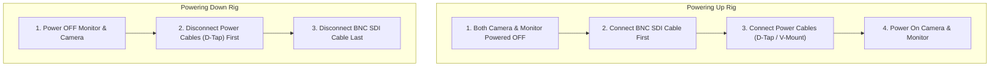

# Technical Prep Bench & Maintenance Protocols
### Babin Rentals Pvt. Ltd. — Quality Control Manual

This manual codifies the physical inspection, testing, and incident logging procedures required for every item entering and exiting the Babin Rentals prep facility at Boudha-6, Kathmandu.

---

## 1. 12G-SDI Ground Loop Protection Protocol (Mandatory)

### 1.1 The Failure Mode
Connecting or disconnecting SDI cables while the camera and external monitor/wireless transmitter are both powered on creates an instantaneous ground potential loop through the coaxial shield. This surges high voltage into the camera’s internal 12G-SDI transceiver IC, instantly destroying the port. 
* **High-Risk Units:** RED Komodo-X, RED Komodo 6K, Sony FX3 (with SDI adapter box), Desview S14-HDR, Accsoon CineView SDI.

### 1.2 The Strict Connection Sequence (Non-Negotiable)

* **Client Handover Warning:** Every rental kit containing an SDI camera and SDI monitor must include the physical **SDI Ground Loop Warning Card** laminated inside the monitor case.

---

## 2. Optical Alignment & Flange Depth (Back-Focus Collimation)

### 2.1 The Issue
Cine lenses (especially the **CHIOPT 28–85mm & 75–250mm Zooms**, **Blazar Mantis Anamorphics**, and **NiSi Athena Primes**) rely on exact flange focal depth ($52.00\text{mm}$ for PL-mount). If an adapter (PL to E, PL to RF) is uncalibrated or loose:
* The zoom becomes non-parfocal (loses focus as you zoom in or out).
* Focus distance markings on the lens barrel will not match physical subject distance.

### 2.2 Bench Calibration Procedure
1. Mount the camera to the studio test bench with the target lens and adapter.
2. Position a Siemens Star focus chart exactly $3.0\text{m}$ from the sensor plane index mark.
3. **Parfocal Verification (Zoom Lenses):**
   * Zoom in to maximum telephoto ($85\text{mm}$ or $250\text{mm}$).
   * Set critical focus using peaking and $10\times$ electronic magnification.
   * Zoom out to wide ($28\text{mm}$ or $75\text{mm}$) with the aperture wide open ($T3.2$).
   * *Pass:* Focus remains razor sharp on the chart center.
   * *Fail:* Image softens. Add or remove shims from the PL adapter before release.

---

## 3. Sensor Sweep & Optical Surface Inspection

### 3.1 Sensor Dust & Micro-Scratch Inspection (The f/22 Test)
Every camera body must undergo an optical sensor sweep prior to dispatch and upon return.
1. Mount a clean, stopped-down prime lens ($f/22$).
2. Aim the camera at the illuminated white test box or uniform studio ceiling.
3. Set ISO to baseline ($800$), pan slowly across the light surface while recording.
4. Review on high-contrast monitor:
   * **Loose Dust:** Clean immediately using an approved sensor bulb blower. If stubborn, use a single wet sensor swab with sensor cleaner fluid.
   * **Permanent Scratches or Coating Flaws:** Immediately flag item as `HOLD` / `MAINTENANCE` and log an incident.

---

## 4. Gimbal Calibration & Motor Health (DJI RS3 / RS4 Pro)

### 4.1 The 45-Degree Rest Test
A poorly balanced camera burns out gimbal brushless motors within hours and causes micro-jitter.
1. Mount camera with target lens, cage, wireless transmitter, and battery.
2. Balance Pitch, Roll, and Pan axes mechanically with motors turned OFF.
3. **The 45° Test:** Tilt the camera to a $45^\circ$ angle along each axis. It must hold its position without dropping or swinging back to center.
4. Turn on motors and run the built-in **Auto Tune**. Verify stiffness scores across all 3 axes are within normal tolerances ($40 - 70$).

---

## 5. Wireless Video & Audio Antenna Integrity

### 5.1 Wireless Video (Accsoon CineView / Hollyland Cosmo)
* **Antenna Serialization:** Antennas are serialized and colour-coded to the base unit.
* **SMA Connector Inspection:** Inspect gold coaxial SMA pins for bending or stripping. Never tighten antennas with pliers—finger-tight only.
* **Channel Sweep:** Perform an RF scan in the prep room to ensure transmitter lock on least congested 5GHz DFS channels.

### 5.2 Audio Systems (DJI Mic / Rode VideoMic)
* Inspect USB-C / Lightning phone adapters.
* Test 3.5mm TRS coiled interconnect cables for crackle or ground hum under tension.
* Verify internal battery charge $\ge 90\%$ before packing.

---

## 6. Incident Management & Severity Classification

When damaged equipment returns or fails on a shoot, staff must immediately create an entry in the **Incident Tracker** according to the following schema:

| Severity | Definition | Examples | Action & Cost Recovery |
| :--- | :--- | :--- | :--- |
| **MINOR** | Cosmetic surface wear, lost lens cap, minor cable strain | Scratched paint on cage, lost rubber eye cup | Deduct replacement cost from deposit (NPR 500–2,000); item stays in `READY`. |
| **MODERATE** | Functional impairment that can be repaired locally | Bent 15mm rod, stripped 1/4"-20 thread, loose HDMI port | Item moved to `PENDING_REPAIR`. Charge client actual repair invoice + 15% handling. |
| **SEVERE** | Core optical or electronic failure requiring factory service | Cracked LCD monitor, scratched cine lens front element, blown 12G-SDI board, motor burnout | Item placed on `HOLD`. Full replacement or factory repair deducted from client guarantee deposit. |
| **WRITTEN_OFF** | Total destruction, saltwater submersion, structural chassis break | Dropped off cliff, vehicle runover, submerged in river | Client billed full landed replacement value in NPR (MSRP + freight + 15% customs + 13% VAT). |

### 6.1 Return Inspection Form Protocol
Every return must cross-reference the outgoing dispatch photo. The return technician must check off:
* [ ] Sensor plane clean (no cleaning swab streaks or dust clusters).
* [ ] Lens front and rear elements free of wiping marks, chips, or haze.
* [ ] Battery contacts dry with zero signs of swelling or deformation.
* [ ] All antennas, thumb screws, baseplates, and proprietary cables accounted for.
