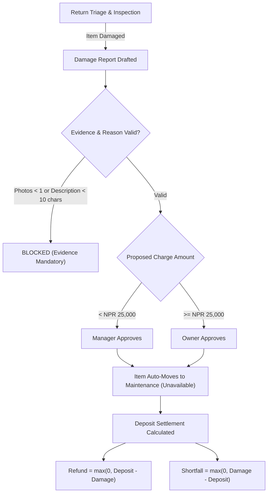

# Babin Rentals OS Architecture & Engine Standards
### Foundation Specification v2.0 Operational Manual

This reference manual documents the architectural foundations, domain engines, and non-negotiable laws governing **Babin Rentals OS** (`c:\Users\use\Desktop\babin-rentals-os`). The Rental Intelligence System (`rentals-intelligence`) must align with these standards when processing quotes, tracking lifecycle transitions, or verifying compliance.

---

## 1. The Core Architectural Laws (§0)

| # | Law | Enforcement Layer | Operational Rule |
| :--- | :--- | :--- | :--- |
| **1** | **Pages never implement business logic** | Domain Engines (`src/lib/`) | UI components and LLM prompts never compute money, dates, or status transitions inline. They call dedicated engines. |
| **2** | **Single Query Rule** | Data Layer (`bookingQuery.ts`) | One canonical booking query serves every surface. Screens never run divergent queries that disagree on state or totals. |
| **3** | **Nothing is deleted** | Database Grants & Triggers | Hard deletes are blocked (`REVOKE DELETE`). Named terminal states only: Cancel, Void, Reverse, Retire, Archive, Deactivate, Close. |
| **4** | **Payments are immutable** | Database Triggers | Payments cannot be updated or deleted. Corrections are ledger reversal rows referencing the original payment ID. |
| **5** | **Deposits are liabilities** | Schema & Financial Engine | Deposits never enter Rental Total, never reduce Outstanding balance, and never count as payments. |
| **6** | **Warehouse sees no money** | PostgreSQL RLS & Views (`_v`) | Warehouse staff cannot view item daily rates, line totals, or invoice figures. Enforced at database level. |
| **7** | **Store AD in UTC** | Schema & Localization (`bs.ts`) | All business dates and timestamps are stored in UTC Anno Domini (AD). Bikram Sambat (BS) is rendered for display only. |
| **8** | **Client UUID on every write** | Unique Constraints | Every mutation carries a client-generated UUID for replay-safe idempotency and offline queue sync. |
| **9** | **Days mandatory on priced lines** | Check Constraint (`days >= 1`) | Every line with a daily rate must have an explicit integer day count. Days can never be omitted or null. |
| **10** | **Discount approval & 25% cap** | Database Trigger & Engine | Discounts $\le 10\%$ are standard. Discounts $> 10\%$ require reason $\ge 10$ chars and a named approver. Hard cap is 25% across all stacked discounts with zero role bypass. |
| **11** | **Never colour alone** | Component Design System | Statuses and alerts must always render Icon + Label + Colour. Ensures readability under greyscale or direct sun. |
| **12** | **Errors inline and persistent** | UI Form Standards | Errors stay next to the input until corrected. Toasts carry successes only. |
| **13** | **No platform branch in layout** | CSS / Primitives | Branch on screen width or capability (e.g. pointer/touch), never on OS or user-agent strings. |
| **14** | **Width decides (768 / 1180)** | Viewport Engine (`useViewport`) | Layouts adapt strictly by width: $< 768$ (phone), $768-1180$ (tablet), $\ge 1180$ (desktop). Never orientation. |
| **15** | **44×44 touch targets** | Design System Tokens | All interactive controls meet the 44×44 px minimum touch boundary across all devices. |
| **16** | **Validated computation before AI** | System Prompt & RIS Gates | AI panels and assistants cannot render recommendations until verified by underlying engine math. |
| **17** | **Strict vocabulary: Clients, never Customers** | Copy / System Standard | The word "customer" is banned across UI, documentation, and notifications. They are strictly **Clients**. |

---

## 2. The Canonical Lifecycle (Six Stages & Four Jobs)

Foundation Specification v2.0 retired the legacy 12-stage workflow in favor of a clean three-layer model:

```mermaid
flowchart TD
    Q["Quote (0)<br/><i>Priced, not committed</i>"] -->|Client confirms + Advance paid| B["Booked (1)<br/><i>Committed & reserved</i>"]
    
    subgraph Operations["Warehouse Operations"]
        B -->|Job: Pack| P["Packed (2)<br/><i>Ready for pickup</i>"]
        P -->|Job: Handover (Sessions)| O["On Rent (3)<br/><i>With the client</i>"]
        O -->|Job: Return (Sessions)| R["Returned (4)<br/><i>Physically checked in</i>"]
        R -->|Job: Reset (Absorbs Cleaning)| A["Item Available for Booking"]
    end
    
    R -->|Financial Gate: Dues cleared & deposit resolved| C["Closed (5)<br/><i>Complete</i>"]
```

### 2.1 The Canonical Six Booking Stages
1. **`Quote` (Order 0, Neutral):** Priced, not committed. Reserves no physical inventory.
2. **`Booked` (Order 1, Primary Blue):** Commercial commitment. Gear reserved, calendar held, serials assigned.
3. **`Packed` (Order 2, Progress Yellow):** Packing complete, sealed in flight cases, ready to leave.
4. **`On Rent` (Order 3, Solid Green):** Gear physically handed over and currently in client possession.
5. **`Returned` (Order 4, Soft Green):** Gear physically received back at Babin Rentals prep facility.
6. **`Closed` (Order 5, Neutral Gray):** Financial ledger reconciled, outstanding balance paid, deposit refunded or adjusted, nothing open.

### 2.2 The Four Operational Jobs
* **`Pack`:** Runs at `Booked`, completion sets `Packed`. Single-run workflow.
* **`Handover`:** Runs at `Packed`, completion sets `On Rent`. Multi-session capable (supports staggered pickups).
* **`Return`:** Runs at `On Rent`, completion sets `Returned`. Multi-session capable (supports partial returns).
* **`Reset`:** Runs at `Returned`. Sets no booking status (blocks the *item* from re-entering Available stock until inspection, testing, and cleaning are complete). **Reset absorbs Cleaning.**

### 2.3 Item State Quantities
Item states are **quantities**, not exclusive statuses:
* `Ready` + `Picked Up` + `Returned` + `Missing` $\equiv$ Total Booked Quantity.
* `Damaged` is a condition flag carried alongside `Returned`, never a separate exclusive quantity bucket.

---

## 3. The Financial Engine (`money.ts`)

### 3.1 Integer Paisa Standard
To prevent floating-point rounding errors and string parsing drift from Postgres `numeric` columns, all monetary figures are stored and calculated as **Integer Paisa** ($1\text{ NPR} = 100\text{ Paisa}$).
* Example: NPR $1,39,506 = 13,950,600\text{ Paisa}$.
* Percentages (VAT, discounts) remain standard floating-point numbers.

### 3.2 Half-Up Rounding & South Asian Grouping
* Rounding rule: **Half-Up applied at each displayed step** (`roundHalfUp(n)`: $-0.5 \rightarrow -1$, $+0.5 \rightarrow +1$).
* Lakh grouping: Custom regex grouping ($1,85,000$, not international $185,000$), independent of browser ICU locale data.

### 3.3 Calculation Sequence
$$\text{Subtotal} = \text{Equipment} + \text{SubRental} + \text{Services} + \text{Crew} + \text{Transport}$$
$$\text{Discount} = \text{round}_{\text{HalfUp}}(\text{Subtotal} \times (\text{Discount}\% / 100))$$
$$\text{Taxable} = \text{Subtotal} - \text{Discount}$$
$$\text{VAT} = \text{round}_{\text{HalfUp}}(\text{Taxable} \times (\text{VAT}\% / 100))$$
$$\text{RentalTotal} = \text{Taxable} + \text{VAT}$$
$$\text{Outstanding} = \text{RentalTotal} - \text{Payments}$$

> **Law 5 Reminder:** Security deposits are liabilities. Deposits **never** enter Rental Total, **never** reduce Outstanding balance, and are **never** recorded as a rental payment.

### 3.4 Foundation §2.8 Reference Case Assertion
Every financial implementation must assert against the official reference booking (`BK-2026-0715`):
* Input: Equipment NPR $1,32,750$ | Discount $7\%$ | VAT $13\%$ | Payments NPR $15,000$.
* **Expected Output:**
  * Discount: `NPR 9,293`
  * Taxable: `NPR 1,23,457`
  * 13% VAT: `NPR 16,049`
  * Rental Total: `NPR 1,39,506`
  * Outstanding: `NPR 1,24,506`

---

## 4. Late Fee Policy Engine (`lateFee.ts`)

### 4.1 Fee Tiers & Day Rate Basis
Late fees are calculated on the full booking daily rate:
$$\text{Day Rate} = \frac{\text{Equipment}}{\text{Days}} + \frac{\text{Crew}}{\text{Days}} + \text{Transport (if billed per-day)}$$
*(Note: Flat transport charges are excluded because flat deliveries do not occur a second time upon late return).*

* **Bands:**
  * $\le 30\text{ minutes}$ overage: Band `None` $\rightarrow$ Fee = `NPR 0` (Grace period).
  * $31\text{ to } 120\text{ minutes}$ overage: Band `Half Day` $\rightarrow$ Fee = $\text{round}_{\text{HalfUp}}(\text{Day Rate} / 2)$.
  * $> 120\text{ minutes}$ ($2\text{ hours}$): Band `Full Day` $\rightarrow$ Fee = $\text{Day Rate} \times \lceil\text{OverageMinutes} / 1440\rceil$.

### 4.2 Late Fee Waiver Protocol
Late fees are **suggestions, never automated charges**. An operator must apply or waive:
* Any staff member may raise a waiver.
* **A Manager or Owner must authorize the waiver.**
* Waiver reason must be at least **10 characters** (`WAIVER_REASON_MIN = 10`).

---

## 5. Damage Findings & Deposit Settlement (`damage.ts`)



* **Replacement Value Rule:** The replacement value is a reference benchmark, never the automatic default charge.
* **Deposit Settlement Formula:**
  $$\text{Refund} = \max(0, \text{Deposit} - \text{Damage})$$
  $$\text{Shortfall} = \max(0, \text{Damage} - \text{Deposit})$$
  *(Shortfalls become separate accounts receivable. Deposit refunds never result in negative numbers).*

---

## 6. Crew Coordination Billing Model (`money.ts:157`)
Babin Rentals operates under **Model A (Recharged Expenses)**:
$$\text{Billed to Client} = \text{Crew Payouts} + \text{Coordination Fee} + \text{Recharged Expenses}$$
* The Coordination Fee is Babin Rentals revenue, never paid to crew members.
* Expenses (meals, travel, hotel, fuel) are billed at cost as a distinct transparent line.
