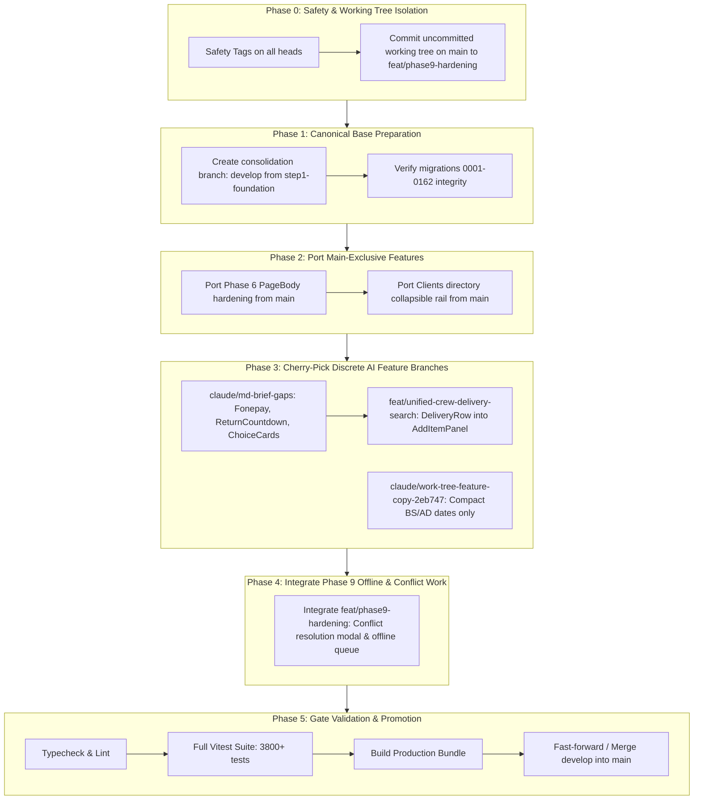

# Babin Rentals OS — Safe Branch Consolidation Plan

**Repository:** `babindulal7/Brv2`  
**Date:** 2026-10-08  
**Mode:** READ-ONLY AUDIT — PROPOSAL ONLY (Requires Owner Approval Before Execution)

---

## 1. Overview & Strategy

The audit revealed that development has split into two major parallel tracks since August 13, 2026 (`10679d9`):
1. **The `main` branch:** Received PageBody 5-state hardening, client collapsible filters, and mock server configs (34 commits, 2117 tests passing), but is missing migrations `0063`–`0158` and carries uncommitted work.
2. **The `step1-foundation` branch:** Received the complete Babin Rentals OS domain architecture, Booqable adoption, dynamic pricing, saved views, and migrations `0001`–`0162` (343 commits).

Attempting a naive `git merge step1-foundation` directly into `main` will cause massive merge conflicts across 1600+ files and trigger a database migration collision on `0159`.

This consolidation plan defines a strictly phased, reversible procedure to merge all unique features into a unified production codebase.

---

## 2. Consolidation Roadmap



---

## 3. Step-by-Step Execution Plan (Once Approved)

### Phase 0: Backup Baseline & Safety Isolation
1. **Create immutable snapshot tags:**
   ```powershell
   git tag snapshot/main-audit-20261008 main
   git tag snapshot/step1-foundation-20261008 step1-foundation
   git tag snapshot/md-brief-gaps-20261008 claude/md-brief-gaps
   git tag snapshot/unified-search-20261008 feat/unified-crew-delivery-search
   ```
2. **Isolate uncommitted changes on `main`:**
   * Create branch `feat/phase9-offline-and-conflict-handling` from `main`.
   * Commit the 20 modified files and 6 untracked conflict resolution files cleanly with descriptive message.
   * `main` working tree is now 100% clean.

### Phase 1: Establish Canonical Development Base
* `step1-foundation` contains the correct database schema (`0001` through `0162`) and 90% of the modern application code.
* Create consolidation staging branch:
  ```powershell
  git checkout -b develop step1-foundation
  ```
* Verify `supabase/migrations/` has exactly 160 files with zero duplicate prefixes.

### Phase 2: Integrate `main`'s Unique Hardening Commits
* Cherry-pick `main`'s 3 unique functional commits onto `develop`:
  * `1fafb77`: *Clients directory: one collapsible filter rail*
  * `49c592e`: *Add launch config for the md-brief-gaps worktree mock server*
  * `d7ca3bc`: *Phase 6: five-state PageBody hardening across remaining screens*
* **Conflict Hotspots:** `src/components/ui/PageBody.tsx`, `src/modules/clients/ClientsDirectory.tsx`.
* **Resolution Strategy:** Favor `d7ca3bc`'s 5-state PageBody enum precedence while preserving `step1-foundation`'s data hooks.

### Phase 3: Cherry-Pick High-Value AI Feature Additions
1. **From `claude/md-brief-gaps` (5 commits):**
   * `82b04a5`: Live return countdown on Today and Booking Detail.
   * `f8f5761`: Fonepay payment method support for Nepal.
   * `d94c424`: Section §4.61 brief gaps.
   * `7388360`: "Create & add another" on `RecordForm.tsx`.
   * `277d80e`: Payment method tap cards (`ChoiceCards.tsx`).
2. **From `feat/unified-crew-delivery-search`:**
   * Extract `DeliveryRow` component and delivery modes from commit `33de1a0` into `src/modules/rentals/booking/AddItemPanel.tsx`.
3. **From `claude/work-tree-feature-copy-2eb747`:**
   * Cherry-pick only commit `5cb1127` (*compact BS/AD dates*). Do NOT merge the whole branch due to the 9 recorded test failures.

### Phase 4: Integrate Phase 9 Conflict & Offline Queue
* Merge `feat/phase9-offline-and-conflict-handling` into `develop`.
* Wires `ConflictNotificationBanner.tsx`, `ConflictResolutionModal.tsx`, `DataAgeBadge.tsx`, and `offlineQueue.test.ts`.

### Phase 5: Verification Gates (Must Pass 100%)
* **Gate 1:** `npm run typecheck` (0 errors).
* **Gate 2:** `npm run test` (all ~3,900 unit and integration tests green).
* **Gate 3:** `npm run build` (production Vite bundle builds cleanly).

### Phase 6: Final Promotion to `main`
* Fast-forward or merge `develop` into `main`.
* Push `main` to the backup remote `origin`.

---

## 4. Branch Disposition Table (Post-Consolidation)

| Branch Name | Disposition Action | Justification |
|---|---|---|
| `main` | **KEEP & UPDATE** | Production release branch |
| `step1-foundation` | **ARCHIVE** (tag `archive/step1-foundation`) | Fully merged into `develop` / `main` |
| `merge/codex-step1-into-main` | **DELETE** | Exact duplicate pointer of `step1-foundation` |
| `claude/extend-rental-labels` | **DELETE** | Strict ancestor of `step1-foundation` |
| `claude/booqable-babin-adoption-spec-de72fa` | **DELETE** | Already merged via commit `9a50931` |
| `claude/modest-neumann-ccc071` | **DELETE** | Strict ancestor of `main`, 0 unique commits |
| `claude/suspicious-wescoff-e2639e` | **DELETE** | Strict ancestor of `main`, 0 unique commits |
| `wip/main-loose-2026-10-08` | **DELETE** | Commits already absorbed in `main` (`79ec345`) |
| `claude/zen-swartz-228eaa` | **ARCHIVE** | Superseded by `step1-foundation`'s RPC settings |
| `claude/md-brief-gaps` | **ARCHIVE** | 5 unique commits cherry-picked into `develop` |
| `feat/unified-crew-delivery-search` | **ARCHIVE** | `DeliveryRow` cherry-picked into `develop` |
| `claude/work-tree-feature-copy-2eb747` | **ARCHIVE** | Date formatting cherry-picked; buggy UI retired |

---

## 5. Rollback & Disaster Recovery Plan

1. If any conflict or regression is detected during consolidation:
   * Reset `develop` to the safe tag:
     ```powershell
     git checkout develop
     git reset --hard snapshot/step1-foundation-20261008
     ```
2. If `main` is affected:
   * Restore `main` from tag:
     ```powershell
     git checkout main
     git reset --hard snapshot/main-audit-20261008
     ```
3. No remote push or destructive operation will be run without prior user verification.
