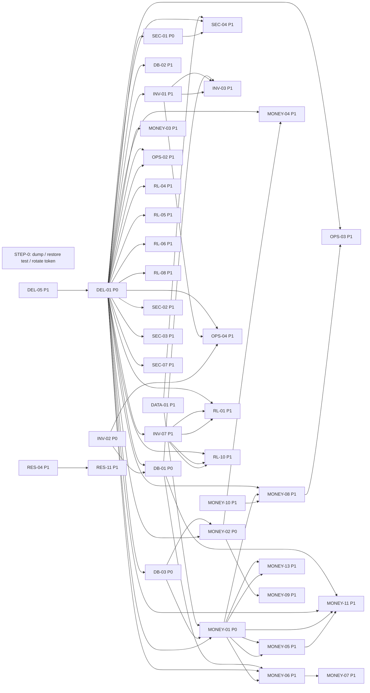

# BABIN RENTALS OS - ISSUE DETECTION + FIX OPTIONS

## Engineering Audit & Remediation Report - 2026-09-05T10:25+05:45

Measured at HEAD `467e7f1` (branch step1-foundation) and against the live Supabase project, read-only. Twelve clusters audited independently; every P0/P1 re-measured by an adversarial refuter; one cross-cluster critic grouped root causes and proposed dependency edges. **Nothing was fixed during this audit** (Spec 2).

Clusters run: architecture, frontend-design, data-connection, database, rental-lifecycle, inventory-availability, money, auth-security, resilience, operations-ux, delivery, forms-interactions

## Final Decision (Spec 37)

**PRODUCTION STATUS: [x] NOT READY  [ ] READY WITH BLOCKERS  [ ] PRODUCTION READY**

> ### Where this stands on 8 September, three days after the audit
>
> The verdict below is unchanged — the project is still NOT READY — but three things have moved,
> and the assessment is left as written rather than quietly restated.
>
> **One P0 is fixed on production.** `DB-01` is closed: `0089` is applied to live, the formatter no
> longer truncates, and R-19 re-pointed the booking counter from 917 to 945. Booking creation works
> again, and every sequence now mints a correct, non-colliding number. `DB-06` went with it — the
> missing `transfer` key exists. **This is the first fix to reach the live project since the ledger
> stopped at `0078` on 1 September.** It took the non-destructive route deliberately: `0085`'s
> renumber of all 246 live bookings was *not* applied, because it is irreversible and no dump exists.
>
> **A time-critical decision is now open.** The first booking created takes `B-946`, and every
> number from 946 upward that Booqable later issues becomes a collision on a UNIQUE column, on rows
> Law 3 forbids deleting. While no booking exists the counter is one reversible `UPDATE`.
> **PLAN §4.48 must be ruled before the first live booking, not after.**
>
> **The migrations are no longer unverifiable.** `npm run check:pglite` applies all 96 migrations
> from scratch into Postgres 18 compiled to WebAssembly, with no Docker and no network: **96 of 96,
> zero failures.** That replaces "never executed" with "builds" for every draft in this report. It
> is not proof for production — PGlite is not a Supabase environment, so RLS and grant behaviour
> proven there is not proven on live, and an empty database cannot reproduce a drift failure that
> depends on production's rows. Six other P0/P1 fixes are written and still unapplied, and the live
> holes they close were re-verified open on 8 September: 26 views still accept `anon` INSERT,
> `invoice_lines` still carries one SELECT-only policy, and `audit_events` still accepts an
> unauthenticated INSERT.

**Reason.** On the live project as it stands, a rental cannot be run end to end. Booking creation works exactly once and then collides (DB-01). Confirm fails for every one of the 204 live products because they are all quantity-tracked and no product-level hold is ever written (INV-02). No invoice can be created, issued, paid against as a Draft, voided or corrected (DB-03, DATA-01, MONEY-01, MONEY-05, MONEY-06, MONEY-07). A payment sync that counts refunds as receipts and never hears about reversals is the only thing that derives what a client owes (MONEY-02). A rental can be handed over, returned and closed with nothing invoiced, the deposit still held and a damage finding unbilled, because all three close gates test the wrong predicate (MONEY-13, RL-05, RL-06). There is no cancel, extend or reopen (RL-01, RL-10, RL-04). Anyone holding the public anon key, which ships in the browser bundle, can insert rows into 23 tables and any staff session can update or delete every row of them through the masking views, past RLS (SEC-01). Every fix written since 2 September is frozen in the tree because PHASE-0 Step 0 has not been done, and the project sits on the Free tier with no verified dump and no PITR (DEL-01).

**P0 Issues (7):** DEL-01 Step 0 undone · SEC-01 writable masking views · DB-01 numbering truncates and collides · INV-02 Confirm impossible for quantity products · DB-03 invoice_lines unwritable and invoice contract contradicts R-05/R-15 · MONEY-01 no invoice can be raised · MONEY-02 payment sync wrong on refund, reversal and Draft.

**P1 Issues (41):** the money lifecycle after creation (MONEY-03 trigger vs engine, MONEY-04 outstanding formulas, MONEY-05 Draft cannot take a payment, MONEY-06 nothing issues, MONEY-07 void unbuildable, MONEY-08 return charges never reach the bill, MONEY-09 refund stub, MONEY-10 deposits have no write path, MONEY-11 quote is not the booking, MONEY-13 vacuous outstanding, DATA-01 createInvoice refused by column grants); the lifecycle verbs (RL-01 cancel, RL-04 reopen, RL-05 deposit gate, RL-06 damage gate, RL-08 handover gate pre-R-06, RL-09 verbs report what they did not do, RL-10 extend, RL-11 still-expected line is terminal); inventory (INV-01 two unlinked assignment tables, INV-03 D5 unwired, INV-05 reserve reports success on nothing, INV-07 holds never released); security (SEC-02 forgeable audit rows, SEC-03 Warehouse rewrites prices, SEC-04 15 money tables unarmed, SEC-07 no staff administration, DB-02 stage directly writable); resilience (RES-01 N rows queue one, RES-02 syncing rows stranded, RES-04 dead letters invisible, RES-06 offline premise fails at login, RES-11 replay under the wrong operator); delivery (DEL-02 no test reaches a database, DEL-05 Booqable token unrotated); the floor (OPS-02 no evidence path, OPS-03 late fee recorded nowhere, OPS-04 damage becomes prose); data (DATA-04 fixture names refused live); forms (FORMS-01 duplicate payment by dismissing a modal); the scanner (FE-01 ticks anything scanned).

**Required fixes, in the order the dependency graph allows.**

1. **Step 0** (DEL-01, Option B): live `pg_dump` to a path outside the repo, restore drill into a scratch database with row-count assertions, Booqable token rotated (DEL-05). Nothing below may run before this.
2. **Close the public write hole** (SEC-01, Option B): revoke INSERT/UPDATE/DELETE on every `_v` view from anon and authenticated, then revoke the platform default privileges from anon and re-grant only what login and the portal need. One migration, no application change.
3. **Numbering** (DB-01, patched per DB-13). **Corrected 7 September — the order and the value this report first gave were both wrong, proven by a per-migration dry run and re-verified here.** Apply in filename order: **0085, then 0088, then 0089**, with 0085 committing in its own earlier transaction. 0088 raises unless 0085 ran first (it guards on `bookings_booking_no_is_digits`, which 0085 creates), and 0089 applied alone computes its next mints as `B-918`/`B-919`, finds both already in `bookings`, and raises. 0085 must commit separately because a non-concurrent `CREATE INDEX` scans with SnapshotAny and would index 0085's own recently-dead rows. **The next mint is 900, not 946**: 0085 moves the 46 seed bookings out of the 900-945 band first, then points the counter at 899, the highest real imported booking. Whether the OS should instead resume at 946 while Booqable is still issuing is open as PLAN §4.48 and is a one-token change if ruled. Mint a booking to verify, never assert the counter. **Note before pressing it:** 0085 renumbers all 246 live bookings from `B-<n>` to bare digits, changing the identity already printed on client paper — that is irreversible in the way that matters, so get §4.48 ruled and the dump taken first.
4. **Invoice write contract** (DB-03 Option B and DATA-01 Option B agree): apply 0086, then add `create_invoice(payload)` as an invoker-rights RPC in the `create_booking` mould so the draft snapshot reads the money columns server-side and lands header and lines in one transaction.
5. **Payment state** (MONEY-02, Option A): apply 0080 then 0087, with the pgTAP scenario that a refund lowers nothing, a reversal lowers `paid_amount`, and a Draft stays Draft.
6. **Wire invoicing** (MONEY-01, Option A): rule PLAN §4.46 as "the invoice bills the booking" (R-03 already says so), turn CreateInvoiceModal into a preview of what `createInvoice` will write, dispatch it.
7. **Quantity holds** (INV-02, Option A): split lines by `tracking_mode`, plan quantity lines with a pure capacity function in `lib/availability.ts`, write product-level `inventory_reservations` rows; the live capacity trigger and the GiST index on (product_id, period) are the arbiter.

Then Phase 2 in the roadmap's order, starting with the gates (MONEY-13, RL-05, RL-06), the grant contract (DB-02, SEC-03, SEC-04), cancel plus hold release (RL-01, INV-07) and the offline queue (RES-01, RES-02, RES-04, RES-05, RES-11).

**Recommended architecture.** Every state-changing verb becomes a server-owned function in the shape `create_booking` already has: `confirm_booking`, `cancel_booking`, `amend_booking_window`, `complete_floor_session`, `create_invoice`, `issue_invoice`, `void_invoice`, `post_charge_to_invoice`, `reverse_booking_stage`. The browser dispatches and reads back; it never sequences multi-table writes. One grant contract replaces the inert column REVOKEs: platform defaults revoked, read and write masking derived from a single Law 6 registry and asserted by `check:rebuild`. One availability engine over `inventory_reservations` serves both tracking modes, with `booking_line_units` demoted to a link. Money is owned by `lib/money.ts` with the trigger proven equal to it by pgTAP on the reference cases. The RBAC mirror becomes a generated, tested artifact. A test lane that reaches a real database joins the engine suite.

**Estimated fix scope.** Phase 1 is seven items: six rated MEDIUM effort and one LOW by their recommended options, touching about ten migrations (the ten drafts, three of them patched, plus three new), three RPCs, two actions, and three screens. Phase 2 is forty-one items, most LOW or MEDIUM, dominated by the nine server-owned verbs above and the offline queue rework. Phases 3 and 4 are 99 items of duplication, fixture removal, accessibility and cleanup that carry no loss path.

## Final Issue Summary (Spec 34)

| Severity | Count |
|---|---|
| P0 | 7 |
| P1 | 41 |
| P2 | 70 |
| P3 | 25 |
| P4 | 6 |
| **Total** | **149** |

Filed before refutation: 172 - refuted and withdrawn: 0 - merged as duplicates: 23

**By status:** CONFIRMED BUG 25 - PARTIAL IMPLEMENTATION 16 - DATA INTEGRITY RISK 14 - DISCONNECTED IMPLEMENTATION 12 - SECURITY RISK 12 - ARCHITECTURAL PROBLEM 11 - MISSING FEATURE 11 - MOCK IMPLEMENTATION 9 - TECHNICAL DEBT 9 - UX PROBLEM 9 - DEPLOYMENT PROBLEM 7 - TESTING GAP 4 - ACCESSIBILITY PROBLEM 4 - DUPLICATED IMPLEMENTATION 3 - PERFORMANCE PROBLEM 3

**By cluster:** architecture 14 - auth-security 9 - data-connection 13 - database 13 - delivery 11 - forms-interactions 18 - frontend-design 13 - inventory-availability 12 - money 15 - operations-ux 7 - rental-lifecycle 12 - resilience 12

**By current status:** UNTOUCHED 125 - DRAFTED_UNAPPLIED 13 - FIXED_IN_TREE 8 - FIXED_ON_LIVE 2 - UNKNOWN 1

## Top 10 Issues (Spec 35)

1. **DEL-01 - Written but not applied; Step 0 undone.** Why it matters: 38 issues in ten clusters depend on it and twelve drafted fixes cannot land; a mistaken write or a Free-tier pause has no recovery. Fix: Option B, Step 0 plus a mechanical pre-apply gate (dump, restore drill, row counts). Effort: MEDIUM. Production impact: nothing else in this report can reach live until it is done.
2. **SEC-01 - Every masking view is writable by anon and authenticated.** Why: the public anon key in the bundle inserts into 23 tables and any staff JWT updates or deletes every row of them, bypassing RLS and Law 3. Fix: Option B, revoke view DML then the platform defaults from anon. Effort: MEDIUM. Impact: a live write-integrity hole today, independent of transactions.
3. **DB-01 - next_document_number truncates and the counter sits in the seed block.** Why: the first live booking is minted `B-9`, the second collides; clients, invoices and deposits share the defect. Fix: apply **0085, 0088, 0089 in that order** (corrected 7 Sep — this report first gave the reverse, which raises), 0085 committing separately; the next mint is 900, and 946 is an open question in PLAN §4.48, not a fix. Mint to verify, never assert the counter. Effort: MEDIUM. Impact: booking creation is unusable — and 0085 renumbers all 246 live bookings to bare digits, so the dump and the §4.48 ruling come first.
4. **INV-02 - Confirm impossible for every live product.** Why: all 204 are quantity-tracked and no product hold is ever written, so Confirm refuses every booking once numbering works. Fix: Option A, plan and write product-level holds in the existing app path. Effort: MEDIUM. Impact: no booking can be confirmed on live.
5. **MONEY-01 with DB-03 and DATA-01 - No invoice can be raised.** Why: the modal refuses, the policy refuses, and the action's money reads are refused by column grants; three independent blockers on one path. Fix: 0086, a `create_invoice` RPC, and the modal wired as a preview. Effort: MEDIUM. Impact: no billing at all.
6. **MONEY-02 with MONEY-04 - Payment state derived wrongly.** Why: a refund raises `paid_amount`, a reversal never re-syncs, the first payment ejects a Draft, and two live formulas disagree about overpayment. Fix: 0080 then 0087 with pgTAP, and one owning function for outstanding. Effort: LOW then MEDIUM. Impact: what a client owes is wrong after the first correction.
7. **MONEY-13, RL-05, RL-06 - The close and handover gates test the wrong thing.** Why: `outstanding = 0` is true for an unbilled rental, "deposit resolved" means collected, and the damage gate is hardcoded to zero. Fix: Option A on each, three small predicate corrections with an Owner override for zero-value jobs. Effort: LOW. Impact: rentals close unbilled, deposits are kept, damage goes uncharged.
8. **RL-01 with INV-07 - No cancel, and holds are never released.** Why: a confirmed booking's gear stays blocked until its return date whatever happens. Fix: Option B, a `cancel_booking` function plus the two release triggers 0003 declared. Effort: MEDIUM. Impact: wrong availability on every surface after any cancel or early return.
9. **DB-02, SEC-03, SEC-04 - The grant contract is implicit and the column REVOKEs are inert.** Why: stage and closed_at are writable by every desk role, a Warehouse session rewrites prices it cannot read, and 15 money tables still expose money to money-blind roles. Fix: 0062's pattern for UPDATE, 0092 amended, and a registry-driven arming asserted in `check:rebuild`. Effort: LOW to MEDIUM. Impact: forward-only transitions and Law 6 are both bypassable today.
10. **RES-01, RES-02, RES-04, RES-05, RES-11 - The offline queue loses floor work silently.** Why: N rows queue as one, in-flight rows strand on reload, dead letters after 100 seconds and are invisible, verbs report success for queued writes, and replay runs under whoever is signed in. Fix: Option A on each, all in `dataAccess`, `offlineQueue` and `floorVerb`. Effort: LOW to MEDIUM. Impact: the product's one premise, floor work without signal, does not hold.

## Issue Prioritization (Spec 26)

| # | ID | Issue | Sev | Status | Current | Business Impact | Root Cause | Recommended Fix | Effort | Blocker |
|---|---|---|---|---|---|---|---|---|---|---|
| 1 | INV-02 | Confirm is impossible for every Quantity- or Consumable-tracked produc... | P0 | PARTIAL IMPLEMENTATION | FIXED_IN_TREE | Cine Sewa's live catalogue is entirely quantity-tracked today (cables, stands, gels, every bulk SKU), so no bo... | SYMPTOM: once P0-4 is unblocked, every Confirm on live fails with 'cannot be confirmed: not every line has uni... | A: Plan and write product-level holds in the existing app path | MEDIUM | YES |
| 2 | DEL-01 | Written but not applied — PHASE-0 Step 0 (live dump, restore drill, to... | P0 | DEPLOYMENT PROBLEM | UNTOUCHED | On a rental day at Cine Sewa the OS cannot create a booking (B-918 collides), cannot raise or pay an invoice, ... | SYMPTOM: every cluster reports DRAFTED_UNAPPLIED; booking creation on live has been bricked since the seed blo... | B: Step 0 plus a mechanical pre-apply gate | MEDIUM | YES |
| 3 | DB-03 | invoice_lines has only a SELECT policy and invoices' NOT NULLs and rol... | P0 | CONFIRMED BUG | DRAFTED_UNAPPLIED | No rental can be billed; the day ends with rental value uncollected and no tax invoice. When 0086 lands withou... | SYMPTOM: no invoice can be written. TRACE: 0011 wrote a SELECT-only policy set for invoice_lines when no write... | B: 0086 plus a create_invoice RPC in the create_booking mould | MEDIUM | YES |
| 4 | MONEY-01 | No invoice can be raised: createInvoice is drafted but unwired (PLAN §... | P0 | DISCONNECTED IMPLEMENTATION | FIXED_IN_TREE | Cine Sewa cannot bill a single rental from this system; every rupee of revenue is tracked outside it; nothing ... | SYMPTOM: Finance offers Create Invoice, pressing it refuses; live holds 0 invoices. TRACE: the modal was built... | A: Rule §4.46(a) and wire the modal as a preview of the booking... | MEDIUM | YES |
| 5 | MONEY-02 | sync_payment_to_invoice: a Refund raises paid_amount, a reversal never... | P0 | CONFIRMED BUG | DRAFTED_UNAPPLIED | After the first refund or reversal Finance says the client has paid more than they have; the close gate (which... | SYMPTOM: an invoice would read Paid after a refund, or after its only payment was reversed. TRACE: 0010 wrote ... | A: Apply 0080 then 0087 (or 0087 alone) after Step 0, with a pg... | LOW | YES |
| 6 | SEC-01 | Every `_v` masking view is an owner-privilege, auto-updatable view wit... | P0 | SECURITY RISK | DRAFTED_UNAPPLIED | Anyone who opens the app and copies the anon key from the bundle can insert products, clients, cases, purchase... | SYMPTOM: the masking views accept writes from the public API roles. TRACE: 0019 chose definer-rights views so ... | B: A plus platform-grant discipline | MEDIUM | YES |
| 7 | DB-01 | next_document_number truncates every padding-1 sequence through lpad, ... | P0 | CONFIRMED BUG | FIXED_ON_LIVE | On a rental day the first walk-in client saves as C-7 and the next Add Client fails; the first OS-created book... | SYMPTOM: the first new client or booking saves under a one-digit number and every one after fails with a uniqu... | B: 0085 + 0088 as ruled, with step 7 corrected | MEDIUM | YES |
| 8 | DATA-01 | createInvoice reads money columns from column-armed base tables and is... | P1 | CONFIRMED BUG | DRAFTED_UNAPPLIED | On the day §4.46 is answered and the Create Invoice button is wired, the Owner's first invoice at Cine Sewa fa... | SYMPTOM: an invoice action that would fail with a permissions error the first time it is wired. TRACE: migrati... | B: Server-side draft snapshot RPC | MEDIUM | YES |
| 9 | DATA-04 | Write-live inventory forms pick warehouses, categories and models from... | P1 | CONFIRMED BUG | UNTOUCHED | On the live project no serialised equipment can be added (a warehouse is required and none of the offered ones... | SYMPTOM: every inventory create on live ends in an honest refusal naming a fixture string. TRACE: the forms we... | B: One reference-data module, fixtures reduced to types | HIGH | YES |
| 10 | DEL-02 | No automated test reaches a database — 118 suites replace the Supabase... | P1 | TESTING GAP | UNTOUCHED | Money and gate rules that live in triggers (invoice totals, payment sync, forward-only stages, handover gate) ... | SYMPTOM: the counter collision at 917, the invoice_lines write refusal, the refund that raises paid_amount and... | B: A plus a Playwright journey against dev:local | HIGH | YES |
| 11 | DEL-05 | The Booqable API token still lives in pre-scrub archives on this machi... | P1 | SECURITY RISK | UNTOUCHED | Anyone with a copy of this workspace or its backups can read and change Cine Sewa's orders, clients and paymen... | SYMPTOM: PHASE-0 Step 0.5 and QA_FIX_PLAN.md:35 still read 'rotate'. TRACE: the 2 Sep scrub rewrote commits 25... | B: A plus a secret scan and snapshot hygiene | LOW | YES |
| 12 | FE-01 | Global scanner fabricates a ticked item on every scan | P1 | MOCK IMPLEMENTATION | UNTOUCHED | On a rental day a packer working from the FAB scanner can 'tick' every item on the list, including one that is... | SYMPTOM: a packer scanning a serial that belongs to another booking hears the success tone and reads '— ticked... | B: Build the scan resolver and give the FAB the workspace contr... | HIGH | YES |
| 13 | FORMS-01 | Money modals can be dismissed mid-submit by Escape, backdrop or ×, and... | P1 | DATA INTEGRITY RISK | UNTOUCHED | On a rental day at the desk, a Coordinator taking an advance on a slow connection who presses Escape (or taps ... | SYMPTOM: a payment or expense can be recorded twice after a dismissed submit. TRACE: the busy state lives in e... | B: Undismissable while busy plus attempt-scoped key owned by th... | MEDIUM | YES |
| 14 | INV-01 | Reservation and floor assignment are two unlinked tables: Confirm writ... | P1 | ARCHITECTURAL PROBLEM | UNTOUCHED | On a shoot day at Cine Sewa the coordinator confirms the job and the database genuinely holds the camera bodie... | SYMPTOM: a booking the app confirms is 'Booked — gear reserved, serials assigned' (workflow.ts:45) yet arrives... | B: Server-side confirm_booking function plus a reservation link... | HIGH | YES |
| 15 | INV-05 | reserveAssignedUnits reports success on the two insert branches that w... | P1 | CONFIRMED BUG | FIXED_IN_TREE | A confirmed job sits on the calendar with no body actually held; a second coordinator's Confirm takes the unit... | SYMPTOM: a Booked booking with fewer live holds than lines. TRACE: the reserve loop trusts a null error from a... | A: Exact-count and read-back check in the reservation writer | LOW | YES |
| 16 | INV-07 | A hold has exactly one lifecycle verb: nothing releases inventory_rese... | P1 | MISSING FEATURE | UNTOUCHED | When a client cancels, the bodies stay held for the whole window and the next coordinator is told they are tak... | SYMPTOM: gear stays blocked after a cancel or an early return. TRACE: no caller of releaseReservations outside... | A: Database triggers on bookings.cancelled_at and actual_return... | MEDIUM | YES |
| 17 | MONEY-03 | The invoice trigger and the pricing engine disagree: 2 dp + hardcoded ... | P1 | CONFIRMED BUG | DRAFTED_UNAPPLIED | Every tax invoice's VAT line on the IRD return is off by paisa against what the client was shown; totals do no... | SYMPTOM: the printed invoice (engine) and the stored row (trigger) differ by up to a rupee and the VAT line by... | A: Write 0081_invoice_totals_match_engine per SPEC-P0-1 §2.2, a... | MEDIUM | YES |
| 18 | MONEY-04 | Eleven independent 'outstanding' formulas, and the two in the database... | P1 | DATA INTEGRITY RISK | UNTOUCHED | A client who overpays by a round amount loses the credit from every screen and, at return, the damage charge c... | SYMPTOM: an overpayment is invisible on one path and a hard error on another; a void or a refund distorts the ... | A: Rule overpayment as a visible client credit and make one fun... | MEDIUM | YES |
| 19 | MONEY-05 | A Draft invoice cannot receive a payment from the Record Payment modal... | P1 | PARTIAL IMPLEMENTATION | FIXED_IN_TREE | An advance at booking or handover — R-06's whole premise — cannot be posted; the handover warning would fire o... | SYMPTOM: the advance SPEC-P0-1 §5 expects against a Draft cannot be recorded. TRACE: recordPayment was widened... | A: Pass the uuid through and dispatch invoiceId | LOW | YES |
| 20 | MONEY-13 | 'Outstanding = 0' is vacuously true for a rental that was never billed... | P1 | DATA INTEGRITY RISK | FIXED_IN_TREE | A rental can be handed over, returned and closed with nothing ever invoiced — revenue lost silently, and Close... | SYMPTOM: rentals can close unbilled. TRACE: the gates were written as sums with coalesce, assuming an invoice ... | A: Require an issued invoice before 'outstanding = 0' counts, w... | LOW | YES |
| 21 | OPS-02 | No evidence path exists end to end: no storage bucket on live, no uplo... | P1 | PARTIAL IMPLEMENTATION | UNTOUCHED | A camera goes out in worse condition than it came back and Cine Sewa has no photo to show the client; a Rs 25,... | SYMPTOM: gates go green with no photo; disputes have no evidence; the Evidence page is dead for every real boo... | B: Capture-first sessions: open the operation session at worksp... | HIGH | YES |
| 22 | OPS-04 | Damage recorded at Return on live becomes prose in operation_sessions.... | P1 | PARTIAL IMPLEMENTATION | UNTOUCHED | On today's live data a returned lens marked Damaged with a written description cannot be charged: the descript... | SYMPTOM: a Damaged return on live produces no finding and no charge. TRACE: the writer exists and is unit-keye... | A: Make quantity-line damage representable and write it | MEDIUM | YES |
| 23 | RES-01 | One floor action updating N rows offline queues only the first row and... | P1 | CONFIRMED BUG | UNTOUCHED | On a tablet that drops signal mid-return, a 6-unit return records one unit back; the other five stay 'out' on ... | SYMPTOM: a multi-unit Return or Reset captured offline lands with one unit changed. TRACE: the outbox's unit o... | A: Per-row envelope key and propagated result | LOW | YES |
| 24 | RES-02 | A mutation marked 'syncing' when the tab dies is never selected again ... | P1 | CONFIRMED BUG | UNTOUCHED | A warehouse tablet that reconnects, starts draining and is closed by the operator (the normal end of a shift) ... | SYMPTOM: queued floor work vanishes after a reload during sync. TRACE: the in-flight marker is persisted to In... | A: Recover stale in-flight rows | LOW | YES |
| 25 | RES-04 | Replay has no backoff, dead-letters after about 100 seconds of any out... | P1 | CONFIRMED BUG | UNTOUCHED | A Supabase Free-tier pause, a tower outage or the 8-second statement timeout on a busy afternoon converts a sh... | SYMPTOM: queued work disappears after a couple of minutes of bad signal and the app reports everything synced.... | A: Classify, back off, count, and route a review | MEDIUM | YES |
| 26 | RES-06 | With a persisted session but no signal the app routes to /login, and n... | P1 | PARTIAL IMPLEMENTATION | UNTOUCHED | The single premise of the product — floor work with no signal — does not hold: an operator in the dead zone se... | SYMPTOM: the warehouse tablet cannot open the app in the dead zone. TRACE: identity resolution is a network re... | B: On-device database with role-projected pull | HIGH | YES |
| 27 | RES-11 | A queued mutation replays under whichever operator is signed in: live ... | P1 | DATA INTEGRITY RISK | UNTOUCHED | Gear that physically came back is recorded as still out on every desk surface, the deposit conversation cannot... | SYMPTOM: after a shift handover on a shared tablet, a return recorded before the handover leaves the booking O... | A: Author on every envelope, drain only the author's rows, show... | LOW | YES |
| 28 | RL-01 | No cancel path: cancelRental is a stub, nothing writes cancelled_at, a... | P1 | MISSING FEATURE | UNTOUCHED | On a rental day at Cine Sewa a client who calls off a shoot cannot be cancelled: the booking keeps its stage, ... | SYMPTOM: an operator cannot cancel a booking anywhere in the product, and a confirmed booking's units stay hel... | B: cancel_booking() server function plus the two missing trigge... | MEDIUM | YES |
| 29 | RL-05 | The Close gate's 'deposit resolved' tests uncollected deposit (pending... | P1 | CONFIRMED BUG | FIXED_IN_TREE | Law 5: the deposit is the client's money. A rental closed with the deposit still held disappears from every op... | SYMPTOM: Close will pass on a booking whose deposit is still held. TRACE: the deposit table exposes one derive... | A: Correct the predicate in both gates | LOW | YES |
| 30 | RL-08 | The live handover gate is the pre-R-06 hard block; 0090 (warn with a n... | P1 | DEPLOYMENT PROBLEM | DRAFTED_UNAPPLIED | On the day invoicing goes live, every booking that receives a Draft invoice before pickup cannot be handed ove... | SYMPTOM: R-06 is unimplemented on production and the app's override plumbing is dead against it. TRACE: 0090 w... | B: Evaluate the money gates inside apply_booking_stage_transiti... | MEDIUM | YES |
| 31 | RL-09 | Floor verbs seal the session and flip unit states before the stage mov... | P1 | ARCHITECTURAL PROBLEM | UNTOUCHED | A Warehouse operator completes a handover on a tablet whose clock is two minutes behind the desk that confirme... | SYMPTOM: the operator is told gear is On Rent (or the booking Packed) while bookings.stage did not move, and a... | B: complete_floor_session() server function | VERY HIGH | YES |
| 32 | RL-10 | No extend, reschedule or edit-after-Booked path: extendRental is a stu... | P1 | MISSING FEATURE | UNTOUCHED | A shoot overruns by two days: the desk cannot extend, so either the booking is left On Rent past return_at (Ov... | SYMPTOM: a rental cannot be extended, moved or amended after Confirm. TRACE: the correction verbs were scaffol... | B: amend_booking_window() server function shared by extend and ... | HIGH | YES |
| 33 | RL-11 | A line declared Not Returned with decision 'Still expected' is termina... | P1 | CONFIRMED BUG | UNTOUCHED | A client brings back four of five lights and says the fifth is at the studio and will come tomorrow: the opera... | SYMPTOM: gear that is still with the client is recorded as a completed return. TRACE: the terminal set was wri... | A: Terminality reads the decision | LOW | YES |
| 34 | SEC-02 | `audit_events_insert` is `WITH CHECK (true)` to PUBLIC and `anon` hold... | P1 | SECURITY RISK | DRAFTED_UNAPPLIED | A dispute over who approved a discount, who released a deposit or who overrode a handover gate rests on `audit... | SYMPTOM: forged audit rows from an unauthenticated caller. TRACE: 0011 created the policy with no `TO` clause ... | A: Apply 0091 as drafted | LOW | YES |
| 35 | SEC-03 | Law 6 governs SELECT only — a Warehouse session can rewrite `products.... | P1 | SECURITY RISK | DRAFTED_UNAPPLIED | Every future quote for that product prices at Rs 1 a day and no screen says so, because the pricing engine rea... | SYMPTOM: money-blind role writes money. TRACE: every browser session is the same Postgres role `authenticated`... | A: Apply 0092 amended per X-10 | LOW | YES |
| 36 | SEC-07 | Staff administration has no database path and only one identity can si... | P1 | MISSING FEATURE | UNTOUCHED | A warehouse tablet cannot be given its own login without someone running SQL as postgres and creating the auth... | SYMPTOM: nobody but the Owner can sign in and no one can be added. TRACE: 0020 added the self-scoped SELECT as... | B: `users_manage` policy plus a `staff-invite` Edge Function | HIGH | YES |
| 37 | DB-02 | bookings.stage, closed_at and booking_no remain directly writable by e... | P1 | DATA INTEGRITY RISK | DRAFTED_UNAPPLIED | A warehouse tablet can close a booking with money owing, reopen a Closed booking by clearing closed_at without... | SYMPTOM: forward-only transitions can be bypassed and a booking can be inserted Closed. TRACE: 0021 issued a c... | A: Revoke table-level UPDATE/INSERT and re-grant column lists (... | LOW | YES |
| 38 | SEC-04 | Law 6 read masking is armed on 9 tables; 15 view-backed money tables s... | P1 | SECURITY RISK | UNTOUCHED | On a warehouse tablet the raw REST endpoint shows a Warehouse or Driver user the crew day rates, client credit... | SYMPTOM: a money-blind role can read money from the base table. TRACE: 0019 revoked SELECT on money columns; 0... | B: A plus an invariant and a lint | MEDIUM | YES |
| 39 | RL-06 | The damage-charge close gate is hardcoded to 0 while damage_findings a... | P1 | PARTIAL IMPLEMENTATION | FIXED_IN_TREE | A camera comes back damaged at Return, the finding is recorded, the Manager has not yet approved the Rs charge... | SYMPTOM: a rental with an unapproved damage finding can be closed and the charge is never raised. TRACE: close... | A: Read the findings through their parents, and add both branch... | LOW | YES |
| 40 | MONEY-09 | The refund path is a stub with two contradictory schema homes and no r... | P1 | PARTIAL IMPLEMENTATION | UNTOUCHED | A client refund is off-book; a wrong payment cannot be corrected; if the bridge writes a Refund row, paid_amou... | SYMPTOM: money cannot leave the till through the system. TRACE: the schema offers two representations (0006's ... | A: Rule 'a refund is a payment_reversals row', retire payments.... | MEDIUM | YES |
| 41 | MONEY-10 | Security deposits (Law 5) have no write path, and 'deposit resolved' m... | P1 | MISSING FEATURE | UNTOUCHED | The only cover against damage and non-return is never recorded; a client's Rs 50,000 deposit is either held fo... | SYMPTOM: deposits exist only as bookings.deposit_required; nothing is ever received, applied or refunded, and ... | A: Build the deposit lifecycle on the existing schema and defin... | HIGH | YES |
| 42 | MONEY-08 | Return-time charges have no way onto the Draft (R-03): no addInvoiceLi... | P1 | MISSING FEATURE | UNTOUCHED | Every damaged, missing or late return is billed at zero; because the deposit cannot be applied either (MONEY-1... | SYMPTOM: damage and late fees never reach the bill. TRACE: the schema models finding → charge → line; the floo... | A: Complete finding → charge → line on the existing model | HIGH | YES |
| 43 | OPS-03 | A late return is computed and announced on the Return screen and then ... | P1 | MISSING FEATURE | UNTOUCHED | Every late return at Cine Sewa is free. A kit due back at 06:00 returned at 14:00 is eight hours over (Full Da... | SYMPTOM: late fees are never billed; the floor tells the operator a day is chargeable and the ledger never hea... | B: Database-owned: trigger on bookings.actual_return_at mints t... | MEDIUM | YES |
| 44 | RL-04 | Reopen (R-09/R-16) is unbuilt, and the reversal path it would ride let... | P1 | DATA INTEGRITY RISK | UNTOUCHED | Once rentals start closing, a booking closed by mistake (forgotten damage charge, wrong deposit release) canno... | SYMPTOM: a closed rental cannot be reopened through the product, and the database will accept a three-stage re... | B: reverse_booking_stage() function owns approval, audit and th... | MEDIUM | YES |
| 45 | INV-03 | D5 creation-time serial assignment is unwired: planCreationUnits has z... | P1 | DISCONNECTED IMPLEMENTATION | UNTOUCHED | The removable serial-chip workflow staff use in Booqable today (spec §10.2) does not exist here; a coordinator... | SYMPTOM: no serial chip on any app-created booking. TRACE: the plan (availability.ts:554) and the RPC branch (... | A: Call the existing plan from New Rental's submit | LOW | YES |
| 46 | MONEY-06 | Nothing issues an invoice: no issueInvoice action, so invoice_no is ne... | P1 | MISSING FEATURE | UNTOUCHED | No numbered tax invoice ever exists: no IRD-compliant document, no receipt, no enforceable receivable; the clo... | SYMPTOM: an invoice can (once MONEY-01 lands) be created and paid but never becomes a tax invoice. TRACE: R-02... | A: issueInvoice action over an atomic issue_invoice(uuid) RPC | MEDIUM | YES |
| 47 | MONEY-07 | Void + Credit Note (R-04) is unbuildable: no voidInvoice action, no cr... | P1 | MISSING FEATURE | UNTOUCHED | Any invoicing mistake after issue is permanent; the only workaround is database surgery, which the immutabilit... | SYMPTOM: an issued invoice with a wrong figure can never be corrected. TRACE: R-04 rules the mechanism and 000... | A: Credit-note sequence, void_invoice RPC, voidInvoice action, ... | MEDIUM | YES |
| 48 | MONEY-11 | The quote the client agrees to is not the booking stored and not the i... | P1 | CONFIRMED BUG | UNTOUCHED | The client is quoted one total and invoiced another; a line discount agreed at the counter vanishes; an advanc... | SYMPTOM: three numbers for one rental. TRACE: the page computes with inputs it never persists; the engine and ... | A: Persist every priced input and move the line rule into the e... | MEDIUM | YES |
| 49 | ARCH-01 | Three private stage-to-colour maps still carry the v4.0 palette: On Re... | P2 | CONFIRMED BUG | UNTOUCHED | On a rental day an operator scanning the Today timeline or the Rentals list reads green as 'home and ready' (t... | SYMPTOM: the same booking is green in the Rentals progress dot, the Today timeline dot and the Booking Detail ... | B: One status rendering surface, lint-enforced | MEDIUM | NO |
| 50 | ARCH-03 | The four floor workspaces are clones carrying private copies of engine... | P2 | ARCHITECTURAL PROBLEM | UNTOUCHED | A partial handover that the database recorded as In Progress can read as Complete on one screen and In Progres... | SYMPTOM: the same booking can show a different day count, a different BS cell and a different job-state chip d... | B: A shared floor layer: useFloorBooking hook and FloorHeader c... | MEDIUM | NO |
| 51 | ARCH-04 | A line's net amount is computed in three places with two different rul... | P2 | ARCHITECTURAL PROBLEM | UNTOUCHED | The line amounts an operator sees while building a rental are computed by the page; the invoice is computed by... | SYMPTOM: three formulas, two rules, and a page-level number the database never receives. TRACE: money.ts `pric... | A: One lineNet primitive in lib/money.ts, called everywhere | LOW | NO |
| 52 | ARCH-05 | Law 2's canonical booking query is still dead: fetchCanonicalBooking (... | P2 | DISCONNECTED IMPLEMENTATION | UNTOUCHED | Nothing today — the query is not in any path. The cost is what it was meant to prevent: when the Booking Detai... | SYMPTOM: 4.4k lines compile for no caller and the Law 2 gate enforces nothing. TRACE: the floor screens needed... | B: Make it the read behind every booking total | HIGH | NO |
| 53 | ARCH-07 | 22 of 40 actions are stubs and six are still dispatched from full form... | P2 | DISCONNECTED IMPLEMENTATION | UNTOUCHED | On a rental day a coordinator types an extension, a refund or a crew assignment in full and is then told nothi... | SYMPTOM: operators can complete six forms whose submit is guaranteed to refuse. TRACE: the dispatcher's fail-c... | A: Gate the six openers on the action's implemented flag | LOW | NO |
| 54 | ARCH-08 | src/data is still a 25,701-line hybrid of fixtures and engines feeding... | P2 | ARCHITECTURAL PROBLEM | UNTOUCHED | Membership, the maintenance registry, evidence photos, warehouse cards and the calendar's event markers show C... | SYMPTOM: a screen cannot tell whether a `data/` import is a fixture, an engine or a type, and five routed scre... | A: Split the layer and lint the boundary | MEDIUM | NO |
| 55 | ARCH-09 | Two engines answer 'what money may this role see' and still disagree a... | P2 | ARCHITECTURAL PROBLEM | UNTOUCHED | A Coordinator can be shown purchase cost, ROI, crew pay and supplier margin on the boolean-gated screens (Main... | SYMPTOM: Coordinator sees asset-finance figures on some screens and not others. TRACE: canViewMoney was writte... | B: One engine: fold canViewMoney into fieldGating and add a per... | HIGH | NO |
| 56 | ARCH-13 | Success fabrication on every report screen: ReportTemplate's Save View... | P2 | MOCK IMPLEMENTATION | UNTOUCHED | An accounts user saves a report view before month-end, is told it saved, and finds nothing next time; the same... | SYMPTOM: a success message for nothing. TRACE: the reference build's placeholder was ported; the 3 Sep audit f... | A: Gate the control | LOW | NO |
| 57 | DATA-05 | Cases has no write path and no reader: the Close gate reads an always-... | P2 | MOCK IMPLEMENTATION | UNTOUCHED | R-00's close gate 'no open case' is inert: a rental with a genuinely missing lens can be closed and its deposi... | SYMPTOM: two truths about cases on one screen set. TRACE: the Cases screen predates the `cases` table and was ... | B: A plus resolveCase and gate parity test | HIGH | NO |
| 58 | DATA-06 | Nine routed registers render src/data fixtures on live while their tab... | P2 | MOCK IMPLEMENTATION | UNTOUCHED | An operator opening Documents looks for a real gate pass among 27 invented ones; Crew Assist shows people who ... | SYMPTOM: registers full of invented rows on a live project. TRACE: screens were built from the spec pack with ... | A: Honest empty first: point every register at its live view | MEDIUM | NO |
| 59 | DATA-07 | All eleven /reports/* routes, Pulse and the Finance report catalog ren... | P2 | MOCK IMPLEMENTATION | UNTOUCHED | Cine Sewa's owner reads an aging report, a cash position and a deposits-held figure that were typed into a fil... | SYMPTOM: a finance surface that cannot be reconciled to anything. TRACE: reports were built to the spec's figu... | A: Stop fabricating: NotTracked on every fixture figure | MEDIUM | NO |
| 60 | DATA-08 | All 25 settings persist to localStorage only; the VAT rate that prices... | P2 | DATA INTEGRITY RISK | UNTOUCHED | A second desk (or a cleared browser) silently prices at the default 13 % or at whatever was last typed there; ... | SYMPTOM: two laptops can quote the same booking at different VAT. TRACE: settingsStore was written as a localS... | B: A plus VAT owned by the database | HIGH | NO |
| 61 | DATA-09 | Writers living in the read layer bypass the dispatcher, capability che... | P2 | ARCHITECTURAL PROBLEM | UNTOUCHED | Expense approval rights are whatever the expenses policy says, not what rbac says, and a Coordinator's expense... | SYMPTOM: an expense can be created by any role RLS admits, with no event and no queue entry. TRACE: the Expens... | B: A plus a lint gate | MEDIUM | NO |
| 62 | DATA-12 | booqable-webhook is not deployed, would be rejected by the gateway's J... | P2 | DISCONNECTED IMPLEMENTATION | UNTOUCHED | While staff keep taking orders in Booqable, none reach the OS; every count, availability check and report is s... | SYMPTOM: orders after #899 never arrive. TRACE: the webhook was scaffolded with a deliberate TODO(decision) fo... | B: A plus a ruled drain | HIGH | NO |
| 63 | DATA-17 | The live corpus is hollow past Packed: 200 of 246 bookings carry no li... | P2 | DATA INTEGRITY RISK | UNTOUCHED | Opening any of the 190 Returned or Closed bookings shows a rental with no equipment on it, so no past job can ... | SYMPTOM: a production database whose history is stages without substance. TRACE: the import mapped Booqable or... | A: State it, and stop reading stage as history | LOW | NO |
| 64 | DB-06 | number_sequences has no 'transfer' row while createStockTransfer (impl... | P2 | MISSING FEATURE | FIXED_ON_LIVE | Moving gear between warehouses cannot be recorded; the Transfer Center ends in an error sentence on every atte... | SYMPTOM: stock transfers fail on live. TRACE: 0012 seeded seven keys and 0056 three more; the action deliberat... | A: Seed the missing sequences under ruled prefixes | LOW | NO |
| 65 | DB-07 | src/types/supabase.ts is the 11 Aug schema — 3 tables, 6 views, 7 colu... | P2 | TECHNICAL DEBT | UNTOUCHED | A column change on a money table (0086 nulling invoice_no, 0085 changing booking_no's shape) compiles green an... | SYMPTOM: writes to daily_closings, clients and client_flags need 'as never'. TRACE: the file was generated onc... | A: Repoint the script, regenerate, remove the casts, gate on dr... | LOW | NO |
| 66 | ARCH-02 | Status vocabularies are hand-declared in four layers with no conforman... | P2 | ARCHITECTURAL PROBLEM | UNTOUCHED | Today nothing visible: product_units and damage_findings are empty live. On the first stock import or the firs... | SYMPTOM: 'Available' / 'In Stock', 'In Maintenance' / 'Maintenance', 'Complete' / 'Completed', 'Awaiting Appro... | B: Generate the enum layer from the database and re-export | HIGH | NO |
| 67 | DB-08 | The live ledger and the migrations directory cannot be reconciled mech... | P2 | DEPLOYMENT PROBLEM | UNTOUCHED | In a restore the rebuilt database differs from production in ways nobody has listed; recovery time becomes inv... | SYMPTOM: nobody can state from the repo what live ran. TRACE: applies went through MCP apply_migration with fr... | B: Adopt CLI-timestamped filenames and supabase db push as the ... | HIGH | NO |
| 68 | DB-09 | Any staff role can rewrite the document counters (number_sequences ALL... | P2 | SECURITY RISK | UNTOUCHED | A mis-tap on a warehouse tablet or one unhappy employee makes the next tax invoice a duplicate number or leave... | SYMPTOM: the floor can edit the counters. TRACE: the function runs as the caller, so RLS on number_sequences h... | A: Definer minting function, staff read-only counters, Owner/Ad... | LOW | NO |
| 69 | DB-10 | 194 TRIGGER REQUIRED invariants in the migrations, 40 triggers live (t... | P2 | ARCHITECTURAL PROBLEM | UNTOUCHED | A booking can be cancelled with gear still out; a session can be closed with units unaccounted for; a movement... | SYMPTOM: engine and workspaces hold the gates in local state. TRACE: the schema was written with intent commen... | A: Build the load-bearing seven as BEFORE triggers with pgTAP | MEDIUM | NO |
| 70 | DB-11 | No migration states base-table grants for authenticated, anon or servi... | P2 | DEPLOYMENT PROBLEM | UNTOUCHED | None on live today; a restore into a self-hosted or differently provisioned project would be unreadable, and e... | SYMPTOM: rebuilt database unreadable by the app. TRACE: platform defaults hid the omission; 0062/0077 assume a... | A: State the grants and default privileges in a migration, and ... | LOW | NO |
| 71 | DB-12 | anon holds INSERT/UPDATE/SELECT grants on every public table by defaul... | P2 | SECURITY RISK | UNTOUCHED | Any future table or policy written the ordinary way is anonymously writable until its predicate is right; 0085... | SYMPTOM: an anonymous caller forges audit rows. TRACE: default ACL grants anon everything, policies are TO pub... | A: anon has nothing in public | LOW | NO |
| 72 | DEL-03 | CI has never run — the repository has no remote — and the workflow omi... | P2 | DEPLOYMENT PROBLEM | UNTOUCHED | Indirect: regressions in pricing, dates or gates reach the tree with no independent check, and the DR gate (ch... | SYMPTOM: 'CI green' appears in no PROGRESS entry; lint drift was measured wrongly once already (P2-3 withdrawn... | B: A plus branch protection and a nightly database job | MEDIUM | NO |
| 73 | DEL-04 | No hosting target — three deploy configs coexist and disagree on shell... | P2 | DEPLOYMENT PROBLEM | UNTOUCHED | The OS cannot be used from a phone or a warehouse tablet outside a developer's machine; once it is, the wrong ... | SYMPTOM: nothing is reachable for the business, and a tablet that once cached index.html on Vercel would be pi... | B: A plus a deploy job in CI | MEDIUM | NO |
| 74 | DEL-06 | The Booqable SQL importer hazard regenerates itself — the quarantine s... | P2 | DATA INTEGRITY RISK | UNTOUCHED | One `node scripts/sync-all-booqable-data.mjs` followed by running its output rewrites the client and the dates... | SYMPTOM: P1-7 was closed by a quarantine, and the tree still holds a script that will attach 100+ bookings to ... | B: Retire the generators; one importer on the typed bridge, bac... | MEDIUM | NO |
| 75 | FE-03 | Service-worker runtime cache: half the patterns are inert, the other h... | P2 | SECURITY RISK | UNTOUCHED | A floor tablet handed from a Manager to a Warehouse hand shows the last week's client credit limits and bundle... | SYMPTOM: a Warehouse login on the shared floor tablet renders a client list carrying credit limits that were f... | B: Remove REST runtime caching from the SW; the Dexie store is ... | MEDIUM | NO |
| 76 | FE-04 | Contrast fails on the surfaces the gate does not measure: muted ink on... | P2 | ACCESSIBILITY PROBLEM | UNTOUCHED | Operators on a bright warehouse floor or a dimmed night desk lose the secondary text (dates, counts, notes) fi... | SYMPTOM: 13px muted metadata on a card footer or table header reads faint, and a keyboard user cannot see wher... | B: Retune as in A and replace the gate with a resolver-based pa... | MEDIUM | NO |
| 77 | FE-05 | Responsive layer has no adopters and eight screens render 720-1020px t... | P2 | PARTIAL IMPLEMENTATION | UNTOUCHED | Warehouses and Stock Units are floor screens; on a phone the transfer table and the unit list are unreadable w... | SYMPTOM: Warehouses on a phone is a 1010px grid in a 390px window. TRACE: the responsive layer was added 25 Au... | B: Card-row fallback on the eight screens plus a guard test | MEDIUM | NO |
| 78 | FE-06 | All five installable icons are one 470 KB JPEG declared as PNG/ICO, an... | P2 | DEPLOYMENT PROBLEM | UNTOUCHED | The warehouse tablet downloads 2.3 MB of identical JPEG on first install over a weak connection; the home-scre... | SYMPTOM: an installed app with a cropped, blurry icon and a 2.3 MB heavier first load. TRACE: the manifest was... | B: A plus an icon build script and a byte-level guard test | MEDIUM | NO |
| 79 | FE-07 | Two scanner implementations with different contracts, and a demo 'test... | P2 | DUPLICATED IMPLEMENTATION | UNTOUCHED | A tap on 'Sony FX3 (SN-FX3-102)' is recorded as a scan of the physical unit; the count reconciles while the un... | SYMPTOM: a packer can 'scan' every unit by tapping names, and the floor modal cannot use the camera while the ... | B: Extract useBarcodeDecoder and make the modal the one UI the ... | MEDIUM | NO |
| 80 | FORMS-03 | Six full forms sit in front of implemented:false actions and fail on e... | P2 | PARTIAL IMPLEMENTATION | UNTOUCHED | An operator on a Booked rental fills a five-field Extend form, or types a reversal amount and reason, and lear... | SYMPTOM: enabled primary buttons that always end in 'is not connected to the database yet' (§37), and one disa... | B: Expose `implemented` from createAction and gate mechanically | MEDIUM | NO |
| 81 | FORMS-04 | Create Purchase Request fabricates a PR number, an equipment id and a ... | P2 | MOCK IMPLEMENTATION | UNTOUCHED | A Warehouse lead documents a turnaway-backed capex case, sees it listed as Draft, and it is gone the next morn... | SYMPTOM: a request the operator just 'submitted' is refused on approve and is gone after reload. TRACE: the mo... | B: createPurchaseRequest action and a product picker | MEDIUM | NO |
| 82 | FORMS-05 | Damage approval form approves and rejects in component state over a se... | P2 | MOCK IMPLEMENTATION | UNTOUCHED | On a return with a cracked lens, a Manager can 'approve' a Rs 25,000 charge and see it move to Settled; nothin... | SYMPTOM: an approval with a rupee charge 'records' nothing. TRACE: the money half of the damage flow was built... | B: approveDamageFinding action mirroring damage_findings_approv... | MEDIUM | NO |
| 83 | FORMS-06 | Client inline edit saves to component state only; updateClient has no ... | P2 | PARTIAL IMPLEMENTATION | UNTOUCHED | The desk corrects a client's phone or PAN before confirming a booking, the change looks saved, and the next sc... | SYMPTOM: edits die on reload. TRACE: the edit UI (useEditMode) and the capability are done; the action body wa... | A: Implement updateClient with an explicit key→column map | MEDIUM | NO |
| 84 | FORMS-10 | Settings ▸ Branches ▸ Add Branch appends to local state and reports su... | P2 | MOCK IMPLEMENTATION | UNTOUCHED | The Owner sets up a fourth branch for a Pokhara season, sees it listed, and every booking, transfer and closin... | SYMPTOM: a new branch appears, then vanishes on reload. TRACE: the whole tab reads data/settings BRANCHES; the... | B: Read branches, write through createBranch | MEDIUM | NO |
| 85 | FORMS-11 | The stock-transfer form cannot succeed on live: its warehouse pickers ... | P2 | PARTIAL IMPLEMENTATION | UNTOUCHED | Moving a camera body between the vault and the lakeside hub — the only two facilities the business has — is im... | SYMPTOM: an honest refusal on every transfer. TRACE: the write was connected before the read; the facility lis... | B: A plus seed number_sequences.transfer | MEDIUM | NO |
| 86 | FORMS-12 | Daily Closing never reads its own closing back: after reload Approve i... | P2 | PARTIAL IMPLEMENTATION | UNTOUCHED | At 21:00 the accountant signs the day; at 21:05 on another tablet the Owner sees an unsigned day and signs aga... | SYMPTOM: a signed day looks unsigned. TRACE: the write was added (0078 + action) without a reader; §4.40's ope... | A: Read-back, reason field, variance in the engine | LOW | NO |
| 87 | FORMS-15 | Nine dead enabled controls survive: seven Evidence bulk actions render... | P2 | CONFIRMED BUG | UNTOUCHED | On the floor a packer presses Print Packing List and nothing happens; in Evidence a reviewer presses Remove on... | SYMPTOM: pressing Print or Remove does nothing. TRACE: the bulk bar maps labels straight to Buttons; the print... | B: A plus a dead-control lint rule | MEDIUM | NO |
| 88 | FORMS-20 | Create Invoice and Void Invoice are full forms whose primary buttons a... | P2 | PARTIAL IMPLEMENTATION | UNTOUCHED | Accounts cannot void a wrong invoice from the app (R-04's only correction path), and a Manager permitted by R-... | SYMPTOM: two finance forms that cannot succeed. TRACE: Create is blocked on §4.46; Void has no action because ... | B: voidInvoice to the trigger contract | MEDIUM | NO |
| 89 | INV-04 | booking_line_units accepts the same physical unit on two overlapping b... | P2 | DATA INTEGRITY RISK | UNTOUCHED | When D5 is wired (INV-03) two coordinators can both promise Camera body 01 to two shoots on the same day and b... | SYMPTOM: one serial promised to two overlapping bookings. TRACE: 0071 chose booking_line_units for D5 chips 'a... | A: Overlap trigger on booking_line_units | MEDIUM | NO |
| 90 | INV-06 | planAssignment reports complete for a booking whose every line is prod... | P2 | DATA INTEGRITY RISK | UNTOUCHED | A booking imported from Booqable as a bundle line, or created by any future caller with a Bundle line, confirm... | SYMPTOM: Booked with zero holds. TRACE: the skipped/assignable split followed by a vacuous every. ROOT CAUSE: ... | A: Expand bundles and make complete honest | LOW | NO |
| 91 | INV-08 | readHolds reads every live reservation in the database with no window ... | P2 | PERFORMANCE PROBLEM | UNTOUCHED | Not today; after roughly a thousand unit-bookings it becomes 'the system said free, the database said no' on t... | SYMPTOM: stale free/held answers at scale. TRACE: readHolds selects every live hold. ROOT CAUSE: the read was ... | A: Window predicate, named cap and exact count | LOW | NO |
| 92 | INV-09 | The New Rental picker answers availability from a present-tense produc... | P2 | CONFIRMED BUG | FIXED_IN_TREE | Coordinators are blocked from confirming a future job because a body is out today, or promised a cable count n... | SYMPTOM: wrong availability and wrong blocking on the one screen that sells the job. TRACE: the catalogue deri... | A: One product read through the engine for the booking window | MEDIUM | NO |
| 93 | INV-10 | product_units.status is never written by any OS verb, yet Product deta... | P2 | DISCONNECTED IMPLEMENTATION | UNTOUCHED | The screen a warehouse lead opens to answer 'do we have a spare 24-70?' is wrong in the optimistic direction. | SYMPTOM: Product detail says 3 of 3 available while all three are on a shoot. TRACE: the status column is neve... | B: Derive 'free now' from the engine and relabel the enum | MEDIUM | NO |
| 94 | INV-11 | The availability rules (disqualifying states, half-open vs closed brac... | P2 | DATA INTEGRITY RISK | UNTOUCHED | Nobody can explain from the data why one back-to-back booking was refused and another accepted; the turnaround... | SYMPTOM: back-to-back bookings behave differently depending on whose laptop confirmed them. TRACE: the bracket... | B: Server-held business settings read by both layers | MEDIUM | NO |
| 95 | INV-12 | No test exercises the double-booking defence: the exclusion constraint... | P2 | TESTING GAP | UNTOUCHED | Every fix above ships on inspection alone; a regression in the arbiter would reach the floor unnoticed. | Tests were written where the engine is pure (Law 1) and stopped at the IO boundary; the database-side defence ... | B: Dockerised Postgres in CI with a two-session concurrency tes... | HIGH | NO |
| 96 | MONEY-15 | Crew is billed at cost on the invoice, and folding per-engagement extr... | P2 | CONFIRMED BUG | UNTOUCHED | Every crew day is invoiced with zero margin; Rs 0.01 lines fail the 'reconcile exactly' rule on a tax document... | SYMPTOM: crew revenue equals crew cost; a line that does not multiply. TRACE: the spec's fee has no storage; e... | A: Extras as their own lines; bill a bill rate, not the payout | MEDIUM | NO |
| 97 | MONEY-16 | Money-document numbering: payment numbers reset every January (R-18) a... | P2 | DATA INTEGRITY RISK | DRAFTED_UNAPPLIED | Latent until MONEY-07/08/09 are built, then blocking; a January reset would duplicate receipt numbers across y... | SYMPTOM: three correction/charge documents are unnumberable and receipts would restart yearly. TRACE: 0007 see... | A: Apply 0085's payment fix and 0089; add the three registry ro... | LOW | NO |
| 98 | MONEY-17 | Daily Closing's expected cash is structurally zero: no Cash bank accou... | P2 | CONFIRMED BUG | UNTOUCHED | The daily ritual reports a variance equal to the day's cash every day; staff stop trusting it or sign it anywa... | SYMPTOM: the drawer never reconciles. TRACE: the method label was deliberately not mapped to an account; the s... | A: Seed a Cash account per branch and preselect it for cash; la... | LOW | NO |
| 99 | OPS-01 | Three definitions of "today" on the floor: Operations scopes use civil... | P2 | ARCHITECTURAL PROBLEM | UNTOUCHED | At Cine Sewa a 05:45 pickup shows on the Operation page's Today list but not on the Dashboard's Today column, ... | SYMPTOM: two screens can list a different set of bookings under the same word "Today", and the night shift (00... | B: One floor-day hook in the query layer consumed by every floo... | MEDIUM | NO |
| 100 | OPS-05 | Past-due floor work drops out of every day scope: 26 uncollected picku... | P2 | UX PROBLEM | UNTOUCHED | A kit packed for a shoot that did not collect on time is the single most expensive thing on the floor (gear re... | SYMPTOM: late jobs vanish from the default view. TRACE: spec 03 §3.1 draws chips filtering one time-ordered li... | A: A late-pickup exception set surfaced in Alerts and as a stic... | LOW | NO |
| 101 | OPS-06 | Handover money gates are attestations: "Payment Verified" and "Deposit... | P2 | DISCONNECTED IMPLEMENTATION | DRAFTED_UNAPPLIED | Every handover at Cine Sewa needs a Manager or Accounts person to press Mark Cleared twice for facts they did ... | SYMPTOM: a Manager certifies a payment nobody checked; on a corpus with deposits (mock) the DB then refuses wh... | A: Money-free gate status RPC + R-06 override wired end to end | MEDIUM | NO |
| 102 | OPS-07 | Signatures are dropped or written as prose: the signatures table exist... | P2 | PARTIAL IMPLEMENTATION | UNTOUCHED | When a client disputes what left the warehouse, Cine Sewa has the receiver's name only in a notes blob (Return... | SYMPTOM: no signature record survives a handover; a return's signatures are unqueryable text. TRACE: the schem... | A: Typed attestations written as signatures rows at dispatch | MEDIUM | NO |
| 103 | RES-03 | The queue-on-network-failure branch in dataAccess can never fire: it m... | P2 | CONFIRMED BUG | UNTOUCHED | The common warehouse failure (signal drops during the request, not before it) produces a raw error on the floo... | SYMPTOM: mid-flight failures never queue and surface as raw 'TypeError: Failed to fetch'. TRACE: the branch wa... | B: One typed network error, one classifier, opt-in queueing | MEDIUM | NO |
| 104 | RES-07 | captureError is a no-op without a DSN nobody has set, and the 3 Sep sw... | P2 | DISCONNECTED IMPLEMENTATION | UNTOUCHED | The failures this cluster documents — dead-lettered returns, refused replays, a failed audit row after a compl... | SYMPTOM: failures that used to appear in the console vanish; the audit trail's own failure path is unobservabl... | A: Local visibility regardless of sink, and install the handler... | LOW | NO |
| 105 | RES-08 | The 25-second pull reads a revoked table with select('*'), maps column... | P2 | DISCONNECTED IMPLEMENTATION | UNTOUCHED | No direct business loss today (nothing reads the cache), but the shell tells operators the local cache is in s... | SYMPTOM: a 403 every 25 seconds in the Network panel, an empty products cache, and a header that says Synced. ... | A: Remove the pull and the claim | LOW | NO |
| 106 | RES-12 | Four write paths bypass dataAccess: no queue, no network handling, and... | P2 | ARCHITECTURAL PROBLEM | UNTOUCHED | An expense approved offline fails with a raw error rather than a refusal the operator understands; a Confirm t... | SYMPTOM: expense writes behave differently offline from every action, and a failed rollback of reservations is... | B: A plus a lint boundary | MEDIUM | NO |
| 107 | RES-13 | The offline stack has no behavioural test: nothing pins dedupe, replay... | P2 | TESTING GAP | UNTOUCHED | Every fix in this cluster will regress silently without tests; the floor's offline promise cannot be certified... | SYMPTOM: a two-line dedupe key and a strict string compare shipped and stayed broken for weeks. TRACE: the mod... | A: fake-indexeddb harness and the six behaviour tests | LOW | NO |
| 108 | RL-03 | Closed-is-final rests on closed_at, which is NULL on all 60 live Close... | P2 | CONFIRMED BUG | UNTOUCHED | Any of the 60 closed-and-cancelled Booqable orders can be walked to Booked, Packed or On Rent by one transitio... | SYMPTOM: 'Closed is final' (0002:96) is not true for any Closed booking on live. TRACE: 0021 made closed_at th... | B: Make closed_at a generated fact of stage | MEDIUM | NO |
| 109 | RL-07 | R-07's auto-suggest is missing: Booking Detail shows a Close button at... | P2 | PARTIAL IMPLEMENTATION | UNTOUCHED | The auto-suggest is the mechanism R-07 relies on to get rentals closed without a queue: without it, Returned b... | SYMPTOM: an Accounts user sees an inviting primary button on every Returned booking and learns only after pres... | A: Move readCloseGates to the query layer and render closeGates... | LOW | NO |
| 110 | RL-12 | The §1.9 flag registry is never fed: no caller passes flags, booking_f... | P2 | DISCONNECTED IMPLEMENTATION | UNTOUCHED | Overdue, Missing and Damaged bookings can be closed by the engine's own rules (the DB has no such gate either ... | SYMPTOM: the engine's flag layer decides nothing. TRACE: the registry was built as a pure table (Law 1) and th... | A: Derive flags at the call site and re-express the two money f... | MEDIUM | NO |
| 111 | RL-14 | A second pass of a staggered handover or return reuses the first pass'... | P2 | CONFIRMED BUG | UNTOUCHED | Partial pickups are normal at Cine Sewa (lights on day one, camera on day two). The second collection fails wi... | SYMPTOM: the second collection of a split pickup cannot be recorded. TRACE: the key is scoped to the mount bec... | A: Re-mint the key after every landed pass; make the session ke... | LOW | NO |
| 112 | SEC-05 | RBAC mirror has four unsafe-direction gaps: Accounts is offered Close ... | P2 | SECURITY RISK | UNTOUCHED | The role the owner ruled should confirm a Close (Accounts) cannot; the warehouse floor can close a rental with... | SYMPTOM: controls offered then refused, and roles the ruling excludes able to close. TRACE: R-05/R-08 (4 Sep) ... | B: A plus a generated mirror test | MEDIUM | NO |
| 113 | SEC-08 | Auth hardening is unverified on the hosted project and weak in the tra... | P2 | SECURITY RISK | UNKNOWN | The Owner account is the only key to the business record and may be protected by a six-character password with... | SYMPTOM: weak or unknown auth posture. TRACE: config.toml is the CLI default with the project id filled in; ho... | A: Harden and record the hosted settings | LOW | NO |
| 114 | DATA-11 | booqable-proxy authorizes by JWT only: its six write-back paths and th... | P2 | SECURITY RISK | UNTOUCHED | If the function secrets are set, any account that can obtain a session — the portal self-registration path exi... | SYMPTOM: an external write surface gated by identity, not by role. TRACE: the proxy was written with role reso... | A: Role-gate the allowlist and pin CORS | LOW | NO |
| 115 | SEC-12 | TRUNCATE is granted to anon and authenticated on 123 of 124 tables, an... | P2 | DATA INTEGRITY RISK | DRAFTED_UNAPPLIED | Not reachable through the REST API today, so no operator or stranger can trigger it with the public key. It is... | SYMPTOM: a privilege nothing in the design mentions sits on every table. TRACE: Supabase's default ACL for rol... | B: A, plus revoke TRUNCATE explicitly and separately | LOW | NO |
| 116 | DB-13 | Apply-safety review of the ten drafts: all apply on today's catalogue,... | P2 | CONFIRMED BUG | DRAFTED_UNAPPLIED | (b) the first real order back-filled at #900 collides with an OS booking and one of them loses its identity; (... | The drafts were verified on a scratch build whose default ACL is empty (DB-11), so the RLS/grant exposure of a... | A: Patch the drafts before apply | LOW | NO |
| 117 | DEL-07 | The Booqable bridge is built but disconnected — zero importers, webhoo... | P2 | DISCONNECTED IMPLEMENTATION | UNTOUCHED | Cine Sewa runs two order books: Booqable holds the real ones since 12 Aug, the OS holds a frozen copy plus a s... | SYMPTOM: orders after #899 never reach the OS and the app shows a corpus frozen at 12 Aug. TRACE: the pull bri... | A: Rule import-once; import the tail; retire the bridge surface | MEDIUM | NO |
| 118 | FORMS-02 | New Rental's Save Draft and Cancel dispatch stub actions on every pres... | P2 | PARTIAL IMPLEMENTATION | UNTOUCHED | A Coordinator building a large booking over a phone call cannot park it; leaving the page or reloading discard... | SYMPTOM: Save Draft fails 100% of the time with an honest message. TRACE: the button is wired to a dispatcher ... | B: Save Draft is createRental without confirmRental | MEDIUM | NO |
| 119 | ARCH-06 | About 4,700 lines of built-but-unreferenced code sit inside the compil... | P3 | TECHNICAL DEBT | UNTOUCHED | None directly; the risk is the one the 3 Sep audit named — a reader trusts a module because it exists (the Ope... | SYMPTOM: engines and a whole workspace tree compile for no caller, and a page re-implements one of them inline... | A: Quarantine or delete, route the branch read, and gate unused... | LOW | NO |
| 120 | ARCH-10 | Phone normalisation exists five times with three different keys (+977 ... | P3 | DUPLICATED IMPLEMENTATION | UNTOUCHED | A client stored as +9779812345678 is matched by the nine-digit tail search and the ten-digit import key in the... | SYMPTOM: five normalisers. TRACE: each consumer (store, WhatsApp, import dedupe, live tail search, form warnin... | A: One module, one tail | LOW | NO |
| 121 | ARCH-11 | Money formatting is reimplemented beside the engine: a second grouped(... | P3 | DUPLICATED IMPLEMENTATION | UNTOUCHED | None proven today; the exposure is a KPI axis or a hover card printing a figure grouped or rounded differently... | SYMPTOM: two grouping implementations and three ad-hoc formatters. TRACE: format.ts predates money.ts; callers... | A: Delete the duplicate and route the three sites | LOW | NO |
| 122 | DATA-10 | users_select_own empties every cross-user name lookup: 'raised by' on ... | P3 | CONFIRMED BUG | UNTOUCHED | A Manager reviewing purchase requests cannot see who raised them unless it was themselves. | SYMPTOM: blank names. TRACE: the two lookups were written before 0020 narrowed users to self-only; staff_direc... | A: Read staff_directory_v through one helper | LOW | NO |
| 123 | DATA-14 | The mock backend serves 8 store keys against 48 tables and views the a... | P3 | TESTING GAP | UNTOUCHED | QA signs off screens that fail on the live project (Add Equipment is the proven case). | SYMPTOM: mock-mode passes that live contradicts. TRACE: the mock was built for the booking spine and never wid... | A: Fail loud and register the missing relations | LOW | NO |
| 124 | DATA-15 | create_booking trusts created_by and branch_id from the payload, valid... | P3 | SECURITY RISK | UNTOUCHED | A Coordinator can file a booking as the Owner or under the other branch; a booking with return before pickup i... | SYMPTOM: attribution and branch are caller-asserted. TRACE: the RPC was written to accept the shape createRent... | B: A plus a uniform response shape | LOW | NO |
| 125 | DB-14 | Catalogue hygiene: two NOT VALID CHECKs with zero violators, a dead pr... | P3 | TECHNICAL DEBT | UNTOUCHED | Cosmetic today; a client list sorted by code will interleave C-0366 and C-751 oddly and the banned word surviv... | Hand edits and generated enums that were never reconciled with the ruled registry; the client sequence was see... | A: One hygiene migration after a ruling on the client-code shap... | LOW | NO |
| 126 | DB-15 | The Booqable bridge's app-side writers target tables with SELECT-only ... | P3 | DISCONNECTED IMPLEMENTATION | UNTOUCHED | None today; on the day the bridge is switched on, every conflict and outbox row is silently refused and the im... | The bridge was written against tables whose policies were designed for an Edge Function writer; the browser-si... | A: Move bridge writes behind the service-role Edge Function | MEDIUM | NO |
| 127 | DEL-10 | Bundle and PWA weight — the 453 KB scanner is preloaded on every page,... | P3 | PERFORMANCE PROBLEM | UNTOUCHED | Slower first load and update on mobile data in Kathmandu; fabricated names and emails shipped to every visitor... | SYMPTOM: a warehouse tablet downloads a barcode decoder and fabricated client names before the Dashboard paint... | A: Lazy scanner, runtime-cached fonts, mode-gated mock import | LOW | NO |
| 128 | DEL-11 | Two spec-pack documents still anchor 1 Shrawan 2083 at 16 Jul 2026, on... | P3 | TECHNICAL DEBT | UNTOUCHED | A printed sample or a hand-checked date from the spec disagrees with the app by a day; on a fiscal boundary th... | SYMPTOM: anyone building a fixture, a test or a sample invoice from the spec pack will place every BS date one... | A: Correct the lines and stamp the source | LOW | NO |
| 129 | DEL-12 | Dependency advisories unchanged since 3 Sep — three high, one moderate... | P3 | TECHNICAL DEBT | UNTOUCHED | Minimal today (build toolchain only); becomes a hosting-provider blocker if the host scans dependencies. | Dev-side transitive advisories; vite's fix is a major bump held by vite-plugin-pwa/vitest alignment. ROOT CAUS... | A: npm audit fix for the three non-major advisories | LOW | NO |
| 130 | FE-09 | Toasts cover the phone bar and the FAB, live-region semantics are ad h... | P3 | ACCESSIBILITY PROBLEM | UNTOUCHED | After recording a payment on a phone the operator's next tap on Scan or More hits the toast's dismiss target i... | SYMPTOM: on a phone the 'Note Added' toast lands on the More slot and the FAB. TRACE: Toast.tsx predates Botto... | B: A plus a shared LiveAnnouncer used by toasts, banners, scann... | MEDIUM | NO |
| 131 | FE-10 | Token discipline drift: literal font sizes ignore the text-size settin... | P3 | TECHNICAL DEBT | UNTOUCHED | The accessibility setting the product advertises (compact/large text) is silently partial on two operations sc... | SYMPTOM: an operator who chose Large text in Settings sees Cases and Sub-Rental unchanged, and the BS day in t... | B: A plus an ESLint guard | MEDIUM | NO |
| 132 | FE-11 | DateField: visible label not associated, grid without rows, Escape han... | P3 | ACCESSIBILITY PROBLEM | UNTOUCHED | Every date in the app now goes through this one picker; a screen-reader user picking a return date cannot tell... | SYMPTOM: clicking the label does nothing; a screen reader reads day numbers without weekdays. TRACE: the compo... | A: Associate the label, add rows and column headers, consume Es... | LOW | NO |
| 133 | FE-12 | Scanner entry points on a phone: the manifest 'Scan' shortcut 404s and... | P3 | UX PROBLEM | UNTOUCHED | The one OS-level entry point built for the warehouse (scan from the home screen) fails; two adjacent scanner b... | SYMPTOM: long-press the home icon, tap Scan, land on a 404. TRACE: the shortcut was written when a /scan scree... | A: Point the shortcut at a real route with a scan query and hid... | LOW | NO |
| 134 | FE-13 | Header search advertises entity search but only opens a navigation pal... | P3 | UX PROBLEM | UNTOUCHED | A coordinator with a serial in hand wastes the ⌘K path and falls back to page filters. | SYMPTOM: typing a serial in the header finds nothing. TRACE: the header's copy was written from the spec's sea... | A: Make the copy true | LOW | NO |
| 135 | FORMS-08 | Validation rules are re-invented per form and per action and disagree:... | P3 | UX PROBLEM | UNTOUCHED | The desk creating a client mid-call types a PAN, presses Save, reads a banner at the top, and has to find the ... | SYMPTOM: refusals arrive late and unlocated. TRACE: each form and each action carries its own validate; nothin... | B: Actions export field rules; forms consume them | MEDIUM | NO |
| 136 | FORMS-09 | No unsaved-changes guard on navigation or reload anywhere, and the rou... | P3 | MISSING FEATURE | UNTOUCHED | Combined with FORMS-02 (no draft), a Coordinator who taps Rentals in the sidebar mid-booking loses ten minutes... | SYMPTOM: a sidebar click or F5 discards a half-built New Rental. TRACE: the guards were built per-button, neve... | B: Data router plus useBlocker | MEDIUM | NO |
| 137 | FORMS-14 | Six Settings ▸ System switches (incl. Two-factor authentication) are b... | P3 | MOCK IMPLEMENTATION | UNTOUCHED | The Owner believes two-factor and the shared-device lock are on; neither exists in the app. | SYMPTOM: 2FA 'turns on' and turns itself off. TRACE: rows that describe absent features were given a live-look... | A: Read-only rows with NotBuilt | LOW | NO |
| 138 | FORMS-16 | DateField's Today is the UTC calendar day, not the Kathmandu day, so b... | P3 | CONFIRMED BUG | UNTOUCHED | A night-shift return recorded at 01:00 with Today lands on the previous day's ledger and VAT period; a pickup ... | SYMPTOM: Today picks yesterday at night. TRACE: the helper uses the UTC getters. ROOT CAUSE: the picker comput... | A: Delegate to the Date Engine | LOW | NO |
| 139 | FORMS-17 | Modal form fields are unlabelled to assistive tech, asterisks carry no... | P3 | ACCESSIBILITY PROBLEM | UNTOUCHED | Keyboard and screen-reader operators cannot complete a payment or a purchase request reliably; sighted operato... | SYMPTOM: a screen-reader user hears 'edit text' with no name and never hears the refusal. TRACE: nine modals w... | A: Fix Input.tsx and migrate the nine modals to Input/Select | MEDIUM | NO |
| 140 | FORMS-18 | Add Client collects Contact Person, Designation, Website, Government I... | P3 | UX PROBLEM | UNTOUCHED | The desk records 'Ramesh, Line Producer, 98…' as the contact for a production house; the booking page later sh... | SYMPTOM: a typed contact person is gone after save. TRACE: the notice was written when the form's dropped set ... | B: Write the contact and client_since; derive the notice | MEDIUM | NO |
| 141 | FORMS-19 | Expense Reports' disabled New Expense and Import carry a false reason:... | P3 | UX PROBLEM | UNTOUCHED | An Accounts user on the report page is told to keep expenses in their books; the app has had a working expense... | SYMPTOM: an operator is told expenses cannot be recorded. TRACE: the reason was written when it was true (BUG-... | A: Route New Expense to the sheet; fix Import's reason | LOW | NO |
| 142 | RES-14 | Mock and live modes share one Dexie outbox per origin and the boot dra... | P3 | CONFIRMED BUG | UNTOUCHED | Developer-only today (a production origin never runs mock); the risk is losing real queued work during verific... | SYMPTOM: queued live writes vanish after switching a dev machine to mock. TRACE: dataAccess correctly refuses ... | A: Guard the drain and the pull on IS_MOCK | LOW | NO |
| 143 | RES-15 | Raw data-layer and read-layer messages reach the floor, and the offlin... | P3 | UX PROBLEM | UNTOUCHED | On the floor a raw fetch error gives no instruction (retry? walk to signal? was it saved?), and the banner tel... | SYMPTOM: operators see 'TypeError: Failed to fetch' and a banner that contradicts the refusal beside it. TRACE... | B: Typed errors from the data layer, translator keyed on class | MEDIUM | NO |
| 144 | ARCH-12 | Runtime import cycle ScannerFab ↔ BottomBar in the app shell | P4 | TECHNICAL DEBT | UNTOUCHED | None today. | SYMPTOM: mutual imports. TRACE: the bar's height constant was declared in the bar and the scanner toggle in th... | A: Move the shared constant | LOW | NO |
| 145 | ARCH-14 | Two query files carry literal NUL bytes that hide them from plain grep... | P4 | TECHNICAL DEBT | UNTOUCHED | None. | SYMPTOM: files invisible to grep. TRACE: a past editor or generator inserted NULs (likely a truncated write); ... | A: Strip and guard | LOW | NO |
| 146 | DEL-13 | Reservation and inventory writes issue one awaited request per unit in... | P4 | PERFORMANCE PROBLEM | UNTOUCHED | None measurable today; on a 40-unit lighting booking over mobile data it becomes 40 sequential round trips, an... | Convenience loop over a helper that takes one row; at 246 bookings and small lines the cost is invisible, so n... | B: Reserve inside create_booking / the confirm RPC | MEDIUM | NO |
| 147 | FE-14 | Static cream theme-color under the dark theme | P4 | UX PROBLEM | UNTOUCHED | Cosmetic; installed dark-mode users see mismatched chrome. | The v4.2 light-default fix set the pre-paint value correctly and left the runtime side undone. | A: Set the meta from ThemeProvider | LOW | NO |
| 148 | FE-15 | Membership tiers still painted with status hues on Client Detail and t... | P4 | UX PROBLEM | UNTOUCHED | On the intel card an Elite client wears the same orange the floor reads as gear out on rent. | The tier→StatusKey map lives in src/data where the presentation fix could not reach it; the consumers were lef... | A: Promote TIER_ACCENT to a shared UI module and retire TIER_TO... | LOW | NO |
| 149 | SEC-11 | `.env.example` still documents `VITE_DEV_AUTH_BYPASS` as a working Own... | P4 | TECHNICAL DEBT | UNTOUCHED | A developer or auditor reading the template believes an Owner bypass exists and either wastes time or, worse, ... | SYMPTOM: stale template. TRACE: the bypass was deleted from code; the template that advertised it was not upda... | A: Delete the block and point to mock mode | LOW | NO |

## Root-Cause Grouping (Spec 23)

### Written but not applied — PHASE-0 Step 0 not done

Every DRAFTED_UNAPPLIED issue shares one operational root: ten migrations (0079–0092) and their app-side counterparts were written after 2 Sep against a live project with no verified dump, no restore drill and an unrotated Booqable token, and PHASE-0-PLAN Step 0 gates every apply. Membership here is by status, not mechanism — most of these issues also belong to a mechanism group below, and DEL-01 is the gate that keeps their fixes frozen rather than the cause of the defect. DEL-05 (rotation is Step 0.5) and DB-08 (no ledger contract, so 'what live ran' cannot be stated for the restore drill) are the two halves of Step 0 that were filed separately. DATA-01 is deliberately NOT in this group: the live probe shows 0086 does not grant booking_lines.rate/discount_amount or booking_transport.delivery_charge, so nothing drafted addresses it.

**Root issue:** DEL-01  |  **Causes:** DEL-01, DEL-05, DB-08, DEL-09, DB-01, DB-03, DB-05, DB-13, RL-08, MONEY-01, MONEY-02, MONEY-03, MONEY-16, SEC-02, SEC-03, OPS-06

### Grant contract is implicit: column-level REVOKE is inert against the platform default ACL, and one Postgres role cannot carry app roles

No migration states base-table grants; live runs on Supabase's default ACL (anon and authenticated hold table-level INSERT/UPDATE/DELETE on every public table and view, verified: bookings relacl is anon=arwDxtm, authenticated=awDxtm). Against a table-level grant a column REVOKE removes nothing, so 0021's stage fence never took (verified: has_column_privilege(authenticated, bookings, stage, UPDATE) = true and every one of the 28 column ACLs is SELECT-only — the 28 'UPDATE column grants' in the brief are 0062's SELECT grants; RL-02's 're-granted per-column UPDATE' mechanism is wrong). The same implicit ACL makes the 0019/0048 definer-rights _v views writable by anon (SEC-01), leaves 15 money tables with table-level SELECT (SEC-04), left anon's SELECT untouched on the tables 0062 armed for authenticated, hid the RLS-less 0085 table on the scratch build (DB-13), and — because every session is the single role authenticated — forces Law 6's write side into a trigger (SEC-03). One migration that states the whole contract (revoke table-level from anon/authenticated, grant per column per command, security_invoker or non-updatable views) removes DB-02, SEC-04, DB-12 and SEC-01 together; SEC-03 still needs its trigger.

**Root issue:** DB-11  |  **Causes:** DB-11, DB-02, RL-02, SEC-06, SEC-04, DB-12, SEC-01, SEC-03, DB-13

### No test reaches a database; the mock models rows, not the contract (grants, policies, sequences)

118 suites replace the Supabase client and the mock backend serves 8 store keys with no grants, policies or sequences, so anything that is refused by the live contract passes green: createInvoice's base-table money read (DATA-01 — verified refused live), syncEngine's select('*') on armed products (DATA-02/RES-08), the bridge's browser-side writers against SELECT-only policies (DB-15), the drafts verified on a scratch build with an empty ACL (DB-13), and the double-booking defence (INV-12). RES-13 is the same pattern one layer down (no fake IndexedDB, so the queue was declared untestable). The fix that removes the members is DEL-02's DB-backed test lane; widening the mock (DATA-14) is the partial alternative.

**Root issue:** DEL-02  |  **Causes:** DEL-02, DATA-14, DATA-01, DATA-02, RES-08, DB-15, INV-12, RES-13

### Trigger and engine disagree — 0006/0010 triggers predate the pricing engine, the rulings and the second payment direction

recalculate_invoice_totals (numeric(14,2), literal 0.13) and sync_payment_to_invoice ('sum every Received payment') were written before money.ts (whole-rupee half-up, Settings rate), before payment_type carried Refund, before payment_reversals existed (0046), and before R-14; SPEC-P0-1 §2.2 ruled 'the trigger changes' but 0081 was never written. Consequences: Rs 0.98 on the reference case and no recompute on header-discount change (MONEY-03), two database outstanding formulas with different floors plus nine app ones (MONEY-04), a refund that raises paid_amount and a reversal that never re-syncs (MONEY-02/DB-05), a crew line folded into unit_rate so qty×days×rate ≠ total (MONEY-15), and three page/action net-line formulas none of which is money.ts (ARCH-04). Making the engine the single computer and the trigger a checker of the same rule (MONEY-03's fix) removes the arithmetic members; MONEY-02 needs 0087's payment-model fix on top.

**Root issue:** MONEY-03  |  **Causes:** MONEY-03, MONEY-04, MONEY-02, DB-05, MONEY-15, ARCH-04

### Gates evaluate a vacuous or misread predicate

Every close/handover gate was written as a sum-with-coalesce or a constant against a table nothing writes, or against a column whose name was misread: 'outstanding = 0' is true for a never-billed rental (MONEY-13), 'deposit resolved' reads pending_amount which means uncollected (RL-05, MONEY-10's gate half), the damage gate is a hardcoded 0 while findings are now written (RL-6), the cases gate reads an always-empty table (DATA-05's gate half), the handover money gates are local booleans that read nothing (OPS-06), closed-is-final compares a NULL successor with <> (RL-03), and the engine holds 194 declared-but-unbuilt trigger invariants in local state (DB-10). RL-07's missing auto-suggest is the UI face of the same absence: no query-layer gate reader exists, so nothing can name a failing gate. Recasting the gates as 'billed and settled / collected and returned / inspected and approved' predicates read from their source tables (MONEY-13's fix, exposed through one gate reader) removes the members.

**Root issue:** MONEY-13  |  **Causes:** MONEY-13, RL-05, RL-06, RL-07, RL-03, OPS-06, DB-10

### RLS role set ≠ rbac predicate — the PLAN §4.20 mirror is hand-maintained in both directions with no conformance test

Capability predicates and policies were written from different role lists at different times: Accounts is offered Close and Void that Postgres refuses, Technician has floor verbs and appears in 0 of 246 policies, Warehouse/Coordinator can insert a Closed transition (SEC-05); invoices_insert names Coordinator where R-05 names Accounts (DB-03's role half); two app predicates answer 'may this role see money' and disagree about Coordinator, while the database has one (ARCH-09). A generated mirror test (policy roles per table/command vs rbac predicate per capability) removes the members; ARCH-09 must collapse to one predicate first or the test has nothing single to compare.

**Root issue:** SEC-05  |  **Causes:** SEC-05, ARCH-09, DB-03

### Fixture-fed screens on live — src/data is a second data layer nothing forces a screen to leave

src/data is a 25,701-line hybrid of fixtures, engines and types feeding 89 of 133 module files; screens built from the spec pack before their tables existed were never re-pointed when the tables landed, and forms built over fixtures either resolve fixture names against live (DATA-04, FORMS-11's picker half) or fabricate success into local state (OPS-09/FORMS-04, FORMS-10, FORMS-05). Nine registers, eleven report routes and the Cases chip render invented rows to the Owner on a live project (DATA-06, DATA-07/MONEY-14, DATA-05/OPS-08), and the tier→StatusKey map lives where the presentation fix could not reach (FE-15). The structural fix is ARCH-08 (split fixtures from engines/types so a 'fixture import on live' gate is enforceable); each member also has a per-screen query/action fix.

**Root issue:** ARCH-08  |  **Causes:** ARCH-08, DATA-04, DATA-06, DATA-07, MONEY-14, DATA-05, OPS-08, OPS-09, FORMS-04, FORMS-10, FORMS-11, FE-15

### Latent money lifecycle behind zero invoices

Live holds 0 invoices, 0 invoice_lines, 0 payments (brief §2), so the whole invoice lifecycle after creation is unexercised and every defect in it is latent behind MONEY-01: invoice_lines has only a SELECT policy (DB-03), a Draft cannot take a payment because the modal resolves by number (MONEY-05), nothing issues (MONEY-06), void + credit note is unbuildable (MONEY-07), refund is a stub with two schema homes (MONEY-09), the quote's discounts/VAT switch/advance never reach the row (MONEY-11), Daily Closing's expected cash is structurally zero (MONEY-17), and Create/Void Invoice are forms that always refuse (FORMS-20). Landing MONEY-01 (with DATA-01 and DB-03) is the precondition for observing, testing or fixing any of them; DEL-02 is why none was caught.

**Root issue:** MONEY-01  |  **Causes:** MONEY-01, DB-03, MONEY-05, MONEY-06, MONEY-07, MONEY-09, MONEY-11, MONEY-17, FORMS-20

### Numbering counter vs seed corpus

The seed (0047 tail / 0076) minted B-900…B-945 from max(booking_no) without advancing the sequence past 917, 0055/0056 left every padding-1 sequence truncating through lpad, and no post-condition ever minted a string, so booking, client, invoice and deposit creation are broken on live today (DB-01). The drafted repair (0085/0089) then re-points the counter onto the range reserved for real Booqable orders and creates an RLS-less map table (DB-13); the bridge would mint from its own prefix and sequence (DEL-07's numbering half); and the client corpus stores C-0366 while the sequence mints C-751 (DB-14). One migration that (a) never truncates, (b) re-points every counter from a shape-checked max of the stored column, and (c) proves itself by minting, removes the members.

**Root issue:** DB-01  |  **Causes:** DB-01, DB-13, DB-14, DEL-07

### Sequence registry is hand-seeded per table, and minting is an open RPC outside the insert

number_sequences rows are added by hand: 0012 seeded seven keys, 0056 three more, and every later NOT NULL UNIQUE *_no column (transfer, reversal, credit_note, charge, plus DB-06's other two) shipped without a row while payment was seeded with include_year before the never-reset ruling (DB-06, MONEY-16, DATA-16, FORMS-11's sequence half). Independently, next_document_number is EXECUTE-to-PUBLIC with invoker rights over a staff-wide ALL policy, so any staff JWT can rewrite counters or burn numbers, and every browser create mints in one transaction and inserts in another (DB-09, DATA-03, SEC-09). DB-06 is the root for the registry half (derive the rows from the catalogue's *_no columns, once); DB-09's definer-function-inside-the-insert is the root for the mint half.

**Root issue:** DB-06  |  **Causes:** DB-06, DATA-16, MONEY-16, DB-09, DATA-03, SEC-09

### Status vocabulary drift — four hand-declared layers with no conformance check

types/database.ts was typed from a spec draft (it types a table that never existed), data/inventory.ts and booqable/map/stock.ts each re-typed the live ten-label enum, and workflow.ts names job, damage and client-facing states differently again (ARCH-02). The drift shows as Available/In Stock, In Maintenance/Maintenance, Complete/Completed, Awaiting/Pending Approval; a stage that is green in three private BrandKey maps and orange in the engine's StatusKey chip (ARCH-01); job state derived on four floor pages by four formulas that never read the session row (ARCH-03); a product_units.status column no OS verb moves yet three surfaces render as live (INV-10); a line whose Not Returned + 'Still expected' is terminal in the engine and not in the business (RL-11); a 'draft' modelled as a separate stub action instead of stage Quote (FORMS-02); and src/types/supabase.ts frozen at 11 Aug with 22 'as never' casts (DB-07). Generating one vocabulary from the live catalogue (ARCH-02's fix, fed by DB-07's regeneration) removes the members.

**Root issue:** ARCH-02  |  **Causes:** ARCH-02, ARCH-01, ARCH-03, DB-07, INV-10, RL-11, FORMS-02

### Two assignment tables, one defence — reservation and floor assignment are unlinked

§4.30 put the double-booking defence on inventory_reservations because booking_line_units had none; D5/0071 then put creation-time chips on booking_line_units; the floor verbs read and write booking_line_units; nothing projects one into the other (INV-01). So D5 is unwired because wiring it would arm the overlap hole (INV-03), the same serial can sit on two overlapping bookings via RPC or import (INV-04), and a damage finding — keyed on product_units.id — can never be written for a live line because every live line is unit-less (OPS-04). Unifying the tables (or giving booking_line_units a period and an exclusion, and projecting reservations into it at Confirm) removes the members.

**Root issue:** INV-01  |  **Causes:** INV-01, INV-03, INV-04, OPS-04

### Availability engine built for the serialised half only

readLines → assignable regardless of tracking_mode → empty pool → refusal: no product-level hold is ever written, the 0045 capacity ceiling guards rows nothing creates, and 204 of 204 live products are Quantity- or Consumable-tracked, so every Confirm will fail once creation is unbricked (INV-02). The picker was wired to a status-count heuristic that paints those products green before the engine refuses them (INV-09), and planAssignment's skipped/assignable split reports complete for a booking of product-less lines (INV-06). A quantity-hold writer with a windowed capacity read (INV-02's fix) removes INV-09's wrong answer once the picker is re-pointed and gives INV-06 a non-vacuous every.

**Root issue:** INV-02  |  **Causes:** INV-02, INV-09, INV-06

### Holds have one lifecycle verb; post-Confirm mutation was never designed

Reservation ownership was assigned to Confirm rather than to the booking's lifecycle: only Confirm's own compensation ever releases a hold, the state column never changes, and the 0003 'TRIGGER REQUIRED' release was never built (INV-07 / RL-13). The verbs that would own release or adjustment — cancel and extend/reschedule — are event-emitting stubs from the 36-stub era (RL-01, RL-10), so holds are one-way and readHolds reads a live set that never decays into PostgREST's silent 1000-row cap (INV-08). Building the correction verbs as owners of the hold lifecycle removes the members; INV-07 is kept as root because both stubs depend on it and it names all three release events.

**Root issue:** INV-07  |  **Causes:** INV-07, RL-13, RL-01, RL-10, INV-08

### Optimistic write contract — success computed from intent, no read-back, no 'queued' or 'nothing written' state

dataAccess returns a null error for a queued write and for the two idempotentInsert branches that write nothing, and no write result carries 'queued'; every layer above computes its outcome from what it meant to do. Floor verbs seal the session and flip unit states before the one write the trigger can refuse and never read the stage back (RL-09 = RES-05), Confirm reaches Booked with zero live holds (INV-05), a mutation stranded in 'syncing' is never re-selected (RES-02), replay has no error taxonomy so it dead-letters after ~100 s into a state no UI reads (RES-04), replay runs under whoever is signed in and the identity-strict transition dead-letters while line rows land (RES-11), the network-failure branch matches a message shape postgrest-js does not emit (RES-03), and raw data-layer strings reach the floor (RES-15). A write result type with explicit persisted/queued/refused states plus a stage read-back after every verb removes the members.

**Root issue:** RL-09  |  **Causes:** RL-09, RES-05, INV-05, RES-02, RES-04, RES-11, RES-03, RES-15

### Law 8 attempt key scoped per screen, not per row or per attempt

There is no rule for the scope or lifetime of the client_uuid attempt key, so each screen chooses: floorVerb passes one action key for every row so an offline N-row update queues one (RES-01); Handover/Return scope the key to the mount and reuse it as the session row's own client_uuid, so the second pass of a staggered pickup collides (RL-14); the payment and expense modals hold the key in open-cycle state, so a dismissed submit retries under a fresh key and pays twice (FORMS-01). One rule — key per intended row, lifetime per attempt, owned by the action not the screen — removes the members.

**Root issue:** RES-01  |  **Causes:** RES-01, RL-14, FORMS-01

### Writers outside the dispatcher — the queries folder carries writes

No rule says writes live under src/actions, so createExpense/setExpenseStatus and the staff RPC wrappers write from lib/queries with no capability check, no attempt key, no event, no queue and no recorded decider (DATA-09, FORMS-13), and four more paths bypass dataAccess altogether including a reservation compensation whose failure reports to a sink nobody reads (RES-12). Moving the writers under the dispatcher and making dataAccess the only import that touches supabase.from().insert/update removes the members.

**Root issue:** DATA-09  |  **Causes:** DATA-09, FORMS-13, RES-12

### Controls enabled for stub actions — `implemented` is private to createAction

The dispatcher's fail-closed default made every stub honest after the click, but the flag is a private field consumed only inside createAction, so no screen can ask 'is this action buildable' and each opener hand-codes a guess: six full forms in front of implemented:false actions (FORMS-03 = FE-02 = DATA-13), Save Draft/Cancel on New Rental (FORMS-02), Create/Void Invoice (FORMS-20), the 22-of-40 stub inventory with two client-side minters (ARCH-07), a disabled reason that stopped being true (FORMS-19), nine dead enabled controls with no reason map (FORMS-15), a report Save View that alerts success over nothing (ARCH-13), and a header search whose copy promises entity search (FE-13). Exposing the flag (or a reason) on the returned action and gating Button on it removes the members.

**Root issue:** FORMS-03  |  **Causes:** FORMS-03, FE-02, DATA-13, FORMS-02, FORMS-20, ARCH-07, FORMS-19, FORMS-15, ARCH-13, FE-13

### Damage and late-fee money half unbuilt — finding → charge → line stops at the finding

The schema models finding → charge → invoice line; the floor now writes damage findings and computes the late band, but the approval action, the charge writer, the CHG- sequence, the Damage line_kind value and addInvoiceLine were never built (MONEY-08), so a late day is announced on the Return screen and recorded nowhere while the panel that would apply or waive it has no importer (OPS-03), and the approval form approves and rejects in component state over a seed although damage_findings is live with an approval-rank policy (FORMS-05). Building the chain from MONEY-08 outward removes the members; OPS-04 (findings cannot be keyed on unit-less live lines) is the prerequisite filed under INV-01.

**Root issue:** MONEY-08  |  **Causes:** MONEY-08, OPS-03, FORMS-05

### Settings have no server authority

settingsStore is a typed localStorage wrapper with validation and no server half; system_settings holds 0 rows and no query or action targets it, so all 25 settings — including the VAT rate that prices every quote, invoice and booking, and the availability bracket rule — are per-browser values (DATA-08 = FORMS-07 = MONEY-12). The inventory consequence is that two operators can write different period brackets into inventory_reservations (INV-11). A system_settings read/write path with the store as cache removes the members.

**Root issue:** DATA-08  |  **Causes:** DATA-08, FORMS-07, MONEY-12, INV-11

### Evidence and signature storage path absent

evidence_files, evidence_references, signatures and their retention/derivative model exist on live with zero writers; no Supabase Storage bucket, object policy or upload helper was ever created because storage was never put on the migration path, so the ruled-mandatory photo gates are local counters, the Evidence Workspace is hard-gated to seed B-715, Handover keeps its two signatures in React state and Return writes them into operation_sessions.notes (OPS-02 = DEL-08, OPS-07). A bucket migration plus one upload helper and an evidence_files/signatures writer in the floor verbs removes the members.

**Root issue:** OPS-02  |  **Causes:** OPS-02, DEL-08, OPS-07

### Device caches keyed by URL and purged by event, written against an earlier schema

The service-worker runtime-caching block was written against an early table vocabulary (equipment, booking_items), so half its patterns are inert and the other half cache user-scoped money bodies by URL for a week; the purge is attached only to explicit sign-out (FE-03 = RES-10), and no floor read or identity read is cached at all so the offline premise fails at /login (RES-06's cache half). Keying the cache by identity (or scoping it to money-free reads) and reconciling the patterns with what the app actually reads removes the members.

**Root issue:** FE-03  |  **Causes:** FE-03, RES-10, RES-06

### Booqable bridge built but disconnected, with authorisation delegated to a client layer never built

No ruling says whether Booqable stays a live master after cutover or is imported once and retired, so the 109 KB pull bridge has zero importers, the webhook is undeployed and its drain throws by design (DATA-12), both SQL generators still emit the LIMIT 1 client and NOW() dates that P1-7 quarantined on one output file (DEL-06), and the proxy verifies the JWT but never refuses the Client role because 'the caller building the request enforces the guards' — the src/actions that do not exist (DATA-11 = SEC-10's authz half). The ruling is the root (DEL-07); DATA-11's role check is needed regardless because the function is deployed today.

**Root issue:** DEL-07  |  **Causes:** DEL-07, DATA-12, DEL-06, DATA-11, SEC-10

### Staff lifecycle never designed as a server-side capability

users has one policy (users_select_own), auth.users holds 1 account against 5 staff rows, creating an auth account needs the service role no browser may hold, and a self-signup lands as role Client (SEC-07 = DB-04); the two cross-user name lookups written before 0020 narrowed users now resolve only for the viewer (DATA-10); and the hosted auth posture (signups enabled, 6-char minimum, no MFA, leaked-password protection unverified) is nowhere stated or checked (SEC-08). A definer-function invite/deactivate/re-role path (the Owner-only pattern already live for password reset and PIN revoke) plus a staff_directory_v re-point removes the members; SEC-08 is the same 'auth is not part of the deliverable' root.

**Root issue:** SEC-07  |  **Causes:** SEC-07, DB-04, DATA-10, SEC-08

### Three definitions of 'today' on the floor

D4 ruled the floor's day starts at 06:00 as a setting and lib/operationalDay.ts implements it, but operationalToday() has one caller: Operations scopes use civil-day bounds, the Dashboard uses operational bounds under a civil-day label (OPS-01), DateField computes its own 'today' from UTC getters so it offers yesterday until 05:44 NPT (FORMS-16), and because the sets are pure day windows a late pickup drops out of every scope with no alert (OPS-05). One business-day source consumed by every scope, with lateness as a predicate beside it, removes the members.

**Root issue:** OPS-01  |  **Causes:** OPS-01, FORMS-16, OPS-05

### Duplicated engine logic with no lint boundary

Every duplication issue cites the same absence — 'no lint rule forbids the alternatives' — and none files the rule: rentalDays ×3 and bsLabel ×8 across four cloned workspaces (ARCH-03), five phone normalisers with three keys (ARCH-10), a second grouped()/rs() beside money.ts (ARCH-11), 45 literal fontSize values that ignore the text-size setting (FE-10), a runtime import cycle with no cycle check (ARCH-12), and NUL bytes with no control-character check (ARCH-14). A restricted-imports/no-literal-token/cycle/control-char rule set in the gate removes the recurrence; ARCH-03 is the root because the clones are where the copies originate.

**Root issue:** ARCH-03  |  **Causes:** ARCH-03, ARCH-10, ARCH-11, FE-10, ARCH-12, ARCH-14

### Engines built ahead of callers and never wired

About 4,700 lines compile for no caller — a second OperationsShell tree, kpiEngine, sessionBranch (bypassed inline by the one caller that needs it), sound, printSlip, FilterOptionList, planCreationUnits, format.rs (ARCH-06); the Law 2 canonical booking query (2,568 lines) has no importer while every detail surface reads fetchFloorBooking (ARCH-05); and the §1.9 flag registry has a decision table and no data source, with two rules now contradicting R-06 (RL-12). A wiring gate (an engine with zero importers fails the build unless archived) removes the members.

**Root issue:** ARCH-06  |  **Causes:** ARCH-06, ARCH-05, RL-12

### No shared form-field primitive

Nine modals were hand-rolled from one template that predates Input.tsx's label wiring, so 72 of 194 labels have no programmatic association, asterisks carry no aria-required, error banners are not announced and Enter never submits (FORMS-17 = FE-08), and DateField — lifted from one caller and made universal on 4 Sep — has an unassociated label and a grid without rows (FE-11). A Field primitive that owns id, label, required and error removes the members.

**Root issue:** FORMS-17  |  **Causes:** FORMS-17, FE-08, FE-11

### Delivery pipeline has no owner — no host, CI never run, no environment decision

The host is unruled (three deploy configs disagree on shell caching, no build with real env exists — DEL-04), the repository has no remote so CI has never executed and omits lint, the ledger check and any database gate (DEL-03), dependency advisories sit unchanged because audit runs only in CI (DEL-12), build-mode separation was never designed so the scanner, the mock corpus and 9.5 MB of precache ship to every tablet (DEL-10), and the monitoring sink was never chosen so captureError is a no-op that 28 files now report into (RES-07). Deciding host, remote and environment (DEL-04) is the root; the others follow from it.

**Root issue:** DEL-04  |  **Causes:** DEL-04, DEL-03, DEL-12, DEL-10, RES-07

### Scanner built as a shell fixture with no resolver

ScannerFab depends on no query or store and no lib/ resolver maps a code to a unit and a job, so every scan fabricates a ticked item with the success tone (FE-01); the floor modal and the FAB each solved half of decode/match and the modal's demo 'tap to scan' strip ships in production (FE-07); and the manifest 'Scan' shortcut 404s because the /scan screen became a panel (FE-12). One decode pipeline and one match contract consumed by both UIs (FE-01's fix) removes the members.

**Root issue:** FE-01  |  **Causes:** FE-01, FE-07, FE-12

## Issue Dependencies (Spec 22)

Edges read *fix this first, then this*. DEL-01 (PHASE-0 Step 0: live dump, restore drill, token rotation) is the root; every `STEP-0` reference resolves to it. The diagram shows only edges between P0/P1 issues; the table below lists every edge.

| Root | Dependent | Why |
|---|---|---|
| ARCH-08 | DATA-06 | critic: A 'fixture import on live' gate is only enforceable once src/data separates fixtures from the engines and types 89 module files legitimately import. |
| ARCH-09 | SEC-05 | critic: The mirror test compares one app predicate per capability against the policy role set; canViewMoney and moneyScope must collapse to one first. |
| DATA-01 | MONEY-01 | critic: Verified live: has_column_privilege(authenticated, booking_lines, rate/discount_amount, SELECT) and (booking_transport, delivery_charge, SELECT) are all... |
| DATA-01 | SEC-04 | critic: Arming the remaining 15 money tables (booking_crew_lines still has table-level SELECT — verified) would also refuse createInvoice's crew read at :432; b... |
| DATA-04 | DB-06 | dependsOn |
| DATA-08 | INV-11 | critic: Reservations can carry one bracket rule only once the rule is a server-side setting rather than each planner's localStorage. |
| DATA-09 | RES-12 | critic: Moving createExpense/setExpenseStatus under the dispatcher removes two of RES-12's four bypass paths before the remaining two are addressed. |
| DB-01 | DB-13 | dependsOn |
| DB-01 | FORMS-02 | critic: Save Draft re-modelled as a Quote-stage booking runs through create_booking, which cannot mint today. |
| DB-01 | INV-03 | critic: Sending units[] from New Rental exercises the create_booking units branch, unreachable while creation is bricked. |
| DB-01 | MONEY-06 | critic: issueInvoice mints INV- through next_document_number, which truncates padded sequences until 0089 is applied. |
| DB-01 | MONEY-11 | critic: Persisting the quote's inputs goes through createRental → create_booking, bricked until the counter is re-pointed. |
| DB-02 | RL-03 | critic: Re-points RL-03's dependsOn from RL-02 (folded) to DB-02: closed_at can only be trusted as the sentinel once direct stage writes are fenced. |
| DB-02 | RL-03 | dependsOn |
| DB-02 | SEC-05 | critic: Re-points SEC-05's dependsOn from SEC-06 (folded) to DB-02. |
| DB-02 | SEC-05 | dependsOn |
| DB-03 | MONEY-01 | critic: invoice_lines has only invoice_lines_select; wiring createInvoice before 0086 lands ships a form whose every submit is refused by policy. |
| DB-03 | MONEY-02 | dependsOn |
| DB-06 | MONEY-16 | critic: One registry migration should seed every missing *_no sequence (transfer, reversal, credit_note, charge) and un-year payment together; MONEY-16 is the m... |
| DB-07 | ARCH-02 | critic: A vocabulary conformance check needs types generated from live; db:types currently targets the hand-written file. |
| DB-08 | DB-13 | critic: The apply-safety review needs a reconciled ledger: 0090 restated apply_booking_stage_transition from an older copy than live precisely because file and ... |
| DB-11 | DB-02 | critic: The stage fence has to be expressed as table-level REVOKE plus per-column GRANT; that is only durable once the repo states the grant contract check:rebu... |
| DB-11 | DB-13 | critic: DB-13's blind spot (an RLS-less table invisible on the scratch build) exists because the scratch database has no default ACL; state the grants in a migr... |
| DB-11 | SEC-04 | critic: Arming by table-revoke-plus-column-grant is the same contract for all 15 tables; do it once in the grant migration rather than per table. |
| DB-13 | DB-01 | critic: Replaces the filed DB-13 dependsOn DB-01, which is inverted: 0085 as drafted re-points the counter onto the Booqable #900+ range and creates an RLS-less... |
| DB-13 | DEL-07 | critic: The bridge's booking_no mapping depends on whether 0085's counter re-point onto the reserved range is kept or reversed. |
| DEL-01 | ARCH-02 | dependsOn |
| DEL-01 | DATA-08 | dependsOn |
| DEL-01 | DATA-11 | dependsOn |
| DEL-01 | DATA-12 | dependsOn |
| DEL-01 | DATA-15 | critic: Making create_booking derive actor and branch from the session instead of the payload replaces the live function. |
| DEL-01 | DB-01 | dependsOn |
| DEL-01 | DB-02 | dependsOn |
| DEL-01 | DB-03 | dependsOn |
| DEL-01 | DB-06 | critic: Seeding number_sequences rows for transfer, reversal, credit_note and charge is a live write behind Step 0. |
| DEL-01 | DB-06 | dependsOn |
| DEL-01 | DB-07 | critic: Regenerate src/types/supabase.ts after the ten drafts land, not before, or it is regenerated twice and the casts return. |
| DEL-01 | DB-08 | dependsOn |
| DEL-01 | DB-08 | rootFor |
| DEL-01 | DB-09 | critic: Converting next_document_number to a definer function called inside the insert is a migration. |
| DEL-01 | DB-09 | dependsOn |
| DEL-01 | DB-10 | dependsOn |
| DEL-01 | DB-11 | critic: Stating the base-table grant contract is a migration against the live ACL. |
| DEL-01 | DB-12 | critic: Revoking anon's default INSERT/UPDATE/SELECT and adding TO authenticated to policies is a migration. |
| DEL-01 | DB-13 | dependsOn |
| DEL-01 | DEL-06 | dependsOn |
| DEL-01 | DEL-06 | rootFor |
| DEL-01 | DEL-07 | dependsOn |
| DEL-01 | DEL-07 | rootFor |
| DEL-01 | FORMS-02 | dependsOn |
| DEL-01 | FORMS-04 | dependsOn |
| DEL-01 | FORMS-11 | dependsOn |
| DEL-01 | FORMS-20 | dependsOn |
| DEL-01 | INV-01 | critic: Unifying the two assignment tables, or adding a period column and exclusion to booking_line_units, is a migration. |
| DEL-01 | INV-04 | dependsOn |
| DEL-01 | INV-07 | dependsOn |
| DEL-01 | MONEY-01 | dependsOn |
| DEL-01 | MONEY-02 | dependsOn |
| DEL-01 | MONEY-03 | dependsOn |
| DEL-01 | MONEY-04 | critic: Aligning the two database outstanding formulas, the CHECK and client_directory_v is a migration. |
| DEL-01 | MONEY-06 | dependsOn |
| DEL-01 | MONEY-08 | critic: Adding Damage to line_kind and the CHG- sequence are migrations; MONEY-08 lists only MONEY-01 and MONEY-10. |
| DEL-01 | MONEY-11 | critic: Persisting per-line discount, the VAT switch and the advance needs columns or a create_booking change. |
| DEL-01 | MONEY-15 | critic: A bill rate on booking_crew_lines is a column addition. |
| DEL-01 | MONEY-16 | dependsOn |
| DEL-01 | MONEY-17 | critic: A Cash bank_accounts row is a live data write. |
| DEL-01 | OPS-02 | dependsOn |
| DEL-01 | OPS-02 | rootFor |
| DEL-01 | OPS-03 | dependsOn |
| DEL-01 | OPS-04 | dependsOn |
| DEL-01 | OPS-06 | dependsOn |
| DEL-01 | RL-01 | dependsOn |
| DEL-01 | RL-03 | dependsOn |
| DEL-01 | RL-04 | dependsOn |
| DEL-01 | RL-05 | dependsOn |
| DEL-01 | RL-06 | dependsOn |
| DEL-01 | RL-08 | dependsOn |
| DEL-01 | RL-10 | dependsOn |
| DEL-01 | SEC-01 | dependsOn |
| DEL-01 | SEC-02 | dependsOn |
| DEL-01 | SEC-03 | dependsOn |
| DEL-01 | SEC-04 | dependsOn |
| DEL-01 | SEC-05 | dependsOn |
| DEL-01 | SEC-07 | dependsOn |
| DEL-01 | SEC-12 | dependsOn |
| DEL-02 | INV-12 | critic: The exclusion-constraint, capacity-trigger and concurrent-Confirm tests cannot exist without the database-reaching lane DEL-02 delivers. |
| DEL-03 | DEL-12 | critic: Dependency audit runs only in the CI workflow, which has never executed. |
| DEL-04 | FE-03 | critic: Service-worker cache rules and the host's shell-caching rule must be decided together; vercel.json and nginx.conf disagree on the shell today. |
| DEL-05 | DEL-01 | critic: Token rotation is PHASE-0 Step 0.5; DEL-01 cannot be closed while DEL-05 is open. |
| DEL-06 | DEL-07 | dependsOn |
| FE-01 | FE-07 | dependsOn |
| FE-01 | FE-07 | rootFor |
| FE-01 | FE-12 | rootFor |
| FORMS-03 | FORMS-06 | dependsOn |
| FORMS-05 | RL-06 | critic: A non-vacuous damage gate can only clear once an approval writer exists; otherwise every finding written at Return blocks Close forever. |
| INV-01 | INV-03 | dependsOn |
| INV-01 | INV-03 | rootFor |
| INV-01 | INV-04 | rootFor |
| INV-01 | OPS-04 | critic: Unit-keyed findings need the line→unit link INV-01 establishes for serialised lines; for quantity lines a line-keyed finding is the schema change OPS-04... |
| INV-02 | DB-01 | critic: Release order: unblocking creation without a quantity-hold writer makes every new live booking unconfirmable (204 of 204 products are quantity-tracked);... |
| INV-02 | INV-09 | dependsOn |
| INV-02 | OPS-04 | dependsOn |
| INV-04 | INV-03 | dependsOn |
| INV-07 | RL-01 | critic: Re-points RL-01's dependsOn from RL-13 (folded) to INV-07: cancel must release the hold it owns. |
| INV-07 | RL-01 | dependsOn |
| INV-07 | RL-10 | critic: Re-points RL-10's dependsOn from RL-13 (folded) to INV-07: an extension must adjust the hold's period. |
| INV-07 | RL-10 | dependsOn |
| MONEY-01 | DATA-07 | dependsOn |
| MONEY-01 | MONEY-05 | dependsOn |
| MONEY-01 | MONEY-05 | rootFor |
| MONEY-01 | MONEY-06 | dependsOn |
| MONEY-01 | MONEY-08 | dependsOn |
| MONEY-01 | MONEY-11 | dependsOn |
| MONEY-01 | MONEY-13 | dependsOn |
| MONEY-01 | MONEY-13 | rootFor |
| MONEY-01 | MONEY-15 | dependsOn |
| MONEY-02 | MONEY-04 | dependsOn |
| MONEY-02 | MONEY-09 | dependsOn |
| MONEY-03 | DATA-08 | dependsOn |
| MONEY-05 | MONEY-11 | dependsOn |
| MONEY-05 | MONEY-17 | dependsOn |
| MONEY-06 | MONEY-07 | dependsOn |
| MONEY-08 | OPS-03 | critic: The late fee can only be posted once a charges writer or addInvoiceLine exists; the finding alone has nowhere to go. |
| MONEY-10 | MONEY-08 | dependsOn |
| MONEY-13 | RL-07 | critic: R-07's auto-suggest must name the failing gate; that requires the gate reader to mean 'billed and settled', not 'outstanding = 0', first. |
| MONEY-16 | MONEY-07 | dependsOn |
| MONEY-16 | MONEY-08 | critic: charges_no_format demands CHG-YYYY-NNNN and no charge sequence exists. |
| MONEY-16 | MONEY-09 | dependsOn |
| MONEY-16 | MONEY-10 | dependsOn |
| OPS-01 | FORMS-16 | critic: DateField's 'today' should call the single business-day source OPS-01 designates instead of UTC getters. |
| OPS-01 | OPS-05 | critic: A 'late' predicate belongs beside the one day-scope definition; adding it to three divergent scopes multiplies the drift. |
| OPS-02 | OPS-07 | dependsOn |
| RES-01 | RES-03 | dependsOn |
| RES-02 | RES-03 | dependsOn |
| RES-03 | RES-15 | dependsOn |
| RES-04 | RES-11 | dependsOn |
| RES-07 | RES-12 | dependsOn |
| RL-03 | RL-04 | dependsOn |
| RL-05 | RL-07 | dependsOn |
| RL-06 | RL-07 | dependsOn |
| RL-08 | OPS-06 | critic: The attestation booleans can only become reads once 0090 defines what the floor may know and pass as an override reason. |
| RL-08 | RL-12 | dependsOn |
| RL-09 | RES-03 | critic: Re-points RES-03's dependsOn from RES-05 (folded) to RL-09: a write result with an explicit 'queued' state must exist before the network-failure branch ... |
| RL-09 | RES-03 | dependsOn |
| SEC-01 | SEC-04 | dependsOn |
| SEC-08 | DATA-11 | dependsOn |

## Fix Roadmap (Spec 27)

### PHASE 1 - P0

1. **INV-02** - Confirm is impossible for every Quantity- or Consumable-tracked product — 204 of 204 products on live — because no product-level hold is ever written; the live capacity ceiling guards rows nothing creates - Option A (MEDIUM), current: FIXED_IN_TREE
2. **DEL-01** - Written but not applied — PHASE-0 Step 0 (live dump, restore drill, token rotation) has not been done, so every draft since 2 Sep is frozen in the tree - Option B (MEDIUM), current: UNTOUCHED
3. **DB-03** - invoice_lines has only a SELECT policy and invoices' NOT NULLs and role set contradict R-05/R-15 — an invoice cannot be created, and after the policy fix a header can exist with zero totals - Option B (MEDIUM), current: DRAFTED_UNAPPLIED, after DEL-01
4. **MONEY-01** - No invoice can be raised: createInvoice is drafted but unwired (PLAN §4.46) and the live schema refuses it (0086 unapplied) - Option A (MEDIUM), current: FIXED_IN_TREE, after DEL-01
5. **MONEY-02** - sync_payment_to_invoice: a Refund raises paid_amount, a reversal never re-syncs the invoice, and the first payment ejects a Draft (R-14) - Option A (LOW), current: DRAFTED_UNAPPLIED, after DB-03, DEL-01
6. **SEC-01** - Every `_v` masking view is an owner-privilege, auto-updatable view with INSERT/UPDATE/DELETE granted to anon and authenticated — an RLS and Law 3 bypass on 23 tables - Option B (MEDIUM), current: DRAFTED_UNAPPLIED, after DEL-01
7. **DB-01** - next_document_number truncates every padding-1 sequence through lpad, and the booking counter sits inside the seed block — creating a booking, client, invoice or deposit on live is broken today - Option B (MEDIUM), current: FIXED_ON_LIVE, after DEL-01

### PHASE 2 - P1

1. **DATA-01** - createInvoice reads money columns from column-armed base tables and is refused for every role on live - Option B (MEDIUM), current: DRAFTED_UNAPPLIED
2. **DATA-04** - Write-live inventory forms pick warehouses, categories and models from fixtures and the actions resolve them by exact name against a live project whose names differ - Option B (HIGH), current: UNTOUCHED
3. **DEL-02** - No automated test reaches a database — 118 suites replace the Supabase client, no pgTAP, no browser suite - Option B (HIGH), current: UNTOUCHED
4. **DEL-05** - The Booqable API token still lives in pre-scrub archives on this machine and has never been rotated - Option B (LOW), current: UNTOUCHED
5. **FE-01** - Global scanner fabricates a ticked item on every scan - Option B (HIGH), current: UNTOUCHED
6. **FORMS-01** - Money modals can be dismissed mid-submit by Escape, backdrop or ×, and the retry carries a fresh Law 8 key — a duplicate payment or expense - Option B (MEDIUM), current: UNTOUCHED
7. **INV-01** - Reservation and floor assignment are two unlinked tables: Confirm writes inventory_reservations, the floor reads and writes booking_line_units, and nothing projects one into the other - Option B (HIGH), current: UNTOUCHED
8. **INV-05** - reserveAssignedUnits reports success on the two insert branches that write nothing, so a Confirm can reach Booked with zero live holds or with holds replayed later after another booking took the unit - Option A (LOW), current: FIXED_IN_TREE
9. **INV-07** - A hold has exactly one lifecycle verb: nothing releases inventory_reservations on Cancel, early Return or Close, nothing shortens or extends a period, and the 0003 'TRIGGER REQUIRED' release was never built - Option A (MEDIUM), current: UNTOUCHED, after DEL-01
10. **MONEY-03** - The invoice trigger and the pricing engine disagree: 2 dp + hardcoded 0.13 versus whole-rupee + Settings rate, Rs 0.98 on the reference case, and nothing recomputes when the header's discount changes - Option A (MEDIUM), current: DRAFTED_UNAPPLIED, after DEL-01
11. **MONEY-04** - Eleven independent 'outstanding' formulas, and the two in the database disagree about overpayment: one floors at 0, the other violates a CHECK so an overpaid Draft can never take another line - Option A (MEDIUM), current: UNTOUCHED, after MONEY-02
12. **MONEY-05** - A Draft invoice cannot receive a payment from the Record Payment modal: it resolves by number, and a Draft has none - Option A (LOW), current: FIXED_IN_TREE, after MONEY-01
13. **MONEY-13** - 'Outstanding = 0' is vacuously true for a rental that was never billed, so the money gates on handover and close pass on an un-invoiced booking - Option A (LOW), current: FIXED_IN_TREE, after MONEY-01
14. **OPS-02** - No evidence path exists end to end: no storage bucket on live, no upload call, no evidence_files writer — the ruled-mandatory photo gates are local counters and the Evidence Workspace is hard-gated to seed B-715 - Option B (HIGH), current: UNTOUCHED, after DEL-01
15. **OPS-04** - Damage recorded at Return on live becomes prose in operation_sessions.notes: every live floor line is unit-less and damage_findings can only parent a product_units row - Option A (MEDIUM), current: UNTOUCHED, after DEL-01, INV-02
16. **RES-01** - One floor action updating N rows offline queues only the first row and reports success for all N - Option A (LOW), current: UNTOUCHED
17. **RES-02** - A mutation marked 'syncing' when the tab dies is never selected again and the pending count reads zero - Option A (LOW), current: UNTOUCHED
18. **RES-04** - Replay has no backoff, dead-letters after about 100 seconds of any outage, and dead letters are invisible everywhere in the routed app - Option A (MEDIUM), current: UNTOUCHED
19. **RES-06** - With a persisted session but no signal the app routes to /login, and no floor read is cached, so the offline premise fails before any queue is reached - Option B (HIGH), current: UNTOUCHED
20. **RES-11** - A queued mutation replays under whichever operator is signed in: live RLS refuses the stage transition (invisible dead letter) while the line rows land, leaving the booking in a mixed state - Option A (LOW), current: UNTOUCHED, after RES-04
21. **RL-01** - No cancel path: cancelRental is a stub, nothing writes cancelled_at, and holds are never released - Option B (MEDIUM), current: UNTOUCHED, after DEL-01, INV-07
22. **RL-05** - The Close gate's 'deposit resolved' tests uncollected deposit (pending_amount), not unreturned deposit, so a closed rental can keep the client's money forever - Option A (LOW), current: FIXED_IN_TREE, after DEL-01
23. **RL-08** - The live handover gate is the pre-R-06 hard block; 0090 (warn with a named reason) is drafted and unapplied while the app already sends the reason it expects - Option B (MEDIUM), current: DRAFTED_UNAPPLIED, after DEL-01
24. **RL-09** - Floor verbs seal the session and flip unit states before the stage move, never read the stage back, and applyBookingTransition reports success on a queued or refused insert - Option B (VERY HIGH), current: UNTOUCHED
25. **RL-10** - No extend, reschedule or edit-after-Booked path: extendRental is a stub, and an extension would leave the added days unreserved - Option B (HIGH), current: UNTOUCHED, after DEL-01, INV-07
26. **RL-11** - A line declared Not Returned with decision 'Still expected' is terminal, so the booking advances to Returned with gear still out and the item can never be received - Option A (LOW), current: UNTOUCHED
27. **SEC-02** - `audit_events_insert` is `WITH CHECK (true)` to PUBLIC and `anon` holds INSERT — anyone with the anon key can write permanent forged audit rows; signed-in forgery and caller-supplied `created_by` remain open - Option A (LOW), current: DRAFTED_UNAPPLIED, after DEL-01
28. **SEC-03** - Law 6 governs SELECT only — a Warehouse session can rewrite `products.daily_rate` (and every priced column) it cannot read; 0092 is drafted, unapplied, and leaves INSERT and two deposit columns open - Option A (LOW), current: DRAFTED_UNAPPLIED, after DEL-01
29. **SEC-07** - Staff administration has no database path and only one identity can sign in: `users` has one policy (`users_select_own`), `auth.users` holds 1 account against 5 staff rows, and a self-signup lands as role Client - Option B (HIGH), current: UNTOUCHED, after DEL-01
30. **DB-02** - bookings.stage, closed_at and booking_no remain directly writable by every bookings_update role — 0021's column REVOKE is inert because the table-level UPDATE grant still stands - Option A (LOW), current: DRAFTED_UNAPPLIED, after DEL-01
31. **SEC-04** - Law 6 read masking is armed on 9 tables; 15 view-backed money tables still grant blanket SELECT to `authenticated`, so a money-blind role reading the base table over PostgREST bypasses the `_v` view - Option B (MEDIUM), current: UNTOUCHED, after DEL-01, SEC-01
32. **RL-06** - The damage-charge close gate is hardcoded to 0 while damage_findings are now written at Return and Reset, and the database gate has no case or damage branch at all - Option A (LOW), current: FIXED_IN_TREE, after DEL-01
33. **MONEY-09** - The refund path is a stub with two contradictory schema homes and no reversal number: refundPayment takes {id}, the modal passes an invoice id and drops the amount, and reversals are unbounded - Option A (MEDIUM), current: UNTOUCHED, after MONEY-02, MONEY-16
34. **MONEY-10** - Security deposits (Law 5) have no write path, and 'deposit resolved' means 'collected', so a booking closes with the client's money still held - Option A (HIGH), current: UNTOUCHED, after MONEY-16
35. **MONEY-08** - Return-time charges have no way onto the Draft (R-03): no addInvoiceLine, no 'Damage' line_kind, no charges writer, and the late fee is computed but never posted - Option A (HIGH), current: UNTOUCHED, after MONEY-01, MONEY-10
36. **OPS-03** - A late return is computed and announced on the Return screen and then recorded nowhere: late_fee_findings has no writer and the Finance panel that would apply or waive it has no importer - Option B (MEDIUM), current: UNTOUCHED, after DEL-01
37. **RL-04** - Reopen (R-09/R-16) is unbuilt, and the reversal path it would ride lets any desk role self-approve a multi-stage reversal - Option B (MEDIUM), current: UNTOUCHED, after DEL-01, RL-03
38. **INV-03** - D5 creation-time serial assignment is unwired: planCreationUnits has zero importers and New Rental never sends units[], so no app-created booking carries a serial chip and the least-used rotation never runs - Option A (LOW), current: UNTOUCHED, after INV-01, INV-04
39. **MONEY-06** - Nothing issues an invoice: no issueInvoice action, so invoice_no is never minted (R-15), status never leaves Draft (R-02), and due_date is dated from Draft creation instead of issue - Option A (MEDIUM), current: UNTOUCHED, after DEL-01, MONEY-01
40. **MONEY-07** - Void + Credit Note (R-04) is unbuildable: no voidInvoice action, no credit_note sequence, the CHECK demands a credit_note_no, and createInvoice refuses to re-invoice after a void - Option A (MEDIUM), current: UNTOUCHED, after MONEY-06, MONEY-16
41. **MONEY-11** - The quote the client agrees to is not the booking stored and not the invoice raised: per-line discounts, the VAT switch and the advance are priced on New Rental and dropped at submit - Option A (MEDIUM), current: UNTOUCHED, after MONEY-01, MONEY-05

### PHASE 3 - P2

1. **ARCH-01** - Three private stage-to-colour maps still carry the v4.0 palette: On Rent paints green beside the engine's orange chip on the same row - Option B (MEDIUM), current: UNTOUCHED
2. **ARCH-03** - The four floor workspaces are clones carrying private copies of engine logic: rentalDays ×3, bsLabel ×8 with two behaviours, and job state derived on the page by four different formulas that never read the session row - Option B (MEDIUM), current: UNTOUCHED
3. **ARCH-04** - A line's net amount is computed in three places with two different rules and none of them is lib/money.ts — New Rental prices lines on the page and applies a per-line discount that never reaches the row - Option A (LOW), current: UNTOUCHED
4. **ARCH-05** - Law 2's canonical booking query is still dead: fetchCanonicalBooking (2,568 lines) has no importer while every detail surface reads fetchFloorBooking - Option B (HIGH), current: UNTOUCHED
5. **ARCH-07** - 22 of 40 actions are stubs and six are still dispatched from full forms with placeholder input schemas; two stubs mint document numbers client-side - Option A (LOW), current: UNTOUCHED
6. **ARCH-08** - src/data is still a 25,701-line hybrid of fixtures and engines feeding 89 of 133 module files, and it is where the domain types live: the query layer imports its record types from fixture modules while src/domain is empty - Option A (MEDIUM), current: UNTOUCHED
7. **ARCH-09** - Two engines answer 'what money may this role see' and still disagree about Coordinator: canViewMoney says yes to everything, moneyScope says booking-and-client balance only - Option B (HIGH), current: UNTOUCHED
8. **ARCH-13** - Success fabrication on every report screen: ReportTemplate's Save View still calls alert('… saved successfully!') with no write behind it - Option A (LOW), current: UNTOUCHED
9. **DATA-05** - Cases has no write path and no reader: the Close gate reads an always-empty table while Operations counts a fixture - Option B (HIGH), current: UNTOUCHED
10. **DATA-06** - Nine routed registers render src/data fixtures on live while their tables exist, are empty and have no query module - Option A (MEDIUM), current: UNTOUCHED
11. **DATA-07** - All eleven /reports/* routes, Pulse and the Finance report catalog render fixture money figures to the Owner on live - Option A (MEDIUM), current: UNTOUCHED, after MONEY-01
12. **DATA-08** - All 25 settings persist to localStorage only; the VAT rate that prices every booking, invoice and quote is per-browser while system_settings holds 0 rows - Option B (HIGH), current: UNTOUCHED, after DEL-01, MONEY-03
13. **DATA-09** - Writers living in the read layer bypass the dispatcher, capability check, events and offline queue - Option B (MEDIUM), current: UNTOUCHED
14. **DATA-12** - booqable-webhook is not deployed, would be rejected by the gateway's JWT check if deployed with defaults, and its drain throws by design - Option B (HIGH), current: UNTOUCHED, after DEL-01
15. **DATA-17** - The live corpus is hollow past Packed: 200 of 246 bookings carry no lines and every floor table is empty, so Return and Reset have nothing to render on production - Option A (LOW), current: UNTOUCHED
16. **DB-06** - number_sequences has no 'transfer' row while createStockTransfer (implemented: true, dispatched from the Transfer Center) mints from it — every stock transfer on live fails; five more NOT NULL UNIQUE *_no columns have no sequence - Option A (LOW), current: FIXED_ON_LIVE, after DATA-04, DEL-01
17. **DB-07** - src/types/supabase.ts is the 11 Aug schema — 3 tables, 6 views, 7 columns, 1 nullability and 1 function behind live — 22 write sites cast 'as never' past it, and npm run db:types is pointed at the hand-written vocabulary file - Option A (LOW), current: UNTOUCHED
18. **ARCH-02** - Status vocabularies are hand-declared in four layers with no conformance check: the unit-status union shares three of ten labels with the live enum, and job, damage and client-facing states have different names per layer - Option B (HIGH), current: UNTOUCHED, after DEL-01
19. **DB-08** - The live ledger and the migrations directory cannot be reconciled mechanically: seven ledger names differ from filenames, a 20-table bakery_archive schema and two hand-altered NOT VALID checks exist with no file, and the planned 0081–0084 were never written - Option B (HIGH), current: UNTOUCHED, after DEL-01
20. **DB-09** - Any staff role can rewrite the document counters (number_sequences ALL policy) and burn numbers through next_document_number (EXECUTE for anon and authenticated, invoker rights) — sequence gaps and re-issue against the never-reset ruling - Option A (LOW), current: UNTOUCHED, after DEL-01
21. **DB-10** - 194 TRIGGER REQUIRED invariants in the migrations, 40 triggers live (the declared set is fully present) — the engine's own comments name the unbuilt ones it depends on - Option A (MEDIUM), current: UNTOUCHED, after DEL-01
22. **DB-11** - No migration states base-table grants for authenticated, anon or service_role; live runs on Supabase's default ACL, so check:rebuild's scratch database has an app that cannot read - Option A (LOW), current: UNTOUCHED
23. **DB-12** - anon holds INSERT/UPDATE/SELECT grants on every public table by default ACL and every policy but two is declared TO public — RLS predicates are the only lock, and one 'with check (true)' already admits anonymous audit rows - Option A (LOW), current: UNTOUCHED
24. **DEL-03** - CI has never run — the repository has no remote — and the workflow omits lint, the ledger check and any database gate - Option B (MEDIUM), current: UNTOUCHED
25. **DEL-04** - No hosting target — three deploy configs coexist and disagree on shell caching, and the only build on disk cannot reach the live project - Option B (MEDIUM), current: UNTOUCHED
26. **DEL-06** - The Booqable SQL importer hazard regenerates itself — the quarantine sits on one output file while both generators still emit the LIMIT 1 client and NOW() dates - Option B (MEDIUM), current: UNTOUCHED, after DEL-01
27. **FE-03** - Service-worker runtime cache: half the patterns are inert, the other half persist user-scoped money data across sign-ins for a week - Option B (MEDIUM), current: UNTOUCHED
28. **FE-04** - Contrast fails on the surfaces the gate does not measure: muted ink on secondary surfaces and the cream canvas, input borders, placeholders, dark active-nav label - Option B (MEDIUM), current: UNTOUCHED
29. **FE-05** - Responsive layer has no adopters and eight screens render 720-1020px tables on a phone - Option B (MEDIUM), current: UNTOUCHED
30. **FE-06** - All five installable icons are one 470 KB JPEG declared as PNG/ICO, and iOS install meta is absent - Option B (MEDIUM), current: UNTOUCHED
31. **FE-07** - Two scanner implementations with different contracts, and a demo 'test scanning' strip ships in production - Option B (MEDIUM), current: UNTOUCHED, after FE-01
32. **FORMS-03** - Six full forms sit in front of implemented:false actions and fail on every submit, because no screen consults the action registry's flag - Option B (MEDIUM), current: UNTOUCHED
33. **FORMS-04** - Create Purchase Request fabricates a PR number, an equipment id and a BS date in local state; the row vanishes on reload and cannot be approved - Option B (MEDIUM), current: UNTOUCHED, after DEL-01
34. **FORMS-05** - Damage approval form approves and rejects in component state over a seed while damage_findings is live with an approval-rank policy - Option B (MEDIUM), current: UNTOUCHED
35. **FORMS-06** - Client inline edit saves to component state only; updateClient has no body although clients_update is live and the capability is mapped - Option A (MEDIUM), current: UNTOUCHED, after FORMS-03
36. **FORMS-10** - Settings ▸ Branches ▸ Add Branch appends to local state and reports success; the branch code is minted on the page and nothing writes branches - Option B (MEDIUM), current: UNTOUCHED
37. **FORMS-11** - The stock-transfer form cannot succeed on live: its warehouse pickers list four seed names the action resolves against a table holding two different ones, and the transfer sequence does not exist - Option B (MEDIUM), current: UNTOUCHED, after DEL-01
38. **FORMS-12** - Daily Closing never reads its own closing back: after reload Approve is offered again for a signed day, and the variance reason the action accepts has no field - Option A (LOW), current: UNTOUCHED
39. **FORMS-15** - Nine dead enabled controls survive: seven Evidence bulk actions rendered from an array and both floor Print buttons - Option B (MEDIUM), current: UNTOUCHED
40. **FORMS-20** - Create Invoice and Void Invoice are full forms whose primary buttons always refuse, and Finance gates issue rights with the void predicate instead of R-05's canIssueInvoice - Option B (MEDIUM), current: UNTOUCHED, after DEL-01
41. **INV-04** - booking_line_units accepts the same physical unit on two overlapping bookings: create_booking writes it with no exclusion, no period and no overlap trigger, and Quote-time assignments are never reconciled with the Confirm reservation - Option A (MEDIUM), current: UNTOUCHED, after DEL-01
42. **INV-06** - planAssignment reports complete for a booking whose every line is product-less (Bundle, Service, Manual item, Sub-rental), so it reaches Booked holding nothing — reachable by RPC and import, not from New Rental at HEAD - Option A (LOW), current: UNTOUCHED
43. **INV-08** - readHolds reads every live reservation in the database with no window filter and no limit, so PostgREST's silent 1000-row cap will drop holds from every plan once the table grows — and INV-07 means it only grows - Option A (LOW), current: UNTOUCHED
44. **INV-09** - The New Rental picker answers availability from a present-tense product_units.status count that the OS never writes, raises a Critical that blocks Confirm on today's status for a future window, and paints every quantity product green before INV-02 refuses it - Option A (MEDIUM), current: FIXED_IN_TREE, after INV-02
45. **INV-10** - product_units.status is never written by any OS verb, yet Product detail ('Live Availability', 'AVAILABLE NOW') and the Inventory list breakdown render it as live availability; every OS-created unit reads In Stock forever, reserved or on rent - Option B (MEDIUM), current: UNTOUCHED
46. **INV-11** - The availability rules (disqualifying states, half-open vs closed bracket) are read from per-browser localStorage at plan time, so two operators can plan under different rules and write different period brackets into inventory_reservations - Option B (MEDIUM), current: UNTOUCHED
47. **INV-12** - No test exercises the double-booking defence: the exclusion constraint, the capacity trigger and a concurrent Confirm are untested; queries/availability.test.ts covers only the tstzrange parser and confirmRental.test.ts stubs the entire assignment module - Option B (HIGH), current: UNTOUCHED
48. **MONEY-15** - Crew is billed at cost on the invoice, and folding per-engagement extras into unit_rate makes quantity × days × unit_rate ≠ line_total at 2 dp - Option A (MEDIUM), current: UNTOUCHED, after MONEY-01
49. **MONEY-16** - Money-document numbering: payment numbers reset every January (R-18) and reversal, credit-note and charge numbers have no sequence at all - Option A (LOW), current: DRAFTED_UNAPPLIED, after DEL-01
50. **MONEY-17** - Daily Closing's expected cash is structurally zero: no Cash bank account exists live, account-less cash payments fall into 'other', and receivables exclude every Draft's running balance - Option A (LOW), current: UNTOUCHED, after MONEY-05
51. **OPS-01** - Three definitions of "today" on the floor: Operations scopes use civil-day bounds, the Dashboard uses operational bounds under a civil-day label, and operationalToday() has one caller - Option B (MEDIUM), current: UNTOUCHED
52. **OPS-05** - Past-due floor work drops out of every day scope: 26 uncollected pickups on live are invisible under Today/Tomorrow/Week and have no alert - Option A (LOW), current: UNTOUCHED
53. **OPS-06** - Handover money gates are attestations: "Payment Verified" and "Deposit Received" are local booleans that read nothing, while the real gate lives in a trigger the UI cannot see (and 0090's warn-with-reason is drafted, not applied) - Option A (MEDIUM), current: DRAFTED_UNAPPLIED, after DEL-01
54. **OPS-07** - Signatures are dropped or written as prose: the signatures table exists on live with zero writers, Handover keeps its two signatures in React state, Return writes them into operation_sessions.notes, and inspector_note is never written - Option A (MEDIUM), current: UNTOUCHED, after OPS-02
55. **RES-03** - The queue-on-network-failure branch in dataAccess can never fire: it matches a message shape postgrest-js does not produce, and writes get no retry from the client library - Option B (MEDIUM), current: UNTOUCHED, after RES-01, RES-02, RL-09
56. **RES-07** - captureError is a no-op without a DSN nobody has set, and the 3 Sep sweep replaced console.error with it in 28 files, so those failures now reach nothing at all - Option A (LOW), current: UNTOUCHED
57. **RES-08** - The 25-second pull reads a revoked table with select('*'), maps columns that do not exist, fills a cache nothing reads, and the header calls it Synced - Option A (LOW), current: UNTOUCHED
58. **RES-12** - Four write paths bypass dataAccess: no queue, no network handling, and a silent compensation failure that can leave a live inventory hold behind - Option B (MEDIUM), current: UNTOUCHED, after RES-07
59. **RES-13** - The offline stack has no behavioural test: nothing pins dedupe, replay, dead-lettering, recovery or the network classifier - Option A (LOW), current: UNTOUCHED
60. **RL-03** - Closed-is-final rests on closed_at, which is NULL on all 60 live Closed bookings, and the trigger refuses nothing out of Closed because its successor comparison evaluates to NULL - Option B (MEDIUM), current: UNTOUCHED, after DB-02, DEL-01
61. **RL-07** - R-07's auto-suggest is missing: Booking Detail shows a Close button at Returned and lets the action refuse after the press, never naming the failing gate or the vacuous damage gate - Option A (LOW), current: UNTOUCHED, after RL-05, RL-06
62. **RL-12** - The §1.9 flag registry is never fed: no caller passes flags, booking_flags has no writer, and two of its rules now contradict R-06 - Option A (MEDIUM), current: UNTOUCHED, after RL-08
63. **RL-14** - A second pass of a staggered handover or return reuses the first pass's Law 8 key, so the new session collides on operation_sessions.client_uuid and the pass cannot land - Option A (LOW), current: UNTOUCHED
64. **SEC-05** - RBAC mirror has four unsafe-direction gaps: Accounts is offered Close and Void that Postgres refuses, Technician is offered every floor verb but appears in 0 of 246 policies, and Warehouse/Coordinator can insert a Closed transition by direct call — R-08 has no migration at all - Option B (MEDIUM), current: UNTOUCHED, after DB-02, DEL-01
65. **SEC-08** - Auth hardening is unverified on the hosted project and weak in the tracked config: signups enabled, 6-character minimum, no complexity, no MFA, leaked-password protection off - Option A (LOW), current: UNKNOWN
66. **DATA-11** - booqable-proxy authorizes by JWT only: its six write-back paths and the client read paths are open to every role, including a portal Client - Option A (LOW), current: UNTOUCHED, after DEL-01, SEC-08
67. **SEC-12** - TRUNCATE is granted to anon and authenticated on 123 of 124 tables, and neither RLS nor Law 3's row triggers can see it - Option B (LOW), current: DRAFTED_UNAPPLIED, after DEL-01
68. **DB-13** - Apply-safety review of the ten drafts: all apply on today's catalogue, but 0085 creates an RLS-less table and re-points the booking counter onto the range reserved for the real Booqable orders, 0089 alone does not un-brick bookings, 0090 drops pg_temp from a hardened search_path, and 0092 misses two columns and INSERT - Option A (LOW), current: DRAFTED_UNAPPLIED, after DB-01, DEL-01
69. **DEL-07** - The Booqable bridge is built but disconnected — zero importers, webhook undeployed, corpus half-imported, and its numbering contradicts R-10 and the 0085 draft - Option A (MEDIUM), current: UNTOUCHED, after DEL-01, DEL-06
70. **FORMS-02** - New Rental's Save Draft and Cancel dispatch stub actions on every press while rendering as live controls - Option B (MEDIUM), current: UNTOUCHED, after DEL-01

### PHASE 4 - P3/P4

1. **ARCH-06** - About 4,700 lines of built-but-unreferenced code sit inside the compiled tree (second OperationsShell tree, kpiEngine, sessionBranch, sound, printSlip, FilterOptionList, planCreationUnits, format.rs/grouped, workflow.outstanding/clientLabel) while the one engine that has a caller-shaped need (sessionBranch) is bypassed inline - Option A (LOW), current: UNTOUCHED
2. **ARCH-10** - Phone normalisation exists five times with three different keys (+977 canonical, last-10, last-9), so duplicate detection, import matching and WhatsApp addressing can each answer differently for one number - Option A (LOW), current: UNTOUCHED
3. **ARCH-11** - Money formatting is reimplemented beside the engine: a second grouped()/rs() in lib/format.ts with different negative rounding and rupee input, and three inline formatters on pages and intel - Option A (LOW), current: UNTOUCHED
4. **DATA-10** - users_select_own empties every cross-user name lookup: 'raised by' on Purchase Requests and Transfers resolves only for the viewer - Option A (LOW), current: UNTOUCHED
5. **DATA-14** - The mock backend serves 8 store keys against 48 tables and views the app reads, answering the rest with [] and a console warning - Option A (LOW), current: UNTOUCHED
6. **DATA-15** - create_booking trusts created_by and branch_id from the payload, validates no date order, and is executable by anon - Option B (LOW), current: UNTOUCHED
7. **DB-14** - Catalogue hygiene: two NOT VALID CHECKs with zero violators, a dead prefix enum, duplicate enum labels, a banned word in delivery_type, and client codes whose stored shape (C-0366) differs from what the sequence will mint (C-751) - Option A (LOW), current: UNTOUCHED
8. **DB-15** - The Booqable bridge's app-side writers target tables with SELECT-only policies (sync_conflicts, sync_outbox, external_refs upsert, external_invoices update) — latent while the bridge is offline - Option A (MEDIUM), current: UNTOUCHED
9. **DEL-10** - Bundle and PWA weight — the 453 KB scanner is preloaded on every page, the service worker precaches 9.5 MB including fonts, and the mock corpus ships in the live main chunk - Option A (LOW), current: UNTOUCHED
10. **DEL-11** - Two spec-pack documents still anchor 1 Shrawan 2083 at 16 Jul 2026, one day ahead of the corrected engine - Option A (LOW), current: UNTOUCHED
11. **DEL-12** - Dependency advisories unchanged since 3 Sep — three high, one moderate, fixes available - Option A (LOW), current: UNTOUCHED
12. **FE-09** - Toasts cover the phone bar and the FAB, live-region semantics are ad hoc, and route changes are silent - Option B (MEDIUM), current: UNTOUCHED
13. **FE-10** - Token discipline drift: literal font sizes ignore the text-size setting, the BS day renders at 9px below the type floor, z-index and scrim literals bypass the scale - Option B (MEDIUM), current: UNTOUCHED
14. **FE-11** - DateField: visible label not associated, grid without rows, Escape handled at window scope - Option A (LOW), current: UNTOUCHED
15. **FE-12** - Scanner entry points on a phone: the manifest 'Scan' shortcut 404s and two triggers render 16px apart - Option A (LOW), current: UNTOUCHED
16. **FE-13** - Header search advertises entity search but only opens a navigation palette - Option A (LOW), current: UNTOUCHED
17. **FORMS-08** - Validation rules are re-invented per form and per action and disagree: PAN and negative counts are refused only after submit as a banner - Option B (MEDIUM), current: UNTOUCHED
18. **FORMS-09** - No unsaved-changes guard on navigation or reload anywhere, and the router cannot host one - Option B (MEDIUM), current: UNTOUCHED
19. **FORMS-14** - Six Settings ▸ System switches (incl. Two-factor authentication) are bare component state and silently revert - Option A (LOW), current: UNTOUCHED
20. **FORMS-16** - DateField's Today is the UTC calendar day, not the Kathmandu day, so between midnight and 05:44 NPT the picker offers yesterday - Option A (LOW), current: UNTOUCHED
21. **FORMS-17** - Modal form fields are unlabelled to assistive tech, asterisks carry no aria-required, error banners are not announced, and Enter never submits - Option A (MEDIUM), current: UNTOUCHED
22. **FORMS-18** - Add Client collects Contact Person, Designation, Website, Government ID type and Client Since and drops all five silently; they are missing from the NOT_SAVED_YET notice it promises is complete - Option B (MEDIUM), current: UNTOUCHED
23. **FORMS-19** - Expense Reports' disabled New Expense and Import carry a false reason: they say no action writes expenses while /finance/expenses does - Option A (LOW), current: UNTOUCHED
24. **RES-14** - Mock and live modes share one Dexie outbox per origin and the boot drain has no mode guard, so live-queued rows can replay into the mock overlay and be deleted - Option A (LOW), current: UNTOUCHED
25. **RES-15** - Raw data-layer and read-layer messages reach the floor, and the offline banner promises local saving that most of the app refuses - Option B (MEDIUM), current: UNTOUCHED, after RES-03
26. **ARCH-12** - Runtime import cycle ScannerFab ↔ BottomBar in the app shell - Option A (LOW), current: UNTOUCHED
27. **ARCH-14** - Two query files carry literal NUL bytes that hide them from plain grep and can corrupt diffs - Option A (LOW), current: UNTOUCHED
28. **DEL-13** - Reservation and inventory writes issue one awaited request per unit inside loops — unmeasured today, non-atomic by construction - Option B (MEDIUM), current: UNTOUCHED
29. **FE-14** - Static cream theme-color under the dark theme - Option A (LOW), current: UNTOUCHED
30. **FE-15** - Membership tiers still painted with status hues on Client Detail and the intel card - Option A (LOW), current: UNTOUCHED
31. **SEC-11** - `.env.example` still documents `VITE_DEV_AUTH_BYPASS` as a working Owner login bypass that was removed on 12 Aug - Option A (LOW), current: UNTOUCHED

## Status Consistency (Spec 15)

- **STEP-0 (dependency target)** - dependsOn: 'STEP-0' in 38 issues across 10 clusters / Filed issue: DEL-01 'Written but not applied — PHASE-0 Step 0' - _'STEP-0' is not an issue id; the brief asked for the root to be filed once in delivery and referenced. Every 'STEP-0' must resolve to DEL-01 or the dependency graph has 38 dangling edges._
- **DATA-01 currentStatus** - Filed: DRAFTED_UNAPPLIED / Verified: 0086 contains no grant or revoke on booking_lines/booking_transport; live has_column_privilege(authenticated, booking_lines, rate, SELECT) = false, discount_amount = false, booking_transport.delivery_charge = false - _Nothing in the tree addresses DATA-01; its status is UNTOUCHED and it is a third, independent blocker of MONEY-01 that survives the ten drafts._
- **bookings UPDATE privilege for authenticated** - Brief §2 / RL-02: '28 UPDATE column grants' — per-column UPDATE re-granted by 0062/0065 / DB-02 / SEC-06: table-level UPDATE from the default ACL still stands; 0021's column REVOKE was a no-op / Live: relacl authenticated=awDxtm (INSERT, UPDATE, TRUNCATE, REFERENCES, TRIGGER, MAINTAIN — no SELECT); all 28 column ACLs {authenticated=r} (SELECT only) - _The 28 are SELECT grants from Law 6 arming, not UPDATE grants; the fix is a table-level REVOKE UPDATE plus per-column UPDATE grants, not a column-level revoke._
- **Unit / inventory state** - types/database.ts union (typed from a spec draft; shares 3 of 10 labels with live) / data/inventory.ts and booqable/map/stock.ts (each re-typed the live ten labels) / live enum: 'Available' vs 'In Stock', 'In Maintenance' vs 'Maintenance' / product_units.status: Booqable-mastered, never written by any OS verb (INV-10) / Product detail 'AVAILABLE NOW' / Inventory breakdown: render the static column as live / New Rental picker: status-count heuristic (INV-09) / Engine: window overlap on inventory_reservations - _'Available' has three meanings (a static imported column, a status-count heuristic, a reservation-window answer) and two spellings; every OS-created unit reads In Stock forever._
- **Job / operation session state** - workflow.ts: 'Complete' / types/database.ts / live: 'Completed' / Four floor workspaces: job state derived on the page by four formulas that never read operation_sessions (ARCH-03) - _The same booking shows a different job-state chip depending on which floor screen is open; no layer reads the session row as the truth._
- **Damage approval state** - 'Awaiting Approval' (one layer) vs 'Pending Approval' (another) — ARCH-02 / DamageTab: approve/reject in component state over data/damage.ts (FORMS-05) / live: damage_findings with approval-rank policy auth_can_approve_damage, no writer of the approval - _Two names, and an approval that is recorded on the screen and nowhere in the row that carries the policy._
- **Booking stage colour (On Rent and peers)** - Engine StatusKey chip: orange (v4.1 palette) / Three private Record<BookingStatus, BrandKey> maps (today.ts, rentals.ts, BookingDetail): green (v4.0 palette) - _One stage painted two hues on the same row; violates 'never colour alone' by making colour disagree with itself._
- **Booking 'Closed' / closed-is-final** - bookings.stage = 'Closed' on 60 live rows (imported by direct write) / closed_at: the 0021 sentinel — NULL on all 60 / 0021 successor comparison '<>' against a NULL successor → refuses nothing out of Closed / closeRental.ts: stamps closed_at only through its own path - _'Closed is final' (0002:96) is true by name and false by sentinel for every Closed booking on live._
- **Booking 'Cancelled'** - bookings.cancelled_at / cancelled_by / cancellation_reason columns exist (verified in column list) / cancelRental: event-emitting stub, nothing writes cancelled_at (RL-01) / mock client: emulates only the 0021 stage trigger / New Rental 'Cancel' control: dispatches the stub (FORMS-02) - _A state the schema, the UI and the workflow all name, with no writer in any layer._
- **Booking 'Draft'** - saveDraft: a separate stub action targeting 'draft-new' (FORMS-02) / Schema / createRental: a booking at stage Quote - _The app models a draft as a thing that does not exist while the schema already has it as a stage._
- **Invoice 'Draft' and invoice_no** - R-15 / createInvoice: Draft has no invoice_no / live 0006: invoice_no NOT NULL (DB-03) / Finance row shape / RecordPaymentModal: resolves an invoice by number (MONEY-05) / live sync trigger: first payment ejects Draft; R-14 / 0080 draft: Draft is sticky (MONEY-02) / due_date: dated from Draft creation (createInvoice) vs from issue (R-02/R-15) (MONEY-06) - _'Draft' is unnumbered in the ruling, numbered in the schema, unaddressable in the payment UI, and auto-ejected by the trigger the ruling forbids._
- **Outstanding / balance** - recalculate_invoice_totals: v_total − v_paid (can go negative, violates CHECK) / sync_payment_to_invoice: greatest(0, total − paid) / client_directory_v: re-sums raw columns / money.ts:138 and eight more app formulas (MONEY-04: eleven total) / validate_booking_gates / closeRental / handoverRental: coalesce(sum(outstanding), 0) — 0 for an un-invoiced booking (MONEY-13) - _An overpayment is invisible on one path and a hard error on another; 'outstanding = 0' means 'settled' in the gates and 'never billed' in reality._
- **Deposit 'resolved'** - sync_deposit_balances.pending_amount = greatest(0, required − received) → 'not yet collected' / closeRental.ts:125-143 / validate_booking_gates Closed branch: reads pending_amount as 'unresolved' (RL-05) / SPEC-P0-2 §1: documents pending_amount as the live 'deposit resolved' / Law 5 / spec intent: 'returned or applied' (MONEY-10) - _Close passes on a booking whose deposit is still held; the column name and the gate disagree about what resolved means._
- **Refund** - payment_type enum: 'Refund' (0006) — a positive-amount payment row the sync trigger sums as a receipt / payment_reversals (0046) — append-only, no re-sync / refundPayment action: stub taking {id}; RefundPaymentModal passes an invoice id and drops the amount (MONEY-09) - _Two schema homes and no ruling; whichever the stub eventually writes, the invoice's paid_amount moves the wrong way or not at all._
- **Line return state 'Not Returned'** - floorVerb terminal set: Not Returned is terminal (two-outcome model) / not_returned decision enum (four members): 'Still expected' means the item is due back / ReturnWorkspace: persists the decision; the stage rule never reads it (RL-11) - _A line the business still expects is a completed return in the engine, so the booking advances to Returned with gear out._
- **Reservation / hold state** - inventory_reservations.state column: exists, never changes after Confirm (INV-07/RL-13) / 0003 header: release at Cancel is 'TRIGGER REQUIRED' — never built / readHolds: reads every row as live - _'Live' is the only state a hold ever has, so the column carries no information and the live set only grows._
- **Cases 'open'** - Operations chip / CasesWorkspace: 12 open cases from data/cases.ts / live public.cases: 0 rows / closeRental.ts:146-153 gate: reads the live table (always empty) - _Two truths on one screen set; the only database consumer is a gate that can never fail._
- **Sync state ('Synced', pending count)** - Header: 'Synced' while the 25 s pull is refused every cycle (RES-08) / Pending count: excludes rows stranded in 'syncing' after a tab death (RES-02) / Dead-letter: terminal state hidden from every count the UI reads; only review surface archived (RES-04) - _'Synced' and 'pending 0' can both be shown while work is stranded or dead-lettered._
- **Today / business day** - lib/operationalDay.ts: 06:00 boundary (D4) — one caller / Operations scopes: civil-day bounds / Dashboard: operational bounds under a civil-day label (OPS-01) / DateField: UTC calendar day (FORMS-16) - _Three screens can list different bookings under the word 'Today', and the picker offers yesterday until 05:44 NPT._
- **Document number shapes** - clients: stored C-0366 vs sequence mints C-751 (DB-14) / transfer: registry enum says TRF, seed used TR-2026-00xx, no sequence row (DB-06) / bookings: seed B-900…B-945 vs 0085's bare #n vs Booqable's own prefix in the bridge (DEL-07) / payment: PAY- with include_year (resets yearly) vs R-18 never-reset (MONEY-16) - _For four document types the stored shape, the ruled shape and the shape the sequence would mint are three different strings._
- **Money visibility per role (Coordinator)** - rbac.canViewMoney: yes to everything (mirrors auth_can_view_money()) / fieldGating.moneyScope: booking-and-client balance only / database auth_can_view_money(): no middle tier - _Coordinator sees asset-finance figures on some screens and not others; the database predicate has no tier the app invented._
- **Role sets per capability** - invoices_insert/update policy: Owner, Admin, Manager, Coordinator / R-05 / rbac.canIssueInvoice: Owner, Admin, Manager, Accounts / Finance.tsx gate: uses the void predicate for issue (FORMS-20) / rbac.canPerformOperations: includes Technician; 0 of 246 policies name Technician (SEC-05) / rbac close: Accounts offered Close; Postgres refuses; Warehouse/Coordinator can insert a Closed transition - _For close, void, issue and every floor verb the app's role list and the policy's role list differ in at least one direction._
- **Handover money gate** - HandoverWorkspace: 'Payment Verified' / 'Deposit Received' — local booleans reading nothing / live validate_booking_gates: hard block on outstanding (pre-R-06) / 0090 draft: warn with a named reason / floorVerb.ts:1638-1657: already sends the override reason 0090 expects - _The UI attests what it never read, the live trigger blocks what R-06 says to warn, and the app already speaks to a migration that does not exist on live._
- **Purchase request row** - CreatePurchaseRequestModal: fabricated EQ- id, UTC date, hardcoded BS date in local state / live purchase_requests: the list now reads it; approvePurchaseRequest resolves the fabricated id and fails - _A row that exists on the screen and not in the table, then errors on the only action that reads the table._
- **Membership tier** - data/clients.ts:92-98: tier → StatusKey map / ClientDetail / clientIntel: paint tiers with status hues - _A commercial tier is rendered in the vocabulary of operational status, so Gold reads as a state rather than a rank._
- **Types of the live schema** - src/types/supabase.ts: 11 Aug generation — 3 tables, 6 views, 7 columns, 1 nullability, 1 function behind live; 22 'as never' casts (DB-07) / src/types/database.ts: hand-maintained; types a table that never existed (ARCH-02) / package.json db:types: points at the hand-written file - _Neither type file is the live catalogue and the regeneration script cannot fix either._
- **Action stub count** - ARCH-07: 22 of 40 actions are stubs (18 implemented) / Brief §1: 19 files with implemented: true at HEAD - _One action is counted differently; ARCH-07's inventory and the brief's grep disagree by one and neither names the file._

## Cross-Agent Severity Disagreements (Spec 25)

| ID | Filed | Suggested | Rule |
|---|---|---|---|
| DB-05 | P1 | P0 (or fold into MONEY-02) | §4: financial risk is P0; the same trigger defect (refund raises paid_amount, reversal never re-syncs) cannot carry P0 in the money cluster and P1 in the database cluster. |
| RL-13 | P2 | P1 (folded into INV-07) | §9: holds never released after cancel or early return is wrong availability / blocked inventory; INV-07 files the identical defect at P1. |
| DATA-16 | P2 | P1 (folded into DB-06) | §4 P1 = major business functionality broken: no stock transfer can be created on live; DB-06 files the identical defect at P1. |
| FORMS-11 | P2 | P1 (folded into DATA-04 + DB-06) | Same defect as DATA-16/DB-06 (no transfer can succeed); §4 P1. |
| OPS-08 | P2 | P1 for the cases half (folded into DATA-05); P3 for the two dead links | §9: a close gate that reads an always-empty cases table lets a rental close with an open damage/missing-item case — missing damage charge / missing equipment is P0/P1. |
| MONEY-14 | P2 | P1 (folded into DATA-07) | Same defect as DATA-07 (fixture money rendered to the Owner on live), which the refuter settled at P1; one defect, one level. |
| FORMS-07 | P2 | P1 (folded into DATA-08) | §9: wrong VAT / pricing is P0/P1; DATA-08 files the identical defect at P1 (RESTATED by the refuter). |
| MONEY-12 | P2 | P1 (folded into DATA-08) | §9: the per-browser VAT rate decides the tax invoice after 0079 — wrong VAT is P0/P1. |
| INV-11 | P2 | P1 | §9: two operators writing different period brackets into inventory_reservations is a double-booking / wrong-availability mechanism, not a settings nicety. |
| RES-10 | P3 | P2 (folded into FE-03) | Same defect as FE-03 (a Warehouse login served the previous Manager's money bodies from Cache Storage) — a Law 6 breach is a SECURITY RISK, §4 P2 at minimum. |
| RES-08 | P2 | P3 | §4 P3 = minor: the failing pull fills a cache nothing reads and no user-visible function depends on it; DATA-02 files the identical defect at P3. The header 'Synced' copy is a separate honesty fix at ... |
| DEL-09 | P2 | P1 (folded into DB-08) | Same defect as DB-08 (ledger and files cannot be reconciled), which the refuter settled at P1 because it gates DEL-01's restore drill (P0); one defect, one level. |
| OPS-06 | P2 | P1 | §9: gear leaves the warehouse against a 'Payment Verified' boolean that reads nothing — financial loss on a real handover day; RL-08 (the migration half of the same gate) is P1. |
| DB-12 | P2 | P1 | §38 root-carries-severity: DB-12 is filed as rootFor BUG-004 (= SEC-02, P1, anonymous audit forgery); verified live that anon still holds table-level SELECT (anon=arwDxtm) on the tables 0062 armed onl... |
| DB-11 | P2 | P1 | §38: as the root of DB-02 (P1), SEC-04 (P1) and the DB-13 blind spot, the implicit grant contract cannot be rated below the defects it produces; the P2 downgrade rationale ('a real restore target carr... |
| MONEY-16 | P2 | P1 | §4: MONEY-07 (void + credit note) and MONEY-09 (refund) are P1 and both list MONEY-16 in dependsOn; a P1 cannot be unblocked by a P2. DB-06 files the same registry gap at P1. |
| RL-01 | P0 | P1 | §4: P0 is a production blocker or data/financial loss today; a missing cancel verb is major functionality broken (P1), and its loss mechanism — holds never released — is INV-07's P1. Peers of the same... |
| FORMS-14 | P3 | P2 | Same class as FORMS-10 and ARCH-13 (MOCK IMPLEMENTATION fabricating success, both P2): a 'Two-factor authentication' switch that turns on and silently reverts is a fabricated security control, §37 hon... |
| FE-07 | P2 | P1 | §9: the demo 'tap a name to scan' strip in production lets a packer tick every unit without a scan — wrong inventory / return status — the same mechanism FE-01 carries at P1. |
| SEC-08 | P2 | P1 | §4 security risk: open signups are the entry step of SEC-01's exploit chain (any self-registered account is `authenticated` and can write through the 23 owner-privilege auto-updatable views); a P0's p... |

## Completeness Critic - What Nobody Filed

- **data-connection** - No inventory of base-table money readers that must move to _v before SEC-04 arms 15 more tables — createInvoice is one (verified refused live on booking_lines.rate and booking_transport.delivery_charge; its crew read on booking_crew_lines would join it the day that table is armed); the list is the prerequisite of SEC-04 and nobody filed it.
- **database / auth-security** - Law 6 arming left anon out: on the tables 0062 armed for authenticated, anon still holds table-level SELECT (verified: bookings, booking_lines and booking_transport relacl all carry anon=arwDxtm). DB-12 states the default ACL generally; nobody filed that the arming migrations revoked from one role and not the other, so the anon key reaches every money column through RLS alone.
- **auth-security** - The Client (external) role's surface was not enumerated: what a Client JWT reads through the _v views, writes through SEC-01's writable views, and reaches via the portal (0072 portal_sessions, the 0057-era self-registration RPC). SEC-08's open signup is the entry step; the exploit chain is unfiled end to end.
- **auth-security** - The Driver role appears in none of the 170 issues — no capability, policy, screen or delivery-slip verdict, although 'Nine roles' in the brief names it and delivery_type / booking_transport exist live.
- **auth-security** - Staff PIN sign-in: revoke_staff_pin_for exists live (SEC-07 cites it as a pattern) but no issue audits PIN storage, verification, lockout or where the PIN path enters auth.tsx.
- **database** - The per-table × per-command RLS matrix was not published; DB-03 (invoice_lines) and DB-15 (sync_*) are two cells. cases, signatures, evidence_files, damage_findings, late_fee_findings, security_deposits, deposit_movements, charges and booking_flags all have planned app writers and no stated INSERT/UPDATE policy verdict — the next 'refused for every role' surprise is in that matrix.
- **money** - 'Missing' / lost-equipment charge path: line_kind has no Missing value (brief §2), RL-11 covers the not-returned decision but nothing covers not-returned → charge → invoice line → deposit offset; §9 names missing equipment explicitly and the deposit is the only recovery.
- **money / forms-interactions** - Client-facing documents are unfiled as a capability: printSlip is unwired (FORMS-15), Documents is a fixture (DATA-06), a quote sequence exists — but no issue states whether any quote, invoice or receipt can be produced for a client today, in either format.
- **inventory-availability** - §11 asked to prove or disprove concurrent safety; INV-12 records only that no test exists. Nobody read the live EXCLUDE constraint and GiST index on inventory_reservations or ran two role-simulated overlapping probes, so the verdict on the one defence the app relies on is still open.
- **delivery** - Supabase Free tier pauses a project after about a week without API traffic; a paused project is a full outage with no alert and no cached identity (RES-06). DEL-04 covers the missing host only; project pausing and its restore time are unfiled (verify against the current Supabase policy).
- **delivery** - Edge Function deploy drift has no gate: SEC-10 notes the deployed booqable-proxy is v1 (12 Aug) and HEAD moved on; DATA-12 notes config.toml has no [functions.*] block. No delivery issue asks for a deploy step or a deployed-hash check for functions, the way DB-08 does for migrations.
- **architecture** - The lint rule set that ARCH-10, ARCH-11, ARCH-12, ARCH-14, FE-10 and FORMS-15 each cite as absent is itself unfiled: restricted imports for money/phone/format/date, no-literal-fontSize/z-index, a cycle check, a control-character check, and a Button-without-onClick-or-Unavailable rule.
- **forms-interactions** - LogMaintenanceModal: Maintenance is a fixture register (DATA-06) and the modal has 10 bare labels (FE-08), but whether Log Maintenance fabricates a success into local state like FORMS-04/FORMS-10 or dispatches a stub is unfiled.
- **rental-lifecycle** - Quote lifecycle is unfiled: bookings.quote_expires_at exists live (verified in the column list), OPS-05 mentions a lapsed-quotes set, but nothing states who lapses a quote, whether a lapsed quote can still be confirmed, or whether a quote holds anything before Confirm.
- **rental-lifecycle** - bookings.locked_at / locked_by exist live (verified) with no issue naming a reader or writer; if they are the edit lock for post-Confirm mutation their absence belongs in RL-10, if they are dead columns they belong in DB-14.
- **operations-ux** - Reset stage: SEC-05 names completeReset and RL-09 covers floor verbs generically, but no issue states what Reset is supposed to change (product_units.status back to In Stock, maintenance findings, hold release) — with INV-10 saying nothing writes status, Reset may be a verb with no effect.
- **architecture** - ARCH-07 counts 22 of 40 actions as stubs (18 implemented) while the brief measures 19 implemented: true at HEAD; the one-file discrepancy should be named so the stub inventory FORMS-03 gates on is exact.

## Top 10 Architectural Improvements (Spec 36)

Separate from the bugs; each is supported by code that already exists in the tree.

1. **Server-owned lifecycle verbs.** `create_booking` is the right shape: one function, one transaction, `client_uuid` replay, gates evaluated where the data is. Give confirm, cancel, amend, floor completion, invoice create/issue/void, charge posting and stage reversal the same shape. Removes RL-09's ordering problem, INV-05's optimistic success and INV-04's second defence.
2. **One grant contract.** Revoke the platform defaults for anon and authenticated on relations and functions, then grant by registry. Every column-level REVOKE in the repo is inert against a table-level grant; 0062 and 0077 already use the working pattern. Make it the only pattern and assert it in `check:rebuild`.
3. **One availability engine, both tracking modes.** `lib/availability.ts` and `queries/availability.ts` already answer window overlap for serialised units over `inventory_reservations`, and the live table carries the EXCLUDE constraint. Add the quantity half there, demote `booking_line_units` to a link, and route the New Rental picker, Calendar and Product detail through it.
4. **Money owned by the engine, proven equal in the database.** `lib/money.ts` is one function with reference-case assertions. Make the trigger read the settings rate, round per step the same way, own a single outstanding function, and pin trigger output to the engine's reference cases in pgTAP.
5. **Honest write results.** `dataAccess` returns `persisted`, `queued` or `refused` and every verb reads state back before it reports. The offline queue keys envelopes per row and per author and classifies errors into retryable and failed.
6. **RBAC mirror as a generated artifact.** A capability-to-table map in `src/actions`, a script that evaluates each predicate for the nine roles against `pg_policies` on the local stack, run inside `check:rebuild`. Ends the hand-maintained drift SEC-05 documents.
7. **Retire `src/data` as a data layer.** Reference data through `lib/queries` with session caching; fixtures reduced to types; anything without a query renders NotTracked with the reason, the pattern Calendar and Settings already use.
8. **Canonical state model.** Generate types from the live catalogue, keep one enum per entity shared by database, types, engine and UI, and lint against private status-to-colour maps. Closes the 27 inconsistencies in the status table above.
9. **A delivery pipeline with a database lane.** CLI-timestamped migrations with `db push` as the one apply path, `supabase migration repair` for the seven mismatched ledger rows, pgTAP plus a local-stack journey test, CI on a remote, and a hosting decision.
10. **Evidence and storage as first-class.** Two private buckets with policies mirroring `evidence_files`, one upload helper, sessions opened at workspace entry so uploads have a parent, and gates that read rows instead of counters.

# Issues (Spec 5 format)

# P0 - 7 issues

## ISSUE-001 - INV-02 - Confirm is impossible for every Quantity- or Consumable-tracked product — 204 of 204 products on live — because no product-level hold is ever written; the live capacity ceiling guards rows nothing creates

**Severity:** P0 _(refuter: CONFIRMED)_
**Status:** PARTIAL IMPLEMENTATION  |  **Current status:** FIXED_IN_TREE  |  **Confidence:** HIGH (traced)  |  **Dependency role:** ROOT ISSUE
**Module:** Inventory & availability _(derived from cluster)_  |  **Feature:** Confirm is impossible for every Quantity- or Consumable-tracked product — 204 of 204 products on live — because no product-level hold is ever written; the live capacity ceiling guards rows nothing creates
**Affected Layers:** Frontend, Business Logic, Database _(derived from locations)_
**Prior art:** RL-07

**Location:**
- `src/lib/queries/availability.ts` 187-205, 217-255, 411-456, 644-683
- `src/modules/rentals/booking/itemCatalogue.ts` 360-378
- `supabase/migrations/0045_reservation_capacity_ceiling.sql` 103-130 (applied live 20260811213329)

**Description / Root Cause:** SYMPTOM: once P0-4 is unblocked, every Confirm on live fails with 'cannot be confirmed: not every line has units free for these dates'. TRACE: readLines → assignable regardless of tracking_mode → empty pool → refusal. ROOT CAUSE: the availability engine was built for the serialised half of §4.30 and the quantity half of the schema — product_id holds and the 0045 ceiling — was never given a writer; the code never reads tracking_mode.

**Expected Behavior:** Database (products.tracking_mode) → planAssignment branches per line: Serialised → unit candidates and asset_id holds; Quantity/Consumable → one product-level hold (product_id, qty, period) whose peak occupancy the live enforce_inventory_reservation_capacity trigger checks against total_quantity → Confirm.

**Actual Behavior:** readLines treats every product line as needing serial units; readCandidates reads product_units_v, which is empty for a Quantity product; selectUnitsForLine(needed = qty, candidates = []) yields shortfall = qty; complete becomes false and AssignmentIncompleteError is thrown; reserveAssignedUnits can only ever write asset_id holds with qty 1. The catalogue advertises the same product as available with 'N in stock · not unit-tracked' (itemCatalogue.ts:373).

**Evidence:** Code at the cited lines; tracking_mode is not read anywhere on the Confirm path (`git grep tracking_mode HEAD -- src/lib/queries/availability.ts src/actions/rentals/confirmRental.ts` → 0). Live 5 Sep: `select tracking_mode, count(*) from products group by 1` → Quantity = 204, total_quantity = 10 on every row; product_units 0 rows; inventory_reservations 0 rows; enforce_inventory_reservation_capacity exists live and branches on tracking_mode for product_id holds. PLAN.md:120 names the quantity gap at the database only; RULINGS-2026-09-04 and PLAN §4.30 are silent on quantity confirm, so nothing rules that bulk stock may not be confirmed. STATUS UPDATE (2026-09-07): UNTOUCHED -> FIXED_IN_TREE. Commit 2950cc0 implements Option A. lib/availability.ts gains a pure capacityFor that restates 0045's own sweep (candidate instants = window start plus each overlapping hold's lower bound inside the window; occupancy summed at each; free = total - peak) and refuses rather than answers on a non-integer qty, a negative total, an inverted window or an uncountable hold. readLines reads tracking_mode through products_v and splits lines; AssignmentPlanLine is now a discriminated union and planAssignment branches per line; isSerialisedMode mirrors the trigger's own branch. reserveAssignedUnits writes product-level holds with a client_uuid per row. 148 tests pass. IMPORTANT: fixed in the tree, not proven end to end — the arbiters (enforce_inventory_reservation_capacity and the GiST exclusion) live in Postgres and were never exercised; there is no pgTAP, no live insert, check:rebuild cannot run (Docker's privileged service is stopped), and the quantity path has never rendered because the mock corpus makes every product Serialised. mock/client.ts now records that the capacity trigger is not emulated, so a green mock run is not evidence the ceiling holds. Two forks are recorded in PLAN §4.49 rather than decided: Consumable-on-return decrementing total_quantity, and whether D5's planner covers bulk stock.

**Refuter's independent evidence (CONFIRMED):** HEAD availability.ts readLines:187-201 pushes every product_id line to `assignable` with no tracking_mode read; readCandidates:217-255 reads product_units_v only; planAssignment:433-445 pool = candidates for the product, selectUnitsForLine (lib/availability.ts:458-525) returns shortfall = needed - assigned, so an empty pool yields shortfall = qty and complete=false (:453); confirmRental.ts:436 throws AssignmentIncompleteError ('cannot be confirmed: not every line has units free for these dates'). `git grep tracking_mode HEAD -- src/lib/queries/availability.ts src/actions/rentals/confirmRental.ts src/lib/availability.ts` -> exit 1 (0 hits); positive control: tracking_mode found in createEquipment.ts (3), floorVerb.ts (1), map/products.ts (6). `git grep -i quantity|tracking|consumable HEAD -- src/lib/availability.ts` -> 0. reserveAssignedUnits:657-665 writes asset_id holds only, never product_id. Live SQL: products tracking_mode Quantity = 204 (min/max total_quantity 10/10, all created 2026-08-29); product_units 0; inventory_reservations 0; column defaults are tracking_mode 'Serialised' and total_quantity 0, so the Quantity values were written explicitly by the 29 Aug loader (uniform 10 looks like a placeholder, but it is the stored fact). Live enforce_inventory_reservation_capacity branches `if v_tracking_mode = 'Serialised' ... else v_capacity := v_total_quantity` - the product_id hold path is guarded but has no writer. 0003:1457-1459 XOR constraint designs quantity holds explicitly. PLAN.md:119-121 names the quantity gap at the DB ceiling only; §4.30 and RULINGS silent on quantity confirm. - _P0 stands: once P0-4 unblocks creation, no booking on the live catalogue can reach Booked and the app offers no bypass. Latent only because creation is bricked today._

**Business Impact:** Cine Sewa's live catalogue is entirely quantity-tracked today (cables, stands, gels, every bulk SKU), so no booking at all can be confirmed on live, and the picker tells the coordinator the item is available right up to the refusal; even once serialised bodies exist, a job with one roll of tape on it cannot be confirmed.

**Technical Impact:** Quote → Booked is unreachable for the live corpus; 0045's trigger and its gist index are dead weight; quantity stock has no ceiling at all for any writer that bypasses the engine.

**Affected Workflows:** Reserve; Pack; Handover; Return; Availability lookup _(derived from cluster)_

**Root for:** DB-01, INV-09, OPS-04

**Reproduction:** 1. Live (after 0085): New Rental → add 'BNC Cable 3m' (Quantity, total_quantity 10) qty 2 → catalogue says '10 in stock · not unit-tracked', verdict available. 2. Create, then Confirm. 3. Error names 'BNC Cable 3m: 2 more units needed than are free (0 assigned)'. 4. `select count(*) from inventory_reservations` → 0. Unit: planAssignment for a line whose product has no product_units rows → complete false.

**Fix Options:**

- **Option A - Plan and write product-level holds in the existing app path.** readLines reads products.tracking_mode (products_v embed) and splits lines; quantity lines are planned by a pure `capacityFor(window, holds, totalQuantity)` in lib/availability.ts that performs the same peak sweep as 0045 against live product_id holds read for the window, and reserveAssignedUnits writes `{product_id, qty, period}` for them; the database trigger remains the arbiter; itemCatalogue's quantity verdict uses the same read instead of a constant green.
  - Scope: `src/lib/availability.ts`, `src/lib/queries/availability.ts`, `src/actions/rentals/confirmRental.ts`, `src/modules/rentals/booking/itemCatalogue.ts`, `src/lib/__tests__/availability.test.ts`, `src/lib/queries/__tests__/availability.test.ts`
  - Pros: No migration, so not gated by STEP-0; The live 0045 trigger already enforces the ceiling; the app only previews it; Unblocks 100% of the live catalogue
  - Cons: The peak-occupancy sweep is restated in TypeScript for the preview; Still one non-atomic insert per line

- **Option B - Fold quantity holds into INV-01's confirm_booking function.** The server-side function reads tracking_mode and inserts either serial holds or one product hold per line inside the transaction; the same migration applies the §4.30(c) ceiling tightening (`where pu.retired_at is null` in the Serialised count of enforce_inventory_reservation_capacity).
  - Scope: `supabase/migrations/0093_confirm_booking_function.sql`, `src/actions/rentals/confirmRental.ts`, `src/lib/queries/availability.ts`
  - Pros: Single arbiter, atomic; Closes the ruled-but-unapplied §4.14 tightening in the same change
  - Cons: Migration on live, gated by STEP-0; Delivers later than A

| Option | Effort | Risk | Long-Term Quality | Performance | Recommended |
|---|---|---|---|---|---|
| A | MEDIUM | MEDIUM | HIGH | MEDIUM | YES |
| B | HIGH | MEDIUM | VERY HIGH | HIGH |  |

**Recommended:** Option A  |  **Why:** Data safety is equal under both because the live trigger is the arbiter either way; business correctness favours the option that is not gated by STEP-0 and can be driven on live the day the counter is fixed; A's engine code is what B's preview calls, so it is not thrown away. B is the destination and belongs to INV-01.

**Complexity:** MEDIUM  |  **Risk:** MEDIUM  |  **Estimated Scope:** `src/lib/availability.ts`, `src/lib/queries/availability.ts`, `src/actions/rentals/confirmRental.ts`, `src/modules/rentals/booking/itemCatalogue.ts`, `src/lib/__tests__/availability.test.ts`, `src/lib/queries/__tests__/availability.test.ts`

**Regression Risk:** The peak-occupancy sweep is restated in TypeScript for the preview; Still one non-atomic insert per line _(from the recommended option's cons)_

**Database change (Spec 29):** Option A: none. Option B: as INV-01, plus `create or replace function enforce_inventory_reservation_capacity` adding `where pu.retired_at is null` to the Serialised count (ruled in PLAN §4.30(c), never applied); rollback is create-or-replace back to the 0045 body.

**Verification:** vitest: planAssignment on a Quantity line with three overlapping product holds summing 8 against total_quantity 10 assigns qty 2 and refuses qty 3 with the ceiling sentence naming the peak. pgTAP on a branch: two product holds of 6 each overlapping on a total_quantity 10 product → second raises 'would have 12 units held at once'. Manual on live: confirm a cable-only booking and read one inventory_reservations row with product_id set and asset_id null.

**Production Blocker:** YES

---

## ISSUE-002 - DEL-01 - Written but not applied — PHASE-0 Step 0 (live dump, restore drill, token rotation) has not been done, so every draft since 2 Sep is frozen in the tree

**Severity:** P0 _(refuter: CONFIRMED)_
**Status:** DEPLOYMENT PROBLEM  |  **Current status:** UNTOUCHED  |  **Confidence:** HIGH (ran)  |  **Dependency role:** DEPENDENT ISSUE
**Module:** Delivery (tests, deploy, integrations) _(derived from cluster)_  |  **Feature:** Written but not applied — PHASE-0 Step 0 (live dump, restore drill, token rotation) has not been done, so every draft since 2 Sep is frozen in the tree
**Affected Layers:** Database, Infrastructure _(derived from locations)_
**Prior art:** P1-8 / DEL-13 (FULL_SYSTEM_AUDIT_2026-09-03.md); PHASE-0-PLAN.md Step 0

**Location:**
- `PHASE-0-PLAN.md` 12-18
- `scripts/check-rebuild.mjs` 33-41
- `scripts/check-dump.mjs` 10-11, 46, 54
- `supabase/migrations/0079_invoice_vat_rate_is_authoritative.sql … 0092_law6_warehouse_cannot_rewrite_prices.sql` 1 (ten files, none in the live ledger)
- `../backups/local-db-2026-09-02/public-before.sql` 13330-13331

**Description / Root Cause:** SYMPTOM: every cluster reports DRAFTED_UNAPPLIED; booking creation on live has been bricked since the seed block landed and the fix (0085) has sat in the tree since 4 Sep. TRACE: each draft was written after 2 Sep against a live project whose only stated recovery path is 're-run the migration set', and check-rebuild.mjs:33-41 says that set builds a different database from production; the organisation is on Free with no PITR; so applying any trigger change to invoices, payments or bookings is irreversible, and every author, correctly, stopped at the file. ROOT CAUSE: the project has no backup procedure at all — no dump runner, no schedule, no restore drill, no named owner — and the one plan that names it (PHASE-0 Step 0, half a day) has no mechanical gate forcing it before an apply, so 'written' has silently become the finished state while live stays at 0078.

**Expected Behavior:** Live pg_dump → check:dump → restore into the local stack → weekly off-machine dump → token rotated → then 0080/0085–0092 applied in order → createInvoice / closeRental reachable on live.

**Actual Behavior:** Tree holds ten migrations and the invoicing/close actions; live ledger stops at 0078_daily_closings; the only dump on disk is a schema-only local-stack file; no dump runner, schedule, restore record or rotation record exists; nothing has been applied since 1 Sep.

**Evidence:** Ran live: select count(*) from supabase_migrations.schema_migrations = 81, high-water 0078_daily_closings (20260901114821); get_organization plan = free; get_project ACTIVE_HEALTHY, PG 17.6.1.121. Repo at HEAD 467e7f1: git ls-files supabase/migrations = 90 files, ten beyond the ledger — 0079 first committed 6c978a5 (2 Sep), 0080/0085/0086/0087/0088/0089/0090 on 4 Sep, 0091/0092 in a25d5d5 (5 Sep) — none present in the ledger. Workspace backups/: local-db-2026-09-02/public-before.sql is 805,150 B with 124 COPY statements, COPY public.clients at :13330 terminated by the backslash-dot line at :13331 (zero rows) and 0 mentions of bakery_archive, while live holds 366 clients, 246 bookings, 204 products and a 20-table bakery_archive schema; git-history-2026-09-01-pre-scrub/ is a git bundle, not a database. git grep pg_dump HEAD -- scripts package.json .github → only check-dump.mjs:84 (a comment) and check-rebuild.mjs:158 (dumping the local auth schema); no scheduled task or script dumps live. PHASE-0-PLAN.md:12-18 lists Step 0; QA_FIX_PLAN.md:33-35 and docs/SPEC-P0-1-INVOICING.md:164 restate it as the gate; no PROGRESS entry, ruling or doc records its completion. scripts/check-rebuild.mjs:33-41 states that the migration set does not reproduce production (the ledger lacks 0047_seed_reference_corpus and carries 0047_seed_tail_b917_equipment_line and archive_bakery_pos_schema with no repo file). Live number_sequences.booking.current_value = 917 while bookings max is B-945 with 46 rows matching B-9[0-4][0-9] — the collision the 0085 draft exists to fix.

**Refuter's independent evidence (CONFIRMED):** Live (execute_sql): supabase_migrations.schema_migrations count=81, 78 numbered rows, top row 0078_daily_closings (version 20260901114821); get_organization ujuzxeowrexnysglqajw plan="free"; get_project status ACTIVE_HEALTHY, PG 17.6.1.121. HEAD: `git ls-files supabase/migrations`=90; first-commit dates via `git log --diff-filter=A`: 0079 6c978a5 (2 Sep), 0080/0086/0087 58846c3, 0085 5761dc6, 0088 a930db5, 0089/0090 52c2190 (all 4 Sep), 0091/0092 a25d5d5 (5 Sep) — none in the ledger. ../backups: local-db-2026-09-02/public-before.sql 805,150 B, header "PostgreSQL database dump ... 17.6", 124 `COPY` statements; `COPY public.clients` at :13330 terminated by `\.` at :13331 (0 rows), bookings 0 rows, products 0 rows, users 5, number_sequences 10; 0 mentions of bakery_archive; dump.err 0 B — it is the empty local stack, while live holds clients 366 / bookings 246 / products 204 and 20 tables in bakery_archive. `git grep -n pg_dump HEAD -- scripts package.json .github` → check-dump.mjs:84 (comment), check-rebuild.mjs:127 (comment), :158 (local `--schema=auth --schema-only`); `git remote -v` empty so .github/workflows/ci.yml (6fb1c62, 12 Aug) has never executed; `schtasks /query /fo CSV /v` has no task matching pg_dump|supabase|backup|babin|rental. PHASE-0-PLAN.md:10-18 Step 0 (dump, check:dump, restore once, weekly off-machine, rotate); QA_FIX_PLAN.md:33-36 and docs/SPEC-P0-1-INVOICING.md:164 ("Do PHASE-0 item 0 first") restate it; PROGRESS.md:1031 "Step 0's backup does not exist yet", :221 0090-0092 "wait on the Step 0 dump", :1023-1024 token "still unrotated"; RULINGS-2026-09-04.md has 0 matches for rotat|token|backup|dump. check-rebuild.mjs:34-42 (auditor wrote 33-41) states the ledger lacks 0047_seed_reference_corpus and carries 0047_seed_tail_b917_equipment_line plus one live-only row. Bricking support fact re-derived: number_sequences booking = prefix 'B-', current_value 917, padding 1, include_year false; live next_document_number body returns prefix||lpad(current_value+1) = 'B-918'; bookings holds B-918 (count 1), 46 rows matching ^B-9[0-4][0-9]$, max B-945; create_booking calls next_document_number and contains no `when others` / `unique_violation` handler, so bookings_booking_no_key aborts the whole call including the counter UPDATE. - _Stands as filed. Only corrections: check-rebuild.mjs span is 34-42 at HEAD, and the dump under backups/ is provably the empty local stack (0 clients/bookings/products), which is stronger than the auditor's zero-row-clients observation. Nothing in Step 0 has been executed; check-dump.mjs is tooling for step 0.2 with no input file. P0 by §4/§9: irreversible trigger changes to money/lifecycle tables on a Free project with no PITR and no restorable dump._

**Business Impact:** On a rental day at Cine Sewa the OS cannot create a booking (B-918 collides), cannot raise or pay an invoice, and cannot close a rental; and if a mistaken write or an auto-pause on the Free tier corrupts the project, 366 clients and 246 bookings are gone with no copy anywhere. Every fix the other eleven clusters propose is queued behind this half-day.

**Technical Impact:** Ten migrations touching money and lifecycle triggers accumulate unapplied, widening the gap between what tests and check:rebuild exercise and what live runs; the longer the queue, the larger the single irreversible apply becomes.

**Affected Workflows:** Release; Migration apply; Backup / restore; Booqable import _(derived from cluster)_

**Depends on (fix first):** DEL-05
**Root for:** ARCH-02, DATA-08, DATA-11, DATA-12, DATA-15, DB-01, DB-02, DB-03, DB-06, DB-07, DB-08, DB-09, DB-10, DB-11, DB-12, DB-13, DEL-06, DEL-07, FORMS-02, FORMS-04, FORMS-11, FORMS-20, INV-01, INV-04, INV-07, MONEY-01, MONEY-02, MONEY-03, MONEY-04, MONEY-06, MONEY-08, MONEY-11, MONEY-15, MONEY-16, MONEY-17, OPS-02, OPS-03, OPS-04, OPS-06, RL-01, RL-03, RL-04, RL-05, RL-06, RL-08, RL-10, SEC-01, SEC-02, SEC-03, SEC-04, SEC-05, SEC-07, SEC-12

**Reproduction:** 1. Run `select max(name) from supabase_migrations.schema_migrations where name like '00%'` on live → 0078_daily_closings. 2. `git ls-files supabase/migrations | tail -10` → 0079…0092. 3. `ls ../backups` → no file larger than 805 KB with a .sql or .dump extension; `head -c 200 ../backups/local-db-2026-09-02/public-before.sql` shows a pg_dump header; `awk` from `COPY public.clients` to the terminator → zero rows. 4. `git grep -l pg_dump HEAD -- scripts package.json .github` → two files, neither dumps live. 5. Search PROGRESS.md and RULINGS-2026-09-04.md for 'rotated' → nothing.

**Fix Options:**

- **Option A - Do Step 0 by hand, exactly as PHASE-0-PLAN writes it.** Take a full pg_dump of live (supabase db dump --db-url against the session pooler, or pg_dump 17 with a read-only role), run `npm run check:dump -- <file>`, restore it into the running local container (supabase_db_babin-rentals-os is up) into a scratch database and count rows, put the file off-machine, schedule a weekly repeat with Task Scheduler + rclone, rotate the Booqable token (DEL-05), and record the dump sha256 and restore counts in PROGRESS.md before the first apply_migration of 0080.
  - Scope: `PROGRESS.md`
  - Pros: Half a day, no code; Unblocks every DRAFTED_UNAPPLIED item at once; Uses tooling that already exists (check-dump.mjs, the local container)
  - Cons: Nothing stops the next author applying without a fresh dump; The weekly schedule lives outside the repo and can silently stop

- **Option B - Step 0 plus a mechanical pre-apply gate.** Option A, then add scripts/dump-live.mjs (pg_dump to a path outside the repo, then check:dump, then a restore into a scratch DB reusing check-rebuild's docker path with row-count assertions for clients/bookings/products/external_refs and the bakery_archive namespace), scripts/check-ledger.mjs (DEL-09 A), and a short docs/APPLY.md that makes 'dump sha in the PROGRESS entry' the precondition of any apply; wire both scripts into ci.yml once DEL-03 lands.
  - Scope: `scripts/dump-live.mjs`, `scripts/check-ledger.mjs`, `docs/APPLY.md`, `package.json`, `.github/workflows/ci.yml`, `PROGRESS.md`
  - Pros: Turns a one-off into a procedure that fails loudly; Restore drill is repeatable, so the dump is proven every week not once; Same gate serves DEL-09
  - Cons: A day of scripting on top of A; Restore assertions must be kept in step with the schema

- **Option C - Move the project to Supabase Pro with the PITR add-on.** Upgrade the organisation plan so daily backups and point-in-time recovery exist on the platform; keep A's restore drill because a platform backup nobody has restored is still a hope.
  - Pros: Recovery window measured in minutes, not weeks; No scripting
  - Cons: Monthly cost for a business with zero transactions live yet; Does not fix rebuild fidelity (check-rebuild.mjs:33-41) or replace the restore drill; Still needs a dump for the local stack and for hand-offs

| Option | Effort | Risk | Long-Term Quality | Performance | Recommended |
|---|---|---|---|---|---|
| A | LOW | LOW | MEDIUM | LOW |  |
| B | MEDIUM | LOW | HIGH | LOW | YES |
| C | LOW | LOW | MEDIUM | LOW |  |

**Recommended:** Option B  |  **Why:** Data safety decides it: A and B both produce a restorable dump today, but only B stops the next author applying a trigger change to money tables without one, and it makes the restore proof repeatable; C buys a platform safety net at a cost while leaving the rebuild-fidelity gap and the restore drill undone, so it can follow B rather than replace it.

**Complexity:** MEDIUM  |  **Risk:** LOW  |  **Estimated Scope:** `scripts/dump-live.mjs`, `scripts/check-ledger.mjs`, `docs/APPLY.md`, `package.json`, `.github/workflows/ci.yml`, `PROGRESS.md`

**Regression Risk:** A day of scripting on top of A; Restore assertions must be kept in step with the schema _(from the recommended option's cons)_

**Database change (Spec 29):** None for the backup itself; B's ledger check is read-only. The point of this issue is that no schema change may happen until it is done.

**Verification:** 1. `npm run check:dump -- <live dump>` reports size ≥ 10 MB (MIN_BYTES), the four REQUIRED_TABLES present and the completion marker. 2. Restore into a scratch database on the local container and assert clients = 366, bookings = 246, products = 204, external_refs = 171, and pg_namespace contains bakery_archive with 20 tables. 3. check-ledger prints exactly the known live-only names and the ten drafts, nothing else. 4. PROGRESS.md carries the dump sha256 and the restore counts, dated before the first apply of 0080. 5. After the applies: `select current_value from number_sequences where sequence_key='booking'` reflects 0085 and create_booking mints 946 without collision.

**Production Blocker:** YES

---

## ISSUE-003 - DB-03 - invoice_lines has only a SELECT policy and invoices' NOT NULLs and role set contradict R-05/R-15 — an invoice cannot be created, and after the policy fix a header can exist with zero totals

**Severity:** P0 _(refuter: CONFIRMED)_
**Status:** CONFIRMED BUG  |  **Current status:** DRAFTED_UNAPPLIED  |  **Confidence:** HIGH (ran)  |  **Dependency role:** DEPENDENT ISSUE
**Module:** Database (Supabase/Postgres) _(derived from cluster)_  |  **Feature:** invoice_lines has only a SELECT policy and invoices' NOT NULLs and role set contradict R-05/R-15 — an invoice cannot be created, and after the policy fix a header can exist with zero totals
**Affected Layers:** Business Logic, Database _(derived from locations)_
**Prior art:** DB-01 / P0-5 (FULL_SYSTEM_AUDIT_2026-09-03)

**Location:**
- `supabase/migrations/0011_rls_policies.sql` invoice_lines_select, invoices_insert, invoices_update
- `supabase/migrations/0086_invoice_write_rights_and_draft_without_number.sql` 1-260
- `src/actions/finance/createInvoice.ts` 528-545, 588-612

**Description / Root Cause:** SYMPTOM: no invoice can be written. TRACE: 0011 wrote a SELECT-only policy set for invoice_lines when no writer existed; 0006 declared invoice_no NOT NULL before R-15; the write role set predates R-05; the writer (createInvoice, 4 Sep) and the rulings (4 Sep) arrived together and 0086 was drafted to reconcile all three but has not been applied. ROOT CAUSE: policies and column constraints were written ahead of any writer and never revisited until the writer existed; the fix is written but not delivered (Step 0 gate).

**Expected Behavior:** createInvoice → INSERT invoices (Draft, invoice_no NULL per R-15) → one INSERT invoice_lines per booking line → trg_recalc_invoice_lines derives subtotal/VAT/total → allowed for Owner, Admin, Manager, Accounts (R-05).

**Actual Behavior:** Live pg_policies for invoice_lines: exactly one row, invoice_lines_select (auth_is_finance_or_admin) — every INSERT/UPDATE is refused for every role with 42501. invoices_insert/invoices_update WITH CHECK Owner/Admin/Manager/Coordinator — Accounts absent, Coordinator present. invoices.invoice_no is NOT NULL and issue_date NOT NULL DEFAULT CURRENT_DATE, so the Draft-without-number payload createInvoice sends (invoice_no: string | null, createInvoice.ts:368) fails on 23502 before the line insert is reached. createInvoice writes the header and the lines as separate PostgREST calls (:528 then :588), so once 0086 admits both, a failure between them leaves a lineless Draft whose outstanding_amount is 0.

**Evidence:** pg_policies query 5 Sep (invoice_lines: 1 policy; invoices write policies with Coordinator); information_schema.columns: invoice_no null=NO, issue_date null=NO def=CURRENT_DATE; pg_constraint invoices_no_key UNIQUE (invoice_no) present (0086's post-condition 4 will pass); 0086 body read at HEAD; live counts invoices 0 / invoice_lines 0. STATUS UPDATE (2026-09-07): DRAFTED_UNAPPLIED -> DRAFTED_UNAPPLIED. Commit 76e277b. 0086 is corrected against R-05 and R-15: invoice_no and issue_date nullable with an invoices_issued_together CHECK that they move together, the write policies realigned from Owner/Admin/Manager/Coordinator to R-05's Owner/Admin/Manager/Accounts, and invoice_lines given INSERT and UPDATE policies at all. 0096 adds create_invoice(jsonb) in the create_booking mould so the header and every line land in one transaction, with post-conditions that build a scratch booking and roll it back. Still unapplied AND unproven: check:rebuild cannot run (Docker's privileged service is stopped), and 0096 cannot apply before 0086 in any case. STATUS UPDATE (2026-09-08): DRAFTED_UNAPPLIED -> DRAFTED_UNAPPLIED. 0086 and 0096 both build: check:pglite applies all 96 migrations from scratch with 0 failures, including 0096's behavioural post-conditions. Still unapplied on live and still open there, verified read-only 8 Sep: invoice_lines carries exactly one policy (SELECT) and invoices.invoice_no is still NOT NULL, so no invoice can have lines and R-15's unnumbered Draft is still impossible on production.

**Refuter's independent evidence (CONFIRMED):** Live pg_policies: invoice_lines has exactly one policy (invoice_lines_select, qual auth_is_finance_or_admin()); relrowsecurity true on invoice_lines and invoices -> every INSERT/UPDATE on invoice_lines is refused for every role. invoices_insert with_check and invoices_update qual = Owner, Admin, Manager, Coordinator — Accounts absent although system_role enum contains Accounts (R-05 set is Owner·Admin·Manager·Accounts). information_schema.columns live: invoice_no NOT NULL no default; issue_date NOT NULL default CURRENT_DATE. pg_constraint: invoices_no_key UNIQUE (invoice_no) present. Live counts invoices 0, invoice_lines 0. HEAD 0086 drops both NOT NULLs, adds invoices_issued_together, rewrites the four write policies to the R-05 set and adds invoice_lines_insert/update; ledger stops at 0078. HEAD src/actions/finance/createInvoice.ts:528-545 omits invoice_no/issue_date on the header insert and ~604 states 'Until 0086 applies this is the branch every call takes'. RULINGS R-05 and R-15 confirm the ruled target. - _Stands as filed. The 'header with zero totals after the policy fix' clause is 0086's own observation (nothing forces a line), a minor rider on the P0._

**Business Impact:** No rental can be billed; the day ends with rental value uncollected and no tax invoice. When 0086 lands without 0087 the first refund inflates paid_amount (DB-05), and a header-only Draft reads as fully paid at the handover and close gates.

**Technical Impact:** createInvoice is implemented: true and reachable, so the operator sees a raw Postgres message; the two-call write shape means partial failure is a silently free invoice; canVoidInvoice (Owner, Accounts) still disagrees with every policy (AUTHSEC-01 remainder, unruled).

**Affected Workflows:** Every write path _(derived from cluster)_

**Depends on (fix first):** DEL-01
**Root for:** MONEY-01, MONEY-02

**Reproduction:** 1. begin; set local role authenticated; select set_config('app.current_user_id','<Owner uuid>',true); insert into invoices (client_uuid, booking_id, client_id, branch_id, due_date) values (…) → 23502 null value in column invoice_no. 2. With a number → 1 row; insert into invoice_lines (…) → 42501 new row violates row-level security policy. 3. Same as Accounts uuid → 42501 on invoices. rollback.

**Fix Options:**

- **Option A - Apply 0086 as drafted, together with 0087.** 0086 drops NOT NULL on invoice_no/issue_date, drops the issue_date default, adds invoices_issued_together, re-creates invoices_insert/update and creates invoice_lines_insert/update for Owner/Admin/Manager/Accounts; apply in the same window as 0087 so the payment sync is correct before any payment can exist.
  - Scope: `supabase/migrations/0086_invoice_write_rights_and_draft_without_number.sql`, `supabase/migrations/0087_payment_totals_exclude_refunds_and_net_reversals.sql`
  - Pros: Matches SPEC-P0-1 §3.1, R-05 and R-15 exactly; Post-conditions assert the catalogue shape; No data change (0 invoices)
  - Cons: Header and lines remain two client round-trips — a partial failure leaves a lineless Draft; Void rights still unreconciled with any policy

- **Option B - 0086 plus a create_invoice RPC in the create_booking mould.** Add create_invoice(p_payload jsonb), SECURITY INVOKER (RLS still applies), that inserts the header and every line in one transaction, replays on client_uuid per Law 8, and returns the derived totals; createInvoice calls it instead of two inserts.
  - Scope: `supabase/migrations/0086_invoice_write_rights_and_draft_without_number.sql`, `supabase/migrations/0093_create_invoice_function.sql`, `src/actions/finance/createInvoice.ts`, `src/actions/finance/__tests__/createInvoice.test.ts`
  - Pros: A lineless Draft becomes impossible; Totals are derived in the same transaction the operator sees; Follows the shape create_booking already established
  - Cons: A second RPC to keep in step with the schema; The 203-line createInvoice test needs re-pointing

| Option | Effort | Risk | Long-Term Quality | Performance | Recommended |
|---|---|---|---|---|---|
| A | LOW | LOW | MEDIUM | HIGH |  |
| B | MEDIUM | MEDIUM | HIGH | HIGH | YES |

**Recommended:** Option B  |  **Why:** Data safety first: a header without lines is a free invoice and both gates read outstanding_amount; business correctness is identical; architectural integrity favours the existing RPC shape over a client-side two-step.

**Complexity:** MEDIUM  |  **Risk:** MEDIUM  |  **Estimated Scope:** `supabase/migrations/0086_invoice_write_rights_and_draft_without_number.sql`, `supabase/migrations/0093_create_invoice_function.sql`, `src/actions/finance/createInvoice.ts`, `src/actions/finance/__tests__/createInvoice.test.ts`

**Regression Risk:** A second RPC to keep in step with the schema; The 203-line createInvoice test needs re-pointing _(from the recommended option's cons)_

**Database change (Spec 29):** Current: invoice_no text NOT NULL UNIQUE (invoices_no_key), issue_date NOT NULL DEFAULT CURRENT_DATE, one SELECT policy on invoice_lines, write policies naming Coordinator. Required: drop the NOT NULLs and the default, add invoices_issued_together CHECK, replace four policies (0086), optionally add create_invoice. Migration: 0086 transactional with post-conditions after the Step 0 dump. Existing data: none. Rollback: re-add NOT NULL (fails while any Draft exists — void them first) and restore the 0011 policies.

**Verification:** Role-sim Accounts: INSERT invoices with invoice_no NULL → 1 row; invoice_lines INSERT → 1 row and invoices.total_amount recomputed by trg_recalc_invoice_lines; Coordinator → 42501; pgTAP through the trigger on the PLAN §2.8 reference case; with the RPC, a deliberately failing second line leaves zero invoices rows.

**Production Blocker:** YES

---

## ISSUE-004 - MONEY-01 - No invoice can be raised: createInvoice is drafted but unwired (PLAN §4.46) and the live schema refuses it (0086 unapplied)

**Severity:** P0 _(refuter: CONFIRMED)_
**Status:** DISCONNECTED IMPLEMENTATION  |  **Current status:** FIXED_IN_TREE  |  **Confidence:** HIGH (traced)  |  **Dependency role:** DEPENDENT ISSUE
**Module:** Money (pricing, invoices, payments, deposits) _(derived from cluster)_  |  **Feature:** No invoice can be raised: createInvoice is drafted but unwired (PLAN §4.46) and the live schema refuses it (0086 unapplied)
**Affected Layers:** Frontend, Business Logic, Database _(derived from locations)_
**Prior art:** P0-1 / P0-5 (FULL_SYSTEM_AUDIT); DATA-01; MONEY-03; MISSING_PAGES 3b

**Location:**
- `src/actions/finance/createInvoice.ts` 304-314, 528-543, 588-606
- `src/modules/finance/modals/CreateInvoiceModal.tsx` 303-345
- `src/modules/finance/Finance.tsx` 621
- `supabase/migrations/0086_invoice_write_rights_and_draft_without_number.sql` 75-97, 133-157
- `PLAN.md` 697-740

**Description / Root Cause:** SYMPTOM: Finance offers Create Invoice, pressing it refuses; live holds 0 invoices. TRACE: the modal was built as a free-form line editor before R-03/SPEC-P0-1 ruled that the invoice is the booking's bill; createInvoice was then written to that spec (lines snapshot from booking_lines, crew, transport), so the two disagree about what an invoice is, and §4.46 re-asks a question SPEC-P0-1 §3.1 already answers; separately the three schema changes the action needs (nullable invoice_no/issue_date, an invoice_lines write policy, the R-05 role set) sit in 0086, which cannot be applied until PHASE-0 Step 0 is done. ROOT CAUSE: written-but-not-applied plus a product question left open that the spec had closed.

**Expected Behavior:** Finance ▸ Create Invoice or Booking Detail ▸ Create Invoice → dispatcher (invoice.create → canIssueInvoice) → createInvoice → INSERT invoices (Draft, invoice_no NULL per R-15) → INSERT invoice_lines snapshotted from booking_lines + crew + transport → recalculate_invoice_totals fills the totals → the screen re-reads the row.

**Actual Behavior:** Finance ▸ Create Invoice → CreateInvoiceModal validates hand-typed lines and refuses inline; createInvoice has no non-test caller from any screen (git grep at HEAD: importers are the action itself, comments in recordPayment.ts/closeRental.ts, and the modal's comment). If it were called on live: the header insert omits invoice_no → 23502 (invoices.invoice_no NOT NULL); an Accounts caller → 42501 (invoices_insert = Owner/Admin/Manager/Coordinator); the first line insert → 42501 (invoice_lines has exactly one policy, invoice_lines_select).

**Evidence:** Live pg_policies 5 Sep: invoice_lines → invoice_lines_select only; invoices_insert WITH CHECK Owner/Admin/Manager/Coordinator. Live information_schema: invoices.invoice_no is_nullable NO, issue_date NOT NULL DEFAULT CURRENT_DATE. schema_migrations high-water 0078_daily_closings; 0086 absent. createInvoice.ts:528-543 omits invoice_no/issue_date, :314 implemented: true. CreateInvoiceModal.tsx:322-341: 'this form collects hand-typed lines, and createInvoice derives its lines from the booking … Do not wire this without that answer' (PLAN.md §4.46 OPEN). Positive control: git grep recordPayment at HEAD finds 10 importers including the Finance modal path. STATUS UPDATE (2026-09-07): DRAFTED_UNAPPLIED -> FIXED_IN_TREE. Commit 76e277b. PLAN §4.46 is closed as DERIVED rather than decided: R-03 (append as lines to the Draft, one invoice per rental), SPEC-P0-1 §3.1 (one invoice_lines row per booking_lines row; lines are a snapshot, not a join) and R-02 (Draft for the whole rental, issued once at return) already answered it, and the derivation is quoted in PLAN §4.46 and in the headers of invoicePreview.ts and CreateInvoiceModal.tsx, marked overrule-by-ruling. CreateInvoiceModal is now a read-only preview of exactly what create_invoice will write, priced by lib/money.ts and never by the component, reading the _v views. The mock corpus gained booking_crew_lines_v and booking_transport_v rows because without them the preview showed a bill with no crew while the invoice would have carried it. FIXED_IN_TREE, not on live: the write path it dispatches (0086 + 0096) is still unapplied and unproven against a rebuild.

**Refuter's independent evidence (CONFIRMED):** Live: pg_policies on invoice_lines = invoice_lines_select only (no INSERT/UPDATE); invoices_insert WITH CHECK auth_user_role() in {Owner,Admin,Manager,Coordinator} (Accounts absent); information_schema.columns invoices.invoice_no is_nullable=NO, issue_date is_nullable=NO default CURRENT_DATE; schema_migrations high-water name 0078_daily_closings; invoices count 0. HEAD: src/actions/finance/createInvoice.ts:314 `implemented: true`; :528-542 header idempotentInsert('invoices', {...}) lists no invoice_no and no issue_date (comment :521 says omitted per R-15, relying on 0086); :609-610 admits every call takes the RLS-refusal branch until 0086. supabase/migrations/0086_...sql:75-77 drops the two NOT NULLs, :133-157 adds invoice_lines_insert/update — file exists at HEAD, absent from the ledger. src/modules/finance/modals/CreateInvoiceModal.tsx:326-338 refuses pending PLAN §4.46; Finance.tsx:1141-1143 the only launcher opens that modal; PLAN.md:697-738 §4.46 OPEN ×1. Grep at HEAD: `git grep -n "createInvoice" HEAD -- src` excluding tests and the action file → 0 importers; positive control `git grep -l recordPayment HEAD -- src` (non-test) → 18 files incl. RecordPaymentModal.tsx and Finance.tsx. core.ts:231-232 maps invoice.create → canIssueInvoice (rbac.ts:350-353). `npx vitest run src/actions/finance/__tests__/createInvoice.test.ts` → 6/6 pass (all against a mocked db, totals not asserted). Ruling check: R-01 requires creation from Finance and Booking Detail; SPEC-P0-1 §3.1 already fixes the line source ('one invoice_lines row per booking_lines row … a snapshot, not a join'), so §4.46 re-asks a settled point and nothing makes the refusal deliberate. - _Confirmed as filed. Two additions the fix must carry: (1) §4.46 is answered by SPEC-P0-1 §3.1 + R-03 — option (a), the modal becomes a preview; (2) even after 0086 the createInvoice.ts:346-360 any-invoice precondition blocks re-invoicing after a void (see MONEY-07)._

**Business Impact:** Cine Sewa cannot bill a single rental from this system; every rupee of revenue is tracked outside it; nothing downstream (payment, receipt, VAT, issue, close) can start.

**Technical Impact:** payments, reversals, the invoice lifecycle, daily-closing receivables, Finance KPIs and the close gate all read tables that can never be populated; 0086's policy change is also the AUTHSEC-01 fix, so the RBAC mirror stays broken while it waits.

**Affected Workflows:** Invoice; Payment; Refund / reversal; Deposit; Reports; Daily closing _(derived from cluster)_

**Depends on (fix first):** DATA-01, DB-03, DEL-01
**Root for:** DATA-07, MONEY-05, MONEY-06, MONEY-08, MONEY-11, MONEY-13, MONEY-15

**Reproduction:** 1. VITE_DATA_SOURCE=live, sign in as Owner. 2. Finance ▸ Invoices ▸ Create Invoice, fill one line, submit → inline refusal, no request leaves the browser. 3. From a console call createInvoice({ bookingNo: 'B-880', vatPercent: 13, clientUuid }, ctx) → 'could not be written … null value in column invoice_no' (23502). 4. As Accounts the header insert is 42501; as Owner with a number supplied, the first invoice_lines insert is 42501.

**Fix Options:**

- **Option A - Rule §4.46(a) and wire the modal as a preview of the booking's lines; apply 0086.** Record §4.46 as (a) — the invoice bills the booking, which SPEC-P0-1 §3.1 and R-03 already say. Rewrite CreateInvoiceModal into a read-only preview of the lines createInvoice will write (booking lines, crew, transport) with VAT rate, due date and notes as the only inputs, dispatching createInvoice; add the Booking Detail entry point (R-01); apply 0086 after Step 0 and prove it with the role-simulated inserts in its footer.
  - Scope: `src/modules/finance/modals/CreateInvoiceModal.tsx`, `src/modules/finance/Finance.tsx`, `src/modules/rentals/BookingDetail.tsx`, `supabase/migrations/0086_invoice_write_rights_and_draft_without_number.sql`
  - Pros: Matches the binding rulings without inventing schema; Removes the last free-form money editor from a page (Law 1); 0086 is already drafted with post-conditions
  - Cons: Ad-hoc lines are unavailable until addInvoiceLine exists (MONEY-08)

- **Option B - Rule §4.46(b): the action grows a lines input and bills what was typed.** Extend CreateInvoiceInput with explicit lines and keep the modal as an editor; the booking's own lines become a suggestion the operator may overwrite.
  - Scope: `src/actions/finance/createInvoice.ts`, `src/modules/finance/modals/CreateInvoiceModal.tsx`, `supabase/migrations/0086_invoice_write_rights_and_draft_without_number.sql`
  - Pros: Keeps the existing modal
  - Cons: Two sources of truth for what a rental costs; Breaks R-03's append model for damage and late fees; Re-typing errors become invoice errors

| Option | Effort | Risk | Long-Term Quality | Performance | Recommended |
|---|---|---|---|---|---|
| A | MEDIUM | LOW | HIGH | HIGH | YES |
| B | MEDIUM | MEDIUM | LOW | HIGH |  |

**Recommended:** Option A  |  **Why:** Business correctness and architectural integrity: quote, booking and invoice must be one set of lines so they reconcile; option B creates a second writer for the same money and contradicts R-03.

**Complexity:** MEDIUM  |  **Risk:** LOW  |  **Estimated Scope:** `src/modules/finance/modals/CreateInvoiceModal.tsx`, `src/modules/finance/Finance.tsx`, `src/modules/rentals/BookingDetail.tsx`, `supabase/migrations/0086_invoice_write_rights_and_draft_without_number.sql`

**Regression Risk:** Ad-hoc lines are unavailable until addInvoiceLine exists (MONEY-08) _(from the recommended option's cons)_

**Database change (Spec 29):** Current: invoices.invoice_no NOT NULL, issue_date NOT NULL DEFAULT CURRENT_DATE, invoices_insert/update = Owner/Admin/Manager/Coordinator, invoice_lines has a SELECT policy only → Required: 0086 (drop NOT NULL on both, drop the default, add invoices_issued_together CHECK, replace the two invoice policies with the R-05 set, add invoice_lines_insert/update) → Strategy: one transaction with its post-conditions, after the Step 0 dump → Existing data: 0 invoices, 0 lines, nothing restated → Rollback: re-add NOT NULL (safe while 0 rows), restore the old policies, drop the two new ones.

**Verification:** vitest: the modal renders the preview from a mocked createInvoice target and dispatches once with bookingNo/vatPercent/clientUuid. Live, rolled back, after 0086: as Accounts insert invoices without invoice_no → 1 row; insert invoice_lines → 1 row and the totals populate; as Coordinator → 42501. Manual: create a Draft on B-880 and see it listed with no number and the trigger's total.

**Production Blocker:** YES

---

## ISSUE-005 - MONEY-02 - sync_payment_to_invoice: a Refund raises paid_amount, a reversal never re-syncs the invoice, and the first payment ejects a Draft (R-14)

**Severity:** P0 _(refuter: CONFIRMED)_
**Status:** CONFIRMED BUG  |  **Current status:** DRAFTED_UNAPPLIED  |  **Confidence:** HIGH (traced)  |  **Dependency role:** DEPENDENT ISSUE
**Module:** Money (pricing, invoices, payments, deposits) _(derived from cluster)_  |  **Feature:** sync_payment_to_invoice: a Refund raises paid_amount, a reversal never re-syncs the invoice, and the first payment ejects a Draft (R-14)
**Affected Layers:** Business Logic, Database _(derived from locations)_
**Prior art:** P0-6 (DB-02 / DB-03 / MONEY-02)
**Merged from:** DB-05 - Same trigger, same three defects (refund raises paid_amount, reversal never re-syncs, sum has no payment_type filter). MONEY-02 additionally carries the R-14 draft-ejection and is the money cluster's filing; DB-05's correction — the Security-Deposit-as-revenue half of the 3 Sep finding is already refused by a live CHECK — folds in as contradictsPrior evidence.

**Location:**
- `live function public.sync_payment_to_invoice (0010_triggers_functions.sql)` body read 5 Sep
- `supabase/migrations/0087_payment_totals_exclude_refunds_and_net_reversals.sql` 68-207
- `supabase/migrations/0080_draft_is_sticky.sql` 32-72
- `src/actions/finance/recordPayment.ts` 374-377
- `supabase/migrations/0010_triggers_functions.sql` sync_payment_to_invoice
- `supabase/migrations/0046_law4_payment_and_audit_immutability_backstops.sql` payment_reversals triggers
- `supabase/migrations/0087_payment_totals_exclude_refunds_and_net_reversals.sql` 1-313
- `supabase/migrations/0006_finance.sql` 198

**Description / Root Cause:** SYMPTOM: an invoice would read Paid after a refund, or after its only payment was reversed. TRACE: 0010 wrote the sync as 'sum every Received payment' before the enum carried Refund and before payment_reversals existed (0046), and R-14 (Draft sticky) was ruled on 4 Sep after the trigger. ROOT CAUSE: the payment-state derivation was never revisited when the payment model gained a second direction (refund/reversal) and a Draft phase; 0087 rewrites it correctly but is unapplied.

**Expected Behavior:** payments INSERT → trigger sums Advance Payment rows net of reversals for that invoice → paid_amount/outstanding_amount updated; a Draft keeps its status (R-14); payment_reversals INSERT → the same recompute; a voided invoice is never touched.

**Actual Behavior:** The live trigger sums amount where invoice_id matches and status = 'Received' with no payment_type filter; payments_amount_positive forces amount > 0 and the enum admits Refund, so a Refund row raises paid_amount and lowers outstanding_amount; status flips to Partially Paid/Paid regardless of Draft; payment_reversals carries only the two append-only backstops (reject_delete, reject_update) and nothing re-syncs; there is no voided_at guard.

**Evidence:** pg_get_functiondef(sync_payment_to_invoice) read live: coalesce(sum(amount)) … where invoice_id = NEW.invoice_id and status = 'Received'; status = case when v_outstanding = 0 then 'Paid' when v_total_paid > 0 then 'Partially Paid' else status end. pg_trigger on payment_reversals: trg_payment_reversals_reject_delete, trg_payment_reversals_reject_update only. pg_enum payment_type = {Advance Payment, Security Deposit, Refund}; pg_constraint payments_amount_positive CHECK (amount > 0). schema_migrations: 0080 and 0087 absent. recordPayment.ts:374 always writes 'Advance Payment', so the app's own path is safe; a Refund row from the Booqable mapper (lib/booqable/map/payments.ts), a script or a future refund action arms it. The 'Security Deposit counts as revenue' half of P0-6 cannot occur — see contradictsPrior.

**Refuter's independent evidence (CONFIRMED):** Live pg_get_functiondef(sync_payment_to_invoice): `select coalesce(sum(amount),0) … from payments where invoice_id = NEW.invoice_id and status = 'Received'` — no payment_type filter; status = case when v_outstanding = 0 then 'Paid' when v_total_paid > 0 then 'Partially Paid' else status end — no Draft branch. pg_trigger on payment_reversals: trg_payment_reversals_reject_delete, trg_payment_reversals_reject_update only; trg_sync_payments is AFTER INSERT on payments only. pg_enum payment_type = {Advance Payment, Security Deposit, Refund}; payments_amount_positive CHECK (amount > 0); payments_no_security_deposit CHECK (payment_type <> 'Security Deposit') — so the deposit-as-revenue half is impossible, as the auditor already conceded. reject_invoice_edit_after_issue: `if OLD.status = 'Draft' then return NEW` else raises on any figure change — so the first advance flips a Draft to Partially Paid and the next line append (recalc updates invoices) raises; R-14 states exactly this. Ledger: 0080 and 0087 absent (top 0078). HEAD: 0080_draft_is_sticky.sql:58-65 adds the Draft branch; 0087:113-118 pins the sum to 'Advance Payment', :125-133 nets reversals, :203-207 adds trg_payment_reversal_sync. recordPayment.ts:374 always writes 'Advance Payment'; the Refund arming path exists in-tree at src/lib/booqable/map/payments.ts:638 (`bqType === 'payment_refunds' ? 'Refund' : 'Advance Payment'`) and :1082. Live payments = 0, reversals = 0. - _Confirmed. P0 holds under §9 because the Draft-ejection leg fires on the very first advance the app's own recordPayment writes (R-02/R-03 then mutually impossible), and the reversal leg leaves an invoice reading Paid with its only payment reversed, opening the R-07 close gate on uncollected money. The Refund leg needs a Refund-type row, which only the (offline) Booqable mapper or a script writes today._

**Business Impact:** After the first refund or reversal Finance says the client has paid more than they have; the close gate (which reads outstanding_amount) lets a rental close with money owed; under R-02 a Draft that leaves Draft on the first advance cannot take the damage line at return.

**Technical Impact:** Silent corruption of paid_amount/outstanding_amount/status on the one row every money gate reads; not recoverable by re-running anything because nothing recomputes on reversal.

**Affected Workflows:** Invoice; Payment; Refund / reversal; Deposit; Reports; Daily closing _(derived from cluster)_

**Depends on (fix first):** DB-03, DEL-01
**Root for:** MONEY-04, MONEY-09

**Reproduction:** On a scratch database with one invoice of total 1000, rolled back: 1. insert payments Advance 600 → paid 600. 2. insert payments Refund 200 → paid 800 (expected 600 or 400). 3. insert payment_reversals for the 600 → paid still 800 (expected recompute). 4. On a Draft, step 1 alone flips status to Partially Paid.

**Fix Options:**

- **Option A - Apply 0080 then 0087 (or 0087 alone) after Step 0, with a pgTAP scenario.** 0087 introduces recompute_invoice_payment_state(uuid) that counts only Advance Payment rows, nets payment_reversals via the payment join, skips voided invoices and carries the R-14 Draft branch; both triggers delegate to it. Add the four-step scenario above as a pgTAP test in check:rebuild.
  - Scope: `supabase/migrations/0080_draft_is_sticky.sql`, `supabase/migrations/0087_payment_totals_exclude_refunds_and_net_reversals.sql`, `scripts/check-rebuild.mjs`
  - Pros: Already drafted with post-conditions; One recompute function so the two triggers cannot drift; Must land before the first payment row; it corrupts silently rather than failing
  - Cons: 0087's greatest(0, paid − reversed) masks an over-reversal — bound reversals in the same change (MONEY-09)

- **Option B - Retire payment_type 'Refund' and make payment_reversals the only money-out record.** Constrain payments to Advance Payment only, map the bridge's refunds to payment_reversals rows, and let the sum need no type filter at all.
  - Scope: `new migration`, `src/lib/booqable/map/payments.ts`, `supabase/migrations/0087_payment_totals_exclude_refunds_and_net_reversals.sql`
  - Pros: One representation for money leaving the business
  - Cons: A ruling, not a bug fix (see MONEY-09); Touches the bridge mapper

| Option | Effort | Risk | Long-Term Quality | Performance | Recommended |
|---|---|---|---|---|---|
| A | LOW | LOW | HIGH | HIGH | YES |
| B | MEDIUM | MEDIUM | HIGH | HIGH |  |

**Recommended:** Option A  |  **Why:** Data safety first: the derivation must be right before the first payment row exists; B is the better long-term shape but depends on a refund ruling and can follow.

**Complexity:** LOW  |  **Risk:** LOW  |  **Estimated Scope:** `supabase/migrations/0080_draft_is_sticky.sql`, `supabase/migrations/0087_payment_totals_exclude_refunds_and_net_reversals.sql`, `scripts/check-rebuild.mjs`

**Regression Risk:** 0087's greatest(0, paid − reversed) masks an over-reversal — bound reversals in the same change (MONEY-09) _(from the recommended option's cons)_

**Database change (Spec 29):** Current: sync sums every payment type, no reversal trigger → Change: create recompute_invoice_payment_state(uuid), make sync_payment_to_invoice delegate, add trg_payment_reversal_sync after insert on payment_reversals → Strategy: create or replace in one transaction; existing trigger bindings survive (post-conditioned) → Existing data: 0 payments / 0 invoices, nothing restated → Rollback: re-create 0010's function body, drop trg_payment_reversal_sync.

**Verification:** pgTAP in the scratch database: Advance 600 → paid 600, Draft stays Draft; Refund 200 → paid 600; reversal 600 → paid 0, outstanding = total, issued status returns to Sent; a payment against a voided invoice changes nothing. Live read of pg_proc.prosrc confirms 'Advance Payment' and 'payment_reversals' in the function body.

**Production Blocker:** YES

---

## ISSUE-006 - SEC-01 - Every `_v` masking view is an owner-privilege, auto-updatable view with INSERT/UPDATE/DELETE granted to anon and authenticated — an RLS and Law 3 bypass on 23 tables

**Severity:** P0 _(refuter: CONFIRMED)_
**Status:** SECURITY RISK  |  **Current status:** DRAFTED_UNAPPLIED  |  **Confidence:** HIGH (ran)  |  **Dependency role:** DEPENDENT ISSUE
**Module:** Auth & security _(derived from cluster)_  |  **Feature:** Every `_v` masking view is an owner-privilege, auto-updatable view with INSERT/UPDATE/DELETE granted to anon and authenticated — an RLS and Law 3 bypass on 23 tables
**Affected Layers:** Database _(derived from locations)_

**Location:**
- `supabase/migrations/0019_column_level_money_masking.sql` 49-58
- `supabase/migrations/0048_view_row_predicates.sql` 14-40
- `supabase/migrations/0065_arm_0062_prerequisites.sql` 24-38
- `live: pg_class.reloptions / information_schema.views / pg_default_acl (public)` n/a

**Description / Root Cause:** SYMPTOM: the masking views accept writes from the public API roles. TRACE: 0019 chose definer-rights views so money-blind sessions need no column grants on the base tables; 0048 added the row predicate inside each view body and explicitly accepted the advisor's `security_definer_view` ERRORs as a read-side deviation; 0065 moved `bookings_deposit_v` back to definer rights for the same reason; Supabase's default ACL for `postgres` grants `anon` and `authenticated` full DML on every new relation, views included, and simple single-table views are auto-updatable in Postgres. ROOT CAUSE: the masking design reasoned about SELECT only — no migration ever revoked INSERT/UPDATE/DELETE on a view or added a CHECK OPTION, so the platform's default write grants land on relations that execute as the one role that bypasses RLS.

**Expected Behavior:** Browser (anon key or staff JWT) → PostgREST → `<table>_v` as a read-only projection → base table rows filtered by the caller's RLS; every write goes to the base table or an RPC and is judged by the table's policies and Law 3 triggers.

**Actual Behavior:** Browser → PostgREST `POST/PATCH/DELETE /rest/v1/<table>_v` → Postgres rewrites the DML onto the base table using the view owner's privileges (`postgres`, which owns every table and has `bypassrls=true`) → no RLS policy is evaluated, the view has `check_option = NONE` so its own `WHERE auth_is_staff()` is not applied to inserted rows, and on 18 of the 23 backed tables no `reject_delete` trigger exists → the row lands, is changed, or is deleted.

**Evidence:** Live catalogue (5 Sep): 26 views in `public`, all `reloptions = null` (no `security_invoker`), owner `postgres`; `information_schema.views`: 24 of 26 `is_insertable_into = YES`, `is_updatable = YES`, `check_option = NONE` (only `client_directory_v` and `staff_directory_v` are non-updatable joins); `has_table_privilege('anon', <view>, 'INSERT')` true for 26 of 26 views and `authenticated` holds INSERT/UPDATE/DELETE on every view; `pg_roles`: `postgres super=false, bypassrls=true`; every base table `relforcerowsecurity = false`; `pg_default_acl` for `postgres` in `public`: `anon=arwdDxtm, authenticated=arwdDxtm` on relations; updatable columns include `products_v.total_quantity, status, rental_enabled, tracking_mode` (35 columns), `clients_v.merged_into_client_id, status, deactivated_at` (38), `purchase_requests_v.status, approved_by`, `daily_closings_v.approved_by, voided_at`, `damage_findings_v.approval_state, approved_by`; delete backstop `reject_delete_nothing_is_deleted` exists on only 5 of the 23 backed tables — absent on products, product_units, clients, bundles, cases, damage_findings, purchase_requests, crew_*, membership_plans, client_memberships, maintenance_records, accessories, vehicle_fuel_logs, return_accessory_checks, client_channel_identities. Owner-privilege execution proven read-side under role simulation as the live Warehouse user: `select count(*) from staff_directory_v` succeeds (0 rows, no error) although the view joins `auth.users` and `staff_auth_pins`, while `select count(*) from staff_auth_pins` and `select count(daily_rate) from products` as the same session both fail with 42501. `git grep` at HEAD: 0 migrations revoke DML on any `*_v` view; 0 views carry WITH CHECK OPTION; `authenticator` has `session_preload_libraries=supautils, safeupdate` so a mass DELETE needs only a trivial filter such as `id=not.is.null`. The write itself was not exercised (read-only mandate). STATUS UPDATE (2026-09-06): UNTOUCHED -> DRAFTED_UNAPPLIED. supabase/migrations/0095_views_are_read_only.sql was drafted in this session: it revokes INSERT/UPDATE/DELETE/TRUNCATE on every public view from anon, authenticated and PUBLIC while leaving SELECT, revokes anon's table DML and corrects the default privileges, and proves both in post-conditions that simulate anon and a Warehouse session and distinguish a refusal by grant (42501) from any other refusal. Also records that 0093_state_the_grants.sql restated this hole rather than closing it, because 'grant insert on all tables in schema public' includes views. Unapplied. STATUS UPDATE (2026-09-07): DRAFTED_UNAPPLIED -> DRAFTED_UNAPPLIED. 0095_views_are_read_only.sql is committed at b4c4822 with post-conditions that assert the refusal came from the grant (42501) rather than from any other cause, and that the read path still masks in both directions. Unapplied, and unproven against a rebuild: check:rebuild could not run because Docker's engine returns 500 on exec and docker exec psql hangs. Run that gate before applying. STATUS UPDATE (2026-09-08): DRAFTED_UNAPPLIED -> DRAFTED_UNAPPLIED. 0095 now PROVES IT BUILDS: npm run check:pglite applies all 96 migrations from scratch into Postgres 18 (PGlite/WASM) with 0 failures, so every statement and post-condition block in 0095 compiles and passes there. That is a real upgrade from 'never executed' — but it is NOT proof for production: PGlite is not a Supabase environment, its prelude only stubs the API roles and auth schema, so RLS and grant behaviour proven there is not proven on live. Verified read-only 8 Sep that the hole is still open on production: all 26 views still grant INSERT to anon.

**Refuter's independent evidence (CONFIRMED):** Live catalogue (my own queries, 6 Sep): information_schema.views ⋈ pg_class for public → 26 views, every reloptions NULL, owner postgres for all; is_updatable/is_insertable_into = YES for 24 (only client_directory_v and staff_directory_v NO); check_option NONE on all 26. has_table_privilege('anon', view, 'INSERT') = true for 26/26; authenticated INSERT/UPDATE/DELETE = true for 26/26. pg_roles: postgres rolsuper=false rolbypassrls=true; service_role bypassrls=true. pg_default_acl (postgres, public, relations): anon=arwdDxtm, authenticated=arwdDxtm. pg_views bodies: products_v and clients_v are `select … from <table> where auth_is_staff()` with CASE-masked money — no CHECK OPTION, so an INSERT never meets the predicate and UPDATE/DELETE reach every row for any staff role. information_schema.columns is_updatable=YES: products_v 35 cols (tracking_mode,status,total_quantity,rental_enabled), clients_v 38 (status,deactivated_at,merged_into_client_id), purchase_requests_v 16 (status,approved_by), daily_closings_v 13 (approved_by,voided_at), damage_findings_v 19 (approval_state,approved_by,voided_at); bookings_deposit_v exposes only `id`. reject_delete triggers on the 23 backed tables: 5 (booking_crew_lines, booking_lines, booking_transport, daily_closings, late_fee_findings). Owner-rights execution proven read-side under role simulation as the live Warehouse row 00000000-…-0103 (auth_user_role() returned Warehouse): `select count(*) from staff_directory_v` → 0 rows, no error, while `select count(*) from staff_auth_pins` → 42501 and `select count(daily_rate) from products` → 42501 in the same simulation. Supabase advisor (get_advisors security): 26 × security_definer_view ERROR (one per view) plus auth_users_exposed on staff_directory_v with exposed_to=[anon]. pg_db_role_setting authenticator: session_preload_libraries=supautils, safeupdate; pgrst.db_pre_request=public.set_request_context, whose body only set_configs app.current_user_id from auth.uid() and refuses nothing. git grep at HEAD over supabase/migrations: zero `with check option`, zero revoke/grant of INSERT/UPDATE/DELETE on any `_v`; the only view-option changes are security_invoker on bookings_deposit_v (0061:78 on, 0065:242 reset). 0019:49-58 and 0048:20-30 at HEAD explicitly choose definer rights and accept the advisor lint read-side. Write path not exercised (read-only mandate); the mechanism rests on the catalogue plus Postgres semantics (auto-updatable view; base-table privileges and RLS evaluated as the view owner, who holds BYPASSRLS). - _Confirmed as filed. Count check: 24 auto-updatable views, of which bookings_deposit_v exposes only `id`, so 23 base tables are meaningfully writable and 18 of them lack a Law 3 delete backstop — the auditor's numbers hold. No draft in 0079-0092 touches view DML, so UNTOUCHED is right. P0 stands under §5 (security risk: any holder of the public anon key can INSERT into 23 tables with no policy consulted; any staff session can UPDATE/DELETE every row of them past RLS)._

**Business Impact:** Anyone who opens the app and copies the anon key from the bundle can insert products, clients, cases, purchase requests, damage findings, daily closings and crew records into the live database with no login; any staff tablet session — a Driver, a Technician, an Accounts user — can set a product's `total_quantity` to 0 or `rental_enabled` to false (the availability engine then refuses to rent it), mark a client merged or deactivated, approve a purchase request or a damage finding through the view, void a daily closing, or delete unreferenced clients and products outright on a Free-tier project that has no backup. The one Owner account and 366 clients / 204 products are the whole business record.

**Technical Impact:** RLS, the RESTRICTIVE approval-rank policies (0064/0069 on purchase_requests, damage_findings, late_fee_findings), Law 6's write side and Law 3 are all bypassed for the 23 backed tables. Triggers still fire (audit on clients/product_units, approver-is-actor on findings, freeze on daily_closings), FK constraints still hold, and money columns are CASE expressions so they are not updatable through the view — every non-money column is.

**Affected Workflows:** Login; Role-gated actions; Money visibility; Audit trail _(derived from cluster)_

**Depends on (fix first):** DEL-01
**Root for:** SEC-04

**Reproduction:** 1. Read `VITE_SUPABASE_ANON_KEY` from the deployed bundle or `.env.local`. 2. Without signing in: `curl -X POST '$URL/rest/v1/products_v' -H 'apikey: $ANON' -H 'Content-Type: application/json' -d '{"client_uuid":"<uuid>","asset_code":"EQX","name":"x","tracking_mode":"Serialised"}'` → expect 201 (no policy consulted). 3. Sign in as any staff row (e.g. the Warehouse user) and `PATCH '$URL/rest/v1/products_v?id=eq.<id>' {"total_quantity":0,"rental_enabled":false}` → 200/204 although `products_update` is Owner/Admin/Manager/Warehouse and the caller may be a Driver. 4. `DELETE '$URL/rest/v1/clients_v?id=eq.<unreferenced client id>'` → 204, no Law 3 trigger on `clients`. Run these against the LOCAL stack (`dev:local`), never live. Catalogue proof without a write: `select table_name, is_insertable_into, check_option from information_schema.views where table_schema='public'` and `select has_table_privilege('anon','public.products_v','INSERT')`.

**Fix Options:**

- **Option A - Revoke DML on every view.** Migration 0093: `revoke insert, update, delete, truncate on <each of the 26 views> from anon, authenticated, public` (keep SELECT), plus a DO-block post-condition asserting `has_table_privilege(role, view, 'INSERT'|'UPDATE'|'DELETE') = false` for both roles and every view, and a matching assertion in `scripts/check-rebuild.mjs` so a rebuilt database cannot regress. Add `alter view ... set (security_barrier = true)`? No — leave definer rights alone; the read-side design (0048) depends on them.
  - Scope: `supabase/migrations/0093_views_are_read_only.sql`, `scripts/check-rebuild.mjs`
  - Pros: Closes the exploitable hole in one transactional migration; Zero effect on the read-side masking design or on any screen (no `src/` writes a view: `git grep` shows only `.from('<x>_v')` selects); Rollback is a re-grant
  - Cons: Leaves `anon` holding INSERT/UPDATE on 123 of 124 base tables by default ACL, so the next `with check (true)` policy (cf. SEC-02) is again reachable anonymously; Does not add a delete backstop to the 18 tables that lack one

- **Option B - A plus platform-grant discipline.** Everything in A, then: `alter default privileges for role postgres in schema public revoke all on tables from anon` and re-grant `anon` only what the login and portal paths need (EXECUTE on the auth RPCs — no table DML); extend 0044's `reject_delete_nothing_is_deleted` trigger to every table that lacks it (Law 3 is stated as universal); and add a pgTAP invariant inside `check:rebuild`: no view is writable by an API role, `anon` holds no DML on any relation, every table has a delete backstop. Document the definer-rights views as an accepted advisor deviation in the same file 0048 does.
  - Scope: `supabase/migrations/0093_views_are_read_only.sql`, `supabase/migrations/0094_anon_holds_no_dml.sql`, `supabase/migrations/0095_law3_delete_backstop_everywhere.sql`, `scripts/check-rebuild.mjs`, `supabase/migrations/0048_view_row_predicates.sql (comment)`
  - Pros: Removes the anonymous write surface entirely instead of one instance of it; Makes Law 3 true for every table, not the 5 that happened to get 0044; The invariant makes recurrence a failing build rather than a future audit finding
  - Cons: Default-privilege changes touch platform bootstrap; every future table needs explicit grants (0091's comment already notes no migration grants table privileges today, so this is a rule the repo must adopt); Three migrations to sequence after Step 0

| Option | Effort | Risk | Long-Term Quality | Performance | Recommended |
|---|---|---|---|---|---|
| A | LOW | LOW | MEDIUM | HIGH |  |
| B | MEDIUM | MEDIUM | VERY HIGH | HIGH | YES |

**Recommended:** Option B  |  **Why:** Data safety and business correctness are equal between A and B for the view hole itself; B wins on architectural integrity and security because it removes the mechanism (default DML grants to the anonymous role landing on owner-executed relations) rather than the instance, and makes Law 3 universal. Its higher implementation risk is bounded by the rebuild gate that already exists. Ship A's statements as the first, independently applicable commit of B.

**Complexity:** MEDIUM  |  **Risk:** MEDIUM  |  **Estimated Scope:** `supabase/migrations/0093_views_are_read_only.sql`, `supabase/migrations/0094_anon_holds_no_dml.sql`, `supabase/migrations/0095_law3_delete_backstop_everywhere.sql`, `scripts/check-rebuild.mjs`, `supabase/migrations/0048_view_row_predicates.sql (comment)`

**Regression Risk:** Default-privilege changes touch platform bootstrap; every future table needs explicit grants (0091's comment already notes no migration grants table privileges today, so this is a rule the repo must adopt); Three migrations to sequence after Step 0 _(from the recommended option's cons)_

**Database change (Spec 29):** Current: 26 views owned by `postgres`, `reloptions = null`, `check_option = NONE`, DML granted to `anon`/`authenticated` via `pg_default_acl`; 18 of 23 backed tables lack a delete backstop trigger. Required: revoke INSERT/UPDATE/DELETE/TRUNCATE on all views from the API roles (A); revoke default DML for `anon` and add the Law 3 trigger to the remaining tables (B). Migration strategy: one transactional migration per concern with DO-block post-conditions, proven on `check:rebuild` first, applied to live only after PHASE-0 Step 0's dump and restore drill. Existing data: none touched. Rollback: `grant` statements recorded in the migration footer; the triggers drop cleanly.

**Security (Spec 19):** attackSurface: PostgREST `/rest/v1/<table>_v` for the 24 auto-updatable views, reachable with the public anon key (INSERT) or any staff JWT (UPDATE/DELETE of rows the view's WHERE makes visible — every row for `auth_is_staff()` views). exploit: `POST /rest/v1/clients_v` with a minimal row; `PATCH /rest/v1/products_v?id=eq.X {"total_quantity":0}`; `DELETE /rest/v1/clients_v?id=not.is.null` (pg-safeupdate is satisfied by the filter). dataExposed: write integrity of products, product_units, clients, cases, purchase_requests, damage_findings, late_fee_findings, daily_closings, crew_members, crew_bookings, crew_assignments, crew_profiles_v2, booking_crew_lines, bundles, membership_plans, client_memberships, client_channel_identities, maintenance_records, accessories, booking_lines, booking_transport, return_accessory_checks, vehicle_fuel_logs; deletion on 18 of them. authRequired: none for INSERT; any authenticated JWT with a staff row for UPDATE/DELETE. authzRequired: none — RLS is not evaluated. mitigation: revoke DML on views, strip anon default grants, universal delete backstop, rebuild invariant.

**Verification:** On the local stack after applying: (1) `select bool_and(not has_table_privilege(r, format('public.%I', v), p)) from information_schema.views ..., unnest(array['anon','authenticated']) r, unnest(array['INSERT','UPDATE','DELETE']) p` returns true; (2) role-simulated `insert into products_v (...)` as `anon` and `update products_v set total_quantity = 0` as the Warehouse user inside a rolled-back transaction both raise 42501; (3) regression: as the Warehouse user `select count(*), count(daily_rate) from products_v` still returns 204 rows with 0 non-null rates and `select count(*) from clients_v` returns 366; (4) `npm run check:rebuild` passes with the new invariant; (5) after live apply, re-run the catalogue query from the evidence and confirm 0 writable views.

**Production Blocker:** YES

---

## ISSUE-007 - DB-01 - next_document_number truncates every padding-1 sequence through lpad, and the booking counter sits inside the seed block — creating a booking, client, invoice or deposit on live is broken today

**Severity:** P0 _(refuter: CONFIRMED)_
**Status:** CONFIRMED BUG  |  **Current status:** FIXED_ON_LIVE  |  **Confidence:** HIGH (ran)  |  **Dependency role:** DEPENDENT ISSUE
**Module:** Database (Supabase/Postgres) _(derived from cluster)_  |  **Feature:** next_document_number truncates every padding-1 sequence through lpad, and the booking counter sits inside the seed block — creating a booking, client, invoice or deposit on live is broken today
**Affected Layers:** Business Logic, Database _(derived from locations)_
**Prior art:** BUG-001 (QA_FULL_AUDIT_REPORT); P0-4 / DB-04 (FULL_SYSTEM_AUDIT_2026-09-03)

**Location:**
- `supabase/migrations/0055_ruled_identifier_formats.sql` 140-180
- `supabase/migrations/0056_ruled_sequences_completion.sql` 80
- `supabase/migrations/0089_next_document_number_never_truncates.sql` 1-140
- `supabase/migrations/0085_booking_numbers_bare.sql` 200-260
- `src/actions/clients/createClient.ts` 338-346

**Description / Root Cause:** SYMPTOM: the first new client or booking saves under a one-digit number and every one after fails with a unique violation. TRACE: 0055 rewrote the formatter keeping a fixed-width lpad; 0056 then expressed 'unpadded' as padding = 1; the seed (0047 tail / 0076) minted B-900…B-945 from max(booking_no) without advancing the sequence past 917; no post-condition ever minted a string (they asserted the counter), and the mock mints B-1 so dev never exercised the live function. ROOT CAUSE: the formatter's width semantics were never verified by minting, and the seed bypassed the sequence it was supposed to advance.

**Expected Behavior:** Action → supabase.rpc('next_document_number', key) → number_sequences row locked FOR UPDATE → prefix || (current_value + 1), never narrower than the number itself → INSERT with a unique document number → create_booking / createClient / recordPayment return the number the database issued.

**Actual Behavior:** The live function body formats prefix || lpad(v_next_val::text, v_rec.padding, '0'); 0056:80 set eight sequences to padding = 1 to mean 'no padding', but Postgres lpad is pad-or-cut to exactly n, so every value of two or more digits is cut to its first digit. Simulated on live 5 Sep: booking 917 → 'B-9', client 750 → 'C-7', invoice 120 → 'INV-1', deposit 89 → 'DEP-9' (equipment EQ001151 and PAY-2026-0094 are unaffected). 'B-9' and 'C-7' do not exist, so the first live create succeeds with a wrong number and advances the counter; the second collides on bookings_booking_no_key / clients client_code UNIQUE. Independently, number_sequences.booking = 917 while the seed occupies B-900…B-945 (B-917 and B-918 both exist), so after 0089 alone the mint is 'B-918' and booking creation still fails.

**Evidence:** Live SQL 5 Sep: select 'B-'||lpad('918',1,'0'), 'C-'||lpad('751',1,'0'), 'INV-'||lpad('121',1,'0'), 'DEP-'||lpad('90',1,'0') → B-9, C-7, INV-1, DEP-9. select booking_no from bookings where booking_no in ('B-9','B-918','B-917','B-1') → B-917, B-918. number_sequences: booking B- pad 1 value 917; client C- pad 1 value 750; invoice INV- pad 1 value 120; deposit DEP- pad 1 value 89; clients max client_code 'C-0366' over 366 rows. pg_get_functiondef(next_document_number) shows the lpad line. 0085 header: 'with padding = 1 every mint came back as the single character 9'. 0089 header table lists the same four sequences. STATUS UPDATE (2026-09-07): DRAFTED_UNAPPLIED -> DRAFTED_UNAPPLIED. Commit b4c4822 patched the drafts. 0089 no longer narrows below the number itself, so no padding-1 sequence truncates; 0085 puts booking_no_migration_map under RLS and revokes it from anon; the post-conditions now MINT through next_document_number for every sequence inside a subtransaction rather than asserting a counter value, because a counter assertion cannot catch a formatting fault. The two open choices this issue's Option B pre-empted are recorded as PLAN §4.48 rather than decided: whether the OS may mint into the 900-945 band during the bridge (the spec-literal reading is implemented; reserving the band is recommended and is a one-token change) and the transfer prefix. Still unapplied, and now also unproven against a rebuild: check:rebuild could not run because Docker's engine returns 500 on exec. STATUS UPDATE (2026-09-07): DRAFTED_UNAPPLIED -> DRAFTED_UNAPPLIED. CORRECTION to this issue's own Option B, proven by a per-migration dry run and re-verified against the live catalogue on 7 Sep. (1) The apply ORDER is 0085 -> 0088 -> 0089, i.e. filename order, not the 0089-first order Option B gave: 0088 raises unless 0085 ran first because it guards on the constraint bookings_booking_no_is_digits that 0085 creates (0088:50-56 vs 0085:273-275), and 0089 applied alone derives its next mints from current_value + 1 = B-918/B-919, finds both already in bookings, and raises naming 0085. (2) 0085 must COMMIT in its own earlier transaction: a non-concurrent CREATE INDEX scans with SnapshotAny and would index 0085's own recently-dead rows. (3) The next mint is 900, NOT 946 - 0085 frees the 900-945 band by moving the 46 seed bookings to 90000+ and then points the counter at 899, the highest real import. 946 was Option B's recommendation and this issue's own refuter (DB-13) overturned it as a ruling rather than a bug fix; it is open as PLAN 4.48 and is a one-token change if ruled. (4) UNFLAGGED CONSEQUENCE: 0085 renumbers ALL 246 live bookings from B-<n> to bare digits, changing the externally known identity of every booking already printed on client paper. Live confirms the shape: 246 bookings, all B- prefixed, 0 bare, 200 in 700-899, 46 in 900-945, counter 917 with padding 1. STATUS UPDATE (2026-09-08): DRAFTED_UNAPPLIED -> FIXED_ON_LIVE. FIXED ON PRODUCTION, by a different route than either option in this issue. Verified read-only 8 Sep: 0089_next_document_number_never_truncates is APPLIED (ledger 20260907103035), the live formatter now uses greatest(padding, length(...)) so nothing truncates, and RULINGS-2026-09-07 R-19 moved number_sequences.booking.current_value from 917 to 945. Next mint is B-946 and it does not collide; every other sequence also mints correctly now (C-751, INV-121, DEP-90, BND-1, EXP-1, TRF-1, EQ001151, PAY-2026-0094). Booking creation on live works again. NOTE the route: 0085 was deliberately NOT applied, because its renumber of all 246 live bookings from B-<n> to bare digits is irreversible with no dump in existence — so the earlier correction in this entry describing 'next mint 900' was describing 0085's path, which was not taken. R-19 lands on option (2) of PLAN §4.48 and says explicitly it chose the non-destructive route rather than the merits. REMAINING RISK, now time-critical: the first booking created takes B-946, and every number from 946 up that Booqable later issues becomes a collision on a UNIQUE column on rows Law 3 forbids deleting. §4.48 must be ruled BEFORE the first live booking; until one exists the counter is one reversible UPDATE.

**Refuter's independent evidence (CONFIRMED):** Live: select 'B-'||lpad('918',1,'0'), 'C-'||lpad('751',1,'0'), 'INV-'||lpad('121',1,'0'), 'DEP-'||lpad('90',1,'0') -> B-9, C-7, INV-1, DEP-9. number_sequences live: booking B- pad 1 value 917; client C- pad 1 value 750; invoice INV- pad 1 value 120; deposit DEP- pad 1 value 89. pg_get_functiondef(next_document_number) live formats `prefix || lpad(v_next_val::text, v_rec.padding, '0')` with no greatest(). bookings live: B-900, B-917, B-918, B-945 all exist (46 rows in the 900-945 band, min B-700, max B-945); clients 366, max client_code C-0366 (so C-7 does not exist: first client create lands as C-7, second collides). pg_get_functiondef(create_booking) live: `v_booking_no := next_document_number('booking')` before its insert. HEAD 0055_ruled_identifier_formats.sql:171-190 carries the same lpad body; HEAD 0089 (greatest(padding,length)) and 0085 step 6 are the fix; ledger high-water 0078_daily_closings so neither is applied. HEAD src/actions/clients/createClient.ts:338-340 calls rpc next_document_number p_sequence_key 'client'. Not ruled deliberate anywhere (RULINGS R-10/R-11 rule the target shape). - _One precision: `git grep -o "p_sequence_key: '…'" HEAD -- src` yields client, payment, bundle, equipment, transfer, expense — no writer at HEAD calls the invoice or deposit key, so the INV-/DEP- halves are latent until issueInvoice lands; the booking and client halves are broken on live today. The counter UPDATE runs inside the failing transaction, so the second collision is permanent._

**Business Impact:** On a rental day the first walk-in client saves as C-7 and the next Add Client fails; the first OS-created booking saves as B-9 (or, once 0089 is applied alone, fails on B-918); when invoicing opens the first tax invoice is INV-1 and the first deposit receipt DEP-9, and the second of each fails — an IRD-visible mis-numbering on documents that are immutable once issued.

**Technical Impact:** create_booking and the RPC callers createClient, recordPayment, createBundle and createStockTransfer throw unique violations after the first mint; the counter UPDATE rolls back with the failed insert so the system cannot recover by itself; previewNextNumbers (queries/numbering.ts) restates the same wrong format; nothing in dev:mock reproduces it.

**Affected Workflows:** Every write path _(derived from cluster)_

**Depends on (fix first):** DB-13, DEL-01, INV-02
**Root for:** DB-13, FORMS-02, INV-03, MONEY-06, MONEY-11

**Reproduction:** 1. On a scratch copy of live (or inside a rolled-back transaction): select next_document_number('client') → 'C-7'. 2. As Owner on dev:local built with live data: POST /rest/v1/rpc/create_booking with a valid payload → row created with booking_no 'B-9'. 3. Repeat → duplicate key value violates unique constraint "bookings_booking_no_key". 4. Apply 0089 only and repeat step 2 → mint 'B-918' → duplicate key (B-918 exists).

**Fix Options:**

- **Option A - 0089 plus a counter re-point, no renumber.** Apply 0089 (lpad width = greatest(padding, length(v))) and add 0093_repoint_booking_counter.sql setting number_sequences.booking.current_value = 945 so the next mint is B-946, matching R-10's 'the next real order is #946'; post-condition mints and rolls back.
  - Scope: `supabase/migrations/0089_next_document_number_never_truncates.sql`, `supabase/migrations/0093_repoint_booking_counter.sql`
  - Pros: Un-bricks all four sequences with one counter change and no data rewrite; Independent of the renumber decision; Matches R-10 literally on the next number
  - Cons: Keeps the B- prefix R-10 removes; Seed still squats on 900–945 so the back-fill of the real Booqable orders #900–#945 stays blocked (R-11 unmet)

- **Option B - 0085 + 0088 as ruled, with step 7 corrected.** Apply 0085 (bare numbers, seed parked at 90000+, formatter fix, payment year-less) and 0088 (numeric index in a later transaction), but change 0085 step 7 to current_value = 945 (next mint 946) instead of 899, and add RLS to booking_no_migration_map (DB-13). Complete the app-side sweep so every screen and search uses lib/format.ts formatBookingNo (one module importer today).
  - Scope: `supabase/migrations/0085_booking_numbers_bare.sql`, `supabase/migrations/0088_booking_no_numeric_index.sql`, `src/lib/format.ts`, `src/modules/rentals/**`
  - Pros: Implements R-10, R-11 and R-18 in one apply; Frees 900–945 for the real orders without an OS mint landing on them; One formatter, one counter, mint-asserted post-conditions
  - Cons: One-way renumber of 246 rows (needs the Step 0 dump first); Display/search sweep is incomplete at HEAD (formatBookingNo has one non-test importer)

| Option | Effort | Risk | Long-Term Quality | Performance | Recommended |
|---|---|---|---|---|---|
| A | LOW | LOW | MEDIUM | HIGH |  |
| B | MEDIUM | MEDIUM | HIGH | HIGH | YES |

**Recommended:** Option B  |  **Why:** Data safety: numbers are never re-issued and the pending Booqable back-fill cannot collide because the OS resumes at 946; business correctness: R-10/R-11/R-18 are binding and only B satisfies them; architecture: one formatter and one counter with a minting post-condition. A is the fallback if the renumber is postponed, but it leaves R-11 unmet and the real orders un-importable.

**Complexity:** MEDIUM  |  **Risk:** MEDIUM  |  **Estimated Scope:** `supabase/migrations/0085_booking_numbers_bare.sql`, `supabase/migrations/0088_booking_no_numeric_index.sql`, `src/lib/format.ts`, `src/modules/rentals/**`

**Regression Risk:** One-way renumber of 246 rows (needs the Step 0 dump first); Display/search sweep is incomplete at HEAD (formatBookingNo has one non-test importer) _(from the recommended option's cons)_

**Database change (Spec 29):** Current: next_document_number uses fixed-width lpad; number_sequences.booking prefix 'B-', padding 1, current_value 917; bookings_booking_no_format CHECK '^B-[0-9]+$'. Required: CREATE OR REPLACE the function with greatest(padding, length); A: UPDATE the booking counter to 945; B: prefix '', renumber 246 rows, drop the format CHECK, add bookings_booking_no_is_digits, add the map table with RLS, build the numeric index in a later transaction (0088). Migration strategy: one transaction each with mint-asserting post-conditions, applied after the Step 0 dump. Existing data: A none beyond the counter; B every booking_no rewritten (audit rows written by trg_audit_bookings) with an old→new map. Rollback: A restore the 0055 body and counter; B reverse the map in one UPDATE and swap the CHECK back — only from a verified dump.

**Verification:** pgTAP inside check:rebuild's scratch database: for every sequence_key, next_document_number(k) equals prefix || (current_value + 1) as text (mint, do not read the counter); call create_booking twice → 946 then 947 with no error; after 0085, count(*) from bookings where booking_no::bigint between 900 and 945 = 0 and the map table resolves B-880 → 880; role-sim Owner createClient twice → C-751, C-752.

**Production Blocker:** YES

---

# P1 - 41 issues

## ISSUE-008 - DATA-01 - createInvoice reads money columns from column-armed base tables and is refused for every role on live

**Severity:** P1 _(refuter: CONFIRMED)_
**Status:** CONFIRMED BUG  |  **Current status:** DRAFTED_UNAPPLIED  |  **Confidence:** HIGH (ran)  |  **Dependency role:** ROOT ISSUE
**Module:** Data connection (screen to table) _(derived from cluster)_  |  **Feature:** createInvoice reads money columns from column-armed base tables and is refused for every role on live
**Affected Layers:** Business Logic _(derived from locations)_

**Location:**
- `src/actions/finance/createInvoice.ts` 393-394
- `src/actions/finance/createInvoice.ts` 467-468
- `src/actions/finance/createInvoice.ts` 528-611
- `src/actions/finance/__tests__/createInvoice.test.ts` 30-76
- `src/lib/bookingQuery.ts` 935-944

**Description / Root Cause:** SYMPTOM: an invoice action that would fail with a permissions error the first time it is wired. TRACE: migration 0062 revoked table-level SELECT on booking_lines and booking_transport and granted only non-money columns to `authenticated`, moving money reads to the _v views; createInvoice was written on 4-5 Sep against the mock backend, whose in-memory store has no grants, and its unit test replaces the client entirely. ROOT CAUSE: nothing binds an action's SELECT projection to the live grant set — the query layer carries that discipline by convention (BASE_COLUMNS, COLUMNS over booking_lines_v) but src/actions has no rule, lint or test that a base-table projection may name only granted columns.

**Expected Behavior:** CreateInvoiceModal → createInvoice → booking_lines_v / booking_transport_v (the Law 6 masking views, rate and charges visible to money roles) → invoices + invoice_lines through idempotentInsert → recalculate_invoice_totals trigger.

**Actual Behavior:** createInvoice → `booking_lines` base table selecting `rate, discount_amount` (:393-394) and `booking_transport` base table selecting `delivery_charge, fuel_charge` (:467-468) → Postgres 42501 for every signed-in user, Owner included, before the header insert at :528 is reached. The action is implemented: true but has no caller (CreateInvoiceModal refuses at :304-338 pending PLAN.md §4.46), so the defect is latent.

**Evidence:** Live, role-simulated as the Owner uuid (begin; set local role authenticated; set_config app.current_user_id; rollback): `select id, client_uuid, line_type, description, qty, days, rate, discount_amount, sort_order, voided_at from booking_lines limit 1` → ERROR 42501 permission denied for table booking_lines. information_schema.column_privileges for grantee authenticated on booking_lines lists 19 SELECT columns and none of rate, discount_amount, markup_amount, supplier_cost; table_privileges shows no table-level SELECT on booking_lines, bookings, products, product_units. has_column_privilege('authenticated','booking_transport','delivery_charge','SELECT') = false while 'vehicle' = true. has_table_privilege on booking_lines_v and booking_transport_v = true and booking_lines_v masks rate/discount_amount/supplier_cost behind auth_can_view_money(). The same probe over the granted columns of booking_lines returns 92 rows, proving the row policy is not the blocker. createInvoice.test.ts:30 and :76 vi.mock lib/dataAccess and lib/supabase, so the 203-line test never meets a grant. Contrast bookingQuery.ts:935-944, which reads booking_lines_v for the same money columns. STATUS UPDATE (2026-09-07): DRAFTED_UNAPPLIED -> DRAFTED_UNAPPLIED. Commit 76e277b resolves this by moving the read server-side rather than by widening a grant. The probe that decided it: has_column_privilege('authenticated','booking_lines','rate','SELECT') is false for EVERY signed-in session including Owner, because 0062 revoked table SELECT and granted back only the non-money columns. So an invoker-rights function would read NULL money and silently bill zero; create_invoice is SECURITY DEFINER with the R-05 role check inside it, in the same transaction as the write. createInvoice.ts now dispatches one rpc call instead of a header insert plus a loop.

**Refuter's independent evidence (CONFIRMED):** HEAD src/actions/finance/createInvoice.ts:393-394 `.from('booking_lines').select('id, client_uuid, line_type, description, qty, days, rate, discount_amount, sort_order, voided_at')`; :467-468 `.from('booking_transport').select('client_uuid, vehicle, delivery_charge, fuel_charge')`; :314 `implemented: true`. Test __tests__/createInvoice.test.ts:30 `vi.mock('../../../lib/dataAccess')`, :76 `vi.mock('../../../lib/supabase')` — no grant is ever met. Live, role-simulated as the Owner row 00000000-0000-0000-0000-000000000101 (begin; set_config app.current_user_id; set local role authenticated; …; rollback): the :393 projection → `ERROR 42501 permission denied for table booking_lines`; the :467 projection → `42501 permission denied for table booking_transport`. Positive controls inside the same simulation: booking_lines projected on its 19 granted columns → 92 rows; `select id, rate, discount_amount from booking_lines_v` → 92 rows, 92 with rate not null; auth_can_view_money() = true, auth_user_role() = Owner; the :432 booking_crew_lines projection (day_rate, overtime, …) → 0 rows, no error; the :228 bookings projection (id, booking_no, client_id, branch_id, stage, cancelled_at) → 246; clients → 366. has_table_privilege(authenticated, SELECT): booking_lines false, booking_transport false, bookings false, booking_lines_v true, booking_transport_v true, booking_crew_lines true, invoices/clients/booking_discounts true. has_column_privilege: booking_lines.rate false, .discount_amount false, .qty true; booking_transport.delivery_charge false, .fuel_charge false, .vehicle true; booking_crew_lines.day_rate true. information_schema.column_privileges lists 19 SELECT columns on booking_lines for authenticated, none of rate/discount_amount/supplier_cost/markup_amount. pg_get_viewdef(booking_lines_v) wraps rate, discount_amount, supplier_cost, markup_amount in `CASE WHEN auth_can_view_money()`. Contrast HEAD src/lib/bookingQuery.ts:927-944: money on lines read through booking_lines_v, with the comment that a base-table money select "fails for every authenticated session including Owner". No draft 0079–0092 re-grants or re-points: 0086's only booking_lines mention is a comment (:19). Callers at HEAD: `git grep createInvoice HEAD -- src` outside its own file/test → comments only (recordPayment.ts:95, closeRental.ts:40, CreateInvoiceModal.tsx:327 — the modal refuses by design, PLAN §4.46 OPEN). Positive control for that grep: recordPayment matches in six files. createInvoice.ts is identical in tree and HEAD. - _Nothing in RULINGS-2026-09-04.md (R-01…R-18), PLAN §4.46 or SPEC-P0-1 permits a base-table money read; 0062 is in the migration chain so a from-scratch rebuild reproduces it. The mechanism, location and role-independence (every signed-in user is Postgres role `authenticated`) reproduce exactly. currentStatus kept at DRAFTED_UNAPPLIED per the brief's vocabulary (the defect lives in the unapplied createInvoice draft); functionally nothing in tree or drafts corrects it. P1 stands under §5: the first invoice after Phase-0 Step 3.2 wiring fails at the first line read, before 0086's invoice_lines write policy is even reached._

**Business Impact:** On the day §4.46 is answered and the Create Invoice button is wired, the Owner's first invoice at Cine Sewa fails with a permissions message; no invoice, no payment, no VAT record. The obvious wrong fix — GRANT SELECT (rate) TO authenticated — would hand Warehouse the rate on every booking line, breaking Law 6.

**Technical Impact:** The drafted invoicing path cannot be exercised on the live project as written; its green test is false assurance; every future action that reads bookings, booking_lines, products, product_units or booking_transport can repeat the mistake silently.

**Affected Workflows:** Every routed screen _(derived from cluster)_

**Root for:** MONEY-01, SEC-04

**Reproduction:** 1. Sign in to the live project as an Owner. 2. From the console or a temporary wiring of CreateInvoiceModal, call createInvoice({ bookingNo: 'B-900', … }, { userId, role: 'Owner' }). 3. Observe the failure text from the booking_lines read at :393 (42501). 4. Confirm in SQL with the role-simulated SELECT above; then run the same SELECT against booking_lines_v and see 92 rows.

**Fix Options:**

- **Option A - Read the masking views.** Point the line snapshot at booking_lines_v (:393) and the transport read at booking_transport_v (:467); keep base-table reads for non-money columns. Add a vitest that fails if any `.from('booking_lines')` / `.from('booking_transport')` projection under src/actions names rate, discount_amount, markup_amount, supplier_cost, delivery_charge or fuel_charge.
  - Scope: `src/actions/finance/createInvoice.ts`, `src/actions/finance/__tests__/createInvoice.test.ts`
  - Pros: Minimal, mirrors bookingQuery.ts, Law 6 preserved; No migration, no Step 0 dependency
  - Cons: Header plus N line inserts stay three PostgREST writes; a header without lines remains possible on a mid-sequence failure; Money columns still cross to the browser before being written back

- **Option B - Server-side draft snapshot RPC.** Add `create_invoice_draft(p_booking_id uuid, p_client_uuid uuid, p_line_client_uuids uuid[])` (plpgsql, invoker rights so invoices/invoice_lines RLS and R-05 still apply) that reads booking_lines, booking_crew_lines, booking_transport and booking_discounts server-side and inserts header and lines in one transaction, replaying on p_client_uuid like create_booking. createInvoice becomes a thin caller as createRental is for create_booking; the line-kind map moves into SQL next to the enum it maps.
  - Scope: `supabase/migrations/00xx_create_invoice_draft.sql`, `src/actions/finance/createInvoice.ts`, `src/actions/finance/__tests__/createInvoice.test.ts`, `src/types/database.ts`
  - Pros: Atomic: no invoice header can exist without its lines; Money never leaves the database on the way to being written; Same pattern the booking spine already uses; R-15 issue-time numbering can sit beside it
  - Cons: A migration, so gated on PHASE-0 Step 0; Duplicates the line-kind mapping in plpgsql until the TS copy is deleted

| Option | Effort | Risk | Long-Term Quality | Performance | Recommended |
|---|---|---|---|---|---|
| A | LOW | LOW | MEDIUM | HIGH |  |
| B | MEDIUM | MEDIUM | HIGH | HIGH | YES |

**Recommended:** Option B  |  **Why:** Data safety first: a header row without lines is a money record that cannot be voided cleanly and R-04 forbids editing it after issue; atomicity and Law 6 both argue for the database, and the booking spine already proves the pattern. Option A is the correct stopgap if 0086 lands before the RPC.

**Complexity:** MEDIUM  |  **Risk:** MEDIUM  |  **Estimated Scope:** `supabase/migrations/00xx_create_invoice_draft.sql`, `src/actions/finance/createInvoice.ts`, `src/actions/finance/__tests__/createInvoice.test.ts`, `src/types/database.ts`

**Regression Risk:** A migration, so gated on PHASE-0 Step 0; Duplicates the line-kind mapping in plpgsql until the TS copy is deleted _(from the recommended option's cons)_

**Database change (Spec 29):** For B only. Current: no invoice-creating function; invoices/invoice_lines written row-by-row from the browser. Change: CREATE FUNCTION public.create_invoice_draft(…) returns jsonb, invoker rights, search_path pinned. Migration: forward-only, after 0086 (invoice_lines write policy) and after Step 0. Existing data: none affected (0 invoices, 0 invoice_lines live). Rollback: DROP FUNCTION; no data to unwind.

**Verification:** pgTAP or psql under role simulation: as Owner, create a draft for B-900 → exactly one invoices row (status Draft, invoice_no null per R-15) and N invoice_lines whose subtotal equals recalculate_invoice_totals' output; as Warehouse → refused. Vitest: createInvoice never issues a base-table projection naming a money column (grep-based assertion over the source, plus the mocked path).

**Production Blocker:** YES _(P1 = major business functionality broken; blocks go-live for a rental business)_

---

## ISSUE-009 - DATA-04 - Write-live inventory forms pick warehouses, categories and models from fixtures and the actions resolve them by exact name against a live project whose names differ

**Severity:** P1 _(refuter: CONFIRMED)_
**Status:** CONFIRMED BUG  |  **Current status:** UNTOUCHED  |  **Confidence:** HIGH (traced)  |  **Dependency role:** ROOT ISSUE
**Module:** Data connection (screen to table) _(derived from cluster)_  |  **Feature:** Write-live inventory forms pick warehouses, categories and models from fixtures and the actions resolve them by exact name against a live project whose names differ
**Affected Layers:** Frontend, Business Logic _(derived from locations)_

**Location:**
- `src/modules/inventory/AddEquipment.tsx` 124, 188
- `src/modules/inventory/components/SectionLocation.tsx` 5, 39-41
- `src/modules/inventory/components/AddEquipmentContext.tsx` 15, 235-237
- `src/actions/inventory/createEquipment.ts` 355-357, 376-378
- `src/modules/inventory/Warehouses.tsx` 794-795, 799-810, 2239-2243
- `src/actions/inventory/createStockTransfer.ts` 202-206
- `src/modules/inventory/AddBundle.tsx` 23, 646, 858, 1677
- `src/actions/inventory/createBundle.ts` 250-252, 273-275
- `src/data/warehouse.ts` 180-241
- `src/data/addBundle.ts` 31-41 and INVENTORY_MODELS

**Description / Root Cause:** SYMPTOM: every inventory create on live ends in an honest refusal naming a fixture string. TRACE: the forms were built against src/data fixtures; when the actions gained real bodies they bridged the fixture with a by-name lookup; both sides were only ever exercised against the mock, whose corpus is the fixture, so the join always matched. ROOT CAUSE: reference data (warehouses, storage zones, categories, products as pick-list) has no query module, so nothing in the app can offer live ids to a form; the by-name lookups exist to paper over that absence.

**Expected Behavior:** Database (warehouses, inventory_categories, products_v) → lib/queries → form pick-lists carrying ids → action inserts by id.

**Actual Behavior:** Form → src/data fixture (WAREHOUSES, EQUIPMENT_CATEGORIES, INVENTORY_MODELS) → action → `.eq('name', <fixture display string>)` against the live table → row not found → 'X is not a warehouse / category / product, so nothing was saved'. Add Equipment (serialised), New Stock Transfer and Add Bundle therefore cannot complete on the live project.

**Evidence:** Live: select name from warehouses → 'Central Camera Vault', 'Lakeside Equipment Hub'; fixture WAREHOUSES (data/warehouse.ts:183,202,221,240) → 'Kathmandu Main Hub (HQ)', 'Patan Studio Depository', 'Pokhara Regional Hub', 'Bhaktapur Heavy Grip & Rigging' — zero overlap. AddEquipment.tsx:124 `warehouseName: WAREHOUSES.find(w => w.id === ctx.warehouseId)?.name`; createEquipment.ts:376-378 `.from('warehouses').select('id, branch_id, name').eq('name', input.warehouseName…)`. Warehouses.tsx:2239-2243 offers WAREHOUSES names as source/destination and :799-810 passes them; createStockTransfer.ts:202-206 looks each up by name. Live inventory_categories → Audio, Camera, Grip, Lens, Lighting, Support (6); fixture INVENTORY_CATEGORIES adds Drone, Monitor, Power, Media and EQUIPMENT_CATEGORIES adds Consumable; createEquipment.ts:355-357 and createBundle.ts:250-252 resolve `.eq('name', …)`. Twelve of the twenty fixture INVENTORY_MODELS names queried against live products.name → 1 match; createBundle.ts:273-275 resolves each component `.eq('name', productName)`. product_units_serial_no_key UNIQUE exists live, so the fixture EXISTING_SERIALS map (AddEquipmentContext.tsx:235-237, QA BUG-019) only adds false refusals. Not driven end to end on live (no writes permitted); the mechanism is exact string equality over disjoint sets.

**Refuter's independent evidence (CONFIRMED):** Live `select name from warehouses` → Central Camera Vault | Lakeside Equipment Hub. HEAD src/data/warehouse.ts:183/202/221/240 → Kathmandu Main Hub (HQ), Patan Studio Depository, Pokhara Regional Hub, Bhaktapur Heavy Grip & Rigging — zero overlap. SectionLocation.tsx:5 imports WAREHOUSES, :39-41 renders them as the only options; AddEquipment.tsx:124 `warehouseName: WAREHOUSES.find((w) => w.id === ctx.warehouseId)?.name`, :187-188 dispatches createEquipment; createEquipment.ts:355-357 `.from('inventory_categories').select('id, name').eq('name', categoryName)`, :376-378 `.from('warehouses').select('id, branch_id, name').eq('name', input.warehouseName?.trim() ?? '')`, :278 `implemented: true`. Live inventory_categories → Audio, Camera, Grip, Lens, Lighting, Support (6). SectionIdentity.tsx:4/:72 offers EQUIPMENT_CATEGORIES = INVENTORY_CATEGORIES + 'Consumable' (data/addEquipment.ts:34); INVENTORY_CATEGORIES (data/addBundle.ts:31-45) has 14 names, so 15 are offered and 9 cannot resolve (Drone, Monitor, Power, Media, Computing, Case, Bag, Accessory, Consumable). Warehouses.tsx:794-795 `WAREHOUSES.find((w) => w.name === form.source/destination)`, :799-810 passes the names, :2239-2243 Source Facility `<option value={w.name}>` over WAREHOUSES; createStockTransfer.ts:202-206 by-name lookup, :164 `implemented: true`, and its own refusal text (:211-213) says "The facility list on this screen is seed data"; it also calls next_document_number('transfer') (:269) while live number_sequences.sequence_key = booking,bundle,client,deposit,equipment,expense,invoice,membership,payment,quote — no transfer. AddBundle.tsx:23 imports INVENTORY_MODELS, :644-646 calls createBundle, :858 and :1677 offer fixture models; createBundle.ts:249-252 category by name, :272-275 `.from('products').select('id, name').eq('name', productName)`, :192 `implemented: true`. All 20 INVENTORY_MODELS names (extracted from data/addBundle.ts:125-404) queried against live products.name → exactly 1 match (Sony NP-FZ100 Battery). pg_constraint on product_units: product_units_serial_no_key UNIQUE (serial_no) exists; EXISTING_SERIALS (data/addEquipment.ts:133-139) is built from the fixture PARENTS, imported at AddEquipmentContext.tsx:15 and applied at :235-237. Positive-control grep at HEAD: `.from('warehouses')` / `.from('inventory_categories')` appear only in those three actions; lib/queries/warehouses.ts exists but (commit 5d63421) exports useStockTransfers only, and Warehouses.tsx:26 still imports WAREHOUSES at 20 sites. Routes exist: /inventory/new (App.tsx:294), /inventory/warehouses (:303), /inventory/bundles/new (:346). None of the cited inventory files differ between tree and HEAD. - _Not ruled deliberate: PLAN §4.45 (OPEN ×3, 4 Sep) records this very failure ("Creating a bundle through the UI fails today: createBundle.ts:284 refuses") and asks for the 10→4 status-mapping ruling; commit 5d63421 / §4.45(c) rules only that the warehouse *cards* stay seeded, not the pick-lists. Two counts corrected: the category delta is nine names, not four, and the model match is 1 of 20, not 1 of 12. P1 under §5 (three inventory write paths unusable on live); no §9 loss — every path refuses before writing._

**Business Impact:** On the live project no serialised equipment can be added (a warehouse is required and none of the offered ones exist), no stock transfer can be raised, and a bundle assembled from the model list fails on most components. Master data stays whatever the Booqable import left; every new camera bought by Cine Sewa is invisible to the system until an engineer inserts it by SQL.

**Technical Impact:** Four screens carry a fixture the database contradicts; a successful QA run in mock mode says nothing about live; the numbering counters advance on each refused create (DATA-03).

**Affected Workflows:** Every routed screen _(derived from cluster)_

**Root for:** DB-06

**Reproduction:** 1. Sign in to live as Owner, open /inventory/new. 2. Choose Serialised, category Camera, warehouse 'Kathmandu Main Hub (HQ)' (the only kind offered), one serial, Save. 3. createEquipment refuses: the warehouse name is not in warehouses. 4. /inventory/warehouses → New Transfer → any source/destination → refused first for the missing 'transfer' sequence (DATA-16), then for the names. 5. /inventory/bundles/new → add 'Sony FX3 Top Handle' → createBundle refuses the product name.

**Fix Options:**

- **Option A - Replace each pick-list with a query and pass ids.** warehouses/storage_zones/inventory_categories read through small list functions; listInventory (products_v) feeds Add Bundle; forms carry ids; createEquipment, createStockTransfer and createBundle accept warehouse_id / category_id / product_id and drop the by-name lookups; delete EXISTING_SERIALS and surface the 23505 from product_units_serial_no_key inline.
  - Scope: `src/lib/queries/inventory.ts`, `src/modules/inventory/AddEquipment.tsx`, `src/modules/inventory/components/SectionLocation.tsx`, `src/modules/inventory/components/SectionIdentity.tsx`, `src/modules/inventory/components/AddEquipmentContext.tsx`, `src/modules/inventory/Warehouses.tsx`, `src/modules/inventory/AddBundle.tsx`, `src/actions/inventory/createEquipment.ts`, `src/actions/inventory/createStockTransfer.ts`, `src/actions/inventory/createBundle.ts`
  - Pros: Unblocks all three creates on live; No schema change
  - Cons: Three screens each grow their own warehouse/category fetch; the same fixture problem recurs in Settings ▸ Branches and NewRental's catalogue

- **Option B - One reference-data module, fixtures reduced to types.** Add lib/queries/referenceData.ts exposing useWarehouses, useStorageZones, useCategories, useBranches (session-cached, Law 6-safe columns only) and make AddEquipment, Warehouses, AddBundle, Settings ▸ Branches & Warehouses and booking/itemCatalogue consume it; actions take ids only; src/data/warehouse.ts and addBundle.ts keep types and UI tokens, not rows.
  - Scope: `src/lib/queries/referenceData.ts`, `src/modules/inventory/AddEquipment.tsx`, `src/modules/inventory/components/*.tsx`, `src/modules/inventory/Warehouses.tsx`, `src/modules/inventory/AddBundle.tsx`, `src/modules/settings/sections/BranchesWarehouses.tsx`, `src/modules/rentals/booking/itemCatalogue.ts`, `src/actions/inventory/createEquipment.ts`, `src/actions/inventory/createStockTransfer.ts`, `src/actions/inventory/createBundle.ts`, `src/data/warehouse.ts`, `src/data/addBundle.ts`
  - Pros: Ends the fixture/live drift for every pick-list at once; Aligns with the other session's in-flight itemCatalogue/productAvailability work
  - Cons: Wider diff across files the other session is editing now; coordinate before starting

| Option | Effort | Risk | Long-Term Quality | Performance | Recommended |
|---|---|---|---|---|---|
| A | MEDIUM | LOW | MEDIUM | HIGH |  |
| B | HIGH | MEDIUM | HIGH | HIGH | YES |

**Recommended:** Option B  |  **Why:** Architectural integrity: the shape recurs in at least five screens and a per-screen patch leaves the next form to repeat it; business correctness is the same under A or B, and B removes the class of bug rather than three instances.

**Complexity:** HIGH  |  **Risk:** MEDIUM  |  **Estimated Scope:** `src/lib/queries/referenceData.ts`, `src/modules/inventory/AddEquipment.tsx`, `src/modules/inventory/components/*.tsx`, `src/modules/inventory/Warehouses.tsx`, `src/modules/inventory/AddBundle.tsx`, `src/modules/settings/sections/BranchesWarehouses.tsx`, `src/modules/rentals/booking/itemCatalogue.ts`, `src/actions/inventory/createEquipment.ts`, `src/actions/inventory/createStockTransfer.ts`, `src/actions/inventory/createBundle.ts`, `src/data/warehouse.ts`, `src/data/addBundle.ts`

**Regression Risk:** Wider diff across files the other session is editing now; coordinate before starting _(from the recommended option's cons)_

**Verification:** Manual on live as Owner: Add Equipment (serialised, one serial) with a live warehouse → a product_units row with that warehouse_id appears on /inventory and /inventory/:assetId; a duplicate serial is refused inline with the constraint's message. Vitest: createEquipment/createBundle/createStockTransfer reject a name-only input and require ids. Grep gate: no `WAREHOUSES`, `INVENTORY_MODELS`, `EXISTING_SERIALS` value imports remain under src/modules.

**Production Blocker:** YES _(P1 = major business functionality broken; blocks go-live for a rental business)_

---

## ISSUE-010 - DEL-02 - No automated test reaches a database — 118 suites replace the Supabase client, no pgTAP, no browser suite

**Severity:** P1 _(refuter: RESTATED)_
**Status:** TESTING GAP  |  **Current status:** UNTOUCHED  |  **Confidence:** HIGH (ran)  |  **Dependency role:** ROOT ISSUE
**Module:** Delivery (tests, deploy, integrations) _(derived from cluster)_  |  **Feature:** No automated test reaches a database — 118 suites replace the Supabase client, no pgTAP, no browser suite
**Affected Layers:** Business Logic, Infrastructure _(derived from locations)_
**Prior art:** P1-10 (DEL-01 + DEL-02 in FULL_SYSTEM_AUDIT_2026-09-03.md)

**Location:**
- `src/lib/supabase.ts` 1
- `vitest.config.ts` 20, 35, 69-73
- `scripts/check-rebuild.mjs` 33-41
- `package.json` scripts / devDependencies

**Description / Root Cause:** SYMPTOM: the counter collision at 917, the invoice_lines write refusal, the refund that raises paid_amount and BUG-011/012 were each found by hand against live while thousands of tests stayed green. TRACE: every suite imports the action or query and swaps ../supabase for an in-file recorder, so a wrong column, an RLS refusal, a trigger rejection or a numbering collision is unreachable by construction; the one gate with a database was written to prove that files apply in order. ROOT CAUSE: no test harness has ever been handed a database — the local stack is up and pgTAP is one create extension away inside check:rebuild's scratch DB, but nothing in package.json, vitest or CI runs anything against it, so the 43 triggers and the RLS matrix have never been exercised by an automated run.

**Expected Behavior:** Engine suites in vitest plus pgTAP cases run against check:rebuild's scratch database (reference case through recalculate_invoice_totals, the 0021 trigger, sync_payment_to_invoice with a Refund, create_booking after 0085) plus a browser journey against dev:local under Owner and Warehouse identities.

**Actual Behavior:** vitest only, environment node, every suite mocking ../supabase or dataAccess; the single database-capable gate (check:rebuild) proves apply-order and per-migration post-conditions, not behaviour; no pgTAP, no Playwright/Cypress dependency, no supabase/tests directory.

**Evidence:** Ran at HEAD: `git ls-files | grep -E '\.(test|spec)\.(ts|tsx)$' | wc -l` = 118; PROGRESS.md:81 records 116 files / 2543 tests on the last full run (not re-run today). Positive control: `git grep "from '@supabase/supabase-js'" HEAD -- src ':!*.test.*'` → exactly src/lib/supabase.ts:1; the same grep over *.test.ts and *.test.tsx → 0 files; 35 suites vi.mock a supabase module path and 26 mock dataAccess/queries; src/lib/queries/__tests__/useList.test.tsx:20 and src/modules/operations/__tests__/operationsQueues.test.ts:25 state VITE_SUPABASE_URL is unset in test. package.json → 0 matches for playwright, cypress or puppeteer; no supabase/tests path in git ls-files. Live list_extensions: pgtap default_version 1.3.3, installed_version null; the only repo mentions of pgTAP are FULL_SYSTEM_AUDIT:145,299,365, PHASE-0-PLAN.md:34 and docs/SPEC-P0-1-INVOICING.md:76,156. vitest.config.ts:20 environment 'node'; :69-73 coverage include src/lib/** only, no thresholds. check:rebuild last recorded 90 applied / 0 failed (PROGRESS.md:215) and PROGRESS.md:188-191 shows it asserting only what a migration's own post-condition block asserts.

**Refuter's independent evidence (RESTATED):** HEAD: `git ls-files | grep -E '\.(test|spec)\.(ts|tsx)$' | wc -l` = 118. Positive control `git grep -n "from '@supabase/supabase-js'" HEAD -- src ':!*.test.*'` → exactly src/lib/supabase.ts:1; same grep over *.test.ts/*.test.tsx → 0. 35 suites `vi.mock(` a supabase path, 26 mock dataAccess/queries; createInvoice.test.ts:30 mocks ../../../lib/dataAccess and :76 mocks ../../../lib/supabase; useList.test.tsx:20 and operationsQueues.test.ts:25 record VITE_SUPABASE_URL unset; no test names localhost:54321 or supabase.co. vitest.config.ts:23 `environment: 'node'` (auditor cited :20, which is the alias line), :35 include, coverage include src/lib/** at :67 (auditor's 69-73 is 64-69 at HEAD), no thresholds. package.json: 0 matches for playwright|cypress|puppeteer; `git ls-files supabase/tests supabase/test` → 0; list_extensions: pgtap default_version 1.3.3, installed_version null; pgTAP named only in FULL_SYSTEM_AUDIT:145,299,365, PHASE-0-PLAN.md:34, SPEC-P0-1-INVOICING.md:76,156 and createInvoice.ts:64. PROGRESS.md:81 116 files / 2543 tests; :215-216 check:rebuild 90 applied / 0 failed; :185-191 0092 post-condition behaviour. Counter-evidence that limits the claim: the draft migrations' own post-condition blocks DO exercise database behaviour on check:rebuild's scratch DB — 0089:123 `select next_document_number(r.sequence_key) into v_minted`, 0090:270 `update bookings set stage = 'On Rent'` (fires the stage trigger), 0092:167-169 `set local role authenticated` + `perform set_config('app.current_user_id', …)` + `update products set daily_rate = 1` — and scripts/check-db.mjs:88-89 reaches a database through the app's anon client (`.env.local` = live by default, :80) although "RPCs are not called" (:50-53). Neither is a test harness and neither runs in CI (no remote). - _Corrected claim: no test HARNESS reaches a database and CI has never run — vitest (118 suites: 35 mock the supabase module, 26 mock dataAccess/queries, the remaining ~57 are pure engine suites that import neither), pgTAP (not installed live, no supabase/tests), and no browser runner exists. The only automated DB-behaviour assertions are the post-condition blocks inside the ten DRAFT migrations, run once per apply by check:rebuild against a scratch database and covering only the behaviour each migration introduces (0089:123, 0090:270, 0092:167-169); the 78 applied migrations carry none, and nothing exercises validate_booking_gates, recalculate_invoice_totals, create_booking, sync_payment_to_invoice or RLS per role. The title's "118 suites replace the Supabase client" is the wrong mechanism — most suites never touch it. Severity stays P1 (§9: every money defect in the 3-5 Sep findings passed a green run); status UNTOUCHED (no harness, no pgTAP file, no CI execution)._

**Business Impact:** Money and gate rules that live in triggers (invoice totals, payment sync, forward-only stages, handover gate) can be wrong on live with no signal until an operator meets them on a rental day; the first real invoice is the first test.

**Technical Impact:** Every DRAFTED_UNAPPLIED migration (0080–0092) will be applied to production having been exercised only by its own post-condition block; regressions in RLS or triggers are invisible to CI even once CI runs.

**Affected Workflows:** Release; Migration apply; Backup / restore; Booqable import _(derived from cluster)_

**Root for:** INV-12

**Reproduction:** 1. `git grep -l "from '@supabase/supabase-js'" HEAD -- '*.test.ts' '*.test.tsx'` → empty. 2. `git grep -c 'vi.mock(' HEAD -- src/actions/finance/__tests__/createInvoice.test.ts` → the supabase module is mocked. 3. `grep -c -i playwright package.json` → 0. 4. `ls supabase/tests` → not found. 5. On live, list_extensions → pgtap installed_version null.

**Fix Options:**

- **Option A - pgTAP inside check:rebuild's scratch database.** After the migrations apply in the scratch DB, run `create extension pgtap` there and execute supabase/tests/*.sql through the same docker exec path; first cases: the §2.8 reference case (Rs 1,39,506 / 1,24,506) through recalculate_invoice_totals, a forward-only violation through the 0021 trigger, sync_payment_to_invoice with one Advance and one Refund row, create_booking minting after 0085, and an invoice_lines insert as Coordinator. Expose as `npm run test:db`.
  - Scope: `scripts/check-rebuild.mjs`, `supabase/tests/*.sql`, `package.json`
  - Pros: Reaches the triggers and RLS that every money defect lived in; Reuses the container and the apply path already proven; PLAN §4.42 has asked for exactly this test
  - Cons: Scratch DB lacks platform default ACLs (check-rebuild.mjs:60-70), so grant assertions need explicit seeding; Runs only where Docker runs

- **Option B - A plus a Playwright journey against dev:local.** Seed two auth users (Owner, Warehouse) into the local stack, drive the twelve-step §44 journey through the real app with VITE_DATA_SOURCE=live pointed at localhost, and after each step assert the database rows through a service-role client inside the test; run nightly in CI (DEL-03 B) with a Postgres service container.
  - Scope: `e2e/journey.spec.ts`, `playwright.config.ts`, `package.json`, `.github/workflows/ci.yml`, `scripts/seed-auth-users.mjs`
  - Pros: Proves the app reaches the database under RLS, which pgTAP alone does not; Turns the hand-driven 3 Sep journey into a regression gate; Catches wrong-column and refused-write defects at the layer operators see
  - Cons: Highest effort in this cluster; Needs auth seeding and a stable local stack in CI; Slow (minutes), so nightly not per-push

| Option | Effort | Risk | Long-Term Quality | Performance | Recommended |
|---|---|---|---|---|---|
| A | MEDIUM | LOW | HIGH | MEDIUM |  |
| B | HIGH | MEDIUM | VERY HIGH | LOW | YES |

**Recommended:** Option B  |  **Why:** Business correctness decides it: pgTAP proves the engines and the triggers agree, but the defect that blocks invoicing today is an RLS policy refusing a write, which only a test that goes through PostgREST as a real role can see; A is B's first milestone, not a substitute.

**Complexity:** HIGH  |  **Risk:** MEDIUM  |  **Estimated Scope:** `e2e/journey.spec.ts`, `playwright.config.ts`, `package.json`, `.github/workflows/ci.yml`, `scripts/seed-auth-users.mjs`

**Regression Risk:** Highest effort in this cluster; Needs auth seeding and a stable local stack in CI; Slow (minutes), so nightly not per-push _(from the recommended option's cons)_

**Verification:** Change the expected total in the §2.8 pgTAP case by Rs 1 → the run is red; revert → green. Under Playwright against the local stack at ledger state 0078, the invoice step must fail with the invoice_lines RLS refusal (exactly one policy exists) and must pass after 0086 is applied locally — that pass/fail flip is the proof the test reaches the database.

**Production Blocker:** YES _(P1 = major business functionality broken; blocks go-live for a rental business)_

---

## ISSUE-011 - DEL-05 - The Booqable API token still lives in pre-scrub archives on this machine and has never been rotated

**Severity:** P1 _(refuter: CONFIRMED)_
**Status:** SECURITY RISK  |  **Current status:** UNTOUCHED  |  **Confidence:** MEDIUM (traced)  |  **Dependency role:** ROOT ISSUE
**Module:** Delivery (tests, deploy, integrations) _(derived from cluster)_  |  **Feature:** The Booqable API token still lives in pre-scrub archives on this machine and has never been rotated
**Affected Layers:** API _(derived from locations)_
**Prior art:** P1-9 / DEL-16

**Location:**
- `PHASE-0-PLAN.md` 16-17
- `../backups/babin-rentals-os-pre-miraz-uiux-backup-2026-08-31/` .env.local, scripts/ (not opened)
- `../backups/git-history-2026-09-01-pre-scrub/` all-refs.bundle, dot-git-copy (not opened)
- `supabase/functions/booqable-proxy/index.ts` 59-60

**Description / Root Cause:** SYMPTOM: PHASE-0 Step 0.5 and QA_FIX_PLAN.md:35 still read 'rotate'. TRACE: the 2 Sep scrub rewrote commits 25-71, but the snapshots taken to make that rewrite safe preserve the pre-scrub tree and refs by construction, so the secret survived the operation meant to remove it. ROOT CAUSE: rotation is a click in Booqable's own UI that no engineering session can perform, and it was never assigned to Babin as a dated task; the scrub, which every document treats as done, therefore left the secret valid.

**Expected Behavior:** Token rotated in Booqable, held only as the booqable-proxy function secret, archives deleted or re-scrubbed, rotation recorded with a date.

**Actual Behavior:** HEAD is clean; the archives created to protect the 2 Sep history rewrite still contain the pre-scrub working tree and history; every document since 1 Sep says rotate first and none records a rotation.

**Evidence:** At HEAD: a 64-hex grep across the repo excluding package-lock, fonts and dist matches only skills-lock.json (13 sha256 plugin lock hashes); all four Booqable scripts read process.env.BOOQABLE_TOKEN (booqable-cost-audit.mjs:20, import-booqable-direct.mjs:19, import-via-mcp-sql.mjs:7, sync-all-booqable-data.mjs:7); the proxy reads Deno.env.get('BOOQABLE_TOKEN') at booqable-proxy/index.ts:59. Outside the repo: `ls ../backups` shows babin-rentals-os-pre-miraz-uiux-backup-2026-08-31/ (a whole working-tree copy whose listing includes .env.local, .env.localdb.local and scripts/), its 35,160,871 B .zip, and git-history-2026-09-01-pre-scrub/ (all-refs.bundle 7,230,377 B plus dot-git-copy/). Per brief §0.3 none of these was opened; that the token is inside them is the 3 Sep audit's counted finding (P1-9: values counted, never read), which is why confidence is MEDIUM. QA_FIX_PLAN.md:35 and PHASE-0-PLAN.md:16-17 restate 'rotate'; no PROGRESS entry or ruling records it.

**Refuter's independent evidence (CONFIRMED):** HEAD: `git grep -c -E '[0-9a-f]{64}' HEAD -- . ':!package-lock.json' ':!*.woff*' ':!dist'` → only skills-lock.json:13. Positive control `git grep -n BOOQABLE_TOKEN HEAD -- scripts supabase src` → booqable-cost-audit.mjs:20, import-booqable-direct.mjs:19, import-via-mcp-sql.mjs:7, sync-all-booqable-data.mjs:7 all `process.env.BOOQABLE_TOKEN`; booqable-proxy/index.ts:59 `Deno.env.get('BOOQABLE_TOKEN')`. Current history: `git log --all -p -- 'scripts/*.mjs' | grep -c -E '[0-9a-f]{64}'` = 0 and 0 `Bearer <literal>` → the scrub held inside the repo. d15906a (1 Sep) "Take the Booqable token out of four scripts and read it from the environment", 18ee65e (2 Sep). ../BACKUP_REPORT.md:9-11: the 31 Aug snapshot was taken 2026-08-31T21:02:44 at 6fe4ad1 with "Full .git metadata directory preserved" — it predates d15906a, and its scripts/ lists import-booqable-direct.mjs, sync-all-booqable-data.mjs, sync-booqable-data.mjs (names only; nothing opened per §0.3), so it carries the pre-scrub scripts by construction. `ls ../backups`: the snapshot dir, its 35,160,871 B .zip, git-history-2026-09-01-pre-scrub/ (all-refs.bundle 7,230,377 B, dot-git-copy/, refs-before.txt). Additional carriers the auditor did not list, both named in FULL_SYSTEM_AUDIT:144,257 and PHASE-0-PLAN.md:18 ("six archives"): ../QA-BACKUP-2026-09-01-4696af8/ (full-history.bundle + worktree/) and ../babin-rentals-os.rar (147,382,976 B). Working-tree .env.local (313 B) has 0 BOOQABLE key-name matches and the snapshot's .env.local is the same 313 B. No rotation record: RULINGS-2026-09-04.md 0 matches for rotat|token; PROGRESS.md:1023-1024 (4-5 Sep) "the Booqable token is still unrotated", :3163-3167 and :3610-3613 "rotate first ... An agent must not rotate a credential". `git remote -v` empty. - _Stands; widen the location list to ../QA-BACKUP-2026-09-01-4696af8/{full-history.bundle, worktree/scripts/} and ../babin-rentals-os.rar, and drop `.env.local` (byte-identical size to the tree copy, which contains no BOOQABLE key). Presence in the archives is established by construction (snapshot 31 Aug 21:02 < d15906a 1 Sep), not by reading — confidence stays MEDIUM; the token's validity cannot be tested read-only. Exposure is local-only (no remote ever) plus any hand-off built from this workspace (files.zip 379 MB and os/ at the root are unknown content and were not opened). P1 kept, consistent with P1-9 and its 3 Sep refutation._

**Business Impact:** Anyone with a copy of this workspace or its backups can read and change Cine Sewa's orders, clients and payments in Booqable — the system that still holds the real order history.

**Technical Impact:** Every hand-off, zip or cloud sync of the workspace re-exports the secret; the proxy's function secret is the same value, so the exposure is the live integration credential, not a stale one.

**Affected Workflows:** Release; Migration apply; Backup / restore; Booqable import _(derived from cluster)_

**Root for:** DEL-01

**Reproduction:** 1. `ls ../backups` → the two snapshot directories and the zip exist. 2. `git grep -c -E '[0-9a-f]{64}' HEAD` → only skills-lock.json. 3. Search PROGRESS.md and RULINGS for 'rotat' → no rotation entry.

**Fix Options:**

- **Option A - Rotate, re-secret, re-scrub.** Babin rotates the token in Booqable; set the new value with `supabase secrets set BOOQABLE_TOKEN` and redeploy booqable-proxy; then delete the pre-miraz snapshot and its zip (the repo history and the 31 Aug commits cover their content) or re-scrub them and the git-history bundle; remove the two plaintext working-tree copies named in P1-9.
  - Scope: `PROGRESS.md`
  - Pros: Closes the exposure regardless of what the archives contain; Fifteen minutes of Babin's time plus one redeploy
  - Cons: Nothing prevents the next snapshot from copying .env.local again

- **Option B - A plus a secret scan and snapshot hygiene.** Option A, then add scripts/scan-secrets.mjs (64-hex, sk_, eyJ patterns; counts, never prints) run in CI and required before any workspace snapshot; make the snapshot procedure exclude .env* and generated SQL; record rotation dates in a SECRETS.md.
  - Scope: `scripts/scan-secrets.mjs`, `.github/workflows/ci.yml`, `docs/SECRETS.md`, `PROGRESS.md`
  - Pros: The class of leak becomes detectable, not just this instance; Rotation has a written owner and cadence
  - Cons: Scanner false positives on hashes need an allowlist (skills-lock.json)

| Option | Effort | Risk | Long-Term Quality | Performance | Recommended |
|---|---|---|---|---|---|
| A | LOW | LOW | MEDIUM | LOW |  |
| B | LOW | LOW | HIGH | LOW | YES |

**Recommended:** Option B  |  **Why:** Security outranks implementation risk in §8 and the extra work in B is an hour; A alone has already been recommended by three documents and not happened, so the procedure and the scan are what make it stick.

**Complexity:** LOW  |  **Risk:** LOW  |  **Estimated Scope:** `scripts/scan-secrets.mjs`, `.github/workflows/ci.yml`, `docs/SECRETS.md`, `PROGRESS.md`

**Regression Risk:** Scanner false positives on hashes need an allowlist (skills-lock.json) _(from the recommended option's cons)_

**Security (Spec 19):** attackSurface: this Windows machine and any copy of ../backups/**, ../QA-BACKUP-*, ../babin-rentals-os.rar handed to anyone. exploit: open a plaintext scripts/*.mjs or .env.local inside the 31 Aug snapshot and call the Booqable v4 API with the token. dataExposed: the full Booqable tenant — clients, orders, payments, documents — read and write. authRequired: local file access only. authzRequired: none. mitigation: rotate in Booqable, keep the value only as the booqable-proxy function secret, delete or re-scrub the archives, scan before snapshots.

**Verification:** A call to the Booqable v4 API with the old token returns 401 (record the status, never the token); a 64-hex count over ../backups returns only lock/hash files or the directories are gone; booqable-proxy returns 200 on a known-good order fetch with the new secret; PROGRESS.md carries the rotation date.

**Production Blocker:** YES _(P1 = major business functionality broken; blocks go-live for a rental business)_

---

## ISSUE-012 - FE-01 - Global scanner fabricates a ticked item on every scan

**Severity:** P1 _(refuter: CONFIRMED)_
**Status:** MOCK IMPLEMENTATION  |  **Current status:** UNTOUCHED  |  **Confidence:** HIGH (traced)  |  **Dependency role:** ROOT ISSUE
**Module:** Frontend design system _(derived from cluster)_  |  **Feature:** Global scanner fabricates a ticked item on every scan
**Affected Layers:** Frontend _(derived from locations)_
**Prior art:** FE-03

**Location:**
- `src/components/shell/ScannerFab.tsx` 215-227
- `src/components/shell/ScannerFab.tsx` 17-24
- `src/components/shell/ScannerFab.tsx` 380-398

**Description / Root Cause:** SYMPTOM: a packer scanning a serial that belongs to another booking hears the success tone and reads '— ticked'. TRACE: ScannerFab has no dependency on any query or store; toggleScanner() is a window event, so the panel knows nothing about which booking or session the operator is in, and there is no resolver in lib/ that maps a code to a unit and a job. ROOT CAUSE: the scanner was built as a shell affordance (Foundation §5.5: FAB at every width, six contexts, tones) before any scan engine existed, and the placeholder that made the demo audible was never replaced or gated; the contract that BarcodeScannerModal later established (local mark, consumer owns the write) was never back-ported.

**Expected Behavior:** Camera/wedge code → scan resolver (product_units_v by serial or asset tag) → per-context check against the active operation session (packing list line, booking_line_units, stock audit) → local mark handed to the floor workspace → feedback tone from the real outcome (matched / wrong job / unknown / duplicate).

**Actual Behavior:** Camera/wedge code → string test in ScannerFab.handleScan: a code containing ERR gives wrong-job, XXX gives unknown, DUP gives duplicate, and every other string fires the success tone, vibrates, and prints '<code> — ticked'. No query runs, no line is marked, no workspace is told.

**Evidence:** ScannerFab.tsx:215-227 at HEAD: `// Simulate real responses (since Engine isn't fully wired)` followed by the four-branch includes() test and `else fire('ok', `${c} — ticked`)`. The six contexts (17-24) are labels with hints only; nothing reads them except the hint text at 291. The ZXing decode at 112-157 is real, so a genuine barcode reaches this simulator. PLAN.md:533-535 records the simulation path as an open gap. The honest scanner (BarcodeScannerModal.tsx:113-168) does an identity match against a passed item list and reports 'marked — recorded at session close, nothing saved yet', which is the contract this component lacks.

**Refuter's independent evidence (CONFIRMED):** READ at HEAD (`git show HEAD:src/components/shell/ScannerFab.tsx`, 425 lines): 17-24 CONTEXTS = six {key,label,hint}; 215-227 `handleScan` = `c.includes('ERR')` → wrong-job, `'XXX'` → unknown, `'DUP'` → duplicate, `else fire('ok', `${c} — ticked`)` under the comment `// Simulate real responses (since Engine isn't fully wired)`; `handleScan` never reads `context`; imports at 1-7 are react, Icon, @zxing/browser, audioContext, device, BottomBar — no query, store or action; no `import.meta.env.DEV` guard anywhere in the file. 112-157 is a real `decodeFromVideoDevice` whose callback (138) feeds `handleScanRef` → this simulator. Positive controls: `git grep -n -a "ScannerFab|toggleScanner|SCANNER_TOGGLE_EVENT" HEAD -- src` → App.tsx:8,1090 (`<ScannerFab />` mounted unconditionally for every role/route), BottomBar.tsx:173, CommandPalette.tsx:120; `git grep -n -a -i "serial_no|asset_tag|barcode" HEAD -- src/lib src/actions` finds 40+ hits (grep works), of which the only code→unit lookup is actions/inventory/createStockTransfer.ts:246-247 `.eq('serial_no', serial)` — transfer-only, no job, unreachable from ScannerFab; nothing under src/lib resolves a code. No test outside ScannerFab.tsx contains 'ticked'/'belongs to another job'/'Not a Babin code'; shell.test.tsx:149-160 only asserts the toggle event. RAN: scratch jsdom vitest probe (scratchpad/scannerfab-probe/, root=repo, no repo file written) rendering HEAD's ScannerFab, clicking the FAB, setting the manual field and dispatching Enter — 4/4 passed: `ANY-STRING-1 — ticked`; `SN-FX3-003 — ticked`; `sn-err-1` → `SN-ERR-1 belongs to another job` (substring, not a job lookup); Lookup context selected (hint = 'Find any item by code') and `EQ000123-01` still → `EQ000123-01 — ticked`. Camera init rejects in jsdom (`getUserMedia` undefined) and is caught at 145-150, so the manual/wedge path is exactly what a desktop operator gets. Contract comparison: `src/components/ui/BarcodeScannerModal.tsx:42` `DEFAULT_MATCH_LABEL = 'marked — recorded at session close, nothing saved yet'`, identity match at 113-121, `onItemScanned` at 168, used by Packing/Handover/Return/StockCheck (grep). PLAN.md:533-535 at HEAD records `ScannerFab:159-171 still carries a string-matching simulation path` as a `[~]` Phase 8 gap (its internal line cite is stale; the code is now at 219-223). Rulings: `git grep -n -i scan HEAD -- RULINGS-2026-09-04.md PHASE-0-PLAN.md docs/SPEC-P0-1.md docs/SPEC-P0-2.md docs/SPEC-P0-3.md` → zero hits (files exist at HEAD; docs/SPEC-P0-*.md are not in `git ls-tree` — grep ran on the four that exist); PLAN.md §4 has no scanner ruling. Spec: `updated mds/COMPLETE/01 Spec Pack (corrected 8 Aug)/04 Operations/Scanner.md` §3 (packing scan 'Ticks the unit on the packing list'), §4 (header 'always names the job'), §7.3 ('Every scan writes an audit row'), §7.5 ('never converts silence into a state'), §9 (Technician/Coordinator/Accounts get lookup only), §10.3/§10.8; Foundation Specification.md:630 §5.5 — none licenses a simulation. History: `git log -- src/components/shell/ScannerFab.tsx` → last commit 1a3c7b7 (3 Sep 06:58) touched only the camera lifecycle/stale-ref (A13); the simulation was neither flagged nor removed, and nothing in the tree or drafts replaces it → UNTOUCHED. Prior art: FULL_SYSTEM_AUDIT_2026-09-03.md:432 FE-03, P1, 'unrefuted; I verified it', same lines 215-227. - _Mechanism, lines, PLAN cite and priorId all reproduce at HEAD; no ruling (RULINGS-2026-09-04, PHASE-0-PLAN, PLAN §4) touches the scanner, and the locked Scanner spec requires the opposite behaviour. P1 stands under §5 (the spec's 'single input device of the warehouse', mounted for every role on every route, is a mock) and §9 (the spec's key safety state — wrong-job — is a false negative for every real unit: a unit belonging to another booking gets the success tone and '— ticked'; on desktop the Ctrl/⌘-B wedge path IS this component per Scanner.md §8, not a redundant affordance). Mitigation worth recording, not a downgrade: it writes nothing, so it cannot put a false state in the database — PackingWorkspace.tsx:421 refuses a session with nothing ticked/scanned, and the four workspaces embed the honest ui/BarcodeScannerModal. Two corrections to the filing: (1) the comparison file is `src/components/ui/BarcodeScannerModal.tsx`, not `src/components/shell/` (lines 113-168 and the quoted contract string at :42 are right); (2) 'no resolver in lib/' is literally true, but a serial→unit lookup does exist in `src/actions/inventory/createStockTransfer.ts:246-247` — transfer-scoped, job-less, and not reachable from the FAB, so the substantive claim (nothing maps code→unit→job for the scanner) holds. Also, CONTEXTS is read at 295-324 to draw the six buttons and `context` at 296 for aria-pressed, not only for the hint at 291 — still nothing consequential._

**Business Impact:** On a rental day a packer working from the FAB scanner can 'tick' every item on the list, including one that is sitting in another job's crate or is not a Babin code at all, and nothing in the system disagrees. The kit leaves incomplete or with the wrong unit, which is exactly the missing-equipment / wrong-inventory-status case §9 rates as P1.

**Technical Impact:** Every scan produces feedback disconnected from state; no INVENTORY_* event, no session_line_movements row, no packing line flips. The floor workspaces and the FAB scanner disagree about what a scan means, and a future engine cannot be wired without redefining the FAB's contract.

**Affected Workflows:** All screens _(derived from cluster)_

**Root for:** FE-07, FE-12

**Reproduction:** 1. Sign in as Warehouse on the mock (owner@babinrentals.com also works). 2. Open any page, press Ctrl+B or the FAB. 3. Leave context on Packing, type ANY-STRING-1 in the manual field and press Enter. 4. Observe the green banner 'ANY-STRING-1 — ticked' and the success tone. 5. Open /rentals/<any booking>/packing — no line changed.

**Fix Options:**

- **Option A - Make the panel honest until an engine exists.** Replace the simulation branch with a single outcome: every scan fires the 'unknown' tone with the text 'Scan lookup is not connected yet — use the scanner inside Packing, Handover, Return or Reset'. Wrap the six context buttons in Unavailable with the same reason, keep Lookup only if it navigates to inventory search by code, and delete the ERR/XXX/DUP strings. Add a vitest that asserts no code ever yields tone 'ok' from ScannerFab.
  - Scope: `src/components/shell/ScannerFab.tsx`, `src/components/shell/__tests__/shell.test.tsx`
  - Pros: Removes the fabricated success the same day; No new dependency on queries or sessions; Keeps the camera/wedge plumbing that already works
  - Cons: The FAB becomes a dead end on a phone, where it is the centre bar slot; Does not deliver the §5.5 scanner the spec promises

- **Option B - Build the scan resolver and give the FAB the workspace contract.** Add lib/scan.ts: resolveCode(code) → product_units_v by serial_no or asset_tag (one query, role-safe view), then contextFor(route) reads the active booking/session from the URL (/rentals/:bookingNo/packing etc.) and asks the same list the floor workspace holds. ScannerFab dispatches a `br:scan` CustomEvent carrying {code, unit, context}; each floor workspace subscribes (as BarcodeScannerModal's onItemScanned does) and marks the line locally; feedback tones come from the resolver's outcome (matched / wrong-job when the unit's booking differs / unknown / duplicate when already marked). Outside a floor route the FAB offers Lookup only.
  - Scope: `src/lib/scan.ts`, `src/components/shell/ScannerFab.tsx`, `src/modules/rentals/PackingWorkspace.tsx`, `src/modules/rentals/HandoverWorkspace.tsx`, `src/modules/rentals/ReturnWorkspace.tsx`, `src/modules/rentals/ResetWorkspace.tsx`, `src/modules/inventory/StockCheck.tsx`, `src/lib/__tests__/scan.test.ts`
  - Pros: Feedback is derived from state, so wrong-job becomes the key state §5.5 asks for; One resolver both scanner UIs can share (closes FE-07); Writes stay with the action layer, matching BarcodeScannerModal's contract
  - Cons: Needs a route→session convention and a subscription in four workspaces; Serial/asset-tag lookup must respect Law 6 views (product_units_v)

| Option | Effort | Risk | Long-Term Quality | Performance | Recommended |
|---|---|---|---|---|---|
| A | LOW | LOW | LOW | HIGH |  |
| B | HIGH | MEDIUM | HIGH | MEDIUM | YES |

**Recommended:** Option B  |  **Why:** Business correctness outranks implementation cost: A only stops the lie, B makes the scanner say what is true about the job in hand, which is the whole reason a packer scans. B also removes the duplicate-scanner root (FE-07) instead of leaving two contracts. A is the acceptable interim if B cannot land before the next floor day.

**Complexity:** HIGH  |  **Risk:** MEDIUM  |  **Estimated Scope:** `src/lib/scan.ts`, `src/components/shell/ScannerFab.tsx`, `src/modules/rentals/PackingWorkspace.tsx`, `src/modules/rentals/HandoverWorkspace.tsx`, `src/modules/rentals/ReturnWorkspace.tsx`, `src/modules/rentals/ResetWorkspace.tsx`, `src/modules/inventory/StockCheck.tsx`, `src/lib/__tests__/scan.test.ts`

**Regression Risk:** Needs a route→session convention and a subscription in four workspaces; Serial/asset-tag lookup must respect Law 6 views (product_units_v) _(from the recommended option's cons)_

**Verification:** Unit: scan.test.ts — resolveCode('SN-FX3-102') returns the unit; with context pack on booking #700 and the unit reserved to #701, outcome is 'wrong-job'; an unknown code is 'unknown'; a second scan of a matched code is 'duplicate'. Integration (jsdom): render PackingWorkspace for B-715 (the one booking with unit rows in mock), dispatch br:scan with a serial on its list, assert the line shows the local mark and no toast; dispatch a serial not on the list, assert the wrong-job banner and no mark. Regression: a test that greps ScannerFab for the strings ERR/XXX/DUP and fails if any remain.

**Production Blocker:** YES _(P1 = major business functionality broken; blocks go-live for a rental business)_

---

## ISSUE-013 - FORMS-01 - Money modals can be dismissed mid-submit by Escape, backdrop or ×, and the retry carries a fresh Law 8 key — a duplicate payment or expense

**Severity:** P1 _(refuter: RESTATED)_
**Status:** DATA INTEGRITY RISK  |  **Current status:** UNTOUCHED  |  **Confidence:** HIGH (traced)  |  **Dependency role:** INDEPENDENT
**Module:** Forms & interactions _(derived from cluster)_  |  **Feature:** Money modals can be dismissed mid-submit by Escape, backdrop or ×, and the retry carries a fresh Law 8 key — a duplicate payment or expense
**Affected Layers:** Frontend _(derived from locations)_

**Location:**
- `src/components/ui/Modal.tsx` 109-125, 224-228, 294-316
- `src/modules/finance/modals/RecordPaymentModal.tsx` 122-131, 291-361, 372-378
- `src/modules/finance/Payments.tsx` 1013-1018, 1026-1034
- `src/modules/finance/Expenses.tsx` 489-495, 543-544, 549-559, 1128-1130
- `src/modules/finance/modals/RefundPaymentModal.tsx` 122-184, 195-201

**Description / Root Cause:** SYMPTOM: a payment or expense can be recorded twice after a dismissed submit. TRACE: the busy state lives in each modal's local isSubmitting and is applied only to the two footer buttons; the shared Modal owns the other three dismiss paths and has no prop through which a caller can say 'not now'; the Law 8 attempt key is stored in modal state whose lifetime is the open-cycle, not the attempt, so any dismissal that unmounts or re-opens the modal discards the key. ROOT CAUSE: the dismiss contract and the idempotency-key lifetime are both bound to the modal's mount/open lifecycle instead of to the write attempt, and the shared dialog has no notion of an undismissable state.

**Expected Behavior:** Operator presses Record Payment → modal becomes undismissable while the write is in flight → recordPayment resolves → the same attempt key is reused on any retry until a confirmed success → Payments list refetches → one payments row.

**Actual Behavior:** Operator presses Record Payment → isSubmitting disables Cancel and the primary button only → Escape, the scrim click or the header × call onClose unconditionally (Modal.tsx:113-115, 226, 296) → Payments unmounts the modal (Payments.tsx:1013 mounts it only while recordOpen) → the in-flight promise finishes against an unmounted component, so a failure message is lost and a success is only visible if the list refetch happens to run → the operator reopens the modal, which mounts fresh and mints a new clientUuid (RecordPaymentModal.tsx:122-126) → the retry is a second INSERT under a different key that payments_client_uuid_key cannot reject. Add Expense keeps its sheet mounted but re-mints clientUuid on every open (Expenses.tsx:490-495), so the same sequence produces a second expenses row.

**Evidence:** Modal.tsx:111-116 handleKeyDown calls onClose() on Escape with no busy check; :224-228 backdrop div onClick={onClose}; :294-297 close button onClick={onClose} with no disabled. RecordPaymentModal.tsx:372-377 disables only the two footer buttons on isSubmitting; :122-131 useState(newClientUuid) plus useEffect re-minting on isOpen; :291-356 the await sits between setIsSubmitting(true) and onClose(). Payments.tsx:1013-1018 conditional mount `{money && canTakePayment && recordOpen && <RecordPaymentModal … onClose={() => setRecordOpen(false)} />}`. Expenses.tsx:490-495 `useEffect(() => { if (isOpen) { setClientUuid(newClientUuid()) … } }, [isOpen])`; :543-544 the sheet passes onClose straight to Modal. Test coverage: RecordPaymentModal.test.tsx contains no Escape/backdrop/unmount case (grep count 0 at HEAD). Not driven in a browser (no dev server permitted); the mechanism is deterministic from the code.

**Refuter's independent evidence (RESTATED):** HEAD reads (git show HEAD:<path>): Modal.tsx:61-70 `ModalProps` = {isOpen,onClose,title,subtitle,children,footer,size,sheet} — no busy/dismissible prop; :111-116 window keydown → `onClose()` on Escape when top of stack, no busy check; :157 `handleTrapKeyDown` returns for any non-Tab key and never calls stopPropagation (grep: only preventDefault at :160,:169,:172, all inside the Tab branch), so Escape reaches the window listener; :224-228 backdrop `onClick={onClose}`; :294-297 close button `onClick={onClose}` with no disabled. RecordPaymentModal.tsx:122-131 key minted in `useState(newClientUuid)` + re-minted in `useEffect([isOpen])`; :291 `setIsSubmitting(true)` … :320-333 `await recordPayment({... clientUuid ...})` … :355 `onClose()`; :366 `onClose={onClose}` passed straight to Modal; :372/:375 only the two footer buttons carry `disabled={isSubmitting}`; grep onKeyDown|stopPropagation = 0 hits. Payments.tsx:1012-1019 `{money && canTakePayment && recordOpen && <RecordPaymentModal onClose={() => setRecordOpen(false)} …/>}` — dismissal unmounts, re-open remounts with a fresh key. Expenses.tsx:483-495 comment states the key is 'minted ONCE, when the sheet opens' so `expenses_client_uuid_key` can reject a retry, but :490-495 re-mints on every `isOpen` and :1127-1137 mounts the sheet conditionally, so a dismissed-and-reopened sheet carries a new key; :544 `onClose={onClose}` straight to Modal; :515-527 `await createExpense(…, clientUuid)` sits between `setSaving` and `onClose()`; :550-558 only footer buttons disabled. lib/queries/finance.ts:1408-1420 `createExpense` plain insert, 23505-on-client_uuid → `expenseByClientUuid` replay (:1426-1435) — dedupe is key-based only, no content dedupe. actions/finance/recordPayment.ts:285 `implemented: true`, :363-364 `idempotentInsert('payments', {client_uuid: input.clientUuid …})`; lib/dataAccess.ts:135-144 the only dedupe is the 23505 replay on `client_uuid`; abort/AbortSignal = 0 hits in dataAccess.ts, recordPayment.ts, lib/queries/finance.ts, RecordPaymentModal.tsx (positive control: `enqueueMutation` 6 hits in dataAccess.ts) — nothing cancels the in-flight insert when the modal unmounts, so the first write lands and the second, fresh-keyed write lands too. actions/payments/refundPayment.ts:18 `implemented: false` (+ :5 placeholder input) and actions/core.ts:280-281 throws `ActionNotImplementedError` before execute — the RefundPaymentModal path (its own comment :146-151 says so) cannot write anything. Test-coverage claim: RecordPaymentModal.test.tsx positive control 'Record Payment|recordPayment' = 17 lines; 'escape|backdrop|unmount|keydown|Close' = 0; the only retry test (:126-140) re-clicks submit on a still-mounted modal after a rejected promise. Across ExpenseWrites/Expenses/Payments/FinanceDoubleWrite/RefundPaymentModal.identity tests the sole dismiss-pattern hit is Payments.test.tsx:308 `afterEach` teardown unmount; FinanceDoubleWrite.test.tsx:129-130 tests one click → one dispatch, not dismiss-and-reopen. Rulings: grep of RULINGS-2026-09-04.md, PHASE-0-PLAN.md, docs/SPEC-P0-{1,2,3}.md for escape|backdrop|dismiss|double-submit|in-flight|busy|Law 8|idempoten|client_uuid = 0 hits in all five; PLAN.md hits (169,288-290,551-554,2932-2966) describe the client_uuid replay contract and none rules that a dismissed attempt may re-key; CLAUDE.md:32 'Every write carries a client_uuid; duplicates rejected' is the law this violates in spirit (a fresh key is not a duplicate). Live (SELECT only, project sxguwvgoserhdolewibb): pg_constraint → `payments_client_uuid_key UNIQUE (client_uuid)`, `expenses_client_uuid_key UNIQUE (client_uuid)` (key-based only, no natural-key unique); pg_policy → `payments_insert` WITH CHECK auth_user_role() in (Owner,Admin,Manager,Coordinator,Accounts), `expenses_insert_finance` WITH CHECK `auth_is_finance_or_admin()` whose body is `auth_user_role() in ('Owner','Admin','Manager','Coordinator','Accounts')` — Owner may insert both; has_table_privilege('authenticated', payments|expenses, 'INSERT') = true/true; pg_trigger on payments = trg_audit_payments, trg_payments_reject_delete, trg_payments_reject_update, trg_sync_payments; `sync_payment_to_invoice()` body: sums `payments where invoice_id=… and status='Received'`, sets `outstanding = greatest(0, total - paid)` and status 'Paid' when 0 — NO over-payment guard, so a duplicate is accepted on any invoice total; expenses has no non-internal triggers; counts payments=0, expenses=0, invoices=0, payment_reversals=0 (latent). - _Corrected claim: RecordPaymentModal (Payments.tsx mount) and AddExpenseSheet (Expenses.tsx) can each record the same money twice — the shared Modal exposes three dismiss paths (Escape via the window listener at Modal.tsx:111-116, backdrop :226, × :296) that ignore the consumer's isSubmitting/saving state, nothing aborts the in-flight insert on unmount, and because both screens mount the modal conditionally and re-mint the Law 8 key on isOpen, the re-opened attempt carries a fresh client_uuid that `payments_client_uuid_key`/`expenses_client_uuid_key` cannot catch. DROP the RefundPaymentModal location: `refundPayment` is `implemented: false` at HEAD (refundPayment.ts:18), so core.ts:280-281 throws before any write — it shares the dismiss shape but cannot duplicate anything today; list it as shape-only. Two mechanism refinements the fix needs: (1) on live `sync_payment_to_invoice()` has no over-payment guard — it clamps outstanding to 0 and flips the invoice to 'Paid', so the duplicate lands on ANY invoice total and is invisible in outstanding_amount, showing only as an inflated paid_amount; (2) per brief §2 no payment_reversals trigger re-syncs the invoice on live (0087 is a draft), so the Law 4 correction path does not repair paid_amount today. Severity stays P1 under §9 (duplicate payment) rather than P0: it is latent (0 invoices/0 payments/0 expenses live) and requires a mid-flight dismissal plus a re-keyed submit, not the first real transaction by itself. currentStatus UNTOUCHED confirmed: no busy/dismissible prop in ModalProps at HEAD, tree identical to HEAD on every cited file, no draft migration or code addresses the dismiss contract or the key lifetime, and no ruling in RULINGS-2026-09-04/PHASE-0-PLAN/SPEC-P0 makes the behaviour deliberate._

**Business Impact:** On a rental day at the desk, a Coordinator taking an advance on a slow connection who presses Escape (or taps outside the sheet on a tablet) while 'Recording...' is showing, then records it again, charges the client twice. Payments are immutable (Law 4), so the correction is a payment_reversals row, a receipt to reissue and a conversation with the client. Latent today only because live holds zero payments.

**Technical Impact:** payments_client_uuid_key and expenses_client_uuid_key cannot protect against this because the second attempt carries a different key; the offline queue and sync engine are not involved. Every Modal-based write form inherits the same hole the day it gets a real action (Extend, Assign Crew, Sub-rental, Void, Create Invoice).

**Affected Workflows:** New Rental; Client create/edit; Payments; Expenses; Purchase requests; Settings _(derived from cluster)_

**Reproduction:** 1. Sign in as Owner on a build with a real invoice in the Sent state (local stack). 2. Finance ▸ Payments ▸ Record Payment, choose the invoice, type 5000, press Record Payment. 3. Throttle the network so the INSERT takes several seconds; while the button reads 'Recording...', press Escape — the modal closes. 4. Reopen Record Payment, type 5000 again, press Record Payment. 5. select count(*) from payments where invoice_id = <that invoice> — expect 1, observe 2 with two distinct client_uuid values. 6. Repeat on Finance ▸ Expenses with the Add Expense sheet for the expenses table.

**Fix Options:**

- **Option A - Busy prop on Modal.** Add `dismissable?: boolean` (default true) to Modal; when false, the Escape handler, the scrim onClick and the × are inert (× rendered disabled with aria-disabled). RecordPaymentModal, RefundPaymentModal, the Add Expense sheet and VoidInvoiceModal pass `dismissable={!isSubmitting}`. Payments keeps its conditional mount unchanged.
  - Scope: `src/components/ui/Modal.tsx`, `src/modules/finance/modals/RecordPaymentModal.tsx`, `src/modules/finance/modals/RefundPaymentModal.tsx`, `src/modules/finance/Expenses.tsx`, `src/modules/finance/modals/VoidInvoiceModal.tsx`, `src/components/ui/__tests__/Modal.dismiss.test.tsx`
  - Pros: Small, one primitive fixes every caller at once; No change to the write paths or the key lifetime; Closes the dismiss-mid-flight window entirely
  - Cons: Does not fix the key lifetime: a modal closed by a route change or a role change mid-flight still loses the key; A future modal that forgets the prop reopens the hole

- **Option B - Undismissable while busy plus attempt-scoped key owned by the screen.** Option A, plus move the Law 8 key out of the modal: the opening screen (Payments, Finance, BookingDetail, Expenses) holds `attemptKeyRef` minted when the operator opens the form and cleared only on a confirmed success returned by the action; the modal receives `clientUuid` as a prop and never mints one. Modal mounts stay conditional, but a remount after any dismissal reuses the ref's key, so a replayed INSERT collides on the unique key and the action's existing 23505 branch hands back the first row. Add `useWriteAttempt()` in lib/edit so the three screens share the shape.
  - Scope: `src/components/ui/Modal.tsx`, `src/lib/edit/useWriteAttempt.ts`, `src/modules/finance/modals/RecordPaymentModal.tsx`, `src/modules/finance/modals/RefundPaymentModal.tsx`, `src/modules/finance/Payments.tsx`, `src/modules/finance/Finance.tsx`, `src/modules/finance/Expenses.tsx`, `src/modules/rentals/BookingDetail.tsx`, `src/modules/finance/__tests__/RecordPaymentModal.test.tsx`
  - Pros: The key survives every dismissal path including navigation, so Law 8 holds at the row for real; One documented shape for every future write form; Makes the existing 23505 replay branch in createExpense/recordPayment reachable
  - Cons: Touches four screens and two modals; Callers must remember to clear the key on success; the hook has to make that the only way out

| Option | Effort | Risk | Long-Term Quality | Performance | Recommended |
|---|---|---|---|---|---|
| A | LOW | LOW | MEDIUM | HIGH |  |
| B | MEDIUM | LOW | HIGH | HIGH | YES |

**Recommended:** Option B  |  **Why:** Data safety first: A closes the window the operator can open with a key press, but only B makes the retry idempotent regardless of how the first attempt ended, which is what Law 8 promises per row. Business correctness and architectural integrity both favour the key living with the attempt rather than with a dialog's mount; implementation risk is low because the actions already handle the unique-key replay.

**Complexity:** MEDIUM  |  **Risk:** LOW  |  **Estimated Scope:** `src/components/ui/Modal.tsx`, `src/lib/edit/useWriteAttempt.ts`, `src/modules/finance/modals/RecordPaymentModal.tsx`, `src/modules/finance/modals/RefundPaymentModal.tsx`, `src/modules/finance/Payments.tsx`, `src/modules/finance/Finance.tsx`, `src/modules/finance/Expenses.tsx`, `src/modules/rentals/BookingDetail.tsx`, `src/modules/finance/__tests__/RecordPaymentModal.test.tsx`

**Regression Risk:** Touches four screens and two modals; Callers must remember to clear the key on success; the hook has to make that the only way out _(from the recommended option's cons)_

**Verification:** Vitest with @testing-library/react: mount RecordPaymentModal with recordPayment mocked to resolve after 300ms; fill and submit; at 50ms dispatch keydown Escape on window and click the scrim — assert the dialog is still in the document and onClose was not called; after resolution assert onSuccess called once. Second test: submit, force-unmount, remount with the same screen-level attempt key, submit again — assert recordPayment received the identical clientUuid both times. Integration on the local stack: perform the manual reproduction and assert `select count(*) from payments where invoice_id = $1` returns 1.

**Production Blocker:** YES _(P1 = major business functionality broken; blocks go-live for a rental business)_

---

## ISSUE-014 - INV-01 - Reservation and floor assignment are two unlinked tables: Confirm writes inventory_reservations, the floor reads and writes booking_line_units, and nothing projects one into the other

**Severity:** P1 _(refuter: CONFIRMED)_
**Status:** ARCHITECTURAL PROBLEM  |  **Current status:** UNTOUCHED  |  **Confidence:** HIGH (traced)  |  **Dependency role:** DEPENDENT ISSUE
**Module:** Inventory & availability _(derived from cluster)_  |  **Feature:** Reservation and floor assignment are two unlinked tables: Confirm writes inventory_reservations, the floor reads and writes booking_line_units, and nothing projects one into the other
**Affected Layers:** Business Logic, Database _(derived from locations)_

**Location:**
- `src/lib/queries/availability.ts` 52-57, 644-683
- `src/actions/rentals/confirmRental.ts` 435-438
- `src/actions/rentals/floorVerb.ts` 1323-1337
- `src/lib/queries/bookings.ts` 1077, 1146-1147
- `src/actions/rentals/releaseBookingLineUnit.ts` 86-95
- `supabase/migrations/0071_create_booking_units_at_creation.sql` 17-25

**Description / Root Cause:** SYMPTOM: a booking the app confirms is 'Booked — gear reserved, serials assigned' (workflow.ts:45) yet arrives on the floor with unit-less lines and no per-unit state can be recorded. TRACE: §4.30(a) put the double-booking defence on inventory_reservations because booking_line_units had none; D5/0071 then put creation-time chips on booking_line_units; the floor verbs were wired to booking_line_units on 3 Sep (X-03). ROOT CAUSE: three rulings were implemented on two tables that share no foreign key, trigger or action; each half was verified in isolation and the join between a reservation and the unit row it reserves was never built.

**Expected Behavior:** New Rental → create_booking (D5 units into booking_line_units) → Confirm → planAssignment → inventory_reservations rows AND the same units projected onto booking_line_units → Pack/Handover/Return read booking_line_units and record per-unit state on exactly the units the database is defending; releasing a unit row releases its reservation and vice versa.

**Actual Behavior:** Confirm → planAssignment → inventory_reservations rows only (availability.ts:53 states "It does not write booking_line_units"); the floor read (queries/bookings.ts:1077) and every floor write (floorVerb.writeUnitStates:1323-1337) go to booking_line_units, which holds zero rows for any app-confirmed booking, so the Packing screen offers no serials and the per-unit Picked Up / Returned / Damaged writes find no targets; the release chip ends a booking_line_units row and leaves the reservation live; the Confirm compensation releases reservations and leaves any unit row live.

**Evidence:** availability.ts:52-57 and reserveAssignedUnits:657-665 write only inventory_reservations; `git grep booking_line_units HEAD -- confirmRental.ts queries/availability.ts` returns only the usage-count read at availability.ts:532 (positive control: floorVerb.ts has 4 hits); queries/bookings.ts:1077 selects booking_line_units for the floor lines and :1147 filters released rows; 0071:17-25 records the split as designed. Live 5 Sep: inventory_reservations 0 rows, booking_line_units 0 rows, product_units 0 rows, so no row has ever bridged the two tables.

**Refuter's independent evidence (CONFIRMED):** HEAD src/lib/queries/availability.ts:36-57 states Confirm writes inventory_reservations only and that booking_line_units rows 'are a projection of it and are built where those questions are answered' (the §4.31 questions were answered 16 Aug; the projection was never built); reserveAssignedUnits:654-676 inserts inventory_reservations only; confirmRental.ts:435-438 calls planAssignment/reserveAssignedUnits and nothing else touches units. `git grep -n booking_line_units HEAD -- src/actions/rentals/confirmRental.ts src/lib/queries/availability.ts` -> 4 comment hits + one read at availability.ts:532 (usage count); positive control floorVerb.ts = 4 hits (select :1323-1327, safeUpdate :1336; floorVerb has NO insert into booking_line_units - its idempotentInsert calls are operation_sessions :793, packing_lines :1015, handover_lines :1053). queries/bookings.ts:1077 selects booking_line_units for the floor and :1146-1147 filters released rows. 0071:17-25 documents the split by design. Live SQL: pg_trigger on inventory_reservations = trg_enforce_inventory_reservation_capacity only; the only pg_proc whose body mentions inventory_reservations is enforce_inventory_reservation_capacity; inventory_reservations 0, booking_line_units 0, product_units 0 rows. Rulings check: RULINGS-2026-09-04 R-00..R-18 silent on reservations; PLAN §4.30(a) rules the defended write, D5 rules creation chips; neither rules against a bridge, and §4.30's own (a3) analysis names 'two tables modelling the same fact' as the hazard. - _Stands as filed. The floor cannot even fall back to filling units at Pack (no insert path in floorVerb; PLAN.md:1316-1317 'Swap has no RPC anywhere'), so a Booked booking's per-unit state is unrecordable end to end._

**Business Impact:** On a shoot day at Cine Sewa the coordinator confirms the job and the database genuinely holds the camera bodies, but the packer opens the Packing screen to find no serials to scan; whatever he pulls is not what was reserved, the handover and return per-unit record never lands, and damage found at return has no unit row to attach to.

**Technical Impact:** Two sources of truth for which physical unit is on a booking; the GiST defence protects rows the floor never sees; every per-unit floor write is a no-op on live; the least-used rotation, the release chip and the cleaning queue all key on the table Confirm does not write.

**Affected Workflows:** Reserve; Pack; Handover; Return; Availability lookup _(derived from cluster)_

**Depends on (fix first):** DEL-01
**Root for:** INV-03, INV-04, OPS-04

**Reproduction:** 1. On live (after the numbering fix) create a Serialised product with two units. 2. New Rental → one line qty 1 → Create, then Confirm. 3. `select count(*) from inventory_reservations where booking_id = :id` → 1; `select count(*) from booking_line_units u join booking_lines l on l.id = u.booking_line_id where l.booking_id = :id` → 0. 4. Open /rentals/<no>/pack → no serial chips; complete Pack → booking_line_units unchanged.

**Fix Options:**

- **Option A - Project reserved units onto booking_line_units from the app.** After reserveAssignedUnits succeeds, confirmRental inserts one booking_line_units row per reserved unit (own client_uuid, asset_id, booking_line_id) and stores the reservation id in a new nullable column; releaseBookingLineUnit also releases the matching live reservation.
  - Scope: `src/actions/rentals/confirmRental.ts`, `src/lib/queries/availability.ts`, `src/actions/rentals/releaseBookingLineUnit.ts`, `src/types/database.ts`, `src/actions/rentals/__tests__/confirmRental.test.ts`
  - Pros: No server function needed; closes the floor gap immediately; Uses the same insert helper and Law 8 keys as today
  - Cons: Still N+1 PostgREST writes with no transaction; a failure between the two inserts leaves the tables out of step; Two tables remain without a database-enforced link

- **Option B - Server-side confirm_booking function plus a reservation link on the unit row.** A plpgsql `confirm_booking(p_booking_id, p_client_uuid, p_actor)` that, in one transaction, locks the product rows, inserts the inventory_reservations rows (GiST and 0045 as arbiter), inserts or updates the matching booking_line_units rows carrying a new `reservation_id` FK, and inserts the booking_stage_transitions row; a mirror trigger keeps released_at in step both ways; confirmRental.ts becomes one `.rpc()` like createRental and planAssignment stays as the preview.
  - Scope: `supabase/migrations/0093_confirm_booking_function.sql`, `src/actions/rentals/confirmRental.ts`, `src/lib/queries/availability.ts`, `src/actions/rentals/releaseBookingLineUnit.ts`, `src/types/database.ts`, `src/lib/mock/client.ts`
  - Pros: Atomic — also closes INV-05's compensation path; One arbiter; the floor and the reservation cannot disagree; Same seam as create_booking, mirrored in the mock client
  - Cons: Migration on live, gated by STEP-0; The write-path rule is restated in plpgsql beside the TS engine used for the preview

| Option | Effort | Risk | Long-Term Quality | Performance | Recommended |
|---|---|---|---|---|---|
| A | MEDIUM | MEDIUM | MEDIUM | MEDIUM |  |
| B | HIGH | MEDIUM | VERY HIGH | HIGH | YES |

**Recommended:** Option B  |  **Why:** Data safety and business correctness come first: only a transaction makes 'reserved' and 'assigned' the same fact, and A leaves a window in which they differ; B also retires the non-atomic compensation that INV-05 depends on.

**Complexity:** HIGH  |  **Risk:** MEDIUM  |  **Estimated Scope:** `supabase/migrations/0093_confirm_booking_function.sql`, `src/actions/rentals/confirmRental.ts`, `src/lib/queries/availability.ts`, `src/actions/rentals/releaseBookingLineUnit.ts`, `src/types/database.ts`, `src/lib/mock/client.ts`

**Regression Risk:** Migration on live, gated by STEP-0; The write-path rule is restated in plpgsql beside the TS engine used for the preview _(from the recommended option's cons)_

**Database change (Spec 29):** Current: booking_line_units has no link to inventory_reservations and neither table references the other. Required (option B): `booking_line_units.reservation_id uuid null references inventory_reservations(id)`, a partial unique index on reservation_id where released_at is null, a mirror trigger on released_at, and the confirm_booking function. Strategy: additive migration, create-or-replace, no backfill (both tables are empty on live; the mock corpus rows keep a null reservation_id). Existing data: none affected. Rollback: drop function, drop trigger, drop column.

**Verification:** pgTAP on a branch database: after confirm_booking, live inventory_reservations count equals live booking_line_units count equals sum(qty) and every unit row's reservation_id resolves; releasing a unit row flips its reservation's released_at; two sessions confirming two Quotes that need the last unit → exactly one commits, the other raises 23P01 and leaves zero rows in either table. UI: the Pack screen lists the reserved serials of a freshly confirmed booking.

**Production Blocker:** YES _(P1 = major business functionality broken; blocks go-live for a rental business)_

---

## ISSUE-015 - INV-05 - reserveAssignedUnits reports success on the two insert branches that write nothing, so a Confirm can reach Booked with zero live holds or with holds replayed later after another booking took the unit

**Severity:** P1 _(refuter: CONFIRMED)_
**Status:** CONFIRMED BUG  |  **Current status:** FIXED_IN_TREE  |  **Confidence:** HIGH (traced)  |  **Dependency role:** INDEPENDENT
**Module:** Inventory & availability _(derived from cluster)_  |  **Feature:** reserveAssignedUnits reports success on the two insert branches that write nothing, so a Confirm can reach Booked with zero live holds or with holds replayed later after another booking took the unit
**Affected Layers:** Business Logic _(derived from locations)_
**Prior art:** INV-05

**Location:**
- `src/lib/queries/availability.ts` 654-683, 693-704
- `src/lib/dataAccess.ts` 128, 216
- `src/actions/rentals/confirmRental.ts` 438, 469-501
- `src/actions/rentals/__tests__/confirmRental.test.ts` 641-648

**Description / Root Cause:** SYMPTOM: a Booked booking with fewer live holds than lines. TRACE: the reserve loop trusts a null error from a helper whose contract is optimistic success. ROOT CAUSE: dataAccess's 'success on nothing written' contract leaked into the one path that must be exact — the same class as RL-08 (floorVerb never reads the stage back).

**Expected Behavior:** Confirm → reserve N rows → verify N ids came back from Postgres → stage transition → verify the stage; any shortfall in written rows aborts before the stage moves.

**Actual Behavior:** insertViaSourceSwitch returns `{data: payload, error: null}` on the offline queue and on the 'Failed to fetch' / 408 branches (dataAccess.ts:128, 216); the echoed payload carries no id so `written` silently skips it (availability.ts:673-674); the function returns `{units: written.length}` with no comparison against the plan; confirmRental proceeds to the transition and reports unitsReserved lower than units without acting on it. releaseReservations is best-effort (captureError, :700-702), so a failed compensation leaves live holds behind.

**Evidence:** Code at the cited lines; confirmRental's persistence check (469-501) re-reads bookings.stage only; the test 'reports units reserved separately from qty' asserts unitsReserved 1 for 5 units and passes, pinning the gap as accepted behaviour. STATUS UPDATE (2026-09-07): UNTOUCHED -> FIXED_IN_TREE. Commit 2950cc0. reserveAssignedUnits now compares the written count against the plan AND reads the rows back live by id; on any mismatch it releases what it wrote (keeping the row, Law 3) and throws a typed ReservationNotPersistedError. Contention is recognised specifically (23P01, 23505, or the capacity trigger's own refusal) and reported inline with a fresh availability read appended rather than as a generic failure. releaseReservations returns the ids it released, and confirmRental names any hold the rollback could not give back instead of stranding it silently. Covered by test: a write that lands fewer rows than planned throws and leaves no live partial holds.

**Refuter's independent evidence (CONFIRMED):** HEAD dataAccess.ts insertViaSourceSwitch:364-375 is idempotentInsert unchanged for os-native tables (inventory_reservations left BOOQABLE_READ_ONLY_TABLES per :294-325). idempotentInsert:115-119 (shouldQueueOffline) and :126-132 ('Failed to fetch' / code 408) both enqueue and return `{ data: finalPayload, error: null }` - finalPayload has no `id`. reserveAssignedUnits:667-674 throws only on `error`, pushes an id only `if (typeof id === 'string')`, and returns `units: written.length`; confirmRental.ts:438 stores it, :443-453 moves the stage, :479-480 re-reads bookings.stage only, :514 reports unitsReserved with no comparison against the plan's assigned count. shouldQueueOffline:40-43 mirrors navigator.onLine and confirmRental:339-346 refuses offline first, so the queue branch is closed; the 'Failed to fetch'/408 branch (which the file itself notes at :473-475 'fires even when navigator.onLine is true') is open. Ran `npx vitest run src/actions/rentals/__tests__/confirmRental.test.ts` -> 47/47 pass; test :637-644 resolves confirm with unitsReserved 1 for units 5 (assign stub returns one id), which demonstrates the absence of a cross-check but its stated purpose is bundle lines, not acceptance of a shortfall. - _Mechanism reproduces at HEAD; severity per §9 (a Booked booking with a missing hold is the double-booking precondition, and the queued replay may later be refused by the GiST silently). Correction to the auditor's framing: the test does not 'pin the gap as accepted behaviour' - it tests bundle-line reporting - but no test asserts reservation.units == planned units either._

**Business Impact:** A confirmed job sits on the calendar with no body actually held; a second coordinator's Confirm takes the unit; the first crew arrives to gear that is already out.

**Technical Impact:** The invariant Confirm exists to establish is unverified; queued inserts may replay after the window and be rejected by the GiST with nobody watching.

**Affected Workflows:** Reserve; Pack; Handover; Return; Availability lookup _(derived from cluster)_

**Reproduction:** 1. vitest: stub insertViaSourceSwitch to return `{data: {client_uuid: '…'}, error: null}` for one of two units; at HEAD confirm resolves with unitsReserved 1 and writes the stage row. 2. Browser: cut the network after the plan read while navigator.onLine stays true → Booked with 0 reservations.

**Fix Options:**

- **Option A - Exact-count and read-back check in the reservation writer.** Compare written.length with the plan's assigned count, read the rows back by id with released_at is null, release what was written and throw on any mismatch; make releaseReservations return the ids it failed to release so confirmRental names them inline.
  - Scope: `src/lib/queries/availability.ts`, `src/actions/rentals/confirmRental.ts`, `src/actions/rentals/__tests__/confirmRental.test.ts`, `src/lib/queries/__tests__/availability.test.ts`
  - Pros: Same pattern the stage check already uses; No migration
  - Cons: Still compensation, not atomicity

- **Option B - Atomic server-side confirm (INV-01 option B).** The transaction either writes every reservation or none, so no count check is needed.
  - Scope: `supabase/migrations/0093_confirm_booking_function.sql`, `src/actions/rentals/confirmRental.ts`
  - Pros: Removes the compensation path entirely
  - Cons: Gated by STEP-0

| Option | Effort | Risk | Long-Term Quality | Performance | Recommended |
|---|---|---|---|---|---|
| A | LOW | LOW | MEDIUM | MEDIUM | YES |
| B | HIGH | MEDIUM | VERY HIGH | HIGH |  |

**Recommended:** Option A  |  **Why:** Data safety: A closes the silent-success path now without a migration and is not gated by STEP-0; B is INV-01's fix and supersedes it when it lands.

**Complexity:** LOW  |  **Risk:** LOW  |  **Estimated Scope:** `src/lib/queries/availability.ts`, `src/actions/rentals/confirmRental.ts`, `src/actions/rentals/__tests__/confirmRental.test.ts`, `src/lib/queries/__tests__/availability.test.ts`

**Regression Risk:** Still compensation, not atomicity _(from the recommended option's cons)_

**Verification:** vitest: one silent insert → confirm throws, no stage row, release called with the written ids; a release failure → the error names the reservation ids; the 'reports units reserved separately' test rewritten so unitsReserved below the assigned count is a failure, not a report.

**Production Blocker:** YES _(P1 = major business functionality broken; blocks go-live for a rental business)_

---

## ISSUE-016 - INV-07 - A hold has exactly one lifecycle verb: nothing releases inventory_reservations on Cancel, early Return or Close, nothing shortens or extends a period, and the 0003 'TRIGGER REQUIRED' release was never built

**Severity:** P1 _(refuter: RESTATED)_
**Status:** MISSING FEATURE  |  **Current status:** UNTOUCHED  |  **Confidence:** HIGH (traced)  |  **Dependency role:** DEPENDENT ISSUE
**Module:** Inventory & availability _(derived from cluster)_  |  **Feature:** A hold has exactly one lifecycle verb: nothing releases inventory_reservations on Cancel, early Return or Close, nothing shortens or extends a period, and the 0003 'TRIGGER REQUIRED' release was never built
**Affected Layers:** Business Logic, Database _(derived from locations)_
**Prior art:** RL-10/RL-11
**Merged from:** RL-13 - Same defect (holds are one-way; only Confirm's compensation releases; the state column never changes). INV-07 is P1 per §9, cites the 0003 'TRIGGER REQUIRED' release and names all three release events (cancel, early return, close/extend); RL-01 and RL-10's dependsOn RL-13 re-point to INV-07.

**Location:**
- `src/actions/rentals/cancelRental.ts` 18
- `src/actions/rentals/extendRental.ts` 18
- `src/lib/queries/availability.ts` 60-64, 693-704
- `src/actions/rentals/confirmRental.ts` 459, 493
- `live public.bookings triggers` trg_audit_bookings, trg_booking_gate_check, trg_bookings_reject_delete — none releases
- `src/lib/queries/availability.ts` 644-704
- `src/actions/rentals/confirmRental.ts` 436-501
- `supabase/migrations/0002_bookings.sql` 495-496

**Description / Root Cause:** SYMPTOM: gear stays blocked after a cancel or an early return. TRACE: no caller of releaseReservations outside the compensation path. ROOT CAUSE: the hold lifecycle designed in 0003 (reserve at Confirm, release at Cancel, TRIGGER REQUIRED) had only its first verb built; the correction commands that would own the others are the rental-lifecycle cluster's P0-7 stubs, and no database trigger backs them.

**Expected Behavior:** Cancel → every live hold released with a reason; Return with actual_return_at before return_at → period shortened (Law 3: the row stays); Extend → the extra window re-planned and the period widened; the database enforces it whoever writes the column.

**Actual Behavior:** Only confirmRental's two failure paths call releaseReservations; cancelRental and extendRental are refused stubs; floorVerb, returnRental and closeRental never touch inventory_reservations (grep 0, positive control: releaseReservations named at confirmRental.ts:459,493 and availability.ts:678); apply_booking_stage_transition (live) releases nothing; the engine deliberately excludes actual_return_at (availability.ts:60-64).

**Evidence:** Greps at HEAD with positive control; live pg_proc has no release or cancel function; 0003's comment 'Set by Cancel. The row remains — released, never deleted' has no Cancel to set it; live cancelled bookings = 60, all with 0 holds only because the table is empty.

**Refuter's independent evidence (RESTATED):** HEAD cancelRental.ts:18 and extendRental.ts:18 `implemented: false` with execute that emits an event and writes nothing. `git grep releaseReservations HEAD -- src` -> confirmRental.ts:10,:459,:493 (compensation), availability.ts:678 (own rollback), :693 (definition), test:180; positive control reserveAssignedUnits found at confirmRental:9,:438. `git grep -i releaseReservations|inventory_reservations HEAD -- src/lib/bookingTransition.ts src/actions/rentals/closeRental.ts src/actions/rentals/floorVerb.ts` -> exit 1 (0). No src code updates a reservation `period` (grep for period updates -> only data/audit.ts retention strings). Live SQL: pg_proc matching releas/cancel/reserv = create_booking, enforce_inventory_reservation_capacity, reject_update_released_unit only; bookings triggers = trg_audit_bookings, trg_booking_gate_check, trg_bookings_reject_delete; validate_booking_gates and apply_booking_stage_transition bodies do not mention inventory_reservations; cancelled bookings = 60, inventory_reservations = 0. 0003_operations.sql:1480 ('An extension widens it and must re-run the availability check'), :1485-1486 ('Set by Cancel'), :1494-1495 TRIGGER REQUIRED cancel-release. PLAN.md:3423-3425 records 'inventory release on cancel' as deliberately deferred to 'Phase 3 engine responsibilities' - a deferral, not a ruling against it. §4.30(b)/(c) make the window (plus the turnaround setting) the arbiter of availability. - _Corrected claim: the schema designs exactly two hold verbs beyond reserve - Cancel releases (0003:1485-1486, :1494-1495) and Extend widens the period with a re-check (0003:1480) - and neither is built in code or trigger; releaseReservations exists only as Confirm's own compensation. The early-Return and Close halves of the title are NOT designed behaviours: 0003 names Cancel alone, and whether an early return frees a unit before return_at is an unruled product/turnaround question, not a bug. P1 stands per §9 (a cancelled booking's holds would refuse real bookings for the whole window), latent until INV-02/P0-4 let holds exist and until the rental-lifecycle cluster builds Cancel; it must ship in that same change._

**Business Impact:** When a client cancels, the bodies stay held for the whole window and the next coordinator is told they are taken; an early return on Wednesday keeps the camera unbookable until Friday; an extension on the floor cannot be recorded against inventory at all.

**Technical Impact:** The live-hold set grows monotonically (feeds INV-08); released_at is a column only the compensation path writes.

**Affected Workflows:** Reserve; Pack; Handover; Return; Availability lookup _(derived from cluster)_

**Depends on (fix first):** DEL-01
**Root for:** RL-01, RL-10

**Reproduction:** On a branch: confirm a booking, then `update bookings set cancelled_at = now(), cancelled_by = :u, cancellation_reason = 'test'` → `select count(*) from inventory_reservations where booking_id = :id and released_at is null` unchanged; complete a Return early → periods unchanged.

**Fix Options:**

- **Option A - Database triggers on bookings.cancelled_at and actual_return_at.** AFTER UPDATE OF cancelled_at releases live holds with reason 'Cancelled'; AFTER UPDATE OF actual_return_at sets `period = tstzrange(lower(period), NEW.actual_return_at, bounds)` on live holds when earlier — shrinking a range can never create an overlap under the EXCLUDE; extension is handled by the future extend action re-planning the extra window.
  - Scope: `supabase/migrations/0093_reservation_release_triggers.sql`, `supabase/tests (pgTAP)`
  - Pros: Fires whoever writes the column — action, import or SQL; Law 3 clean: rows stay, released or shortened
  - Cons: Migration gated by STEP-0; The app-side cancel verb (P0-7) is still needed to write cancelled_at

- **Option B - Release from the actions.** cancelRental, returnRental and extendRental call releaseReservations or update the period themselves.
  - Scope: `src/actions/rentals/cancelRental.ts`, `src/actions/rentals/floorVerb.ts`, `src/actions/rentals/extendRental.ts`
  - Pros: No migration
  - Cons: Three compensation-style call sites; a direct cancelled_at write bypasses all of them

| Option | Effort | Risk | Long-Term Quality | Performance | Recommended |
|---|---|---|---|---|---|
| A | MEDIUM | LOW | HIGH | HIGH | YES |
| B | MEDIUM | MEDIUM | MEDIUM | MEDIUM |  |

**Recommended:** Option A  |  **Why:** Data safety: the release must fire whoever writes cancelled_at, and the schema already promised it as a trigger.

**Complexity:** MEDIUM  |  **Risk:** LOW  |  **Estimated Scope:** `supabase/migrations/0093_reservation_release_triggers.sql`, `supabase/tests (pgTAP)`

**Regression Risk:** Migration gated by STEP-0; The app-side cancel verb (P0-7) is still needed to write cancelled_at _(from the recommended option's cons)_

**Database change (Spec 29):** Current: no trigger on bookings touches inventory_reservations. Change: two AFTER UPDATE triggers on bookings (cancelled_at, actual_return_at) and one function. Strategy: additive. Existing data: 60 cancelled bookings carry 0 holds (table empty), nothing to backfill. Rollback: drop triggers and function.

**Verification:** pgTAP: cancel → all holds released with reason; early return → upper(period) equals actual_return_at; a new booking for the freed slot is accepted by the GiST. vitest (when extend exists): refuses when the extra window is held.

**Production Blocker:** YES _(P1 = major business functionality broken; blocks go-live for a rental business)_

---

## ISSUE-017 - MONEY-03 - The invoice trigger and the pricing engine disagree: 2 dp + hardcoded 0.13 versus whole-rupee + Settings rate, Rs 0.98 on the reference case, and nothing recomputes when the header's discount changes

**Severity:** P1 _(refuter: CONFIRMED)_
**Status:** CONFIRMED BUG  |  **Current status:** DRAFTED_UNAPPLIED  |  **Confidence:** HIGH (ran)  |  **Dependency role:** DEPENDENT ISSUE
**Module:** Money (pricing, invoices, payments, deposits) _(derived from cluster)_  |  **Feature:** The invoice trigger and the pricing engine disagree: 2 dp + hardcoded 0.13 versus whole-rupee + Settings rate, Rs 0.98 on the reference case, and nothing recomputes when the header's discount changes
**Affected Layers:** Frontend, Business Logic, Database _(derived from locations)_
**Prior art:** P1-4 / MONEY-01 / PLAN §4.42(b) / DB-08

**Location:**
- `live function public.recalculate_invoice_totals (0006_finance.sql)` body read 5 Sep
- `src/lib/money.ts` 111-140, 333-366
- `supabase/migrations/0079_invoice_vat_rate_is_authoritative.sql` 60-122
- `docs/SPEC-P0-1-INVOICING.md` §2.2
- `src/components/ui/ReconciliationAssertion.tsx` 26-33

**Description / Root Cause:** SYMPTOM: the printed invoice (engine) and the stored row (trigger) differ by up to a rupee and the VAT line by up to 50 paisa; a discount edited on a Draft is not applied. TRACE: 0006 wrote the trigger with numeric(14,2) semantics and a literal rate; money.ts was written to Foundation §2.4; §4.42(b) asked which wins and SPEC-P0-1 §2.2 ruled 'the trigger changes', but 0081 was never written and 0079 (rate only) is unapplied; the trigger was bound to lines only because the header had no editable inputs at the time. ROOT CAUSE: two implementations of one calculation with no shared test; the ruling exists, the migration does not.

**Expected Behavior:** One arithmetic: discount = half-up(subtotal × pct) to the rupee; taxable = subtotal − discount; vat = half-up(taxable × invoices.vat_rate) to the rupee; total = taxable + vat (Foundation §2.4; R-00 'half-up at each displayed step; all displayed totals reconcile'), asserted by a test that runs through the trigger (PLAN §4.42), and recomputed whenever a header input (discount_percent, vat_rate) changes.

**Actual Behavior:** Trigger: discount round(…, 2), vat round(taxable × 0.13, 2), total unrounded; vat_rate column ignored. Engine: whole rupee at every step. Live arithmetic probe on the §2.8 case (132,750 / 7% / 13%): trigger 9292.50 / 123457.50 / 16049.48 / 139506.98; engine 9293 / 123457 / 16049 / 139506 — Rs 0.98 total, Rs 0.48 on the VAT line. The trigger fires only on invoice_lines, so an UPDATE of invoices.discount_percent or vat_rate leaves every derived column stale. ReconciliationAssertion, the component whose only job is to assert subtotal/total/outstanding reconcile, has zero importers (positive control: price( has 41 callers).

**Evidence:** pg_get_functiondef read live. SELECT probe (pure arithmetic, no table): db_live 9292.50 / 123457.50 / 16049.48 / 139506.98, engine 9293 / 123457.00 / 16049 / 139506.00. money.test.ts:275,302 and bookingQuery.test.ts:635 pin 139506 app-side; git grep 139506 finds no database-side test; createInvoice.test.ts:138-176 asserts line mapping only, totals are mocked. 0079's post-conditions grep prosrc for '0.13' and 'vat_rate'; 0079 is not in the ledger and 0081 (PHASE-0-PLAN 1.2) is not written. pg_trigger: only trg_recalc_invoice_lines on invoice_lines; no trigger on invoices for header inputs. STATUS UPDATE (2026-09-08): DRAFTED_UNAPPLIED -> DRAFTED_UNAPPLIED. 0081_invoice_totals_match_engine.sql now exists (it was planned in PHASE-0-PLAN and never written) and builds: check:pglite applies all 96 migrations from scratch with 0 failures. Unapplied on live; the trigger there still uses 2dp semantics and a hardcoded rate.

**Refuter's independent evidence (CONFIRMED):** Live pg_get_functiondef(recalculate_invoice_totals): v_discount := round(v_subtotal * (v_discount/100.0), 2); v_taxable := v_subtotal − v_discount (unrounded); v_vat := round(v_taxable * 0.13, 2) — literal rate, vat_rate column never read; v_total unrounded; v_outstanding := v_total − v_paid. Pure-arithmetic SELECT on live (no table): 2dp chain 9292.50 / 123457.50 / 16049.48 / 139506.98; 0dp chain 9293 / 123457 / 16049 / 139506. `npx vitest run src/lib/__tests__/money.test.ts` → 52/52 pass, :271-277 pins 9293/123457/16049/139506/124506; money.ts:127-130 rounds each step to a whole rupee. `git grep 139506 HEAD -- src supabase scripts` → src tests only, nothing database-side. pg_trigger: invoices carries trg_audit_invoices + trg_invoices_immutable_once_issued only; trg_recalc_invoice_lines is on invoice_lines — no header-input recompute. HEAD ls-tree: 0079 present, 0081 absent; 0079:98-106 keeps round(…,2) and only swaps the literal for vat_rate; ledger top 0078. Rulings: R-00 table 'VAT rate read from Settings, never hardcoded' and SPEC-P0-1 §2.2 'the trigger changes, not the engine' — the live trigger breaches a ruled lock, so this is not deliberate. Extra: live system_settings holds 0 rows, so 0081's fallback chain would still land on 0.13 until Settings is backed. - _Confirmed as filed; P1 stands (§9 wrong VAT/pricing, and a breach of a Foundation lock). 0079 is a partial draft (rate only, still 2dp) and 0081 has never been written._

**Business Impact:** Every tax invoice's VAT line on the IRD return is off by paisa against what the client was shown; totals do not reconcile, which Foundation names a defect; a discount changed on a Draft silently does not reach the bill.

**Technical Impact:** createInvoice deliberately re-reads the trigger's figures, so the wrong arithmetic becomes the figure of record; no test can catch regression because nothing exercises the trigger.

**Affected Workflows:** Invoice; Payment; Refund / reversal; Deposit; Reports; Daily closing _(derived from cluster)_

**Depends on (fix first):** DEL-01
**Root for:** DATA-08

**Reproduction:** 1. Scratch database: create an invoice with discount_percent 7 and one line with line_total 132750. 2. select discount_amount, taxable_amount, vat_amount, total_amount → 9292.50 / 123457.50 / 16049.48 / 139506.98. 3. price({ equipment: rupees(132750), discountPercent: 7, vatPercent: 13, payments: rupees(0) }).rentalTotal → 139506. 4. update invoices set discount_percent = 10 → totals unchanged.

**Fix Options:**

- **Option A - Write 0081_invoice_totals_match_engine per SPEC-P0-1 §2.2, add a header recompute, pin with pgTAP.** Replace recalculate_invoice_totals with round(…, 0) at each step reading invoices.vat_rate (absorbing 0079), add a before-update trigger on invoices for discount_percent/vat_rate that re-runs the same computation, and add the §2.8 reference case as a pgTAP test inside check:rebuild's scratch database.
  - Scope: `supabase/migrations/0081_invoice_totals_match_engine.sql (new)`, `supabase/migrations/0079_invoice_vat_rate_is_authoritative.sql`, `scripts/check-rebuild.mjs`
  - Pros: One arithmetic, ruled already; Storage unchanged; numeric(14,2) simply holds whole rupees; The header edit path stops being silent
  - Cons: numeric(14,2) columns still differ from the integer-paisa Foundation model — record it, do not convert 124 tables

- **Option B - Make the app the writer of totals via price() and reduce the trigger to a consistency CHECK.** createInvoice computes subtotal…total with price() and writes them; the trigger only verifies sum(line_total) = subtotal and raises otherwise.
  - Scope: `src/actions/finance/createInvoice.ts`, `new migration`
  - Pros: The engine is the single implementation
  - Cons: Any non-app writer (bridge, script) bypasses it; Contradicts 'totals owned by the trigger' already built into createInvoice; Law 1 wants the database as guarantor for rows the app did not write

| Option | Effort | Risk | Long-Term Quality | Performance | Recommended |
|---|---|---|---|---|---|
| A | MEDIUM | LOW | HIGH | HIGH | YES |
| B | MEDIUM | MEDIUM | MEDIUM | HIGH |  |

**Recommended:** Option A  |  **Why:** Business correctness with data safety: the database must guarantee the figure regardless of writer, and SPEC-P0-1 §2.2 already chose this.

**Complexity:** MEDIUM  |  **Risk:** LOW  |  **Estimated Scope:** `supabase/migrations/0081_invoice_totals_match_engine.sql (new)`, `supabase/migrations/0079_invoice_vat_rate_is_authoritative.sql`, `scripts/check-rebuild.mjs`

**Regression Risk:** numeric(14,2) columns still differ from the integer-paisa Foundation model — record it, do not convert 124 tables _(from the recommended option's cons)_

**Database change (Spec 29):** Current: trigger rounds to 2 dp, hardcodes 0.13, fires on invoice_lines only → Change: replace the function body; add a trigger on invoices for discount_percent/vat_rate → Strategy: create or replace plus 0079's post-conditions and the reference case in the same file → Existing data: 0 rows → Rollback: reinstate 0006's body, drop the header trigger.

**Verification:** pgTAP: after inserting the §2.8 line assert discount 9293, taxable 123457, vat 16049, total 139506; after update invoices set discount_percent = 10 assert the total restates; vitest keeps money.test.ts:275 and adds a case for a Rs 0.50 discount boundary in both.

**Production Blocker:** YES _(P1 = major business functionality broken; blocks go-live for a rental business)_

---

## ISSUE-018 - MONEY-04 - Eleven independent 'outstanding' formulas, and the two in the database disagree about overpayment: one floors at 0, the other violates a CHECK so an overpaid Draft can never take another line

**Severity:** P1 _(refuter: RESTATED)_
**Status:** DATA INTEGRITY RISK  |  **Current status:** UNTOUCHED  |  **Confidence:** HIGH (traced)  |  **Dependency role:** DEPENDENT ISSUE
**Module:** Money (pricing, invoices, payments, deposits) _(derived from cluster)_  |  **Feature:** Eleven independent 'outstanding' formulas, and the two in the database disagree about overpayment: one floors at 0, the other violates a CHECK so an overpaid Draft can never take another line
**Affected Layers:** Frontend, Business Logic _(derived from locations)_
**Prior art:** MONEY-09/11–17 (overpayment invisible); RecordPaymentModal TODO(decision)

**Location:**
- `live function public.recalculate_invoice_totals` v_outstanding := v_total - v_paid
- `live function public.sync_payment_to_invoice` greatest(0, v_total_amount - v_total_paid)
- `live view public.client_directory_v` 44-52
- `src/lib/money.ts` 138
- `src/lib/workflow.ts` 422-423
- `src/data/invoiceIntel.ts` 75, 122
- `src/data/pulse.ts` 497-527
- `src/data/expenseReports.ts` 846
- `src/actions/rentals/closeRental.ts` 110-123
- `src/lib/queries/closing.ts` 199
- `src/lib/queries/finance.ts` 505-531
- `src/modules/rentals/NewRental.tsx` 2078
- `src/modules/finance/modals/RecordPaymentModal.tsx` 202-254

**Description / Root Cause:** SYMPTOM: an overpayment is invisible on one path and a hard error on another; a void or a refund distorts the client's balance; Finance and the gates disagree about whether a Draft's balance is owed. TRACE: recalc (0006) and sync (0010) were written separately with different floors and the CHECK was added later; the directory view (0052/0053) re-derives balances by summing raw columns without the filters finance.ts applies; each screen re-implemented total − paid locally. ROOT CAUSE: no single owner of the balance rule and no ruling on paid > total.

**Expected Behavior:** The database owns invoices.outstanding_amount under one rule with a ruled answer for paid > total; every surface reads that column, or derives client/booking balances from it with the same Void and type filters; price().outstanding is a quote-time projection only.

**Actual Behavior:** (1) recalculate_invoice_totals sets outstanding = total − paid unfloored, but invoices_amounts_non_negative CHECKs outstanding_amount >= 0, so on an overpaid invoice the next invoice_lines write (a damage line at return) raises 23514 and the line is refused. (2) sync_payment_to_invoice floors at 0 and sets Paid, so the excess vanishes. (3) client_directory_v.outstanding_total sums invoices.outstanding_amount with no status filter, so a voided invoice — whose figures reject_invoice_edit_after_issue freezes and which nothing re-syncs — keeps inflating the client's balance that feeds the credit-limit check (data/clients.ts:1169) and 'Owes Rs X' (clientIntel.ts:175); its paid_total sums every payment type, so a Refund raises it. (4) App-side: money.ts:138 and workflow.ts:422 rentalTotal − payments (negative allowed, on purpose); invoiceIntel.ts:75 total − paid; pulse.ts:500 opening receivable plus period sums; expenseReports.ts:846 total − Σpaid (seed); NewRental.tsx:2078 derives an 'invoice state' from the typed advance; closeRental.ts:122 Σ outstanding_amount (status ≠ Void); closing.ts:199 Σ outstanding over a STATUS set that excludes Draft (finance.ts:526) while the gates include Drafts. RecordPaymentModal:202-254 records the overpayment question as an open decision with three options and enforces none.

**Evidence:** pg_get_functiondef ×2 and pg_get_viewdef(client_directory_v) lines 44-52 read live; pg_constraint invoices_amounts_non_negative: CHECK (… paid_amount >= 0 AND outstanding_amount >= 0); git grep at HEAD for each cited app formula.

**Refuter's independent evidence (RESTATED):** Live: recalculate_invoice_totals `v_outstanding := v_total − v_paid` (no floor); sync_payment_to_invoice `greatest(0, v_total_amount − v_total_paid)`; pg_constraint invoices_amounts_non_negative CHECK (… paid_amount >= 0 AND outstanding_amount >= 0); pg_get_viewdef(client_directory_v): `sum(i.outstanding_amount) from invoices i where i.client_id = c.id` — no status/voided_at filter; deposit_held = greatest(received − refunded − applied, 0). PLAN.md §4.17 (11 Aug) still OPEN and itself records 'one floors at 0, one does not, and payment_reversals never flow back'. HEAD drafts do not resolve it: 0079:106 keeps the unfloored recalc, 0087:134 keeps greatest(0,…) in sync — so UNTOUCHED is right. App side at HEAD: money.ts:138 rentalTotal − payments (goes negative), workflow.ts:422-423 same, invoiceIntel.ts:75 and :122 total − paid, pulse.ts:500 seeded receivable; but closeRental.ts:122 and closing.ts:199 SUM the stored outstanding_amount (a read, not a derivation), finance.ts:526-531 is a status-set filter, expenseReports.ts:846 is expense pending (payables, not receivables), NewRental.tsx:2078 derives a status label. Recomputed reproduction: a 1000 invoice at 13% VAT has lines 884.96; adding a 100 line gives total 1113 and outstanding 1113 − 1200 = −87, not −100 — and any recalc while total < paid trips the CHECK, so an overpaid Draft is frozen against every line edit, not only additions. - _Corrected claim: the two live triggers disagree on the overpayment floor and the CHECK turns recalc's unfloored result into 23514, so an overpaid invoice can never take a line change; client_directory_v counts voided invoices' balances. The 'eleven independent formulas' count is inflated — five of the cited sites read the stored column, filter by status, or measure payables; the genuinely independent derivations are recalc, sync, the directory view, money.ts, workflow.ts, invoiceIntel.ts, pulse.ts (seed) and the page-local NewRental figures. Severity unchanged at P1 (§9 wrong balance). Prior art the auditor did not cite: PLAN §4.17._

**Business Impact:** A client who overpays by a round amount loses the credit from every screen and, at return, the damage charge cannot be added to their Draft; a client with one voided invoice is shown owing money and can trip the credit-limit block; refunds inflate 'total paid'.

**Technical Impact:** The invoice row is the money gates' input, so the inconsistency propagates to handover and close; the view's numbers cannot be reconciled to Finance's list.

**Affected Workflows:** Invoice; Payment; Refund / reversal; Deposit; Reports; Daily closing _(derived from cluster)_

**Depends on (fix first):** DEL-01, MONEY-02

**Reproduction:** 1. Scratch database: invoice total 1000; insert Advance 1200 → paid 1200, outstanding 0, status Paid. 2. insert an invoice_lines row with line_total 100 → ERROR 23514 invoices_amounts_non_negative (recalc computes −100). 3. Void an issued invoice carrying outstanding 500 → client_directory_v.outstanding_amount still includes 500. 4. Compare Finance ▸ receivables (Draft excluded) with Booking Detail's outstanding on a Draft that carries an advance.

**Fix Options:**

- **Option A - Rule overpayment as a visible client credit and make one function own paid/outstanding; filter the view.** Adopt RecordPaymentModal option (c): recordPayment refuses an amount above outstanding unless an explicit credit flag is passed, and the excess is surfaced as a credit (refund or apply). Extend 0087 so recalculate_invoice_totals delegates its paid/outstanding half to recompute_invoice_payment_state (keeping greatest(0, …) with the excess exposed as a computed credit). Rebuild client_directory_v with status <> 'Void' and payment_type = 'Advance Payment'. Replace the local total − paid in invoiceIntel, pulse and NewRental with the column, and label finance.ts's Draft-excluded set as 'issued receivables', a KPI definition rather than a balance.
  - Scope: `supabase/migrations/0087_payment_totals_exclude_refunds_and_net_reversals.sql`, `new view migration (client_directory_v)`, `src/actions/finance/recordPayment.ts`, `src/modules/finance/modals/RecordPaymentModal.tsx`, `src/data/invoiceIntel.ts`, `src/data/pulse.ts`, `src/modules/rentals/NewRental.tsx`, `src/lib/queries/finance.ts`
  - Pros: One rule, one owner, one filter set; A credit is a liability the business owes and becomes visible and refundable
  - Cons: Needs the overpayment ruling first

- **Option B - Allow a negative outstanding everywhere.** Drop the ≥ 0 CHECK on outstanding_amount and the greatest(0, …) so an overpayment is a negative balance on every surface.
  - Scope: `new migration`, `src/lib/queries/finance.ts`
  - Pros: Minimal; no credit ruling needed
  - Cons: Every gate that tests outstanding > 0 passes a negative; Reports show negative receivables; Blurs a client credit with a deposit (Law 5)

| Option | Effort | Risk | Long-Term Quality | Performance | Recommended |
|---|---|---|---|---|---|
| A | MEDIUM | MEDIUM | HIGH | HIGH | YES |
| B | LOW | MEDIUM | LOW | HIGH |  |

**Recommended:** Option A  |  **Why:** Business correctness over ease: a credit must be visible and refundable, and a void must not inflate a client's debt; B fixes the crash by hiding the meaning.

**Complexity:** MEDIUM  |  **Risk:** MEDIUM  |  **Estimated Scope:** `supabase/migrations/0087_payment_totals_exclude_refunds_and_net_reversals.sql`, `new view migration (client_directory_v)`, `src/actions/finance/recordPayment.ts`, `src/modules/finance/modals/RecordPaymentModal.tsx`, `src/data/invoiceIntel.ts`, `src/data/pulse.ts`, `src/modules/rentals/NewRental.tsx`, `src/lib/queries/finance.ts`

**Regression Risk:** Needs the overpayment ruling first _(from the recommended option's cons)_

**Database change (Spec 29):** Current: two floors, CHECK outstanding_amount >= 0, view sums raw columns → Change: recalc delegates paid/outstanding to recompute_invoice_payment_state; drop-and-create client_directory_v with status/type filters (per §4.42(a)'s column-order lesson) → Strategy: after 0087 → Existing data: none → Rollback: restore the prior view definition and function bodies.

**Verification:** pgTAP: overpay 1200 on 1000 then append a 100 line → no error, outstanding 0, credit 100 visible; void an invoice → the view excludes it; a Refund row → paid_total unchanged. vitest: recordPayment refuses amount > outstanding without the credit flag; invoiceIntel renders the column, not a local subtraction.

**Production Blocker:** YES _(P1 = major business functionality broken; blocks go-live for a rental business)_

---

## ISSUE-019 - MONEY-05 - A Draft invoice cannot receive a payment from the Record Payment modal: it resolves by number, and a Draft has none

**Severity:** P1 _(refuter: CONFIRMED)_
**Status:** PARTIAL IMPLEMENTATION  |  **Current status:** FIXED_IN_TREE  |  **Confidence:** HIGH (traced)  |  **Dependency role:** DEPENDENT ISSUE
**Module:** Money (pricing, invoices, payments, deposits) _(derived from cluster)_  |  **Feature:** A Draft invoice cannot receive a payment from the Record Payment modal: it resolves by number, and a Draft has none
**Affected Layers:** Frontend, Business Logic _(derived from locations)_
**Prior art:** BUG-012 (QA_FULL_AUDIT); P0-1 second half

**Location:**
- `src/modules/finance/Finance.tsx` 858-871
- `src/modules/finance/modals/RecordPaymentModal.tsx` 62, 308-322
- `src/actions/finance/recordPayment.ts` 86-102, 204-219

**Description / Root Cause:** SYMPTOM: the advance SPEC-P0-1 §5 expects against a Draft cannot be recorded. TRACE: recordPayment was widened to accept the uuid (R-15 aware) but Finance's row shape was designed around the number and the modal never changed. ROOT CAUSE: the R-15 change was applied to the action only.

**Expected Behavior:** Finance or Booking Detail ▸ Record Payment → recordPayment({ invoiceId: <uuid>, … }) → payments INSERT → sync → the Draft keeps its status (R-14) and outstanding halves (SPEC-P0-1 §5, second bullet).

**Actual Behavior:** Finance.tsx:871 hands the modal rows shaped `id: r.invoiceNo`; the modal's `invoiceId` state therefore holds a number and it dispatches `invoiceNo: invoiceId` (RecordPaymentModal.tsx:322). recordPayment.ts:204-219 accepts invoiceId, but no caller passes it (git grep at HEAD: the action and its test only). After 0086 a Draft's invoice_no is NULL, so the row has no key and the resolve fails 'No invoice numbered … exists' for the whole rental; before 0086 createInvoice itself fails (MONEY-01), so the path is closed at both ends. SPEC-P0-1 §3.5's 'RecordPaymentModal — no change needed to recordPayment' is true of the action and false of the modal.

**Evidence:** The three files at the cited lines at HEAD; positive control: recordPayment has 10 importers, RecordPaymentModal among them. STATUS UPDATE (2026-09-07): UNTOUCHED -> FIXED_IN_TREE. Commit 76e277b. Finance, Payments and Booking Detail now hand RecordPaymentModal {id, invoiceNo}; it dispatches invoiceId and shows 'Draft (no number)' for an unnumbered invoice, so the advance SPEC-P0-1 §5 expects against a Draft can be recorded. Number lookup survives only for a typed reference. Booking Detail also becomes an invoice entry point under R-01, which is a screen-level choice and not part of §4.46.

**Refuter's independent evidence (CONFIRMED):** HEAD Finance.tsx:868-875 `modalInvoices = list.rows.map(r => ({ id: r.invoiceNo, … booking: r.bookingNo }))` with a TODO(decision) admitting the number-vs-uuid mismatch; RecordPaymentModal.tsx:62 seeds state from invoices[].id, :320-322 `recordPayment({ invoiceNo: invoiceId, … })`; recordPayment.ts:86-102 accepts invoiceId OR invoiceNo, :204-219 resolves by id when given, else `.eq('invoice_no', …)`. InvoiceListRow (src/lib/queries/finance.ts:231-232) already carries `id: string` (the uuid) — the material for the fix exists and is unused. Same defect in the two other callers: BookingDetail.tsx:2861 `id: inv.invoiceNo` and Payments.tsx:611 `id: r.invoiceNo`. Live: invoices.invoice_no is NOT NULL today, so a numberless Draft cannot exist until 0086 lands — latent until MONEY-01. Positive control: recordPayment has 18 importers at HEAD. Ruling check: R-15 (no number on a Draft) and R-02 (Draft for the whole rental) make this path the only way to take an advance, so it is contrary to ruling, not deliberate. - _Confirmed and widened: all three RecordPaymentModal callers (Finance, Booking Detail, Payments) pass the invoice number, not only Finance. The action half (invoiceId) is already committed; the modal/caller half is untouched. Depends on MONEY-01/0086 to become reachable; P1 stands because under R-02 every invoice is a Draft for the whole rental._

**Business Impact:** An advance at booking or handover — R-06's whole premise — cannot be posted; the handover warning would fire on every rental and no Draft ever carries a running balance.

**Technical Impact:** The R-02/R-14/R-15 chain is broken at the screen, invisible to the mock-only tests because the mock corpus numbers every invoice.

**Affected Workflows:** Invoice; Payment; Refund / reversal; Deposit; Reports; Daily closing _(derived from cluster)_

**Depends on (fix first):** MONEY-01
**Root for:** MONEY-11, MONEY-17

**Reproduction:** 1. After MONEY-01 lands, create a Draft on B-880. 2. Finance ▸ Invoices ▸ Pay on that row → modal → amount → submit → 'No invoice numbered null exists, so this payment has nothing to settle'.

**Fix Options:**

- **Option A - Pass the uuid through and dispatch invoiceId.** Finance, Payments and Booking Detail hand the modal `{ id: r.id, invoiceNo: r.invoiceNo }`; the modal dispatches `invoiceId` and keeps number lookup only for a typed reference; the select shows 'Draft (no number)' for un-issued rows.
  - Scope: `src/modules/finance/Finance.tsx`, `src/modules/finance/Payments.tsx`, `src/modules/rentals/BookingDetail.tsx`, `src/modules/finance/modals/RecordPaymentModal.tsx`, `src/modules/finance/__tests__/RecordPaymentModal.test.tsx`
  - Pros: Tiny; matches the contract the action already has
  - Cons: None material

| Option | Effort | Risk | Long-Term Quality | Performance | Recommended |
|---|---|---|---|---|---|
| A | LOW | LOW | HIGH | HIGH | YES |

**Recommended:** Option A  |  **Why:** Business correctness: the action already carries the right contract; only the callers are wrong.

**Complexity:** LOW  |  **Risk:** LOW  |  **Estimated Scope:** `src/modules/finance/Finance.tsx`, `src/modules/finance/Payments.tsx`, `src/modules/rentals/BookingDetail.tsx`, `src/modules/finance/modals/RecordPaymentModal.tsx`, `src/modules/finance/__tests__/RecordPaymentModal.test.tsx`

**Regression Risk:** None material _(from the recommended option's cons)_

**Verification:** vitest RecordPaymentModal.test: submitting from a row whose invoiceNo is null dispatches recordPayment with invoiceId and no invoiceNo. Live, rolled back, after 0086/0087: insert an Advance against a Draft → status still Draft, outstanding halves.

**Production Blocker:** YES _(P1 = major business functionality broken; blocks go-live for a rental business)_

---

## ISSUE-020 - MONEY-13 - 'Outstanding = 0' is vacuously true for a rental that was never billed, so the money gates on handover and close pass on an un-invoiced booking

**Severity:** P1 _(refuter: CONFIRMED)_
**Status:** DATA INTEGRITY RISK  |  **Current status:** FIXED_IN_TREE  |  **Confidence:** HIGH (traced)  |  **Dependency role:** DEPENDENT ISSUE
**Module:** Money (pricing, invoices, payments, deposits) _(derived from cluster)_  |  **Feature:** 'Outstanding = 0' is vacuously true for a rental that was never billed, so the money gates on handover and close pass on an un-invoiced booking
**Affected Layers:** Business Logic, Database _(derived from locations)_
**Prior art:** P1-14; SPEC-P0-1 §2.3

**Location:**
- `live function public.validate_booking_gates` both branches: coalesce(sum(outstanding_amount), 0)
- `src/actions/rentals/closeRental.ts` 110-123, 157
- `src/actions/rentals/handoverRental.ts` 39
- `supabase/migrations/0090_r06_handover_money_gate_warns.sql` draft

**Description / Root Cause:** SYMPTOM: rentals can close unbilled. TRACE: the gates were written as sums with coalesce, assuming an invoice exists by then; R-01 makes invoicing manual, so it may not. ROOT CAUSE: the gate encodes 'no outstanding' rather than 'billed and settled'.

**Expected Behavior:** R-07 'Outstanding must be 0 and the deposit resolved' presupposes a bill exists; a booking with no issued, non-Void invoice is 'unbilled', not 'settled' — Close refuses (or requires an explicit zero-value confirmation) and handover warns 'not yet invoiced'.

**Actual Behavior:** Both the trigger and closeRental sum invoices.outstanding_amount over zero rows → 0 → the gate passes; SPEC-P0-1 §2.3 names this for handover and moves the warning into handoverRental (0090 draft), but the Closed branch and closeRental keep the vacuous sum; nothing distinguishes 'paid' from 'never billed'.

**Evidence:** Function body read live; closeRental.ts at the cited lines; live 246 bookings and 0 invoices, so every booking passes today. STATUS UPDATE (2026-09-07): UNTOUCHED -> FIXED_IN_TREE. Commit b043587, app side only. The first close gate now requires an invoice whose status is neither Draft nor Void, so 'outstanding = 0' can no longer be satisfied by a rental that was never billed. A Draft's balance still counts toward outstanding (a working figure someone must settle or void is not nothing) but a Draft cannot stand in for a bill having been raised. The Owner override this issue's Option A recommended was deliberately NOT built: R-07 keeps the close gate a hard block and names no exception, R-06's named override belongs to the handover gate and explicitly only there, and R-08 rules who may confirm a close rather than what they may waive — so it is filed as PLAN §4.51 with both answers costed. The handover half of this issue is untouched: that money gate exists only in the trigger, and HandoverWorkspace's money checkboxes read nothing (OPS-06).

**Refuter's independent evidence (CONFIRMED):** Live pg_get_functiondef(validate_booking_gates): both the On Rent and Closed branches use `select coalesce(sum(outstanding_amount), 0) … from invoices where booking_id = NEW.id and status not in ('Void')` and `coalesce(pending_amount, 0)` from security_deposits — an empty set reads as settled. Live counts: 246 bookings, 0 invoices, 0 security_deposits; 130 bookings are already at Returned and every one of them passes the money gates today. HEAD closeRental.ts:109-123 sums outstanding_amount over the booking's non-Void invoices with no empty-set check (grep for never-billed/length === 0 → none); its own header :37-41 calls the server half 'vacuous'. handoverRental.ts:38-44 only carries overrideReason through (:73). 0090 (draft, unapplied) turns handover into warn-with-reason and :42-44 leaves the Closed branch untouched. Ruling check: R-07 gates are 'outstanding 0 · deposit resolved · no open case · no pending damage charge' — no 'billed' gate exists in Foundation or the rulings; SPEC-P0-1 §2.3 names the paid-vs-never-billed confusion as a defect for handover and §3.5 prescribes a persistent un-invoiced prompt on Booking Detail rather than a close gate. So the close-side gap is unruled, not deliberate. - _Confirmed as filed; P1 stands under §9 (a rental closed unbilled is uncollected revenue). Note for the fix: the spec's chosen remedy is the §3.5 prompt plus a named refusal in the action, not a new trigger gate — adding 'invoice exists' to validate_booking_gates would need its own ruling since R-07 does not list it._

**Business Impact:** A rental can be handed over, returned and closed with nothing ever invoiced — revenue lost silently, and Closed is terminal (R-09 reopen is stage-only).

**Technical Impact:** closeRental's 'same expression as the server' is faithfully the same wrong expression.

**Affected Workflows:** Invoice; Payment; Refund / reversal; Deposit; Reports; Daily closing _(derived from cluster)_

**Depends on (fix first):** MONEY-01
**Root for:** RL-07

**Reproduction:** 1. Confirm, pack, hand over and return B-880 with no invoice. 2. closeRental → all gates pass → Closed.

**Fix Options:**

- **Option A - Require an issued invoice before 'outstanding = 0' counts, with an Owner/Admin zero-value override.** closeRental and the Closed branch require exists(invoices where booking_id and status not in ('Draft','Void')); add a 'close without billing' override (Owner/Admin, reason to audit_events) for genuine zero-value jobs; handoverRental adds a third R-06 message, 'not invoiced'.
  - Scope: `src/actions/rentals/closeRental.ts`, `supabase/migrations/0084_close_gates_complete.sql (planned)`, `src/actions/rentals/handoverRental.ts`
  - Pros: Matches R-02 (issued at return) exactly; No new money computation
  - Cons: Zero-value bookings need the override

- **Option B - Treat an un-invoiced booking as owing its engine total.** The gate computes bookingQuery's total when no invoice exists and refuses if it is above zero.
  - Scope: `src/actions/rentals/closeRental.ts`, `new migration`
  - Pros: No override needed
  - Cons: The gate computes money on the fly — a second total beside the invoice's

| Option | Effort | Risk | Long-Term Quality | Performance | Recommended |
|---|---|---|---|---|---|
| A | LOW | LOW | HIGH | HIGH | YES |
| B | MEDIUM | MEDIUM | MEDIUM | MEDIUM |  |

**Recommended:** Option A  |  **Why:** Business correctness (no silent revenue loss) with the least new computation; B duplicates the money rule.

**Complexity:** LOW  |  **Risk:** LOW  |  **Estimated Scope:** `src/actions/rentals/closeRental.ts`, `supabase/migrations/0084_close_gates_complete.sql (planned)`, `src/actions/rentals/handoverRental.ts`

**Regression Risk:** Zero-value bookings need the override _(from the recommended option's cons)_

**Database change (Spec 29):** Current: the Closed branch sums outstanding → Change: add the existence check in validate_booking_gates → Strategy: in 0084 → Existing data: none → Rollback: restore the function.

**Verification:** pgTAP: Closed transition with 0 invoices → raises 'not invoiced'; with an issued, paid invoice → passes; vitest: closeRental mirrors both.

**Production Blocker:** YES _(P1 = major business functionality broken; blocks go-live for a rental business)_

---

## ISSUE-021 - OPS-02 - No evidence path exists end to end: no storage bucket on live, no upload call, no evidence_files writer — the ruled-mandatory photo gates are local counters and the Evidence Workspace is hard-gated to seed B-715

**Severity:** P1 _(refuter: CONFIRMED)_
**Status:** PARTIAL IMPLEMENTATION  |  **Current status:** UNTOUCHED  |  **Confidence:** HIGH (ran)  |  **Dependency role:** DEPENDENT ISSUE
**Module:** Operations / floor UX _(derived from cluster)_  |  **Feature:** No evidence path exists end to end: no storage bucket on live, no upload call, no evidence_files writer — the ruled-mandatory photo gates are local counters and the Evidence Workspace is hard-gated to seed B-715
**Affected Layers:** Frontend, Database _(derived from locations)_
**Prior art:** P1-2
**Merged from:** DEL-08 - Same defect (no Storage bucket, no upload path, evidence_files has no writer). OPS-02 traces every gate and workspace that fakes it with a counter and the B-715 hard-gate; DEL-01's rootFor pointer to DEL-08 should read OPS-02.

**Location:**
- `src/modules/rentals/PackingWorkspace.tsx` 49-52, 355, 415, 1229-1246
- `src/modules/rentals/HandoverWorkspace.tsx` 396, 493, 519-525, 1207
- `src/modules/rentals/ReturnWorkspace.tsx` 530-531, 563-568, 624-628, 1409-1424, 1533-1560
- `src/modules/rentals/EvidenceWorkspace.tsx` 15, 123, 186-187, 335-360
- `src/modules/operations/BookingNotLoaded.tsx` 67-77
- `src/data/booking.ts` 115
- `supabase/migrations` (no bucket in any of 0001-0092)
- `src/modules/rentals/EvidenceWorkspace.tsx` 345
- `src/modules/finance/Expenses.tsx` 126
- `supabase/migrations/0003_operations.sql` evidence_files table
- `supabase/migrations/` no file touches storage.buckets or storage.objects

**Description / Root Cause:** SYMPTOM: gates go green with no photo; disputes have no evidence; the Evidence page is dead for every real booking. TRACE: the schema (evidence_files, evidence_references, retention, derivatives) was built on 0003 and the workspaces were built against seed data with a counter as a placeholder; the Supabase Storage side (bucket, object policies, an upload helper) was never created, and every later pass gated the dead upload buttons with Unavailable rather than building the path. ROOT CAUSE: the storage layer for evidence does not exist in any environment, so nothing above it could be wired; the gates were left as counters so the lifecycle could be driven.

**Expected Behavior:** Camera/file → storage.from('evidence').upload → evidence_files row (content_hash, storage_path, media_type, size_bytes, category) → evidence_references row naming the session/line/finding → the Packing/Handover/Return gates read the count of files attached to the booking → Evidence Workspace lists the files for any booking number; a damage charge can only be raised once a photo is attached (R-00: "Damage evidence mandatory before any charge is raised").

**Actual Behavior:** "Take Photo" → setPhotoCount(n => n + 1) (PackingWorkspace.tsx:1241, HandoverWorkspace.tsx:1207) or addDamagePhoto (ReturnWorkspace.tsx:624-628) → a React counter → gate passes; nothing is captured, uploaded or written; the Evidence Workspace renders data/booking.ts's seed for B-715 and BookingNotLoaded for every other number (EvidenceWorkspace.tsx:186-187), whose copy still says the missing piece is a floor-lines read (BookingNotLoaded.tsx:73) that has existed since fetchFloorBooking.

**Evidence:** Live: `select id, public from storage.buckets` → [] (0 buckets); evidence_files 0 rows, evidence_references 0 rows. Repo (HEAD): grep for `storage.from(` / `.upload(` across src returns only comments (Expenses.tsx:126, EvidenceWorkspace.tsx:345); grep for `evidence_files` in src/actions, src/lib/queries, src/modules returns comments only — positive control: the same grep for `packing_lines` finds the writer at floorVerb.ts:1012-1015; no migration file mentions storage.buckets (the one hit, 0012_seed_data.sql:51, is storage_zones). ReturnWorkspace.tsx:371-372 writes into session notes: "N photo(s) counted locally on the floor; none uploaded from this screen." Live constraints that shape the fix: evidence_files.content_hash/storage_path/original_filename/media_type/size_bytes/category NOT NULL; evidence_references_needs_a_target; evidence_references_operational_stage_needs_a_session (a Packing/Pickup/Delivery/Return/Inspection reference must carry session_id).

**Refuter's independent evidence (CONFIRMED):** Live (6 Sep, SELECT): storage.buckets=0, storage.objects=0, evidence_files=0, evidence_references=0; pg_proc scan for any public function touching evidence_files/storage.objects → []. HEAD greps (git grep -a): `storage\.from\(|\.upload\(` across src → only two comments (Expenses.tsx:126, EvidenceWorkspace.tsx:345); `evidence_files` outside src/types → comments only (bookings.ts:1208, rbac.ts:83/221, settingsStore.ts:336, PackingWorkspace.tsx:51, ReturnWorkspace.tsx:1534); positive control `packing_lines` finds the writer at floorVerb.ts:1012/1015 with the same grep. supabase/: no storage.buckets/objects in any migration at HEAD or tree; the only hit is the commented-out `# [storage.buckets.images]` at config.toml:126. The one evidence action, reviewEvidence.ts:20 is `implemented: false` and emits an event only. Screens read at HEAD: PackingWorkspace.tsx:355 `useState(0)`, :415 `needsPhoto = packedRows.length > 0 && photoCount === 0`, :1241 `Take Photo` → `setPhotoCount(n+1)` (no picker, state resets on reload); HandoverWorkspace.tsx:396/:493 `evidencePassing = photoCount > 0`/:519-525 gate 6/:1207 same handler; ReturnWorkspace.tsx:531 gate on `damagePhotos`, :624-628 `addDamagePhoto`, :372 notes text "photo(s) counted locally on the floor; none uploaded from this screen". EvidenceWorkspace.tsx:15 imports seed `BOOKING`, :123 `bookingNo ?? BOOKING.no`, :186-188 returns BookingNotLoaded for any other number; data/booking.ts:115 `no: 'B-715'`; ran `vitest run operationRoutes.test.tsx -t Evidence` → 3/3 pass including "Evidence (still seed-backed) states the number and the honest gap". Rulings checked: RULINGS R-00 table "Damage evidence — mandatory before any charge is raised"; PLAN.md §4.31(1) one photo per booking; §4.31(1b) "Not built… must not be recorded anywhere as done"; PHASE-0-PLAN.md:115 already records "P1-2… Blocked by DEL-22 — no storage bucket exists in any migration and no storage.from() call exists in src… a P2 gating a P1 and should be re-ranked". No ruling sanctions a local counter as satisfying the gate. No migration 0079–0092 creates a bucket → UNTOUCHED stands. - _Confirmed as filed. Severity held at P1 under §9: with R-00 making evidence a precondition to any damage charge, no damage charge can lawfully be raised anywhere in the system, and the Packing/Handover gates pass on a click that persists nothing. Prior P1-2 status refreshed correctly._

**Business Impact:** A camera goes out in worse condition than it came back and Cine Sewa has no photo to show the client; a Rs 25,000+ damage charge (R-00 approval rule) cannot lawfully be raised because R-00 makes evidence mandatory first; the operator believes the photo was filed because the gate turned green.

**Technical Impact:** evidence_files, evidence_references, signatures.signature_evidence_file_id, the Evidence v1.1 retention columns and the Evidence Workspace (810 lines) all compile for no data; the §4.31 gate is enforced in name only and resets on reload; any future damage-charge path is blocked at the evidence rule.

**Affected Workflows:** Today / Operations queue; Packing; Handover; Return; Reset; Evidence _(derived from cluster)_

**Depends on (fix first):** DEL-01
**Root for:** OPS-07

**Reproduction:** 1. Log in as Owner (mock or live). 2. Open /rentals/<any Booked booking>/packing, pack one line, press Take Photo: the counter reads 1, the gate turns green, no picker opens. 3. Reload: the counter is 0 again. 4. Press View All → /rentals/<no>/evidence: "Evidence for <no> is not loaded yet … Floor data exists in this build only for B-715". 5. Live: `select count(*) from evidence_files` → 0 after any number of floor sessions.

**Fix Options:**

- **Option A - Bucket + one upload helper; references written at dispatch.** Migration: insert a private `evidence` bucket and storage.objects policies (staff insert/select under bookings/<booking_id>/…, no update/delete — Law 3). Add lib/evidence.ts uploadEvidence(file, {bookingId, category}) that hashes client-side (SHA-256 → content_hash), calls storage.from('evidence').upload, and inserts evidence_files; the workspaces hold the returned file ids and floorVerb writes evidence_references at dispatch with the session id it just minted; gates count uploaded files (persisted in the workspace's local state until dispatch). Evidence Workspace reads evidence_files via evidence_references for the route's booking; delete the B-715 gate and correct BookingNotLoaded's copy.
  - Scope: `supabase/migrations/0093_evidence_bucket.sql`, `src/lib/evidence.ts`, `src/actions/rentals/floorVerb.ts`, `src/modules/rentals/PackingWorkspace.tsx`, `src/modules/rentals/HandoverWorkspace.tsx`, `src/modules/rentals/ReturnWorkspace.tsx`, `src/modules/rentals/EvidenceWorkspace.tsx`, `src/modules/operations/BookingNotLoaded.tsx`
  - Pros: Smallest change that makes the gate true; No session lifecycle change; Evidence Workspace becomes real for every booking
  - Cons: A photo taken then a reload before dispatch loses the reference (file is in storage, row unlinked); Offline capture must queue the upload separately from the row

- **Option B - Capture-first sessions: open the operation session at workspace entry and reference evidence immediately.** floorVerb already resumes an 'In Progress' session (readLatestSession, :788-789); add openFloorSession(job, bookingRef) that inserts the operation_sessions row on workspace entry, so uploads write evidence_files AND evidence_references (with session_id) at capture time, the gates read the database count (survives reload, visible on a second device), and dispatch attaches nothing new. Same bucket migration and helper as A.
  - Scope: `supabase/migrations/0093_evidence_bucket.sql`, `src/lib/evidence.ts`, `src/actions/rentals/floorVerb.ts`, `src/actions/rentals/openFloorSession.ts`, `src/modules/rentals/PackingWorkspace.tsx`, `src/modules/rentals/HandoverWorkspace.tsx`, `src/modules/rentals/ReturnWorkspace.tsx`, `src/modules/rentals/EvidenceWorkspace.tsx`
  - Pros: Evidence is never orphaned; the gate is a database fact; Matches the engine's existing resume path and the §3 'session' model; Second operator or second tablet sees the same photos
  - Cons: Creates sessions that may never complete (needs the existing cancel_reason path); Interacts with operation_sessions_one_packing_per_booking (PK-05) — an opened-then-abandoned packing session must be cancellable, not sealed

| Option | Effort | Risk | Long-Term Quality | Performance | Recommended |
|---|---|---|---|---|---|
| A | MEDIUM | MEDIUM | MEDIUM | HIGH |  |
| B | HIGH | MEDIUM | HIGH | HIGH | YES |

**Recommended:** Option B  |  **Why:** Data safety first: evidence is dispute material and A can orphan it between capture and dispatch; B makes the reference exist the moment the photo does. Business correctness (a gate that is a database fact) and architecture (the engine already models resumable sessions) both favour B; the extra risk is confined to session cancellation, which the schema already supports.

**Complexity:** HIGH  |  **Risk:** MEDIUM  |  **Estimated Scope:** `supabase/migrations/0093_evidence_bucket.sql`, `src/lib/evidence.ts`, `src/actions/rentals/floorVerb.ts`, `src/actions/rentals/openFloorSession.ts`, `src/modules/rentals/PackingWorkspace.tsx`, `src/modules/rentals/HandoverWorkspace.tsx`, `src/modules/rentals/ReturnWorkspace.tsx`, `src/modules/rentals/EvidenceWorkspace.tsx`

**Regression Risk:** Creates sessions that may never complete (needs the existing cancel_reason path); Interacts with operation_sessions_one_packing_per_booking (PK-05) — an opened-then-abandoned packing session must be cancellable, not sealed _(from the recommended option's cons)_

**Database change (Spec 29):** Current: storage.buckets empty; evidence_files / evidence_references exist with NOT NULL content_hash, storage_path, original_filename, media_type, size_bytes, category and the constraints evidence_references_needs_a_target and evidence_references_operational_stage_needs_a_session. Required: one migration inserting bucket `evidence` (public=false, file size limit, allowed image/video MIME types) and storage.objects policies (authenticated staff INSERT and SELECT scoped to bookings/<booking_id>/…, no UPDATE/DELETE); no column changes. Strategy: forward-only, applied after PHASE-0 Step 0 (dump). Existing data: none (0 rows). Rollback: drop the two policies; the bucket stays (empty or not — Law 3).

**Verification:** Integration (local Supabase): as Warehouse, upload one photo on Packing for booking X → storage object exists under bookings/<id>/, one evidence_files row with matching content_hash and size_bytes, one evidence_references row with operation_stage 'Packing' and a non-null session_id; reload the workspace: the gate still reads 1; as Owner open /rentals/X/evidence: the photo is listed; a Warehouse DELETE on storage.objects is refused. Negative: dispatching Complete Packing with 0 files is refused with the §4.31 reason. Live: storage.buckets contains `evidence` with public=false after Step 0 and the migration apply.

**Production Blocker:** YES _(P1 = major business functionality broken; blocks go-live for a rental business)_

---

## ISSUE-022 - OPS-04 - Damage recorded at Return on live becomes prose in operation_sessions.notes: every live floor line is unit-less and damage_findings can only parent a product_units row

**Severity:** P1 _(refuter: RESTATED)_
**Status:** PARTIAL IMPLEMENTATION  |  **Current status:** UNTOUCHED  |  **Confidence:** HIGH (ran)  |  **Dependency role:** DEPENDENT ISSUE
**Module:** Operations / floor UX _(derived from cluster)_  |  **Feature:** Damage recorded at Return on live becomes prose in operation_sessions.notes: every live floor line is unit-less and damage_findings can only parent a product_units row
**Affected Layers:** Frontend, Business Logic _(derived from locations)_
**Prior art:** P1-3

**Location:**
- `src/modules/rentals/ReturnWorkspace.tsx` 274-281, 325-337, 371-378
- `src/actions/rentals/floorVerb.ts` 149-158, 185-192, 655-676, 1201-1222
- `src/lib/queries/bookings.ts` 1060-1160

**Description / Root Cause:** SYMPTOM: a Damaged return on live produces no finding and no charge. TRACE: the writer exists and is unit-keyed; the schema keys a finding on product_units.id; the Booqable import wrote no product_units and Confirm assigns none (INV-02), so no live line can ever satisfy the writer's precondition; quantity products (cables, stands, sandbags) legitimately have no unit even after INV-02 is fixed. ROOT CAUSE: damage is modelled as a per-unit fact only, and the inventory on live is entirely quantity-shaped.

**Expected Behavior:** Return line marked Damaged/Lost with a description → floorVerb.writeDamageFindings → damage_findings row (source Return inspection, parented on the return_lines row, approval Pending) → Manager/Owner approval (R-00 thresholds) → charge → Draft invoice line (R-03).

**Actual Behavior:** ReturnWorkspace.tsx:328-337 builds the damage payload only for rows with `r.assetId !== null`; on live product_units has 0 rows and booking_line_units 0 rows, so fetchFloorBooking returns every line with units [] and assetId null, the payload's damage array is always empty, and the Damaged verdict survives only as return_lines.condition (worst of line) plus a sentence in operation_sessions.notes (ReturnWorkspace.tsx:371-378: "…this note is the only record"). No finding, no approval, no charge.

**Evidence:** Live: product_units 0, booking_line_units 0, damage_findings 0, cases 0 (SQL 6 Sep); damage_findings.unit_id is NOT NULL and damage_findings_exactly_one_parent CHECK (num_nonnulls(return_line_id, cleaning_queue_entry_id) = 1) (live catalogue). Repo: the serialised path IS built — floorVerb.ts:1201-1222 inserts damage_findings per unit, validated at :655-676 (this contradicts P1-3's headline, see contradictsPrior) — but ReturnWorkspace.tsx:331 filters on assetId, and bookings.ts:1078 joins product_units through booking_line_units, which the import never populated (INV-02: planCreationUnits has zero importers, so app-created bookings arrive unit-less too).

**Refuter's independent evidence (RESTATED):** Confirmed parts (HEAD): floorVerb.ts:1201-1222 `writeDamageFindings` inserts one damage_findings row per unit with `source='Return inspection'`, `return_line_id`, `unit_id`; :655-676 refuses a finding without `unitId` ("damage_findings.unit_id is NOT NULL (0003:455)"); ran `vitest run floorVerbs.test.ts -t damage` → 6/6 pass (incl. :724 "raises one damage_findings row per damaged unit"). ReturnWorkspace.tsx:331 `r.assetId !== null && (c === 'Damaged' || c === 'Lost')` — quantity rows are filtered out of `damage`; :372-378 their description and photo tally go to session notes ("this note is the only record"). bookings.ts:1078 FLOOR_COLUMNS joins `booking_line_units(…product_units(…))`. Live (SELECT): product_units=0, booking_line_units=0, damage_findings=0, cases=0, operation_sessions=0, return_lines=0; damage_findings.unit_id NOT NULL with FK product_units(id); damage_findings_exactly_one_parent `num_nonnulls(return_line_id, cleaning_queue_entry_id)=1`; damage_findings_parent_matches_source; RLS damage_findings_all = auth_is_staff(). INV-02 sub-claim verified with positive control: `planCreationUnits` at HEAD → definition availability.ts:554 + two comment mentions (bundleRecords.ts:35/237), zero importers; availability.ts:53 states planAssignment "does not write booking_line_units"; confirmRental.ts:435-438 calls planAssignment→reserveAssignedUnits (inventory_reservations only); createRental.ts:517-522 sends `units: (line.units ?? [])` to `create_booking` and nothing populates `line.units`. New live fact the filing lacks: `select tracking_mode from products` → the only value is 'Quantity' — **204 of 204 live products are quantity-tracked, 0 serialised**; 46 of 246 bookings have lines (92, none voided), all on Quantity products. So on live the per-unit precondition is unsatisfiable for 100% of the catalogue, not merely for the import-skipped units. Prior P1-3 (3 Sep audit line 138: "no writer of damage_findings") is indeed contradicted for serialised units — the writer exists and is tested. Rulings: no ruling on quantity-line damage (PLAN.md grep quantity×damage → none; RULINGS R-00 covers approval rank and evidence only); SPEC-P0-1 §3.2 and PHASE-0-PLAN:116 treat damage_findings as pending Phase 1 work. Reproduction caveat as OPS-03: the 3 live On Rent bookings have 0 lines, so step 2 needs a Booked-with-lines booking driven to On Rent (mock or live). - _Corrected claim: damage is modelled as a per-unit fact (`damage_findings.unit_id` NOT NULL → product_units) and the live business is 100% quantity-tracked (204/204 products `tracking_mode='Quantity'`, 0 product_units), so EVERY live damage at Return becomes prose in operation_sessions.notes — not because the Booqable import skipped units (INV-02) but because there is no serialised product on live for any unit to exist against. Fixing INV-02 / wiring planCreationUnits changes nothing on live; the fix must let a finding parent on the return line / booking line with a quantity (unit_id nullable under a CHECK), which is a schema change, not a wiring change. The serialised half is FIXED_IN_TREE (floorVerb.ts:1201-1222, tested) and the filing's contradictsPrior on P1-3 is correct; the quantity gap is UNTOUCHED. P1 held under §9 (missing damage charge)._

**Business Impact:** On today's live data a returned lens marked Damaged with a written description cannot be charged: the description lives in a notes blob, there is no approval row for the Manager, and R-03 has no line to append. Damage is absorbed by Cine Sewa until inventory is serialised, and quantity items stay uncharge-able even then.

**Technical Impact:** P1-12's floor (line_kind has no Damage value) sits below this; writeDamageFindings is dead code on live; return_lines.condition carries a per-line verdict with no per-item record; operation_sessions.notes becomes an unqueryable ledger.

**Affected Workflows:** Today / Operations queue; Packing; Handover; Return; Reset; Evidence _(derived from cluster)_

**Depends on (fix first):** DEL-01, INV-01, INV-02

**Reproduction:** 1. Live or mock corpus booking at On Rent whose lines have no units (all of live). 2. /rentals/<no>/return → receive a line as Damaged, type a description, press Add Photo, Complete Return. 3. `select count(*) from damage_findings` → 0; `select notes from operation_sessions order by created_at desc limit 1` → contains "returned Damaged: … this line tracks a quantity … this note is the only record". 4. Booking Detail shows no damage finding to approve.

**Fix Options:**

- **Option A - Make quantity-line damage representable and write it.** Migration: damage_findings.unit_id DROP NOT NULL, add quantity_affected integer CHECK (>= 1), add CHECK damage_findings_unit_or_quantity (num_nonnulls(unit_id, quantity_affected) = 1); the existing exactly_one_parent and parent_matches_source CHECKs stay. ReturnWorkspace sends damage for quantity rows with quantity_affected; floorVerb.validateFloorVerb accepts either key; DamageTab/Booking Detail render quantity findings.
  - Scope: `supabase/migrations/0095_damage_findings_quantity.sql`, `src/actions/rentals/floorVerb.ts`, `src/modules/rentals/ReturnWorkspace.tsx`, `src/types/database.ts`, `src/modules/inventory/DamageTab.tsx`
  - Pros: Every damaged item on live becomes a finding tomorrow, before inventory is serialised; Quantity products are chargeable for good; Small, additive schema change with 0 existing rows
  - Cons: A quantity finding cannot name which physical item, so the disposition/unit history stays coarser than a unit finding; Approval UI must handle a row with no unit

- **Option B - Serialise the inventory and rely on the existing unit path.** Back-fill product_units for the imported catalogue and wire planCreationUnits so every booking line carries units (the inventory cluster's INV-02 fix); no schema or workspace change here.
  - Scope: `src/actions/rentals/createRental.ts`, `src/lib/booqable/*`, `scripts/*`
  - Pros: Uses the writer that already exists; Per-unit history and disposition
  - Cons: Does nothing for genuinely quantity-tracked products; Blocked on the inventory cluster and on a back-fill of 204 products' units that nobody has ruled

| Option | Effort | Risk | Long-Term Quality | Performance | Recommended |
|---|---|---|---|---|---|
| A | MEDIUM | LOW | HIGH | HIGH | YES |
| B | HIGH | MEDIUM | MEDIUM | HIGH |  |

**Recommended:** Option A  |  **Why:** Business correctness: a damage charge must be raisable for what Cine Sewa actually rents, and a third of it is quantity gear that B never covers; data safety is better with a structured row than a notes blob; A's schema change is additive over an empty table. B remains necessary for unit history but is another cluster's root (INV-02) and is listed as a dependency, not an alternative.

**Complexity:** MEDIUM  |  **Risk:** LOW  |  **Estimated Scope:** `supabase/migrations/0095_damage_findings_quantity.sql`, `src/actions/rentals/floorVerb.ts`, `src/modules/rentals/ReturnWorkspace.tsx`, `src/types/database.ts`, `src/modules/inventory/DamageTab.tsx`

**Regression Risk:** A quantity finding cannot name which physical item, so the disposition/unit history stays coarser than a unit finding; Approval UI must handle a row with no unit _(from the recommended option's cons)_

**Database change (Spec 29):** Current: damage_findings.unit_id NOT NULL; CHECKs exactly_one_parent (return_line_id | cleaning_queue_entry_id) and parent_matches_source; 0 rows. Required: ALTER COLUMN unit_id DROP NOT NULL; ADD COLUMN quantity_affected integer CHECK (quantity_affected >= 1); ADD CONSTRAINT damage_findings_unit_or_quantity CHECK (num_nonnulls(unit_id, quantity_affected) = 1). Strategy: single forward migration after Step 0; existing data: none affected (0 rows); rollback: drop the new CHECK and column and re-add NOT NULL — safe only while no quantity rows exist, otherwise keep the column (Law 3).

**Verification:** Integration: return a quantity line (qty 3) with 2 marked Damaged and a description → one damage_findings row with unit_id null, quantity_affected 2, return_line_id = the new return_lines row, approval_state Pending Approval; a Manager approves under Rs 25,000 (trigger trg_damage_approver_is_actor passes); a row with both unit_id and quantity_affected, or neither, is refused by the CHECK. floorVerb tests: validateFloorVerb accepts {quantityAffected} and refuses a finding with no description.

**Production Blocker:** YES _(P1 = major business functionality broken; blocks go-live for a rental business)_

---

## ISSUE-023 - RES-01 - One floor action updating N rows offline queues only the first row and reports success for all N

**Severity:** P1 _(refuter: CONFIRMED)_
**Status:** CONFIRMED BUG  |  **Current status:** UNTOUCHED  |  **Confidence:** HIGH (traced)  |  **Dependency role:** ROOT ISSUE
**Module:** Resilience (offline, sync, errors) _(derived from cluster)_  |  **Feature:** One floor action updating N rows offline queues only the first row and reports success for all N
**Affected Layers:** Business Logic _(derived from locations)_
**Prior art:** RES-01

**Location:**
- `src/lib/offlineQueue.ts` 69, 100-120
- `src/lib/dataAccess.ts` 198, 204-208, 216-219
- `src/actions/rentals/floorVerb.ts` 1330-1336, 1550-1554, 1012, 1050, 1107

**Description / Root Cause:** SYMPTOM: a multi-unit Return or Reset captured offline lands with one unit changed. TRACE: the outbox's unit of deduplication is the user action (table+action+actionUuid), while the unit of work is the row; the caller passes the action key for every row because safeUpdate's contract says the key is 'for this user action'. ROOT CAUSE: the queue conflates 'same action replayed' with 'same row written' — there is no row identity in the dedupe key and no channel for enqueueMutation's false to reach the caller, so a dropped row is indistinguishable from a queued one.

**Expected Behavior:** Return/Reset workspace → floorVerb loop → safeUpdate per unit → one outbox entry per row → drain replays N PATCHes → N rows change on the database.

**Actual Behavior:** Return/Reset workspace → floorVerb loop → safeUpdate per unit with the SAME actionUuid → enqueueMutation dedupes on [table+action+clientUuid], returns false for rows 2..N → safeUpdate discards the boolean and returns the optimistic payload → the verb returns success:true with lines:N → only row 1 is ever replayed.

**Evidence:** offlineQueue.ts:69 declares the unique index '&[table+action+clientUuid]'; :101-110 returns false on a hit with only a console.warn; dataAccess.ts:198 resolves actionUuid once per call and :206/:218 pass it as the envelope key for every row; :207/:219 return {data, error:null} regardless. floorVerb.ts:1336 safeUpdate('booking_line_units', u.id, patch, actionUuid) runs inside a per-unit loop (this citation was uncommitted on 3 Sep and is at HEAD since c014d69); :1554 safeUpdate('cleaning_queue_entries', row.id, fields, actionUuid) likewise; :1012/:1050/:1107 update line rows on resumed sessions under the same key. Files identical at HEAD and tree (git diff --stat HEAD empty). PHASE-0-PLAN.md:117 records that Foundation v2.0 rules floor work offline 'yes', which re-raises this to P1 by the 3 Sep refutation's own words.

**Refuter's independent evidence (CONFIRMED):** git show HEAD:src/lib/offlineQueue.ts — :69 `mutations: '++id, clientUuid, table, status, timestamp, &[table+action+clientUuid]'`; :101-110 `.where('[table+action+clientUuid]').equals([...]).first()` → console.warn 'Duplicate rejected (Law 8)' → `return false`. git show HEAD:src/lib/dataAccess.ts — :198 `const actionUuid = clientUuid ?? generateClientUuid()` once per call; :206 `enqueueMutation(String(table),'update',{...payload,id},actionUuid)` and :207 `return { data: {...payload,id}, error: null }`; :218-219 same on the Failed-to-fetch branch; the boolean is discarded at both sites. git show HEAD:src/actions/rentals/floorVerb.ts — :836-870 `for (const line of lines)` calls writePackingLine/writeHandoverLine/writeReturnLine (→ :1012/:1050/:1107 `safeUpdate(<line table>, priorId, …, actionUuid)` on a resumed session) and writeUnitStates (→ :1335-1337 `for (const u of targets) await safeUpdate('booking_line_units', u.id, patch, actionUuid)`); :1554 `safeUpdate('cleaning_queue_entries', row.id, fields, actionUuid)` inside completeResetQueue's per-entry loop. Extra collision the auditor missed: :814 and :822 both `safeUpdate('operation_sessions', sessionId, …, actionUuid)` — a resumed session with notes queues the facts patch and silently drops the notes patch. dataAccess.ts:28-32 header comment itself records E-P1-1 ('one action writing five booking lines enqueues the first and silently drops four') as 'still open'. shouldQueueOffline (:40-42) is `!IS_MOCK && !navigator.onLine`, so the DevTools-Offline repro takes the queue path deterministically. fake-indexeddb is not installed and no test imports offlineQueue, so I could not execute the queue in Node — traced, but the code path is unconditional. - _Reachable today only when navigator.onLine flips between the verb's reads (:473-517 throw offline) and its write loop — the breakpoint repro makes that deterministic; on a tablet it is the walk into the dead zone after tapping Complete. §9: wrong return/inventory status, silently → P1. The 3 Sep P2 rested on the policy being unruled; Foundation v2.0 §10 rules the IndexedDB queue as the floor path, meeting that refuter's own re-raise condition. Nothing in 0079-0092 (all SQL) or the dirty tree touches the queue._

**Business Impact:** On a tablet that drops signal mid-return, a 6-unit return records one unit back; the other five stay 'out' on every availability surface, the reset queue never receives them, and the next booking that needs them is refused or double-booked when a colleague overrides. The operator saw a green success and has no reason to check.

**Technical Impact:** Silent N−1 data loss on the only write path allowed to queue; booking_line_units, cleaning_queue_entries and the three line tables diverge from what the session row and audit event claim happened.

**Affected Workflows:** Offline capture; Sync replay; Error recovery _(derived from cluster)_

**Root for:** RES-03

**Reproduction:** 1. Build the bundle (the dev server registers no service worker) and sign in as Owner in mock=false. 2. Open a Return workspace for a booking with 3 assigned units. 3. In DevTools set a breakpoint at floorVerb.ts:826 (after readLineRows) and press Complete Return. 4. When paused, tick Network → Offline, then continue. 5. Observe the success state; open IndexedDB → BabinOfflineQueue → mutations: one 'update' on booking_line_units, not three; the console shows two 'Duplicate rejected (Law 8)' warnings. 6. Go online: one PATCH is sent.

**Fix Options:**

- **Option A - Per-row envelope key and propagated result.** In safeUpdate, enqueue updates under `${actionUuid}:${rowId}` (keep the [table+action+clientUuid] index; the composite still dedupes a genuine replay of the same action on the same row). Make enqueueMutation's boolean the return contract: idempotentInsert/safeUpdate return {data, error:null, queued:true, deduped:boolean} and throw when a caller expected a new envelope and got a dedupe. Audit the five floorVerb loops to pass the row id.
  - Scope: `src/lib/offlineQueue.ts`, `src/lib/dataAccess.ts`, `src/actions/rentals/floorVerb.ts`
  - Pros: Closes the loss with no schema change; Forward-compatible with an action-level outbox later; Small enough to land with its own fake-indexeddb test
  - Cons: Still a per-row queue: ordering and partial failure across rows remain the caller's problem (RES-04); Every future multi-row caller must remember the key shape

- **Option B - Action-level outbox.** Queue the whole command ({action, input, ctx, actionUuid}) instead of per-row mutations and replay it through createAction, so the verb's own read-then-write, ordering, gates and stage read-back run at replay time. Per-row enqueue in dataAccess becomes unreachable for floor verbs.
  - Scope: `src/lib/offlineQueue.ts`, `src/lib/dataAccess.ts`, `src/actions/core.ts`, `src/actions/rentals/floorVerb.ts`, `src/lib/syncEngine.ts`
  - Pros: Removes the row/action conflation entirely; Also resolves ordering, partial failure and replay identity (RES-04, RES-11) in one mechanism; Is the shape the §4.43 on-device build needs anyway
  - Cons: Replay re-reads state that may have moved, so the verb must define its own conflict answer; Larger change across the dispatcher; needs the persistence fields RES-05 introduces

| Option | Effort | Risk | Long-Term Quality | Performance | Recommended |
|---|---|---|---|---|---|
| A | LOW | LOW | MEDIUM | HIGH | YES |
| B | HIGH | MEDIUM | VERY HIGH | HIGH |  |

**Recommended:** Option A  |  **Why:** Data safety first: both options stop the loss, but A does it in three files with a test that can land tomorrow and no dependency on the open §4.43 rulings; B is the right architecture for the local-first build and should absorb A's key shape when it comes, rather than gate the fix on it.

**Complexity:** LOW  |  **Risk:** LOW  |  **Estimated Scope:** `src/lib/offlineQueue.ts`, `src/lib/dataAccess.ts`, `src/actions/rentals/floorVerb.ts`

**Regression Risk:** Still a per-row queue: ordering and partial failure across rows remain the caller's problem (RES-04); Every future multi-row caller must remember the key shape _(from the recommended option's cons)_

**Verification:** vitest with fake-indexeddb: with navigator.onLine=false, one action calling safeUpdate for three booking_line_units ids under one actionUuid yields three outbox rows; re-running the identical action yields still three (dedupe holds per row); drainQueue with a stubbed supabase records three PATCH calls with the three ids. A second test asserts safeUpdate throws when enqueueMutation returns false.

**Production Blocker:** YES _(P1 = major business functionality broken; blocks go-live for a rental business)_

---

## ISSUE-024 - RES-02 - A mutation marked 'syncing' when the tab dies is never selected again and the pending count reads zero

**Severity:** P1 _(refuter: CONFIRMED)_
**Status:** CONFIRMED BUG  |  **Current status:** UNTOUCHED  |  **Confidence:** HIGH (traced)  |  **Dependency role:** ROOT ISSUE
**Module:** Resilience (offline, sync, errors) _(derived from cluster)_  |  **Feature:** A mutation marked 'syncing' when the tab dies is never selected again and the pending count reads zero
**Affected Layers:** Business Logic _(derived from locations)_
**Prior art:** RES-02

**Location:**
- `src/lib/offlineQueue.ts` 126-128, 133-135, 155-161, 189-192
- `src/lib/syncEngine.ts` 91-109
- `src/lib/devicePurge.ts` 117

**Description / Root Cause:** SYMPTOM: queued floor work vanishes after a reload during sync. TRACE: the in-flight marker is persisted to IndexedDB but its recovery is not — the only owner of the transition back is the in-memory replay function that died. ROOT CAUSE: a durable state ('syncing') was introduced to guard against a non-durable problem (double replay within one process, already guarded by the `draining` flag), and no recovery step was written for the durable side.

**Expected Behavior:** drain → mark row in-flight → PATCH/POST → delete row; if the process dies in between, the next drain picks the row up again because replay is idempotent.

**Actual Behavior:** drain → markMutationSyncing (status='syncing') → tab closed / reload / crash → getPendingMutations selects only 'pending', getDeadLetterMutations only 'failed' → the row is invisible to every drain and every count for ever; the header shows 'Synced'.

**Evidence:** offlineQueue.ts:192 sets status 'syncing' before the network call; :127 reads where('status').equals('pending'); :156-159 reads 'failed' with retryCount >= 5; nothing anywhere writes 'syncing' back to 'pending' (grep 'syncing' in src: only these lines and devicePurge.ts:117, which counts pending+syncing precisely because the author knows the state lingers). syncEngine.ts:94-104 derives pendingCount from getPendingMutations, so a stranded row contributes 0.

**Refuter's independent evidence (CONFIRMED):** offlineQueue.ts at HEAD — :192 `await markMutationSyncing(id)` before the network call; :127 getPendingMutations = `.where('status').equals('pending')`; :155-161 getDeadLetterMutations = 'failed' with retryCount ≥ 5; the only 'syncing'→'pending' writer is :220 inside replayMutation's own catch (same process). Boot/online drains (:254-265) call drainQueue → pending only; the v2 Dexie upgrade (:40-56) only de-duplicates. `git grep -n syncing HEAD -- src` (file has 2 NUL bytes; full listing read via git show): Header.tsx:228/241/261/285 are SyncStatusType, dataAccess.ts:32 is a comment stating E-P1-2 'never selected by any drain again' as still open, devicePurge.ts:117 counts pending+syncing, syncEngine.ts uses its own in-memory flag — no recovery path anywhere. syncEngine.ts:91-104 pendingCount = getPendingMutations().length → a stranded row contributes 0 and status resolves 'synced'; Header.tsx:293 renders 'Synced'. Live pg_db_role_setting: authenticated statement_timeout=8s, so the window per row is the fetch round-trip up to 8s. - _Window is narrow (tab death while one row is in flight) but the loss is silent and unrecoverable by any code path at HEAD; §9 wrong return/pack status → P1 now that Foundation §10 makes the queue the ruled floor path. Fix shape unchanged from 3 Sep: reset 'syncing'→'pending' at module load (replay is idempotent via the stored client_uuid)._

**Business Impact:** A warehouse tablet that reconnects, starts draining and is closed by the operator (the normal end of a shift) loses whichever write was mid-flight — a handover line, a return, a cleaning entry — with no trace on any screen.

**Technical Impact:** Permanent silent loss of one row per interrupted drain; the outbox accumulates undrainable rows that also block re-enqueue of the same key through the unique index.

**Affected Workflows:** Offline capture; Sync replay; Error recovery _(derived from cluster)_

**Root for:** RES-03

**Reproduction:** 1. With two rows queued (RES-01 method), set a breakpoint at offlineQueue.ts:194 (after markMutationSyncing). 2. Go online; when paused, close the tab. 3. Reopen the app: header reads 'Synced', pendingCount 0; IndexedDB shows the row with status 'syncing'. 4. Wait any number of drains: the row never changes.

**Fix Options:**

- **Option A - Recover stale in-flight rows.** At module init (before the boot drain) and at the top of drainQueue, run db.mutations.where('status').equals('syncing').modify({status:'pending'}). Replay is idempotent (inserts by stored client_uuid, updates by content), so a row that had actually landed resolves on the 23505 path.
  - Scope: `src/lib/offlineQueue.ts`
  - Pros: Two lines, no state-machine change; Makes the durable state self-healing
  - Cons: Two tabs draining at once could double-replay (harmless for inserts, last-write for updates) — same as today

- **Option B - Drop the transient status.** Remove 'syncing' from the persisted status set; keep rows 'pending' until resolved or failed, serialise drains with the existing in-memory flag plus navigator.locks.request('babin-outbox') for cross-tab exclusion.
  - Scope: `src/lib/offlineQueue.ts`, `src/lib/syncEngine.ts`, `src/lib/devicePurge.ts`
  - Pros: No state that can strand; Cross-tab safety becomes explicit
  - Cons: Web Locks is unavailable in some private modes; needs a fallback; Touches every reader of the status field

| Option | Effort | Risk | Long-Term Quality | Performance | Recommended |
|---|---|---|---|---|---|
| A | LOW | LOW | MEDIUM | HIGH | YES |
| B | MEDIUM | LOW | HIGH | HIGH |  |

**Recommended:** Option A  |  **Why:** Data safety is equal between the two and A carries the least implementation and regression risk; B's cross-tab guarantee is worth having but is a separate concern that should not delay recovering rows already stranded on real devices.

**Complexity:** LOW  |  **Risk:** LOW  |  **Estimated Scope:** `src/lib/offlineQueue.ts`

**Regression Risk:** Two tabs draining at once could double-replay (harmless for inserts, last-write for updates) — same as today _(from the recommended option's cons)_

**Verification:** fake-indexeddb test: seed a row with status 'syncing', import offlineQueue (or call drainQueue), assert the row is 'pending' before replay and deleted after a stubbed successful replay; a second test asserts refreshPendingCount reports 1 for a seeded 'syncing' row after recovery.

**Production Blocker:** YES _(P1 = major business functionality broken; blocks go-live for a rental business)_

---

## ISSUE-025 - RES-04 - Replay has no backoff, dead-letters after about 100 seconds of any outage, and dead letters are invisible everywhere in the routed app

**Severity:** P1 _(refuter: CONFIRMED)_
**Status:** CONFIRMED BUG  |  **Current status:** UNTOUCHED  |  **Confidence:** HIGH (traced)  |  **Dependency role:** ROOT ISSUE
**Module:** Resilience (offline, sync, errors) _(derived from cluster)_  |  **Feature:** Replay has no backoff, dead-letters after about 100 seconds of any outage, and dead letters are invisible everywhere in the routed app
**Affected Layers:** Frontend, Business Logic _(derived from locations)_
**Prior art:** RES-03

**Location:**
- `src/lib/offlineQueue.ts` 19, 155-161, 174-187, 213-222
- `src/lib/syncEngine.ts` 52-53, 72-79, 91-109, 124-140
- `src/components/shell/Header.tsx` 261-272, 285-293
- `src/archive/system/SystemMonitor.tsx` 8, 95

**Description / Root Cause:** SYMPTOM: queued work disappears after a couple of minutes of bad signal and the app reports everything synced. TRACE: retry is a flat counter, the terminal state is hidden from every count the UI reads, and the one review surface was archived. ROOT CAUSE: the queue has no error taxonomy — it cannot tell 'not yet' from 'never' — and SyncState was designed around pending rows only, so the terminal state has no representation in the model the shell renders.

**Expected Behavior:** A transient failure (no route, 5xx, statement timeout) retries with growing delay indefinitely; a permanent failure (42501, constraint, missing parent) dead-letters at once with a translated reason; both are visible as a count in the header and reviewable on a routed screen.

**Actual Behavior:** Every drain (boot, 'online', every 25 s, manual) attempts every pending row once; the fifth consecutive failure of any kind sets status 'failed' for good. getPendingMutations excludes 'failed', refreshPendingCount counts only 'pending', SyncState has no failed count, syncAll returns success:true, the header says 'Synced' and the toast says '100% in sync'. The only reader of getDeadLetterMutations is src/archive/system/SystemMonitor.tsx, which App.tsx does not route. A dead-lettered row also occupies the unique key, so a later re-enqueue of the same envelope returns false and is dropped (RES-01 mechanism).

**Evidence:** offlineQueue.ts:19 MAX_RETRIES=5; :213-222 increments retryCount on any thrown error and flips to 'failed' at 5 with no error classification and no delay; :176 drainQueue runs whenever online; syncEngine.ts:53 startBackgroundSync(25000) and :74-78 call syncAll every tick; :126-138 status derives from pending only; Header.tsx:272/293 'Synced' copy; syncContext.tsx:37 success toast. Positive control for the dead-letter reader: grep found getDeadLetterMutations in SystemMonitor.tsx:95; grep 'SystemMonitor' in App.tsx and data/nav.ts returns nothing. Live: pg_db_role_setting shows authenticated statement_timeout=8s, so a slow PATCH under load fails with 57014 and counts as an attempt.

**Refuter's independent evidence (CONFIRMED):** offlineQueue.ts at HEAD — :19 MAX_RETRIES=5; :213-222 any caught error → retryCount+1, ≥5 → status 'failed'; no error classification, no delay; :176 drainQueue only checks navigator.onLine. node_modules/@supabase/postgrest-js (2.112.0) dist/index.cjs:394 — with shouldThrowOnError false a fetch rejection is caught and returned as `{error}`, so :199/:205 `throw error` fires and a blocked/failed request (onLine still true) burns one retry per drain. syncEngine.ts:53 startBackgroundSync(25000); :74-78 syncAll every tick when onLine; :126-138 status = remainingPending>0 ? 'pending' : 'synced' — dead letters are not pending → count 0 → 'synced'. 5 ticks ≈ 125 s. Header.tsx:272 'Cloud Database & Local Cache Synced', :293 'Synced'; syncContext.tsx:35-37 success toast. Dead-letter reader positive control: `git grep getDeadLetterMutations HEAD -- src` → only src/archive/system/SystemMonitor.tsx:8,95; `git grep SystemMonitor HEAD -- src` → that file plus a theme.css comment, nothing in App.tsx or nav; control grep `shell/Header` finds App.tsx:6, so the grep works. Live pg_db_role_setting: authenticated statement_timeout=8s, authenticator statement_timeout=8s + lock_timeout=8s → a 57014 under load is an attempt too. - _Aggravation from RES-11: the 25 s interval starts at module import (syncEngine.ts:42-54) and SyncProvider wraps /login (App.tsx:103), so while nobody is signed in every drain replays as anon (42501) and burns the same 5-attempt budget. §9 silent loss of floor work → P1._

**Business Impact:** A Supabase Free-tier pause, a tower outage or the 8-second statement timeout on a busy afternoon converts a shift's queued returns into rows nobody will ever see; the header's 'Synced' actively tells the operator there is nothing to chase.

**Technical Impact:** Irrecoverable-in-UI data loss path; unique-key squatting by dead rows blocks legitimate re-queues; no distinction between retryable and permanent failures.

**Affected Workflows:** Offline capture; Sync replay; Error recovery _(derived from cluster)_

**Root for:** RES-11

**Reproduction:** 1. Queue one row (RES-01 method). 2. In DevTools Network, add a request-blocking pattern for *.supabase.co/rest/v1/* (not Offline — navigator.onLine stays true). 3. Wait about two minutes (five 25-second drains). 4. IndexedDB: status 'failed', retryCount 5; header 'Synced'; pendingCount 0. 5. Remove the block: the row never replays; no screen lists it.

**Fix Options:**

- **Option A - Classify, back off, count, and route a review.** In replayMutation classify the error: network/5xx/57014/PGRST timeout → retryable (never dead-lettered; nextAttemptAt = now + min(2^n × 5 s, 10 min), drain skips rows not yet due); 42501/23xxx/PGRST116/22xxx → 'failed' immediately with a translated reason. Add failedCount and nextAttemptAt to SyncState; Header renders 'N queued · M failed' and the toast fires only when both are zero. Route a Sync Review screen (resurrect SystemMonitor's list) with Retry and Discard-with-reason; Discard marks the row 'discarded' with the reason (Law 3: never delete) and writes an audit_events row when online.
  - Scope: `src/lib/offlineQueue.ts`, `src/lib/syncEngine.ts`, `src/lib/syncContext.tsx`, `src/components/shell/Header.tsx`, `src/modules/system/SyncReview.tsx`, `src/App.tsx`, `src/data/nav.ts`
  - Pros: Ends silent loss on transient outages; Makes permanent failures visible with a reason the operator can act on; Reuses the archived screen's list
  - Cons: A new routed screen needs a nav ruling on who sees it; Backoff state adds two fields to QueuedMutation (Dexie version bump)

- **Option B - Same taxonomy inside an action-level outbox.** Implement the classification and review on the command outbox from RES-01 option B, where a failed replay is a failed action with the verb's own message rather than a failed row.
  - Scope: `src/lib/offlineQueue.ts`, `src/actions/core.ts`, `src/lib/syncEngine.ts`, `src/modules/system/SyncReview.tsx`
  - Pros: Failures are reported at the level the operator understands (the verb); One mechanism for RES-01/04/11
  - Cons: Blocked on the larger refactor; the loss continues meanwhile

| Option | Effort | Risk | Long-Term Quality | Performance | Recommended |
|---|---|---|---|---|---|
| A | MEDIUM | LOW | HIGH | HIGH | YES |
| B | HIGH | MEDIUM | VERY HIGH | HIGH |  |

**Recommended:** Option A  |  **Why:** Data safety and business correctness: A stops converting transient failures into permanent loss and makes the permanent ones visible now, with low regression risk; B is the better home eventually but gates the fix on a refactor.

**Complexity:** MEDIUM  |  **Risk:** LOW  |  **Estimated Scope:** `src/lib/offlineQueue.ts`, `src/lib/syncEngine.ts`, `src/lib/syncContext.tsx`, `src/components/shell/Header.tsx`, `src/modules/system/SyncReview.tsx`, `src/App.tsx`, `src/data/nav.ts`

**Regression Risk:** A new routed screen needs a nav ruling on who sees it; Backoff state adds two fields to QueuedMutation (Dexie version bump) _(from the recommended option's cons)_

**Verification:** fake-indexeddb tests: a replay rejected with a TypeError network error leaves status 'pending', retryCount 1 and a future nextAttemptAt, and is skipped by a drain before that time; a 42501 sets 'failed' on the first attempt with a translated reason; SyncState.failedCount equals the number of 'failed' rows; the Header test asserts the 'Synced' label is absent while failedCount > 0.

**Production Blocker:** YES _(P1 = major business functionality broken; blocks go-live for a rental business)_

---

## ISSUE-026 - RES-06 - With a persisted session but no signal the app routes to /login, and no floor read is cached, so the offline premise fails before any queue is reached

**Severity:** P1 _(refuter: CONFIRMED)_
**Status:** PARTIAL IMPLEMENTATION  |  **Current status:** UNTOUCHED  |  **Confidence:** HIGH (traced)  |  **Dependency role:** INDEPENDENT
**Module:** Resilience (offline, sync, errors) _(derived from cluster)_  |  **Feature:** With a persisted session but no signal the app routes to /login, and no floor read is cached, so the offline premise fails before any queue is reached
**Affected Layers:** Frontend, Business Logic, Infrastructure _(derived from locations)_
**Prior art:** RES-07

**Location:**
- `src/lib/auth.tsx` 150-155, 183-187, 242-256, 274-278
- `src/App.tsx` 1016-1017
- `vite.config.ts` 69-93
- `src/actions/rentals/floorVerb.ts` 473-500

**Description / Root Cause:** SYMPTOM: the warehouse tablet cannot open the app in the dead zone. TRACE: identity resolution is a network read with no cache, and the runtime caching layer was written against table names from an earlier schema and never reconciled with what the app reads. ROOT CAUSE: 'offline' was implemented at the write side (an outbox) without the read side (identity and data) that every offline screen depends on; the service worker configuration is decorative for data.

**Expected Behavior:** Cold launch offline → SW serves the shell → session restored from storage → cached identity {id,name,role} → floor screens read bookings/booking_lines/products_v/product_units/operation_sessions from a device cache → verbs write to the outbox.

**Actual Behavior:** Cold launch offline → shell served → getSession resolves → loadProfile reads rest/v1/users → fetch fails → setUser(previous) where previous is null → Shell renders <Navigate to="/login"/>. Even with an identity, floorVerb's first read (bookings, then booking_lines) throws 'Could not read booking …: TypeError: Failed to fetch' because the SW runtime cache patterns cover only rest/v1/(equipment|clients|bundles) and rest/v1/(bookings|booking_items); equipment and booking_items do not exist on live, so the reference cache only ever holds clients and bundles.

**Evidence:** auth.tsx:151-155 reads users on every session event; :183-187 keeps the previous identity on error (null at boot); App.tsx:1016-1017 redirects null users; vite.config.ts:71 and :82 patterns, confirmed in dist/sw.js (built 5 Sep 19:51) which contains exactly 'equipment|clients|bundles' and 'bookings|booking_items'; live pg_class probe: no relation named equipment or booking_items; floorVerb.ts:481/497/517 throw on read failure. 2c3a680 precached the fonts and icons only. supabase.ts:54-59 persistSession:true, so the token itself survives.

**Refuter's independent evidence (CONFIRMED):** auth.tsx at HEAD — :139 `useState<AuthUser|null>(null)`; :150-155 loadProfile selects users by auth id; :183-187 on error `captureError` + `setUser(previous => previous)` (null at boot) then :253/:279 `.finally(setLoading(false))`; called from getSession (:244-255) and every onAuthStateChange (:258-282); grep localStorage|sessionStorage in auth.tsx → nothing (no profile cache). App.tsx:1016-1017 `if (!user) return <Navigate to="/login" replace />` in Shell. supabase.ts:54-59 persistSession:true. vite.config.ts:71 `/rest/v1/(equipment|clients|bundles)` SWR, :82 `/rest/v1/(bookings|booking_items)` NetworkFirst; dist/sw.js (5 Sep 19:51) contains exactly those two alternations. Live pg_class (public): equipment and booking_items do not exist; bookings, clients, bundles, booking_lines, products do. floorVerb.ts:473-481 readBooking throws on error, :486-495 readBookingLines throws, :512-517 readLineRows throws, :1323-1328 unit read throws — booking_lines, packing/handover/return_lines, booking_line_units, operation_sessions and users match no SW pattern. Not ruled deliberate: Foundation §10:761 makes airplane mode in the warehouse the gate; PLAN.md:819-831 (measured 4 Sep) says §4.43 (a)/(b) do not block the floor; devicePurge.ts:55-58 says the build 'exists to prevent' a tablet that cannot boot offline. - _Precision: the runtime-cache claim is 2-of-5 stale, not decorative — bookings, clients and bundles are live tables and their list GETs are cached (URL-keyed); the floor still cannot proceed because every other verb read is uncached and readBooking's exact URL rarely matches a prior fetch. No §9 loss here; P1 under §5 because a ruled major capability (Foundation §10 offline floor) fails at the identity gate on a build whose stated purpose is that gate. PARTIAL IMPLEMENTATION stands._

**Business Impact:** The single premise of the product — floor work with no signal — does not hold: an operator in the dead zone sees the login screen; if they log in outside and walk in, every Pack/Return fails on its first read. All queue defects (RES-01/02/05/11) are reachable today only through a mid-verb signal loss.

**Technical Impact:** No offline read path exists in any mode (LOCAL_FIRST_MAP_2026-09-03.md:15 concurs); the outbox is a write-only half of a feature.

**Affected Workflows:** Offline capture; Sync replay; Error recovery _(derived from cluster)_

**Reproduction:** 1. Build and run vite preview over https (SW registers only on a built bundle). 2. Sign in, open Today, confirm the SW is active. 3. Enable airplane mode and reload: the app renders /login. 4. Disable airplane mode, sign in, open a Packing workspace, enable airplane mode, press Complete Packing: 'Could not read booking …: TypeError: Failed to fetch'.

**Fix Options:**

- **Option A - Cached identity and a per-user floor read cache.** Persist the resolved {id,name,role} beside the Supabase session (localStorage, cleared by devicePurge on sign-out); on a failed re-read with a cached identity keep it and mark the session 'unverified' until reconnect. Switch VitePWA to injectManifest with a custom sw.ts that caches the floor read-set (bookings, booking_lines, products_v, product_units, operation_sessions, packing/handover/return_lines, cleaning_queue_entries) NetworkFirst with a cacheKeyWillBeUsed plugin appending the user id, so bodies are never served across identities.
  - Scope: `src/lib/auth.tsx`, `src/lib/devicePurge.ts`, `vite.config.ts`, `src/sw.ts`
  - Pros: Unblocks cold-start and floor reads offline in days; Per-user keys close the residual cache-identity gap (RES-10)
  - Cons: Still stores money-bearing bookings bodies for Owner sessions on a shared device, which §4.43(b) has not ruled; HTTP cache is not a query engine: filtered lists only hit when the URL matches exactly

- **Option B - On-device database with role-projected pull.** Per §4.43: a Dexie (or local Postgres) store holding the floor read-set, pulled with explicit non-money column lists from the _v views on a server-stamped updated_at cursor; identity cached with the session; queries/bookings.ts and the floor verbs read the local store; the service worker caches only the shell.
  - Scope: `src/lib/localStore.ts`, `src/lib/syncEngine.ts`, `src/lib/auth.tsx`, `src/lib/queries/bookings.ts`, `src/actions/rentals/floorVerb.ts`, `supabase/migrations/00NN_updated_at_triggers.sql`
  - Pros: Answers §4.43(b) by projecting money out at write time (Law 6 on disk); Real offline reads for lists and lookups, not URL matches; Is the direction Babin ruled on 3 Sep
  - Cons: Needs §4.43(d)'s server-stamped updated_at trigger and the version increment before a cursor is trustworthy; Largest change in this cluster

| Option | Effort | Risk | Long-Term Quality | Performance | Recommended |
|---|---|---|---|---|---|
| A | MEDIUM | MEDIUM | MEDIUM | HIGH |  |
| B | HIGH | MEDIUM | VERY HIGH | HIGH | YES |

**Recommended:** Option B  |  **Why:** Data safety and architecture: A caches money-bearing server bodies on a shared device under an unruled policy and cannot serve filtered queries; B keeps money off money-blind devices by construction and is the ruled direction. If the floor must ship before the local store, A's identity cache alone (not its data cache) is the acceptable interim.

**Complexity:** HIGH  |  **Risk:** MEDIUM  |  **Estimated Scope:** `src/lib/localStore.ts`, `src/lib/syncEngine.ts`, `src/lib/auth.tsx`, `src/lib/queries/bookings.ts`, `src/actions/rentals/floorVerb.ts`, `supabase/migrations/00NN_updated_at_triggers.sql`

**Regression Risk:** Needs §4.43(d)'s server-stamped updated_at trigger and the version increment before a cursor is trustworthy; Largest change in this cluster _(from the recommended option's cons)_

**Database change (Spec 29):** Current: updated_at is written by the client (floorVerb.ts occurredAt) and no trigger overrides it; booking_lines, booking_line_units, booking_discounts and booking_stage_transitions lack the column (PLAN.md §4.43(d)). Required: add updated_at where missing and a before-update trigger setting new.updated_at = now() on every table in the sync set; increment bookings.version in the same trigger. Migration: additive, one file, after 0078 and the drafted 0079-0092 (query schema_migrations for the next free number). Existing data: unaffected (defaults applied lazily on next update). Rollback: drop the triggers; the columns stay.

**Verification:** Playwright against a built bundle with a local Supabase: sign in online, go offline (context.setOffline), reload → Today renders with the cached identity; open a Packing workspace and complete it offline → the workspace shows the queued state and the local store holds the rows; go online → drain completes and the server rows match. pgTAP for the updated_at trigger on every sync-set table.

**Production Blocker:** YES _(P1 = major business functionality broken; blocks go-live for a rental business)_

---

## ISSUE-027 - RES-11 - A queued mutation replays under whichever operator is signed in: live RLS refuses the stage transition (invisible dead letter) while the line rows land, leaving the booking in a mixed state

**Severity:** P1 _(refuter: CONFIRMED)_
**Status:** DATA INTEGRITY RISK  |  **Current status:** UNTOUCHED  |  **Confidence:** HIGH (ran)  |  **Dependency role:** DEPENDENT ISSUE
**Module:** Resilience (offline, sync, errors) _(derived from cluster)_  |  **Feature:** A queued mutation replays under whichever operator is signed in: live RLS refuses the stage transition (invisible dead letter) while the line rows land, leaving the booking in a mixed state
**Affected Layers:** Frontend, Business Logic, Database _(derived from locations)_

**Location:**
- `src/lib/offlineQueue.ts` 5-16, 174-205
- `src/lib/devicePurge.ts` 33-50, 115-117
- `src/lib/auth.tsx` 543-558
- `supabase/migrations/0021_forward_only_stage_transitions.sql` 225-234

**Description / Root Cause:** SYMPTOM: after a shift handover on a shared tablet, a return recorded before the handover leaves the booking On Rent with a completed return session. TRACE: the outbox is identity-blind by construction and the server is identity-strict on exactly one of the tables a verb writes. ROOT CAUSE: the queue models mutations as rows without an author, so replay has no way to honour the server's actor rule or to keep a verb's rows together; the mixed outcome is the server enforcing a rule the client never recorded.

**Expected Behavior:** A write queued by operator A is replayed as A (after A signs in again) or is visibly held ('N writes waiting for A'), and every row of one verb lands or none does.

**Actual Behavior:** QueuedMutation carries no user id; devicePurge deliberately spares the outbox on sign-out; drainQueue replays everything under the current JWT. On live, booking_stage_transitions_insert's WITH CHECK requires actor_id = current_setting('app.current_user_id') — which PostgREST sets from auth.uid() per request via the authenticator role's pgrst.db_pre_request = public.set_request_context — so A's transition replayed as B is refused (42501), retried five times and dead-lettered invisibly (RES-04). The session, line, movement and cleaning rows have role-only WITH CHECK clauses, so they land under B's session carrying A's ids in started_by/created_by. Result: a Completed Return session on a booking that stays On Rent.

**Evidence:** Live pg_policies: booking_stage_transitions_insert with_check '(auth_user_role() = ANY(…)) AND (actor_id = (NULLIF(current_setting('app.current_user_id', true), ''))::uuid)'; packing_lines_all, return_lines_all, handover_lines_all, session_line_movements_all, cleaning_queue_entries_all with_check role-only; operation_sessions_all with_check empty. Live pg_db_role_setting: authenticator setconfig includes 'pgrst.db_pre_request=public.set_request_context', and set_request_context's source is set_config('app.current_user_id', coalesce(auth.uid()::text,''), true). offlineQueue.ts:5-16 interface has no userId; :189-205 replay uses the global supabase client; devicePurge.ts:44-50 files the TODO(decision) and :117 counts the spared rows. PLAN.md:906-923 §4.43(c) registers the ruling as OPEN and calls the engineering 'small (a userId column plus a drain filter)'.

**Refuter's independent evidence (CONFIRMED):** Live pg_policies (public): booking_stage_transitions_insert with_check `(auth_user_role() = ANY(Owner,Admin,Manager,Coordinator,Warehouse)) AND (actor_id = NULLIF(current_setting('app.current_user_id',true),'')::uuid)`; packing_lines_all, return_lines_all, handover_lines_all, session_line_movements_all, cleaning_queue_entries_all with_check role-only (Owner,Admin,Manager,Warehouse); operation_sessions_all with_check null (USING role list applies); booking_line_units_all and bookings_update role-only — the actor rule is the sole per-row identity check across the seven tables a verb writes. Live pg_db_role_setting authenticator: `pgrst.db_pre_request=public.set_request_context`; pg_proc: set_request_context = `set_config('app.current_user_id', coalesce(auth.uid()::text,''), true)`, auth_user_role() = users.primary_role for that id else 'Client'. offlineQueue.ts:5-16 no userId; :189-205 replays through the global `supabase` client. supabase-js 2.112.0 dist/index.cjs:790-794 `_getAccessToken` falls back to the anon key with no session. devicePurge.ts:44-50 TODO(decision), :117 counts pending+syncing and clears nothing; auth.tsx:540-558 logout = signOut + purge, outbox spared. 0021:228-233 is the policy source; grep booking_stage_transitions in drafts 0086/0092 → nothing, so nothing is drafted. PLAN.md:906-923 §4.43(c) OPEN; RULINGS-2026-09-04.md silent. - _Mechanism confirmed and wider than filed: SyncProvider wraps /login (App.tsx:103) and the 25 s interval starts at import, so from the instant the network returns with nobody signed in every drain replays as anon → every row 42501 → retries burn. If the next operator signs in inside the ~2 min budget the outcome is exactly the filed mixed state (transition dead-lettered on actor mismatch; session/lines/movements/units/actual_return_at land under Warehouse); if not, the whole verb dead-letters invisibly (RES-04). Reachable today only via the RES-01 race; routine at shift handover once Foundation §10's offline floor is built. §9 wrong return status → P1. The open §4.43(c) ruling decides who may replay, not whether a verb's rows may land half — that half-landing is a defect under any ruling._

**Business Impact:** Gear that physically came back is recorded as still out on every desk surface, the deposit conversation cannot proceed, and availability for the next booking is wrong; the audit trail attributes A's work to a request made by B. On a shared tablet this is the normal 4 pm hand-over, not an edge case.

**Technical Impact:** Inconsistent state across a verb's tables; refused rows are invisible until RES-04 lands; §4.43(c)'s three questions remain open but the failure exists regardless of how they are answered.

**Affected Workflows:** Offline capture; Sync replay; Error recovery _(derived from cluster)_

**Depends on (fix first):** RES-04

**Reproduction:** 1. Owner signs in on a built bundle; use the RES-01 method to queue a Return (session, lines, movements, cleaning entries, transition) offline. 2. Sign out (outbox spared — console shows pendingLeft > 0 in the purge report). 3. Warehouse signs in, go online. 4. Network: POST booking_stage_transitions → 403 (42501); other POSTs → 201. 5. select stage from bookings: unchanged; select state from operation_sessions: Completed. 6. After five drains the transition is 'failed' in IndexedDB and no screen shows it.

**Fix Options:**

- **Option A - Author on every envelope, drain only the author's rows, show the rest.** Add userId to QueuedMutation (Dexie version 4, index it); enqueue stamps the signed-in user; drainQueue filters to the current user; SyncState gains foreignPending with the author names so the header can say '3 writes waiting for Sita to sign in'; devicePurge reports them. Whatever §4.43(c) rules later (wait / reassign / discharge) is an operation on that list, not a change to replay.
  - Scope: `src/lib/offlineQueue.ts`, `src/lib/dataAccess.ts`, `src/lib/syncEngine.ts`, `src/lib/syncContext.tsx`, `src/components/shell/Header.tsx`, `src/lib/devicePurge.ts`
  - Pros: Prevents the mixed outcome without pre-empting the ruling; Is the exact 'small' engineering §4.43(c) names; Makes spared work visible instead of merely spared
  - Cons: Work can wait days on a shared device until its author returns (the ruling's own concern); A verb's rows still replay row by row (ordering/partial failure remain RES-01 B territory)

- **Option B - Action-level outbox that carries ctx and refuses a mismatched replayer explicitly.** With RES-01 option B, the queued command carries ctx.userId; replay under a different session is refused up front with a named reason and surfaced, and the verb's rows go together or not at all.
  - Scope: `src/lib/offlineQueue.ts`, `src/actions/core.ts`, `src/lib/syncEngine.ts`
  - Pros: Atomic per verb; Gives the §4.43(c) ruling real data (who waited, for how long)
  - Cons: Gated on the larger refactor

| Option | Effort | Risk | Long-Term Quality | Performance | Recommended |
|---|---|---|---|---|---|
| A | LOW | LOW | HIGH | HIGH | YES |
| B | HIGH | MEDIUM | VERY HIGH | HIGH |  |

**Recommended:** Option A  |  **Why:** Data safety and business correctness: A stops the server from being asked to attribute A's work to B and stops the mixed state now, at low risk, without deciding the open ruling; B is where this ends up when the outbox is rebuilt.

**Complexity:** LOW  |  **Risk:** LOW  |  **Estimated Scope:** `src/lib/offlineQueue.ts`, `src/lib/dataAccess.ts`, `src/lib/syncEngine.ts`, `src/lib/syncContext.tsx`, `src/components/shell/Header.tsx`, `src/lib/devicePurge.ts`

**Regression Risk:** Work can wait days on a shared device until its author returns (the ruling's own concern); A verb's rows still replay row by row (ordering/partial failure remain RES-01 B territory) _(from the recommended option's cons)_

**Verification:** fake-indexeddb test: two rows queued under userId U1, one under U2; drainQueue with currentUser U2 replays exactly the U2 row and SyncState.foreignPending reports 2 for U1. Live-shaped test (local Supabase): a transition row with actor_id ≠ auth.uid() is refused with 42501 and a matching one is accepted, pinning the policy the fix relies on.

**Production Blocker:** YES _(P1 = major business functionality broken; blocks go-live for a rental business)_

---

## ISSUE-028 - RL-01 - No cancel path: cancelRental is a stub, nothing writes cancelled_at, and holds are never released

**Severity:** P1 _(filed P0; refuter: DOWNGRADED)_
**Critic proposes:** P1 (filed P0) - §4: P0 is a production blocker or data/financial loss today; a missing cancel verb is major functionality broken (P1), and its loss mechanism — holds never released — is INV-07's P1. Peers of the same kind (RL-10 extend stub, INV-07) are P1; the refuter's DOWNGRADED mark is not reflected in the level. _(not applied: reported per Spec 25, decided in the roadmap notes)_
**Status:** MISSING FEATURE  |  **Current status:** UNTOUCHED  |  **Confidence:** HIGH (traced)  |  **Dependency role:** DEPENDENT ISSUE
**Module:** Rental lifecycle _(derived from cluster)_  |  **Feature:** No cancel path: cancelRental is a stub, nothing writes cancelled_at, and holds are never released
**Affected Layers:** Frontend, Business Logic, Database _(derived from locations)_
**Prior art:** P0-7

**Location:**
- `src/actions/rentals/cancelRental.ts` 4-41
- `src/modules/rentals/NewRental.tsx` 2657-2673
- `supabase/migrations/0002_bookings.sql` 105-106, 495-496
- `src/lib/queries/availability.ts` 693-704

**Description / Root Cause:** SYMPTOM: an operator cannot cancel a booking anywhere in the product, and a confirmed booking's units stay held until return_at. TRACE: cancelRental was scaffolded as an event-emitting stub in the 36-stub era and never given a body; the 0002 header pushed the two cancel behaviours (block-while-picked-up, release holds) onto 'TRIGGER REQUIRED' comments that 0021 explicitly declined to build because 'Cancelled' left the enum in 0015; nobody then owned the write. ROOT CAUSE: cancellation was moved from a stage to a flag (0015) without moving its side effects (release, block, audit, fee) to any layer, so both the app verb and the database triggers assume the other one does it.

**Expected Behavior:** Booking Detail and the Rentals row menu → cancelRental (reason, actor, stage-at-cancel) → one write that sets bookings.cancelled_at/cancelled_by/cancellation_reason, releases every live inventory_reservations row for the booking with a reason, refuses while any booking_line_unit is Picked Up, and writes an audit row → Booking Detail re-reads and shows the Cancelled flag with the stage it died at (Foundation §1.3: cancellation fees differ by stage).

**Actual Behavior:** cancelRental.ts is implemented:false with a placeholder input of {id}; createAction throws ActionNotImplementedError before any body runs. The only dispatcher is NewRental.tsx:2670, a rollback that sends id:'draft-new'. No screen offers Cancel (MISSING_PAGES_AUDIT row 84 still true at HEAD). cancelled_at is read in nine query sites and written by nothing in src/. releaseReservations exists but is called only from confirmRental's own compensation paths (grep at HEAD: three callers, all inside confirmRental.ts and availability.ts). The 0002:105 trigger 'Cancel is rejected while any unit is Picked Up' and the 0002:495 'cancel releases reservations' trigger were both declared and never built (0021 header lines 29-33 says so).

**Evidence:** git show HEAD:src/actions/rentals/cancelRental.ts lines 18 (implemented: false) and 24-41 (emits an event, writes nothing). git grep at HEAD for cancelled_at across src/modules, src/lib/queries, src/data: every hit is a read filter (bookings.ts:546,556,619,682,733; rentals.ts:682,763,781; today.ts:1076). Positive control for 'zero callers': the same grep found packRental's caller at PackingWorkspace.tsx:546. Live: bookings_cancelled_requires_actor_and_reason CHECK exists; pg_trigger on bookings has only gate-check, audit and reject-delete triggers; inventory_reservations has 0 rows. Foundation §1.3 (line 67-71) rules cancellation as a flag with stage-dependent fees and a Cancellations report.

**Refuter's independent evidence (DOWNGRADED):** HEAD src/actions/rentals/cancelRental.ts:18 `implemented: false`; :24-41 builds an EVENT_TYPES.RENTAL_CANCELLED event and returns {success:true} with no table write. HEAD NewRental.tsx:2669-2670 is the only caller and passes `id: 'draft-new'` (an unsaved draft). Grep at HEAD (binary-safe, -a): `cancelled_by:` is written only in src/lib/booqable/map/orders.ts:636 (offline bridge mapper) and src/lib/mock/corpus.ts:602; no Cancel control in BookingDetail.tsx / RentalsList.tsx (grep empty). Positive control: `packRental(` found at src/actions/rentals/__tests__/floorVerbs.test.ts:195; `canCloseRental` found at rbac.ts:376. Live: pg_trigger on bookings = trg_audit_bookings, trg_booking_gate_check, trg_bookings_reject_delete only (no release trigger); inventory_reservations 0 rows / 0 live holds; bookings by stage: 60 cancelled rows, all at stage Closed (import), 0 cancelled at any other stage. RULINGS-2026-09-04 is silent on cancel; Foundation Specification.md:51 rules 'Cancelled releases reserved inventory and requires a reason' — unbuilt ruled behaviour, not a deliberate omission. 0021 header lines 28-33 records the release as 'real and unbuilt'. - _§5: a missing verb with no data loss and no security exposure is 'major business functionality broken' = P1, not a P0 production blocker. §9's availability effect is bounded: a hold exists only after Confirm (live has 0 reservations), is scoped to the booking window, and self-expires at period end; the 60 live cancelled rows are already terminal (Closed). The finding itself stands: there is no operator cancel path and holds are never released on cancel._

**Business Impact:** On a rental day at Cine Sewa a client who calls off a shoot cannot be cancelled: the booking keeps its stage, its units stay reserved for the whole window so the next client is refused availability on gear that is on the shelf, no cancellation fee is recorded (Foundation §1.3 says the fee depends on the stage it died at), and the only way out is a direct SQL update by whoever has the service key.

**Technical Impact:** Every 'cancelled' booking on live today (60) was written by an import script directly on the row. The app's own Law 3 terminal action for bookings does not exist, so Confirm's holds are irrevocable through the product, the Cancellations report has no source, and the confirmRental/floorVerb/closeRental refusals on cancelled_at guard a value nothing can set.

**Affected Workflows:** Quote to Booked to Packed to On Rent to Returned to Closed; Cancel / edit / extend / reopen _(derived from cluster)_

**Depends on (fix first):** DEL-01, INV-07

**Reproduction:** 1. Sign in as Owner, open any Booked booking on /rentals/:no. 2. Look for a Cancel control in the header, the overflow menu and the list row menu: none exists. 3. In the console, import actions/rentals/cancelRental and call cancelRental({id: '<uuid>'}, {userId, role: 'Owner'}): ActionNotImplementedError. 4. select count(*) from inventory_reservations where booking_id = '<uuid>' and released_at is null after any attempt: unchanged.

**Fix Options:**

- **Option A - App-side cancelRental with compensating release.** Give cancelRental a real body: read the booking head (cancelled_at, closed_at, stage) and its booking_line_units; refuse if closed, already cancelled, or any unit_state = 'Picked Up' (0002:105); safeUpdate bookings {cancelled_at, cancelled_by, cancellation_reason} with the action key; then releaseReservations on every live hold for the booking with reason 'Cancelled: <reason>'; logAuditEvent; read cancelled_at back. Map rental.cancel to a predicate mirroring bookings_update (desk five) or narrower per 0002:87 ('Owner and Manager only'). Add the control to Booking Detail and the list row menu with a reason dialog (min 10 chars).
  - Scope: `src/actions/rentals/cancelRental.ts`, `src/lib/rbac.ts`, `src/actions/core.ts`, `src/modules/rentals/BookingDetail.tsx`, `src/modules/rentals/RentalsList.tsx`, `src/lib/queries/availability.ts`
  - Pros: No migration; shippable before Step 0; Reuses releaseReservations and the existing CHECK; Honest refusal messages in the app's own voice
  - Cons: Two writes, not one transaction: a network drop between the bookings update and the release leaves a cancelled booking still holding units; The Picked-Up guard is client-side only; a direct PATCH still cancels a booking whose gear is out; Cancellation fee still unrecorded (needs the Settings tiers)

- **Option B - cancel_booking() server function plus the two missing triggers.** Migration: (1) create function cancel_booking(p_payload jsonb) security definer, same shape as create_booking: validates client_uuid/actor/reason, locks the booking FOR UPDATE, refuses if closed_at set or any booking_line_units.unit_state = 'Picked Up', sets the three cancel columns, updates inventory_reservations set released_at = now(), released_reason = 'Cancelled: '||reason where booking_id = p and released_at is null, writes the audit_events row, returns the row; replays on client_uuid like create_booking. (2) BEFORE UPDATE trigger on bookings that rejects any change to cancelled_at/cancelled_by/cancellation_reason unless a transaction-local GUC set by cancel_booking is present (same pattern 0090 uses), so the flag cannot be set or cleared by a direct PATCH. cancelRental then becomes a thin rpc('cancel_booking') caller with a read-back, and the UI work is as in A.
  - Scope: `supabase/migrations/0093_cancel_booking.sql`, `src/actions/rentals/cancelRental.ts`, `src/lib/rbac.ts`, `src/actions/core.ts`, `src/modules/rentals/BookingDetail.tsx`, `src/modules/rentals/RentalsList.tsx`, `src/lib/mock/client.ts`
  - Pros: Cancel, release and audit commit or fail together; Closes the direct-PATCH cancel path in the same change; Mirrors the create_booking pattern the codebase already trusts
  - Cons: Needs Step 0 (dump) before it can reach live; Mock must emulate the function or the flow is undrivable in dev:mock; Cancellation fee still a separate ruling (Settings tiers are NotTrackedYet)

| Option | Effort | Risk | Long-Term Quality | Performance | Recommended |
|---|---|---|---|---|---|
| A | MEDIUM | MEDIUM | MEDIUM | HIGH |  |
| B | MEDIUM | LOW | HIGH | HIGH | YES |

**Recommended:** Option B  |  **Why:** Data safety first: the release of holds must be atomic with the flag or a cancelled booking keeps blocking gear, which is the exact inventory loss §9 rates P0. Business correctness: the Picked-Up refusal only means something if the database enforces it. Architecture: create_booking already established that multi-table booking writes live in a function. A is acceptable as a stopgap only if Step 0 slips by weeks.

**Complexity:** MEDIUM  |  **Risk:** LOW  |  **Estimated Scope:** `supabase/migrations/0093_cancel_booking.sql`, `src/actions/rentals/cancelRental.ts`, `src/lib/rbac.ts`, `src/actions/core.ts`, `src/modules/rentals/BookingDetail.tsx`, `src/modules/rentals/RentalsList.tsx`, `src/lib/mock/client.ts`

**Regression Risk:** Needs Step 0 (dump) before it can reach live; Mock must emulate the function or the flow is undrivable in dev:mock; Cancellation fee still a separate ruling (Settings tiers are NotTrackedYet) _(from the recommended option's cons)_

**Database change (Spec 29):** Current: bookings.cancelled_at/cancelled_by/cancellation_reason exist with CHECK bookings_cancelled_requires_actor_and_reason; inventory_reservations.released_at/released_reason exist with CHECK release_carries_a_reason; no function, no trigger. Required: function cancel_booking(jsonb) + BEFORE UPDATE guard trigger on the three columns keyed on a transaction-local GUC. Migration: additive DDL, numbered after 0092, applied after the Step 0 dump. Existing data: the 60 imported cancelled rows keep their values; the trigger only fires on changes. Rollback: drop trigger, drop function; no column changes.

**Verification:** pgTAP or dev:local script: confirm a Quote (two reservations written), call cancel_booking with a reason as Manager; assert cancelled_at set, both reservations released with the reason, one audit row, and a second call with the same client_uuid returns replayed:true. Negative: hand over one unit first, cancel must raise naming the Picked Up unit; direct PATCH /bookings {cancelled_at: now()} as Coordinator must be refused by the trigger. UI: Booking Detail shows the Cancelled badge and every stage verb is Unavailable with the cancelled reason.

**Production Blocker:** YES _(P1 = major business functionality broken; blocks go-live for a rental business)_

---

## ISSUE-029 - RL-05 - The Close gate's 'deposit resolved' tests uncollected deposit (pending_amount), not unreturned deposit, so a closed rental can keep the client's money forever

**Severity:** P1 _(refuter: CONFIRMED)_
**Status:** CONFIRMED BUG  |  **Current status:** FIXED_IN_TREE  |  **Confidence:** HIGH (ran)  |  **Dependency role:** DEPENDENT ISSUE
**Module:** Rental lifecycle _(derived from cluster)_  |  **Feature:** The Close gate's 'deposit resolved' tests uncollected deposit (pending_amount), not unreturned deposit, so a closed rental can keep the client's money forever
**Affected Layers:** Business Logic, Database _(derived from locations)_
**Prior art:** QA BUG-010

**Location:**
- `src/actions/rentals/closeRental.ts` 125-143, 160
- `supabase/migrations/0010_triggers_functions.sql` 230, 357-363
- `supabase/migrations/0090_r06_handover_money_gate_warns.sql` 140-146

**Description / Root Cause:** SYMPTOM: Close will pass on a booking whose deposit is still held. TRACE: the deposit table exposes one derived 'pending' number that means 'not yet collected'; the gate authors read 'pending' as 'unresolved'; SPEC-P0-2 §1 then documented pending_amount as the already-live implementation of 'deposit resolved', and the QA pass concluded the meaning was unruled. ROOT CAUSE: an ambiguous column name standing in for two different liabilities (owed-to-us vs held-by-us), with the ruling text living outside the repo (Foundation §1.7) where the gate authors did not read it.

**Expected Behavior:** Foundation §1.7 gate 2 (carried by R-00): 'Deposit resolved — refunded, forfeited, or applied, with the accountant's confirmation'. Close refuses while received_amount − refunded_amount − applied_amount > 0 and names the held amount.

**Actual Behavior:** sync_deposit_balances sets pending_amount = greatest(0, required_amount − received_amount), i.e. what the client still owes, not what Cine Sewa still holds. Both closeRental.readCloseGates (depositResolved = pending sum === 0) and validate_booking_gates' Closed branch read pending_amount, so a deposit that was received in full and never refunded or applied passes the gate. closeRental's own comment at 126-128 states the correct rule ('refunded, applied, or never required') and the predicate below it tests the wrong column. 0090 restates the same predicate for Close. QA_FIX_PLAN FIX-6 is open and marked 'deliberately not fixed, unruled'; the Foundation text quoted above is the ruling.

**Evidence:** 0010_triggers_functions.sql:230 'v_pending := greatest(0, v_required - v_received)'; live pg_get_functiondef(validate_booking_gates) Closed branch reads pending_amount; HEAD closeRental.ts:142-143,160; Foundation Specification.md:132 (md and photos/Babin Rentals OS/00 Getting Started). Live security_deposits: 0 rows, so latent until the first deposit is recorded. STATUS UPDATE (2026-09-07): UNTOUCHED -> FIXED_IN_TREE. Commit b043587, app side only. The gate read security_deposits.pending_amount, which sync_deposit_balances derives as greatest(required - received, 0) — 'not yet collected', not 'not yet given back'. It now reads received_amount, refunded_amount and applied_amount and gates on held = received - refunded - applied; pending_amount is gone from the file. CloseGateInput renames depositResolved: boolean to depositHeldPaisa: number so every call site faced the changed meaning. On SPEC-P0-2 §1, which lists this gate under 'Already live' and treats it as satisfied: that line is the misreading — Foundation §1.7 gate 2, carried by R-00, is 'refunded, forfeited, or applied', which is what is held. The seed corpus had the same fault and was corrected: 16 Closed demo bookings received deposits and emitted no Released movement. CONSEQUENCE: nothing in the app writes a Released or Applied deposit_movements row, so a held deposit now blocks Close with no exit path until MONEY-10 lands; the refusal string says so explicitly and carries a TODO naming MONEY-10. The trigger still reads pending_amount — this is one of two layers.

**Refuter's independent evidence (CONFIRMED):** Live pg_get_functiondef(sync_deposit_balances): `v_pending := greatest(0, v_required - v_received)` — pending means not-yet-collected; refunded_amount/applied_amount are tracked separately and never enter pending. Live validate_booking_gates Closed branch: `select coalesce(pending_amount,0) ... if v_deposit_pending > 0 then raise`. HEAD closeRental.ts:130-132 selects pending_amount, :142-143 sums it, :160 `depositResolved: depositPendingPaisa === 0`. HEAD 0090:140-146 carries the same Closed branch unchanged. Ruling text: Foundation Specification.md:49 (COMPLETE/01 Spec Pack, also ARCHIVE copy) 'Closed means the invoice is settled and the deposit refunded or applied'; RULINGS R-00 table carries the four close gates forward and R-07 keeps Close a hard block. Live security_deposits: 0 rows; deposit_movements trigger trg_sync_deposit_movements is the only writer of pending_amount. - _Reproduced: a deposit with required = received (pending 0) and refunded = applied = 0 passes both the app gate and the trigger, though Foundation §1.7 defines resolved as refunded-or-applied. Latent on an empty table; §9 'lost deposit' keeps it P1 because the first real deposit triggers it. The auditor's Foundation citation should read line 49 (§1.2 'Completed vs Closed'), not 132._

**Business Impact:** Law 5: the deposit is the client's money. A rental closed with the deposit still held disappears from every open queue with Rs held and no step left that would return or apply it; the Deposits-held figure on Daily Closing keeps carrying a liability against a rental the Owner believes is finished. With the reference corpus' typical Rs 25,000–50,000 deposits this is the largest single money exposure per rental.

**Technical Impact:** Both gate implementations agree on the wrong predicate, so the app's pre-check and the trigger's refusal cannot catch each other; the 'accountant's confirmation' half of the gate has no representation at all.

**Affected Workflows:** Quote to Booked to Packed to On Rent to Returned to Closed; Cancel / edit / extend / reopen _(derived from cluster)_

**Depends on (fix first):** DEL-01
**Root for:** RL-07

**Reproduction:** 1. (dev:local) Insert a security_deposits row for a Returned booking with required 25000, received 25000, refunded 0, applied 0 (pending computes to 0). 2. Call closeRental as Accounts. 3. Expected: refused naming Rs 25,000 held. Actual: gates pass, transition row written, stage Closed.

**Fix Options:**

- **Option A - Correct the predicate in both gates.** closeRental.readCloseGates: select received_amount, refunded_amount, applied_amount and compute heldPaisa = received − refunded − applied; depositResolved = heldPaisa === 0; surface the held amount as the blocking value. Migration: validate_booking_gates Closed branch reads coalesce(received_amount − refunded_amount − applied_amount, 0) and names the amount in its message; keep pending_amount for the handover warning where 'not yet collected' is the right question. Add a pinning unit test and a pgTAP case.
  - Scope: `src/actions/rentals/closeRental.ts`, `supabase/migrations/0084_close_gates_complete.sql`, `src/lib/workflow.ts`, `src/actions/rentals/__tests__/closeRental.test.ts`
  - Pros: Implements the ruled meaning with no schema change; Both layers change in one commit so they cannot disagree
  - Cons: 'With the accountant's confirmation' is still not represented; a deposit released by anyone with security_deposits UPDATE passes; Depends on a deposit-release writer (deposit_movements has none in the app) for the gate to ever pass on a real booking

- **Option B - Add held_amount to security_deposits and make the gate read it.** Migration: add security_deposits.held_amount numeric(14,2) generated by sync_deposit_balances as received − refunded − applied; rename nothing. Gate (trigger and closeRental) reads held_amount; the Deposits rail and Daily Closing 'Deposits held' read the same column so the liability figure and the gate cannot diverge. Same predicate fix as A on top.
  - Scope: `supabase/migrations/0084_close_gates_complete.sql`, `src/actions/rentals/closeRental.ts`, `src/lib/queries/closing.ts`, `src/types/database.ts`
  - Pros: One named number for the liability, used by gate and report alike; Removes the ambiguity that caused the bug
  - Cons: Schema change on a money table; types drift until regenerated; Backfill trivial today (0 rows) but the column must be maintained by the trigger forever

| Option | Effort | Risk | Long-Term Quality | Performance | Recommended |
|---|---|---|---|---|---|
| A | LOW | LOW | HIGH | HIGH | YES |
| B | MEDIUM | LOW | VERY HIGH | HIGH |  |

**Recommended:** Option A  |  **Why:** Business correctness is restored by A with no schema risk, and the ambiguity B fixes is a naming problem the money cluster can take with the deposit-release writer it must build anyway. Data safety is equal between them once A lands. The accountant-confirmation half should be filed with money as the deposit-release action's approval rule.

**Complexity:** LOW  |  **Risk:** LOW  |  **Estimated Scope:** `src/actions/rentals/closeRental.ts`, `supabase/migrations/0084_close_gates_complete.sql`, `src/lib/workflow.ts`, `src/actions/rentals/__tests__/closeRental.test.ts`

**Regression Risk:** 'With the accountant's confirmation' is still not represented; a deposit released by anyone with security_deposits UPDATE passes; Depends on a deposit-release writer (deposit_movements has none in the app) for the gate to ever pass on a real booking _(from the recommended option's cons)_

**Database change (Spec 29):** Current: security_deposits.pending_amount = greatest(0, required − received) maintained by sync_deposit_balances; the Closed gate reads it. Required (A): function body change only. Migration: replace validate_booking_gates after Step 0, in the same file as the case/damage gates (0084). Existing data: none (0 deposit rows). Rollback: restore the prior function body.

**Verification:** pgTAP: Returned booking with received 25000 and nothing refunded/applied → UPDATE bookings SET stage='Closed' raises naming Rs 25,000 held; after a deposit_movements 'Released' row for 25000 the same update succeeds. Vitest closeRental: a mocked deposit row {received 25000, refunded 0, applied 0} yields depositResolved false with blocking '2500000' paisa; {received 25000, refunded 25000} yields true.

**Production Blocker:** YES _(P1 = major business functionality broken; blocks go-live for a rental business)_

---

## ISSUE-030 - RL-08 - The live handover gate is the pre-R-06 hard block; 0090 (warn with a named reason) is drafted and unapplied while the app already sends the reason it expects

**Severity:** P1 _(refuter: CONFIRMED)_
**Status:** DEPLOYMENT PROBLEM  |  **Current status:** DRAFTED_UNAPPLIED  |  **Confidence:** HIGH (ran)  |  **Dependency role:** DEPENDENT ISSUE
**Module:** Rental lifecycle _(derived from cluster)_  |  **Feature:** The live handover gate is the pre-R-06 hard block; 0090 (warn with a named reason) is drafted and unapplied while the app already sends the reason it expects
**Affected Layers:** Frontend, Business Logic, Database _(derived from locations)_
**Prior art:** P1-14

**Location:**
- `supabase/migrations/0090_r06_handover_money_gate_warns.sql` 69-151, 223-225
- `src/actions/rentals/floorVerb.ts` 1638-1657
- `src/modules/rentals/HandoverWorkspace.tsx` 686-692, 1153-1177

**Description / Root Cause:** SYMPTOM: R-06 is unimplemented on production and the app's override plumbing is dead against it. TRACE: 0090 was written and verified on a rebuilt database on 4-5 Sep; PHASE-0 Step 0 (dump, restore test) gates every migration and has not been done. ROOT CAUSE: written but not applied (the delivery cluster's root issue); secondarily, the app was changed to depend on a migration before that migration shipped, with no feature flag.

**Expected Behavior:** R-06: handover with an outstanding balance or unpaid deposit warns, requires a named override reason, records it in audit_events with the amounts, and proceeds. The app sends booking_stage_transitions.reason; the trigger reads it.

**Actual Behavior:** Live validate_booking_gates is the 0010 body: any pending_amount > 0 or any non-Void invoice outstanding > 0 raises 'Handover blocked' with no override path. 0090 rewrites the gate to read a transaction-local GUC published by apply_booking_stage_transition, and floorVerb.advanceStage already passes overrideReason as reason (1645-1647), so the app is ahead of the database. Today the gate is vacuous (0 invoices, 0 deposits) so nothing is blocked; the first createInvoice (Draft, counted by both bodies because the filter is status <> 'Void') turns it into a permanent wall for that booking on live (QA BUG-011) until 0090 applies. The workspace's override textarea is labelled unavailable under the §11.4 refusal (1153-1177) yet its value is sent at 692, so the UI simultaneously says the reason cannot be applied and sends it.

**Evidence:** execute_sql pg_get_functiondef(validate_booking_gates): no current_setting call, hard raise on both amounts; pg_get_functiondef(apply_booking_stage_transition): no set_config lines; schema_migrations high-water 0078 (brief §2). HEAD floorVerb.ts:1645-1647 spreads reason; HandoverWorkspace.tsx:692 spreads overrideReason; 0090 post-condition block (245-314) verified on rebuild per QA_FIX_PLAN.

**Refuter's independent evidence (CONFIRMED):** Live pg_get_functiondef(validate_booking_gates): handover branch raises 'Handover blocked due to pending deposit balance' and 'Handover blocked due to outstanding rental payment' with no current_setting read; live apply_booking_stage_transition has no set_config lines (identical to HEAD 0021). schema_migrations high-water = 0078_daily_closings (20260901114821). HEAD supabase/migrations/0090_r06_handover_money_gate_warns.sql:69-151 rewrites the gate to read app.stage_override_reason and write an audit_events row, :223-225 publishes reason/actor/branch via set_config. HEAD floorVerb.ts:1636-1647 comment asserts '0090' is in effect and spreads `reason: overrideReason` into the transition; HandoverWorkspace.tsx:692 sends overrideReason when non-empty (typed in the textarea at :1167-1173). Live invoices 0 / security_deposits 0, so the branch is vacuous today. RULINGS R-06: warns, does not block, named override reason recorded. - _Confirmed as filed. Latent until the first Draft invoice with outstanding > 0 on a Packed booking; at that point the live gate hard-blocks and, per RL-09's ordering, the session is already sealed and units flipped — a §9 wrong-inventory-status outcome, so P1 holds. Depends on the delivery root issue (Step 0 not done)._

**Business Impact:** On the day invoicing goes live, every booking that receives a Draft invoice before pickup cannot be handed over from the app or by any path until 0090 lands; the van is loaded and Postgres says no, which is the exact case 0090's header measured (66 of 70 open bookings in the corpus).

**Technical Impact:** Two trigger bodies for the same gate exist (live 0010, tree 0090) and the app targets the tree one; the R-06 audit row (amounts as they stood) is never written on live.

**Affected Workflows:** Quote to Booked to Packed to On Rent to Returned to Closed; Cancel / edit / extend / reopen _(derived from cluster)_

**Depends on (fix first):** DEL-01
**Root for:** OPS-06, RL-12

**Reproduction:** 1. (live or dev:local at 0078) Insert an invoice row for a Packed booking with outstanding_amount 1000 (Draft). 2. Complete Handover in the app with an override reason typed. 3. Expected: proceeds, audit row with gate=handover_money. Actual: 'Gate Check Failure: Handover blocked due to outstanding rental payment'; floorVerb throws after the session is already Completed (RL-09).

**Fix Options:**

- **Option A - Apply 0090 after Step 0, as drafted.** Run Step 0, apply 0090 with its own post-condition probe, then re-verify has_column_privilege and the GUC behaviour on live; remove the §11.4 'unavailable' framing from the override textarea in HandoverWorkspace so the reason field is presented as the R-06 field it now is (min 10 chars), leaving §11.4's Manager override on gates 1/3/4 refused as before.
  - Scope: `supabase/migrations/0090_r06_handover_money_gate_warns.sql`, `src/modules/rentals/HandoverWorkspace.tsx`
  - Pros: Already written and rebuild-verified; Smallest distance to R-06 on live
  - Cons: The GUC handshake is a side channel: the gate fires on any bookings UPDATE and trusts a setting rather than the row; Draft invoices count as outstanding, so every invoiced booking will require a reason at pickup (by R-06's letter, but worth stating to the Owner)

- **Option B - Evaluate the money gates inside apply_booking_stage_transition, not on the bookings UPDATE.** Move the handover and close money checks from validate_booking_gates into apply_booking_stage_transition, which holds NEW.reason, NEW.actor_id and NEW.branch_id directly: no GUC, the audit row is written from the transition, and a direct bookings UPDATE (already refused by RL-02 B) never needs to see a reason. validate_booking_gates keeps only the Closed hard block as a backstop. Same UI change as A.
  - Scope: `supabase/migrations/0090_r06_handover_money_gate_warns.sql`, `src/modules/rentals/HandoverWorkspace.tsx`, `scripts/check-rebuild.mjs`
  - Pros: The reason travels on the row that carries it; no transaction-local state; One function owns transitions and their gates
  - Cons: Rewrites a rebuild-verified migration; re-verify the post-condition probe; Slightly larger diff on the trigger the whole lifecycle depends on

| Option | Effort | Risk | Long-Term Quality | Performance | Recommended |
|---|---|---|---|---|---|
| A | LOW | LOW | MEDIUM | HIGH |  |
| B | MEDIUM | LOW | HIGH | HIGH | YES |

**Recommended:** Option B  |  **Why:** Architectural integrity: the gate belongs with the transition that carries the reason, and removing the GUC removes a class of 'setting leaked into the wrong statement' bugs before the trigger becomes load-bearing for money. Business correctness is identical. If Step 0 lands this week and B would delay invoicing, A is acceptable and B becomes a follow-up.

**Complexity:** MEDIUM  |  **Risk:** LOW  |  **Estimated Scope:** `supabase/migrations/0090_r06_handover_money_gate_warns.sql`, `src/modules/rentals/HandoverWorkspace.tsx`, `scripts/check-rebuild.mjs`

**Regression Risk:** Rewrites a rebuild-verified migration; re-verify the post-condition probe; Slightly larger diff on the trigger the whole lifecycle depends on _(from the recommended option's cons)_

**Database change (Spec 29):** Current: validate_booking_gates hard-blocks both amounts; apply_booking_stage_transition publishes nothing. Required: replace both function bodies (0090 as drafted, or the B variant). Migration: after the Step 0 dump; verified by the in-file post-condition probe. Existing data: none. Rollback: restore 0010's bodies (kept in the repo).

**Verification:** pgTAP after apply: Packed booking with a Draft invoice outstanding 1000 → transition row without reason raises naming Rs 1,000 and asking for a reason; with reason 'client pays on delivery' → stage On Rent and exactly one audit_events row with new_values gate=handover_money, rental_outstanding=1000; Returned→Closed with the same invoice still raises (R-07). App: HandoverWorkspace typed reason reaches booking_stage_transitions.reason (read back).

**Production Blocker:** YES _(P1 = major business functionality broken; blocks go-live for a rental business)_

---

## ISSUE-031 - RL-09 - Floor verbs seal the session and flip unit states before the stage move, never read the stage back, and applyBookingTransition reports success on a queued or refused insert

**Severity:** P1 _(refuter: CONFIRMED)_
**Status:** ARCHITECTURAL PROBLEM  |  **Current status:** UNTOUCHED  |  **Confidence:** HIGH (traced)  |  **Dependency role:** ROOT ISSUE
**Module:** Rental lifecycle _(derived from cluster)_  |  **Feature:** Floor verbs seal the session and flip unit states before the stage move, never read the stage back, and applyBookingTransition reports success on a queued or refused insert
**Affected Layers:** Frontend, Business Logic _(derived from locations)_
**Prior art:** RL-08 (3 Sep) / PK-05
**Merged from:** RES-05 - Same defect (floor verbs report success for queued or refused writes and never read the stage back). RL-09 additionally files the write ordering — session seal and unit flips before the one write the trigger can refuse — which RES-05 lacks; RES-05's 'queued has no representation in the write result type' is the fix shape and folds into RL-09. RES-03's dependsOn RES-05 re-points to RL-09.

**Location:**
- `src/actions/rentals/floorVerb.ts` 981-1005, 1030-1041, 1658-1687
- `src/lib/bookingTransition.ts` 97-125
- `src/lib/dataAccess.ts` 115-131
- `src/lib/dataAccess.ts` 115-119, 204-208
- `src/actions/rentals/floorVerb.ts` 941-967, 1666-1687
- `src/lib/bookingTransition.ts` 97-106
- `src/modules/rentals/ReturnWorkspace.tsx` 700-719

**Description / Root Cause:** SYMPTOM: the operator is told gear is On Rent (or the booking Packed) while bookings.stage did not move, and a refused pack bricks the booking's packing. TRACE: PostgREST gives the browser no transaction; the verb chose an order that leaves 'truthful residue' for line writes but placed the session seal and unit-state writes before the only write the trigger can refuse; the transition helper was written as fire-and-forget. ROOT CAUSE: a multi-table state change with server-side refusal points is orchestrated from the client, with the irreversible writes ordered before the refusable one and no post-condition read.

**Expected Behavior:** 0003:174 'session close is one transaction': the session's Completed mark, the unit states and the stage move commit together, or the verb reports exactly which of them landed; the app trusts bookings.stage read back, as confirmRental (readStage) and closeRental do.

**Actual Behavior:** runFloorVerb order: write lines, movements and unit states (unit_state Picked Up / Returned), then safeUpdate operation_sessions state='Completed' (983-989), then logAuditEvent, then advanceStage (1031). advanceStage calls applyBookingTransition and never reads bookings.stage back (grep readStage|select('stage') at HEAD: confirmRental 3, floorVerb 0). applyBookingTransition discards idempotentInsert's return value; idempotentInsert returns {data: payload} without throwing on the offline queue and on 'Failed to fetch'/408, so ok:true and an audit row claiming 'stage changed' are produced for a move that did not happen. When the trigger does raise (causal order on a skewed tablet clock, from_stage mismatch, or the live handover money gate), advanceStage throws after the session is already Completed and the units already flipped. For Pack the consequence is permanent: the sealed Packing session cannot be resumed and the partial unique index operation_sessions_one_packing_per_booking (verified live) refuses a second one, so the booking can never be packed through the product.

**Evidence:** HEAD floorVerb.ts:983-989 (Completed before advanceStage at 1031); floorVerb.ts:1658-1687 (no read-back; throws only on plan refusal); bookingTransition.ts:97 'await idempotentInsert(…)' with the result unused, :111 audit row unconditional; dataAccess.ts:115-131 queue branches return {data: payload, error: null}; live pg_indexes: operation_sessions_one_packing_per_booking UNIQUE (booking_id) WHERE operation='Packing' and operation_sessions_one_in_progress. Positive control for the read-back claim: confirmRental.ts:480 readStage.

**Refuter's independent evidence (CONFIRMED):** HEAD floorVerb.ts write order in runFloorVerb: :869 writeUnitStates (per-unit Picked Up/Packed) → :893-899 safeUpdate operation_sessions state 'Completed' (when complete or CLOSES_WHILE_INCOMPLETE) → :915-927 audit row → :942-944 advanceStage → :1665-1690 advanceStage throws only when planTransition refuses; no stage read-back anywhere in the file (grep; positive control confirmRental.ts:480 `readStage`). HEAD bookingTransition.ts:97 `await idempotentInsert(...)` result discarded, :111 audit row written unconditionally, :127 returns ok:true. HEAD dataAccess.ts:115-118 (shouldQueueOffline) and :127-131 ('Failed to fetch' / 408) return {data: payload, error: null}; :134-146 duplicate-key returns the existing row; :147 throws on any other error. floorVerb has no isOnline refusal (grep empty; closeRental.ts:211 has one). Live: unique index operation_sessions_one_packing_per_booking (booking_id) WHERE operation='Packing'; floorVerb.ts:788-790 resumes only an 'In Progress' session, so after a sealed pack the retry inserts a second Packing session and dataAccess.ts:147 throws the unique violation. Note the auditor's line numbers (983-989, 1030-1041) are off; content is as described. - _Confirmed. One precision: a trigger RAISE on the transition insert does throw (dataAccess.ts:147) and the UI shows it — 'reports success on a refused insert' is true for the 23505 client_uuid replay branch and the two network branches (offline queue, Failed to fetch/408), not for a RAISE. The irreversible-writes-before-the-refusable-one ordering and the bricked Packing retry reproduce exactly as filed; §9 wrong inventory status → P1._

**Business Impact:** A Warehouse operator completes a handover on a tablet whose clock is two minutes behind the desk that confirmed the booking: the trigger's causal-order check refuses, but the units are already Picked Up in booking_line_units and the session is Completed. The booking stays Packed, the handover queue still lists it, and a second attempt cannot resume the sealed session. For Pack the booking is stuck forever without SQL.

**Technical Impact:** The transition audit row and the session audit row can both describe a stage move that never happened; Booking Detail's counters (read from booking_line_units) disagree with the stage badge (read from bookings); RL-08's live hard block and RL-02's from_stage drift both land in this failure path.

**Affected Workflows:** Quote to Booked to Packed to On Rent to Returned to Closed; Cancel / edit / extend / reopen _(derived from cluster)_

**Root for:** RES-03

**Reproduction:** 1. dev:local, a Booked booking with two units. 2. In PackingWorkspace mark both packed and dispatch with occurredAt one minute earlier than the booking's Quote→Booked transition (or set the device clock back). 3. Trigger raises 'occurred_at precedes'; UI shows the refusal. 4. select state from operation_sessions → Completed; select packed from booking_line_units → true; bookings.stage → Booked. 5. Retry Complete Packing: 'Insert failed … operation_sessions_one_packing_per_booking'.

**Fix Options:**

- **Option A - Reorder, read back, and stop trusting the insert.** floorVerb: attempt advanceStage BEFORE sealing the session and writing unit states; on refusal leave the session In Progress with the refusal in notes and return stage:null with the reason. advanceStage: after applyBookingTransition, read bookings.stage and throw if it is not JOBS[job].sets (the confirmRental guard). applyBookingTransition: check idempotentInsert's returned row (id present, not the echoed payload) and return ok:false with a 'queued/not persisted' blocker instead of writing the audit row; drop the app-side audit row entirely because trg_audit_bookings already records the UPDATE (two rows per move today).
  - Scope: `src/actions/rentals/floorVerb.ts`, `src/lib/bookingTransition.ts`, `src/actions/rentals/__tests__/floorVerbs.test.ts`, `src/lib/__tests__/bookingTransition.test.ts`
  - Pros: No migration; closes the false-success and the bricked-pack cases; Removes a duplicated audit row
  - Cons: Still three round trips that can fail between each other; residue is truthful but manual to finish; Unit states written after the move means a network drop leaves On Rent with units still Ready (the reverse inconsistency, less harmful)

- **Option B - complete_floor_session() server function.** Migration: security definer complete_floor_session(p_session uuid, p_lines jsonb, p_client_uuid uuid, p_reason text) that, in one transaction, writes the line rows and movements, updates booking_line_units, seals the session, inserts the booking_stage_transitions row (which fires the gates) and returns the resulting stage; a refusal rolls everything back and returns the gate message. floorVerb becomes: open/resume session (one insert), then rpc('complete_floor_session'), then read stage back. Also implements 0003:159/235's 'Completed session is immutable' and 'movements only while In Progress' triggers, which the current client order relies on but the database lacks.
  - Scope: `supabase/migrations/009x_complete_floor_session.sql`, `src/actions/rentals/floorVerb.ts`, `src/lib/bookingTransition.ts`, `src/lib/mock/client.ts`, `src/actions/rentals/__tests__/floorVerbs.test.ts`
  - Pros: Atomic: no residue, no bricked packs, no false success; The same function serves offline replay: the queue sends one call, not eight rows
  - Cons: Highest effort in this cluster; the 1,688-line verb becomes a thin caller and every floorVerb test moves; Mock must emulate the function or the four workspaces are undrivable in dev:mock; Needs Step 0

| Option | Effort | Risk | Long-Term Quality | Performance | Recommended |
|---|---|---|---|---|---|
| A | MEDIUM | LOW | MEDIUM | HIGH |  |
| B | VERY HIGH | MEDIUM | VERY HIGH | HIGH | YES |

**Recommended:** Option B  |  **Why:** Data safety: only B makes 'the session is Completed' and 'the stage moved' the same fact, which is what the floor reads to decide whether gear left the building. Architecture: 0003:174 already asks for it and the offline queue needs a single idempotent call. A must ship first regardless as a low-risk stopgap (read-back and reorder are a day's work) because B is a multi-day change gated on Step 0.

**Complexity:** VERY HIGH  |  **Risk:** MEDIUM  |  **Estimated Scope:** `supabase/migrations/009x_complete_floor_session.sql`, `src/actions/rentals/floorVerb.ts`, `src/lib/bookingTransition.ts`, `src/lib/mock/client.ts`, `src/actions/rentals/__tests__/floorVerbs.test.ts`

**Regression Risk:** Highest effort in this cluster; the 1,688-line verb becomes a thin caller and every floorVerb test moves; Mock must emulate the function or the four workspaces are undrivable in dev:mock; Needs Step 0 _(from the recommended option's cons)_

**Database change (Spec 29):** Current (B): no function; operation_sessions has one_in_progress and one_packing_per_booking partial unique indexes; no immutability triggers on sessions/movements. Required: function plus two BEFORE triggers (reject writes to a Completed session; reject movements unless parent In Progress). Migration: after Step 0; rebuild in both orders. Existing data: 0 sessions live. Rollback: drop function and triggers; the client path A remains valid.

**Verification:** Vitest floorVerbs: a transition insert that resolves with the echoed payload (no id) makes the verb throw 'not persisted' and leaves the session In Progress; a trigger refusal leaves unit states unchanged. pgTAP (B): complete_floor_session on a Packed booking whose gate raises returns the message and leaves operation_sessions.state, booking_line_units and bookings.stage untouched; a repeat with the same client_uuid replays. Manual: skew the tablet clock, complete a pack, see the refusal, correct the clock, complete again successfully on the same session.

**Production Blocker:** YES _(P1 = major business functionality broken; blocks go-live for a rental business)_

---

## ISSUE-032 - RL-10 - No extend, reschedule or edit-after-Booked path: extendRental is a stub, and an extension would leave the added days unreserved

**Severity:** P1 _(refuter: CONFIRMED)_
**Status:** MISSING FEATURE  |  **Current status:** UNTOUCHED  |  **Confidence:** HIGH (traced)  |  **Dependency role:** DEPENDENT ISSUE
**Module:** Rental lifecycle _(derived from cluster)_  |  **Feature:** No extend, reschedule or edit-after-Booked path: extendRental is a stub, and an extension would leave the added days unreserved
**Affected Layers:** Frontend, Business Logic, Database _(derived from locations)_
**Prior art:** BD-09 / FORMS-04

**Location:**
- `src/actions/rentals/extendRental.ts` 4-41
- `src/modules/rentals/modals/ExtendRentalModal.tsx` 29-45, 127-143
- `src/modules/rentals/BookingDetail.tsx` 996, 2201
- `supabase/migrations/0002_bookings.sql` 84

**Description / Root Cause:** SYMPTOM: a rental cannot be extended, moved or amended after Confirm. TRACE: the correction verbs were scaffolded as event stubs (same batch as cancel); the extension's pricing source was left as an open question in the modal although 0002:84 states it; the availability engine has a planner for creation and confirm but no delta-window function. ROOT CAUSE: post-Confirm mutation was never designed as a family: each of cancel/extend/reschedule/edit needs the same three steps (re-check window, adjust holds, reprice) and none of them has a home.

**Expected Behavior:** Extend → availability re-check on the delta window [old return_at, new return_at) for the booking's assigned units → inventory_reservations period widened (or delta rows written) under the GiST exclusion and capacity trigger → bookings.return_at moved and booking_lines.days repriced from the lines' own rates (0002:84: 'An extension moves this value and reprices lines 1-11, but is not a stage change') → audit. Reschedule and line edits before Packed follow the same shape.

**Actual Behavior:** extendRental.ts is implemented:false with input {id}; ExtendRentalModal collects days, a hand-typed daily rate (TODO(decision) at 36-38 asks where the rate comes from — 0002:84 answers: the lines), a reason and a confirmation, then calls extendRental({id}) which throws ActionNotImplementedError (127-143 admit this). No availability check, no reservation change, no return_at write. Booking Detail's line editing is ITEM_EDIT_UNAVAILABLE (996, 2201) and there is no date-change control. bookings_update lets any desk role PATCH return_at directly, so the only edit path is one that skips availability entirely.

**Evidence:** git show HEAD:src/actions/rentals/extendRental.ts:18 implemented:false; ExtendRentalModal.tsx:143 'await extendRental({ id: bookingId }, …)'; BookingDetail.tsx:996 ITEM_EDIT_UNAVAILABLE; live inventory_reservations.period tstzrange with EXCLUDE (asset_id, period) where released_at is null; enforce_inventory_reservation_capacity fires AFTER INSERT OR UPDATE (live trigger def), so an UPDATE of period is re-checked.

**Refuter's independent evidence (CONFIRMED):** HEAD src/actions/rentals/extendRental.ts:18 `implemented: false`, :24-41 emits RENTAL_EXTENDED only, input type is `{ id: string }` (:4-6). HEAD ExtendRentalModal.tsx:127-143 documents the stub and calls `extendRental({ id: bookingId }, ...)`; days/rate/reason are never sent. HEAD BookingDetail.tsx:996 ITEM_EDIT_UNAVAILABLE ('booking_lines has no write path from this screen') and :2201 disabled Add Item. `git grep -l 'implemented: true' HEAD -- src/actions` = 19 files (createRental, confirmRental, packRental, handoverRental, returnRental, completeReset, closeRental, releaseBookingLineUnit, createInvoice, recordPayment, …) — none is an extend/reschedule/edit; no `/rentals/:id/edit` route (grep empty). HEAD 0002_bookings.sql:84 comment defines an extension as moving return_at and repricing lines 1-11. Live: EXCLUDE USING gist (asset_id WITH =, period WITH &&) WHERE released_at IS NULL on inventory_reservations; trg_enforce_inventory_reservation_capacity fires AFTER INSERT OR UPDATE. PLAN.md §4 and RULINGS-2026-09-04 contain no ruling deferring extend/reschedule/edit. - _Confirmed as filed: no post-Confirm mutation verb exists, and an extension that only moved return_at would leave the added days outside the hold's period. P1 under §5 (major business functionality) with §9 availability exposure._

**Business Impact:** A shoot overruns by two days: the desk cannot extend, so either the booking is left On Rent past return_at (Overdue and a late fee the client did not agree to) or someone edits return_at in SQL, at which point the extra days are unreserved and the same camera can be confirmed to another client for the overlap (§9 double booking).

**Technical Impact:** The reservation period stays the original window while return_at may be changed by a direct PATCH; availability then lies about the extended days; booking_lines.days is never repriced, so the invoice created from lines (R-03) under-bills the extension.

**Affected Workflows:** Quote to Booked to Packed to On Rent to Returned to Closed; Cancel / edit / extend / reopen _(derived from cluster)_

**Depends on (fix first):** DEL-01, INV-07

**Reproduction:** 1. Open a Booked or On Rent booking, overflow → Extend rental. 2. Enter 2 days, any rate, a reason, tick the confirmation, submit. 3. 'not connected to the database yet' error (ActionNotImplementedError). 4. select return_at, (select period from inventory_reservations where booking_id = X limit 1): unchanged.

**Fix Options:**

- **Option A - App-side extendRental with a delta-window availability check.** Build extendRental: validate newReturnAt > return_at and not Closed/cancelled; read the booking's live holds; call a new lib/queries/availability.planExtension(bookingId, window) that runs the existing candidate/hold logic over the delta window for the already-assigned units only; on conflict refuse naming the unit and the other booking; on success safeUpdate each hold's period to the widened range (the GiST exclusion and capacity trigger re-check on UPDATE), safeUpdate bookings.return_at, safeUpdate booking_lines.days for lines priced per day, audit. The modal drops the typed rate and shows the repriced total from lib/money.
  - Scope: `src/actions/rentals/extendRental.ts`, `src/lib/queries/availability.ts`, `src/lib/availability.ts`, `src/modules/rentals/modals/ExtendRentalModal.tsx`, `src/lib/rbac.ts`, `src/actions/rentals/__tests__/extendRental.test.ts`
  - Pros: No migration; reuses the availability engine and the live exclusion; Removes the invented rate field
  - Cons: Several non-atomic writes: a hold widened but return_at not moved (or the reverse) is possible on a dropped connection; Reschedule (moving pickup) and line edits still need their own verbs

- **Option B - amend_booking_window() server function shared by extend and reschedule.** Migration: security definer amend_booking_window(p_booking, p_pickup_at, p_return_at, p_reason, p_client_uuid) that locks the booking, refuses if Closed/cancelled or past Returned, updates every live hold's period (exclusion + capacity triggers refuse conflicts inside the transaction, naming the asset), moves pickup_at/return_at, recomputes booking_lines.days for per-day lines, writes the audit row, and returns the new window. extendRental and a new rescheduleRental are thin callers; the modal shows the repriced figure from the returned rows.
  - Scope: `supabase/migrations/009x_amend_booking_window.sql`, `src/actions/rentals/extendRental.ts`, `src/actions/rentals/rescheduleRental.ts`, `src/modules/rentals/modals/ExtendRentalModal.tsx`, `src/lib/rbac.ts`, `src/lib/mock/client.ts`
  - Pros: Atomic: holds and dates move together or not at all; One function covers extend, shorten and reschedule; The exclusion constraint does the conflict detection, so no second availability implementation
  - Cons: Needs Step 0; Mock emulation required; Line-level edits (add/remove item) remain a separate verb

| Option | Effort | Risk | Long-Term Quality | Performance | Recommended |
|---|---|---|---|---|---|
| A | MEDIUM | MEDIUM | MEDIUM | HIGH |  |
| B | HIGH | LOW | VERY HIGH | HIGH | YES |

**Recommended:** Option B  |  **Why:** Data safety: the added days must be held in the same transaction that moves return_at or availability lies in the gap. Business correctness: repricing from the lines (0002:84) belongs next to the days it changes. Architecture: the same function serves reschedule, which is otherwise a fourth stub. A is the fallback if Step 0 slips.

**Complexity:** HIGH  |  **Risk:** LOW  |  **Estimated Scope:** `supabase/migrations/009x_amend_booking_window.sql`, `src/actions/rentals/extendRental.ts`, `src/actions/rentals/rescheduleRental.ts`, `src/modules/rentals/modals/ExtendRentalModal.tsx`, `src/lib/rbac.ts`, `src/lib/mock/client.ts`

**Regression Risk:** Needs Step 0; Mock emulation required; Line-level edits (add/remove item) remain a separate verb _(from the recommended option's cons)_

**Database change (Spec 29):** Current: inventory_reservations.period per hold, bookings.return_at, booking_lines.days; no function. Required (B): one function; no column changes. Migration: after Step 0. Existing data: none affected. Rollback: drop the function.

**Verification:** pgTAP: two bookings on the same unit, back to back; extend the first into the second's window → raises naming the unit and the other booking; extend into free days → holds' upper bound moved, return_at moved, days incremented on per-day lines, one audit row; replay with the same client_uuid is a no-op. Vitest: the modal shows the repriced total from money.ts and no rate input.

**Production Blocker:** YES _(P1 = major business functionality broken; blocks go-live for a rental business)_

---

## ISSUE-033 - RL-11 - A line declared Not Returned with decision 'Still expected' is terminal, so the booking advances to Returned with gear still out and the item can never be received

**Severity:** P1 _(refuter: CONFIRMED)_
**Status:** CONFIRMED BUG  |  **Current status:** UNTOUCHED  |  **Confidence:** HIGH (traced)  |  **Dependency role:** INDEPENDENT
**Module:** Rental lifecycle _(derived from cluster)_  |  **Feature:** A line declared Not Returned with decision 'Still expected' is terminal, so the booking advances to Returned with gear still out and the item can never be received
**Affected Layers:** Frontend, Business Logic _(derived from locations)_
**Prior art:** RT-03

**Location:**
- `src/actions/rentals/floorVerb.ts` 362-366, 1030-1041, 1099-1104
- `src/modules/rentals/ReturnWorkspace.tsx` 296-317

**Description / Root Cause:** SYMPTOM: gear that is still with the client is recorded as a completed return. TRACE: the terminal set was written for the two-outcome model (Returned / Not Returned) before the four-member decision enum was consulted; the decision is persisted but never read back into the stage rule. ROOT CAUSE: the terminality rule keys on line state alone while the business meaning lives one column over in not_returned_decision.

**Expected Behavior:** 'Still expected' means the item is due back later: the line stays Outstanding, the session may close (Return is multi-session), the booking stays On Rent with stageHeldBy naming the line, and a later Return session receives it. Only 'Charge replacement', 'Insurance claim' and 'Write off' end the line.

**Actual Behavior:** TERMINAL_LINE_STATES.Return = ['Returned', 'Not Returned']; ReturnWorkspace sends outcome 'missing' with notReturnedDecision for a line whose units are all Not Returned; writeReturnLine stores state 'Not Returned' and the decision; linesShortOfTerminal then treats the line as done regardless of the decision, advanceStage moves the booking to Returned and stamps actual_return_at (floorVerb 1034-1041). A later Return is refused by the stage guard ('Return runs at On Rent; … is at Returned'). No Missing flag is written (booking_flags has no writer; RL-12), so nothing blocks Close for the expected item.

**Evidence:** HEAD floorVerb.ts:365; ReturnWorkspace.tsx:307-317 (outcome 'missing' + decisions[0]); floorVerb.ts:1102 writes not_returned_decision; live enum not_returned_decision = Still expected | Charge replacement | Insurance claim | Write off; floorVerb.ts:731-741 stage guard.

**Refuter's independent evidence (CONFIRMED):** HEAD floorVerb.ts:362-366 TERMINAL_LINE_STATES.Return = ['Returned','Not Returned']; :1630-1638 linesShortOfTerminal keys on `row.state` only; :1099-1102 persists not_returned_reason/not_returned_decision without reading them back; floorVerb passes no `flags` to applyBookingTransition (grep 'flags:' empty) so workflow.ts's Missing flag (which anyway only blocks Close, FLAGS:227) never applies; :737-741 refuses Return once stage ≠ On Rent. HEAD ReturnWorkspace.tsx:135-136 DECISIONS starts with 'Still expected'; :307-317 sends outcome 'missing' with decisions[0]; :579-585 gate only forbids missing/mixed decisions. Live enum not_returned_decision = {Still expected, Charge replacement, Insurance claim, Write off}; CHECK return_lines_not_returned_needs_reason_and_decision. HEAD 0003_operations.sql:399-400 'TRIGGER REQUIRED: any unresolved Not Returned blocks Stage 10 Completed' — and workflow.ts:403 maps retired 'Completed' to 'Returned'. No ruling makes 'Still expected' terminal; 0003 rules the opposite. - _Confirmed: a line declared Not Returned / Still expected satisfies the Return terminal set, the booking advances to Returned with gear still out, and the only receive path (Return workspace) is then refused by the stage guard. §9 wrong return status / missing equipment → P1._

**Business Impact:** A client brings back four of five lights and says the fifth is at the studio and will come tomorrow: the operator records exactly that, the booking reads Returned, the light drops out of every 'still out' view, and when it arrives there is no verb to receive it. §9: wrong return status and a missing item with no record chasing it.

**Technical Impact:** actual_return_at is stamped on a partial return, so late-fee and Returned-Early logic read a false instant; the cleaning queue and availability treat the missing unit as back (unit_state is written by the Return path only for moved units, but the booking-level stage says Returned).

**Affected Workflows:** Quote to Booked to Packed to On Rent to Returned to Closed; Cancel / edit / extend / reopen _(derived from cluster)_

**Reproduction:** 1. dev:mock, B-715 at On Rent. 2. Return workspace: mark all units of one line Not Returned, decision 'Still expected', reason ≥ 10 chars; mark the rest Returned; Complete Return. 3. Booking reads Returned; open /rentals/B-715/return again: refused, 'Return runs at On Rent'.

**Fix Options:**

- **Option A - Terminality reads the decision.** In floorVerb, make linesShortOfTerminal for Return treat a 'Not Returned' row as terminal only when not_returned_decision is not 'Still expected' (read the column in readLineRows); a later session on the same line updates the existing return_lines row (writeReturnLine already takes priorId) to Returned. ReturnWorkspace's caption promises Returned only when no line is Still expected. Pin with a floorVerbs test.
  - Scope: `src/actions/rentals/floorVerb.ts`, `src/modules/rentals/ReturnWorkspace.tsx`, `src/actions/rentals/__tests__/floorVerbs.test.ts`
  - Pros: Small, local, no schema change; Uses a column that is already written
  - Cons: A booking can stay On Rent indefinitely on one expected item with no reminder; needs the Overdue path to surface it; Does not raise the Missing flag or a case for the other three decisions

- **Option B - Decision-driven exits: Still expected holds the stage, the other three raise the record.** A plus: for 'Charge replacement' write a damage_findings row with source 'Return inspection' and condition Lost (already supported by writeDamageFindings), for 'Insurance claim' and 'Write off' write the Missing flag into booking_flags (live enum has Missing) so the §1.9 registry can block Close until a case resolves it, and add a 'Receive expected item' entry point on Booking Detail at On Rent that opens the Return workspace scoped to outstanding lines.
  - Scope: `src/actions/rentals/floorVerb.ts`, `src/modules/rentals/ReturnWorkspace.tsx`, `src/modules/rentals/BookingDetail.tsx`, `src/lib/queries/bookings.ts`, `src/actions/rentals/__tests__/floorVerbs.test.ts`
  - Pros: Every decision leaves a record the close gates can see; Gives the expected item a visible path back
  - Cons: Depends on the flag writer and reader (RL-12) and on cases having a writer; Larger UI change

| Option | Effort | Risk | Long-Term Quality | Performance | Recommended |
|---|---|---|---|---|---|
| A | LOW | LOW | HIGH | HIGH | YES |
| B | MEDIUM | LOW | VERY HIGH | HIGH |  |

**Recommended:** Option A  |  **Why:** Business correctness is restored by A alone and it is the only change without a dependency; B's extras are the right destination but hang on RL-12 and the cases writer. Data safety: A stops the false Returned stamp today.

**Complexity:** LOW  |  **Risk:** LOW  |  **Estimated Scope:** `src/actions/rentals/floorVerb.ts`, `src/modules/rentals/ReturnWorkspace.tsx`, `src/actions/rentals/__tests__/floorVerbs.test.ts`

**Regression Risk:** A booking can stay On Rent indefinitely on one expected item with no reminder; needs the Overdue path to surface it; Does not raise the Missing flag or a case for the other three decisions _(from the recommended option's cons)_

**Verification:** Vitest floorVerbs: a Return session with one line outcome 'missing' and decision 'Still expected' returns stage:null and stageHeldBy = [that line]; the same with 'Write off' returns stage On Rent→Returned; a second session that returns the expected line moves the stage and stamps actual_return_at once. Manual in dev:mock as above: after step 2 the booking stays On Rent and the workspace reopens for the outstanding line.

**Production Blocker:** YES _(P1 = major business functionality broken; blocks go-live for a rental business)_

---

## ISSUE-034 - SEC-02 - `audit_events_insert` is `WITH CHECK (true)` to PUBLIC and `anon` holds INSERT — anyone with the anon key can write permanent forged audit rows; signed-in forgery and caller-supplied `created_by` remain open

**Severity:** P1 _(refuter: CONFIRMED)_
**Status:** SECURITY RISK  |  **Current status:** DRAFTED_UNAPPLIED  |  **Confidence:** HIGH (ran)  |  **Dependency role:** DEPENDENT ISSUE
**Module:** Auth & security _(derived from cluster)_  |  **Feature:** `audit_events_insert` is `WITH CHECK (true)` to PUBLIC and `anon` holds INSERT — anyone with the anon key can write permanent forged audit rows; signed-in forgery and caller-supplied `created_by` remain open
**Affected Layers:** Database _(derived from locations)_
**Prior art:** BUG-004 (QA_FULL_AUDIT_REPORT.md) / FIX-12 (QA_FIX_PLAN.md)

**Location:**
- `supabase/migrations/0091_audit_events_refuse_anonymous_writes.sql` 1-138
- `supabase/migrations/0011 (policy origin cited at 0091:27-29)` 205
- `live: public.create_booking (v_actor := p_payload->>'created_by')` n/a

**Description / Root Cause:** SYMPTOM: forged audit rows from an unauthenticated caller. TRACE: 0011 created the policy with no `TO` clause (PUBLIC) and `with check (true)`; the platform default ACL had already granted `anon` INSERT; SELECT was restricted so nobody could ever see a forged row from the UI. ROOT CAUSE: an append-only table whose write predicate was written as 'anyone' because the trail was assumed to be written only by triggers, on a project whose default grants make 'anyone' include the anonymous role.

**Expected Behavior:** Browser → PostgREST → `audit_events` INSERT admitted only for an authenticated session (or a definer-rights trigger/RPC), with the actor derived from the session, and never removable (Law 3).

**Actual Behavior:** Anon key alone → `POST /rest/v1/audit_events` → policy `with check (true)` applies to PUBLIC, `anon` holds INSERT by default ACL → 201; `trg_audit_events_reject_delete` then makes the forged row permanent for every role including service_role. A signed-in staff member can write any row too, and `create_booking` stamps whatever `created_by` uuid the caller sends into the booking and its audit row.

**Evidence:** Live pg_policies (5 Sep): `audit_events | audit_events_insert | INSERT | PERMISSIVE | {public} | WC=true`; `audit_events_select` is Owner/Admin/Manager only. `has_table_privilege('anon','public.audit_events','INSERT') = true`. Triggers: `trg_audit_events_reject_delete`, `trg_audit_events_reject_update`. 5,424 rows, 598 with NULL `actor_id` (0091:46-48 cites this as the reason it keeps `true` for authenticated). `create_booking` body: `v_actor uuid := (p_payload ->> 'created_by')::uuid` with no comparison against `auth_user_id()`; it is SECURITY INVOKER so `bookings_insert` (role check only) is the sole guard. Ledger high-water is `0078_daily_closings`; 0091 is not applied. STATUS UPDATE (2026-09-08): DRAFTED_UNAPPLIED -> DRAFTED_UNAPPLIED. Still open on production, verified read-only 8 Sep: has_table_privilege('anon','audit_events','INSERT') is still true, so the audit trail remains forgeable without signing in. 0091 builds under check:pglite but has not been applied.

**Refuter's independent evidence (CONFIRMED):** Live pg_policies: audit_events_insert | INSERT | PERMISSIVE | roles {public} | with_check `true`; audit_events_select qual = role in (Owner,Admin,Manager). has_table_privilege('anon','public.audit_events','INSERT') = true; authenticated = true. Triggers on audit_events: trg_audit_events_reject_delete (reject_delete_nothing_is_deleted) and trg_audit_events_reject_update (reject_update_append_only). count(*) = 5424, actor_id IS NULL = 598. pg_proc create_booking: prosecdef=false (SECURITY INVOKER); prosrc contains `v_actor uuid := (p_payload ->> 'created_by')::uuid` and position('auth_user_id()') = 0 — the payload actor is never compared to the session. set_request_context (PostgREST pre-request) does not refuse anon. git ls-tree HEAD: 0091_audit_events_refuse_anonymous_writes.sql is committed; lines 68 `revoke insert on table audit_events from anon;`, 80 `grant insert … to authenticated, service_role;`, 83-85 drop/recreate the policy; :46-48 keeps `with check (true)` citing the 598 NULL-actor rows. Ledger high-water 20260901114821 (0078); 0091 absent. Only reader in src at HEAD is src/lib/queries/audit.ts:264 (display), so a forged row corrupts the trail, not business state. - _Confirmed as filed: policy, grant, triggers, row counts, create_booking actor source and 0091's scope all reproduce. P1 is the right tier — permanent (Law 3) forgery of the audit trail by an unauthenticated caller, with no business logic reading audit_events, is a security/integrity defect but not a financial-loss path under §9._

**Business Impact:** A dispute over who approved a discount, who released a deposit or who overrode a handover gate rests on `audit_events`; today a stranger can plant an 'Approve' row against any booking and nobody can remove it, and a staff member can attribute a booking to a colleague.

**Technical Impact:** The audit trail cannot be trusted as evidence; Law 3 immutability now protects forged rows; 0091 fixes the anonymous half only and defers the authenticated half to a ruling.

**Affected Workflows:** Login; Role-gated actions; Money visibility; Audit trail _(derived from cluster)_

**Depends on (fix first):** DEL-01

**Reproduction:** 1. `curl -X POST $URL/rest/v1/audit_events -H 'apikey: $ANON' -H 'Content-Type: application/json' -d '{"client_uuid":"<uuid>","table_name":"bookings","action":"Approve","record_id":"<booking uuid>"}'` → 201 on the LOCAL stack (0091:11-13 records the same on live, 4 Sep). 2. As postgres: `delete from audit_events where client_uuid = '<uuid>'` → refused by Law 3. 3. Catalogue: `select policyname, roles, with_check from pg_policies where tablename='audit_events'`.

**Fix Options:**

- **Option A - Apply 0091 as drafted.** After Step 0, apply `0091_audit_events_refuse_anonymous_writes.sql`: revoke INSERT from anon, re-grant to authenticated/service_role, recreate the policy `to authenticated, service_role with check (true)`; its DO-block attempts the anon insert and asserts refusal.
  - Scope: `supabase/migrations/0091_audit_events_refuse_anonymous_writes.sql`
  - Pros: Closes the anonymous path with a proven post-condition; No application change
  - Cons: Signed-in forgery stays open by design pending a ruling; `create_booking`'s caller-supplied `created_by` is untouched

- **Option B - Actor comes from the session, not the payload.** A plus: make `create_booking` take `created_by` from `auth_user_id()` (ignore the payload value, or refuse when it differs); tighten `audit_events_insert` for `authenticated` to `with check (actor_id is null or actor_id = auth_user_id())` — the 598 NULL-actor rows are trigger-written and unaffected; browser code that writes audit rows directly (`lib/dataAccess.ts` audit path) already sends the session id. Needs the 'who may write what' ruling 0091 names.
  - Scope: `supabase/migrations/0091_audit_events_refuse_anonymous_writes.sql`, `supabase/migrations/009x_create_booking_actor_is_session.sql`, `src/actions/rentals/createRental.ts`, `src/lib/dataAccess.ts`
  - Pros: Actor attribution becomes a fact of the session; Closes both halves
  - Cons: Blocked on a ruling for the authenticated predicate; Touches the one RPC that creates bookings while P0-4 already blocks it on live

| Option | Effort | Risk | Long-Term Quality | Performance | Recommended |
|---|---|---|---|---|---|
| A | LOW | LOW | MEDIUM | HIGH | YES |
| B | MEDIUM | MEDIUM | HIGH | HIGH |  |

**Recommended:** Option A  |  **Why:** Data safety first: the anonymous path is the one reachable by anyone and A closes it with a proven post-condition and no application change; B's authenticated predicate is a product ruling the 4 Sep rulings file does not make, and R-00 forbids inventing it here. File the `created_by` half for the ruling and ship A now.

**Complexity:** LOW  |  **Risk:** LOW  |  **Estimated Scope:** `supabase/migrations/0091_audit_events_refuse_anonymous_writes.sql`

**Regression Risk:** Signed-in forgery stays open by design pending a ruling; `create_booking`'s caller-supplied `created_by` is untouched _(from the recommended option's cons)_

**Database change (Spec 29):** Current: policy `audit_events_insert` PUBLIC / `with check (true)`, anon INSERT grant. Change: revoke anon INSERT, policy `to authenticated, service_role`. Strategy: 0091 as drafted, transactional, post-condition included. Existing data: none. Rollback: recreate the PUBLIC policy and re-grant.

**Security (Spec 19):** attackSurface: `/rest/v1/audit_events` with the public anon key. exploit: one POST plants a permanent audit row naming any table/record/action. dataExposed: audit-trail integrity (5,424 rows). authRequired: none. authzRequired: none. mitigation: 0091; session-derived actor (B).

**Verification:** On the local stack: the 0091 DO-block passes (anon insert raises, row count unchanged); `has_table_privilege('anon','public.audit_events','INSERT') = false`; `select roles from pg_policies where policyname='audit_events_insert'` = `{authenticated,service_role}`; a signed-in Owner session still records a booking-note audit row (`addBookingNote` drives one).

**Production Blocker:** YES _(P1 = major business functionality broken; blocks go-live for a rental business)_

---

## ISSUE-035 - SEC-03 - Law 6 governs SELECT only — a Warehouse session can rewrite `products.daily_rate` (and every priced column) it cannot read; 0092 is drafted, unapplied, and leaves INSERT and two deposit columns open

**Severity:** P1 _(refuter: CONFIRMED)_
**Status:** SECURITY RISK  |  **Current status:** DRAFTED_UNAPPLIED  |  **Confidence:** HIGH (ran)  |  **Dependency role:** DEPENDENT ISSUE
**Module:** Auth & security _(derived from cluster)_  |  **Feature:** Law 6 governs SELECT only — a Warehouse session can rewrite `products.daily_rate` (and every priced column) it cannot read; 0092 is drafted, unapplied, and leaves INSERT and two deposit columns open
**Affected Layers:** Database _(derived from locations)_
**Prior art:** QA_FULL_AUDIT_REPORT.md §SECURITY 'Warehouse writing a price' / BUG_AUDIT_LIFECYCLE_2026-09-02.md X-10

**Location:**
- `supabase/migrations/0092_law6_warehouse_cannot_rewrite_prices.sql` 60-119
- `supabase/migrations/0019_column_level_money_masking.sql` 146-151
- `live: pg_policies products_update / product_units_update` n/a

**Description / Root Cause:** SYMPTOM: money-blind role writes money. TRACE: every browser session is the same Postgres role `authenticated`, so column grants cannot distinguish Owner from Warehouse (0092:26-31); RLS WITH CHECK sees the new row, not which columns changed; the Warehouse role legitimately owns serials/condition on the same rows. ROOT CAUSE: Law 6 was implemented as a read rule (0019/0062/0077 views and column grants) and the write verb was never specified; the only mechanism that can express 'this role may change these columns but not those' is an OLD-vs-NEW trigger, which did not exist until the 5 Sep draft.

**Expected Behavior:** Warehouse tablet → PostgREST → `products` UPDATE limited to the columns the role owns (serial, location, condition, status); a price change goes through a money-visible role.

**Actual Behavior:** Warehouse JWT → `PATCH /rest/v1/products?id=eq.X {"daily_rate":1}` → `products_update` WITH CHECK admits Warehouse, `has_column_privilege('authenticated','products','daily_rate','UPDATE') = true` → 200; the same session cannot SELECT the column it just changed (42501, measured).

**Evidence:** Live: `products_update | UPDATE | Q=ROLE in (Owner,Admin,Manager,Warehouse) | WC=same`; `products_insert` WITH CHECK the same four; `product_units_update` the same four; `has_column_privilege('authenticated','public.products','daily_rate','UPDATE') = true` while `...'SELECT'` = false; role-simulated Warehouse `select count(daily_rate) from products` → 42501 permission denied. 0092:9-16 records the local reproduction (6500.00 → 1.00, HTTP 200). 0092's trigger checks seven `products` columns (:80-86) but 0019:146-149 masks nine — `deposit_percent` and `deposit_fixed` are unguarded — and both triggers are `before update` only (:112-119) while `products_insert` admits Warehouse, so a Warehouse INSERT with any price is unguarded (X-10). Ledger high-water 0078; 0092 unapplied.

**Refuter's independent evidence (CONFIRMED):** Live pg_policies: products_update USING and WITH CHECK = role in (Owner,Admin,Manager,Warehouse); products_insert WITH CHECK the same four; product_units_update the same four. has_column_privilege('authenticated','public.products','daily_rate','UPDATE') = true while 'SELECT' = false (positive control: `name` SELECT = true); deposit_percent and deposit_fixed UPDATE = true; has_table_privilege products INSERT = true. Role simulation as the live Warehouse row (…0103): `select count(daily_rate) from products` → ERROR 42501 permission denied for table products. 0092 at HEAD: trigger body :80-86 compares exactly seven products columns (daily/weekly/monthly/hourly/weekend rate, purchase_price, replacement_value) and two product_units columns; 0019:146-149 masks nine on products (adds deposit_percent, deposit_fixed); both triggers are `before update` only (:112-119); :9-16 records the local PATCH → 200 reproduction. 0092 not in the ledger. - _Confirmed as filed, including both residual gaps (two unguarded deposit columns; INSERT by Warehouse unguarded because products_insert admits Warehouse and the triggers are UPDATE-only). P1 under §9 (wrong pricing → financial loss) — not P0 because it needs a signed-in Warehouse session issuing a crafted request, not an anonymous caller._

**Business Impact:** Every future quote for that product prices at Rs 1 a day and no screen says so, because the pricing engine reads `products.daily_rate`; a deposit percentage set to 0 by the same path removes the only cover against damage.

**Technical Impact:** Pricing, deposit and replacement-value columns are writable by four roles including one that is money-blind; the drafted guard has two gaps a reviewer already found (X-10).

**Affected Workflows:** Login; Role-gated actions; Money visibility; Audit trail _(derived from cluster)_

**Depends on (fix first):** DEL-01

**Reproduction:** 1. Local stack, sign in as warehouse@… (Warehouse). 2. `PATCH /rest/v1/products?id=eq.<uuid>` body `{"daily_rate":1}` with `Prefer: return=minimal` → 200/204. 3. As Owner read the product: daily_rate = 1. 4. Also `POST /rest/v1/products` as Warehouse with `deposit_percent: 0` → 201 even after 0092.

**Fix Options:**

- **Option A - Apply 0092 amended per X-10.** Add `deposit_percent` and `deposit_fixed` to the products branch; attach the same function `before insert` on both tables with the rule 'a money-blind role may insert only NULL priced columns' (or refuse the insert when any priced column is non-null); keep the `current_user` exemption for migrations; extend the post-conditions to cover INSERT and the two deposit columns. Apply after Step 0.
  - Scope: `supabase/migrations/0092_law6_warehouse_cannot_rewrite_prices.sql`
  - Pros: The only mechanism that can compare OLD/NEW per app role; Post-conditions assert the refusal message, not merely a failure; Warehouse's own fields keep working
  - Cons: Column lists live in a trigger body and must be kept in step with 0019's mask list by hand

- **Option B - One price-write RPC and no direct price columns for browsers.** A's trigger for defence in depth, plus: revoke table UPDATE on `products`/`product_units` from `authenticated` and grant UPDATE on the explicit non-money column lists (0062's pattern for the write verb); route all price edits through a SECURITY DEFINER `set_product_pricing(product_id, jsonb)` RPC gated on `auth_can_view_money()` that writes an audit row with old and new values; `createEquipment` keeps inserting prices (INSERT columns stay granted) under the insert-side trigger.
  - Scope: `supabase/migrations/0092_law6_warehouse_cannot_rewrite_prices.sql`, `supabase/migrations/009x_product_pricing_rpc.sql`, `src/actions/inventory/updateProductPricing.ts`, `src/modules/inventory/* (price edit forms)`
  - Pros: 'The only path to a money column is the sanctioned one' becomes true for writes as it is for reads; Price changes are audited with before/after values
  - Cons: Every price-editing screen must switch to the RPC; Still needs the trigger for the INSERT side, so it does not remove A

| Option | Effort | Risk | Long-Term Quality | Performance | Recommended |
|---|---|---|---|---|---|
| A | LOW | LOW | MEDIUM | HIGH | YES |
| B | MEDIUM | MEDIUM | HIGH | HIGH |  |

**Recommended:** Option A  |  **Why:** Data safety is served equally by both, and B does not eliminate the trigger (INSERT still needs it), so the architectural gain is a single audited write path at the cost of touching every price form while pricing screens are still moving off seed data. A, amended for X-10's two gaps, is complete on its own terms and ships with Step 0.

**Complexity:** LOW  |  **Risk:** LOW  |  **Estimated Scope:** `supabase/migrations/0092_law6_warehouse_cannot_rewrite_prices.sql`

**Regression Risk:** Column lists live in a trigger body and must be kept in step with 0019's mask list by hand _(from the recommended option's cons)_

**Database change (Spec 29):** Current: `products_update`/`products_insert` admit Warehouse; UPDATE column privilege on all price columns. Change: two BEFORE UPDATE and two BEFORE INSERT triggers keyed on `current_user in ('authenticated','anon') and not auth_can_view_money()`. Strategy: 0092 transactional with behavioural post-conditions (skipped where `authenticated` lacks UPDATE, as the draft already handles). Existing data: none. Rollback: drop the four triggers and the function.

**Security (Spec 19):** attackSurface: `/rest/v1/products` and `/rest/v1/product_units` UPDATE/INSERT with a Warehouse JWT. exploit: one PATCH sets any rate, deposit or replacement value. dataExposed: pricing integrity for 204 products. authRequired: a Warehouse (or Technician/Driver, if ever admitted) session. authzRequired: passes today. mitigation: 0092 amended.

**Verification:** Local stack after apply: the 0092 DO-block passes; additionally role-simulated Warehouse `update products set deposit_percent = 0 where id = …` raises the Law 6 message, `insert into products (…, daily_rate) values (…, 1)` as Warehouse raises, and `update products set status = 'Maintenance'` as Warehouse succeeds; as Owner all three succeed. Regression: `createEquipment` test suite and `createStockTransfer` still pass.

**Production Blocker:** YES _(P1 = major business functionality broken; blocks go-live for a rental business)_

---

## ISSUE-036 - SEC-07 - Staff administration has no database path and only one identity can sign in: `users` has one policy (`users_select_own`), `auth.users` holds 1 account against 5 staff rows, and a self-signup lands as role Client

**Severity:** P1 _(refuter: CONFIRMED)_
**Status:** MISSING FEATURE  |  **Current status:** UNTOUCHED  |  **Confidence:** HIGH (ran)  |  **Dependency role:** DEPENDENT ISSUE
**Module:** Auth & security _(derived from cluster)_  |  **Feature:** Staff administration has no database path and only one identity can sign in: `users` has one policy (`users_select_own`), `auth.users` holds 1 account against 5 staff rows, and a self-signup lands as role Client
**Affected Layers:** Frontend, Business Logic, Database _(derived from locations)_
**Prior art:** P1-13 (DB-11 / AUTHSEC-19) FULL_SYSTEM_AUDIT_2026-09-03.md
**Merged from:** DB-04 - Same defect (users has only users_select_own; no staff action). SEC-07 adds the auth.users 1-vs-5 count, the self-signup-lands-as-Client path, and names the live Owner-only definer pattern (record_password_reset_request / revoke_staff_pin_for) the fix should reuse; DB-04's rootFor BD-08 moves to SEC-07.

**Location:**
- `live: pg_policies users` n/a
- `src/lib/auth.tsx` 150-240
- `live: public.record_password_reset_request / revoke_staff_pin_for (Owner-only definer pattern)` n/a
- `supabase/migrations/0059_users_self_read_accepts_auth_uid.sql` users_select_own
- `src/actions` no user/staff/role/invite action at HEAD
- `src/lib/auth.tsx` 152-155

**Description / Root Cause:** SYMPTOM: nobody but the Owner can sign in and no one can be added. TRACE: 0020 added the self-scoped SELECT as the minimum for role resolution; creating an auth account needs the service role, which no browser may hold; the staff screen was built on seed data. ROOT CAUSE: staff lifecycle (invite, deactivate, re-role) was never designed as a server-side capability, so neither a policy nor a privileged function exists for it.

**Expected Behavior:** Owner (Settings › Staff) → action → Edge Function with service role → `auth.admin.inviteUserByEmail` + `users` row in one step → the new staff member signs in and `auth_user_role()` resolves their seat; Owner/Admin can deactivate or re-role through an RLS-guarded UPDATE.

**Actual Behavior:** `users` policies: exactly `users_select_own` (SELECT where id = session); no INSERT/UPDATE for any role; no trigger on `auth.users`; `auth.users` count = 1 (created 12 Aug, confirmed, signed in) while `public.users` holds Admin 1, Owner 2, Warehouse 1, Coordinator 1 — four staff rows with no login and zero users for Manager, Accounts, Technician, Driver; an auth user without a staff row is resolved to `Client` (auth.tsx:190-203, `auth_user_role()` coalesce). Every non-Owner policy on the live project has never been exercised by a real session.

**Evidence:** Live: `users_select_own | SELECT | Q = (id = COALESCE(current_setting('app.current_user_id'), auth.uid()))`, `n_policies = 1`; `auth_users_count = 1`, `public_users_without_auth_user = 4`, `auth_users_without_public_user = 0`, `auth_users_triggers = <none>`; users by role: Admin 1, Owner 2, Warehouse 1, Coordinator 1; `system_role` enum has 9 members. The Owner-only definer pattern already exists for two admin verbs (`record_password_reset_request`, `revoke_staff_pin_for`).

**Refuter's independent evidence (CONFIRMED):** Live pg_policies users: exactly one — users_select_own | SELECT | qual `id = COALESCE(NULLIF(current_setting('app.current_user_id',true),'')::uuid, auth.uid())`. auth.users count = 1; public.users = 5; the four seed rows 00000000-…-0101 (Owner), -0102 (Admin), -0103 (Warehouse), -0104 (Coordinator) have no auth.users row; auth users without a public row = 0; non-internal triggers on auth.users = 0; system_role enum = {Owner,Admin,Warehouse,Coordinator,Accounts,Client,Technician,Driver,Manager} (9). record_password_reset_request and revoke_staff_pin_for: prosecdef = true, both begin `v_actor := auth_user_id()` and raise when null (the Owner-only definer pattern exists). src/lib/auth.tsx at HEAD :150-155 reads users by auth id; :190-205 `if (!data)` sets role 'Client'. src at HEAD: every `.from('users')` is a `.select(` (auth.tsx:152, actions/finance/approveDailyClosing.ts:111, modules/rentals/NewRental.tsx:2448, lib/queries/sessionBranch.ts:39, lib/booqable/sync.ts:887, lib/queries/purchaseRequests.ts, lib/queries/warehouses.ts); no inviteStaff/createStaff/auth.admin.* call anywhere; settings/sections/StaffDirectory.tsx reads staff_directory_v only; settings/sections/UsersRoles.tsx (169 lines) contains no insert/update/upsert/rpc. Migration 0060 (HEAD) created the Owner's staff row by hand. RULINGS-2026-09-04.md, PHASE-0-PLAN.md and PLAN.md carry no staff-lifecycle ruling (grep for invite/onboard/users_insert empty). Not verifiable read-only: whether GoTrue self-signup is enabled (auth config, not catalogue) — the 'lands as Client' claim rests on the code path, which holds for any identity without a staff row. - _Confirmed as filed (prior P1-13 / DB-11). The only workaround is outside the product — create the auth user in the Supabase dashboard, then a postgres INSERT into users with the same id (the 0060 pattern) — which is why this stays P1 (major functionality absent) rather than P0 (a route exists, just not one a staff member or Owner can take in the app)._

**Business Impact:** A warehouse tablet cannot be given its own login without someone running SQL as postgres and creating the auth user in the dashboard; when the Owner's password is unavailable the business has no second administrator; leavers cannot be deactivated from the app.

**Technical Impact:** RBAC for eight of nine roles is untested on live; `is_active` is honoured by `verify_staff_pin` and nothing else reachable.

**Affected Workflows:** Login; Role-gated actions; Money visibility; Audit trail _(derived from cluster)_

**Depends on (fix first):** DEL-01

**Reproduction:** 1. As Owner in the app, try to add a staff member — no control writes `users`. 2. `POST /rest/v1/users` as Owner → 42501 (no INSERT policy). 3. Dashboard-invite a user → they sign in and the header shows `Client`; every staff screen says access restricted.

**Fix Options:**

- **Option A - Operational runbook only.** Document the two-step manual procedure (dashboard invite; `insert into users` as postgres with the same uuid) in README/PHASE-0 and keep the app read-only for staff.
  - Scope: `README.md`, `PHASE-0-PLAN.md`
  - Pros: No code; Unblocks the second identity today
  - Cons: Every hire and leaver is a database operation by the developer; Deactivation and re-role still have no path

- **Option B - `users_manage` policy plus a `staff-invite` Edge Function.** Migration: `users_manage` UPDATE policy for Owner/Admin with `WITH CHECK` forbidding a session from changing its own `primary_role` and forbidding Admin from granting Owner; a `staff_directory_v`-shaped read already exists for Owner. Edge Function `staff-invite` (service role; verifies the caller JWT and Owner/Admin via `users` exactly as `booqable-proxy` does): `auth.admin.inviteUserByEmail`, insert the `users` row with the same uuid, write an audit row; deactivation is `is_active=false` through the policy plus `auth.admin.updateUserById({ban_duration})` in a sibling function. Wire Settings › Staff.
  - Scope: `supabase/migrations/009x_users_manage.sql`, `supabase/functions/staff-invite/index.ts`, `supabase/functions/staff-deactivate/index.ts`, `src/actions/settings/inviteStaff.ts`, `src/modules/settings/Staff*.tsx`, `src/lib/rbac.ts (canManageSettings already Owner)`
  - Pros: Staff lifecycle becomes a product capability with an audit trail; Reuses the proxy's verified-caller pattern
  - Cons: Two Edge Functions to deploy and keep in step with HEAD (cf. SEC-10 drift); Needs the ruling on whether Admin may invite

| Option | Effort | Risk | Long-Term Quality | Performance | Recommended |
|---|---|---|---|---|---|
| A | LOW | LOW | LOW | HIGH |  |
| B | HIGH | MEDIUM | HIGH | HIGH | YES |

**Recommended:** Option B  |  **Why:** Business correctness and security both require that identities be created and revoked by an authorised role with a record; A leaves the developer as the identity provider. B's effort is justified because every other role's RLS is unverified until real sessions exist.

**Complexity:** HIGH  |  **Risk:** MEDIUM  |  **Estimated Scope:** `supabase/migrations/009x_users_manage.sql`, `supabase/functions/staff-invite/index.ts`, `supabase/functions/staff-deactivate/index.ts`, `src/actions/settings/inviteStaff.ts`, `src/modules/settings/Staff*.tsx`, `src/lib/rbac.ts (canManageSettings already Owner)`

**Regression Risk:** Two Edge Functions to deploy and keep in step with HEAD (cf. SEC-10 drift); Needs the ruling on whether Admin may invite _(from the recommended option's cons)_

**Database change (Spec 29):** Current: `users` has one SELECT policy. Change: add `users_manage` UPDATE (and optionally INSERT for service_role only) with self-elevation guards. Strategy: transactional migration with role-simulated post-conditions. Existing data: none. Rollback: drop the policy.

**Verification:** Local stack: Owner invites warehouse@… through the screen; `auth.users` and `users` gain matching rows; signing in as that user resolves `Warehouse` and the floor screens load with money masked; an Admin session attempting `update users set primary_role='Owner' where id=<self>` raises 42501; deactivating the user makes `verify_staff_pin` answer `inactive` and sign-in fail.

**Production Blocker:** YES _(P1 = major business functionality broken; blocks go-live for a rental business)_

---

## ISSUE-037 - DB-02 - bookings.stage, closed_at and booking_no remain directly writable by every bookings_update role — 0021's column REVOKE is inert because the table-level UPDATE grant still stands

**Severity:** P1 _(refuter: CONFIRMED)_
**Status:** DATA INTEGRITY RISK  |  **Current status:** DRAFTED_UNAPPLIED  |  **Confidence:** HIGH (ran)  |  **Dependency role:** DEPENDENT ISSUE
**Module:** Database (Supabase/Postgres) _(derived from cluster)_  |  **Feature:** bookings.stage, closed_at and booking_no remain directly writable by every bookings_update role — 0021's column REVOKE is inert because the table-level UPDATE grant still stands
**Affected Layers:** Business Logic, Database _(derived from locations)_
**Prior art:** DB-05 / P1-11 (FULL_SYSTEM_AUDIT_2026-09-03); BUG-014, BUG-016 (QA_FULL_AUDIT_REPORT)
**Merged from:** SEC-06 - Same defect, same fix (revoke table-level UPDATE on bookings, grant per column minus stage/closed_at/booking_no/cancelled_at). DB-02 carries the policy and grant file citations (0021:185-215, 0062:47-90, 0011 bookings_update) and the rootFor pointer to BUG-016; SEC-06's has_column_privilege probe and 0077:35-40 citation fold in as evidence.; RL-02 - Same defect, but RL-02's mechanism is wrong: it says 0062/0065 re-granted per-column UPDATE on 28 columns. Verified live: bookings relacl is authenticated=awDxtm (table-level UPDATE still granted) and all 28 column ACLs are {authenticated=r} — SELECT only. RL-02's two useful additions (bookings_update has no WITH CHECK; live carries 336 direct stage writes) fold into DB-02.

**Location:**
- `supabase/migrations/0021_forward_only_stage_transitions.sql` 185-215
- `supabase/migrations/0062_law6_column_grants_arm_the_mask.sql` 47-90
- `supabase/migrations/0011_rls_policies.sql` bookings_insert / bookings_update
- `supabase/migrations/0021_forward_only_stage_transitions.sql` 178-199
- `supabase/migrations/0077_law6_arm_the_four_unarmed_tables.sql` 35-40
- `live: has_column_privilege('authenticated','bookings','stage','UPDATE')` n/a
- `supabase/migrations/0021_forward_only_stage_transitions.sql` 186-199
- `supabase/migrations/0011_rls_policies.sql` bookings_update policy (no WITH CHECK)
- `src/lib/rbac.ts` 370-379

**Description / Root Cause:** SYMPTOM: forward-only transitions can be bypassed and a booking can be inserted Closed. TRACE: 0021 issued a column-level REVOKE while the table-level UPDATE grant from Supabase's default ACL remained; Postgres column REVOKE only removes column-level grants and never subtracts from a table-level grant, so the statement was a no-op; no post-condition checked has_column_privilege; 0062 later discovered the same for SELECT and used revoke-table-then-grant-columns, but 0021 was never revisited. ROOT CAUSE: the grant model was misunderstood at 0021 and its effect was never measured (memory note: every column REVOKE in this repo is suspect).

**Expected Behavior:** Action → INSERT booking_stage_transitions → trg_apply_booking_stage_transition (SECURITY DEFINER, owner postgres) is the only writer of bookings.stage and closed_at; a direct PATCH on those columns is refused at the grant; a new booking can only be born at Quote with closed_at NULL; booking_no is immutable after insert (0002:103).

**Actual Behavior:** Live: has_column_privilege('authenticated','bookings','stage','UPDATE') = true, likewise closed_at, booking_no, and stage for INSERT; 28 of 28 columns carry an UPDATE grant; bookings_update admits Owner/Admin/Manager/Coordinator/Warehouse with no WITH CHECK and bookings_insert has no WITH CHECK on stage or closed_at. Any of those roles can PATCH /rest/v1/bookings?id=eq.X {"stage":"Closed","closed_at":"now"} or clear closed_at, or POST a booking already Closed, skipping next_booking_stage, the causal-order check, Closed-is-final, the transition row and (once 0090 lands) the R-06 override record. The only trigger in the way, validate_booking_gates, compares 0 > 0 while invoices and security_deposits are empty.

**Evidence:** Role simulation as Warehouse (00000000-…-0103) on live 5 Sep: stage_upd=true, closed_at_upd=true, booking_no_upd=true, stage_ins=true. Grants query: bookings a_upd=true, a_upd_cols=28, ncols=28. pg_policies bookings_update qual only, bookings_insert WITH CHECK role list only. 0021:199 'revoke update (stage, closed_at) on bookings from authenticated'. 0062:47-48 shows the pattern that works ('revoke select on bookings from authenticated; grant select (…)'). pg_default_acl: authenticated=arwdDxtm on every new table. STATUS UPDATE (2026-09-06): UNTOUCHED -> DRAFTED_UNAPPLIED. Commit 3194b11 added supabase/migrations/0094_stage_is_written_only_by_its_transition.sql: two guards on bookings exempting only postgres/supabase_admin/service_role, so stage and closed_at may change only from inside apply_booking_stage_transition (SECURITY DEFINER, so current_user is the evidence and no session variable is involved), cancelled_at/cancelled_by/cancellation_reason are equally guarded, and an INSERT must start at Quote with no closed_at and no cancelled_at. An adversarial pass over that file found the closed_at INSERT hole before it shipped. Unapplied like every draft; the live column privilege is unchanged.

**Refuter's independent evidence (CONFIRMED):** Live: has_column_privilege('authenticated','bookings',col,'UPDATE') = true for stage, closed_at, booking_no; stage INSERT = true; information_schema.table_privileges for authenticated on bookings = INSERT,UPDATE,TRUNCATE,REFERENCES,TRIGGER (only SELECT was table-revoked, by 0062); column_privileges UPDATE count 28 = column count 28. pg_policies live: bookings_update qual is the five-role list only; bookings_insert with_check is the five-role list only (no stage predicate). Live triggers on bookings: trg_audit_bookings, trg_booking_gate_check, trg_bookings_reject_delete — no stage-immutability trigger (0002:104-105 'TRIGGER REQUIRED: stage may never be written directly' unbuilt). validate_booking_gates' Closed branch reads only invoices (0 rows) and security_deposits.pending_amount (0 rows > 0 live), so a direct stage='Closed' passes. HEAD 0021:199 `revoke update (stage, closed_at) on bookings from authenticated;` under a comment asserting it is 'enforced by the column REVOKE below'. Drafts 0079-0092 grep: no bookings stage/booking_no guard. Postgres REVOKE semantics: a column-level revoke cannot subtract from a table-level grant. No ruling in RULINGS-2026-09-04 / PHASE-0-PLAN / SPEC-P0-* makes this deliberate. - _Stands as filed; §9 (wrong return status via a booking marked Closed or reopened without a transition row) keeps it P1._

**Business Impact:** A warehouse tablet can close a booking with money owing, reopen a Closed booking by clearing closed_at without R-09's Owner/Admin and reason, or create a booking that never passed Booked; a dispute then has no stage history and no override record to stand on.

**Technical Impact:** lib/workflow.ts, the mock's 0021 emulation and Booking Detail all assume the transition table is the single writer; a stage with no transition row breaks that read model; 0085's renumber loses meaning if booking_no can be rewritten afterwards (0002:103 is also unbuilt).

**Affected Workflows:** Every write path _(derived from cluster)_

**Depends on (fix first):** DB-11, DEL-01
**Root for:** RL-03, SEC-05

**Reproduction:** 1. Sign in as Warehouse on dev:local. 2. PATCH /rest/v1/bookings?id=eq.<Booked booking> {"stage":"Closed","closed_at":"2026-09-05T00:00:00Z"} → 200. 3. select count(*) from booking_stage_transitions where booking_id = … → unchanged. 4. PATCH {"closed_at":null} → 200, booking reopened. 5. POST /rest/v1/bookings with stage 'Closed' → 201.

**Fix Options:**

- **Option A - Revoke table-level UPDATE/INSERT and re-grant column lists (0062 pattern).** 0093_bookings_state_columns_are_trigger_only.sql: revoke update on bookings from authenticated; grant update (every column except stage, closed_at, booking_no) to authenticated; revoke insert; grant insert (every column except stage, closed_at); replace bookings_insert with WITH CHECK (stage = 'Quote' and closed_at is null); post-conditions assert has_column_privilege is false for the three columns and that an INSERT into booking_stage_transitions still moves the stage (the trigger runs as postgres).
  - Scope: `supabase/migrations/0093_bookings_state_columns_are_trigger_only.sql`, `PLAN.md (§4.28 maintenance note: new bookings columns need a grant)`
  - Pros: Declarative and verifiable in the catalogue; Same pattern 0062/0077 already use and that measurably works; The SECURITY DEFINER transition trigger is unaffected
  - Cons: Every future bookings column needs an explicit grant (already true for SELECT); service_role and postgres still bypass, by design

- **Option B - BEFORE trigger guarding the state columns behind a transaction-local GUC.** A BEFORE INSERT OR UPDATE trigger on bookings that raises when stage, closed_at or booking_no change unless current_setting('app.stage_transition_in_progress', true) = '1', which apply_booking_stage_transition sets immediately before its UPDATE (the 0090 GUC pattern).
  - Scope: `supabase/migrations/0093_bookings_state_guard_trigger.sql`, `supabase/migrations/0090_r06_handover_money_gate_warns.sql`
  - Pros: Role-agnostic, also refuses service_role misuse; Works on a rebuilt database with missing grants
  - Cons: A second mechanism for the same rule; set_request_context / set_config are EXECUTE-able by authenticated and anon, so a client can set the GUC itself before a PATCH — the guard is weaker than a grant

| Option | Effort | Risk | Long-Term Quality | Performance | Recommended |
|---|---|---|---|---|---|
| A | LOW | LOW | HIGH | HIGH | YES |
| B | MEDIUM | MEDIUM | MEDIUM | HIGH |  |

**Recommended:** Option A  |  **Why:** Data safety is equal, but architectural integrity and maintainability favour the established grant pattern over a second guard, and B's GUC can be set by any session that can call set_config, which makes it spoofable.

**Complexity:** LOW  |  **Risk:** LOW  |  **Estimated Scope:** `supabase/migrations/0093_bookings_state_columns_are_trigger_only.sql`, `PLAN.md (§4.28 maintenance note: new bookings columns need a grant)`

**Regression Risk:** Every future bookings column needs an explicit grant (already true for SELECT); service_role and postgres still bypass, by design _(from the recommended option's cons)_

**Database change (Spec 29):** Current: table-level SELECT-armed but UPDATE/INSERT granted on all 28 bookings columns to authenticated; policies without WITH CHECK on state. Required: revoke table-level UPDATE and INSERT, grant explicit column lists, add WITH CHECK to bookings_insert. Migration: one transactional file, no data change. Existing data: none. Rollback: grant update, insert on bookings to authenticated; restore the 0011 policy.

**Security (Spec 19):** attackSurface: PostgREST PATCH/POST on bookings by any staff JWT (Owner, Admin, Manager, Coordinator, Warehouse). exploit: set stage/closed_at/booking_no directly. dataExposed: none — integrity of stage history and closure. authRequired: yes (staff JWT). authzRequired: any role in bookings_update. mitigation: option A.

**Verification:** pgTAP in check:rebuild (with default ACL seeded, DB-11): has_column_privilege('authenticated','bookings','stage','UPDATE') is false; role-sim Warehouse UPDATE bookings SET stage → 42501; INSERT bookings with stage 'Closed' → RLS violation; INSERT booking_stage_transitions Booked→Packed as Warehouse → bookings.stage reads Packed and closed_at stays NULL.

**Production Blocker:** YES _(P1 = major business functionality broken; blocks go-live for a rental business)_

---

## ISSUE-038 - SEC-04 - Law 6 read masking is armed on 9 tables; 15 view-backed money tables still grant blanket SELECT to `authenticated`, so a money-blind role reading the base table over PostgREST bypasses the `_v` view

**Severity:** P1 _(refuter: CONFIRMED)_
**Status:** SECURITY RISK  |  **Current status:** UNTOUCHED  |  **Confidence:** HIGH (ran)  |  **Dependency role:** DEPENDENT ISSUE
**Module:** Auth & security _(derived from cluster)_  |  **Feature:** Law 6 read masking is armed on 9 tables; 15 view-backed money tables still grant blanket SELECT to `authenticated`, so a money-blind role reading the base table over PostgREST bypasses the `_v` view
**Affected Layers:** Database _(derived from locations)_
**Prior art:** P1-6 / I5 (FULL_SYSTEM_AUDIT_2026-09-03.md) / BUG-015 / FIX-13 (QA)

**Location:**
- `supabase/migrations/0077_law6_arm_the_four_unarmed_tables.sql` 31-51, 293-310
- `supabase/migrations/0062_law6_column_grants_arm_the_mask.sql` n/a
- `live: has_table_privilege / has_column_privilege for authenticated` n/a

**Description / Root Cause:** SYMPTOM: a money-blind role can read money from the base table. TRACE: 0019 revoked SELECT on money columns; 0077:35-40 records that a column REVOKE cannot subtract from a table-level GRANT in Postgres, so those revokes were inert; 0062/0077 replaced the pattern with table-revoke-plus-column-grant for 9 tables only; arming a table requires every screen that reads it to move to the `_v` view first, and 16 view-backed tables are still read from the base table. ROOT CAUSE: the arming pattern is coupled to screen migration and was applied only where the screens had already moved; no invariant checks that a table with a masking view refuses table-level SELECT.

**Expected Behavior:** Money-blind session → PostgREST → `<table>_v` (money columns NULL) and the base table refuses table-level SELECT so the mask cannot be walked around (the 0062/0077 pattern: revoke table SELECT, grant SELECT on the non-money columns, view is the only money path).

**Actual Behavior:** Money-blind session → `GET /rest/v1/bundles?select=daily_rate` (or cases, damage_findings, clients.approved_credit_limit, crew rates, membership fees, purchase-request costs) → table-level SELECT granted, row policy `auth_is_staff()` admits Warehouse/Technician/Driver → money columns returned in clear.

**Evidence:** Live (5 Sep): tables with `has_table_privilege('authenticated', t, 'SELECT') = false` (armed): accessories, booking_lines, booking_transport, bookings, daily_closings, maintenance_records, product_units, products, vehicle_fuel_logs — 9. Tables that have a masking `_v` view AND a `_select`/ALL policy admitting all staff AND blanket table SELECT: booking_crew_lines, bundles, cases, client_channel_identities (address), client_memberships, clients (approved_credit_limit, payment_terms), crew_assignments, crew_bookings, crew_members, crew_profiles_v2, damage_findings, late_fee_findings, membership_plans, purchase_requests, return_accessory_checks — 15. A further 16 money-bearing tables hold blanket SELECT but their row policy already excludes money-blind roles (`auth_can_view_money()` / `auth_is_finance_or_admin()` / explicit finance sets: invoices, invoice_lines, payments, payment_reversals, security_deposits, deposit_movements, expenses, expense_reversals, charges, coupons, coupon_redemptions, booking_discounts, tax_ledgers, depreciation_logs, external_invoices, user_approval_authorities) — those do not leak rows. Role simulation as the live Warehouse user: `select count(*), count(approved_credit_limit) from clients` → 366 rows, no permission error (values NULL today); the same selects on bundles, damage_findings, crew_members, membership_plans, cases, purchase_requests run without error (0 rows — those tables are empty on live as postgres confirms); negative control `select count(daily_rate) from products` → 42501. `git grep` at HEAD: the app reads only 8 of the 26 views (`client_directory_v` ×8, `product_units_v` ×5, `products_v` ×4, `bookings_deposit_v` ×2, `staff_directory_v`, `membership_plans_v`, `clients_v`, `booking_lines_v` ×1) — every other view-backed table is read from its base table by the screens.

**Refuter's independent evidence (CONFIRMED):** Live: has_table_privilege('authenticated', base, 'SELECT') = false (armed) for accessories, booking_lines, booking_transport, daily_closings, maintenance_records, product_units, products, vehicle_fuel_logs and bookings — 9. = true with a masking `_v` view and a staff-wide SELECT/ALL policy (auth_is_staff(), verified per table from pg_policies) for booking_crew_lines, bundles, cases, client_channel_identities, client_memberships, clients, crew_assignments, crew_bookings, crew_members, crew_profiles_v2, damage_findings, late_fee_findings, membership_plans, purchase_requests, return_accessory_checks — 15. Role simulation as the live Warehouse row: `select count(*), count(approved_credit_limit) from clients` → 366 / 0 with no error (the masked column is readable on the base table; it is NULL for every row today); crew_members, bundles, damage_findings → 0 rows, no error; negative control `select count(daily_rate) from products` → 42501. HEAD callers (git grep -a, positive control client_directory_v = 14 hits): booking_lines_v 2, bookings_deposit_v 4, client_directory_v 14, clients_v 2, membership_plans_v 2, product_units_v 9, products_v 7, staff_directory_v 2 — 8 views; the other 18 have zero `.from(` callers (only src/types/supabase.ts type entries and a comment at src/actions/inventory/createBundle.ts:52). PLAN.md §4.28 ruled option (a) — column grants plus moving every call site to `_v`, sequenced — so the 15 open tables are the unfinished half of a ruled plan, not an accepted deviation; no draft in 0079-0092 arms any of them; 0077:31-40 documents why the earlier column revokes were inert. - _Confirmed as filed. Latent today (the readable money columns are NULL or the tables are empty on live), but §9 keeps a Law 6 read leak on the first real crew rate, credit limit or damage amount at P1._

**Business Impact:** On a warehouse tablet the raw REST endpoint shows a Warehouse or Driver user the crew day rates, client credit limits and payment terms, damage cost estimates, membership fees and purchase-request costs that the screens hide — Law 6 broken by a URL. Latent on data today (those tables are empty or NULL on live) and structural.

**Technical Impact:** Two sources of truth for money visibility; the view is decoration for 15 tables; arming later requires touching each reading screen.

**Affected Workflows:** Login; Role-gated actions; Money visibility; Audit trail _(derived from cluster)_

**Depends on (fix first):** DATA-01, DB-11, DEL-01, SEC-01

**Reproduction:** 1. Local stack, sign in as warehouse@…. 2. `GET /rest/v1/crew_members?select=full_name,day_rate` → 200 with rates (after seeding a crew member). 3. `GET /rest/v1/crew_members_v?select=full_name,day_rate` → day_rate NULL. 4. Catalogue: `select has_table_privilege('authenticated','public.crew_members','SELECT')` → true.

**Fix Options:**

- **Option A - Arm the 15 with 0077's pattern.** For each of the 15 tables: switch the screens/queries that read the base table to the `_v` view, then `revoke select on <table> from authenticated; grant select (<non-money columns>) on <table> to authenticated`, keeping `anon`'s table SELECT as 0062 did, with the 0077 post-condition per table. One migration per table or one for all, after Step 0.
  - Scope: `supabase/migrations/009x_law6_arm_remaining_fifteen.sql`, `src/lib/queries/* (readers of cases, crew_*, purchase_requests, damage_findings, late_fee_findings, bundles, membership_plans, client_memberships, client_channel_identities, return_accessory_checks, booking_crew_lines)`
  - Pros: Proven pattern (9 tables already live on it); No new mechanism
  - Cons: Every reader must move first or the screen breaks with 42501; Nothing stops the 16th table from shipping unarmed

- **Option B - A plus an invariant and a lint.** A, plus a `check:rebuild` assertion 'no table that has a `<table>_v` view grants table-level SELECT to authenticated' and an ESLint rule (no-restricted-syntax) forbidding `.from('<base>')` for any table that has a masking view outside `src/actions` writes, so a new money table cannot ship half-armed.
  - Scope: `supabase/migrations/009x_law6_arm_remaining_fifteen.sql`, `scripts/check-rebuild.mjs`, `eslint.config.js`, `src/lib/queries/*`
  - Pros: Turns Law 6's read side into a build-time invariant; Same runtime cost as A
  - Cons: Lint rule needs a maintained list of view-backed tables (can be generated from the migrations)

| Option | Effort | Risk | Long-Term Quality | Performance | Recommended |
|---|---|---|---|---|---|
| A | MEDIUM | MEDIUM | MEDIUM | HIGH |  |
| B | MEDIUM | MEDIUM | HIGH | HIGH | YES |

**Recommended:** Option B  |  **Why:** Same data safety and correctness as A; B adds architectural integrity and maintainability by making the half-armed state unrepresentable, at no extra runtime cost and modest extra effort. SEC-01 should land first — arming reads while the views stay writable closes the window and leaves the door.

**Complexity:** MEDIUM  |  **Risk:** MEDIUM  |  **Estimated Scope:** `supabase/migrations/009x_law6_arm_remaining_fifteen.sql`, `scripts/check-rebuild.mjs`, `eslint.config.js`, `src/lib/queries/*`

**Regression Risk:** Lint rule needs a maintained list of view-backed tables (can be generated from the migrations) _(from the recommended option's cons)_

**Database change (Spec 29):** Current: 15 tables grant table-level SELECT to `authenticated`. Change: revoke table SELECT, grant column SELECT on the non-money list per table (lists derived from each `_v` view's non-CASE columns). Strategy: one transactional migration with per-table post-conditions, readers moved in the same commit. Existing data: none. Rollback: re-grant table SELECT.

**Security (Spec 19):** attackSurface: `/rest/v1/<15 tables>` with a money-blind staff JWT. exploit: `?select=<money column>`. dataExposed: crew and staff pay rates, client credit limits and payment terms, damage/late-fee amounts, membership fees, purchase costs (empty or NULL on live today). authRequired: staff session. authzRequired: passes today. mitigation: 0077 pattern plus invariant.

**Verification:** After apply, as the Warehouse simulation: `select day_rate from crew_members` raises 42501, `select day_rate from crew_members_v` returns NULL, `select full_name from crew_members` succeeds (column grant); the rebuild invariant passes; every screen that lists cases, crew, purchase requests, damage and late-fee findings, bundles, memberships renders for a Warehouse session without a 42501 in the console.

**Production Blocker:** YES _(P1 = major business functionality broken; blocks go-live for a rental business)_

---

## ISSUE-039 - RL-06 - The damage-charge close gate is hardcoded to 0 while damage_findings are now written at Return and Reset, and the database gate has no case or damage branch at all

**Severity:** P1 _(refuter: CONFIRMED)_
**Status:** PARTIAL IMPLEMENTATION  |  **Current status:** FIXED_IN_TREE  |  **Confidence:** HIGH (ran)  |  **Dependency role:** DEPENDENT ISSUE
**Module:** Rental lifecycle _(derived from cluster)_  |  **Feature:** The damage-charge close gate is hardcoded to 0 while damage_findings are now written at Return and Reset, and the database gate has no case or damage branch at all
**Affected Layers:** Business Logic, Database _(derived from locations)_
**Prior art:** SPEC-P0-2 §3 / PHASE-0 4.4

**Location:**
- `src/actions/rentals/closeRental.ts` 162-177
- `src/actions/rentals/floorVerb.ts` 1208-1225, 1569-1580
- `supabase/migrations/0010_triggers_functions.sql` 345-364

**Description / Root Cause:** SYMPTOM: a rental with an unapproved damage finding can be closed and the charge is never raised. TRACE: closeRental was written on 4 Sep against a reading of the schema from before RT-02/RS-03 landed the writers on 3-4 Sep; the two commits were made by different sessions and neither updated the other. ROOT CAUSE: the gate reads a hardcoded constant instead of the tables, so the moment writers appeared the gate silently stopped being true.

**Expected Behavior:** Gate 4 (Foundation §1.7): no damage_findings in Pending Approval on the booking; gate 3: no open case. Both evaluated by closeRental from live tables and by validate_booking_gates so a stale client read cannot close past them.

**Actual Behavior:** closeRental returns damageChargesPendingApproval: 0 unconditionally, with a comment claiming 'nothing in the app writes it yet' and 'no query could return a real number'. Both claims are stale: floorVerb.writeDamageFindings (Return, since 3 Sep, BUG_AUDIT RT-02) and completeResetQueue (Reset, RS-03) insert damage_findings with approval_state defaulting to 'Pending Approval', and a booking join exists on both parents — return_lines.session_id → operation_sessions.booking_id, and cleaning_queue_entries.booking_id directly. The case gate is read only in the app (cases.linked_booking_id); validate_booking_gates has no branch for either, and 0084 is not written. Live counts are 0 findings / 0 cases, so the gap is latent, but the writer exists at HEAD.

**Evidence:** HEAD closeRental.ts:177 'damageChargesPendingApproval: 0'; floorVerb.ts:1208 idempotentInsert('damage_findings', …) and :1569; live information_schema.columns: return_lines has session_id, cleaning_queue_entries has booking_id, damage_findings has return_line_id/cleaning_queue_entry_id/approval_state; live validate_booking_gates body has only the money branches; ls supabase/migrations shows no 0084. STATUS UPDATE (2026-09-07): UNTOUCHED -> FIXED_IN_TREE. Commit b043587, app side only. The hardcoded damageChargesPendingApproval: 0 is replaced by a parent-first read, never an embed: operation_sessions by booking_id -> return_lines by session_id -> damage_findings by return_line_id, and cleaning_queue_entries by booking_id -> damage_findings by cleaning_queue_entry_id, both filtered approval_state = 'Pending Approval' and voided_at is null, with empty parent lists short-circuiting. Every read throws with its table named so a broken read can never read as 'gate passes'. CONSEQUENCE: nothing sets damage_findings.approval_state = 'Approved' (floorVerb only inserts), so a pending finding now blocks Close with no exit path; the refusal says so and carries a TODO naming FORMS-05. The database gate has no damage branch at all — this is one of two layers.

**Refuter's independent evidence (CONFIRMED):** HEAD closeRental.ts:177 `damageChargesPendingApproval: 0`; its justification at :163-165 ('nothing in the app writes it yet') is false at HEAD: floorVerb.ts:1201-1222 writeDamageFindings inserts damage_findings with source 'Return inspection' (fed by ReturnWorkspace.tsx:325-349, which builds `damage` for every serialised unit marked Damaged or Lost) and floorVerb.ts:1568-1579 inserts source 'Cleaning' from Reset. Live damage_findings.approval_state default = 'Pending Approval', so every written finding starts pending; damage_findings has return_line_id/cleaning_queue_entry_id/unit_id (CHECK exactly_one_parent), return_lines.session_id → operation_sessions.booking_id and cleaning_queue_entries.booking_id give a booking path. Live validate_booking_gates body contains only the two money branches (no case, no damage); supabase/migrations at HEAD has no 0084. SPEC-P0-2 §3 and PHASE-0 4.4 both require the gate; RULINGS R-00 lists 'no pending damage charge' as a close gate. closeRental committed 58846c3 (4 Sep), the Return writer landed the same day in a different commit. - _Confirmed as filed: the app gate is a constant and the database gate has no damage/case branch while both writers are live at HEAD. §9 'missing damage charge' → P1; latent only while damage_findings is empty (0 rows live)._

**Business Impact:** A camera comes back damaged at Return, the finding is recorded, the Manager has not yet approved the Rs charge, and Accounts closes the rental because the money gates pass: the charge is never appended to the invoice (R-03) and never deducted from the deposit. §9: missing damage charge.

**Technical Impact:** Two of the four §1.7 gates exist only in the client; the trigger will accept a direct or replayed close past them; Booking Detail cannot honestly render the gate (RL-07).

**Affected Workflows:** Quote to Booked to Packed to On Rent to Returned to Closed; Cancel / edit / extend / reopen _(derived from cluster)_

**Depends on (fix first):** DEL-01, FORMS-05
**Root for:** RL-07

**Reproduction:** 1. (dev:local) Return a booking with one unit marked Damaged (writes a damage_findings row, approval_state Pending Approval). 2. Ensure invoices/deposits pass. 3. closeRental as Manager. Expected: refused, '1 pending'. Actual: gates report 0 pending, close succeeds.

**Fix Options:**

- **Option A - Read the findings through their parents, and add both branches to the trigger.** closeRental.readCloseGates: two reads — damage_findings joined via return_lines→operation_sessions where booking_id = X, and via cleaning_queue_entries where booking_id = X — filtered approval_state = 'Pending Approval' and voided_at is null; count them. Migration 0084: validate_booking_gates Closed branch adds 'no cases in (Open, Under Review, Awaiting Decision, In Progress) for the booking' and the same two-parent damage count, each raising with the failing gate named. Move OPEN_CASE_STATES to lib/workflow.ts so the app and the SQL message agree on the set.
  - Scope: `src/actions/rentals/closeRental.ts`, `src/lib/workflow.ts`, `supabase/migrations/0084_close_gates_complete.sql`, `src/actions/rentals/__tests__/closeRental.test.ts`
  - Pros: No schema change; uses the joins that exist; Both layers enforce all four gates
  - Cons: Two-hop join in the trigger on every Close (cheap at this volume); Findings on a quantity line still ride notes (RT-02 residual) and are invisible to the gate

- **Option B - Denormalise booking_id onto damage_findings.** Migration: add damage_findings.booking_id uuid references bookings, filled by a BEFORE INSERT trigger from whichever parent is set, indexed; the gate becomes one read on each side. Same app and trigger work as A on top of the new column.
  - Scope: `supabase/migrations/0084_close_gates_complete.sql`, `src/actions/rentals/closeRental.ts`, `src/types/database.ts`, `src/lib/workflow.ts`
  - Pros: Single indexed read for the gate, the Booking Detail damage tab and the Cases screen; Removes the 'no booking FK' argument that produced the hardcoded 0
  - Cons: Schema change on a table the money and inventory clusters also touch; Trigger must handle both parents and refuse rows with neither

| Option | Effort | Risk | Long-Term Quality | Performance | Recommended |
|---|---|---|---|---|---|
| A | LOW | LOW | HIGH | HIGH | YES |
| B | MEDIUM | LOW | HIGH | VERY HIGH |  |

**Recommended:** Option A  |  **Why:** Business correctness is fully restored by A and the join is two hops on tables that are tiny; B is a convenience for readers the damage/cases screens can ask for later. Data safety is equal. Regression risk is lower without a schema change on a shared table.

**Complexity:** LOW  |  **Risk:** LOW  |  **Estimated Scope:** `src/actions/rentals/closeRental.ts`, `src/lib/workflow.ts`, `supabase/migrations/0084_close_gates_complete.sql`, `src/actions/rentals/__tests__/closeRental.test.ts`

**Regression Risk:** Two-hop join in the trigger on every Close (cheap at this volume); Findings on a quantity line still ride notes (RT-02 residual) and are invisible to the gate _(from the recommended option's cons)_

**Database change (Spec 29):** Current: validate_booking_gates Closed branch checks invoices and security_deposits only; damage_findings has no booking_id. Required (A): function body only. Migration: 0084 after Step 0 (may ship with RL-05's predicate change in one file per SPEC-P0-2 §3's instruction to keep it out of 0083). Existing data: none. Rollback: restore the function body.

**Verification:** pgTAP: booking with one Pending Approval finding via a return line → UPDATE stage='Closed' raises naming the damage gate; approve the finding → succeeds; booking with an Open case → raises naming the case gate. Vitest closeRental: mocked reads return one pending finding → blockers contain 'No damage charge pending approval (1 pending)'.

**Production Blocker:** YES _(P1 = major business functionality broken; blocks go-live for a rental business)_

---

## ISSUE-040 - MONEY-09 - The refund path is a stub with two contradictory schema homes and no reversal number: refundPayment takes {id}, the modal passes an invoice id and drops the amount, and reversals are unbounded

**Severity:** P1 _(refuter: RESTATED)_
**Status:** PARTIAL IMPLEMENTATION  |  **Current status:** UNTOUCHED  |  **Confidence:** HIGH (traced)  |  **Dependency role:** DEPENDENT ISSUE
**Module:** Money (pricing, invoices, payments, deposits) _(derived from cluster)_  |  **Feature:** The refund path is a stub with two contradictory schema homes and no reversal number: refundPayment takes {id}, the modal passes an invoice id and drops the amount, and reversals are unbounded
**Affected Layers:** Frontend, Business Logic, Database _(derived from locations)_
**Prior art:** MONEY-04; MONEY-05; BUG-013 (QA)

**Location:**
- `src/actions/payments/refundPayment.ts` 4-18
- `src/modules/finance/modals/RefundPaymentModal.tsx` 135-165
- `live enum payment_type` Advance Payment · Security Deposit · Refund
- `live constraints on payment_reversals` amount > 0, reason >= 10, reversal_no UNIQUE NOT NULL
- `supabase/migrations/0087_payment_totals_exclude_refunds_and_net_reversals.sql` 106-133

**Description / Root Cause:** SYMPTOM: money cannot leave the till through the system. TRACE: the schema offers two representations (0006's Refund type, 0046's reversals) and no ruling picks one; the action and modal were stubbed before either was chosen; no sequence or bound was added. ROOT CAUSE: refund semantics unruled.

**Expected Behavior:** Refund → one payment_reversals row (reversal_no minted, original_payment_id, amount ≤ what remains unreversed, reason ≥ 10 chars, approver ≠ actor) → invoice re-synced (0087) → the Payments list shows the correction; one representation of money leaving the business.

**Actual Behavior:** refundPayment is implemented: false with input {id}; RefundPaymentModal.tsx:159 calls refundPayment({ id: invoiceId }) with an invoice id after validating an amount it never sends; payment_reversals.reversal_no is NOT NULL UNIQUE with no sequence; nothing bounds Σ reversals ≤ the original payment (BUG-013) and 0087's greatest(0, paid − reversed) would silently absorb an over-reversal; the same event can also be written as payments.payment_type = 'Refund' (enum, bridge mapper), which the live trigger counts as revenue and 0087 ignores; payment_reversals has no reader (Payments.tsx NO_REVERSAL_ROWS_NOTE) and no bank_account/channel, so a cash refund never reaches the closing.

**Evidence:** Files at the cited lines at HEAD; live enum and constraints listed; number_sequences has no reversal key; 0087 read in full.

**Refuter's independent evidence (RESTATED):** HEAD refundPayment.ts:4-6 `{ id: string } // Placeholder`, :18 `implemented: false`, :24-41 emits PAYMENT_REFUNDED and writes nothing; RefundPaymentModal.tsx:159 `refundPayment({ id: invoiceId }, …)` — amount, method and reason validated then dropped (:135-144 says so); core.ts:129-133 routes payment.refund through canVoidInvoice. Live: payment_type enum has Refund; payment_reversals columns reversal_no NOT NULL UNIQUE, amount NOT NULL CHECK > 0, reason ≥ 10; no reversal key in number_sequences; no CHECK bounds sum(reversals) to the original payment; payment_reversals_insert policy Owner/Admin/Manager; live trigger set on payment_reversals never re-syncs the invoice (MONEY-02). 0087 (unapplied) :106-111 declares 'A refund is recorded as a reversal' and nets with greatest(0, …). - _Corrected root cause: 'refund semantics unruled' overstates. Law 4 (payments immutable, corrections are payment_reversals rows — CLAUDE.md/PLAN §0, restated in the brief §1) already picks the reversal table for correcting a payment, and 0087 builds to it. What is genuinely unruled is narrower: (a) whether a legitimate client refund (cancellation, overpayment) is a reversal of a specific payment or a 'Refund'-type payment row, and (b) the reversal number sequence. The stub, the dropped amount, the invoice-scoped modal against a payment-scoped table, and the unbounded reversals are confirmed. P1 stands._

**Business Impact:** A client refund is off-book; a wrong payment cannot be corrected; if the bridge writes a Refund row, paid_amount rises; an over-reversal erases other payments' money.

**Technical Impact:** Two code paths for one event will drift; every reader needs two filters.

**Affected Workflows:** Invoice; Payment; Refund / reversal; Deposit; Reports; Daily closing _(derived from cluster)_

**Depends on (fix first):** MONEY-02, MONEY-16

**Reproduction:** 1. Finance ▸ Payments ▸ Refund → 500 → submit → dispatcher refusal (implemented: false). 2. select next_document_number('reversal') → does not exist. 3. Scratch: two reversals of 600 each against a 600 payment → both accepted.

**Fix Options:**

- **Option A - Rule 'a refund is a payment_reversals row', retire payments.Refund, number and bound reversals, build the action.** Migration: reversal sequence, a before-insert trigger enforcing Σ reversals ≤ original amount and approver ≠ reversed_by (the approver-is-actor pattern exists), an optional bank_account_id for the channel, and a CHECK payment_type <> 'Refund'; the bridge mapper writes reversals. refundPayment input becomes { paymentId, amountPaisa, reason, approverId, bankAccountId?, clientUuid } and is implemented after 0087; the modal passes the payment id; Payments gains a reversals reader.
  - Scope: `new migration`, `src/actions/payments/refundPayment.ts`, `src/modules/finance/modals/RefundPaymentModal.tsx`, `src/modules/finance/Payments.tsx`, `src/lib/queries/finance.ts`, `src/lib/booqable/map/payments.ts`
  - Pros: One immutable correction record — the Law 4 shape; Bound and numbered
  - Cons: Enum value retired, not dropped

- **Option B - Keep both representations and teach every reader to net both.** Leave Refund rows and reversals; add the type filter and the reversal join to every sum (view, closing, gates).
  - Scope: `new view migration`, `src/lib/queries/finance.ts`, `src/lib/queries/closing.ts`
  - Pros: No bridge change
  - Cons: Two sources forever; every new reader repeats two filters

| Option | Effort | Risk | Long-Term Quality | Performance | Recommended |
|---|---|---|---|---|---|
| A | MEDIUM | LOW | HIGH | HIGH | YES |
| B | MEDIUM | MEDIUM | LOW | HIGH |  |

**Recommended:** Option A  |  **Why:** Data safety and architecture: one bounded, numbered, immutable record; B institutionalises the drift.

**Complexity:** MEDIUM  |  **Risk:** LOW  |  **Estimated Scope:** `new migration`, `src/actions/payments/refundPayment.ts`, `src/modules/finance/modals/RefundPaymentModal.tsx`, `src/modules/finance/Payments.tsx`, `src/lib/queries/finance.ts`, `src/lib/booqable/map/payments.ts`

**Regression Risk:** Enum value retired, not dropped _(from the recommended option's cons)_

**Database change (Spec 29):** Current: no reversal sequence; no bound; Refund admitted → Change: sequence row; bound trigger; optional bank_account_id; CHECK on payment_type → Strategy: after 0087 → Existing data: none → Rollback: drop trigger and CHECK, remove the sequence row.

**Verification:** pgTAP: reversal 600 of 600 → ok; a further 1 → raises; the invoice re-syncs to paid 0 and status Sent; a Refund payment row → refused. vitest: the modal sends paymentId/amount/reason; the action refuses amount above the unreversed remainder.

**Production Blocker:** YES _(P1 = major business functionality broken; blocks go-live for a rental business)_

---

## ISSUE-041 - MONEY-10 - Security deposits (Law 5) have no write path, and 'deposit resolved' means 'collected', so a booking closes with the client's money still held

**Severity:** P1 _(refuter: RESTATED)_
**Status:** MISSING FEATURE  |  **Current status:** UNTOUCHED  |  **Confidence:** HIGH (traced)  |  **Dependency role:** DEPENDENT ISSUE
**Module:** Money (pricing, invoices, payments, deposits) _(derived from cluster)_  |  **Feature:** Security deposits (Law 5) have no write path, and 'deposit resolved' means 'collected', so a booking closes with the client's money still held
**Affected Layers:** Business Logic _(derived from locations)_
**Prior art:** BUG-008 / BUG-010 (QA); P1-14; RT-02 residual

**Location:**
- `live function public.create_booking` prosrc has no reference to security_deposits
- `live function public.sync_deposit_balances` pending := greatest(0, required − received)
- `live function public.validate_booking_gates` Closed branch reads pending_amount
- `src/actions/rentals/closeRental.ts` 126-145, 157-159
- `src/lib/queries/clients.ts` 453-467
- `live view public.client_directory_v` 47
- `src/lib/booqable/map/payments.ts` 381-389

**Description / Root Cause:** SYMPTOM: deposits exist only as bookings.deposit_required; nothing is ever received, applied or refunded, and Close does not ask. TRACE: the liability tables and the sync trigger were built (0006) and the read side (view, closing) reads them, but no action was written, and the close predicate was written against the only column that could be non-zero. ROOT CAUSE: the deposit lifecycle was never implemented above the schema, and 'resolved' was never defined (R-07 leaves it undefined; SPEC-P0-2 names the gap).

**Expected Behavior:** Confirm creates security_deposits (required from bookings.deposit_required) → deposit_movements Received / Applied / Released with DEP- numbers → pending = required − received, held = received − released − applied → handover warns on pending (R-06) → Close requires held = 0 (refunded or applied) under the R-00 deposit rules: refund computed from received, not refundable while outstanding > 0, an excess deduction becomes a receivable.

**Actual Behavior:** No writer of security_deposits or deposit_movements anywhere in src outside the offline Booqable mapper (positive-controlled grep; recordPayment writes payments through the same helper); create_booking never inserts a deposit row; closeRental.ts:145 and the Closed gate test pending_amount, which is zero the moment the deposit is collected, so a fully collected, unreturned deposit reads 'resolved' and the booking closes with the money held; sync_deposit_balances has no guard that Released + Applied ≤ Received, no 'not refundable while outstanding > 0' and no receivable for an excess deduction; nothing mints movement_no from the DEP- sequence; the Daily Closing's deposits_held comes from client_directory_v (held = received − refunded − applied, a fourth deposit formula) and is signed into daily_closings.

**Evidence:** SQL: position('security_deposits' in prosrc) = 0 for create_booking; function bodies read live; grep at HEAD with the positive control; live counts security_deposits 0, deposit_movements 0; the view's line 47 read live.

**Refuter's independent evidence (RESTATED):** Live: position('security_deposits' in create_booking.prosrc) = 0 (8798-char body); sync_deposit_balances `v_pending := greatest(0, v_required − v_received)` and refunded/applied only feed their own columns; validate_booking_gates Closed branch reads security_deposits.pending_amount; security_deposits 0 rows, deposit_movements 0 rows, while bookings has 1 row with deposit_required > 0 (Rs 25,000) and no deposit row — so the gate's `coalesce(pending_amount,0)` reads 0 for it. deposit_movements_insert and security_deposits_insert policies admit Owner/Admin/Manager/Coordinator/Accounts — writable, just unwritten. HEAD: closeRental.ts:130-143,160 depositResolved = (Σ pending_amount === 0) with a comment claiming 'refunded, applied, or never required'; `git grep -a security_deposits|deposit_movements HEAD -- src` (non-test, non-types) → closeRental read, recordPayment comments, and src/lib/booqable/map/payments.ts (the offline bridge, the only writer); clients.ts:453-467 reads deposit_held_amount from client_directory_v (held = received − refunded − applied). Ruling check: R-00 table rules deposit refund 'computed from deposit received … not refundable while outstanding > 0'; R-07 says 'deposit resolved'; Law 5 makes a held deposit a liability. - _Corrected claim: the auditor says 'SPEC-P0-2 names the gap' — it does the opposite. SPEC-P0-2 §1 lists 'It enforces deposit resolved — security_deposits.pending_amount' under 'Already live' and treats the gate as satisfied, so the collected-means-resolved semantic is endorsed by that spec table; the contradiction is with Law 5 and the R-00 deposit-refund ruling, and needs a ruling that defines 'resolved' (held = 0 after refund/apply), not a spec citation. The no-write-path leg (no action, create_booking blind to deposits, only the offline Booqable mapper writes the tables) is confirmed. P1 stands (§9 lost deposit)._

**Business Impact:** The only cover against damage and non-return is never recorded; a client's Rs 50,000 deposit is either held forever with no record or refunded off-book; closing a rental never returns it; damage cannot be deducted (MONEY-08).

**Technical Impact:** The handover deposit warning and the close deposit gate are vacuous; client_directory_v.deposit_held_amount is always 0; daily_closings.deposits_held signs a zero.

**Affected Workflows:** Invoice; Payment; Refund / reversal; Deposit; Reports; Daily closing _(derived from cluster)_

**Depends on (fix first):** MONEY-16
**Root for:** MONEY-08

**Reproduction:** 1. Confirm a booking with deposit_required 50000 → select * from security_deposits where booking_id = … → 0 rows. 2. Booking Detail shows 'no query module yet' for the deposit (BD-13). 3. Scratch: insert a deposit required 50000 and a Received 50000 movement → pending 0 → closeRental passes with 50000 held.

**Fix Options:**

- **Option A - Build the deposit lifecycle on the existing schema and define resolved as held = 0.** Create the security_deposits row at Confirm (create_booking or confirmRental) from deposit_required; actions receiveDeposit / applyDeposit / releaseDeposit writing deposit_movements with numbers from the 'deposit' sequence; closeRental and validate_booking_gates test held = received − refunded − applied = 0; sync_deposit_balances gains guards (over-release, release while the booking's non-Void invoices carry outstanding > 0); an excess deduction posts a Damage/Missing line (MONEY-08); a deposit card on Booking Detail.
  - Scope: `supabase/migrations/0063_create_booking_function.sql (successor) or src/actions/rentals/confirmRental.ts`, `src/actions/finance/receiveDeposit.ts / applyDeposit.ts / releaseDeposit.ts (new)`, `src/actions/rentals/closeRental.ts`, `new migration (gate predicate, sync guards)`, `src/modules/rentals/BookingDetail.tsx`
  - Pros: Completes Law 5 on tables that already exist; Makes the handover deposit warning real
  - Cons: Needs the deposit-versus-invoice precedence ruling for Applied

- **Option B - Fix the predicate only and record movements by hand.** Change the close predicate to held = 0 and add a single Finance ▸ Deposits form that creates the deposit row and its movements manually per booking.
  - Scope: `src/actions/rentals/closeRental.ts`, `new migration (gate predicate)`, `src/modules/finance/Payments.tsx`
  - Pros: Small; stops the wrong close immediately
  - Cons: Deposit rows depend on someone remembering; the handover warning stays vacuous for bookings without one

| Option | Effort | Risk | Long-Term Quality | Performance | Recommended |
|---|---|---|---|---|---|
| A | HIGH | MEDIUM | HIGH | HIGH | YES |
| B | MEDIUM | LOW | MEDIUM | HIGH |  |

**Recommended:** Option A  |  **Why:** Data safety: a client liability must exist the moment it is owed, not when an operator remembers; B is the interim if A cannot be scheduled.

**Complexity:** HIGH  |  **Risk:** MEDIUM  |  **Estimated Scope:** `supabase/migrations/0063_create_booking_function.sql (successor) or src/actions/rentals/confirmRental.ts`, `src/actions/finance/receiveDeposit.ts / applyDeposit.ts / releaseDeposit.ts (new)`, `src/actions/rentals/closeRental.ts`, `new migration (gate predicate, sync guards)`, `src/modules/rentals/BookingDetail.tsx`

**Regression Risk:** Needs the deposit-versus-invoice precedence ruling for Applied _(from the recommended option's cons)_

**Database change (Spec 29):** Current: sync computes pending/received/refunded/applied; the Closed gate reads pending → Change: gate reads the held expression; before-insert guards on deposit_movements → Strategy: in SPEC-P0-2's 0084 → Existing data: none → Rollback: restore the gate function; drop the guard trigger.

**Verification:** pgTAP: required 50000 → Received 50000 → pending 0, held 50000 → Closed transition refused; Released 50000 → held 0 → allowed; Released 60000 → raises; Released while an invoice is outstanding → raises. vitest: closeRental's depositResolved uses held, not pending.

**Production Blocker:** YES _(P1 = major business functionality broken; blocks go-live for a rental business)_

---

## ISSUE-042 - MONEY-08 - Return-time charges have no way onto the Draft (R-03): no addInvoiceLine, no 'Damage' line_kind, no charges writer, and the late fee is computed but never posted

**Severity:** P1 _(refuter: CONFIRMED)_
**Status:** MISSING FEATURE  |  **Current status:** UNTOUCHED  |  **Confidence:** HIGH (traced)  |  **Dependency role:** DEPENDENT ISSUE
**Module:** Money (pricing, invoices, payments, deposits) _(derived from cluster)_  |  **Feature:** Return-time charges have no way onto the Draft (R-03): no addInvoiceLine, no 'Damage' line_kind, no charges writer, and the late fee is computed but never posted
**Affected Layers:** Business Logic _(derived from locations)_
**Prior art:** P1-12 / DB-06; RT-02 residual; PHASE-0-PLAN 3.8

**Location:**
- `live enum line_kind` Equipment Rental · Sub-Rental · Services · Crew Charges · Transport · Late Fee
- `live constraints on charges` charges_source_matches_type, charges_no_format ^CHG-[0-9]{4}-[0-9]{4}$
- `src/actions/rentals/floorVerb.ts` 1195-1222
- `src/lib/lateFee.ts` 244
- `src/lib/money.ts` 310-322
- `src/actions/finance/createInvoice.ts` 129-133

**Description / Root Cause:** SYMPTOM: damage and late fees never reach the bill. TRACE: the schema models finding → charge → line; the floor now writes the finding; the approval, the charge, the enum value, the sequence and the append action were never built, and widening the enum is a ruling because it decides deposit-versus-invoice precedence. ROOT CAUSE: the money half of the damage model was deferred behind SPEC-P1-3 and never scheduled.

**Expected Behavior:** Return marks a unit Damaged → damage_findings (written) → approval (Manager below Rs 25,000, Owner at and above; evidence mandatory) → charges row → addInvoiceLine appends line_kind 'Damage' to the Draft (R-03); a late return → lateFee() band (R-13) → late_fee_findings → a 'Late Fee' line; each refused with the Void + Credit Note reason if the invoice is no longer Draft.

**Actual Behavior:** damage_findings ARE written at HEAD (floorVerb.ts:1208 and :1569, one row per damaged unit — the 3 Sep 'never written' claim no longer holds) but nothing reads, approves or charges them; charges has no writer (positive-controlled grep: idempotentInsert('charges') = 0 while ('invoice_lines') = 1 in createInvoice); line_kind lacks Damage and Missing, so the charge could not post even if written; charges_no_format demands a year-formatted CHG- number with no sequence; lateFee() is wrapped by lib/lateFee.ts whose panel (LateFeePanel.tsx) has no importer; no addInvoiceLine action exists.

**Evidence:** pg_enum line_kind listed live; pg_constraint on charges listed live; greps at HEAD with the positive control; closeRental.ts:150-166 states the damage gate is vacuous for the same reason.

**Refuter's independent evidence (CONFIRMED):** Live pg_enum line_kind = Equipment Rental, Sub-Rental, Services, Crew Charges, Transport, Late Fee — no Damage, no Missing. Live charges constraints: charges_source_matches_type (Damage ⇒ damage_finding_id, Late Fee ⇒ late_fee_finding_id), charges_exactly_one_source, charges_no_format ^CHG-[0-9]{4}-[0-9]{4}$, charge_no NOT NULL — and number_sequences has no charge key. HEAD floorVerb.ts:1201-1223 writeDamageFindings inserts damage_findings only (approval_state left at default, no estimated_cost, no charge); `git grep -a "'charges'" HEAD -- src` → types only; `late_fee_findings` writers → none; `lateFee(` callers outside money.ts → lateFee.ts:244 lateBand only, whose sole caller ReturnWorkspace.tsx:752 is display; money.ts:310-322 computes the fee with a rate but nothing posts it. createInvoice.ts:129-133 documents the enum gap; closeRental.ts:162-170 says the damage gate is vacuous. Live damage_findings 0, charges 0. Positive control: the same grep style finds the damage_findings writer at floorVerb.ts:1208. Rulings: R-03 (append as lines), R-13 (late fee bands), R-00 damage approval/evidence — all rule the path must exist; none makes the gap deliberate. - _Confirmed as filed; §9 names 'missing damage charge' explicitly, P1 stands. The sequencing claim is right: SPEC-P0-1 §3.2 puts addInvoiceLine behind SPEC-P1-3, and the floor half of P1-3 has landed while the money half has not._

**Business Impact:** Every damaged, missing or late return is billed at zero; because the deposit cannot be applied either (MONEY-10), the loss is total.

**Technical Impact:** damage_findings accumulate in Pending Approval forever; the close gate's damage leg is vacuously true by the code's own admission.

**Affected Workflows:** Invoice; Payment; Refund / reversal; Deposit; Reports; Daily closing _(derived from cluster)_

**Depends on (fix first):** DEL-01, MONEY-01, MONEY-10, MONEY-16
**Root for:** OPS-03

**Reproduction:** 1. Return B-715 with one unit Damaged → one damage_findings row. 2. Look for an approve or charge control → none. 3. insert into invoice_lines (line_kind) values ('Damage') → invalid input value for enum line_kind.

**Fix Options:**

- **Option A - Complete finding → charge → line on the existing model.** Migration: add 'Damage' and 'Missing' to line_kind; add a charge sequence (or relax charges_no_format to the never-reset shape); add post_charge_to_invoice(uuid) that inserts the line into the booking's Draft and links charges.invoice_line_id. Actions approveDamageFinding (the auth_can_approve_* mirrors exist) and addInvoiceLine (refuses if status <> 'Draft', naming Void + Credit Note). At Return, compute lateFee() from return_at/actual_return_at and write late_fee_findings plus its line through the same path. Rule the deposit-versus-invoice precedence for Applied deductions.
  - Scope: `new migration (enum, sequence, RPC)`, `src/actions/finance/addInvoiceLine.ts (new)`, `src/actions/inspections/approveDamageFinding.ts (new)`, `src/actions/rentals/floorVerb.ts`, `src/modules/rentals/ReturnWorkspace.tsx`, `src/actions/finance/createInvoice.ts`
  - Pros: Follows the schema's own audit shape (charge row, Law 3 void); R-13 engine and the damage approval trigger already exist
  - Cons: Needs the precedence ruling; Enum additions are irreversible

- **Option B - Skip charges: write the invoice line directly from the approval.** approveDamageFinding inserts the invoice_lines row itself and stores invoice_line_id on the finding.
  - Scope: `new migration (enum)`, `src/actions/inspections/approveDamageFinding.ts (new)`
  - Pros: Fewer moving parts
  - Cons: Loses the charge audit row and its void shape; charges_exactly_one_source becomes dead schema

| Option | Effort | Risk | Long-Term Quality | Performance | Recommended |
|---|---|---|---|---|---|
| A | HIGH | MEDIUM | HIGH | HIGH | YES |
| B | MEDIUM | MEDIUM | MEDIUM | HIGH |  |

**Recommended:** Option A  |  **Why:** Business correctness and architectural integrity: the model exists and should be completed, not bypassed; the charge row is the audit trail for money taken from a client.

**Complexity:** HIGH  |  **Risk:** MEDIUM  |  **Estimated Scope:** `new migration (enum, sequence, RPC)`, `src/actions/finance/addInvoiceLine.ts (new)`, `src/actions/inspections/approveDamageFinding.ts (new)`, `src/actions/rentals/floorVerb.ts`, `src/modules/rentals/ReturnWorkspace.tsx`, `src/actions/finance/createInvoice.ts`

**Regression Risk:** Needs the precedence ruling; Enum additions are irreversible _(from the recommended option's cons)_

**Database change (Spec 29):** Current: line_kind has 6 values; charges has no sequence → Change: ALTER TYPE line_kind ADD VALUE 'Damage', 'Missing' (in their own migration, not usable in the same transaction); add the charge sequence; add the RPC → Strategy: enum migration first, then the RPC → Existing data: none → Rollback: enum values cannot be dropped; leave unused.

**Verification:** pgTAP: 'Damage' accepted by line_kind; post_charge_to_invoice on a Draft appends the line and the totals restate; on a Sent invoice it raises. vitest: lateFee bands at 30/119/120 minutes; addInvoiceLine refuses a non-Draft with the credit-note sentence.

**Production Blocker:** YES _(P1 = major business functionality broken; blocks go-live for a rental business)_

---

## ISSUE-043 - OPS-03 - A late return is computed and announced on the Return screen and then recorded nowhere: late_fee_findings has no writer and the Finance panel that would apply or waive it has no importer

**Severity:** P1 _(refuter: CONFIRMED)_
**Status:** MISSING FEATURE  |  **Current status:** UNTOUCHED  |  **Confidence:** HIGH (traced)  |  **Dependency role:** DEPENDENT ISSUE
**Module:** Operations / floor UX _(derived from cluster)_  |  **Feature:** A late return is computed and announced on the Return screen and then recorded nowhere: late_fee_findings has no writer and the Finance panel that would apply or waive it has no importer
**Affected Layers:** Frontend, Business Logic _(derived from locations)_
**Prior art:** BD-12

**Location:**
- `src/modules/rentals/ReturnWorkspace.tsx` 18-20, 70-71, 749-752, 917-928
- `src/lib/lateFee.ts` 243-262
- `src/actions/rentals/floorVerb.ts` 946-952
- `src/modules/rentals/LateFeePanel.tsx` 1-277
- `src/lib/rbac.ts` 473

**Description / Root Cause:** SYMPTOM: late fees are never billed; the floor tells the operator a day is chargeable and the ledger never hears of it. TRACE: lib/lateFee.ts and the late_fee_findings table were built with the approval trigger (0058); the Return workspace was deliberately kept money-free (Law 6) and so only renders the band; the per-booking day rate has no sanctioned read (BD-12's own words), so the panel that would mint the finding was written and never mounted; nothing server-side derives the finding from actual_return_at. ROOT CAUSE: the finding needs a money figure the Warehouse actor may not compute and the read was never ruled, so the write was left to a Finance panel that nobody wired.

**Expected Behavior:** Return session completes → bookings.actual_return_at set → overage against return_at → late_fee_findings row (band per R-13, full_days_charged, day_rate_amount, fee_amount, approval_state Pending Approval) → Finance sees it in the late-fee panel and applies (invoice line, R-03) or waives with a reason (0058 approver rule).

**Actual Behavior:** ReturnWorkspace.tsx:752 computes lateBand(new Date(floor.returnAtAd), new Date()) and prints "N h past expected return · A full rental day is chargeable. Finance decides whether to apply it." (lateFee.ts:258-262); floorVerb writes actual_return_at (:952) and returns; no code writes late_fee_findings; LateFeePanel.tsx has zero importers (the only mention is prose in rbac.ts:473), so Finance has nowhere to decide.

**Evidence:** grep for `late_fee_findings` across src/actions, src/lib/queries, src/modules: 0 hits (positive control: `damage_findings` writer at floorVerb.ts:1208 found by the same grep); grep for `LateFeePanel` outside its own file: rbac.ts:473 only. Live: late_fee_findings 0 rows; 3 bookings at On Rent, all with return_at ≤ 2026-09-03 06:00 NPT (min 30 Aug) and actual_return_at null — the first three real returns will each land in the Full Day band. Live CHECKs late_fee_findings_band_matches_overage (≤30 None, 30–120 Half Day, ≥120 Full Day) and late_fee_findings_no_none_band_rows agree with R-13 and with lib/lateFee.ts:5, so the rule is settled; day_rate_amount and fee_amount are NOT NULL, so a row cannot be raised without a money figure.

**Refuter's independent evidence (CONFIRMED):** HEAD greps: `late_fee_findings` across src → only src/types/supabase.ts (12 generated hits); positive control `damage_findings` finds writers at floorVerb.ts:1208 and :1569 with the same grep; `LateFeePanel` importers → rbac.ts:473 comment only (tree identical); `'Late Fee'` line_kind writer → none; no late-fee reader in src/lib/queries. Code read at HEAD: lateFee.ts:243-251 `lateBand` calls `lateFee` with `rupees(0)`; :200-224 `settleLateFee` is pure (file imports only ./money, lines 35-36); ReturnWorkspace.tsx:20 imports lateBand/formatOverage/bandConsequence only, :752 computes `overrun` at render, :922-928 renders "past expected return · …Finance decides whether to apply it"; floorVerb.ts:951-953 writes only `bookings.actual_return_at` on Return→Returned. Live (SELECT): late_fee_findings=0; pg_proc scan for functions referencing late_fee_findings → []; triggers on the table are trg_late_fee_approver_is_actor (BEFORE UPDATE) and trg_late_fee_findings_reject_delete only — nothing derives a row from actual_return_at; CHECKs late_fee_findings_band_matches_overage (≤30 None / 30–120 Half Day / ≥120 Full Day), _no_none_band_rows, _full_days_matches_band verified; day_rate_amount and fee_amount NOT NULL verified. Live On Rent: B-894/B-896/B-825, return_at 2026-08-30/09-02/09-03 06:00 **UTC** (auditor wrote NPT — 06:00Z is 11:45 NPT; immaterial), 9485/5165/3725 minutes past, actual_return_at null → Full Day band is correct. Caveat: all three have 0 booking_lines and 0 booking_line_units, so ReturnWorkspace's first gate (:549-553 "At least one item received…") blocks and reproduction step 3 cannot run on live for those three; it runs on mock or on one of the 30 live Booked bookings with lines driven through the stages. Rulings: R-13 bands match lib/lateFee.ts:5 and the live CHECK; R-03 "append as lines to the Draft invoice"; SPEC-P0-1 §3.2 says `addInvoiceLine` is called "by the late-fee engine" — createInvoice.ts (draft, DRAFTED_UNAPPLIED) carries no late-fee call; PLAN §4.23 rules waiver approval only. Nothing defers or waives recording the finding; lateFee.ts's "suggested, never applied" governs auto-charging, not recording. No migration 0079–0092 touches late fees → UNTOUCHED. - _Confirmed as filed; P1 held under §9 (a chargeable rental day announced on the floor and never billed is a financial loss; latent only because live has 0 sessions, and the first real late return triggers it). Correction to the evidence text only: the three On Rent bookings' return_at values are 06:00 UTC not NPT, and those specific bookings cannot be returned through the workspace at all (0 lines), so the live reproduction needs a Booked booking with lines. Prior id BD-12 retained._

**Business Impact:** Every late return at Cine Sewa is free. A kit due back at 06:00 returned at 14:00 is eight hours over (Full Day band, R-13) and the client is never charged; with the three overdue rentals on live today that is three full days of revenue with no record that they were ever owed.

**Technical Impact:** late_fee_findings, its five CHECKs, the approver trigger and LateFeePanel (277 lines) exist for no data; R-03 (late fees appended to the Draft invoice) has no source row; reports on late fees are impossible.

**Affected Workflows:** Today / Operations queue; Packing; Handover; Return; Reset; Evidence _(derived from cluster)_

**Depends on (fix first):** DEL-01, MONEY-08

**Reproduction:** 1. Take an On Rent booking whose return_at is more than two hours in the past (live has three). 2. Open /rentals/<no>/return: the red line reads "… past expected return · A full rental day is chargeable. Finance decides whether to apply it." 3. Receive every line and Complete Return: stage → Returned, bookings.actual_return_at set. 4. `select count(*) from late_fee_findings` → 0. 5. Search the Finance and Booking Detail screens for a late-fee control: none is mounted (LateFeePanel has no importer).

**Fix Options:**

- **Option A - Client-raised finding through a SECURITY DEFINER RPC after the Return transition.** Add raise_late_fee_finding(p_booking_id, p_session_id, p_client_uuid) that reads return_at/actual_return_at, computes band/full_days per the live CHECKs, takes day_rate_amount from the sanctioned per-booking read (to be ruled; the candidate is equipment-rental subtotal ÷ rental days) and inserts the row; floorVerb calls it when stage.to === 'Returned' and the overage exceeds 30 minutes; mount LateFeePanel on Booking Detail for the R-05 set.
  - Scope: `supabase/migrations/0094_raise_late_fee_finding.sql`, `src/actions/rentals/floorVerb.ts`, `src/modules/rentals/BookingDetail.tsx`, `src/modules/rentals/LateFeePanel.tsx`
  - Pros: Warehouse never sees or computes money (Law 6 kept by the definer); Reuses lib/lateFee's contract for the client-side preview
  - Cons: Skippable: a return recorded by any other path (import back-fill, direct update, a queued write that drains later) raises nothing; Two computations of the band (engine and SQL) to keep aligned

- **Option B - Database-owned: trigger on bookings.actual_return_at mints the finding; Finance panel mounted.** AFTER UPDATE OF actual_return_at ON bookings, WHEN OLD.actual_return_at IS NULL AND NEW.actual_return_at > NEW.return_at + interval '30 minutes': insert late_fee_findings with return_session_id = the completed Return session, band/full_days by the same arithmetic the CHECKs encode, day_rate_amount from the ruled read, fee_amount = band × rate, approval_state Pending Approval. Mount LateFeePanel on Booking Detail (and a Finance queue) so the R-05 roles apply (invoice line, R-03) or waive with a reason.
  - Scope: `supabase/migrations/0094_late_fee_finding_trigger.sql`, `src/modules/rentals/BookingDetail.tsx`, `src/modules/rentals/LateFeePanel.tsx`, `src/lib/queries/finance.ts`
  - Pros: Cannot be skipped by any client path; one arithmetic, enforced next to the CHECKs that already pin it; No money reaches the floor; Imports and back-fills are covered by the same rule
  - Cons: Needs the day-rate source ruled before it can be written; A trigger insert must carry client_uuid (Law 8) — generate it server-side and document the exception

| Option | Effort | Risk | Long-Term Quality | Performance | Recommended |
|---|---|---|---|---|---|
| A | MEDIUM | MEDIUM | MEDIUM | HIGH |  |
| B | MEDIUM | MEDIUM | HIGH | HIGH | YES |

**Recommended:** Option B  |  **Why:** Data safety and business correctness: a fee that can be raised only when one client path remembers to call an RPC is a fee that will be missed; the database already owns the band rule in its CHECK constraints and should own the row. Security is equal (no floor money either way); regression risk is low because the trigger fires only on the first setting of actual_return_at, which today happens once per booking.

**Complexity:** MEDIUM  |  **Risk:** MEDIUM  |  **Estimated Scope:** `supabase/migrations/0094_late_fee_finding_trigger.sql`, `src/modules/rentals/BookingDetail.tsx`, `src/modules/rentals/LateFeePanel.tsx`, `src/lib/queries/finance.ts`

**Regression Risk:** Needs the day-rate source ruled before it can be written; A trigger insert must carry client_uuid (Law 8) — generate it server-side and document the exception _(from the recommended option's cons)_

**Database change (Spec 29):** Current: late_fee_findings exists (booking_id NOT NULL, return_session_id nullable, band/overage/full_days/day_rate_amount/fee_amount NOT NULL, five CHECKs, approver trigger) with 0 rows and no writer. Required: one trigger function and trigger on bookings (AFTER UPDATE OF actual_return_at), no column changes; the day-rate source must be ruled and recorded in PLAN §4 before the function is written. Strategy: forward-only after Step 0. Existing data: rows whose actual_return_at is already set never fire; rollback: drop the trigger, keep any findings (Law 3).

**Verification:** pgTAP / integration on a local stack: set actual_return_at to return_at + 25 min → 0 late_fee_findings rows; + 90 min → one row, band Half Day, full_days_charged 0; + 26 h → one row, band Full Day, full_days_charged 2 (per lib/lateFee's existing 27-test contract); a second update of actual_return_at raises nothing; as Warehouse, select on late_fee_findings returns no money columns (Law 6 view). UI: Booking Detail shows the finding to Owner/Manager/Accounts with Apply and Waive; Waive without a reason is refused by 0058.

**Production Blocker:** YES _(P1 = major business functionality broken; blocks go-live for a rental business)_

---

## ISSUE-044 - RL-04 - Reopen (R-09/R-16) is unbuilt, and the reversal path it would ride lets any desk role self-approve a multi-stage reversal

**Severity:** P1 _(refuter: CONFIRMED)_
**Status:** DATA INTEGRITY RISK  |  **Current status:** UNTOUCHED  |  **Confidence:** HIGH (ran)  |  **Dependency role:** DEPENDENT ISSUE
**Module:** Rental lifecycle _(derived from cluster)_  |  **Feature:** Reopen (R-09/R-16) is unbuilt, and the reversal path it would ride lets any desk role self-approve a multi-stage reversal
**Affected Layers:** Business Logic, Database _(derived from locations)_
**Prior art:** QA BUG-017

**Location:**
- `supabase/migrations/0021_forward_only_stage_transitions.sql` 135-138
- `src/lib/bookingTransition.ts` 24-29, 103
- `docs/SPEC-P0-2-CLOSE-AND-REOPEN.md` 28-66, 103-111
- `src/lib/rbac.ts` no canReopenRental exists

**Description / Root Cause:** SYMPTOM: a closed rental cannot be reopened through the product, and the database will accept a three-stage reversal from anyone who can insert a transition. TRACE: 0021 implemented only the ordering half of reversals and left approval to a CHECK that requires the columns to be non-null without saying who may fill them; the app never built the writer; SPEC-P0-2 planned the reopen migration on the assumption the ordering check was already single-step. ROOT CAUSE: 'reversal' was specified as a Manager-approved audited exception (§1.2) but implemented as three nullable columns and a direction test, with no rank rule, no step rule and no writer.

**Expected Behavior:** Owner/Admin → reopenRental(bookingNo, reason ≥ 10 chars) → one reversal row Closed→Returned with approved_by = the approver, reason, and an audit_events row written in the same transaction → trigger clears closed_at, stage returns to Returned, invoice untouched (R-09, R-16). Any other reversal is one step back, approved by a role of Manager rank or above, never by the actor alone.

**Actual Behavior:** App: applyBookingTransition hardcodes is_reversal:false and its header says a reversal 'needs its own approval path'; no reopenRental action, no rbac predicate, no migration 0083 (git grep at HEAD for reopenRental|canReopen: 0 hits; positive control closeRental: 1). Database: the trigger's whole reversal rule is 'if NEW.to_stage >= NEW.from_stage then raise' — no single-step limit, no rank check on approved_by, and closed_at set refuses every reversal including the one R-09 needs. booking_stage_transitions_insert admits Warehouse; approved_by is insertable by authenticated and references users(id) only; audit_event_id references any audit_events row, and audit_events_insert is WITH CHECK (true) (0091 drafted). So a Warehouse session can insert an audit row, then a reversal Returned→Quote with approved_by = its own id, and the trigger applies it. SPEC-P0-2 §2's sentence that the existing check 'already stops a reversal from skipping backwards past Returned in one hop' is false.

**Evidence:** execute_sql: pg_get_functiondef(apply_booking_stage_transition) reversal branch; pg_policies booking_stage_transitions_insert (five roles, actor_id = session); pg_constraint booking_stage_transitions_reversal_needs_approval (approved_by not null, reason, audit_event_id not null); has_column_privilege('authenticated','booking_stage_transitions','approved_by','INSERT') = true; FK list on the table. HEAD src/lib/bookingTransition.ts:103 'is_reversal: false'. PHASE-0-PLAN.md:32 lists 0083 as Step 1.3; supabase/migrations has no 0081–0084.

**Refuter's independent evidence (CONFIRMED):** Live: pg_policies booking_stage_transitions_insert with_check = auth_user_role() in (Owner, Admin, Manager, Coordinator, Warehouse) and actor_id = session — no rank rule; pg_constraint booking_stage_transitions_reversal_needs_approval = is_reversal=false OR (approved_by NOT NULL AND reason non-blank AND audit_event_id NOT NULL) — no rule on WHO approves; FK approved_by → users(id) (any user, self included); has_column_privilege('authenticated','booking_stage_transitions','approved_by','INSERT') = true; audit_events_insert policy with_check = true (any authenticated session can mint the required audit_event_id); live trigger reversal branch tests only `NEW.to_stage >= NEW.from_stage` — no single-step limit. HEAD src/lib/bookingTransition.ts:24-29 declares reversals out of scope, :103 `is_reversal: false`. Grep at HEAD: `reopenRental` / `canReopen` zero hits in src (positive control: `canCloseRental` at rbac.ts:376); supabase/migrations has no 0081–0084; PHASE-0-PLAN.md:32 lists 0083_reopen_clears_closed_at as Step 1.3, :74 reopenRental as 4.3. RULINGS R-09 (Owner/Admin only) and R-16 (approved reversal out of Closed clears closed_at) rule the opposite of the live shape; Foundation Specification.md:51 'reversal requires manager approval'. Live bookings at Returned: 130. - _Both halves reproduce independently: reopen has no verb, no migration and no rbac predicate; the sanctioned reversal path lets any of the five insert roles self-approve a multi-stage drop. Same insider vector as RL-02, but this is the path that survives an RL-02 fix, so it stays P1 (§9 wrong stage/return status for any of the 130 Returned bookings)._

**Business Impact:** Once rentals start closing, a booking closed by mistake (forgotten damage charge, wrong deposit release) cannot be reopened by the Owner; meanwhile anyone on the floor with a login can drop a Returned booking back to Quote, which would silently re-list its gear as uncommitted while the units are physically back and the invoice stands.

**Technical Impact:** R-09 and R-16 are unimplementable without a migration; the reversal columns provide the appearance of an approval trail that any desk role can satisfy alone; bookingTransition.ts cannot express the row R-09 needs.

**Affected Workflows:** Quote to Booked to Packed to On Rent to Returned to Closed; Cancel / edit / extend / reopen _(derived from cluster)_

**Depends on (fix first):** DEL-01, RL-03

**Reproduction:** 1. Take a booking at Returned (130 on live). 2. As Warehouse: insert an audit_events row (allowed), then INSERT INTO booking_stage_transitions (…from_stage 'Returned', to_stage 'Quote', is_reversal true, approved_by <own id>, reason 'x', audit_event_id <that row>, actor_id <own id>…). 3. By the function text: to_stage < from_stage passes, closed_at is null, UPDATE sets stage = Quote. 4. Separately: sign in as Owner, close a booking (RL-07's button), then look for any Reopen control: none.

**Fix Options:**

- **Option A - 0083 as specified plus the two missing reversal rules.** Migration: (1) allow the transition when NEW.is_reversal and NEW.from_stage = 'Closed' even though closed_at is set, and clear closed_at in the same UPDATE (SPEC-P0-2 §2); (2) require reversals to be exactly one step: next_booking_stage(NEW.to_stage) = NEW.from_stage; (3) require approved_by to resolve to a user whose role is Owner or Admin for from_stage = 'Closed' and Owner/Admin/Manager otherwise, using the same rank lookup 0057/0058 use for damage and late-fee approvals; (4) require approved_by = actor or, if different, both to be staff — never Warehouse. App: reopenRental action (Owner/Admin, reason ≥ 10 chars) that writes the audit row first, then the reversal row through a new applyBookingReversal in bookingTransition.ts, and reads stage and closed_at back; canReopenRental in rbac; a Reopen control on Booking Detail at Closed with the R-09 confirm text.
  - Scope: `supabase/migrations/0083_reopen_clears_closed_at.sql`, `src/lib/bookingTransition.ts`, `src/actions/rentals/reopenRental.ts`, `src/actions/rentals/index.ts`, `src/lib/rbac.ts`, `src/actions/core.ts`, `src/modules/rentals/BookingDetail.tsx`
  - Pros: Follows the spec's own plan and closes BUG-017 in the same migration; Reversal stays a row on the same ledger
  - Cons: Two client writes (audit row, then transition) are not atomic; a failure between them leaves an orphan audit row; Rank lookup on approved_by adds a users read inside the trigger

- **Option B - reverse_booking_stage() function owns approval, audit and the row.** Migration: security definer function reverse_booking_stage(p_booking uuid, p_to booking_stage, p_reason text, p_client_uuid uuid) that checks the caller's role from app.current_user_id (Owner/Admin for out of Closed, Manager+ otherwise), writes the audit_events row and the reversal row in one transaction with approved_by = caller, and the trigger rules from A. The insert policy on booking_stage_transitions gains 'is_reversal = false' so a reversal can only enter through the function. reopenRental becomes rpc('reverse_booking_stage', …) with a read-back.
  - Scope: `supabase/migrations/0083_reopen_clears_closed_at.sql`, `src/actions/rentals/reopenRental.ts`, `src/actions/rentals/index.ts`, `src/lib/rbac.ts`, `src/actions/core.ts`, `src/modules/rentals/BookingDetail.tsx`, `src/lib/mock/client.ts`
  - Pros: Approval, audit and transition commit together; no orphan audit rows; The self-approval hole is closed structurally, not by a rank check that a future policy could loosen; Same shape as create_booking and the proposed cancel_booking
  - Cons: Mock must emulate one more function; Slightly more work than A

| Option | Effort | Risk | Long-Term Quality | Performance | Recommended |
|---|---|---|---|---|---|
| A | MEDIUM | LOW | HIGH | HIGH |  |
| B | MEDIUM | LOW | VERY HIGH | HIGH | YES |

**Recommended:** Option B  |  **Why:** Data safety and security: a reversal is the one lifecycle write that must carry a real approver, and only a server function can bind the approver to the session and the audit row to the transition atomically. Business correctness: R-09 restricts reopen to Owner/Admin and that restriction belongs where PostgREST cannot bypass it. A is the minimum if the team prefers to stay on the transition-row path.

**Complexity:** MEDIUM  |  **Risk:** LOW  |  **Estimated Scope:** `supabase/migrations/0083_reopen_clears_closed_at.sql`, `src/actions/rentals/reopenRental.ts`, `src/actions/rentals/index.ts`, `src/lib/rbac.ts`, `src/actions/core.ts`, `src/modules/rentals/BookingDetail.tsx`, `src/lib/mock/client.ts`

**Regression Risk:** Mock must emulate one more function; Slightly more work than A _(from the recommended option's cons)_

**Database change (Spec 29):** Current: reversal enforced by a direction test and a non-null CHECK; closed_at never cleared. Required: function reverse_booking_stage, trigger amendments (single step, rank, clear closed_at on reversal out of Closed), policy amendment (direct inserts non-reversal only). Migration: DDL after Step 0, numbered 0083 per PHASE-0 or renumbered to the next free slot per schema_migrations. Existing data: none affected (0 transition rows live). Rollback: restore previous function and policy bodies; drop the function.

**Verification:** pgTAP: Owner reopens a Closed booking → stage Returned, closed_at null, invoice_no/issue_date/figures unchanged, one audit row and one reversal row; Manager reopen refused; Warehouse reversal Returned→Quote refused (rank); Manager reversal Returned→Packed accepted, Returned→Quote refused (single step); close, reopen, close again leaves three transition rows. Vitest: reopenRental refuses a reason under 10 characters and reads stage back.

**Production Blocker:** YES _(P1 = major business functionality broken; blocks go-live for a rental business)_

---

## ISSUE-045 - INV-03 - D5 creation-time serial assignment is unwired: planCreationUnits has zero importers and New Rental never sends units[], so no app-created booking carries a serial chip and the least-used rotation never runs

**Severity:** P1 _(refuter: CONFIRMED)_
**Status:** DISCONNECTED IMPLEMENTATION  |  **Current status:** UNTOUCHED  |  **Confidence:** HIGH (traced)  |  **Dependency role:** DEPENDENT ISSUE
**Module:** Inventory & availability _(derived from cluster)_  |  **Feature:** D5 creation-time serial assignment is unwired: planCreationUnits has zero importers and New Rental never sends units[], so no app-created booking carries a serial chip and the least-used rotation never runs
**Affected Layers:** Frontend, Business Logic, Database _(derived from locations)_
**Prior art:** INV-02

**Location:**
- `src/lib/queries/availability.ts` 554-612
- `src/actions/rentals/createRental.ts` 145, 519-521
- `src/modules/rentals/NewRental.tsx` 2532 (lines sent with no units field)
- `supabase/migrations/0071_create_booking_units_at_creation.sql` 27-34 (applied live 20260831115743)

**Description / Root Cause:** SYMPTOM: no serial chip on any app-created booking. TRACE: the plan (availability.ts:554) and the RPC branch (0071) exist, but the page that creates bookings was never changed to call the plan. ROOT CAUSE: INV-01's split — creation-time assignment was implemented as a second, optional path on the unprotected table, and wiring it would arm the overlap hole in INV-04, so neither of D5's two fillers (creation, Pack-swap) was ever connected.

**Expected Behavior:** New Rental → planCreationUnits(window, lines) → units[] per line, least-used first → create_booking writes booking_line_units → Booking Detail serial chips → Pack confirms or swaps.

**Actual Behavior:** New Rental → createRental with no units → create_booking writes no unit rows; planCreationUnits is exported and exercised only by its own module.

**Evidence:** `git grep planCreationUnits HEAD -- src` → the definition at availability.ts:554 and two comments in bundleRecords.ts (positive control: `planAssignment` finds confirmRental.ts:8 and :435); `git grep -E 'units:|planCreationUnits' HEAD -- src/modules/rentals/NewRental.tsx` → 0; live booking_line_units 0 rows although 0071 is applied. QA_FULL_AUDIT_REPORT:79-83 reached the same conclusion on 5 Sep.

**Refuter's independent evidence (CONFIRMED):** `git grep -n planCreationUnits HEAD -- src` -> availability.ts:554 (definition) + bundleRecords.ts:35,:237 (comments only); positive control `git grep planAssignment HEAD -- src` -> confirmRental.ts:8,:435 + test. `git grep -E 'units:|planCreationUnits' HEAD -- src/modules/rentals/NewRental.tsx` -> 0; HEAD NewRental.tsx:2530-2542 maps lines with clientUuid/lineType/productId/qty/days/rate/sortOrder and no units. createRental.ts:145 accepts `units?`, :519-521 forwards `line.units ?? []`, so the RPC branch is reachable but never fed. rankLeastUsed's only call is availability.ts:588 inside planCreationUnits, so the 27 Jul least-used rotation never executes. D5 verified at docs/booqable/REFERENCE_SPEC_v2.5.md Appendix A0, ruling D5: 'create_booking(jsonb) is called WITH units per line ... Pack confirms/swaps what creation assigned' - the unit-less fallback is conditioned on a bridge sync gap, but §4.30(a) made inventory_reservations OS-owned (dataAccess.ts:294-325) so availability IS locally readable, and the fallback's second half (Pack fills) has no code (floorVerb never inserts booking_line_units). createRental.ts:139-142 still cites the stale 'Booqable-mastered' reason. Live: booking_line_units 0 rows with 0071 applied. Tree check: NewRental.tsx:27 now imports readProductAvailability but still has no `units:` (grep 0), so the uncommitted work does not wire D5 either. - _Stands as filed; QA_FULL_AUDIT_REPORT:79-83 reached the same conclusion independently. Sequence with INV-04: wiring units[] without an overlap defence on booking_line_units arms the hole._

**Business Impact:** The removable serial-chip workflow staff use in Booqable today (spec §10.2) does not exist here; a coordinator cannot promise a specific body at quote time, and the least-used-unit wear rotation the owner locked on 27 Jul never happens.

**Technical Impact:** Tested engine code and a live RPC branch are dead; readUsageCounts never runs; Pack has nothing to confirm or swap.

**Affected Workflows:** Reserve; Pack; Handover; Return; Availability lookup _(derived from cluster)_

**Depends on (fix first):** DB-01, INV-01, INV-04

**Reproduction:** 1. New Rental → add a serialised product → Create. 2. `select * from booking_line_units where booking_line_id in (select id from booking_lines where booking_id = :id)` → 0 rows; Booking Detail shows no chips. 3. `git grep planCreationUnits HEAD -- src/modules` → none.

**Fix Options:**

- **Option A - Call the existing plan from New Rental's submit.** On submit, call planCreationUnits(window, lines), pass unitsByKey into each createRental line's units, render problems inline (Law 12), and keep the D5 fallback when source is 'unavailable'; ship only after INV-04's guard exists.
  - Scope: `src/modules/rentals/NewRental.tsx`, `src/modules/rentals/booking/itemCatalogue.ts`, `src/modules/rentals/__tests__ (new)`
  - Pros: Uses the tested plan and the live RPC as ruled; Least-used rotation starts running
  - Cons: Arms the booking_line_units overlap hole unless INV-04 lands first; Two extra reads on every create

- **Option B - Retire creation-time assignment and assign only at Confirm.** Drop the D5 path; INV-01's confirm_booking projects units at Confirm and New Rental shows no chips before then. Requires re-ruling A0 D5 (30 Aug), which is closed.
  - Scope: `src/lib/queries/availability.ts`, `src/modules/rentals/NewRental.tsx`, `docs/booqable/REFERENCE_SPEC_v2.5.md`
  - Pros: One assignment moment; no unprotected table to guard
  - Cons: Contradicts a closed ruling and the workflow staff already use in Booqable

| Option | Effort | Risk | Long-Term Quality | Performance | Recommended |
|---|---|---|---|---|---|
| A | LOW | MEDIUM | HIGH | MEDIUM | YES |
| B | LOW | HIGH | MEDIUM | HIGH |  |

**Recommended:** Option A  |  **Why:** Business correctness — the ruled workflow and the wear rotation — with data safety secured by sequencing after INV-04; B needs a ruling reversal the rules-outrank-findings principle forbids this audit from recommending.

**Complexity:** LOW  |  **Risk:** MEDIUM  |  **Estimated Scope:** `src/modules/rentals/NewRental.tsx`, `src/modules/rentals/booking/itemCatalogue.ts`, `src/modules/rentals/__tests__ (new)`

**Regression Risk:** Arms the booking_line_units overlap hole unless INV-04 lands first; Two extra reads on every create _(from the recommended option's cons)_

**Verification:** vitest on the submit path: with two free units the payload carries units[{asset_id}] for the line, least-used first with stubbed usage counts; Booking Detail renders the chip. Integration on a branch: create, then `select asset_id from booking_line_units` returns the planned unit.

**Production Blocker:** YES _(P1 = major business functionality broken; blocks go-live for a rental business)_

---

## ISSUE-046 - MONEY-06 - Nothing issues an invoice: no issueInvoice action, so invoice_no is never minted (R-15), status never leaves Draft (R-02), and due_date is dated from Draft creation instead of issue

**Severity:** P1 _(refuter: RESTATED)_
**Status:** MISSING FEATURE  |  **Current status:** UNTOUCHED  |  **Confidence:** HIGH (traced)  |  **Dependency role:** DEPENDENT ISSUE
**Module:** Money (pricing, invoices, payments, deposits) _(derived from cluster)_  |  **Feature:** Nothing issues an invoice: no issueInvoice action, so invoice_no is never minted (R-15), status never leaves Draft (R-02), and due_date is dated from Draft creation instead of issue
**Affected Layers:** Frontend, Business Logic, Database _(derived from locations)_
**Prior art:** PHASE-0-PLAN 3.4; MISSING_PAGES 3c / 3f

**Location:**
- `src/actions/finance/` directory holds approveDailyClosing.ts, createInvoice.ts, recordPayment.ts only
- `src/lib/rbac.ts` 350-353
- `src/actions/finance/createInvoice.ts` 295-299, 516-522
- `src/modules/finance/Finance.tsx` 305-310, 955
- `supabase/migrations/0086_invoice_write_rights_and_draft_without_number.sql` 88-97

**Description / Root Cause:** SYMPTOM: an invoice can (once MONEY-01 lands) be created and paid but never becomes a tax invoice. TRACE: R-02/R-15 split creation from issue on 4 Sep; only the creation half was built; the due-date rule was attached to creation because that was the only event. ROOT CAUSE: PHASE-0-PLAN Step 3.4 not done and the due-date rule bound to the wrong event.

**Expected Behavior:** At return, Owner/Admin/Manager/Accounts press Issue → one transaction: invoice_no := next_document_number('invoice') (INV-121), issue_date := today, due_date := issue_date + payment terms, status := Sent / Partially Paid / Paid from paid_amount → the figures are frozen by reject_invoice_edit_after_issue and a numbered document exists.

**Actual Behavior:** No action, no screen control, no RPC; git grep issueInvoice in src/actions and rbac.ts returns nothing (positive control: createInvoice found). createInvoice writes due_date = creation date + terms (:295-299, :517), so a 7-day-terms client on a 10-day rental is 'due' before the rental returns and before any number exists; Finance derives Overdue from due_date at read time (:310) and only Drafts' exclusion hides it. No PDF or print path exists (MISSING_PAGES 3f), so even an issued invoice would have no document.

**Evidence:** Directory listing at HEAD; the greps; createInvoice.ts at the cited lines; 0086's invoices_issued_together CHECK ties number and date so a half-issue is impossible once the RPC exists.

**Refuter's independent evidence (RESTATED):** HEAD `git ls-tree HEAD src/actions/finance/` → approveDailyClosing.ts, createInvoice.ts, recordPayment.ts (+__tests__); `git grep -a issueInvoice HEAD -- src` → comment mentions only; core.ts:129-133/231-232/246-247 map invoice.void, invoice.create, rental.close — no invoice.issue; rbac.ts:350-353 canIssueInvoice exists. Finance.tsx:574 `canIssueInvoice = canVoidInvoice(role)` gates only the Create Invoice launcher (:1141-1143) and the CreateInvoiceModal mount (:1869) — no Issue control on the row or page; the row-label grep finds only 'Create Invoice'. createInvoice.ts:295-299 dueDateFrom(now, termDays), :516-517 due_date computed at creation, :521 invoice_no/issue_date omitted. 0086:93-97 invoices_issued_together CHECK. Live: due_date is_nullable=NO (information_schema), and 0086:75-77 relaxes only invoice_no and issue_date. Number sequence 'invoice' at 120, never advanced since 9 Aug. - _Corrected claim: the missing issueInvoice action (PHASE-0 Step 3.4, SPEC-P0-1 §3.3) is confirmed — nothing mints invoice_no, nothing leaves Draft, no control exists. But the due-date leg is not a defect against the spec: SPEC-P0-1 §3.1 lists `due_date — per payment terms` among the creation-time columns and live due_date is NOT NULL, which 0086 does not relax, so a creation-dated due_date is what the spec and schema require; whether issueInvoice should re-date it from issue_date is an unruled question for the issue action, not 'the rule bound to the wrong event'._

**Business Impact:** No numbered tax invoice ever exists: no IRD-compliant document, no receipt, no enforceable receivable; the close gate can pass on a Draft that was never issued.

**Technical Impact:** invoice_status has only its first state reachable; the invoice counter stays at 120 forever.

**Affected Workflows:** Invoice; Payment; Refund / reversal; Deposit; Reports; Daily closing _(derived from cluster)_

**Depends on (fix first):** DB-01, DEL-01, MONEY-01
**Root for:** MONEY-07

**Reproduction:** 1. Create a Draft (after MONEY-01). 2. Look for an Issue control on Finance or Booking Detail → none. 3. select invoice_no, issue_date, due_date → NULL, NULL, creation + terms.

**Fix Options:**

- **Option A - issueInvoice action over an atomic issue_invoice(uuid) RPC.** Add an RPC that, in one transaction, refuses unless status = Draft with at least one line, mints invoice_no via next_document_number('invoice'), sets issue_date, recomputes due_date from the client's terms, and sets status from paid_amount; add the issueInvoice action (invoice.issue → canIssueInvoice) and controls on the Finance row and on Booking Detail at Returned; stop writing due_date at creation (nullable until issue, guarded by the existing CHECK).
  - Scope: `src/actions/finance/issueInvoice.ts (new)`, `new migration (issue_invoice RPC, due_date nullable)`, `src/actions/finance/createInvoice.ts`, `src/modules/finance/Finance.tsx`, `src/modules/rentals/BookingDetail.tsx`, `src/lib/rbac.ts`
  - Pros: Number minted and applied atomically — no gap on failure (R-15, IRD); Due date relative to the real issue date
  - Cons: Needs an RPC: the app cannot hold a transaction across next_document_number and the update

- **Option B - Issue from the app in two round-trips.** Call next_document_number('payment')-style then update the row from the client.
  - Scope: `src/actions/finance/issueInvoice.ts (new)`
  - Pros: No migration
  - Cons: A failed update after the mint burns INV-n — exactly the gap R-15 forbids

| Option | Effort | Risk | Long-Term Quality | Performance | Recommended |
|---|---|---|---|---|---|
| A | MEDIUM | LOW | HIGH | HIGH | YES |
| B | LOW | HIGH | LOW | HIGH |  |

**Recommended:** Option A  |  **Why:** Data safety (no burned tax-invoice numbers) and business correctness (IRD sequencing); the cost of the RPC is small.

**Complexity:** MEDIUM  |  **Risk:** LOW  |  **Estimated Scope:** `src/actions/finance/issueInvoice.ts (new)`, `new migration (issue_invoice RPC, due_date nullable)`, `src/actions/finance/createInvoice.ts`, `src/modules/finance/Finance.tsx`, `src/modules/rentals/BookingDetail.tsx`, `src/lib/rbac.ts`

**Regression Risk:** Needs an RPC: the app cannot hold a transaction across next_document_number and the update _(from the recommended option's cons)_

**Database change (Spec 29):** Current: no RPC; due_date NOT NULL and set at creation → Change: add issue_invoice(uuid) (invoker rights, pinned search_path); make due_date nullable until issued or add CHECK (issue_date is null or due_date >= issue_date) → Strategy: with 0086 → Existing data: none → Rollback: drop the function; re-add NOT NULL while 0 rows.

**Verification:** pgTAP: issue_invoice on a Draft with lines → invoice_no 'INV-121', issue_date today, due_date = today + terms, status Sent; second call → refused; an invoice_lines insert afterwards raises the Law 4 message. vitest: the action refuses a non-Draft and refuses offline.

**Production Blocker:** YES _(P1 = major business functionality broken; blocks go-live for a rental business)_

---

## ISSUE-047 - MONEY-07 - Void + Credit Note (R-04) is unbuildable: no voidInvoice action, no credit_note sequence, the CHECK demands a credit_note_no, and createInvoice refuses to re-invoice after a void

**Severity:** P1 _(refuter: CONFIRMED)_
**Status:** MISSING FEATURE  |  **Current status:** UNTOUCHED  |  **Confidence:** HIGH (traced)  |  **Dependency role:** DEPENDENT ISSUE
**Module:** Money (pricing, invoices, payments, deposits) _(derived from cluster)_  |  **Feature:** Void + Credit Note (R-04) is unbuildable: no voidInvoice action, no credit_note sequence, the CHECK demands a credit_note_no, and createInvoice refuses to re-invoice after a void
**Affected Layers:** Frontend, Business Logic _(derived from locations)_
**Prior art:** MONEY-05; MISSING_PAGES 3e; PHASE-0-PLAN 3.6

**Location:**
- `src/modules/finance/modals/VoidInvoiceModal.tsx` 10-48
- `live constraint invoices_void_requires_reason` credit_note_no IS NOT NULL when voided
- `live function public.reject_invoice_edit_after_issue` void branch
- `live table number_sequences` 10 keys, no credit_note
- `src/actions/finance/createInvoice.ts` 346-360
- `src/lib/rbac.ts` 312-317

**Description / Root Cause:** SYMPTOM: an issued invoice with a wrong figure can never be corrected. TRACE: R-04 rules the mechanism and 0006 shaped it (four columns move together, figures frozen), but no sequence, no action and no re-invoice key strategy were added above the schema. ROOT CAUSE: the correction path was designed at the schema and never built; credit-note numbering was never ruled beyond 'INV- unchanged' (R-12).

**Expected Behavior:** Owner/Accounts (canVoidInvoice) → voidInvoice → UPDATE invoices set voided_at/voided_by/void_reason/credit_note_no (minted from a credit_note sequence) with the figures unchanged, as the live trigger already demands → a credit-note document → a replacement Draft may be raised on the same booking.

**Actual Behavior:** VoidInvoiceModal refuses ('There is nothing to dispatch'); no action exists; number_sequences has no credit_note key so next_document_number('credit_note') raises; createInvoice.ts:346-360 refuses any second invoice, voided ones included, because its line keys reuse the booking lines' client_uuids (TODO(decision) re-invoicing after void); the void role set is unruled — canVoidInvoice is Owner/Accounts while invoices_update is Owner/Admin/Manager/Coordinator live and Owner/Admin/Manager/Accounts after 0086.

**Evidence:** Files at the cited lines; live number_sequences rows listed 5 Sep (booking, bundle, client, deposit, equipment, expense, invoice, membership, payment, quote); live constraint and trigger bodies.

**Refuter's independent evidence (CONFIRMED):** HEAD VoidInvoiceModal.tsx:24-39 'There is nothing to dispatch … no voidInvoice / VOID_INVOICE anywhere under src/actions/' with the credit-note TODO(decision); `git grep -a voidInvoice HEAD -- src` → comments only (Finance.tsx:950, VoidInvoiceModal.tsx:21/24/48). Live pg_constraint invoices_void_requires_reason: voided_at, voided_by, void_reason (≥10) and credit_note_no all NOT NULL together; reject_invoice_edit_after_issue void branch raises if any of subtotal/discount/taxable/vat/total/due_date changes. Live number_sequences = booking, bundle, client, deposit, equipment, expense, invoice, membership, payment, quote — no credit_note; next_document_number body (read, not called): `if not found then raise exception 'Number sequence % does not exist'`. createInvoice.ts:346-360 refuses on ANY existing invoice including voided, with its own TODO(decision) on re-invoicing. rbac.ts:313-316 canVoidInvoice = Owner|Accounts while live invoices_update policy is Owner/Admin/Manager/Coordinator — an Accounts void would also be refused by RLS. R-04 rules Void + Credit Note as the only correction path; R-12 lists prefixes with no credit-note prefix. - _Confirmed as filed. Additional blocker found: the RBAC void set (Owner/Accounts) and the live invoices_update policy (no Accounts) disagree, so even a built voidInvoice would refuse Accounts until 0086 lands._

**Business Impact:** Any invoicing mistake after issue is permanent; the only workaround is database surgery, which the immutability trigger refuses too.

**Technical Impact:** invoice_status 'Void' is unreachable; createInvoice's one-per-booking rule blocks the replacement.

**Affected Workflows:** Invoice; Payment; Refund / reversal; Deposit; Reports; Daily closing _(derived from cluster)_

**Depends on (fix first):** MONEY-06, MONEY-16

**Reproduction:** 1. Issue an invoice (after MONEY-06). 2. Finance row ▸ Void → refusal. 3. select next_document_number('credit_note') → 'Number sequence credit_note does not exist'. 4. createInvoice on the same booking → 'already has an invoice'.

**Fix Options:**

- **Option A - Credit-note sequence, void_invoice RPC, voidInvoice action, per-invoice line keys.** Migration: insert number_sequences 'credit_note' (never reset) and add void_invoice(uuid, reason) that mints and writes the four columns atomically. Action voidInvoice on canVoidInvoice with an inline refusal naming the reason rule (≥ 10 chars). Change createInvoice's R-03 check to 'no non-Void invoice' and derive invoice_lines.client_uuid per invoice (e.g. uuid v5 of invoice_id + booking_line_id) so a replacement Draft is possible. Rule the void role set and the CN- prefix.
  - Scope: `new migration (sequence + RPC)`, `src/actions/finance/voidInvoice.ts (new)`, `src/actions/finance/createInvoice.ts`, `src/modules/finance/modals/VoidInvoiceModal.tsx`, `src/lib/rbac.ts`, `RULINGS / PLAN.md §4`
  - Pros: Completes R-04 on the contract the trigger already enforces; Atomic mint
  - Cons: Needs two small rulings (prefix, void roles)

- **Option B - Void without a credit note (relax the CHECK).** Drop credit_note_no from invoices_void_requires_reason and void with reason only.
  - Scope: `new migration`, `src/actions/finance/voidInvoice.ts (new)`
  - Pros: Fastest
  - Cons: Breaks R-04 and IRD practice: a void with no credit document

| Option | Effort | Risk | Long-Term Quality | Performance | Recommended |
|---|---|---|---|---|---|
| A | MEDIUM | LOW | HIGH | HIGH | YES |
| B | LOW | HIGH | LOW | HIGH |  |

**Recommended:** Option A  |  **Why:** Business correctness and the guarantee the schema already gives; B weakens an existing contract to save a sequence row.

**Complexity:** MEDIUM  |  **Risk:** LOW  |  **Estimated Scope:** `new migration (sequence + RPC)`, `src/actions/finance/voidInvoice.ts (new)`, `src/actions/finance/createInvoice.ts`, `src/modules/finance/modals/VoidInvoiceModal.tsx`, `src/lib/rbac.ts`, `RULINGS / PLAN.md §4`

**Regression Risk:** Needs two small rulings (prefix, void roles) _(from the recommended option's cons)_

**Database change (Spec 29):** Current: no credit_note sequence; void columns and CHECK exist → Change: insert the sequence row; add the RPC → Strategy: idempotent insert guarded by not-exists → Existing data: none → Rollback: delete the sequence row only if never used; drop the RPC.

**Verification:** pgTAP: void → credit_note_no 'CN-1', figures unchanged, second void refused, a payment against the voided invoice leaves it untouched (0087 guard); createInvoice on the same booking afterwards → a new Draft with distinct line keys.

**Production Blocker:** YES _(P1 = major business functionality broken; blocks go-live for a rental business)_

---

## ISSUE-048 - MONEY-11 - The quote the client agrees to is not the booking stored and not the invoice raised: per-line discounts, the VAT switch and the advance are priced on New Rental and dropped at submit

**Severity:** P1 _(refuter: CONFIRMED)_
**Status:** CONFIRMED BUG  |  **Current status:** UNTOUCHED  |  **Confidence:** HIGH (traced)  |  **Dependency role:** DEPENDENT ISSUE
**Module:** Money (pricing, invoices, payments, deposits) _(derived from cluster)_  |  **Feature:** The quote the client agrees to is not the booking stored and not the invoice raised: per-line discounts, the VAT switch and the advance are priced on New Rental and dropped at submit
**Affected Layers:** Frontend, Business Logic _(derived from locations)_
**Prior art:** MONEY-10 / P1-15 (advance); NR-02 residual; NR-18; MONEY-06

**Location:**
- `src/modules/rentals/NewRental.tsx` 211-213, 2053-2078, 2484-2541, 4234-4239
- `src/actions/rentals/createRental.ts` 500-515
- `src/lib/bookingQuery.ts` 843-875
- `src/actions/finance/createInvoice.ts` 402-416, 584-604

**Description / Root Cause:** SYMPTOM: three numbers for one rental. TRACE: the page computes with inputs it never persists; the engine and the invoice compute from the rows. ROOT CAUSE: page-local money inputs (Law 1) without a persistence contract — each was added to the rail without a column or an action to carry it.

**Expected Behavior:** New Rental prices via price() from the same inputs that reach booking_lines/booking_discounts; Booking Detail re-derives the same figure from the rows (bookingQuery); createInvoice snapshots those rows; all three agree to the rupee.

**Actual Behavior:** (1) lineAmountPaisa (:211-213) applies a per-line discountPct into equipmentPaisa (:2053), but the payload (:2530-2541) sends qty/days/rate only — discountAmount is absent — so booking_lines.discount_amount is 0 and Booking Detail and the invoice bill the undiscounted line. (2) lineAmountPaisa rounds to the paisa where price() rounds each step to the rupee (NR-18). (3) vatPercent = vatOn ? rate : 0 (:2069): the VAT-off switch is not stored (NR-02 'still NOT sent'), so createInvoice, which takes vatPercent from Settings, bills 13% on a booking quoted VAT-free. (4) advancePaisa drives Outstanding and an 'invoice state' label (:2072, :2078) but no payment row is written — createRental has no advance field — so the operator watches Outstanding fall and the next screen shows the full amount.

**Evidence:** Lines cited at HEAD; createRental.ts:509 `discount_amount: line.discountAmount ?? 0`; BUG_AUDIT NR-02 records exactly which inputs were and were not sent on 3 Sep; bookingQuery.ts:843-875 documents that line discounts belong inside step 1 as amounts.

**Refuter's independent evidence (CONFIRMED):** HEAD src/modules/rentals/NewRental.tsx:211-213 lineAmountPaisa applies l.discountPct per line; :2062-2075 price({ …, discountPercent, vatPercent: vatOn ? vatRatePercent : 0, payments: advancePaisa }); :2476-2482 the page's own comment: 'NOT sent: the VAT switch … and the advance … Both are TODO(decision)'; :2530-2542 lines mapped as { clientUuid, lineType, productId, qty, days, rate, sortOrder } — no discountAmount; :4234-4239 Advance Payment input feeds advancePaisa only. createRental.ts:509 `discount_amount: line.discountAmount ?? 0` accepts it; bookingQuery.ts:843-875 documents line discounts as amounts inside step 1 and the booking percentage from booking_discounts. Tree: NewRental.tsx is modified in the working copy (+242/−45) but no hunk touches discountAmount/discountPct/advancePaisa/vatOn, so the finding holds at HEAD and in the tree. Ruling check: R-17 is invoice-level ('percentage only, discount_amount derived'); the 'no discount gate' ruling is about approval, not persistence; no ruling makes the drop deliberate. The drop is disclosed only in a code comment, never to the operator. - _Confirmed as filed; P1 stands (§9 wrong pricing/discount). The auditor's reproduction figures (rail 9,000 / stored 11,300) follow from the cited code; I did not drive the page._

**Business Impact:** The client is quoted one total and invoiced another; a line discount agreed at the counter vanishes; an advance typed at booking is not recorded and the client is chased for it again.

**Technical Impact:** bookingQuery's canonical figure can never equal New Rental's; the invoice inherits the gap.

**Affected Workflows:** Invoice; Payment; Refund / reversal; Deposit; Reports; Daily closing _(derived from cluster)_

**Depends on (fix first):** DB-01, DEL-01, MONEY-01, MONEY-05

**Reproduction:** 1. New Rental: one line Rs 10,000 × 1 day with a 10% line discount, booking discount 0, VAT off, advance 5,000 → rail shows Total 9,000, Outstanding 4,000. 2. Confirm. 3. Booking Detail: total 11,300 (10,000 + 13% VAT), no payment. 4. createInvoice → line_total 10,000, VAT 1,300.

**Fix Options:**

- **Option A - Persist every priced input and move the line rule into the engine.** Send discountAmount = gross − net per line, computed by a lib/money line function that bookingQuery already documents (rupee-exact, replacing the page's paisa rounding); store the VAT choice (bookings.vat_rate numeric(5,4) null = Settings) and have createInvoice read it; on Confirm with advance > 0 either create the Draft and recordPayment against it in the same flow, or state inline that an advance needs an invoice and disable the field until one exists.
  - Scope: `src/modules/rentals/NewRental.tsx`, `src/actions/rentals/createRental.ts`, `src/lib/money.ts`, `src/lib/bookingQuery.ts`, `new migration (bookings.vat_rate)`, `src/actions/finance/createInvoice.ts`
  - Pros: Three surfaces converge on the rows
  - Cons: Whether a rental may be VAT-free is a ruling

- **Option B - Remove the three unpersisted inputs from the page until each has a home.** Drop the per-line discount, the VAT switch and the advance field; state inline where each will return.
  - Scope: `src/modules/rentals/NewRental.tsx`
  - Pros: Honest immediately
  - Cons: Loses counter workflow the render specifies

| Option | Effort | Risk | Long-Term Quality | Performance | Recommended |
|---|---|---|---|---|---|
| A | MEDIUM | LOW | HIGH | HIGH | YES |
| B | LOW | LOW | MEDIUM | HIGH |  |

**Recommended:** Option A  |  **Why:** Business correctness: the number the client agreed to must be the number stored; B is the fallback if the VAT ruling is refused.

**Complexity:** MEDIUM  |  **Risk:** LOW  |  **Estimated Scope:** `src/modules/rentals/NewRental.tsx`, `src/actions/rentals/createRental.ts`, `src/lib/money.ts`, `src/lib/bookingQuery.ts`, `new migration (bookings.vat_rate)`, `src/actions/finance/createInvoice.ts`

**Regression Risk:** Whether a rental may be VAT-free is a ruling _(from the recommended option's cons)_

**Database change (Spec 29):** Current: no VAT flag on bookings → Change: add bookings.vat_rate numeric(5,4) null (null = Settings) → Strategy: additive → Existing data: null → Rollback: drop the column.

**Verification:** vitest: createRental's payload carries discountAmount equal to the rail's line display minus the engine net; bookingQuery totals over the written rows equal the rail's breakdown for the reproduction case; createInvoice totals equal both; the advance either becomes a payments row or the field is disabled.

**Production Blocker:** YES _(P1 = major business functionality broken; blocks go-live for a rental business)_

---

# P2 - 70 issues

## ISSUE-049 - ARCH-01 - Three private stage-to-colour maps still carry the v4.0 palette: On Rent paints green beside the engine's orange chip on the same row

**Severity:** P2
**Status:** CONFIRMED BUG  |  **Current status:** UNTOUCHED  |  **Confidence:** HIGH (traced)  |  **Dependency role:** INDEPENDENT
**Module:** Architecture / engines _(derived from cluster)_  |  **Feature:** Three private stage-to-colour maps still carry the v4.0 palette: On Rent paints green beside the engine's orange chip on the same row
**Affected Layers:** Frontend, Business Logic _(derived from locations)_
**Prior art:** ARCH-12…21 (3 Sep Addendum D: STAGE_ICON and StatusBadge duplication — the colour disagreement itself was not filed)

**Location:**
- `src/data/today.ts` 733-744
- `src/modules/today/TimelinePanel.tsx` 129-130
- `src/data/rentals.ts` 1099-1102
- `src/modules/rentals/BookingDetail.tsx` 213-220, 237, 266, 292, 335-349
- `src/modules/inventory/Inventory.tsx` 1377
- `src/data/calendar.ts` 391, 407, 423, 465
- `src/modules/finance/Expenses.tsx` 150-157
- `src/data/expenseReports.ts` 106-113
- `src/modules/rentals/RentalsList.tsx` 143-150
- `src/lib/status.ts` 10-25, 128-131
- `src/modules/admin/AuditSettings.tsx` 136-146

**Description / Root Cause:** SYMPTOM: the same booking is green in the Rentals progress dot, the Today timeline dot and the Booking Detail stepper, and orange in the chip beside each. TRACE: the dots are painted with BRAND (a BrandKey fill) while chips are painted with STATUS (a StatusKey token); no function maps a StatusKey to a BrandKey, so every fill site declares its own Record<BookingStatus, BrandKey> by hand; the v4.1 repaint changed lib/status.ts and lib/workflow.ts only. ROOT CAUSE: stage colour is expressible in two type systems with no derivation between them, so a palette change cannot propagate — each private map is a frozen copy of whichever palette was current when it was written.

**Expected Behavior:** lib/workflow.BOOKING_STATUS[stage].token → statusToken() → lib/status.STATUS / BRAND → one Badge or Dot component; every dot, stepper fill and chip for a stage reads the same token, so a hue has exactly one meaning (DESIGN_DIRECTION_SPEC v4.1 §2, restated in lib/status.ts:10-25: orange = out with the client, green = home).

**Actual Behavior:** Component → private Record<BookingStatus, BrandKey> → BRAND fill. data/today.ts:733 STATUS_DOT maps On Rent → 'success' (green) and Returned → 'progress' (yellow); BookingDetail.tsx:335 dotTone() switch maps On Rent → 'success'; Inventory.tsx:1377 gives the On Rent KPI accent 'success'; data/calendar.ts fixture bars carry dot: 'success' for On Rent. TimelinePanel.tsx:129-130 reads dotTone(t) for the dot and statusKeyOf(t) for the chip of the same movement, so one row shows a green dot next to an orange chip. Rentals list progress dots (data/rentals.ts:1102) and the Booking Detail stepper inherit the same green. Expenses.tsx:156 paints Cancelled 'danger' while data/expenseReports.ts:112 paints the same enum value 'neutral'. STAGE_ICON is declared twice (BookingDetail.tsx:213, RentalsList.tsx:143). Nine screens declare their own status chip (Payments.tsx:263, Inventory.tsx:293, Finance.tsx:1917, Expenses.tsx:246, Documents.tsx:147, AuditSettings.tsx:136, ClientsDirectory.tsx:261, ClientDetail.tsx:92, OperationsQueues.tsx:333); AuditSettings' StatusPill hard-codes STATUS.in (green) for whatever text it is given.

**Evidence:** git show HEAD:src/data/today.ts line 737 = `'On Rent': 'success'`; git show HEAD:src/modules/rentals/BookingDetail.tsx lines 344-345 = `case 'On Rent': return 'success'`; data/today.ts:743-750 defines dotTone (reads STATUS_DOT) and statusKeyOf (reads statusToken) three lines apart with the comment 'One map, read by both, so the same booking cannot be a different colour in two panels'; lib/workflow.ts:48 `'On Rent': { token: 'out' }`, lib/status.ts:22 'On Rent is ORANGE, Returned is GREEN'; grep `dotTone(` → TimelinePanel.tsx:129, rentals.ts:1102, BookingDetail.tsx:237/266/292; grep `'On Rent'[^\n]*'success'` → today.ts:737, calendar.ts:391/407/423/465; Expenses.tsx:156 `Cancelled: 'danger'` vs expenseReports.ts:112 `Cancelled: 'neutral'` (git show HEAD, both). Positive control: the twelve stage-chip sites found by grep `statusToken(` all read the engine. lib/status.ts last commit 732a6ed (5 Sep) — the repaint is current; the maps were never derived from it.

**Business Impact:** On a rental day an operator scanning the Today timeline or the Rentals list reads green as 'home and ready' (the v4.1 meaning the floor was retrained on) for gear that is out with a client; the word is still rendered so nothing is lost outright, but the one-glance colour read the spec spent its budget on gives the opposite answer on three of the busiest screens, and a cancelled expense is red on one screen and grey on the next.

**Technical Impact:** Three hand-written stage-to-colour tables plus two duplicate STAGE_ICON tables and nine private chip components must be edited together on every palette change; the next repaint will miss some of them exactly as this one did; the design system's 'one component paints a status' rule (status.ts:128-131, Badge.tsx header) is unenforced.

**Affected Workflows:** All (cross-cutting) _(derived from cluster)_

**Reproduction:** 1. VITE_DATA_SOURCE=mock, sign in as owner@babinrentals.com. 2. Open /today; find a movement whose chip reads ON RENT. 3. Observe the dot to its left is the green --success fill while the chip is the orange --st-out pair (TimelinePanel.tsx:129-130). 4. Open /rentals; the progress dots for On Rent rows are green (rentals.ts:1102). 5. Open that booking's detail; the stepper's On Rent dot is green (BookingDetail.tsx:335). 6. Open /finance/expenses and /reports/expenses with a Cancelled expense; the status is red on one and grey on the other.

**Fix Options:**

- **Option A - Derive every fill from the engine token.** Add `brandOf(token: StatusKey): BrandKey` to lib/status.ts (out→warn, in→success, progress→progress, primary→primary, danger→danger, neutral/dim→neutral); replace STATUS_DOT (today.ts:733) and BookingDetail's dotTone switch with `brandOf(statusToken(stage))`; set Inventory.tsx:1377's accent from INV_TONE['On Rent']; move STAGE_ICON into workflow.StatusMeta as `icon` and delete the two copies; make expenseReports.STATUS_TOKEN the only expense map and import it in Expenses.tsx; fix the calendar fixture dots or delete them if the marker layer is retired.
  - Scope: `src/lib/status.ts`, `src/lib/workflow.ts`, `src/data/today.ts`, `src/modules/rentals/BookingDetail.tsx`, `src/modules/rentals/RentalsList.tsx`, `src/modules/inventory/Inventory.tsx`, `src/modules/finance/Expenses.tsx`, `src/data/expenseReports.ts`, `src/data/calendar.ts`
  - Pros: Removes the disagreement at its source in one commit; No schema, no new component; Every future palette change propagates through statusToken
  - Cons: Leaves the nine private chip components assembling their own spans (status.ts:128-131 forbids it); BrandKey and StatusKey remain two type systems

- **Option B - One status rendering surface, lint-enforced.** Do A, then add `<StatusDot status>` and `<StageStepper>` to components/ui beside Badge, all reading workflow.StatusMeta (token, icon, dot); migrate the nine private chips (Payments, Documents, AuditSettings, ClientsDirectory, ClientDetail, OperationsQueues, Finance, Inventory, Expenses) onto Badge/StatusDot; add an eslint no-restricted-syntax rule that rejects `Record<BookingStatus, BrandKey | IconName>` and inline `STATUS[...]` spans outside src/components/ui and src/lib.
  - Scope: `src/lib/status.ts`, `src/lib/workflow.ts`, `src/components/ui/Badge.tsx`, `src/components/ui/StatusDot.tsx`, `eslint.config.js`, `src/data/today.ts`, `src/modules/rentals/BookingDetail.tsx`, `src/modules/rentals/RentalsList.tsx`, `src/modules/finance/Payments.tsx`, `src/modules/documents/Documents.tsx`, `src/modules/admin/AuditSettings.tsx`, `src/modules/clients/ClientsDirectory.tsx`, `src/modules/clients/ClientDetail.tsx`, `src/modules/operations/OperationsQueues.tsx`, `src/modules/inventory/Inventory.tsx`, `src/modules/finance/Expenses.tsx`, `src/data/expenseReports.ts`
  - Pros: Makes v4.1 §8 step 2 ('no screen colours a status itself') mechanically true; The next repaint is a one-file change; Fixes the always-green AuditSettings pill and the 999-radius chips in the same pass
  - Cons: Touches ~17 files across five modules while another session is live-editing; Needs a short design pass on StatusDot sizing

| Option | Effort | Risk | Long-Term Quality | Performance | Recommended |
|---|---|---|---|---|---|
| A | LOW | LOW | MEDIUM | LOW |  |
| B | MEDIUM | MEDIUM | HIGH | LOW | YES |

**Recommended:** Option B  |  **Why:** Business correctness and architectural integrity outrank ease here: A repairs today's three wrong maps but leaves the mechanism that produced them (hand-declared colour tables in screens), and the 3 Sep audit already counted five duplicate chips that are now nine. B closes the class with a lint rule; A is its first commit and can ship alone if the concurrent edits make the wider migration risky this week.

**Complexity:** MEDIUM  |  **Risk:** MEDIUM  |  **Estimated Scope:** `src/lib/status.ts`, `src/lib/workflow.ts`, `src/components/ui/Badge.tsx`, `src/components/ui/StatusDot.tsx`, `eslint.config.js`, `src/data/today.ts`, `src/modules/rentals/BookingDetail.tsx`, `src/modules/rentals/RentalsList.tsx`, `src/modules/finance/Payments.tsx`, `src/modules/documents/Documents.tsx`, `src/modules/admin/AuditSettings.tsx`, `src/modules/clients/ClientsDirectory.tsx`, `src/modules/clients/ClientDetail.tsx`, `src/modules/operations/OperationsQueues.tsx`, `src/modules/inventory/Inventory.tsx`, `src/modules/finance/Expenses.tsx`, `src/data/expenseReports.ts`

**Regression Risk:** Touches ~17 files across five modules while another session is live-editing; Needs a short design pass on StatusDot sizing _(from the recommended option's cons)_

**Verification:** Unit: a vitest table over every BookingStatus asserting `brandOf(statusToken(s))` equals the tone used by TimelinePanel, rentals.ts progressTone and BookingDetail's stepper (import the exported helpers), with On Rent → the orange family and Returned → success; a second table asserting Expenses.tsx and expenseReports.ts resolve every ExpenseStatus to one token. Lint: `npx eslint src/modules --max-warnings 0` fails on any new `Record<BookingStatus, BrandKey>`. Manual: /today timeline and /rentals with an On Rent booking show dot and chip in the same hue; AuditSettings pill colour follows its text.

**Production Blocker:** NO

---

## ISSUE-050 - ARCH-03 - The four floor workspaces are clones carrying private copies of engine logic: rentalDays ×3, bsLabel ×8 with two behaviours, and job state derived on the page by four different formulas that never read the session row

**Severity:** P2
**Status:** ARCHITECTURAL PROBLEM  |  **Current status:** UNTOUCHED  |  **Confidence:** HIGH (traced)  |  **Dependency role:** INDEPENDENT
**Module:** Architecture / engines _(derived from cluster)_  |  **Feature:** The four floor workspaces are clones carrying private copies of engine logic: rentalDays ×3, bsLabel ×8 with two behaviours, and job state derived on the page by four different formulas that never read the session row
**Affected Layers:** Frontend, Business Logic _(derived from locations)_
**Prior art:** ARCH-04, ARCH-06 (3 Sep Addendum D)

**Location:**
- `src/modules/rentals/PackingWorkspace.tsx` 280-285, 295-298, 407-408, 664-665, 683-688
- `src/modules/rentals/HandoverWorkspace.tsx` 328-333, 336-340, 471-472, 798, 804-806
- `src/modules/rentals/ReturnWorkspace.tsx` 386-391, 401-404, 514-515, 821-822, 840-845
- `src/modules/rentals/ResetWorkspace.tsx` 261-264, 382, 766, 777-781
- `src/modules/rentals/BookingDetail.tsx` 1046-1049, 1052-1064
- `src/modules/finance/Expenses.tsx` 230-233
- `src/lib/queries/clients.ts` 344-346
- `src/data/bookingIntel.ts` 86-91
- `src/lib/rentalDays.ts` 1-17
- `src/lib/bs.ts` 248-270
- `src/lib/workflow.ts` 82-125
- `src/modules/rentals/NewRental.tsx` 85

**Description / Root Cause:** SYMPTOM: the same booking can show a different day count, a different BS cell and a different job-state chip depending on which floor screen is open. TRACE: the four workspaces share identical doc comments ('The AD span between two instants…', 'same cancellation rule as BookingDetail') — they were created by copying one file; each helper was written as a module-private function; the engine modules that now own the rule (rentalDays.ts, bs.formatBsOrAd, workflow.JOBS) arrived later and only BookingDetail was re-pointed. ROOT CAUSE: there is no shared floor-workspace layer (hook or header component), so each screen owns its own read → derive → render pipeline and every engine extraction has to be applied four times by hand.

**Expected Behavior:** Database (operation_sessions.state, bookings.pickup_at/return_at) → lib/queries → engines (lib/rentalDays.rentalDaysBetween, lib/bs.formatBsOrAd, lib/workflow.JOBS + a single deriveJobState) → one shared floor header component → the four workspaces render it (Law 1: pages never compute business logic).

**Actual Behavior:** Each workspace holds a module-private `rentalDays()` byte-identical to the others (Packing:280, Handover:328, Return:386), a private `bsLabel()` — Packing/Return/Reset fall back to the AD date via formatBsOrAd while Handover, BookingDetail and Expenses answer '—' outside the BS table (eight copies in all, two behaviours) — and a private `jobState` computed from line counts with a different formula on each screen (Packing:407-408 counts packed/pending/missing rows; Handover:471-472 touched/ready; Return:514-515 returned/missing/outstanding; Reset:382 remaining/untouched) instead of reading operation_sessions.state, which floorVerb.ts:898 writes as 'Completed' while the engine's JobState (workflow.ts:83) is spelled 'Complete'. The job-state chip and the stage chip are then assembled inline on all four screens rather than through Badge. lib/rentalDays.ts:15-17 records that only BookingDetail was routed and 'the three floor workspaces still hold their copies'.

**Evidence:** Read at HEAD (tree identical for these files): PackingWorkspace.tsx:280-285, HandoverWorkspace.tsx:328-333, ReturnWorkspace.tsx:386-391 each `function rentalDays(pickupIso, returnIso) { … Math.max(1, Math.round(ms / 86_400_000)) }`; grep `function (bsLabel|bsOrDash)` → eight definitions, three calling formatBsOrAd and five calling toBs-or-dash; grep `const jobState: JobState =` → four sites with four expressions; grep `'Completed'` → floorVerb.ts:898 `{ state: 'Completed', completed_at … }` and database.ts:22; grep `'Complete'` in the workspaces → the chip ternaries; grep `rentalDays'` → BookingDetail.tsx:52 and NewRental.tsx:16 only (positive control for the engine import); lib/bs.ts:261 exports formatBsOrAd. The BS-table port (a921aeb) narrows the bsLabel divergence to dates outside 2078–2095 but does not remove the eight copies.

**Business Impact:** A partial handover that the database recorded as In Progress can read as Complete on one screen and In Progress on another because each screen re-derives the state from whatever rows it happened to load; a warehouse hand comparing the Packing and Handover tabs for one booking can be shown two different day counts if either copy is edited alone; and the naming split (Complete vs Completed) means the engine's session state can never be read back from the database without a translation nobody has written.

**Technical Impact:** Eleven private helpers across four files that must be changed in lockstep; the job-state engine (workflow.ts JOBS, assertOneJobInProgress) is unreachable from the screens that need it because they never load the session row; Law 1 is re-broken on every copy.

**Affected Workflows:** All (cross-cutting) _(derived from cluster)_

**Reproduction:** 1. Open src/modules/rentals/PackingWorkspace.tsx, HandoverWorkspace.tsx, ReturnWorkspace.tsx; find `function rentalDays` in each (identical bodies). 2. In dev:mock open /rentals/B-715/packing then /handover then /return; note each screen's Days and BS cells come from its own helper. 3. Complete a handover session (floorVerb writes state 'Completed'); reload HandoverWorkspace — the chip is computed from readyRows.length, not from the session row. 4. grep -n "JobState" src/lib/workflow.ts (line 83 'Complete') vs grep -n "'Completed'" src/actions/rentals/floorVerb.ts (line 898).

**Fix Options:**

- **Option A - Mechanical de-duplication onto the existing engines.** Delete the three private rentalDays and import rentalDaysBetween; export one `formatBsOrDash(iso)` from lib/bs.ts and replace the eight bsLabel copies; add `deriveJobState(session: { state } | null, lines)` to lib/workflow.ts that returns the session's state when a row exists and falls back to line counts only when it does not, and use it on all four screens; rename JobState's 'Complete' to 'Completed' (workflow.ts:83, the four chip ternaries, data/handover.ts:181, data/returnInspection.ts:280) so the engine, the column and the writer agree.
  - Scope: `src/lib/bs.ts`, `src/lib/workflow.ts`, `src/modules/rentals/PackingWorkspace.tsx`, `src/modules/rentals/HandoverWorkspace.tsx`, `src/modules/rentals/ReturnWorkspace.tsx`, `src/modules/rentals/ResetWorkspace.tsx`, `src/modules/rentals/BookingDetail.tsx`, `src/modules/finance/Expenses.tsx`, `src/lib/queries/clients.ts`, `src/data/bookingIntel.ts`, `src/data/handover.ts`, `src/data/returnInspection.ts`
  - Pros: Removes eleven copies with no new abstraction; Makes the session row the source of job state; Each change is a one-line import
  - Cons: The four screens stay clones; the next helper will be copied again; fetchFloorBooking must start returning the session row for deriveJobState to read

- **Option B - A shared floor layer: useFloorBooking hook and FloorHeader component.** Do A, then extract `useFloorBooking(id)` (the read, cancellation rule, session row, derived days/BS/jobState via the engines) and `<FloorHeader>` (stage chip via Badge, job-state chip, BS/AD dates, days) into src/modules/rentals/floor/, and have the four workspaces consume them; add an eslint restriction on `Date.parse(...) - Date.parse(...)` and `86_400_000` outside src/lib.
  - Scope: `src/modules/rentals/floor/useFloorBooking.ts`, `src/modules/rentals/floor/FloorHeader.tsx`, `src/lib/workflow.ts`, `src/lib/bs.ts`, `src/lib/queries/bookings.ts`, `src/modules/rentals/PackingWorkspace.tsx`, `src/modules/rentals/HandoverWorkspace.tsx`, `src/modules/rentals/ReturnWorkspace.tsx`, `src/modules/rentals/ResetWorkspace.tsx`, `eslint.config.js`
  - Pros: Closes the clone class rather than one generation of copies; One read path for the floor (Law 2 for the four screens that share a booking); Reduces each workspace by the same ~150 lines of scaffolding
  - Cons: A larger refactor on the four most-driven screens while another session edits nearby; Needs a driven pass on all four verbs afterwards

| Option | Effort | Risk | Long-Term Quality | Performance | Recommended |
|---|---|---|---|---|---|
| A | LOW | LOW | MEDIUM | LOW |  |
| B | MEDIUM | MEDIUM | HIGH | LOW | YES |

**Recommended:** Option B  |  **Why:** Business correctness (job state must come from the session row the verb wrote) and architectural integrity (Law 1 cannot hold on four independent copies) both point to B; A is the first commit of B and is what to ship if the concurrent edits make the extraction unsafe this week. Ease is not the criterion — the 3 Sep audit filed this as ×6/×7 and it is ×3/×8 today because only the mechanical half was done once.

**Complexity:** MEDIUM  |  **Risk:** MEDIUM  |  **Estimated Scope:** `src/modules/rentals/floor/useFloorBooking.ts`, `src/modules/rentals/floor/FloorHeader.tsx`, `src/lib/workflow.ts`, `src/lib/bs.ts`, `src/lib/queries/bookings.ts`, `src/modules/rentals/PackingWorkspace.tsx`, `src/modules/rentals/HandoverWorkspace.tsx`, `src/modules/rentals/ReturnWorkspace.tsx`, `src/modules/rentals/ResetWorkspace.tsx`, `eslint.config.js`

**Regression Risk:** A larger refactor on the four most-driven screens while another session edits nearby; Needs a driven pass on all four verbs afterwards _(from the recommended option's cons)_

**Verification:** Unit: `deriveJobState({ state: 'Completed' }, { pending: 3 })` returns Completed regardless of line counts; `formatBsOrDash` returns the AD date for a date outside BS_MIN/MAX_YEAR on every caller (table over the eight former sites). Grep gates: `rg -n "function rentalDays|function bsLabel|const jobState: JobState =" src/modules` returns 0. Manual (dev:mock, B-715): open Packing, Handover, Return, Reset — identical Days, identical BS cell, and after a completed handover session the chip reads Completed on every screen.

**Production Blocker:** NO

---

## ISSUE-051 - ARCH-04 - A line's net amount is computed in three places with two different rules and none of them is lib/money.ts — New Rental prices lines on the page and applies a per-line discount that never reaches the row

**Severity:** P2
**Status:** ARCHITECTURAL PROBLEM  |  **Current status:** UNTOUCHED  |  **Confidence:** HIGH (traced)  |  **Dependency role:** INDEPENDENT
**Module:** Architecture / engines _(derived from cluster)_  |  **Feature:** A line's net amount is computed in three places with two different rules and none of them is lib/money.ts — New Rental prices lines on the page and applies a per-line discount that never reaches the row
**Affected Layers:** Frontend, Business Logic _(derived from locations)_

**Location:**
- `src/modules/rentals/NewRental.tsx` 85, 197, 211-212, 2055, 2532, 3968
- `src/actions/finance/createInvoice.ts` 446-461, 576-598
- `src/lib/bookingQuery.ts` 1339-1410
- `src/lib/money.ts` 82-140
- `src/actions/rentals/createRental.ts` 497-516
- `src/modules/tools/PricingCalculator.tsx` 119
- `src/modules/rentals/modals/ExtendRentalModal.tsx` 57
- `src/modules/rentals/modals/AssignCrewModal.tsx` 56

**Description / Root Cause:** SYMPTOM: three formulas, two rules, and a page-level number the database never receives. TRACE: money.ts `price()` takes `equipment: Paisa` already summed (PriceInput:83), so the row→total step was never owned; the schema deliberately stores no line total (bookingQuery.ts:289 comment), so every reader re-derives; bookingQuery's complete rule was written for the canonical query that nothing calls. ROOT CAUSE: the pricing engine has no line-level primitive — the aggregation between rows and PriceInput is unowned, so pages and actions each wrote their own.

**Expected Behavior:** Database row (qty, days, rate, discount_amount, service_basis, is_included) → one engine function in lib/money.ts (lineNet) → every consumer (New Rental preview, invoice snapshot, detail money tab, tools) shows the same number; the page only renders what the engine returns (Law 1, Foundation §11: every drift came from a formatter or calculator being reimplemented locally).

**Actual Behavior:** Three implementations. NewRental.tsx:211-212 `roundHalfUp(qty × days × ratePaisa × (1 − discountPct/100))` on the page — ignores service_basis and is_included, and the per-line `discountPct` (Line type :197) is never sent: createRental.ts:509-510 writes `discount_amount: line.discountAmount ?? 0, is_included: line.isIncluded ?? false` and the page's line payload (:2532 `lineType: 'Equipment'`) carries neither, so the stored line differs from the displayed line whenever a per-line percentage is applied. createInvoice.ts:585-586 `qty × days × rate − discount_amount` — no Flat-basis branch; :460 folds crew extras into a fractional `rate` (`day_rate + extras / days`). bookingQuery.ts:1339 lineNetTotal — the only complete rule (Flat basis charged once, is_included guard, negative-net refusal) — lives in the file with zero importers (ARCH-05). Crew totals are also computed on the page (NewRental.tsx:2055, :3968) and in two stub modals. lib/money.ts:82-140 `price()` starts from a pre-aggregated `equipment` total, so the per-line step is left to callers; the database stores no line total and no function computes one.

**Evidence:** git show HEAD:src/modules/rentals/NewRental.tsx line 212 = `return roundHalfUp(l.qty * l.days * l.ratePaisa * (1 - l.discountPct / 100)) as Paisa`; createInvoice.ts:585-586 read in tree (file unchanged from HEAD per git status); bookingQuery.ts:1400 `const gross = serviceBasis === 'Flat' ? qty * rate : qty * rate * days`; grep `qty \* [^;]*days|days \* [^;]*[Rr]ate` → the sites listed; SQL `information_schema.columns` for booking_lines: qty, days, rate, discount_amount, markup_amount, supplier_cost, service_basis, is_included — no line_total, not generated; `pg_proc` search for booking-line total/recalculate functions → none (only create_booking references booking_lines with rate). NewRental grep at HEAD: `discountAmount|isIncluded` → 0 matches; `discountPct` → :197 (Line type), :212, :1956 (booking-level state).

**Business Impact:** The line amounts an operator sees while building a rental are computed by the page; the invoice is computed by a different formula from the stored rows; a Flat-basis service or an included (no-charge) line is priced per-day on one and not the other; and any per-line discount typed on New Rental is shown to the client at the desk and then silently not stored. Whether that produces a wrong rupee today is the money cluster's §13 question; architecturally there is no single answer to 'what does this line cost'.

**Technical Impact:** Law 1 breached on the money-heaviest page; the only correct line rule is in dead code; three sites to change when service_basis, is_included or the rounding step changes; the DB cannot check line arithmetic because it holds no total.

**Affected Workflows:** All (cross-cutting) _(derived from cluster)_

**Reproduction:** 1. Open src/lib/money.ts: no function takes a line (qty/days/rate). 2. Open NewRental.tsx:211-212 (page formula with discountPct) and createRental.ts:509-510 (discount_amount defaults to 0; the page never passes it — grep discountAmount in NewRental.tsx returns nothing). 3. Open createInvoice.ts:585 (no service_basis branch) and bookingQuery.ts:1400 (Flat branch). 4. Query information_schema.columns for booking_lines: no line_total.

**Fix Options:**

- **Option A - One lineNet primitive in lib/money.ts, called everywhere.** Move bookingQuery.lineNetTotal's rule into lib/money.ts as `lineNet({ qty, days, rate, discountAmount, serviceBasis, isIncluded }): Paisa | Refusal` (Flat charged once, included → 0, negative → refusal); make NewRental's lineAmountPaisa call it and send `discountAmount = lineGross × discountPct` on the payload so the stored row equals the displayed line; make createInvoice.ts:585 and PricingCalculator.tsx:119 call it; give crewLineNet the same treatment instead of folding extras into a fractional rate.
  - Scope: `src/lib/money.ts`, `src/lib/__tests__/money.test.ts`, `src/modules/rentals/NewRental.tsx`, `src/actions/finance/createInvoice.ts`, `src/actions/finance/__tests__/createInvoice.test.ts`, `src/modules/tools/PricingCalculator.tsx`, `src/lib/bookingQuery.ts`
  - Pros: One rule, tested once, no schema change; Fixes the page-shows-discount-row-stores-zero gap in the same commit; Independent of Step 0
  - Cons: The database still cannot verify a line total; Callers must remember to use it (a lint rule helps)

- **Option B - A generated line_total column shared by app and database.** Do A, then add `booking_lines.line_total numeric GENERATED ALWAYS AS (CASE WHEN service_basis = 'Flat' THEN qty * rate ELSE qty * rate * days END - discount_amount) STORED` (respecting is_included → 0), have createInvoice snapshot it, and assert in a pgTAP test that lineNet in TypeScript equals the column for a seeded set of rows.
  - Scope: `supabase/migrations/0093_booking_line_total.sql`, `src/types/database.ts`, `src/lib/money.ts`, `src/actions/finance/createInvoice.ts`, `supabase/tests/line_total.sql`
  - Pros: Postgres and the app share one definition and can be cross-checked; Reports can sum a column instead of re-deriving
  - Cons: Schema change behind PHASE-0 Step 0; R-17 makes invoice-level discount_amount derived; the line-level column must not be confused with it — naming and comments matter

| Option | Effort | Risk | Long-Term Quality | Performance | Recommended |
|---|---|---|---|---|---|
| A | LOW | LOW | HIGH | LOW | YES |
| B | MEDIUM | MEDIUM | VERY HIGH | LOW |  |

**Recommended:** Option A  |  **Why:** Data safety first: A changes no schema and can ship before Step 0; business correctness is served equally by A (one rule) and B; B's extra architectural integrity is real but sits behind the dump/restore gate and R-17's invoice-level derivation, so it is the follow-on once Phase 0 lands, not the remediation.

**Complexity:** LOW  |  **Risk:** LOW  |  **Estimated Scope:** `src/lib/money.ts`, `src/lib/__tests__/money.test.ts`, `src/modules/rentals/NewRental.tsx`, `src/actions/finance/createInvoice.ts`, `src/actions/finance/__tests__/createInvoice.test.ts`, `src/modules/tools/PricingCalculator.tsx`, `src/lib/bookingQuery.ts`

**Regression Risk:** The database still cannot verify a line total; Callers must remember to use it (a lint rule helps) _(from the recommended option's cons)_

**Database change (Spec 29):** Only for option B. Current: booking_lines has qty, days, rate, discount_amount, service_basis, is_included and no total column. Required: one STORED generated column line_total. Strategy: additive migration after 0092, applied after Step 0's dump; existing data: computed for all rows at ALTER time (246 bookings' lines, no rewrite of stored inputs); rollback: DROP COLUMN, no data loss.

**Verification:** Unit: `lineNet({ qty: 1, days: 3, rate: rupees(1000), serviceBasis: 'Flat', … })` returns Rs 1,000; the same with 'Per day' returns Rs 3,000; is_included returns 0. Integration (createRental test): a New Rental line with discountPct 10 produces a payload whose discount_amount equals the page's displayed reduction. createInvoice test: invoice subtotal equals Σ lineNet over the booking's live lines including a Flat service line. Grep gate: `rg -n "qty \* [^;]*days" src/modules src/actions` returns 0 outside lib/money.ts.

**Production Blocker:** NO

---

## ISSUE-052 - ARCH-05 - Law 2's canonical booking query is still dead: fetchCanonicalBooking (2,568 lines) has no importer while every detail surface reads fetchFloorBooking

**Severity:** P2
**Status:** DISCONNECTED IMPLEMENTATION  |  **Current status:** UNTOUCHED  |  **Confidence:** HIGH (traced)  |  **Dependency role:** INDEPENDENT
**Module:** Architecture / engines _(derived from cluster)_  |  **Feature:** Law 2's canonical booking query is still dead: fetchCanonicalBooking (2,568 lines) has no importer while every detail surface reads fetchFloorBooking
**Affected Layers:** Frontend, Business Logic _(derived from locations)_
**Prior art:** ARCH-01 (3 Sep Addendum D, unrefuted)

**Location:**
- `src/lib/bookingQuery.ts` 1339, 1977, 2015, 2403
- `src/lib/queries/bookings.ts` 1096-1110
- `src/modules/rentals/BookingDetail.tsx` 34, 1116-1129

**Description / Root Cause:** SYMPTOM: 4.4k lines compile for no caller and the Law 2 gate enforces nothing. TRACE: the floor screens needed a money-free read (Law 6) and got fetchFloorBooking; BookingDetail was built on the same read plus the list row and never grew a money tab that would need the canonical query; the canonical query's pricing rule (lineNetTotal) is therefore also unreachable (ARCH-04). ROOT CAUSE: the two reads were designed for different consumers and the consumer the canonical one was written for (a reconciled money view) has not been built, so the gate has nothing to gate.

**Expected Behavior:** Database → fetchCanonicalBooking (the self-described 'hard acceptance gate' that refuses to show a figure it cannot reconcile) → priceCanonicalBooking → Booking Detail money tab and any other screen that shows a booking total, so two screens cannot disagree (Law 2).

**Actual Behavior:** Database → fetchFloorBooking (lib/queries/bookings.ts:1096, no money) + listBookings → BookingDetail; fetchCanonicalBooking, toCanonical and priceCanonicalBooking are exported and referenced only by their own 1,891-line test; the file has not been touched since fd7ad62 (16 Aug).

**Evidence:** grep `fetchCanonicalBooking|fetchFloorBooking` over src (excluding tests): fetchCanonicalBooking appears only inside lib/bookingQuery.ts (:35, :911, :1424, :1977, :1998, :2022, :2061, :2424); fetchFloorBooking is imported by ReturnWorkspace.tsx:22, ResetWorkspace.tsx:17, BookingDetail.tsx:34, PackingWorkspace.tsx:17, HandoverWorkspace.tsx:20 — the positive control for the same grep; `git log -1 -- src/lib/bookingQuery.ts` → fd7ad62 2026-08-16; wc -l → 2568.

**Business Impact:** Nothing today — the query is not in any path. The cost is what it was meant to prevent: when the Booking Detail money tab and the invoice are built on separate reads, the reconciliation Law 2 promised ('two screens cannot disagree') is not enforced by anything.

**Technical Impact:** 2,568 lines plus a 1,891-line test to keep type-correct and reviewed on every schema change; the only complete line-pricing rule in the codebase is inside it; a reader assumes the gate is in force because the file says so.

**Affected Workflows:** All (cross-cutting) _(derived from cluster)_

**Reproduction:** 1. `rg -n "fetchCanonicalBooking" src --glob '!**/__tests__/**'` → only src/lib/bookingQuery.ts. 2. `rg -n "fetchFloorBooking" src/modules` → five importers (control). 3. Open BookingDetail.tsx:1116-1129 — the read is fetchFloorBooking.

**Fix Options:**

- **Option A - Retire it after rescuing its pricing rule.** Move lineNetTotal into lib/money.ts (ARCH-04 option A), keep toCanonical's integrity checks as tests on the money engine, then delete src/lib/bookingQuery.ts and its test; record in PLAN.md that Law 2 is enforced by the single lineNet primitive plus the invoice trigger, not by a canonical read.
  - Scope: `src/lib/bookingQuery.ts`, `src/lib/__tests__/bookingQuery.test.ts`, `src/lib/money.ts`, `PLAN.md`
  - Pros: −4.4k lines of dead surface; Honest: the codebase stops claiming a gate it does not run
  - Cons: Gives up the reconciled-read design; a future money tab must rebuild it; Needs a ruling that Law 2 may be satisfied without a canonical read

- **Option B - Make it the read behind every booking total.** Wire priceCanonicalBooking as the source of Booking Detail's money block and of createInvoice's line snapshot (both currently compute their own), so the gate becomes real: a booking whose rows do not reconcile shows a refusal, not a number; delete the parallel line arithmetic in createInvoice.ts:585.
  - Scope: `src/modules/rentals/BookingDetail.tsx`, `src/actions/finance/createInvoice.ts`, `src/lib/bookingQuery.ts`, `src/lib/money.ts`
  - Pros: Law 2 enforced by code rather than by intent; One read for every money figure on a booking
  - Cons: fetchCanonicalBooking embeds client and discounts and is heavier than the floor read (performance not measured); A 2,568-line module nobody has exercised against live becomes load-bearing at once

| Option | Effort | Risk | Long-Term Quality | Performance | Recommended |
|---|---|---|---|---|---|
| A | LOW | LOW | MEDIUM | LOW |  |
| B | HIGH | MEDIUM | HIGH | MEDIUM | YES |

**Recommended:** Option B  |  **Why:** Business correctness and architectural integrity: Law 2 is a stated law and the invoice path is about to become live (createInvoice is implemented); making the reconciled read the source of both figures is the design the codebase already argues for. Implementation risk is the counter-argument, so B should land behind ARCH-04's lineNet primitive and a driven pass on live-shaped data; A is the honest fallback if the product decides Law 2 is satisfied by the trigger alone.

**Complexity:** HIGH  |  **Risk:** MEDIUM  |  **Estimated Scope:** `src/modules/rentals/BookingDetail.tsx`, `src/actions/finance/createInvoice.ts`, `src/lib/bookingQuery.ts`, `src/lib/money.ts`

**Regression Risk:** fetchCanonicalBooking embeds client and discounts and is heavier than the floor read (performance not measured); A 2,568-line module nobody has exercised against live becomes load-bearing at once _(from the recommended option's cons)_

**Verification:** After B: a vitest that seeds a booking with an equipment line, a Flat service line and an included accessory asserts BookingDetail's displayed total, priceCanonicalBooking's rentalTotal and createInvoice's total_amount are identical; a booking with a discount row exceeding the line is shown as a refusal on Booking Detail and rejected by createInvoice. After A: `npx tsc --noEmit` passes and `rg fetchCanonicalBooking src` returns 0.

**Production Blocker:** NO

---

## ISSUE-053 - ARCH-07 - 22 of 40 actions are stubs and six are still dispatched from full forms with placeholder input schemas; two stubs mint document numbers client-side

**Severity:** P2
**Status:** DISCONNECTED IMPLEMENTATION  |  **Current status:** UNTOUCHED  |  **Confidence:** HIGH (traced)  |  **Dependency role:** INDEPENDENT
**Module:** Architecture / engines _(derived from cluster)_  |  **Feature:** 22 of 40 actions are stubs and six are still dispatched from full forms with placeholder input schemas; two stubs mint document numbers client-side
**Affected Layers:** Frontend, Business Logic _(derived from locations)_
**Prior art:** P1-5 (3 Sep §6; reclassified P2 in Addendum C — honesty, not fake success)

**Location:**
- `src/actions/core.ts` 80-105, 181-185, 277-282
- `src/modules/rentals/modals/ExtendRentalModal.tsx` 6, 125-142
- `src/modules/rentals/modals/CreateSubRentalModal.tsx` 6, 78-100
- `src/modules/rentals/modals/AssignCrewModal.tsx` 7, 89-113
- `src/modules/finance/modals/RefundPaymentModal.tsx` 6, 128-159
- `src/modules/clients/DuplicateCenter.tsx` 294-313
- `src/modules/inventory/StockCheck.tsx` 350-356
- `src/actions/documents/createDocument.ts` 3
- `src/actions/subrentals/createSubRental.ts` 3

**Description / Root Cause:** SYMPTOM: operators can complete six forms whose submit is guaranteed to refuse. TRACE: the dispatcher's fail-closed default (core.ts:277-282) made every stub honest in one move, and the screens were then re-pointed from screen-level DomainEvents.emit to the real dispatch so the refusal reaches the operator; the forms themselves predate both. ROOT CAUSE: the honesty fix was applied at the dispatcher and the catch block, not at the opener — the house Unavailable-with-reason pattern is not connected to `implemented`, so a stub's form is indistinguishable from a working one until submit.

**Expected Behavior:** A control is either wired to an implemented action or rendered Unavailable-with-reason (house rule: honesty of controls); an implemented action writes through lib/dataAccess and mints numbers with next_document_number.

**Actual Behavior:** 18 of 40 action files carry implemented: true at HEAD (the brief's 19th match is src/actions/__tests__/core.test.ts). Of the 22 stubs, six are dispatched from live screens after the operator has filled a whole form: extendRental (ExtendRentalModal:142, input `{ id }` — days, rate and reason typed then dropped), createSubRental (CreateSubRentalModal), bookCrew (AssignCrewModal:110-113, no rate or days in the input), refundPayment (RefundPaymentModal:159, `{ id }` — amount, method, reason dropped), mergeClients (DuplicateCenter:296, dynamic import), reconcileStockCheck (StockCheck:350). All six catch ActionNotImplementedError into an inline error, so nothing is fabricated — but the form is filled first. createDocument.ts:3 and createSubRental.ts:3 import `issue` from data/numbering (client-side minting) contrary to the live next_document_number sequence. inspection.create/pass/fail have no capability (core.ts:181-185, PLAN §4.29) and their three stubs cannot ever run.

**Evidence:** grep `implemented: true` in src/actions excluding tests → 18 files (list in evidence run); `git grep -l "implemented: true" HEAD -- src/actions` includes __tests__/core.test.ts as the 19th; grep of the 22 unimplemented action paths over src → the six screen importers listed plus comments; read of each catch block (RefundPaymentModal:148-159 'the catch below puts that sentence on screen', ExtendRentalModal:125-142, CreateSubRentalModal:78-100, AssignCrewModal:89-113, DuplicateCenter:313-318, StockCheck:353-356); grep `from '../../data/` in src/actions → createDocument.ts:3, createSubRental.ts:3 `import { issue } from '../../data/numbering'`.

**Business Impact:** On a rental day a coordinator types an extension, a refund or a crew assignment in full and is then told nothing was saved; the work is redone elsewhere or lost. No money or inventory is misrecorded (the refusal is real), but Extend, Refund, Sub-rental, Crew, Merge and Stock reconcile are all dead ends presented as live features.

**Technical Impact:** Six forms carry input contracts the actions cannot accept (the modals' own comments warn that setting implemented: true without widening the input would write a reversal with no amount); 16 further stubs with no caller; two stubs bypass the numbering sequence; three stubs can never pass permissions.

**Affected Workflows:** All (cross-cutting) _(derived from cluster)_

**Reproduction:** 1. dev:mock as owner; open a Booked booking → Extend Rental; fill days and reason; Submit → inline 'EXTEND_RENTAL is not connected to the database yet, so nothing was saved.' 2. Finance → a payment → Refund; fill amount/method/reason; Submit → same class of message. 3. Clients → Duplicate Center → Merge; Inventory → Stock Check → Reconcile. 4. `rg -n "implemented: true" src/actions --glob '!**/__tests__/**' | wc -l` → 18.

**Fix Options:**

- **Option A - Gate the six openers on the action's implemented flag.** Export `implemented` (or an `isImplemented(action)` helper) from each action config; render the six openers with the house Unavailable control and the reason 'not connected to the database yet' when false, so no form is filled for a refused write; replace `issue` from data/numbering in the two stubs with a TODO that names next_document_number so nobody promotes them as-is.
  - Scope: `src/actions/core.ts`, `src/modules/rentals/BookingDetail.tsx`, `src/modules/rentals/modals/ExtendRentalModal.tsx`, `src/modules/rentals/modals/CreateSubRentalModal.tsx`, `src/modules/rentals/modals/AssignCrewModal.tsx`, `src/modules/finance/modals/RefundPaymentModal.tsx`, `src/modules/clients/DuplicateCenter.tsx`, `src/modules/inventory/StockCheck.tsx`, `src/actions/documents/createDocument.ts`, `src/actions/subrentals/createSubRental.ts`
  - Pros: Stops the wasted form-fill today; Uses the pattern the codebase already has for Unavailable controls; No action bodies change, so no data risk
  - Cons: Six capabilities remain absent; Openers must import the action module to read the flag (or a registry)

- **Option B - Implement the six bodies with widened inputs behind their RLS mirrors.** refund → a payment_reversals row (Law 4) keyed on original_payment_id with amount/reason; extend → bookings.return_at update plus audit row and reprice through lineNet; crew → booking_crew_lines insert with day_rate/days; sub-rental → sub_rentals insert; merge → clients merge that retains the duplicate (Law 3) and re-points references; stock reconcile → stock_audits close-out; each with `implemented: true` only after a driven write, and the numbering stubs re-pointed at next_document_number.
  - Scope: `src/actions/payments/refundPayment.ts`, `src/actions/rentals/extendRental.ts`, `src/actions/crew/bookCrew.ts`, `src/actions/subrentals/createSubRental.ts`, `src/actions/clients/mergeClients.ts`, `src/actions/inventory/reconcileStockCheck.ts`, `src/actions/documents/createDocument.ts`, `src/lib/rbac.ts`, `supabase/migrations/*`
  - Pros: Delivers the six features rather than hiding them
  - Cons: Feature work, not remediation: refund and extend touch money and need the money cluster's reversal-sync fixes (0087) live first; Each needs its own driven verification and possibly a migration behind Step 0

| Option | Effort | Risk | Long-Term Quality | Performance | Recommended |
|---|---|---|---|---|---|
| A | LOW | LOW | MEDIUM | LOW | YES |
| B | HIGH | MEDIUM | HIGH | LOW |  |

**Recommended:** Option A  |  **Why:** Business correctness today is served by not letting an operator complete work that cannot land; B is feature delivery that depends on unapplied money migrations (0087) and on rulings per feature, so it belongs to the phases that build those features, not to this remediation. A is not chosen for ease — it is the correct scope.

**Complexity:** LOW  |  **Risk:** LOW  |  **Estimated Scope:** `src/actions/core.ts`, `src/modules/rentals/BookingDetail.tsx`, `src/modules/rentals/modals/ExtendRentalModal.tsx`, `src/modules/rentals/modals/CreateSubRentalModal.tsx`, `src/modules/rentals/modals/AssignCrewModal.tsx`, `src/modules/finance/modals/RefundPaymentModal.tsx`, `src/modules/clients/DuplicateCenter.tsx`, `src/modules/inventory/StockCheck.tsx`, `src/actions/documents/createDocument.ts`, `src/actions/subrentals/createSubRental.ts`

**Regression Risk:** Six capabilities remain absent; Openers must import the action module to read the flag (or a registry) _(from the recommended option's cons)_

**Verification:** Unit: for each of the six openers, a vitest renders the screen with the action's implemented flag false and asserts the control is disabled with a visible reason and that no form fields are mounted; with the flag true the form mounts. Manual: Booking Detail → Extend shows 'Unavailable — not connected to the database yet' instead of a form; the same on Refund, Assign Crew, Sub-rental, Merge, Reconcile.

**Production Blocker:** NO

---

## ISSUE-054 - ARCH-08 - src/data is still a 25,701-line hybrid of fixtures and engines feeding 89 of 133 module files, and it is where the domain types live: the query layer imports its record types from fixture modules while src/domain is empty

**Severity:** P2
**Status:** ARCHITECTURAL PROBLEM  |  **Current status:** UNTOUCHED  |  **Confidence:** HIGH (traced)  |  **Dependency role:** ROOT ISSUE
**Module:** Architecture / engines _(derived from cluster)_  |  **Feature:** src/data is still a 25,701-line hybrid of fixtures and engines feeding 89 of 133 module files, and it is where the domain types live: the query layer imports its record types from fixture modules while src/domain is empty
**Affected Layers:** Frontend, Business Logic _(derived from locations)_
**Prior art:** ARCH-09 (3 Sep Addendum D)

**Location:**
- `src/data` 50 files, 352 exported fixture arrays
- `src/modules/clients/Membership.tsx` 11-26
- `src/modules/inventory/Maintenance.tsx` 14-29
- `src/modules/rentals/EvidenceWorkspace.tsx` 15-28
- `src/modules/calendar/Calendar.tsx` 50-63
- `src/modules/inventory/Warehouses.tsx` 40-54
- `src/lib/queries/clients.ts` 33
- `src/lib/queries/bundleRecords.ts` 8
- `src/lib/queries/warehouses.ts` 4
- `src/lib/queries/purchaseRequests.ts` 6
- `src/lib/settingsStore.ts` 30
- `src/lib/clientImport.ts` 10
- `src/domain` empty directory

**Description / Root Cause:** SYMPTOM: a screen cannot tell whether a `data/` import is a fixture, an engine or a type, and five routed screens still render seed rows beside live-writing actions (the 'read-frozen / write-live' pattern MISSING_PAGES names). TRACE: the reference build's per-screen seed modules were ported as-is and the engines and types were written into the same files because that was where the screen already imported from; the query layer then typed its rows against those files. ROOT CAUSE: the fixture layer was never separated from the domain layer, so 'move a screen to the database' means untangling a file that is also the type source for the query that replaces it.

**Expected Behavior:** Three layers: src/types or src/domain (record types and pure engines), src/lib/queries (reads), src/lib/mock + src/fixtures (seed used only by the mock client and tests); modules import domain and queries, never fixtures; engines never import fixtures.

**Actual Behavior:** src/data/*.ts is 25,701 lines mixing 352 exported fixture arrays with real engines (numbering, cases maths, crew conflict detection, intel groups, the Today query mappers, nav) and the record types (ClientRecord, BundleRecord, StockTransfer, PurchaseRequest, Bar, RentalListRow). 89 of 133 module files import from it (162 import statements). Routed screens still rendering fixtures at HEAD: Membership (MEMBERS, PLANS, COMPARISON_ROWS — no queries import), Maintenance registry rows (data/maintenance, no queries import), EvidenceWorkspace (BOOKING, PHOTOS — nine uses), Calendar's event-marker layer (EVENT_MARKERS, LAYERS, EVENT_DETAIL — bars are live), Warehouses cards (data/warehouse), Documents, Pulse, SubRental supplier directory, CasesWorkspace. The engine layer depends on the fixture layer: ten lib/queries files import types from data/* and three lib files import values (settingsStore.ts:30 FEE_PER_CREW_DAY_PAISA from data/crew, clientImport.ts:10 MEMBERSHIP_TIERS/normalizedPhone from data/clients, seed.ts:67 prefixOf from data/numbering). src/domain exists and is empty.

**Evidence:** `cat src/data/*.ts | wc -l` → 25701; grep `^export const [A-Z][A-Z0-9_]+(: …)? = \[` in src/data → 352 across 50 files; grep `from '(\.\./)+data/` in src/modules (count mode) → 162 occurrences in 89 files; `find src/modules -name '*.ts*' | grep -v __tests__ | wc -l` → 133; import blocks read at HEAD for Membership.tsx:12-26, Maintenance.tsx:14-29 (no lib/queries import in the file), EvidenceWorkspace.tsx:15-28, Calendar.tsx:50-63 (plus lib/queries/calendar at :29), Warehouses.tsx:40-54; grep `from '(\.\./)+data/` in src/lib → 13 lines (10 type-only, 3 value); `ls src/domain` → empty. Since 3 Sep: Purchase Requests, Bundles, Client detail, Transfer Center and Calendar bars moved to lib/queries (commits 5d63421, fc35a64 and earlier) — the hybrid shrank at the edges, not structurally.

**Business Impact:** Membership, the maintenance registry, evidence photos, warehouse cards and the calendar's event markers show Cine Sewa seed rows that no action can change; an operator who creates a maintenance job or a membership sees the list not move (the MISSING_PAGES 'page is missing' effect). Which screens is the data-connection cluster's map; the architectural cost is that every such move is harder than it should be.

**Technical Impact:** Three engine tiers (lib, data, modules) instead of one; type changes in a fixture file ripple into lib/queries; the mock client and the fixtures are separate corpora (mock corpus.ts is a fourth); no lint can tell a fixture import from a domain import.

**Affected Workflows:** All (cross-cutting) _(derived from cluster)_

**Root for:** DATA-06

**Reproduction:** 1. `rg -c "from '(\.\./)+data/" src/modules` → 89 files. 2. Open src/modules/clients/Membership.tsx:12-26 and search the file for useList/lib/queries → none; the MEMBERS array renders. 3. Open src/lib/queries/clients.ts:33 → `import type { ClientRecord, MembershipTier } from '../../data/clients'`. 4. `ls src/domain` → empty.

**Fix Options:**

- **Option A - Split the layer and lint the boundary.** Create src/domain (types and pure engines moved out of src/data: numbering, cases, crew conflict, intel groups, today's query mappers, nav) and src/fixtures (the 352 arrays); re-point lib/queries type imports to src/domain and the three lib value imports to domain or settings; add an eslint no-restricted-imports rule: src/modules and src/lib may import src/domain, only src/lib/mock and tests may import src/fixtures, with the still-fixture-fed screens listed as an explicit shrinking allowlist and rendered with the house 'seeded, not live' banner.
  - Scope: `src/domain/**`, `src/fixtures/**`, `src/data/**`, `src/lib/queries/*.ts`, `src/lib/settingsStore.ts`, `src/lib/clientImport.ts`, `src/lib/seed.ts`, `eslint.config.js`, `src/modules/** (import paths)`
  - Pros: Makes fixture-fed screens visible in the allowlist rather than discovered by audit; Gives the query layer a type source that is not a seed file; Mechanical, tsc-guided move
  - Cons: A wide import-path change across ~90 module files while another session is live-editing; Does not itself connect any screen to the database

- **Option B - Split, then retire the allowlist screen by screen.** Do A, then move Membership, Maintenance registry, Evidence, Warehouses cards, Documents and Pulse onto lib/queries reads (memberships, maintenance_records, evidence tables, warehouses, document_registry) with the same Unavailable-with-reason pattern where a table has no rows yet; delete each fixture as its screen goes live.
  - Scope: `src/lib/queries/memberships.ts`, `src/lib/queries/maintenance.ts`, `src/lib/queries/evidence.ts`, `src/lib/queries/documents.ts`, `src/modules/clients/Membership.tsx`, `src/modules/inventory/Maintenance.tsx`, `src/modules/rentals/EvidenceWorkspace.tsx`, `src/modules/inventory/Warehouses.tsx`, `src/modules/documents/Documents.tsx`, `src/modules/reports/Pulse.tsx`, `src/fixtures/**`
  - Pros: Ends the read-frozen / write-live split; Fixture layer shrinks to what the mock client needs
  - Cons: Six screens of data-connection work with per-screen rulings (e.g. Warehouses cards are seeded 'on purpose' per commit 5d63421); Weeks, not days

| Option | Effort | Risk | Long-Term Quality | Performance | Recommended |
|---|---|---|---|---|---|
| A | MEDIUM | MEDIUM | HIGH | LOW | YES |
| B | HIGH | MEDIUM | VERY HIGH | LOW |  |

**Recommended:** Option A  |  **Why:** Architectural integrity and maintainability: the boundary is what makes every later screen move cheap and visible; B is the data-connection cluster's roadmap and depends on rulings per screen (one of which — Warehouses cards — was just ruled seeded on purpose). A first, B as the standing backlog.

**Complexity:** MEDIUM  |  **Risk:** MEDIUM  |  **Estimated Scope:** `src/domain/**`, `src/fixtures/**`, `src/data/**`, `src/lib/queries/*.ts`, `src/lib/settingsStore.ts`, `src/lib/clientImport.ts`, `src/lib/seed.ts`, `eslint.config.js`, `src/modules/** (import paths)`

**Regression Risk:** A wide import-path change across ~90 module files while another session is live-editing; Does not itself connect any screen to the database _(from the recommended option's cons)_

**Verification:** `npx eslint src --max-warnings 0` fails on any `src/modules/**` import from `src/fixtures` not in the allowlist; `rg -n "from '.*/data/" src/lib/queries` returns 0 after the move; `npx tsc --noEmit` passes; the allowlist file lists exactly the screens still on fixtures and shrinks with each B step.

**Production Blocker:** NO

---

## ISSUE-055 - ARCH-09 - Two engines answer 'what money may this role see' and still disagree about Coordinator: canViewMoney says yes to everything, moneyScope says booking-and-client balance only

**Severity:** P2
**Status:** ARCHITECTURAL PROBLEM  |  **Current status:** UNTOUCHED  |  **Confidence:** HIGH (traced)  |  **Dependency role:** ROOT ISSUE
**Module:** Architecture / engines _(derived from cluster)_  |  **Feature:** Two engines answer 'what money may this role see' and still disagree about Coordinator: canViewMoney says yes to everything, moneyScope says booking-and-client balance only
**Affected Layers:** Business Logic _(derived from locations)_
**Prior art:** ARCH-02 (3 Sep Addendum D; divergence verified by the lead)

**Location:**
- `src/lib/rbac.ts` 36-50
- `src/lib/fieldGating.ts` 47-80
- `src/lib/moneyVisibility.ts` 1-40

**Description / Root Cause:** SYMPTOM: Coordinator sees asset-finance figures on some screens and not others. TRACE: canViewMoney was written for Law 6 (Warehouse sees no money) and mirrors auth_can_view_money(); fieldGating was written later from Foundation §4.1's per-role scope and introduced a middle tier the database predicate does not have; screens adopted whichever was nearer. ROOT CAUSE: two predicates for one question with no derivation between them, and the database mirrors only the coarser one, so the finer rule is UI-only and applied inconsistently.

**Expected Behavior:** One money-visibility engine with one scope model (none | booking-and-client-balance | all), mirrored by auth_can_view_money() in the database; every screen asks it per field.

**Actual Behavior:** lib/rbac.ts:45-50 MONEY_BLIND = { Warehouse, Technician, Driver, Client } so canViewMoney('Coordinator') is true and feeds 55 files through useCanViewMoney; lib/fieldGating.ts:55-67 moneyScope('Coordinator') = 'booking-and-client-balance' and canViewMoneyField denies asset-finance, feeding 25 files. A screen that guards asset ROI, crew pay or supplier margin with the boolean shows it to a Coordinator; the same figure behind the field gate is hidden. Neither is wrong on its own; together they are two answers.

**Evidence:** rbac.ts:36-37 `return !MONEY_BLIND.has(role)`, :45-50 the set (read at HEAD); fieldGating.ts:60 `if (c.role === 'Coordinator') return 'booking-and-client-balance'`, :67 canViewMoneyField; grep -l useCanViewMoney over modules/components/data/lib (excluding tests) → 55 files; grep -l canViewMoneyField → 25 files; e.g. Inventory.tsx:1248 uses the field gate while Maintenance.tsx:512, AssetDetail.tsx:295, EquipmentPerformance.tsx:47 use the boolean.

**Business Impact:** A Coordinator can be shown purchase cost, ROI, crew pay and supplier margin on the boolean-gated screens (Maintenance, Asset Detail, Equipment Performance, reports) that the field gate exists to withhold; the Warehouse rule itself holds in both engines and at RLS, so Law 6's hard case is not affected.

**Technical Impact:** Every new money surface must choose between two APIs; the finer scope has no database mirror, so it can never be more than a courtesy; 55 boolean call sites cannot express 'booking money yes, asset money no'.

**Affected Workflows:** All (cross-cutting) _(derived from cluster)_

**Root for:** SEC-05

**Reproduction:** 1. dev:mock, sign in as a Coordinator account. 2. Open /inventory → an asset → Money tab: asset-finance is gated by canViewMoneyField (Inventory.tsx:1248) and hidden. 3. Open /inventory/maintenance (Maintenance.tsx:512) or /reports/equipment-performance (EquipmentPerformance.tsx:47): cost figures render behind useCanViewMoney → true.

**Fix Options:**

- **Option A - Make the boolean a projection of the scope and re-gate asset surfaces.** Define canViewMoney(role) as `moneyScope({role}) !== 'none'` and audit the 55 boolean sites by surface: booking/client money keeps the boolean, asset-finance, crew-pay and supplier-margin surfaces switch to canViewMoneyField with the right field; document in rbac.ts that the database mirrors only the outer ring.
  - Scope: `src/lib/rbac.ts`, `src/lib/fieldGating.ts`, `src/lib/moneyVisibility.ts`, `src/modules/inventory/Maintenance.tsx`, `src/modules/inventory/AssetDetail.tsx`, `src/modules/reports/EquipmentPerformance.tsx`, `src/modules/reports/*.tsx`, `src/modules/crew/CrewBooking.tsx`
  - Pros: One source of truth for the set, no API churn for booking screens; Closes the Coordinator gap where it exists
  - Cons: Two APIs remain; The per-surface audit is judgement work across ~30 files

- **Option B - One engine: fold canViewMoney into fieldGating and add a per-field hook.** Delete canViewMoney/useCanViewMoney; export `useMoney(field: MoneyField)` from moneyVisibility that reads gateContext once and answers per field; migrate the 55 sites (most become useMoney('booking')); add the finer scope to the database as a second predicate (auth_money_scope()) so RLS/_v views can mirror it when the security cluster arms Law 6 columns.
  - Scope: `src/lib/rbac.ts`, `src/lib/fieldGating.ts`, `src/lib/moneyVisibility.ts`, `src/modules/** (55 files)`, `supabase/migrations/*`
  - Pros: One question, one answer, and a path to a database mirror; Removes a whole class of wrong-gate bugs
  - Cons: 55-file migration while other sessions edit; the database half is behind Step 0; Needs a ruling that Coordinator's scope is the intended middle tier (Foundation §4.1 says so; PLAN §4.20 mirrors RLS, which does not)

| Option | Effort | Risk | Long-Term Quality | Performance | Recommended |
|---|---|---|---|---|---|
| A | MEDIUM | LOW | MEDIUM | LOW |  |
| B | HIGH | MEDIUM | VERY HIGH | LOW | YES |

**Recommended:** Option B  |  **Why:** Security and architectural integrity: a Law 6-adjacent rule expressed in two engines is exactly the shape that leaked here, and only one engine can ever be mirrored at RLS (PLAN §4.20's method). A is the interim if the 55-file migration cannot be scheduled beside the concurrent edits.

**Complexity:** HIGH  |  **Risk:** MEDIUM  |  **Estimated Scope:** `src/lib/rbac.ts`, `src/lib/fieldGating.ts`, `src/lib/moneyVisibility.ts`, `src/modules/** (55 files)`, `supabase/migrations/*`

**Regression Risk:** 55-file migration while other sessions edit; the database half is behind Step 0; Needs a ruling that Coordinator's scope is the intended middle tier (Foundation §4.1 says so; PLAN §4.20 mirrors RLS, which does not) _(from the recommended option's cons)_

**Verification:** Unit: a vitest table over every SystemRole × MoneyField asserting the boolean projection never returns true where the field gate returns false; Coordinator × asset-finance = false on both. Manual: as Coordinator, Maintenance cost column, Asset Detail Money tab and Equipment Performance ROI all render the Unavailable reason; as Manager they render figures.

**Production Blocker:** NO

---

## ISSUE-056 - ARCH-13 - Success fabrication on every report screen: ReportTemplate's Save View still calls alert('… saved successfully!') with no write behind it

**Severity:** P2
**Status:** MOCK IMPLEMENTATION  |  **Current status:** UNTOUCHED  |  **Confidence:** HIGH (traced)  |  **Dependency role:** INDEPENDENT
**Module:** Architecture / engines _(derived from cluster)_  |  **Feature:** Success fabrication on every report screen: ReportTemplate's Save View still calls alert('… saved successfully!') with no write behind it
**Affected Layers:** Frontend _(derived from locations)_
**Prior art:** ARCH-11 / P2-4 (3 Sep)

**Location:**
- `src/modules/reports/ReportTemplate.tsx` 273

**Description / Root Cause:** SYMPTOM: a success message for nothing. TRACE: the reference build's placeholder was ported; the 3 Sep audit filed it and it was not in any fix batch since. ROOT CAUSE: no saved-views feature exists and the control was left live instead of gated.

**Expected Behavior:** Save View → action → a saved_views (or report_views) row → the view reappears after reload; or the control renders Unavailable-with-reason (house rule: errors inline, toasts for successes only, never a success for work not done).

**Actual Behavior:** ReportTemplate.tsx:273 `alert(\`View for "${report.name}" (${periodKey}) saved successfully!\`)` — a native alert claiming a save; no action, no table, nothing persisted. Reachable from every report that uses the template (11 report routes per the 3 Sep data-connection addendum).

**Evidence:** grep `alert(` in src/modules/reports/ReportTemplate.tsx → line 273 (read at HEAD; file unchanged in the tree).

**Business Impact:** An accounts user saves a report view before month-end, is told it saved, and finds nothing next time; the same class of untruth the dispatcher rewrite removed everywhere else.

**Technical Impact:** One of two real alert() calls left in the app; violates the toasts-for-success-only and honesty rules.

**Affected Workflows:** All (cross-cutting) _(derived from cluster)_

**Reproduction:** 1. Open any report under /reports (e.g. /reports/products). 2. Click Save View, name it, confirm → native alert 'saved successfully!'. 3. Reload → the view is gone.

**Fix Options:**

- **Option A - Gate the control.** Replace the alert with the house Unavailable-with-reason control ('Saved views are not built yet') and remove the name prompt.
  - Scope: `src/modules/reports/ReportTemplate.tsx`
  - Pros: Honest in one line
  - Cons: Feature stays absent

- **Option B - Build saved views.** Add a report_views table (owner user_id, report key, period, filters jsonb, RLS own-rows) with a saveReportView action (implemented: true after a driven write) and a picker on ReportTemplate.
  - Scope: `supabase/migrations/*`, `src/actions/reports/saveReportView.ts`, `src/lib/queries/reportViews.ts`, `src/modules/reports/ReportTemplate.tsx`
  - Pros: Delivers the feature the control promises
  - Cons: Schema behind Step 0; a per-user table needs its own RLS policy and a ruling on sharing

| Option | Effort | Risk | Long-Term Quality | Performance | Recommended |
|---|---|---|---|---|---|
| A | LOW | LOW | MEDIUM | LOW | YES |
| B | MEDIUM | MEDIUM | HIGH | LOW |  |

**Recommended:** Option A  |  **Why:** Business correctness today is served by not lying; B is feature work behind Step 0 and a sharing ruling.

**Complexity:** LOW  |  **Risk:** LOW  |  **Estimated Scope:** `src/modules/reports/ReportTemplate.tsx`

**Regression Risk:** Feature stays absent _(from the recommended option's cons)_

**Verification:** Manual: Save View on any report renders the Unavailable reason and no alert appears; `rg -n "alert\(" src/modules/reports` returns 0. After B: save, reload, the view is listed.

**Production Blocker:** NO

---

## ISSUE-057 - DATA-05 - Cases has no write path and no reader: the Close gate reads an always-empty table while Operations counts a fixture

**Severity:** P2 _(filed P1; refuter: DOWNGRADED)_
**Status:** MOCK IMPLEMENTATION  |  **Current status:** UNTOUCHED  |  **Confidence:** HIGH (traced)  |  **Dependency role:** INDEPENDENT
**Module:** Data connection (screen to table) _(derived from cluster)_  |  **Feature:** Cases has no write path and no reader: the Close gate reads an always-empty table while Operations counts a fixture
**Affected Layers:** Frontend, Business Logic _(derived from locations)_
**Prior art:** MISSING_PAGES_AUDIT_2026-09-04 (Case workspace partial; Log Case MOCKED in FULL_SYSTEM_AUDIT Addendum C)
**Merged from:** OPS-08 - Same defect (Cases screen and chip read a 12-row seed while live cases has 0 rows and Log Case writes nothing). DATA-05 traces the only database consumer — the close gate at closeRental.ts:146-153 reading an always-empty table — which is what makes it P1. OPS-08's two link defects (?queue=cases discarded, Alerts 'View all' 404) are distinct P3 symptoms and survive as a narrowed OPS-08.

**Location:**
- `src/modules/operations/modals/LogCaseModal.tsx` 65
- `src/modules/operations/CasesWorkspace.tsx` 14 and the CASES import
- `src/modules/operations/OperationsQueues.tsx` 27
- `src/actions/rentals/closeRental.ts` 146-153
- `src/data/cases.ts` whole file
- `src/modules/operations/OperationsQueues.tsx` 128-147, 373-376, 676-713
- `src/data/cases.ts` 149-152, 393
- `src/modules/operations/CasesWorkspace.tsx` 1-477
- `src/modules/operations/modals/LogCaseModal.tsx` 80-115
- `src/modules/today/AlertsPanel.tsx` 128-133
- `src/App.tsx` 763
- `src/modules/reports/Pulse.tsx` 638, 1242
- `src/modules/reports/ExpenseReports.tsx` 844

**Description / Root Cause:** SYMPTOM: two truths about cases on one screen set. TRACE: the Cases screen predates the `cases` table and was never re-pointed; the close gate was written against the table, correctly; nothing writes the table. ROOT CAUSE: no query/action pair exists for cases, so the only consumer that reads the database (the gate) reads a table that is empty by construction.

**Expected Behavior:** Log Case → actions/cases/logCase → `cases` (number from a `case` sequence, CASE- per R-12) → cases_v → Cases workspace, Operations chip counts and closeRental's 'no open case' gate all read the same rows.

**Actual Behavior:** LogCaseModal mints `CASE-2026-${random}` and writes nothing; CasesWorkspace and OperationsQueues render and count the CASES fixture; closeRental reads the live `cases` table, which holds 0 rows and has no writer anywhere in src; resolveCase is a stub (implemented: false).

**Evidence:** LogCaseModal.tsx:65 `const caseNo = \`CASE-2026-${Math.floor(1000 + Math.random() * 9000)}\``, no supabase/action import. grep of `.from('cases')` across src → closeRental.ts:146 only; no lib/queries module for cases. Live: cases 0 rows, cases_v exists, policy cases_all = auth_is_staff() for ALL, table grants present. number_sequences has no `case` key (10 keys listed). CasesWorkspace.tsx:14 imports findClientIdByBooking from data/clients (fixture ids C-1/C-34, MISSING_PAGES 1b). resolveCase.ts:19 implemented: false.

**Refuter's independent evidence (DOWNGRADED):** HEAD LogCaseModal.tsx:65 `const caseNo = \`CASE-2026-${Math.floor(1000 + Math.random() * 9000)}\``; imports :1-9 carry no supabase/actions module; :106-116 emits DomainEvents DISCREPANCY_FLAGGED and calls onSuccess — nothing is persisted. `git grep -a "from('cases')" HEAD -- src` → closeRental.ts:146 only (positive control: 37 src files contain `.from('`). closeRental.ts:146-149 reads cases by linked_booking_id in OPEN_CASE_STATES (:80 Open, Under Review, Awaiting Decision, In Progress — all valid live case_status labels). Live: cases 0 rows; policy cases_all ALL auth_is_staff(); authenticated holds INSERT/SELECT/UPDATE on cases and cases_v; no `case` sequence key. src/actions/cases/resolveCase.ts:19 `implemented: false`. CasesWorkspace.tsx:14 imports findClientIdByBooking from data/clients, :16 CASES; OperationsQueues.tsx:27 imports CASES and :141 derives openCases from it; the CASES fixture (data/cases.ts:393) holds 17 rows at HEAD. BUT reproduction step 3 does not reproduce at HEAD: CasesWorkspace.tsx:330-338 wraps the only opener in `<Unavailable reason={NEW_CASE_UNAVAILABLE_REASON}>` with `disabled` (the RS-06 comment names the fabrication and closes it); `git grep setIsLogCaseOpen|LogCaseModal|Log Incident HEAD -- src` finds no other opener, and OperationsQueues has no Log Case control. No fabricated success is reachable from any route. - _§9: no rule fires — nothing is accepted and then lost, no damage charge is computed from cases (damage is recorded on booking_line_units.damaged and damage_findings is Phase 1 per PHASE-0-PLAN P1-3), and the gate reading an empty table is the same "vacuously true — honest, but weak" state PHASE-0-PLAN accepts for the damage gate; 0084 (case gate) is scoped and unwritten. §5 → P2: a missing feature whose only control is honestly Unavailable (Law 12), plus a seed-only Cases screen and Ops count of the same class as P2-7. Corrected claim: cases have no write path and no query module; the fixture renders on /inventory/cases and in the Ops count while live `cases` is empty; the fabricated CASE-2026-random success exists in code but is unreachable at HEAD._

**Business Impact:** R-00's close gate 'no open case' is inert: a rental with a genuinely missing lens can be closed and its deposit resolved because the case was never a row; meanwhile every operator sees five invented cases on Operations and /inventory/cases.

**Technical Impact:** closeRental's gate reads a table with no writer; Operations chip counts cannot agree with the gate; the numbering ruling (CASE-) has no sequence to run on.

**Affected Workflows:** Every routed screen _(derived from cluster)_

**Reproduction:** 1. On live as Owner, open /inventory/cases → five cases render (seed ids CASE-2026-…). 2. SQL: select count(*) from cases → 0. 3. Log a case from Operations → success toast with a random number; reload → gone. 4. closeRental for any Returned booking passes the case gate regardless.

**Fix Options:**

- **Option A - Query + logCase action over the existing table.** lib/queries/cases.ts over cases_v through useList; actions/cases/logCase.ts (implemented: true, capability mirroring cases_all, number via next_document_number('case') once the key exists); CasesWorkspace and OperationsQueues consume the query; fixture kept as types only.
  - Scope: `src/lib/queries/cases.ts`, `src/actions/cases/logCase.ts`, `src/modules/operations/modals/LogCaseModal.tsx`, `src/modules/operations/CasesWorkspace.tsx`, `src/modules/operations/OperationsQueues.tsx`, `supabase/migrations/00xx_case_sequence.sql`
  - Pros: The gate, the queue and the workspace read one source; Small surface: one table, one view already masked
  - Cons: resolveCase stays a stub, so a logged case cannot be closed from the UI yet

- **Option B - A plus resolveCase and gate parity test.** Option A plus resolveCase.ts implemented (status transition with reason, audit row) and a pgTAP/vitest pair asserting that closeRental's gate and the Operations 'open cases' count derive from the same predicate (isOpenStatus over cases_v).
  - Scope: `src/actions/cases/resolveCase.ts`, `src/actions/rentals/closeRental.ts`, `src/lib/queries/cases.ts`, `supabase/tests/cases_gate.sql`
  - Pros: Closes the lifecycle end to end; the gate becomes testable
  - Cons: Needs the case status vocabulary confirmed against the enum before writing the transition

| Option | Effort | Risk | Long-Term Quality | Performance | Recommended |
|---|---|---|---|---|---|
| A | MEDIUM | LOW | HIGH | HIGH |  |
| B | HIGH | MEDIUM | VERY HIGH | HIGH | YES |

**Recommended:** Option B  |  **Why:** Business correctness: a case that can be opened but never resolved would block closing forever (R-07 hard block), which is the opposite failure; both halves must land together, and the parity test is what stops the two sources drifting again.

**Complexity:** HIGH  |  **Risk:** MEDIUM  |  **Estimated Scope:** `src/actions/cases/resolveCase.ts`, `src/actions/rentals/closeRental.ts`, `src/lib/queries/cases.ts`, `supabase/tests/cases_gate.sql`

**Regression Risk:** Needs the case status vocabulary confirmed against the enum before writing the transition _(from the recommended option's cons)_

**Database change (Spec 29):** Current: number_sequences lacks a `case` key although R-12 names CASE- as a prefix. Change: INSERT one number_sequences row (sequence_key 'case', prefix 'CASE-', include_year per the 15 Aug numbering doc — confirm, do not invent, since R-12 is silent on the year part). Strategy: forward-only after Step 0. Existing data: none. Rollback: delete the row (configuration, not a business record).

**Verification:** Manual on live: log a case against a Returned booking → row in cases; closeRental refuses naming the case; resolve it → close passes and closed_at is set. Vitest: OperationsQueues open-case count equals the query's count for the same rows.

**Production Blocker:** NO

---

## ISSUE-058 - DATA-06 - Nine routed registers render src/data fixtures on live while their tables exist, are empty and have no query module

**Severity:** P2
**Status:** MOCK IMPLEMENTATION  |  **Current status:** UNTOUCHED  |  **Confidence:** HIGH (traced)  |  **Dependency role:** DEPENDENT ISSUE
**Module:** Data connection (screen to table) _(derived from cluster)_  |  **Feature:** Nine routed registers render src/data fixtures on live while their tables exist, are empty and have no query module
**Affected Layers:** Frontend _(derived from locations)_
**Prior art:** P2-7

**Location:**
- `src/modules/documents/Documents.tsx` 22, 48 (also mounted at /finance/documents)
- `src/modules/crew/CrewBooking.tsx` 16, 39 (CREW_DATA, CREW_ROSTER, OPEN_ROLE_REQUESTS)
- `src/modules/inventory/Maintenance.tsx` 24-29
- `src/modules/clients/Membership.tsx` 21-26 (MEMBERS)
- `src/modules/inventory/DamageTab.tsx` 20
- `src/modules/operations/SubRental.tsx` 47-121 (inline SUB_RENTAL_DATA)
- `src/modules/rentals/EvidenceWorkspace.tsx` 15-16, 28 (BOOKING = B-715, PHOTOS)
- `src/modules/inventory/Warehouses.tsx` 536-642 (WAREHOUSES cards beside live transfers)
- `src/modules/admin/ActivityLog.tsx` ACTIVITY_* imports
- `src/modules/admin/AuditSettings.tsx` data/audit imports
- `src/modules/admin/BackupRestore.tsx` data/backup KPIS beside live backup_logs

**Description / Root Cause:** SYMPTOM: registers full of invented rows on a live project. TRACE: screens were built from the spec pack with fixtures before their tables existed; the tables and even their Law 6 views arrived by migration; no query module followed. ROOT CAUSE: src/data is the app's second data layer (ARCH-09) and nothing forces a screen to leave it when its table lands — there is no 'fixture on live' gate in the build.

**Expected Behavior:** Each register reads its table through lib/queries (document_registry, crew_members_v / crew_profiles_v2_v, maintenance_records_v, client_memberships_v, damage_findings_v, evidence_files, warehouses, audit_events, audit_settings, backup_logs) and shows an honest empty state on a project with no rows.

**Actual Behavior:** Each screen renders a literal array from src/data (or, for Sub-Rental, from its own file) regardless of VITE_DATA_SOURCE; the tables exist on live with 0 rows (warehouses: 2 rows, different names); no .from() for any of them exists in src/lib/queries except backup_logs and audit_events (Audit Log only). Evidence is additionally hard-gated to the fixture booking B-715.

**Evidence:** Multi-line-aware import extraction at HEAD (perl over src/modules) lists the fixture constants per file as cited in location. grep set of `.from('…')` across src contains none of document_registry, crew_members, crew_profiles_v2, maintenance_records, client_memberships, damage_findings, evidence_files. list_tables: document_registry 0, crew_members 0, crew_profiles_v2 0, maintenance_records 0, client_memberships 0, damage_findings 0, evidence_files 0, audit_settings 0, audit_events 5424, warehouses 2. pg_views: crew_members_v, crew_profiles_v2_v, maintenance_records_v, client_memberships_v, damage_findings_v all exist and has_table_privilege(authenticated, client_memberships_v, SELECT) = true. Clients.tsx:392 already reads membership plans live via useMembershipPlans while the Membership tab beside it renders MEMBERS.

**Business Impact:** An operator opening Documents looks for a real gate pass among 27 invented ones; Crew Assist shows people who do not work there; Membership shows tiers nobody holds; Damage shows findings nobody filed; a real damage finding from a Return has nowhere to appear, so the damage charge it should raise never reaches a Draft invoice (R-03).

**Technical Impact:** Nine screens whose entire state is unreachable from the database; five masked views with zero readers; two /documents mounts that cannot agree with the Postgres-backed invoice list.

**Affected Workflows:** Every routed screen _(derived from cluster)_

**Depends on (fix first):** ARCH-08

**Reproduction:** 1. On live as Owner open /documents, /crew, /inventory?tab=maintenance, /clients?tab=membership, /inventory?tab=damage, /operations/sub-rental, /rentals/B-900/evidence, /admin/activity-log, /admin/audit. 2. Each shows populated rows. 3. SQL: the corresponding table counts are 0. 4. Change VITE_DATA_SOURCE — the rows do not change.

**Fix Options:**

- **Option A - Honest empty first: point every register at its live view.** For each screen add a thin lib/queries module over the existing view (or table) using useList, render the existing EmptyState when it returns nothing, and reduce the src/data file to types and UI tokens. No writers yet; Evidence drops its B-715 gate and reads evidence_files by booking.
  - Scope: `src/lib/queries/documents.ts`, `src/lib/queries/crew.ts`, `src/lib/queries/maintenance.ts`, `src/lib/queries/memberships.ts`, `src/lib/queries/damage.ts`, `src/lib/queries/evidence.ts`, `src/modules/documents/Documents.tsx`, `src/modules/crew/CrewBooking.tsx`, `src/modules/inventory/Maintenance.tsx`, `src/modules/clients/Membership.tsx`, `src/modules/inventory/DamageTab.tsx`, `src/modules/operations/SubRental.tsx`, `src/modules/rentals/EvidenceWorkspace.tsx`, `src/modules/inventory/Warehouses.tsx`, `src/modules/admin/ActivityLog.tsx`, `src/modules/admin/AuditSettings.tsx`
  - Pros: No fabricated rows on a live system, immediately; Each later writer lands into a screen that already reads the table
  - Cons: Nine near-empty screens until writers exist; some KPI panels lose their numbers

- **Option B - A plus the writers, in business order.** Option A, then actions in the order damage_findings (from ReturnWorkspace, feeds R-03), maintenance (LogMaintenanceModal already built), documents (createDocument stub), crew (bookCrew), memberships, sub-rental (createSubRental), each with implemented: true and the capability mirrored from the table's policy.
  - Scope: `src/actions/inspections/*.ts`, `src/actions/maintenance/createMaintenanceJob.ts`, `src/actions/documents/createDocument.ts`, `src/actions/crew/bookCrew.ts`, `src/actions/subrentals/createSubRental.ts`, `src/modules/rentals/ReturnWorkspace.tsx`
  - Pros: Delivers the registers as features, not just honest lists
  - Cons: Several need rulings (inspection capability §4.29, crew rates, document types); weeks of work across three clusters

| Option | Effort | Risk | Long-Term Quality | Performance | Recommended |
|---|---|---|---|---|---|
| A | MEDIUM | LOW | HIGH | HIGH | YES |
| B | VERY HIGH | MEDIUM | VERY HIGH | HIGH |  |

**Recommended:** Option A  |  **Why:** Business correctness: invented rows on a live register are worse than an honest empty one, and A is a prerequisite of B anyway; the writers belong to the lifecycle, inventory and forms clusters' sequencing.

**Complexity:** MEDIUM  |  **Risk:** LOW  |  **Estimated Scope:** `src/lib/queries/documents.ts`, `src/lib/queries/crew.ts`, `src/lib/queries/maintenance.ts`, `src/lib/queries/memberships.ts`, `src/lib/queries/damage.ts`, `src/lib/queries/evidence.ts`, `src/modules/documents/Documents.tsx`, `src/modules/crew/CrewBooking.tsx`, `src/modules/inventory/Maintenance.tsx`, `src/modules/clients/Membership.tsx`, `src/modules/inventory/DamageTab.tsx`, `src/modules/operations/SubRental.tsx`, `src/modules/rentals/EvidenceWorkspace.tsx`, `src/modules/inventory/Warehouses.tsx`, `src/modules/admin/ActivityLog.tsx`, `src/modules/admin/AuditSettings.tsx`

**Regression Risk:** Nine near-empty screens until writers exist; some KPI panels lose their numbers _(from the recommended option's cons)_

**Verification:** For each screen: on a live project with 0 rows the EmptyState renders and no fixture id (CASE-2026-, SR-2026-, B-715, C-1) appears in the DOM; insert one row by SQL on a branch database → it renders. Grep gate: no value import from src/data/{documents,crew,maintenance,membership,damage,evidence,activityLog,audit}.ts under src/modules.

**Production Blocker:** NO

---

## ISSUE-059 - DATA-07 - All eleven /reports/* routes, Pulse and the Finance report catalog render fixture money figures to the Owner on live

**Severity:** P2 _(filed P1; refuter: DOWNGRADED)_
**Status:** MOCK IMPLEMENTATION  |  **Current status:** UNTOUCHED  |  **Confidence:** HIGH (traced)  |  **Dependency role:** DEPENDENT ISSUE
**Module:** Data connection (screen to table) _(derived from cluster)_  |  **Feature:** All eleven /reports/* routes, Pulse and the Finance report catalog render fixture money figures to the Owner on live
**Affected Layers:** Frontend _(derived from locations)_
**Prior art:** P2-7
**Merged from:** MONEY-14 - Same defect (report screens render src/data money figures). DATA-07 enumerates all eleven routed reports, Pulse and the Finance catalog's 26 route:null entries; MONEY-14's one new fact — no VAT report exists — is carried as a gap line.

**Location:**
- `src/modules/reports/Pulse.tsx` 34 and data/pulse imports
- `src/modules/reports/ClientReports.tsx` KPIS, AGEING, REVENUE_BY_CLIENT imports
- `src/modules/reports/CashFlowReport.tsx` CASH_LINES, OPENING_CASH, INVOICED
- `src/modules/reports/WorkingCapitalReport.tsx` POSITION, DEPOSITS_HELD, OVERDUE
- `src/modules/reports/ExpenseReports.tsx` EXPENSES
- `src/modules/reports/ProductReports.tsx` KPIS, SALES_TREND, TOP_REVENUE
- `src/modules/reports/{Inventory,Staff,Promotions,Forecasting,EquipmentPerformance}Reports.tsx` 5-9
- `src/modules/reports/ReportCatalog.tsx` 12, 22
- `src/modules/reports/ClientReports.tsx` 9-27
- `src/data/clientReports.ts` 11, 125, 139-150
- `src/modules/reports/CashFlowReport.tsx` 10-28
- `src/modules/reports/WorkingCapitalReport.tsx` 10-30
- `src/modules/reports/Pulse.tsx` 18-34
- `src/data/pulse.ts` 497-527
- `src/modules/reports/catalog.ts` 421-429

**Description / Root Cause:** SYMPTOM: a finance surface that cannot be reconciled to anything. TRACE: reports were built to the spec's figures before any transaction existed; the catalog honestly marks 26 of 43 reports route:null, but the 11 that are routed still carry fixture numbers rather than a 'not computed' state. ROOT CAUSE: no reporting query layer exists at all — not one projection over the money tables — so the screens had nothing else to render.

**Expected Behavior:** Finance ▸ Reports → lib/queries/reports (projections over invoices, payments, expenses, bookings, security_deposits; Law 6 through financeRestriction) → figures the Owner can reconcile to the ledger (§13: engine, trigger, invoice and report agree).

**Actual Behavior:** Every report imports its numbers from src/data/*Reports.ts or data/pulse.ts; ReportCatalog's only live import is financeRestriction (the gate), not a figure. On the live project, which has 0 invoices and 0 payments, the Owner is shown revenue, receivables aging buckets, cash conversion days and deposits held.

**Evidence:** Import extraction at HEAD: CashFlowReport ← CASH_LINES, OPENING_CASH, INVOICED, PAPER_PROFIT, DEPOSITS_HELD, OVERDUE; WorkingCapitalReport ← POSITION, CASH_CONVERSION_DAYS, DEPOSITS_HELD; ClientReports ← KPIS, AGEING, AGEING_TOTAL, REVENUE_BY_CLIENT, HIGH_RISK; ProductReports ← KPIS, SALES_TREND, TOP_REVENUE; ExpenseReports ← EXPENSES; Pulse ← RECONCILIATION, SCHEDULES, UPCOMING; ReportCatalog.tsx:12 imports only financeRestriction from lib/queries/finance. list_tables: invoices 0, payments 0, expenses 0, security_deposits 0. grep of `.from('` under src/modules/reports → none.

**Refuter's independent evidence (DOWNGRADED):** HEAD App.tsx: 11 /reports/* routes at :479-576 (pulse, expenses, clients, promotions, staff, inventory, products, equipment-performance, forecasting, cash-flow, working-capital) plus /reports → pulse (:127). Import extraction at HEAD: CashFlowReport.tsx:28 and WorkingCapitalReport.tsx:30 ← data/liquidityReports; ClientReports.tsx:27 ← data/clientReports; ProductReports.tsx:48 ← data/productReports; ExpenseReports.tsx:34 ← data/expenseReports; Pulse.tsx:33 ← data/pulse; InventoryReports/StaffReports/PromotionsReports/ForecastingReports/EquipmentPerformance :5-9 ← their data/* fixtures; ReportCatalog.tsx:12 imports only financeRestriction from lib/queries/finance, :21 data/pulse. `.from(` under src/modules/reports → only `Array.from` (Pulse.tsx:709); positive control 37 files elsewhere. Live: invoices 0, payments 0, expenses 0, security_deposits 0. Fixture client rows (clientReports.ts:113-116, C-34…C-37) match 0 live rows (MISSING_PAGES 1b). Disclosure is uneven: Pulse (:512 "The seed ledger broke a bound", :580 "Does not reconcile", :963 seed-ledger notice), ClientReports (:443 "seed-only (LAYER-D-VERIFICATION)", :450 "A seeded sample, not a client-register query") and ExpenseReports (:357 "Seed data does not reconcile", :933) say so on screen; CashFlow (:335 footer "Cash basis…" only), WorkingCapital (:480-487 footer on untracked liabilities), Staff, Promotions, Forecasting, EquipmentPerformance and Inventory carry no on-screen seed disclosure. catalog.ts:220-222 discloses the route:null entries. Tree == HEAD for src/modules/reports. - _§9: no rule applies — the report screens neither write nor price anything, and a real query layer would render zeros against 0 invoices/payments/expenses; the harm is misinformation, not financial or inventory loss. §5 → P2 "important functional problem", matching prior P2-7 (3 Sep) which the auditor cites but raised without a new mechanism. PLAN §4.41 (ruled 2 Sep) is a routing ruling only and does not make fixture figures deliberate, so not refuted. The five undisclosed screens are the part worth keeping in the fix options._

**Business Impact:** Cine Sewa's owner reads an aging report, a cash position and a deposits-held figure that were typed into a file in August; a decision taken on them (chase a client, hold purchases) is taken on fiction. This is the only reporting surface the product has.

**Technical Impact:** Reports can never disagree with Rentals or Finance because they read nothing; §13's four-way reconciliation is unperformable; money-blind roles are correctly kept out by the Shell guard, which is the only part of the surface that is real.

**Affected Workflows:** Every routed screen _(derived from cluster)_

**Depends on (fix first):** MONEY-01

**Reproduction:** 1. On live as Owner open /reports/clients → aging buckets with rupee totals. 2. SQL: select count(*) from invoices → 0. 3. Open /reports/cash-flow → an opening cash figure; no bank/cash ledger table holds a row.

**Fix Options:**

- **Option A - Stop fabricating: NotTracked on every fixture figure.** Replace each fixture-fed figure and table with the existing NotTracked / Unavailable pattern (already used by Calendar and Settings) stating what the report needs, keep the 43-entry catalog as the index, and delete the numeric fixtures from src/data/*Reports.ts and data/pulse.ts.
  - Scope: `src/modules/reports/*.tsx`, `src/data/pulse.ts`, `src/data/clientReports.ts`, `src/data/liquidityReports.ts`, `src/data/productReports.ts`, `src/data/expenseReports.ts`, `src/data/inventoryReports.ts`, `src/data/staffReports.ts`, `src/data/promotionsReports.ts`, `src/data/forecastingReports.ts`, `src/data/equipmentPerformance.ts`
  - Pros: No invented money on a live system, in days; Honest baseline for the reporting build
  - Cons: Eleven routes become mostly placeholders until B

- **Option B - Reporting query layer over pinned SQL views.** Add SQL views per report family (e.g. report_receivables_aging_v, report_cash_flow_v, report_expenses_v) built on invoices/payments/expenses/security_deposits with Law 6 predicates, a lib/queries/reports.ts reading them through useList, and pgTAP tests pinning each view to the reference case the money cluster uses for §13 reconciliation; wire the 11 routed reports and the catalog projections to them.
  - Scope: `supabase/migrations/00xx_report_views.sql`, `supabase/tests/report_views.sql`, `src/lib/queries/reports.ts`, `src/modules/reports/*.tsx`, `src/modules/reports/catalog.ts`
  - Pros: Reports become reconcilable by construction; one SQL truth per figure; Money-blind masking lives in the view, not the page
  - Cons: Migration-gated on Step 0; the views are empty until real transactions exist, which is correct but visibly so

| Option | Effort | Risk | Long-Term Quality | Performance | Recommended |
|---|---|---|---|---|---|
| A | MEDIUM | LOW | MEDIUM | HIGH | YES |
| B | HIGH | MEDIUM | VERY HIGH | MEDIUM |  |

**Recommended:** Option A  |  **Why:** Business correctness: a wrong number shown as real is the worst state a finance report can be in, and A removes it without waiting on Step 0; B is the build and should follow the money cluster's §13 reconciliation so the views pin to the same reference case.

**Complexity:** MEDIUM  |  **Risk:** LOW  |  **Estimated Scope:** `src/modules/reports/*.tsx`, `src/data/pulse.ts`, `src/data/clientReports.ts`, `src/data/liquidityReports.ts`, `src/data/productReports.ts`, `src/data/expenseReports.ts`, `src/data/inventoryReports.ts`, `src/data/staffReports.ts`, `src/data/promotionsReports.ts`, `src/data/forecastingReports.ts`, `src/data/equipmentPerformance.ts`

**Regression Risk:** Eleven routes become mostly placeholders until B _(from the recommended option's cons)_

**Database change (Spec 29):** For B: current schema has no reporting views; add read-only views (no tables, no columns changed); forward-only migration; no existing-data impact; rollback DROP VIEW.

**Verification:** After A: rendering each /reports/* route on a project with 0 invoices shows no rupee figure outside a NotTracked note; a DOM search for the fixture totals (e.g. AGEING_TOTAL's value) finds nothing. After B: pgTAP asserts report_receivables_aging_v equals a hand-computed aging for the reference booking; vitest asserts ClientReports renders that value.

**Production Blocker:** NO

---

## ISSUE-060 - DATA-08 - All 25 settings persist to localStorage only; the VAT rate that prices every booking, invoice and quote is per-browser while system_settings holds 0 rows

**Severity:** P2 _(filed P1; refuter: RESTATED)_
**Status:** DATA INTEGRITY RISK  |  **Current status:** UNTOUCHED  |  **Confidence:** HIGH (traced)  |  **Dependency role:** DEPENDENT ISSUE
**Module:** Data connection (screen to table) _(derived from cluster)_  |  **Feature:** All 25 settings persist to localStorage only; the VAT rate that prices every booking, invoice and quote is per-browser while system_settings holds 0 rows
**Affected Layers:** Frontend, Business Logic, Database _(derived from locations)_
**Prior art:** DATA-05
**Merged from:** FORMS-07 - Same defect (settingsStore is localStorage-only; system_settings has 0 rows; VAT is per-browser). DATA-08 names all 25 settings and every money consumer; FORMS-07 adds nothing the fix needs.; MONEY-12 - Same defect from the money side. MONEY-12's one addition — after 0079 the per-browser value decides the pinned tax-invoice rate — folds into DATA-08's impact statement; the fix (a server-side settings read/write path) is identical.

**Location:**
- `src/lib/settingsStore.ts` 117, 454, 497, 515
- `src/modules/rentals/NewRental.tsx` 153, 1983, 2158
- `src/modules/finance/modals/CreateInvoiceModal.tsx` 196-227
- `src/modules/tools/PricingCalculator.tsx` 101, 131
- `src/modules/settings/sections/Financial.tsx` 68
- `src/lib/settingsStore.ts` 450-460, 492-497, 502-515
- `src/modules/settings/Settings.tsx` 159-183, 623-630
- `src/modules/settings/useSettingsLoad.ts` 47-68
- `src/modules/rentals/NewRental.tsx` 142-150, 1963
- `src/actions/finance/createInvoice.ts` 80-86
- `live table system_settings` 0 rows
- `src/lib/settingsStore.ts` 117
- `src/modules/rentals/NewRental.tsx` 146-149
- `src/modules/finance/modals/CreateInvoiceModal.tsx` 196-198
- `src/actions/finance/createInvoice.ts` 76-92, 543
- `supabase/migrations/0079_invoice_vat_rate_is_authoritative.sql` 92-100

**Description / Root Cause:** SYMPTOM: two laptops can quote the same booking at different VAT. TRACE: settingsStore was written as a localStorage shim with a namespaced key per setting; the table arrived later with no reader or writer. ROOT CAUSE: business configuration has no server representation the app consults, so every money engine input that is 'read from Settings' is in fact read from the device.

**Expected Behavior:** Settings ▸ Financial → action updateSetting (settings.manage) → system_settings → read on boot by every device → price() (R-00: VAT read from Settings, never hardcoded — one Settings, not one per browser).

**Actual Behavior:** Settings ▸ Financial → settingsStore.setSetting → window.localStorage (settingsStore.ts:497); price() in NewRental, CreateInvoiceModal and PricingCalculator reads getSetting('vatRatePercent') from that browser's storage; live system_settings has 0 rows and no reader in src.

**Evidence:** settingsStore.ts:454 getItem, :497 setItem, :515 removeItem, :117 vatRatePercent default 13; consumers listed in location; grep `.from('system_settings')` in src → none; list_tables: system_settings 0 rows; table grants for authenticated on system_settings include INSERT/SELECT/UPDATE (policies not checked). Draft migration 0079 (vat_rate) exists in the tree and is unapplied.

**Refuter's independent evidence (RESTATED):** HEAD src/lib/settingsStore.ts:117 `vatRatePercent: { default: 13 … }`, :454 `window.localStorage.getItem(PREFIX + key)`, :497 `setItem`, :515 `removeItem`. Consumers at HEAD: NewRental.tsx:18/:147 `Number(getSetting('vatRatePercent'))`, :1963 `useState(readVatRatePercent)`, :2071 `vatPercent: vatOn ? vatRatePercent : 0` — the auditor's 153/1983/2158 are the modified TREE's line numbers (NewRental.tsx differs from HEAD; same content); CreateInvoiceModal.tsx:196-198 re-reads the setting on open and :219-227 prices with it; PricingCalculator.tsx:101 and :131; Financial.tsx:68 settingKey vatRatePercent, readBy "New Rental, the Pricing Calculator and Create Invoice". `git grep -a system_settings HEAD -- src` → a comment at createInvoice.ts:83 and types/supabase.ts only. Live: system_settings 0 rows (columns id, client_uuid, key, value jsonb, description, is_public, is_encrypted, updated_at, updated_by); authenticated holds INSERT/SELECT/UPDATE; policies system_settings_manage ALL (Owner/Admin/Manager) and system_settings_select (is_public OR Owner/Admin/Manager). No draft 0079–0092 mentions system_settings (0081 is unwritten); 0079 (draft, unapplied) makes invoices.vat_rate authoritative in the trigger. Mechanism check: live pg_proc.prosrc of recalculate_invoice_totals computes `v_vat := round(v_taxable * 0.13, 2)` and never reads vat_rate; invoices.vat_rate numeric default 0.1300; information_schema shows the only VAT/total columns in public are on invoices (bookings hold none); create_booking takes `p_payload jsonb` and no booking-pricing function exists in pg_proc (only recalculate_invoice_totals). createInvoice.ts:78-86 itself documents that the rate is device-local ("FORMS-09 / AUTHSEC-02 … two devices can hold different rates"). - _Corrected claim: all 25 settings are per-browser and `system_settings` is empty, but on live today the VAT rate does NOT price "every booking, invoice and quote" — bookings store no priced total, and an invoice's stored vat_amount is trigger-fixed at 13% whatever the device sent (vat_rate is pinned but inert until draft 0079 applies). What the per-device rate prices today is the on-screen New Rental breakdown, the Pricing Calculator and the unwired Create Invoice preview, so the real defect is quote-vs-invoice and device-vs-device disagreement, which becomes stored invoice VAT once 0079 lands. Prior art: 3 Sep DATA-05 (P2) / FORMS-09 (P3); PHASE-0-PLAN re-ranks FORMS-09 above P3 as "a money-correctness defect against a Foundation lock"; RULINGS R-00 "VAT read from Settings, never hardcoded" is honoured by the app, and server-side settings are PLAN §4.32(b)/(c) OPEN, not ruled deliberate. Severity P2: the default 13 equals the trigger's constant, so the first real invoice does not trigger it unless a device was changed by hand; the stored consequence today is an inert column; §5 architectural/functional, consistent with prior DATA-05 and PHASE-0's "above P3"._

**Business Impact:** A second desk (or a cleared browser) silently prices at the default 13 % or at whatever was last typed there; the invoice trigger has no VAT source at all until 0079; the day the rate is changed for a fiscal reason it changes on one machine.

**Technical Impact:** price() and recalculate_invoice_totals cannot agree by design (§4.42(b)); the offline banner's promise that changes sync does not apply to settings; no audit row exists for a settings change.

**Affected Workflows:** Every routed screen _(derived from cluster)_

**Depends on (fix first):** DEL-01, MONEY-03
**Root for:** INV-11

**Reproduction:** 1. On device A, Settings ▸ Financial, set VAT to 10, open /rentals/new → VAT 10 %. 2. On device B (same account) open /rentals/new → VAT 13 %. 3. SQL: select count(*) from system_settings → 0.

**Fix Options:**

- **Option A - Back settingsStore with system_settings.** Read system_settings on boot into the store (localStorage becomes a cache with the server value winning), write through an action updateSetting gated by settings.manage that inserts an audit_events row; seed the 25 keys by migration.
  - Scope: `src/lib/settingsStore.ts`, `src/actions/settings/updateSetting.ts`, `src/lib/queries/settings.ts`, `src/modules/settings/sections/shared.tsx`, `supabase/migrations/00xx_seed_system_settings.sql`
  - Pros: One Settings for every device; audited changes; Money engines unchanged — they keep calling getSetting
  - Cons: VAT still lives only in the app; the invoice trigger still needs its own source

- **Option B - A plus VAT owned by the database.** Option A and apply 0079 so recalculate_invoice_totals reads the rate from system_settings (or the fiscal_periods row), with a pgTAP test pinning trigger output to price() for the reference booking (§4.42(b)).
  - Scope: `supabase/migrations/0079_vat_rate.sql`, `supabase/migrations/00xx_seed_system_settings.sql`, `src/lib/settingsStore.ts`, `src/actions/settings/updateSetting.ts`, `supabase/tests/vat_parity.sql`
  - Pros: Engine, trigger and invoice agree on VAT by construction
  - Cons: Two migrations gated on Step 0; touches the money cluster's trigger

| Option | Effort | Risk | Long-Term Quality | Performance | Recommended |
|---|---|---|---|---|---|
| A | MEDIUM | LOW | HIGH | HIGH |  |
| B | HIGH | MEDIUM | VERY HIGH | HIGH | YES |

**Recommended:** Option B  |  **Why:** Business correctness: the VAT rate is a tax fact, and a fix that leaves the database trigger without it leaves invoices and quotes able to disagree; A alone fixes the per-browser problem but not the one-truth problem.

**Complexity:** HIGH  |  **Risk:** MEDIUM  |  **Estimated Scope:** `supabase/migrations/0079_vat_rate.sql`, `supabase/migrations/00xx_seed_system_settings.sql`, `src/lib/settingsStore.ts`, `src/actions/settings/updateSetting.ts`, `supabase/tests/vat_parity.sql`

**Regression Risk:** Two migrations gated on Step 0; touches the money cluster's trigger _(from the recommended option's cons)_

**Database change (Spec 29):** Current: system_settings exists with 0 rows and no reader. Change: seed 25 rows (key, value, updated_by); policies to verify before relying on them (not checked in this audit). Strategy: forward-only after Step 0; 0079 for the trigger. Existing data: none. Rollback: delete the seeded rows; 0079 reversible by restoring the prior trigger body.

**Verification:** Manual: change VAT on device A, reload device B → same rate; audit_events carries the change with actor and old/new values. pgTAP: after B, inserting invoice_lines for the reference booking yields vat_amount equal to price()'s vat for the same lines.

**Production Blocker:** NO

---

## ISSUE-061 - DATA-09 - Writers living in the read layer bypass the dispatcher, capability check, events and offline queue

**Severity:** P2
**Status:** ARCHITECTURAL PROBLEM  |  **Current status:** UNTOUCHED  |  **Confidence:** HIGH (traced)  |  **Dependency role:** ROOT ISSUE
**Module:** Data connection (screen to table) _(derived from cluster)_  |  **Feature:** Writers living in the read layer bypass the dispatcher, capability check, events and offline queue
**Affected Layers:** Frontend, Business Logic _(derived from locations)_
**Prior art:** DATA-03
**Merged from:** FORMS-13 - FORMS-13 (expense Approve/Reject is a raw status UPDATE with no attempt key, decider or audit event) is one of the two writers DATA-09 files at finance.ts:1474-1491. Per §38 it is a symptom of DATA-09's root and belongs in its rootFor.

**Location:**
- `src/lib/queries/finance.ts` 1384-1410 (createExpense: rpc mint + insert)
- `src/lib/queries/finance.ts` 1474-1491 (setExpenseStatus)
- `src/modules/finance/Expenses.tsx` 515, 819
- `src/lib/queries/staff.ts` 169-174, 206-209
- `src/lib/queries/clients.ts` 821-833 (createClient twin, 0 importers)
- `src/actions/core.ts` 277-311
- `src/lib/queries/finance.ts` 1474-1500
- `src/modules/finance/Expenses.tsx` 814-831

**Description / Root Cause:** SYMPTOM: an expense can be created by any role RLS admits, with no event and no queue entry. TRACE: the Expenses ledger was wired directly when actions/finance held only recordPayment; the staff RPC wrappers followed the same shortcut. ROOT CAUSE: no rule (lint or review gate) says writes live under src/actions; the 'queries' folder name is the only convention.

**Expected Behavior:** Screen → actions/* (createAction: implemented gate, capability via lib/rbac, validate, execute through lib/dataAccess, DomainEvents) → table.

**Actual Behavior:** Expenses.tsx:515 and :819 call createExpense/setExpenseStatus exported from lib/queries/finance.ts, which mint via next_document_number and insert/update directly; StaffDirectory calls revokeStaffPinFor/recordPasswordResetRequest from lib/queries/staff.ts; a second createClient in lib/queries/clients.ts inserts without numbering and has no importer.

**Evidence:** finance.ts:1385 supabase.rpc('next_document_number'), :1410 .insert(payload as never), :1491 .update({ status: to } as never); staff.ts:174 and :209 supabase.rpc(...); Expenses.tsx:23-24 imports them. Positive control: grep for `createClient` imported from actions/clients/createClient → AddClientModal.tsx and newClientDraft.ts; the same grep for lib/queries/clients → 0 files. core.ts:280-298 is the only place implemented/capability are enforced.

**Business Impact:** Expense approval rights are whatever the expenses policy says, not what rbac says, and a Coordinator's expense write offline is lost rather than queued; the dead createClient twin invites the next author to create un-numbered clients.

**Technical Impact:** Two write paths with different guarantees; DomainEvents never fire for expenses; the §4.20 mirror rule cannot be checked for these writes.

**Affected Workflows:** Every routed screen _(derived from cluster)_

**Root for:** RES-12

**Reproduction:** 1. Open /finance/expenses as Coordinator, add an expense → row written with no dispatcher involvement (breakpoint in createAction never hits). 2. grep -rn 'implemented' src/lib/queries → none.

**Fix Options:**

- **Option A - Move the writers under src/actions and delete the twin.** actions/finance/createExpense.ts and setExpenseStatus.ts (implemented: true, capability mirroring the expenses policies per §4.20), actions/staff/revokeStaffPin.ts and requestPasswordReset.ts; delete lib/queries/clients.ts createClient; Expenses.tsx and StaffDirectory call the actions.
  - Scope: `src/actions/finance/createExpense.ts`, `src/actions/finance/setExpenseStatus.ts`, `src/actions/staff/revokeStaffPin.ts`, `src/actions/staff/requestPasswordReset.ts`, `src/lib/queries/finance.ts`, `src/lib/queries/staff.ts`, `src/lib/queries/clients.ts`, `src/modules/finance/Expenses.tsx`, `src/modules/settings/sections/StaffDirectory.tsx`, `src/actions/core.ts`
  - Pros: One write path with the dispatcher's guarantees
  - Cons: Four new capability strings to rule by the mirror method

- **Option B - A plus a lint gate.** Option A plus an eslint no-restricted-syntax rule forbidding `.insert(`, `.update(`, `.upsert(`, `.delete(` and `.rpc(` under src/lib/queries and src/modules (allowing lib/dataAccess and src/actions), so the shape cannot return.
  - Scope: `eslint.config.js`, `src/actions/**`, `src/lib/queries/**`
  - Pros: Prevents recurrence at commit time
  - Cons: The auth.tsx PIN RPCs and NewRental's own-row users read need an explicit allow-list

| Option | Effort | Risk | Long-Term Quality | Performance | Recommended |
|---|---|---|---|---|---|
| A | MEDIUM | LOW | HIGH | HIGH |  |
| B | MEDIUM | LOW | VERY HIGH | HIGH | YES |

**Recommended:** Option B  |  **Why:** Architectural integrity and maintainability: the lint rule is what makes the move stick; without it the third writer in the read layer is a matter of time.

**Complexity:** MEDIUM  |  **Risk:** LOW  |  **Estimated Scope:** `eslint.config.js`, `src/actions/**`, `src/lib/queries/**`

**Regression Risk:** The auth.tsx PIN RPCs and NewRental's own-row users read need an explicit allow-list _(from the recommended option's cons)_

**Verification:** Vitest: createExpense refused for a role outside the mirrored set and for implemented=false; eslint --max-warnings 0 fails on a fixture file that calls .insert under src/lib/queries; grep for createClient in lib/queries returns nothing.

**Production Blocker:** NO

---

## ISSUE-062 - DATA-12 - booqable-webhook is not deployed, would be rejected by the gateway's JWT check if deployed with defaults, and its drain throws by design

**Severity:** P2
**Status:** DISCONNECTED IMPLEMENTATION  |  **Current status:** UNTOUCHED  |  **Confidence:** MEDIUM (traced)  |  **Dependency role:** DEPENDENT ISSUE
**Module:** Data connection (screen to table) _(derived from cluster)_  |  **Feature:** booqable-webhook is not deployed, would be rejected by the gateway's JWT check if deployed with defaults, and its drain throws by design
**Affected Layers:** API, Infrastructure _(derived from locations)_
**Prior art:** DEL-17

**Location:**
- `supabase/functions/booqable-webhook/index.ts` 160-178 (URL token check)
- `supabase/functions/booqable-webhook/index.ts` 290-302 (processSyncInboxEvent throws)
- `supabase/functions/booqable-webhook/index.ts` 306-369 (handler)
- `supabase/config.toml` no [functions.*] block

**Description / Root Cause:** SYMPTOM: orders after #899 never arrive. TRACE: the webhook was scaffolded with a deliberate TODO(decision) for the scheduler and never deployed; deployment config was never written. ROOT CAUSE: the bridge's inbound half was left as a pinned contract awaiting two rulings (scheduler, unauthenticated-row handling) and an operational step (deploy without JWT verification, register the URL with the token) that nobody owns.

**Expected Behavior:** Route: POST /functions/v1/booqable-webhook?token=<secret>. Auth: URL token compared timing-safe (Booqable v4 signs nothing). Authz: n/a (machine sender). Validation: JSON parsed with an unparseable fallback; event/entity/id hints extracted. Service: insert sync_inbox then 200; a scheduled drain re-fetches by id and writes mirrors. Response: {received, id, signatureValid}. Errors: 401 recorded row, 500 on insert failure. Consumer: Booqable, then the drain.

**Actual Behavior:** list_edge_functions shows only booqable-proxy; the webhook has never been deployed, so no delivery can arrive. When it is deployed with the CLI defaults the gateway enforces verify_jwt (the proxy shows verify_jwt=true and config.toml sets nothing per function), and Booqable's POST carries no Supabase JWT, so the request is refused before the function's own token check runs. processSyncInboxEvent throws unconditionally (:298), so even a stored row has no processor. sync_inbox has 0 rows.

**Evidence:** list_edge_functions → one function (booqable-proxy, verify_jwt true). config.toml (421 lines) has no [functions.booqable-webhook] entry and no verify_jwt key. index.ts:298-301 throws 'not implemented in this pass'. list_tables: sync_inbox 0 rows, sync_outbox 0 rows. R-10: 'the counter continues Booqable's order numbers … the next real order is #946' — which presumes an inbound path. The gateway behaviour is Supabase's documented default and was not exercised here (MEDIUM).

**Business Impact:** While staff keep taking orders in Booqable, none reach the OS; every count, availability check and report is stale from order #900 onward.

**Technical Impact:** sync_inbox/sync_outbox and the mirror tables are dead weight; the outbox drain in the proxy is also unscheduled (proxy index.ts:901-917).

**Affected Workflows:** Every routed screen _(derived from cluster)_

**Depends on (fix first):** DEL-01

**Reproduction:** 1. list_edge_functions → booqable-webhook absent. 2. Deploy it with `supabase functions deploy booqable-webhook` (default verify_jwt) and POST a body without a bearer → gateway 401, no sync_inbox row. 3. Redeploy with --no-verify-jwt and the ?token= → 200 and a pending row that nothing ever processes.

**Fix Options:**

- **Option A - Deploy correctly and start collecting evidence.** Add [functions.booqable-webhook] verify_jwt = false to config.toml, set BOOQABLE_WEBHOOK_SECRET, deploy after the token rotation, register the URL with ?token= in Booqable (version 4 subscription). Rows accumulate in sync_inbox as evidence even before a drain exists.
  - Scope: `supabase/config.toml`, `supabase/functions/booqable-webhook/index.ts`
  - Pros: Inbound events are captured from day one; the contract is already written
  - Cons: Nothing processes the rows until B; unauthenticated rows accumulate with signature_ok=false

- **Option B - A plus a ruled drain.** Rule the two TODO(decision)s (scheduler: pg_cron calling a processing function; signature_ok=false rows: skip), implement processSyncInboxEvent to re-fetch by id through the server-side Booqable client and upsert mirrors via the existing mappers (src/lib/booqable/map/*), and schedule it.
  - Scope: `supabase/functions/booqable-webhook/index.ts`, `supabase/functions/booqable-sync/index.ts`, `supabase/migrations/00xx_pg_cron_sync.sql`, `src/lib/booqable/sync.ts`
  - Pros: Delivers the inbound half of the bridge R-10 assumes
  - Cons: Two product rulings first; the 200-order back-fill and P0-3's numbering convention must be settled before mirrors are written

| Option | Effort | Risk | Long-Term Quality | Performance | Recommended |
|---|---|---|---|---|---|
| A | LOW | LOW | MEDIUM | HIGH |  |
| B | HIGH | MEDIUM | HIGH | MEDIUM | YES |

**Recommended:** Option B  |  **Why:** Business correctness: capturing events without processing them does not bring a single order into the OS; A is the first step of B and worth doing alone only as evidence gathering after Step 0.

**Complexity:** HIGH  |  **Risk:** MEDIUM  |  **Estimated Scope:** `supabase/functions/booqable-webhook/index.ts`, `supabase/functions/booqable-sync/index.ts`, `supabase/migrations/00xx_pg_cron_sync.sql`, `src/lib/booqable/sync.ts`

**Regression Risk:** Two product rulings first; the 200-order back-fill and P0-3's numbering convention must be settled before mirrors are written _(from the recommended option's cons)_

**Database change (Spec 29):** For B: pg_cron schedule (extension enable + cron.schedule); no table changes; rollback cron.unschedule.

**Verification:** After A: a test POST with the token returns 200 and one sync_inbox row with signature_ok=true; without the token returns 401 and a row with signature_ok=false. After B: an order.updated event for a known order results in an updated mirror row within the schedule interval and the inbox row status=done.

**Production Blocker:** NO

---

## ISSUE-063 - DATA-17 - The live corpus is hollow past Packed: 200 of 246 bookings carry no lines and every floor table is empty, so Return and Reset have nothing to render on production

**Severity:** P2
**Status:** DATA INTEGRITY RISK  |  **Current status:** UNTOUCHED  |  **Confidence:** HIGH (ran)  |  **Dependency role:** INDEPENDENT
**Module:** Data connection (screen to table) _(derived from cluster)_  |  **Feature:** The live corpus is hollow past Packed: 200 of 246 bookings carry no lines and every floor table is empty, so Return and Reset have nothing to render on production
**Affected Layers:** Database _(derived from locations)_
**Prior art:** AUDIT_VERIFICATION_2026-09-06 §2.3 (same measurement, independently reproduced)

**Location:**
- `live:bookings x booking_lines` 246 bookings, 46 with lines
- `live:operation_sessions / packing_lines / handover_lines / return_lines / booking_line_units` 0 rows each

**Description / Root Cause:** SYMPTOM: a production database whose history is stages without substance. TRACE: the import mapped Booqable orders to bookings and wrote stage directly (the same direct-write path DB-02/SEC-06 documents), then stopped: it did not create the line rows for fulfilled orders, and the floor verbs that would have produced session rows have never run on production. ROOT CAUSE: the import was built to land the master data and the booking headers, and the audit and the roadmap have both been reading stage as evidence that a lifecycle happened. It did not.

**Expected Behavior:** A booking that reached Returned or Closed carries the lines it was fulfilled from and the session rows that record the floor work, so Return, Reset, Booking Detail and every report can reconstruct what happened.

**Actual Behavior:** Lines exist only for Booked (30 bookings, 60 lines) and Packed (16, 32). Returned (130), Closed (60), On Rent (3) and Quote (7) carry zero booking_lines — 200 of 246 bookings. Every floor table is empty: operation_sessions, packing_lines, handover_lines, return_lines and booking_line_units all hold 0 rows. The stages were written directly by the Booqable import, which is why they exist without the work that produces them.

**Evidence:** Live, 6 Sep 2026 (read-only): per-stage counts of bookings, bookings with at least one booking_lines row, and total lines — Booked 30/30/60, Packed 16/16/32, Returned 130/0/0, Closed 60/0/0, On Rent 3/0/0, Quote 7/0/0; select count(*) on operation_sessions, packing_lines, handover_lines, return_lines, booking_line_units -> 0 each. Independently reproduced from the other session's AUDIT_VERIFICATION_2026-09-06 §2.3, which reports the same six rows.

**Business Impact:** Opening any of the 190 Returned or Closed bookings shows a rental with no equipment on it, so no past job can be inspected, disputed or re-quoted from the system. It also removes the safety net the roadmap assumed: there is no production data against which a Return or Reset fix can be tried, because those screens have nothing to list. Pack is the exception and IS runnable — 30 Booked bookings with 60 lines — which makes it the right first floor verb to exercise after Step 0.

**Technical Impact:** Every claim of the form "the floor loop works on live" is unfalsifiable: the screens render empty for a reason unrelated to the defect being tested. It also means INV-02's quantity-hold work cannot be validated against historical data, and any report that joins bookings to lines silently reports zero for 81% of the corpus.

**Affected Workflows:** Every routed screen _(derived from cluster)_

**Reproduction:** 1. Sign in to production and open any booking at stage Returned or Closed. 2. The lines table is empty and the floor tabs list nothing. 3. Confirm at the database: select b.stage, count(*), count(*) filter (where exists (select 1 from booking_lines where booking_id = b.id)) from bookings b group by 1.

**Fix Options:**

- **Option A - State it, and stop reading stage as history.** Do not backfill. Record in PROGRESS.md and the import documentation that stage on imported bookings is a header fact, not evidence of a lifecycle, and mark the 190 line-less bookings in the UI as imported-without-lines (the NotTracked pattern Calendar and Settings already use) so an operator opening one sees why it is empty rather than assuming data loss.
  - Scope: `PROGRESS.md`, `docs/booqable/*`, `src/modules/rentals/BookingDetail.tsx`
  - Pros: No invented data; Honest about what the import did; Cheap
  - Cons: Past jobs stay uninspectable; Reports still read zero for 81% of bookings

- **Option B - Backfill lines from Booqable through the typed bridge.** Extend the import to fetch each order's line items and write booking_lines for the imported bookings, using external_refs for idempotency (DEL-06 already proposes retiring the SQL generators for the typed bridge — do this as part of that work, not before it). Do not fabricate session rows: the floor work genuinely did not happen in this system, and inventing operation_sessions would be worse than an empty tab.
  - Scope: `scripts/import-orders.mjs`, `src/lib/booqable/map/orders.ts`, `src/lib/booqable/sync.ts`
  - Pros: Past jobs become inspectable; Reports reconcile against the real history; Uses the bridge that already exists
  - Cons: Depends on DEL-06 and on Booqable still serving the order lines; Law 3 makes a wrong backfill permanent; Needs Step 0 first

| Option | Effort | Risk | Long-Term Quality | Performance | Recommended |
|---|---|---|---|---|---|
| A | LOW | LOW | MEDIUM | LOW | YES |
| B | HIGH | MEDIUM | HIGH | MEDIUM |  |

**Recommended:** Option A  |  **Why:** Data safety and business correctness both point away from writing 200 bookings' worth of derived rows into a production database that has no verified backup (DEL-01) and forbids deletion (Law 3). A is honest, immediate and reversible; B is the right end state but belongs after Step 0 and inside DEL-06's bridge work, where the idempotency and the mapping are already being built. Choosing B first would be exactly the "fix the symptom with a script" pattern the importer hazard (DEL-06) already produced once.

**Complexity:** LOW  |  **Risk:** LOW  |  **Estimated Scope:** `PROGRESS.md`, `docs/booqable/*`, `src/modules/rentals/BookingDetail.tsx`

**Regression Risk:** Past jobs stay uninspectable; Reports still read zero for 81% of bookings _(from the recommended option's cons)_

**Verification:** A: opening a Returned booking on production shows an explicit "imported without lines" state naming the import, not an empty table; a report over bookings joins states the same. B (later): after the backfill, count of Returned/Closed bookings with at least one line equals the count Booqable reports order lines for, and a second run of the importer writes nothing (external_refs idempotency).

**Production Blocker:** NO

---

## ISSUE-064 - DB-06 - number_sequences has no 'transfer' row while createStockTransfer (implemented: true, dispatched from the Transfer Center) mints from it — every stock transfer on live fails; five more NOT NULL UNIQUE *_no columns have no sequence

**Severity:** P2 _(filed P1; refuter: RESTATED)_
**Status:** MISSING FEATURE  |  **Current status:** FIXED_ON_LIVE  |  **Confidence:** HIGH (ran)  |  **Dependency role:** DEPENDENT ISSUE
**Module:** Database (Supabase/Postgres) _(derived from cluster)_  |  **Feature:** number_sequences has no 'transfer' row while createStockTransfer (implemented: true, dispatched from the Transfer Center) mints from it — every stock transfer on live fails; five more NOT NULL UNIQUE *_no columns have no sequence
**Affected Layers:** Frontend, Business Logic, Database _(derived from locations)_
**Prior art:** DB-13 (FULL_SYSTEM_AUDIT_2026-09-03, the 'missing transfer key' part)
**Merged from:** DATA-16 - Same defect (no 'transfer' row in number_sequences; createStockTransfer mints from it). DB-06 is broader — it names five more NOT NULL UNIQUE *_no columns without a sequence and the TRF-vs-TR-2026 prefix contradiction — so the registry fix lands once.

**Location:**
- `src/actions/inventory/createStockTransfer.ts` 50-62, 164, 268-279
- `src/modules/inventory/Warehouses.tsx` 797
- `supabase/migrations/0012_seed_data.sql` 20-29
- `supabase/migrations/0056_ruled_sequences_completion.sql` 1-90
- `src/actions/inventory/createStockTransfer.ts` 52-57, 268-280
- `src/modules/inventory/Warehouses.tsx` 799

**Description / Root Cause:** SYMPTOM: stock transfers fail on live. TRACE: 0012 seeded seven keys and 0056 three more; the action deliberately asks for whatever the database issues because the prefix was never ruled (its own comment: the registry enum says TRF, the seed used TR-2026-00xx). ROOT CAUSE: the transfer prefix was never ruled and the sequence never seeded, while the screen shipped as live.

**Expected Behavior:** Transfer Center → createStockTransfer → rpc next_document_number('transfer') → 'TRF-…' → stock_transfers row with its lines.

**Actual Behavior:** Live number_sequences holds ten keys (booking, bundle, client, deposit, equipment, expense, invoice, membership, payment, quote); next_document_number raises 'Number sequence transfer does not exist' on the first call and the action surfaces it inline — no transfer is ever written. Also without a sequence: charges.charge_no (CHECK '^CHG-[0-9]{4}-[0-9]{4}$'), cases.case_no (CHECK '^CASE-[0-9]{4}-[0-9]{4}$'), payment_reversals.reversal_no, expense_reversals.reversal_no, purchase_requests.pr_no — none has a create action at HEAD, so those are latent; the two CHECK formats bake a year into the number, which R-00/R-18 (sequences never reset) cannot honour.

**Evidence:** number_sequences rows on live 5 Sep; git grep -o "p_sequence_key: '…'" HEAD -- src (non-test): client, payment, bundle, equipment, transfer, expense; createStockTransfer.ts:164 implemented: true; Warehouses.tsx:797 dynamic import; positive control: createClient importers in src/modules found; pg_constraint cases_no_format, charges_no_format. STATUS UPDATE (2026-09-07): UNTOUCHED -> DRAFTED_UNAPPLIED. 0089 (commit b4c4822) seeds the missing 'transfer' sequence with prefix TRF- from the registry enum, using on conflict (sequence_key) do nothing so a ruling that prefers another prefix seeds its row first and this insert steps aside. No stock_transfers row exists on live or in a rebuild, so nothing would be renumbered. The prefix choice is recorded as open in PLAN §4.48(b). The refuter's correction stands: the 'five more sequences missing' half did not survive a census, and only the transfer key is actually minted by a routed action. STATUS UPDATE (2026-09-08): DRAFTED_UNAPPLIED -> FIXED_ON_LIVE. Verified read-only 8 Sep: the 'transfer' key now exists in live number_sequences with prefix TRF- and mints TRF-1. createStockTransfer no longer fails with 'Number sequence transfer does not exist'. No stock_transfers row exists anywhere, so nothing was renumbered and the prefix choice recorded in PLAN §4.48(b) is closed as implemented.

**Refuter's independent evidence (RESTATED):** Live number_sequences keys: booking, bundle, client, deposit, equipment, expense, invoice, membership, payment, quote — no transfer. HEAD src/actions/inventory/createStockTransfer.ts:164 `implemented: true`, :269 rpc next_document_number p_sequence_key 'transfer' (the header's own TODO(decision) names the missing row and the TR-vs-TRF prefix); HEAD Warehouses.tsx:797 dynamic-imports it; HEAD App.tsx:305-306 routes Warehouses; live warehouses = 2 active. Positive control: createClient importers in src/modules found (AddClient.tsx, ClientDetail.tsx, ImportCenter.tsx). Live census of NOT NULL + UNIQUE `*_no` columns with no sequence key: 18 (rule_no, backup_no, batch_no, case_no, charge_no, crew_booking_no, movement_no, document_no, expense_reversals.reversal_no, record_no, message_no, notification_no, payment_reversals.reversal_no, pr_no, audit_no, transfer_no, entry_no, timesheet_no). Of those, at HEAD only transfer_no has an app writer; movement_no/reversal_no are minted by the offline Booqable mapper from its own ctx maps (map/payments.ts:938, :1154); cases_no_format (^CASE-[0-9]{4}-[0-9]{4}$) and charges_no_format (^CHG-…) exist with no writer. createStockTransfer writes only stock_transfers + stock_transfer_lines (product_units at :245 is a lookup) — it moves no unit. - _Corrected claim: the transfer half stands — number_sequences has no 'transfer' row while a routed, implemented action mints from it, so every Transfer Center create on live fails with the named error. The 'five more' half does not survive a census: 18 NOT NULL UNIQUE *_no columns lack a sequence and only transfer_no has a writer at HEAD, so the others are schema debt, not broken features. Severity P2 by §5: the refusal is loud and named (Law 12), the action moves no inventory so nothing is mis-recorded, and transfers sit outside the PHASE-0-PLAN path; §9 does not apply._

**Business Impact:** Moving gear between warehouses cannot be recorded; the Transfer Center ends in an error sentence on every attempt.

**Technical Impact:** default_system_sequence_prefix (BK, CL, MT, CASE, INV, PAY, EXP, DOC, BND, MEM, PUR, TRF, …) is the only registry of intended prefixes and disagrees with number_sequences (B-, C-, INV-, …); the year-bearing CHECKs on charges and cases will refuse a never-reset sequence.

**Affected Workflows:** Every write path _(derived from cluster)_

**Depends on (fix first):** DATA-04, DEL-01
**Root for:** MONEY-16

**Reproduction:** 1. dev:local as Owner → Warehouses → Transfer Center → create a transfer → inline error 'Number sequence transfer does not exist'. 2. select next_document_number('transfer') → raise.

**Fix Options:**

- **Option A - Seed the missing sequences under ruled prefixes.** 0093_sequences_complete.sql: insert number_sequences rows for transfer (TRF-), charge, case, reversal, credit_note and purchase_request under the prefixes ruled (R-12 lists nine prefixes, none of these); rewrite charges_no_format and cases_no_format to prefix-plus-digits so never-reset holds; post-condition mints each key and rolls the counter back.
  - Scope: `supabase/migrations/0093_sequences_complete.sql`, `RULINGS-2026-09-04.md (prefix ruling for six kinds)`
  - Pros: Unblocks the Transfer Center with one file; Every NOT NULL UNIQUE *_no column gains a minting path before its writer exists
  - Cons: Needs a ruling on six prefixes and on the year segment; Nothing enforces that a *_no column is only filled from its sequence

| Option | Effort | Risk | Long-Term Quality | Performance | Recommended |
|---|---|---|---|---|---|
| A | LOW | LOW | HIGH | HIGH | YES |

**Recommended:** Option A  |  **Why:** Business correctness now; the dead enum and registry mismatch are hygiene (DB-14).

**Complexity:** LOW  |  **Risk:** LOW  |  **Estimated Scope:** `supabase/migrations/0093_sequences_complete.sql`, `RULINGS-2026-09-04.md (prefix ruling for six kinds)`

**Regression Risk:** Needs a ruling on six prefixes and on the year segment; Nothing enforces that a *_no column is only filled from its sequence _(from the recommended option's cons)_

**Database change (Spec 29):** Current: 10 sequence rows; charges/cases CHECKs with a year segment. Required: six rows (insert … on conflict do nothing), two CHECK rewrites. Existing data: none affected (0 rows in all six tables). Rollback: delete the rows only if nothing has minted.

**Verification:** select next_document_number('transfer') → 'TRF-1' inside a rollback; Transfer Center create writes stock_transfers with transfer_no 'TRF-1' and its lines; the 0089-style mint assertion passes for every key.

**Production Blocker:** NO

---

## ISSUE-065 - DB-07 - src/types/supabase.ts is the 11 Aug schema — 3 tables, 6 views, 7 columns, 1 nullability and 1 function behind live — 22 write sites cast 'as never' past it, and npm run db:types is pointed at the hand-written vocabulary file

**Severity:** P2
**Status:** TECHNICAL DEBT  |  **Current status:** UNTOUCHED  |  **Confidence:** HIGH (ran)  |  **Dependency role:** DEPENDENT ISSUE
**Module:** Database (Supabase/Postgres) _(derived from cluster)_  |  **Feature:** src/types/supabase.ts is the 11 Aug schema — 3 tables, 6 views, 7 columns, 1 nullability and 1 function behind live — 22 write sites cast 'as never' past it, and npm run db:types is pointed at the hand-written vocabulary file
**Affected Layers:** Business Logic, Infrastructure _(derived from locations)_
**Prior art:** DB-07 (FULL_SYSTEM_AUDIT_2026-09-03)

**Location:**
- `src/types/supabase.ts` 1-12
- `package.json` 24
- `src/actions/clients/createClient.ts` 389-395
- `src/actions/finance/approveDailyClosing.ts` 129-148
- `src/lib/queries/numbering.ts` 25-31

**Description / Root Cause:** SYMPTOM: writes to daily_closings, clients and client_flags need 'as never'. TRACE: the file was generated once; the regeneration script targets the wrong path so nobody ran it; casts accumulated as tables and columns landed. ROOT CAUSE: no regeneration step in any gate and a wrong script target.

**Expected Behavior:** generate types from the live schema → src/types/supabase.ts → .from()/.insert() typed against the live row shape; src/types/database.ts stays the app vocabulary.

**Actual Behavior:** Diff of generate_typescript_types (live, 5 Sep, read-only) against HEAD: tables missing daily_closings, portal_link_requests, staff_auth_pins; views missing booking_transport_v, bookings_deposit_v, client_directory_v, daily_closings_v, maintenance_records_v, staff_directory_v; columns missing booking_line_units.released_at/released_by, number_sequences.include_year, portal_users.auth_user_id/email/email_verified_at/self_registered_at; portal_users.phone nullable live but required in the repo; function record_password_reset_request missing; enum labels: zero drift across 282 enums. package.json:24 'db:types' writes supabase gen types --local into src/types/database.ts (25 importers) — running it would overwrite the vocabulary file. 22 non-comment 'as never' casts in src/actions at write sites (clients, client_flags, daily_closings).

**Evidence:** scratchpad typediff.mjs over the generated file and git show HEAD:src/types/supabase.ts; git log -- src/types/supabase.ts → one commit (6fb1c62, 12 Aug); git grep 'as never' HEAD -- src/actions minus comments and tests = 22.

**Business Impact:** A column change on a money table (0086 nulling invoice_no, 0085 changing booking_no's shape) compiles green and is first seen as a Postgres error on the floor.

**Technical Impact:** tsc cannot catch schema drift at the 22 cast sites; daily_closings (paisa as bigint) writes are untyped; queries/numbering.ts hand-types the row because include_year is missing.

**Affected Workflows:** Every write path _(derived from cluster)_

**Depends on (fix first):** DEL-01
**Root for:** ARCH-02

**Reproduction:** node scratchpad/typediff.mjs reproduces the list; 'npm run db:types' would overwrite src/types/database.ts (do not run).

**Fix Options:**

- **Option A - Repoint the script, regenerate, remove the casts, gate on drift.** package.json db:types → src/types/supabase.ts; regenerate from the live project (read-only MCP call) now and from the scratch database in check:rebuild, failing the gate on any diff; delete the 'as never' casts where the table or column now exists.
  - Scope: `package.json`, `src/types/supabase.ts`, `scripts/check-rebuild.mjs`, `src/actions/clients/createClient.ts`, `src/actions/clients/blockClient.ts`, `src/actions/finance/approveDailyClosing.ts`, `src/lib/queries/numbering.ts`
  - Pros: Cheap; drift is caught at PR time; Removes the untyped money writes
  - Cons: Local generation differs from live while the ledger and files differ (DB-08)

- **Option B - Collapse database.ts's DB-shaped unions onto Database['public']['Enums'].** Keep only true app vocabulary in database.ts; every enum mirror imports from the generated Enums type.
  - Scope: `src/types/database.ts`, `25 importers`
  - Pros: One source for enum labels
  - Cons: 25 importers; the ItemState four-versus-five disagreement is a ruled-open decision (PLAN §4.16) that this would force

| Option | Effort | Risk | Long-Term Quality | Performance | Recommended |
|---|---|---|---|---|---|
| A | LOW | LOW | HIGH | HIGH | YES |
| B | MEDIUM | MEDIUM | HIGH | HIGH |  |

**Recommended:** Option A  |  **Why:** Maintainability and regression risk: A removes the untyped money writes with no product decision; B forces §4.16.

**Complexity:** LOW  |  **Risk:** LOW  |  **Estimated Scope:** `package.json`, `src/types/supabase.ts`, `scripts/check-rebuild.mjs`, `src/actions/clients/createClient.ts`, `src/actions/clients/blockClient.ts`, `src/actions/finance/approveDailyClosing.ts`, `src/lib/queries/numbering.ts`

**Regression Risk:** Local generation differs from live while the ledger and files differ (DB-08) _(from the recommended option's cons)_

**Verification:** npx tsc --noEmit passes with zero 'as never' in src/actions; typediff reports 0 differences after check:rebuild's regeneration step.

**Production Blocker:** NO

---

## ISSUE-066 - ARCH-02 - Status vocabularies are hand-declared in four layers with no conformance check: the unit-status union shares three of ten labels with the live enum, and job, damage and client-facing states have different names per layer

**Severity:** P2
**Status:** ARCHITECTURAL PROBLEM  |  **Current status:** UNTOUCHED  |  **Confidence:** HIGH (ran)  |  **Dependency role:** DEPENDENT ISSUE
**Module:** Architecture / engines _(derived from cluster)_  |  **Feature:** Status vocabularies are hand-declared in four layers with no conformance check: the unit-status union shares three of ten labels with the live enum, and job, damage and client-facing states have different names per layer
**Affected Layers:** Business Logic _(derived from locations)_

**Location:**
- `src/types/database.ts` 22, 106-116, 234, 597-624
- `src/data/inventory.ts` 41-52
- `src/lib/booqable/map/stock.ts` 75-92
- `src/lib/workflow.ts` 31-64, 83, 172-248
- `src/lib/damage.ts` 51
- `src/data/rentals.ts` 197
- `src/actions/rentals/floorVerb.ts` 898, 926

**Description / Root Cause:** SYMPTOM: 'Available' / 'In Stock', 'In Maintenance' / 'Maintenance', 'Complete' / 'Completed', 'Awaiting Approval' / 'Pending Approval' name the same state depending on the file. TRACE: types/database.ts is hand-maintained (its unions were typed from a spec draft, not from the catalogue — it types a table that never existed); data/inventory.ts and booqable/map/stock.ts each re-typed the live ten because the types file was wrong; the engine's JobState and DamageState were written from Foundation prose; no test reads pg_enum. ROOT CAUSE: there is no generated source of truth for enum vocabularies and no conformance test, so every layer that needs a union declares one and drift is invisible until a row is written.

**Expected Behavior:** Database enum (pg_enum) → generated TypeScript unions (one file) → engine types re-exported from it → UI label maps keyed on the union; a label that does not exist in Postgres is a compile error, and a state has one name in every layer.

**Actual Behavior:** Each layer declares its own union by hand. Table of the same state with different names or meanings (live values from pg_enum, 5 Sep): (1) product_units.status / inventory_state — live: In Stock | Reserved | Packed | On Rent | Returning | Inspection | Cleaning | Maintenance | Missing | Retired; types/database.ts:106 InventoryState: Available | Reserved | In Transit | On Rent | Pending Return Inspection | In Maintenance | Pending Reset | Pending Cleaning | Missing | Retired (7 of 10 labels do not exist live); data/inventory.ts:41 InvStatus and booqable/map/stock.ts:81 ProductUnitStatus each re-type the live ten by hand (stock.ts says explicitly it will not import database.ts). database.ts also types a table `inventory_units` (:597) that does not exist live and `inventory_reservations.current_state` (:606) where the live column is `state`; `product_units`, the real unit table, has no Row type. (2) Job state — workflow.ts:83 JobState 'Complete' vs live session_state and database.ts:22 SessionState 'Completed'; floorVerb.ts:898 writes 'Completed'; nothing translates. (3) Damage — lib/damage.ts:51 DamageState Draft | Awaiting Approval | Approved | Rejected vs live damage_approval_state Pending Approval | Approved: 'Awaiting' vs 'Pending' for the same state, and Draft/Rejected are unrepresentable in the column. (4) Client-facing stage label — workflow.ts:44-50 client: Quote | Confirmed | Ready for pickup | With you | Returned | Complete; live client_visible_state: Quote Ready | Confirmed | Being Prepared | With You | Return Due | Returned | Completed | Cancelled; live client_timeline_step: Quote | Confirmed | Ready | With you | Returned | Completed; data/rentals.ts:197 hard-codes 'Ready for pickup'; booking_client_state_map has 0 rows and no function or view reads it; workflow.clientLabel() has zero callers. (5) Booking flags — workflow.ts:174-192 Flag has 17 members (Draft, Due Soon, Not Reset, Unverified, Security Held, Sub-Rented, Sessions, Cancelled…) vs live booking_flag 12 (adds Partial Return, Late Return, Upgrade Candidate; lacks nine of the engine's); booking_flags has 0 rows. (6) warehouse_status — database.ts:234 adds Under Maintenance | Closed to the live Active | Inactive. (7) Live enum hygiene — alert_severity holds both 'Information' and 'Info'; marketing_consent_state holds 'Opted in' and 'Opt-In', 'Opted out' and 'Opt-Out'; unit_condition duplicates item_condition; delivery_type duplicates delivery_method; audit_action and activity_action differ in their terminal verbs (Delete vs Void/Reverse/Retire/Cancel).

**Evidence:** SQL (read-only): `select typname, string_agg(enumlabel…) from pg_enum join pg_type` — 260 enums, values quoted above; `information_schema.columns where udt_name in (…)` — product_units.status:inventory_state, inventory_reservations.state:inventory_state, operation_sessions.state:session_state, damage_findings.approval_state:damage_approval_state, booking_flags.flag:booking_flag; `information_schema.tables` — inventory_units absent, product_units/booking_client_state_map/inventory_reservations present; row counts: product_units 0, booking_client_state_map 0, booking_flags 0, damage_findings 0, operation_sessions 0; `pg_proc/information_schema.views` referencing client_visible_state or booking_client_state_map — none. Code: git show HEAD:src/types/database.ts lines 106-116 (union quoted above); grep `\bInventoryState\b` → only database.ts:106, 606, 624 (no consumer outside the types file; positive control: the same grep found the definition); grep `'Complete'|'Completed'` → workflow.ts:83, database.ts:22, floorVerb.ts:898/926, four workspaces; grep `clientLabel(` → definition only (positive control: 'Ready for pickup' found at rentals.ts:197). Latency note: product_units and damage_findings are empty live, so the unit and damage drifts cost nothing today; they bite on the first unit import (the Booqable stock mapper writes the live labels) and the first damage row.

**Business Impact:** Today nothing visible: product_units and damage_findings are empty live. On the first stock import or the first damage finding a screen typed against the wrong union filters on a value the column can never hold (a 'Pending Return Inspection' filter matches zero units; a Rejected damage decision has no column value and either throws or is silently stored as Approved), and the client-facing 'With you' / 'With You' / 'Ready' / 'Being Prepared' wording will differ between WhatsApp, the future portal and the desk depending on which table the sender reads.

**Technical Impact:** Four parallel unit-status unions, two job-state names, two damage vocabularies and four client-label vocabularies to keep aligned by hand; database.ts cannot be regenerated without breaking imports because it carries invented tables; the live catalogue itself carries duplicate labels inside single enums (alert_severity, marketing_consent_state) that any generated union will faithfully reproduce.

**Affected Workflows:** All (cross-cutting) _(derived from cluster)_

**Depends on (fix first):** DB-07, DEL-01

**Reproduction:** 1. Run the pg_enum query above and read inventory_state. 2. Open src/types/database.ts:106-116 and compare: seven labels differ. 3. grep -rn "inventory_units" src/types/database.ts (line 597) and query information_schema.tables for it (absent). 4. grep -n "JobState" src/lib/workflow.ts (line 83: 'Complete') and grep -n "'Completed'" src/actions/rentals/floorVerb.ts (line 898). 5. Open src/lib/damage.ts:51 and compare with damage_approval_state. 6. grep -rn "clientLabel(" src — definition only; query booking_client_state_map — 0 rows.

**Fix Options:**

- **Option A - Conformance test plus hand repair of the six drifted unions.** Add scripts/dump-enums.mjs that writes pg_enum to supabase/enums.json (run in check:rebuild against the local stack), and src/types/__tests__/enumConformance.test.ts asserting each of InventoryState, SessionState, DamageState (mapped), WarehouseStatus, InvStatus, ProductUnitStatus, InvoiceStatus, PaymentStatus, BookingStage, Flag∩booking_flag equals the JSON labels. Repair by hand: InventoryState → the live ten; delete `inventory_units`; rename inventory_reservations.current_state → state; add a product_units Row; WarehouseStatus → Active | Inactive; JobState → 'Completed' (one rename plus the four workspace literals) or a documented mapping; DamageState → the two live values with Rejected/Draft carried as separate columns or added to the enum by migration (see dbChange).
  - Scope: `scripts/dump-enums.mjs`, `supabase/enums.json`, `src/types/__tests__/enumConformance.test.ts`, `src/types/database.ts`, `src/lib/workflow.ts`, `src/lib/damage.ts`, `src/data/inventory.ts`, `src/lib/booqable/map/stock.ts`, `package.json`
  - Pros: Catches every future drift at test time; No runtime change for screens that already use the live labels; Small, reviewable diff per union
  - Cons: Still three hand-typed copies of the unit union (now merely checked); The JSON must be refreshed whenever a migration adds a label

- **Option B - Generate the enum layer from the database and re-export.** Adopt `supabase gen types typescript` (the MCP already exposes generate_typescript_types) into check:rebuild, emitting src/types/database.generated.ts; keep database.ts as hand-written domain types that import its unions from the generated file; make data/inventory.ts InvStatus, booqable/map/stock.ts ProductUnitStatus, lib/damage.ts DamageState and workflow.ts JobState type aliases of the generated enums (or explicit `satisfies` mappings where the engine deliberately narrows, e.g. ItemState without Damaged); add the conformance test from A as a guard that the generated file is fresh. In the same pass file the live enum hygiene defects (duplicate labels in alert_severity and marketing_consent_state; unit_condition/item_condition, delivery_type/delivery_method twins) for the database cluster.
  - Scope: `package.json`, `scripts/check-rebuild.mjs`, `src/types/database.generated.ts`, `src/types/database.ts`, `src/lib/workflow.ts`, `src/lib/damage.ts`, `src/data/inventory.ts`, `src/lib/booqable/map/stock.ts`, `src/types/__tests__/enumConformance.test.ts`
  - Pros: One source of truth; a new enum label is a regenerate, not a hunt; Removes the phantom inventory_units table and the missing product_units Row for free; The Booqable mapper's stated reason for not importing database.ts disappears
  - Cons: First generation will surface every other Row-type drift at once (a large tsc diff to work through); Generated unions copy the live duplicate labels until the database cluster cleans them

| Option | Effort | Risk | Long-Term Quality | Performance | Recommended |
|---|---|---|---|---|---|
| A | MEDIUM | LOW | MEDIUM | LOW |  |
| B | HIGH | MEDIUM | VERY HIGH | LOW | YES |

**Recommended:** Option B  |  **Why:** Data safety and business correctness first: the drift is latent only because the affected tables are empty, and the first import or damage row makes it live; architectural integrity favours a generated layer over a fourth hand copy plus a test; implementation risk is the counter-argument (a large first diff), which is why A's conformance test ships first as B's guard. Step 0 gates only the optional enum migration for DamageState; the generation itself is read-only against live.

**Complexity:** HIGH  |  **Risk:** MEDIUM  |  **Estimated Scope:** `package.json`, `scripts/check-rebuild.mjs`, `src/types/database.generated.ts`, `src/types/database.ts`, `src/lib/workflow.ts`, `src/lib/damage.ts`, `src/data/inventory.ts`, `src/lib/booqable/map/stock.ts`, `src/types/__tests__/enumConformance.test.ts`

**Regression Risk:** First generation will surface every other Row-type drift at once (a large tsc diff to work through); Generated unions copy the live duplicate labels until the database cluster cleans them _(from the recommended option's cons)_

**Database change (Spec 29):** Only if the damage rules require Rejected/Draft as column states (Damage rules ruling: Manager below Rs 25,000, Owner above — an approval implies a refusal outcome). Current: damage_findings.approval_state damage_approval_state ('Pending Approval','Approved'); required: ALTER TYPE damage_approval_state ADD VALUE 'Rejected' (additive; Draft is better carried by the existing lifecycle columns than by the enum); migration strategy: one additive ALTER TYPE in its own migration after 0092, applied behind PHASE-0 Step 0's dump; existing data impact: none (0 rows; additive labels never rewrite rows); rollback: Postgres cannot drop an enum value — rollback is recreate-type-and-cast, so the label must be right before it ships. Nothing else in this issue touches the schema.

**Verification:** `npx vitest run src/types/__tests__/enumConformance.test.ts` fails at HEAD listing 'Available', 'In Transit', 'Pending Return Inspection', 'In Maintenance', 'Pending Reset', 'Pending Cleaning', 'Under Maintenance', 'Closed', 'Awaiting Approval', 'Rejected', 'Draft', 'Complete' as labels absent from the JSON, and passes after; `npx tsc --noEmit` passes with database.generated.ts in place; `select enumlabel from pg_enum e join pg_type t on t.oid=e.enumtypid where typname='inventory_state'` equals the exported InventoryState union member for member.

**Production Blocker:** NO

---

## ISSUE-067 - DB-08 - The live ledger and the migrations directory cannot be reconciled mechanically: seven ledger names differ from filenames, a 20-table bakery_archive schema and two hand-altered NOT VALID checks exist with no file, and the planned 0081–0084 were never written

**Severity:** P2 _(filed P1; refuter: DOWNGRADED)_
**Status:** DEPLOYMENT PROBLEM  |  **Current status:** UNTOUCHED  |  **Confidence:** HIGH (ran)  |  **Dependency role:** DEPENDENT ISSUE
**Module:** Database (Supabase/Postgres) _(derived from cluster)_  |  **Feature:** The live ledger and the migrations directory cannot be reconciled mechanically: seven ledger names differ from filenames, a 20-table bakery_archive schema and two hand-altered NOT VALID checks exist with no file, and the planned 0081–0084 were never written
**Affected Layers:** Database, Infrastructure _(derived from locations)_
**Prior art:** DB-09 (FULL_SYSTEM_AUDIT_2026-09-03) — the rebuild half is FIXED_IN_TREE (check:rebuild, 2–3 Sep); the reconciliation half is untouched
**Merged from:** DEL-09 - Same defect (live ledger and migrations directory cannot be reconciled; no single apply path). DB-08 names the seven differing ledger names, the 20-table bakery_archive schema, the two hand-added NOT VALID checks and the unwritten 0081–0084; DEL-09's apply-script observation folds in.

**Location:**
- `scripts/check-rebuild.mjs` 34-60
- `scripts/apply-migrations-local.mjs` 40-100
- `supabase/migrations/0002_bookings.sql` 177, 184
- `PHASE-0-PLAN.md` Step 1, Step 3, Step 4
- `supabase/config.toml` 59-66
- `scripts/apply-migrations-local.mjs` 44-56
- `scripts/check-db.sql` 20-28
- `scripts/check-rebuild.mjs` 84-100

**Description / Root Cause:** SYMPTOM: nobody can state from the repo what live ran. TRACE: applies went through MCP apply_migration with free-text names; files were renamed after apply; the seed was loaded by script; constraints were re-added by hand as NOT VALID (probably when the scripted corpus violated them). ROOT CAUSE: there is no single apply path and no gate that compares the ledger with the files.

**Expected Behavior:** File ↔ ledger row one-to-one by version; supabase migration list clean; a rebuild from the files reproduces live; the plan's migration numbers exist as files.

**Actual Behavior:** Ledger high-water confirmed at 0078_daily_closings. Name mismatches: 0047_seed_tail_b917_equipment_line ≠ 0047_seed_reference_corpus.sql (the 1.87 MB corpus reached live by script); 0056_auth_role_falls_back_to_auth_uid ≠ 0056_0_…; 0057_users_self_read_accepts_auth_uid ≠ 0059_…; 0058_staff_row_for_babindulal7 ≠ 0060_staff_row_for_the_current_owner_identity; ruled_sequences_completion ≠ 0056_ruled_sequences_completion; purchase_approval_owner_manager_only ≠ 0069_…; archive_bakery_pos_schema has no file and pg_namespace shows bakery_archive with 20 tables. Applied order ≠ filename order (0048–0053 before 0043–0046, 0062 after 0065, 0047 after 0055). booking_lines_discount_within_line and booking_lines_money_non_negative are NOT VALID live but declared inline (valid) in 0002:177,184 and no file contains 'not valid' — a hand edit no migration records. Files carry NNNN prefixes rather than CLI timestamps, so supabase db push / migration list cannot be used and every apply is a hand MCP call. PHASE-0 names 0081–0084 which do not exist while 0079 and 0090 cover parts of 0081/0082's intent. 0073 was never written.

**Evidence:** select version, name from supabase_migrations.schema_migrations (5 Sep); ls supabase/migrations (92 files); pg_namespace; pg_class count in bakery_archive = 20; pg_get_constraintdef showing NOT VALID; git grep -i 'not valid' HEAD -- supabase/migrations → 0 hits (positive control booking_lines_days_min found); check-rebuild.mjs:34-45 already lists three of the differences.

**Refuter's independent evidence (DOWNGRADED):** Live supabase_migrations.schema_migrations vs `git ls-tree HEAD supabase/migrations`: seven mismatches — archive_bakery_pos_schema (no file), 0047_seed_tail_b917_equipment_line (no file; the file 0047_seed_reference_corpus is absent from the ledger), 0056_auth_role_falls_back_to_auth_uid -> 0056_0_…, 0057_users_self_read_accepts_auth_uid -> 0059_…, 0058_staff_row_for_babindulal7 -> 0060_staff_row_for_the_current_owner_identity, ruled_sequences_completion -> 0056_ruled_sequences_completion, purchase_approval_owner_manager_only -> 0069_…. pg_namespace has bakery_archive; pg_class count relkind r in it = 20. pg_constraint on booking_lines: booking_lines_discount_within_line and booking_lines_money_non_negative are NOT VALID live, while HEAD 0002:177 and :184 declare them plain; `git grep -i 'not valid' HEAD -- supabase/migrations` -> 0 hits (positive control booking_lines_days_min: hits in 0002 and 0063). Files 0081-0084 do not exist (0080 then 0085). HEAD scripts/check-rebuild.mjs:34-45 already documents three of the differences. Also measured: no file under src/ or scripts/ references bakery_archive; 0 of 92 booking_lines rows violate either NOT VALID check. - _§5 rule: this is a DEPLOYMENT PROBLEM whose only loss path runs through the delivery ROOT (no dump, no PITR — PHASE-0-PLAN Step 0), which the brief says to file once in delivery and reference via dependsOn. The database-cluster residue has no functional effect on its own: the archive schema is referenced by nothing, the two NOT VALID checks enforce identically for new rows and have zero violators, and the seven ledger differences are labels. P2 (important architectural problem), not P1._

**Business Impact:** In a restore the rebuilt database differs from production in ways nobody has listed; recovery time becomes investigation time while the shop is stopped, on a Free-tier project with no backup.

**Technical Impact:** check:rebuild proves the files apply, not that live is reproduced (its own header); 0085's pre-condition gates on live-only facts; the NOT VALID state is silently lost on rebuild.

**Affected Workflows:** Every write path _(derived from cluster)_

**Depends on (fix first):** DEL-01
**Root for:** DB-13

**Reproduction:** Run the ledger query and diff against ls supabase/migrations → 7 mismatches; select relname from pg_class where relnamespace = 'bakery_archive'::regnamespace → 20 rows; select conname, convalidated from pg_constraint where conrelid = 'booking_lines'::regclass and not convalidated → 2 rows.

**Fix Options:**

- **Option A - Read-only ledger gate with an explicit alias table.** scripts/check-ledger.mjs reads the ledger (read-only SQL) and the filenames, maps the seven known aliases from a committed table, and fails on any unknown row or unmatched file; record bakery_archive and the NOT VALID pair as known drift, or after Step 0 write 0093_validate_checks_and_drop_bakery_archive.
  - Scope: `scripts/check-ledger.mjs`, `scripts/ledger-aliases.json`, `package.json`, `supabase/migrations/0093_validate_checks_and_drop_bakery_archive.sql`
  - Pros: Cheap and honest; no live writes; Catches the next hand apply immediately
  - Cons: The alias table is a permanent crutch

- **Option B - Adopt CLI-timestamped filenames and supabase db push as the only apply path.** After Step 0: git mv every file to <ledger version>_<name>.sql (drafts get fresh timestamps), run supabase migration repair for the seven mismatched rows, make db push the single apply path and retire hand MCP applies; keep check:rebuild ordering by the same timestamps.
  - Scope: `supabase/migrations/* (92 renames)`, `scripts/check-rebuild.mjs`, `scripts/apply-migrations-local.mjs`, `PLAN.md`
  - Pros: Ledger and files reconcile by construction; One mechanical apply path with the CLI's own bookkeeping
  - Cons: Renames every file the other session and the scripts reference; migration repair writes the live ledger (after the dump only); 0055's apply-order semantics must be preserved by the chosen timestamps

| Option | Effort | Risk | Long-Term Quality | Performance | Recommended |
|---|---|---|---|---|---|
| A | LOW | LOW | MEDIUM | HIGH |  |
| B | HIGH | MEDIUM | HIGH | HIGH | YES |

**Recommended:** Option B  |  **Why:** Data safety of every future apply and architectural integrity outrank the rename cost; do A first as the interim gate so the next hand apply cannot widen the gap while B waits on Step 0.

**Complexity:** HIGH  |  **Risk:** MEDIUM  |  **Estimated Scope:** `supabase/migrations/* (92 renames)`, `scripts/check-rebuild.mjs`, `scripts/apply-migrations-local.mjs`, `PLAN.md`

**Regression Risk:** Renames every file the other session and the scripts reference; migration repair writes the live ledger (after the dump only); 0055's apply-order semantics must be preserved by the chosen timestamps _(from the recommended option's cons)_

**Database change (Spec 29):** Current: ledger rows with free-text names; bakery_archive schema; two NOT VALID checks. Required: repair the seven rows (versions unchanged), VALIDATE CONSTRAINT ×2 (0 violators today), drop or document bakery_archive. Migration: supabase migration repair plus one validating file. Existing data: none in public. Rollback: repair back; a validated constraint can be re-added NOT VALID.

**Verification:** supabase migration list shows no local-only and no remote-only rows; check:rebuild's schema-only dump diffed against a live pg_dump --schema-only has an allowlist of zero; the NOT VALID pair reads convalidated = true.

**Production Blocker:** NO

---

## ISSUE-068 - DB-09 - Any staff role can rewrite the document counters (number_sequences ALL policy) and burn numbers through next_document_number (EXECUTE for anon and authenticated, invoker rights) — sequence gaps and re-issue against the never-reset ruling

**Severity:** P2
**Status:** SECURITY RISK  |  **Current status:** UNTOUCHED  |  **Confidence:** HIGH (ran)  |  **Dependency role:** DEPENDENT ISSUE
**Module:** Database (Supabase/Postgres) _(derived from cluster)_  |  **Feature:** Any staff role can rewrite the document counters (number_sequences ALL policy) and burn numbers through next_document_number (EXECUTE for anon and authenticated, invoker rights) — sequence gaps and re-issue against the never-reset ruling
**Affected Layers:** Business Logic, Database _(derived from locations)_
**Merged from:** DATA-03 - Same defect (next_document_number is a browser-callable invoker-rights RPC over a staff-wide ALL policy; every create mints in one transaction and inserts in another). DB-09 names the origin (0033 number_sequences_all) and the fix shape (definer function inside the insert); DATA-03's per-action mint sites fold in.; SEC-09 - Third filing of the same RPC exposure. SEC-09's grant facts (EXECUTE for PUBLIC/anon/authenticated/service_role, not SECURITY DEFINER) and its action list fold into DB-09 as evidence.

**Location:**
- `supabase/migrations/0033_fleet_bundle_and_sequence_policies.sql` number_sequences_all
- `supabase/migrations/0055_ruled_identifier_formats.sql` 140-180
- `src/lib/queries/numbering.ts` 25-60
- `live public.next_document_number(text)` function body, grants anon/authenticated EXECUTE
- `src/actions/clients/createClient.ts` 338
- `src/actions/finance/recordPayment.ts` 352
- `src/actions/inventory/createBundle.ts` 301
- `src/actions/inventory/createEquipment.ts` 396
- `src/actions/inventory/createStockTransfer.ts` 268
- `src/lib/queries/finance.ts` 1385
- `live: public.next_document_number (EXECUTE: PUBLIC, anon, authenticated, service_role; not SECURITY DEFINER)` n/a
- `src/actions/clients/createClient.ts` 338
- `src/actions/finance/recordPayment.ts` 352
- `src/actions/inventory/createBundle.ts / createEquipment.ts / createStockTransfer.ts` 301 / 396 / 268
- `src/lib/queries/finance.ts` 1385

**Description / Root Cause:** SYMPTOM: the floor can edit the counters. TRACE: the function runs as the caller, so RLS on number_sequences had to admit every minting role to UPDATE; the simplest policy was ALL for staff. ROOT CAUSE: minting privilege was granted at the table instead of encapsulated in a definer function.

**Expected Behavior:** Counters change only inside minting; Owner/Admin edit them from Numbering Sequences; a number is consumed only by a write path that also writes the document.

**Actual Behavior:** Role simulation as Warehouse on live: all 10 number_sequences rows visible; number_sequences_all is ALL with USING/WITH CHECK auth_is_staff(); the table-level UPDATE grant is true; next_document_number is SECURITY INVOKER with EXECUTE for anon and authenticated. So any staff JWT (Warehouse, Driver, Technician included) can PATCH /rest/v1/number_sequences?sequence_key=eq.invoice {"current_value":0} — the next tax invoice then duplicates history once invoices exist — or POST /rpc/next_document_number {"p_sequence_key":"invoice"} to consume INV numbers with no invoice, the very gap R-15 exists to prevent. anon fails at the SELECT under RLS (role resolves to Client).

**Evidence:** Role-sim 5 Sep: seq_rows_visible 10, counters listed, seq_update_grant true; pg_policies number_sequences_all; has_function_privilege query: next_document_number anon=true auth=true secdef=false.

**Business Impact:** A mis-tap on a warehouse tablet or one unhappy employee makes the next tax invoice a duplicate number or leaves a hole the auditor asks about; R-00's 'sequences never reset' is unenforced at the row.

**Technical Impact:** previewNextNumbers shows a value any session can invalidate; the Numbering Sequences screen is implicitly writable by every staff role.

**Affected Workflows:** Every write path _(derived from cluster)_

**Depends on (fix first):** DEL-01

**Reproduction:** As Warehouse on dev:local: PATCH /rest/v1/number_sequences?sequence_key=eq.invoice {"current_value":0} → 200; POST /rest/v1/rpc/next_document_number {"p_sequence_key":"invoice"} three times → INV-1, INV-2, INV-3 consumed with no invoice.

**Fix Options:**

- **Option A - Definer minting function, staff read-only counters, Owner/Admin edit.** ALTER FUNCTION next_document_number SECURITY DEFINER SET search_path = public, pg_temp (owner postgres); revoke EXECUTE from anon and PUBLIC, grant to authenticated; drop number_sequences_all; keep number_sequences_select for staff; add number_sequences_update for Owner/Admin only (the admin screen); no INSERT/DELETE policy.
  - Scope: `supabase/migrations/0093_number_sequences_are_not_writable_by_the_floor.sql`
  - Pros: Closes the counter rewrite for every non-admin role; create_booking and the five RPC callers keep working unchanged
  - Cons: Number burning via the RPC remains for any authenticated staff until minting moves server-side

- **Option B - Mint only inside per-document RPCs.** A plus create_client / create_invoice / issue_invoice / record_payment RPCs in the create_booking mould, and revoke next_document_number from authenticated entirely so a number can only be consumed by writing the document in the same transaction.
  - Scope: `supabase/migrations/0093_number_sequences_are_not_writable_by_the_floor.sql`, `supabase/migrations/0094_document_rpcs.sql`, `src/actions/clients/createClient.ts`, `src/actions/finance/recordPayment.ts`, `src/actions/inventory/createBundle.ts`, `src/actions/inventory/createEquipment.ts`, `src/actions/inventory/createStockTransfer.ts`
  - Pros: The R-15 property (no gaps) holds for every document kind
  - Cons: Five actions rewritten to RPCs

| Option | Effort | Risk | Long-Term Quality | Performance | Recommended |
|---|---|---|---|---|---|
| A | LOW | LOW | MEDIUM | HIGH | YES |
| B | HIGH | MEDIUM | HIGH | HIGH |  |

**Recommended:** Option A  |  **Why:** Security and data safety with the smallest blast radius now; B is the direction Phase 0's invoice RPC (DB-03 option B) starts and is justified as each document path is built.

**Complexity:** LOW  |  **Risk:** LOW  |  **Estimated Scope:** `supabase/migrations/0093_number_sequences_are_not_writable_by_the_floor.sql`

**Regression Risk:** Number burning via the RPC remains for any authenticated staff until minting moves server-side _(from the recommended option's cons)_

**Database change (Spec 29):** Current: invoker function, ALL policy for staff. Required: function attributes, EXECUTE grants, two policies. No data change. Rollback: restore invoker rights and the ALL policy.

**Security (Spec 19):** attackSurface: PostgREST on number_sequences and the next_document_number RPC. exploit: PATCH current_value or call the RPC with any staff JWT. dataExposed: none — numbering integrity (IRD gaps, duplicate tax-invoice numbers). authRequired: yes (any staff JWT). authzRequired: any role passing auth_is_staff(). mitigation: option A.

**Verification:** Role-sim Warehouse UPDATE number_sequences → 0 rows or 42501; anon rpc → 42501; Owner createClient still mints C-751 then C-752; Owner UPDATE from the admin screen → 1 row.

**Production Blocker:** NO

---

## ISSUE-069 - DB-10 - 194 TRIGGER REQUIRED invariants in the migrations, 40 triggers live (the declared set is fully present) — the engine's own comments name the unbuilt ones it depends on

**Severity:** P2 _(filed P1; refuter: DOWNGRADED)_
**Status:** ARCHITECTURAL PROBLEM  |  **Current status:** UNTOUCHED  |  **Confidence:** HIGH (traced)  |  **Dependency role:** DEPENDENT ISSUE
**Module:** Database (Supabase/Postgres) _(derived from cluster)_  |  **Feature:** 194 TRIGGER REQUIRED invariants in the migrations, 40 triggers live (the declared set is fully present) — the engine's own comments name the unbuilt ones it depends on
**Affected Layers:** Business Logic, Database _(derived from locations)_
**Prior art:** DB-10 (FULL_SYSTEM_AUDIT_2026-09-03)

**Location:**
- `supabase/migrations/0002_bookings.sql` 103-111, 210-215, 288-299, 486-502
- `supabase/migrations/0003_operations.sql` 156-177, 224-239, 289, 1478-1491
- `src/actions/rentals/confirmRental.ts` 68-80, 410-425
- `src/actions/rentals/floorVerb.ts` 91-96
- `src/lib/bookingQuery.ts` 762-767
- `src/lib/dataAccess.ts` 315-320

**Description / Root Cause:** SYMPTOM: engine and workspaces hold the gates in local state. TRACE: the schema was written with intent comments; triggers were built only for Law 3/4 backstops, discount stacking, capacity, money gates and stage application. ROOT CAUSE: the invariants were never ranked by what Phase 0 needs, so none were scheduled and each action documents the absence instead.

**Expected Behavior:** The database refuses the invalid state and the engine reads the result back; the comments in 0002/0003 describe triggers that exist.

**Actual Behavior:** All 40 create trigger names in 0001–0078 at HEAD exist live and enabled, name for name, so declared-versus-live is clean; the gap is the invariants written as comments: booking_no immutable after insert (0002:103 — the one that keeps 0085's renumber honest), stage never written directly (0002:104 → DB-02), cancel refused while any unit is Picked Up (0002:106), the Ready/Completed/Closed unit gates (0002:288-293), the transition table as sole writer (0002:502), parent_line_id on the same booking (0002:210 — bookingQuery.ts:766 detects orphans client-side because 'that trigger does not exist'), the eight operation-session close gates and forward-only session state (0003:156-177 — floorVerb.ts:91-96: the gates 'belong in the triggers 0003 marks TRIGGER REQUIRED and has never had'), movement immutability (0003:239), and the reservation-at-Quote rule (0003:1488 — confirmRental.ts:418 knowingly writes units before the stage move because the trigger 'has never been built').

**Evidence:** git grep -c 'TRIGGER REQUIRED' HEAD -- supabase/migrations = 194 (0002:38, 0003:96, 0005:39, 0016:5, 0021:3, 0023:5, 0034:1, 0036:2, 0044:2, 0045:3); pg_trigger non-internal in public = 40; the 40 declared names extracted from git show HEAD of 0001–0078 match one for one; the engine comments quoted are at the cited lines at HEAD.

**Refuter's independent evidence (DOWNGRADED):** `git grep -c 'TRIGGER REQUIRED' HEAD -- supabase/migrations` = 194 with exactly the per-file split filed (0002:38, 0003:96, 0005:39, 0016:5, 0021:3, 0023:5, 0034:1, 0036:2, 0044:2, 0045:3). Live pg_trigger non-internal: 45 total, 40 in public (the other 5 are realtime/storage). The 40 distinct `create trigger` names in HEAD 0001-0078 (comments stripped) equal the 40 live names set-for-set (comm in both directions: empty). Cited comments present at HEAD 0002:103-111, 210-215, 288-299, 486-502; confirmRental.ts:68-80 and 410-425; floorVerb.ts:91-96; bookingQuery.ts:762-767; dataAccess.ts:315-320. Live pg_policies: operation_sessions_all and session_line_movements_all are ALL policies for Owner/Admin/Manager/Warehouse and neither table carries a trigger, so the direct-PATCH reproduction is plausible. PLAN.md:3423 records that the other 0002 TRIGGER REQUIRED items were deliberately not implemented in 0021. - _§5 rule: the auditor's own status is ARCHITECTURAL PROBLEM, which is P2's definition. The one member with a live loss path (direct write of bookings.stage/booking_no/closed_at) is already carried at P1 by DB-02; other members are implemented at the action layer (Confirm reserves inventory, confirmRental.ts 16 Aug) or explicitly deferred (floorVerb TODO(decision)); a count of declarative comments is not itself a §9 loss. Keeping both DB-02 and DB-10 at P1 double-counts the same exposure._

**Business Impact:** A booking can be cancelled with gear still out; a session can be closed with units unaccounted for; a movement can be edited after the fact; a renumbered booking can be renumbered again by a PATCH.

**Technical Impact:** Every floor verb's correctness rests on the client's local state; the mock emulates one trigger of 40, so no test can observe the gap.

**Affected Workflows:** Every write path _(derived from cluster)_

**Depends on (fix first):** DEL-01

**Reproduction:** dev:local as Owner: PATCH /rest/v1/bookings booking_no → 200; PATCH operation_sessions state 'Completed' with open movements → 200; PATCH session_line_movements qty → 200.

**Fix Options:**

- **Option A - Build the load-bearing seven as BEFORE triggers with pgTAP.** 0094_load_bearing_invariants.sql: booking_no immutable; cancel refused while any booking_line_unit is Picked Up; operation_sessions forward-only and structural close gates (counts, not money); session_line_movements immutable; parent_line_id same booking; reservation-at-Quote relaxed to 'released or transitioned in the same statement' so confirmRental's order stays legal; each with a pgTAP case in check:rebuild and mock emulation (BUG_AUDIT X-02 pattern).
  - Scope: `supabase/migrations/0094_load_bearing_invariants.sql`, `scripts/check-rebuild.mjs`, `src/lib/mock/client.ts`
  - Pros: The database refuses; the engine comments become true; Structural gates need no money read, so Law 6 is untouched
  - Cons: The six money gates stay app-side until invoicing exists

- **Option B - Server-side verbs as the only writers.** cancel_booking and close_session RPCs (SECURITY INVOKER under RLS) hold the invariants once, with direct UPDATE on the state columns revoked (DB-02 pattern); floorVerb replays one call from the offline queue.
  - Scope: `supabase/migrations/0094_floor_rpcs.sql`, `src/actions/rentals/floorVerb.ts`, `src/lib/offlineQueue.ts`
  - Pros: One transaction per verb; the offline queue replays one idempotent call
  - Cons: floorVerb rewritten; larger regression surface

| Option | Effort | Risk | Long-Term Quality | Performance | Recommended |
|---|---|---|---|---|---|
| A | MEDIUM | MEDIUM | HIGH | HIGH | YES |
| B | HIGH | MEDIUM | HIGH | HIGH |  |

**Recommended:** Option A  |  **Why:** Data safety at the row with the least regression risk; B is the Phase 1 shape once the verbs are stable.

**Complexity:** MEDIUM  |  **Risk:** MEDIUM  |  **Estimated Scope:** `supabase/migrations/0094_load_bearing_invariants.sql`, `scripts/check-rebuild.mjs`, `src/lib/mock/client.ts`

**Regression Risk:** The six money gates stay app-side until invoicing exists _(from the recommended option's cons)_

**Database change (Spec 29):** Seven trigger functions and triggers; no data change; rollback drop triggers.

**Verification:** pgTAP per trigger in check:rebuild; role-sim reproductions above now refuse; the mock's emulation list gains the seven; PLAN §4.31 rulings re-read so the deliberate half-open/closed behaviours are not 'fixed'.

**Production Blocker:** NO

---

## ISSUE-070 - DB-11 - No migration states base-table grants for authenticated, anon or service_role; live runs on Supabase's default ACL, so check:rebuild's scratch database has an app that cannot read

**Severity:** P2
**Critic proposes:** P1 (filed P2) - §38: as the root of DB-02 (P1), SEC-04 (P1) and the DB-13 blind spot, the implicit grant contract cannot be rated below the defects it produces; the P2 downgrade rationale ('a real restore target carries the same default ACL') is exactly the problem. _(not applied: reported per Spec 25, decided in the roadmap notes)_
**Status:** DEPLOYMENT PROBLEM  |  **Current status:** UNTOUCHED  |  **Confidence:** HIGH (ran)  |  **Dependency role:** DEPENDENT ISSUE
**Module:** Database (Supabase/Postgres) _(derived from cluster)_  |  **Feature:** No migration states base-table grants for authenticated, anon or service_role; live runs on Supabase's default ACL, so check:rebuild's scratch database has an app that cannot read
**Affected Layers:** Database, Infrastructure _(derived from locations)_
**Prior art:** BUG-006 (QA_FULL_AUDIT_REPORT) — refreshed from P1 to P2: a real restore target carries the same default ACL, only the scratch rebuild lacks it

**Location:**
- `scripts/check-rebuild.mjs` 53-60
- `supabase/migrations/0091_audit_events_refuse_anonymous_writes.sql` 35-45
- `supabase/migrations/0062_law6_column_grants_arm_the_mask.sql` 47-84

**Description / Root Cause:** SYMPTOM: rebuilt database unreadable by the app. TRACE: platform defaults hid the omission; 0062/0077 assume a table-level grant exists to revoke. ROOT CAUSE: the grant contract is implicit in the environment rather than stated in the repo.

**Expected Behavior:** The migrations are the whole contract: explicit GRANT or ALTER DEFAULT PRIVILEGES per role, so a database built from them behaves like live.

**Actual Behavior:** git grep '^grant' over migrations at HEAD finds only view grants (0019, 0034, 0035, 0036), column grants (0062, 0077) and 0091's single INSERT; live pg_default_acl: postgres and supabase_admin grant anon, authenticated and service_role arwdDxtm on tables, X on functions and rwU on sequences, so live and any new Supabase project get the grants implicitly; the scratch rebuild clones template1 with no default ACL, which is why 0092's behavioural post-condition already skips there.

**Evidence:** pg_default_acl query 5 Sep; git grep listing; check-rebuild.mjs header stating default privileges are not reproduced; 0092 post-condition comment.

**Business Impact:** None on live today; a restore into a self-hosted or differently provisioned project would be unreadable, and every draft's role-simulation post-condition is skipped in the DR gate, so the gate tests less than live.

**Technical Impact:** check:rebuild cannot exercise 0092's or any future grant-dependent probe; DB-02's fix cannot be proven in the scratch database until this lands.

**Affected Workflows:** Every write path _(derived from cluster)_

**Depends on (fix first):** DEL-01
**Root for:** DB-02, DB-13, SEC-04

**Reproduction:** npm run check:rebuild, then in the scratch database select has_table_privilege('authenticated','public.clients','SELECT') → false.

**Fix Options:**

- **Option A - State the grants and default privileges in a migration, and seed them in check:rebuild.** 0093_state_grants.sql: explicit grant select/insert/update on each public table to authenticated mirroring live (respecting the 0062/0077 column-armed tables and DB-12's anon revocation), alter default privileges in schema public, idempotent on live; check-rebuild seeds pg_default_acl to match Supabase before applying.
  - Scope: `supabase/migrations/0093_state_grants.sql`, `scripts/check-rebuild.mjs`
  - Pros: The contract is explicit and diffable; 0092-style behavioural probes run in the gate
  - Cons: 124 statements to maintain; Must be idempotent on live where the grants already exist

- **Option B - Only make check-rebuild replicate the default ACL.** Seed pg_default_acl in the scratch database and change nothing in the migrations.
  - Scope: `scripts/check-rebuild.mjs`
  - Pros: Tiny
  - Cons: The contract stays implicit

| Option | Effort | Risk | Long-Term Quality | Performance | Recommended |
|---|---|---|---|---|---|
| A | LOW | LOW | HIGH | HIGH | YES |
| B | LOW | LOW | LOW | HIGH |  |

**Recommended:** Option A  |  **Why:** Architectural integrity and maintainability: the repo should be the contract; the extra statements are mechanical.

**Complexity:** LOW  |  **Risk:** LOW  |  **Estimated Scope:** `supabase/migrations/0093_state_grants.sql`, `scripts/check-rebuild.mjs`

**Regression Risk:** 124 statements to maintain; Must be idempotent on live where the grants already exist _(from the recommended option's cons)_

**Database change (Spec 29):** Grants and default privileges only; no data; rollback revoke.

**Verification:** check:rebuild → has_table_privilege('authenticated','public.clients','SELECT') true; 0092's behavioural probe no longer prints its skip notice; DB-02's has_column_privilege assertions run.

**Production Blocker:** NO

---

## ISSUE-071 - DB-12 - anon holds INSERT/UPDATE/SELECT grants on every public table by default ACL and every policy but two is declared TO public — RLS predicates are the only lock, and one 'with check (true)' already admits anonymous audit rows

**Severity:** P2
**Critic proposes:** P1 (filed P2) - §38 root-carries-severity: DB-12 is filed as rootFor BUG-004 (= SEC-02, P1, anonymous audit forgery); verified live that anon still holds table-level SELECT (anon=arwDxtm) on the tables 0062 armed only for authenticated, so RLS is the sole lock on every money column for the anon key. _(not applied: reported per Spec 25, decided in the roadmap notes)_
**Status:** SECURITY RISK  |  **Current status:** UNTOUCHED  |  **Confidence:** HIGH (ran)  |  **Dependency role:** DEPENDENT ISSUE
**Module:** Database (Supabase/Postgres) _(derived from cluster)_  |  **Feature:** anon holds INSERT/UPDATE/SELECT grants on every public table by default ACL and every policy but two is declared TO public — RLS predicates are the only lock, and one 'with check (true)' already admits anonymous audit rows
**Affected Layers:** Database _(derived from locations)_

**Location:**
- `supabase/migrations/0011_rls_policies.sql` 205
- `supabase/migrations/0091_audit_events_refuse_anonymous_writes.sql` 1-138
- `supabase/migrations/0072_portal_email_binding_policies.sql` portal_sessions policies (the only TO authenticated)

**Description / Root Cause:** SYMPTOM: an anonymous caller forges audit rows. TRACE: default ACL grants anon everything, policies are TO public, and one predicate is true. ROOT CAUSE: no defence in depth — nothing at the grant layer distinguishes anon from staff, so every policy is one permissive predicate away from an anonymous write path.

**Expected Behavior:** anon can reach the portal claim RPC and nothing in public tables; app-facing policies are declared TO authenticated; new tables are closed to anon until opened.

**Actual Behavior:** Grants query: anon SELECT/INSERT/UPDATE true on bank_accounts, invoices, users, clients, number_sequences, bookings, products and every other sampled table; pg_policies roles = public for all but portal_sessions_self_read/_staff_read; auth_user_role() falls back to 'Client' for anon so role-checked predicates refuse, but audit_events_insert WITH CHECK (true) admits anon (BUG-004, 0091 drafted); create_booking, next_document_number and set_request_context are EXECUTE-able by anon (the first two fail under RLS, set_request_context succeeds). The three policies with qual = true (damage_findings, late_fee_findings, purchase_requests approval_rank) are RESTRICTIVE and safe.

**Evidence:** has_table_privilege('anon', …) for 28 tables; pg_policies roles column; pg_default_acl; has_function_privilege query; 0091 header reproduction (POST /rest/v1/audit_events with the anon key → 201).

**Business Impact:** Any future table or policy written the ordinary way is anonymously writable until its predicate is right; 0085's map table would have been (DB-13); a forged audit row is permanent under Law 3.

**Technical Impact:** Security depends on every future policy author remembering TO authenticated; the Edge Functions use service_role and are unaffected.

**Affected Workflows:** Every write path _(derived from cluster)_

**Depends on (fix first):** DEL-01

**Reproduction:** select has_table_privilege('anon','public.invoices','INSERT') → true; with the anon key, POST /rest/v1/audit_events {"client_uuid":"…","table_name":"bookings","record_id":"…","action":"Approve"} → 201.

**Fix Options:**

- **Option A - anon has nothing in public.** 0093_anon_has_nothing.sql: revoke all on all tables in schema public from anon; revoke execute on all functions from anon except portal_claim_by_verified_email and auth_user_role; alter default privileges revoke from anon; re-declare app write policies TO authenticated (0091 pattern) and keep 0091's audit change.
  - Scope: `supabase/migrations/0093_anon_has_nothing.sql`, `supabase/migrations/0091_audit_events_refuse_anonymous_writes.sql`
  - Pros: Closes the class, not the instance; Future tables are closed by default
  - Cons: The portal email-binding flow (0072) must be verified to need no anon table read; One-time review of every TO public policy

- **Option B - Apply 0091 only.** Revoke anon INSERT on audit_events and narrow that one policy.
  - Scope: `supabase/migrations/0091_audit_events_refuse_anonymous_writes.sql`
  - Pros: Closes the known instance
  - Cons: The class remains

| Option | Effort | Risk | Long-Term Quality | Performance | Recommended |
|---|---|---|---|---|---|
| A | LOW | MEDIUM | HIGH | HIGH | YES |
| B | LOW | LOW | LOW | HIGH |  |

**Recommended:** Option A  |  **Why:** Security: the anon key ships in the bundle by design; a grant-layer lock is the only control that survives the next mistaken predicate.

**Complexity:** LOW  |  **Risk:** MEDIUM  |  **Estimated Scope:** `supabase/migrations/0093_anon_has_nothing.sql`, `supabase/migrations/0091_audit_events_refuse_anonymous_writes.sql`

**Regression Risk:** The portal email-binding flow (0072) must be verified to need no anon table read; One-time review of every TO public policy _(from the recommended option's cons)_

**Database change (Spec 29):** Grants and default privileges; policy TO clauses; no data; rollback re-grant.

**Security (Spec 19):** attackSurface: the anon key embedded in the client bundle against PostgREST. exploit: any policy TO public with a permissive true predicate (today audit_events_insert). dataExposed: integrity of the audit trail (rows cannot be deleted under Law 3). authRequired: none. authzRequired: none. mitigation: option A.

**Verification:** For every public table has_table_privilege('anon', t, 'SELECT'|'INSERT'|'UPDATE') is false; anon POST audit_events → 401/42501 and the row count is unchanged; the portal claim RPC still succeeds for an anon caller; pgTAP in check:rebuild.

**Production Blocker:** NO

---

## ISSUE-072 - DEL-03 - CI has never run — the repository has no remote — and the workflow omits lint, the ledger check and any database gate

**Severity:** P2
**Status:** DEPLOYMENT PROBLEM  |  **Current status:** UNTOUCHED  |  **Confidence:** HIGH (ran)  |  **Dependency role:** ROOT ISSUE
**Module:** Delivery (tests, deploy, integrations) _(derived from cluster)_  |  **Feature:** CI has never run — the repository has no remote — and the workflow omits lint, the ledger check and any database gate
**Affected Layers:** Infrastructure _(derived from locations)_
**Prior art:** DEL-10 (with DEL-11 and DEL-27 folded in)

**Location:**
- `.github/workflows/ci.yml` 7-10, 37-57
- `vitest.config.ts` 69-73
- `README.md` 136-138

**Description / Root Cause:** SYMPTOM: 'CI green' appears in no PROGRESS entry; lint drift was measured wrongly once already (P2-3 withdrawn) because the only lint run was a session's. TRACE: GitHub Actions cannot execute without a GitHub repository; none exists; the file has been correct since 11 Aug and would run on first push. ROOT CAUSE: the private-remote decision was never taken — README.md:136-138 records only the host TODO — so the gate is a document, and when it finally runs it still will not lint, threshold coverage or compare the ledger.

**Expected Behavior:** Push → Actions run typecheck · lint · test · build · coverage-with-threshold · check:ledger on every branch tip; nightly check:rebuild + test:db.

**Actual Behavior:** Workflow file exists and is well-formed but has nowhere to run; gates are whatever the last session chose to run; no lint step, no coverage threshold, no ledger or database step.

**Evidence:** `git remote -v` → 0 remotes; `git rev-parse --abbrev-ref @{u}` → 'no upstream configured for branch step1-foundation'. .github/workflows/ci.yml:7-10 triggers on push to any branch and on pull_request; last touched 6fb1c62 (11 Aug); steps at :37-57 are npm ci, typecheck, test, build, test:coverage, upload-artifact — no `npm run lint`, no schema_migrations comparison, no check:rebuild. vitest.config.ts:69-73 declares coverage with no thresholds. `git grep schema_migrations HEAD -- .github` → nothing.

**Business Impact:** Indirect: regressions in pricing, dates or gates reach the tree with no independent check, and the DR gate (check:rebuild) runs only when someone remembers.

**Technical Impact:** Two sessions editing concurrently have no arbiter; the 4-minute build and the lint gate are skipped whenever a session runs out of time.

**Affected Workflows:** Release; Migration apply; Backup / restore; Booqable import _(derived from cluster)_

**Root for:** DEL-12

**Reproduction:** 1. `git remote` → empty. 2. Read .github/workflows/ci.yml → no lint step, no ledger step. 3. `grep -n thresholds vitest.config.ts` → none.

**Fix Options:**

- **Option A - Private remote plus the missing steps.** Create a private GitHub repository, push step1-foundation, add `npm run lint` and `node scripts/check-ledger.mjs` (DEL-09 A) as steps between typecheck and test, and add a coverage threshold for src/lib (start at the current figure so it cannot regress).
  - Scope: `.github/workflows/ci.yml`, `vitest.config.ts`, `scripts/check-ledger.mjs`
  - Pros: One decision and one hour; Lint measured at HEAD by a machine, not a session; Ledger drift becomes a red run instead of a memory note
  - Cons: Build step is 4+ minutes per push; Nothing yet reaches a database in CI

- **Option B - A plus branch protection and a nightly database job.** Protect step1-foundation so merges require the verify job green; add a nightly workflow with a postgres:17 service container that runs check:rebuild and test:db (DEL-02 A) and, once DEL-02 B exists, the Playwright journey; publish the coverage summary as a job annotation.
  - Scope: `.github/workflows/ci.yml`, `.github/workflows/nightly.yml`, `scripts/check-rebuild.mjs`
  - Pros: A gate nobody can bypass; The DR rebuild proof runs unattended every night; Same job hosts the future database tests
  - Cons: check-rebuild.mjs currently assumes the Supabase docker container name and copies the auth schema from it (check-rebuild.mjs:44-60); the nightly job needs a bootstrap for a bare postgres image; More CI minutes

| Option | Effort | Risk | Long-Term Quality | Performance | Recommended |
|---|---|---|---|---|---|
| A | LOW | LOW | MEDIUM | LOW |  |
| B | MEDIUM | LOW | HIGH | LOW | YES |

**Recommended:** Option B  |  **Why:** Maintainability and regression risk decide it: a gate that exists but can be skipped is what produced the withdrawn P2-3 and the stale §4.28; B makes the check unavoidable and gives the rebuild proof a schedule, at a cost of one extra workflow file once A's remote exists.

**Complexity:** MEDIUM  |  **Risk:** LOW  |  **Estimated Scope:** `.github/workflows/ci.yml`, `.github/workflows/nightly.yml`, `scripts/check-rebuild.mjs`

**Regression Risk:** check-rebuild.mjs currently assumes the Supabase docker container name and copies the auth schema from it (check-rebuild.mjs:44-60); the nightly job needs a bootstrap for a bare postgres image; More CI minutes _(from the recommended option's cons)_

**Verification:** First push shows a green verify run on the pushed sha; open a scratch branch with an exhaustive-deps warning in NewRental.tsx → the run is red at the lint step; delete one alias from check-ledger's map → red at the ledger step; the nightly job's log shows '90 applied, 0 failed'.

**Production Blocker:** NO

---

## ISSUE-073 - DEL-04 - No hosting target — three deploy configs coexist and disagree on shell caching, and the only build on disk cannot reach the live project

**Severity:** P2
**Status:** DEPLOYMENT PROBLEM  |  **Current status:** UNTOUCHED  |  **Confidence:** HIGH (traced)  |  **Dependency role:** ROOT ISSUE
**Module:** Delivery (tests, deploy, integrations) _(derived from cluster)_  |  **Feature:** No hosting target — three deploy configs coexist and disagree on shell caching, and the only build on disk cannot reach the live project
**Affected Layers:** Infrastructure _(derived from locations)_
**Prior art:** DEL-12

**Location:**
- `README.md` 128-138
- `vercel.json` 13-36
- `nginx.conf` 22-33
- `public/_redirects` 1
- `.github/workflows/ci.yml` 63-67

**Description / Root Cause:** SYMPTOM: nothing is reachable for the business, and a tablet that once cached index.html on Vercel would be pinned to a stale shell. TRACE: three configs written for three hosts, each valid alone; the two survivors disagree on the shell rule; no build with real env has ever been produced because there is no place the env lives. ROOT CAUSE: the host is unruled, so every artefact downstream of it — env handling, cache policy, deploy job — has been written speculatively in triplicate.

**Expected Behavior:** One ruled host, one config, env values held as host secrets, a deploy job producing a build with VITE_SUPABASE_URL baked in, and index.html/manifest served no-cache so tablets pick up the next service worker.

**Actual Behavior:** vercel.json (assets immutable; only sw.js and registerSW.js no-cache; no rule for index.html or manifest), nginx.conf (html and manifest no-cache via a map), public/_redirects (static host rewrite) and a Dockerfile all coexist; README records the decision as TODO; the dist/ of 5 Sep 19:48 contains no project host string.

**Evidence:** README.md:136-138 'No hosting provider has been chosen … TODO(decision): pick the host, then delete the config for the one not used'. vercel.json:13-36 headers: /assets/(.*) public, max-age=31536000, immutable; /sw.js and /registerSW.js no-cache, no-store, must-revalidate; no header entry for index.html or manifest.webmanifest. nginx.conf:22-33 map: sw/registerSW no-cache; every *.html 'no-cache, must-revalidate'; /manifest.webmanifest no-cache. public/_redirects: '/* /index.html 200'. dist/ (gitignored, mtime 5 Sep 19:48, contains the post-HEAD 'Still out' rename in Today-*.js): `grep -c supabase.co dist/assets/main-*.js` = 0, so it was built without VITE_SUPABASE_URL or as build:mock — either way not deployable against live. ci.yml:63-67 documents that CI injects no VITE_SUPABASE_* values. PLAN.md §4 has no hosting heading; RULINGS-2026-09-04.md is silent on hosting.

**Business Impact:** The OS cannot be used from a phone or a warehouse tablet outside a developer's machine; once it is, the wrong cache rule would leave devices on an old build after a money-rule fix.

**Technical Impact:** Env handling has no home: VITE_SUPABASE_URL/ANON_KEY exist only in gitignored .env.local files, and the deployable build is unreproducible.

**Affected Workflows:** Release; Migration apply; Backup / restore; Booqable import _(derived from cluster)_

**Root for:** FE-03

**Reproduction:** 1. Read README.md:136-138. 2. Diff the cache rules: vercel.json has no index.html entry; nginx.conf:32 does. 3. `grep -c supabase.co dist/assets/main-*.js` → 0.

**Fix Options:**

- **Option A - Rule the host, keep one config, produce one real build.** Record the host in PLAN §4 (the Dockerfile+nginx path already carries the correct cache map and security headers; Vercel is the zero-ops alternative), delete the two other configs and the README paragraphs about them, port the html+manifest no-cache rule into vercel.json if Vercel wins, store VITE_SUPABASE_URL/ANON_KEY as host secrets, and deploy one build.
  - Scope: `PLAN.md`, `README.md`, `vercel.json`, `nginx.conf`, `Dockerfile`, `public/_redirects`
  - Pros: Removes the drift at its source; Makes env handling concrete; One afternoon after the decision
  - Cons: Manual deploys until B; Docker path needs a VPS or container host the business must pay for

- **Option B - A plus a deploy job in CI.** Add a deploy job to ci.yml that runs only on step1-foundation after verify is green, injects the VITE_* values from repository secrets, builds, and deploys to the ruled host (vercel CLI, or docker build + push + host pull); include a smoke check that GET / returns the shell with Cache-Control no-cache and that /assets/* is immutable.
  - Scope: `.github/workflows/ci.yml`, `PLAN.md`, `README.md`
  - Pros: Every green tip is deployable and deployed; Cache headers verified on every deploy; Closes the env-handling question permanently
  - Cons: Needs DEL-03's remote first; Secrets in GitHub add one more place to rotate

| Option | Effort | Risk | Long-Term Quality | Performance | Recommended |
|---|---|---|---|---|---|
| A | LOW | LOW | MEDIUM | LOW |  |
| B | MEDIUM | LOW | HIGH | LOW | YES |

**Recommended:** Option B  |  **Why:** Business correctness and maintainability: A ends the drift but leaves deploys to memory, and the cache-rule mistake this issue is about is exactly the kind a hand deploy repeats; B's smoke check proves the rule on every deploy. The decision in A is B's first step, not an alternative.

**Complexity:** MEDIUM  |  **Risk:** LOW  |  **Estimated Scope:** `.github/workflows/ci.yml`, `PLAN.md`, `README.md`

**Regression Risk:** Needs DEL-03's remote first; Secrets in GitHub add one more place to rotate _(from the recommended option's cons)_

**Verification:** `curl -I https://<host>/` → Cache-Control: no-cache on index.html and on /manifest.webmanifest; `curl -I https://<host>/assets/<chunk>.js` → immutable; open the app on a tablet, redeploy with a visible copy change, and confirm the change appears after one service-worker update cycle without clearing site data; login reaches the live project (network log shows the project host).

**Production Blocker:** NO

---

## ISSUE-074 - DEL-06 - The Booqable SQL importer hazard regenerates itself — the quarantine sits on one output file while both generators still emit the LIMIT 1 client and NOW() dates

**Severity:** P2 _(filed P1; refuter: DOWNGRADED)_
**Status:** DATA INTEGRITY RISK  |  **Current status:** UNTOUCHED  |  **Confidence:** HIGH (ran)  |  **Dependency role:** DEPENDENT ISSUE
**Module:** Delivery (tests, deploy, integrations) _(derived from cluster)_  |  **Feature:** The Booqable SQL importer hazard regenerates itself — the quarantine sits on one output file while both generators still emit the LIMIT 1 client and NOW() dates
**Affected Layers:** Infrastructure _(derived from locations)_
**Prior art:** P1-7 / DEL-19 (artefact half now FIXED_IN_TREE — see contradictsPrior)

**Location:**
- `scripts/sync-all-booqable-data.mjs` 118-125, 137
- `scripts/import-via-mcp-sql.mjs` 124-125, 153
- `scripts/generated_import.sql` 1
- `scripts/execute-generated-sql.mjs` 6, 19-24
- `scripts/full_sync.sql` 2, 32-35

**Description / Root Cause:** SYMPTOM: P1-7 was closed by a quarantine, and the tree still holds a script that will attach 100+ bookings to one arbitrary client and stamp both rental dates with now(). TRACE: the guard was placed in the generated file because that is what the audit cited; the generator emits the same body from the same template and overwrites the file; the sibling generator has no guard at all and its executor lies about running. ROOT CAUSE: the importers were written before external_refs order bookkeeping existed and before Law 3 made bookings undeletable, and the fix targeted the artefact rather than the code that produces it.

**Expected Behavior:** Import of Booqable orders keyed on the order UUID in external_refs, carrying each order's real client and dates, idempotent on re-run, refused by every path until the external_refs orders back-fill exists.

**Actual Behavior:** full_sync.sql is guarded; the generator that writes it (sync-all-booqable-data.mjs:137) will overwrite the guard on its next run with the same hazardous template; import-via-mcp-sql.mjs emits an unguarded generated_import.sql that a stub executor claims to have run.

**Evidence:** scripts/full_sync.sql:2 'QUARANTINED 4 Sep 2026' and :32-35 `DO $$ BEGIN RAISE EXCEPTION … END $$;` before the first statement; its body still contains 101 occurrences of `(SELECT id FROM public.clients LIMIT 1)` and 13 of `NOW()` (e.g. :2214). scripts/sync-all-booqable-data.mjs:118-119 default starts_at/stops_at to the literal 'NOW()', :125 templates the LIMIT 1 client, :137 `fs.writeFileSync('scripts/full_sync.sql', fullSql)` — regenerating drops the guard. scripts/import-via-mcp-sql.mjs:124-125 same NOW() default, :153 writes scripts/generated_import.sql, which at HEAD begins `BEGIN;` (:1) with no guard and contains 3 NOW(). scripts/execute-generated-sql.mjs:6 reads that file and :19-24 iterates blocks incrementing a counter, sending nothing, then prints 'Executed N SQL blocks successfully!'. `git grep -il 'quarantin|DO NOT RUN'` over the four generator/runner scripts → 0. Live: external_refs orders = 0 (clients 100, products 71), so the idempotency guard the generated SQL keys on cannot match a single existing booking and every order would insert fresh.

**Refuter's independent evidence (DOWNGRADED):** HEAD: scripts/sync-all-booqable-data.mjs:117 `B-${attrs.number || bookingIdx}`, :118-119 default 'NOW()' for starts_at/stops_at, :125 `(SELECT id FROM public.clients LIMIT 1)`, :137 `fs.writeFileSync('scripts/full_sync.sql', fullSql)`; scripts/import-via-mcp-sql.mjs:123 same `B-` prefix, :124-125 NOW() defaults, :134 `SELECT id INTO v_client_id FROM public.clients LIMIT 1`, :144 ELSE `UPDATE public.bookings SET stage = …`, :153 writes scripts/generated_import.sql. generated_import.sql:1 `BEGIN;` with no guard, 3× NOW(), 25× `INSERT INTO public.bookings` each via the LIMIT-1 client, numbers B-799..B-823 (25 distinct). execute-generated-sql.mjs:6 reads that file, :11-22 splits and counts blocks with no network call (createClient imported, never used), :23 prints "Executed N SQL blocks successfully!". full_sync.sql:2 QUARANTINED 4 Sep, :32-35 `DO $$ BEGIN RAISE EXCEPTION … END $$` before `BEGIN;` at :37; body 101× `SELECT id FROM public.clients LIMIT 1`, 13× NOW(), numbers B-798..B-897 (100 distinct) inside one DO block. `git grep -il -E 'quarantin|DO NOT RUN' HEAD -- <the 4 generator/runner files>` → 0; positive control: the same grep matches scripts/full_sync.sql. Neither generator nor runner is referenced by any package.json script. Live: external_refs entities = clients 100, products 71, orders 0. Live counter-evidence: bookings holds all 100 of B-798..B-897 (count 100; therefore all 25 of B-799..B-823); pg_constraint on bookings: bookings_booking_no_key UNIQUE(booking_no) and bookings_booking_no_format CHECK (booking_no ~ '^B-[0-9]+$'). Draft 0085:150-154 rewrites every booking_no to `substring(booking_no from 3)` (seed → 90000 band) and :173-174 adds CHECK (booking_no ~ '^[0-9]+$'), while both generators still emit 'B-<n>'. - _§9 rule: a P0/P1 needs a path to financial or inventory loss; on live there is none. Every row either file can produce collides with bookings_booking_no_key today (all 100 + 25 numbers already exist, in single-transaction and per-block execution alike) and fails bookings_booking_no_is_digits after 0085, so the corruption requires a database that lacks the Booqable corpus — i.e. the local stack after db:rebuild. The fail-closed is structural (Law 3: those 246 bookings cannot be deleted), not luck. §5 P2 fits: the guard sits on one artefact, regeneration drops it, the sibling generator has none, and the executor is inert. One latent path the fix must still cover: once PHASE-0 step 2.5 back-fills external_refs orders, import-via-mcp-sql.mjs:144's ELSE branch would rewrite `stage` on live for every matched booking — guard the generators, not the files. Status: the artefact half is FIXED_IN_TREE (full_sync.sql:32-35); the issue as filed (the generators) is UNTOUCHED._

**Business Impact:** One `node scripts/sync-all-booqable-data.mjs` followed by running its output rewrites the client and the dates on every Booqable-imported booking; under Law 3 the rows cannot be deleted, so Cine Sewa's rental history is permanently wrong and, without DEL-01's dump, unrecoverable.

**Technical Impact:** The idempotency design (external_refs) is bypassed because the orders refs were never written; every re-import duplicates; the stub executor produces false success logs.

**Affected Workflows:** Release; Migration apply; Backup / restore; Booqable import _(derived from cluster)_

**Depends on (fix first):** DEL-01
**Root for:** DEL-07

**Reproduction:** 1. `sed -n 118,137p scripts/sync-all-booqable-data.mjs` → NOW() defaults, LIMIT 1 client, writeFileSync to full_sync.sql. 2. `head -3 scripts/generated_import.sql` → BEGIN; with no guard. 3. `sed -n 15,24p scripts/execute-generated-sql.mjs` → counter loop, no network call. 4. Live: `select count(*) from external_refs where entity='orders'` → 0.

**Fix Options:**

- **Option A - Move the refusal into the generators and neutralise the stub.** Make sync-all-booqable-data.mjs and import-via-mcp-sql.mjs exit 1 with the same PHASE-0 2.4 message before generating unless an explicit flag is passed, truncate generated_import.sql to the same guard, and make execute-generated-sql.mjs refuse rather than report success; keep full_sync.sql's guard.
  - Scope: `scripts/sync-all-booqable-data.mjs`, `scripts/import-via-mcp-sql.mjs`, `scripts/generated_import.sql`, `scripts/execute-generated-sql.mjs`
  - Pros: Removes the hazard at its source in an hour; No live dependency
  - Cons: Leaves the import problem unsolved: orders #946+ still cannot be brought in

- **Option B - Retire the generators; one importer on the typed bridge, back-fill first.** Archive the three generators (Law 3), write scripts/import-orders.mjs on lib/booqable/map/orders.ts that (1) back-fills external_refs entity='orders' for the 200 imported bookings by matching Booqable order number to booking_no (PHASE-0 2.5), (2) imports #946+ under 0085's bare numbering using Booqable's number per R-10, keyed on the order UUID, upserting on collision, carrying the real client (via external_refs clients) and the real starts_at/stops_at, refusing any order without them. Guard as in A until 0085 is applied.
  - Scope: `scripts/import-orders.mjs`, `src/lib/booqable/map/orders.ts`, `scripts/sync-all-booqable-data.mjs`, `scripts/import-via-mcp-sql.mjs`, `scripts/execute-generated-sql.mjs`
  - Pros: Idempotent by design, honours Law 3 and R-10; Completes the half-imported corpus; Reuses 270 KB of tested mappers instead of string templates
  - Cons: Depends on DEL-01 (dump) and on 0085 being applied; Bridge numbering must be corrected first (DEL-07)

| Option | Effort | Risk | Long-Term Quality | Performance | Recommended |
|---|---|---|---|---|---|
| A | LOW | LOW | MEDIUM | LOW |  |
| B | MEDIUM | MEDIUM | HIGH | LOW | YES |

**Recommended:** Option B  |  **Why:** Data safety and business correctness: A only stops the corruption, B stops it and makes the import correct and repeatable on the typed bridge; A's guard is B's first commit, so nothing is lost by choosing B.

**Complexity:** MEDIUM  |  **Risk:** MEDIUM  |  **Estimated Scope:** `scripts/import-orders.mjs`, `src/lib/booqable/map/orders.ts`, `scripts/sync-all-booqable-data.mjs`, `scripts/import-via-mcp-sql.mjs`, `scripts/execute-generated-sql.mjs`

**Regression Risk:** Depends on DEL-01 (dump) and on 0085 being applied; Bridge numbering must be corrected first (DEL-07) _(from the recommended option's cons)_

**Database change (Spec 29):** No schema change. B writes rows to external_refs (entity='orders') and inserts new bookings. Existing data: 200 bookings gain a ref, none rewritten. Rollback: delete the inserted external_refs rows by provider/entity/created_at; bookings inserted after the back-fill are Law 3 undeletable, so run only after the DEL-01 dump and rehearse on the restored copy first.

**Verification:** Run either generator → exits 1 before writing any file. After B, on the local stack restored from the DEL-01 dump: `select count(*) from external_refs where entity='orders'` = 200 after back-fill, 201 after importing one order, unchanged after re-running; `select count(*) from bookings where pickup_at = return_at` = 0; no booking's client_id changed (compare against the dump).

**Production Blocker:** NO

---

## ISSUE-075 - FE-03 - Service-worker runtime cache: half the patterns are inert, the other half persist user-scoped money data across sign-ins for a week

**Severity:** P2
**Status:** SECURITY RISK  |  **Current status:** UNTOUCHED  |  **Confidence:** HIGH (traced)  |  **Dependency role:** DEPENDENT ISSUE
**Module:** Frontend design system _(derived from cluster)_  |  **Feature:** Service-worker runtime cache: half the patterns are inert, the other half persist user-scoped money data across sign-ins for a week
**Affected Layers:** Frontend, Business Logic, Infrastructure _(derived from locations)_
**Prior art:** FE-10
**Merged from:** RES-10 - Same defect (Cache Storage keyed by URL serves one role's money body to the next sign-in on a shared tablet). FE-03 identifies the inert pattern half and the SWR-serves-stored-body mechanism; RES-10's addition — the purge runs only on explicit logout, not on expiry — folds in as a second trigger of the same exposure.

**Location:**
- `vite.config.ts` 104-124
- `src/lib/auth.tsx` 545
- `src/lib/devicePurge.ts` 94
- `src/lib/auth.tsx` 274-278, 543-558
- `src/lib/devicePurge.ts` 61-63, 85-99
- `vite.config.ts` 70-92

**Description / Root Cause:** SYMPTOM: a Warehouse login on the shared floor tablet renders a client list carrying credit limits that were fetched by the Manager who used the tablet before. TRACE: the SW cache is keyed by URL; the app's data access reads the same URL for every role; SWR serves the stored body first. ROOT CAUSE: the runtime-caching block was written against an early table vocabulary (equipment, booking_items) as a generic 'offline reference data' idea, while the real offline design moved to a per-user Dexie store; the SW block was never reconciled with either the schema or Law 6, and sign-out never learned about Cache Storage.

**Expected Behavior:** Offline reference data is held per signed-in user in the app's own local store (lib/localStore.ts, Dexie), keyed by user, cleared on sign-out; the service worker precaches only the app shell.

**Actual Behavior:** Workbox runtimeCaching: StaleWhileRevalidate on /rest/v1/(equipment|clients|bundles) for 7 days and NetworkFirst on /rest/v1/(bookings|booking_items) for 1 day, matched on the URL only (no boundary after the name, Authorization header ignored). `equipment` and `booking_items` are never requested (0 `.from()` hits; positive control `.from('bookings')` 13, `.from('clients')` 5, `.from('bundles')` 2), `bookings` also swallows bookings_deposit_v, and nothing clears these caches on signOut (auth.tsx:545 calls supabase.auth.signOut only; caches.delete exists only in the explicit devicePurge path).

**Evidence:** vite.config.ts:107 and :117 regexes; live probe (read-only, 5 Sep): clients carries approved_credit_limit and pan_vat, bundles carries daily_rate and weekly_rate, bookings carries deposit_required. Workbox SWR returns the cached Response for a matching Request URL before revalidating, and the Request URL for a list query is identical for every user. The app requests /rest/v1/clients and /rest/v1/bundles directly (lib/queries). Memory/prior audit: the base tables for clients and bundles are already SELECT-open to `authenticated`, so the cache is a device-level persistence of that exposure, not a new one at the API.

**Business Impact:** A floor tablet handed from a Manager to a Warehouse hand shows the last week's client credit limits and bundle rates to a role Law 6 says must not see money; the same tablet serves yesterday's booking list as if it were live whenever the network is slower than 3 s, so a coordinator can act on a stale deposit_required.

**Technical Impact:** Two of the four patterns never fire, so offline behaviour is not what the config claims; cached bodies outlive the session they were fetched in; Law 6 masking done later in _v views is bypassed on the device by whatever the base-table request returned.

**Affected Workflows:** All screens _(derived from cluster)_

**Depends on (fix first):** DEL-04

**Reproduction:** 1. Build and serve dist (vite preview; the dev server registers no SW). 2. Sign in as a Manager, open /clients (fetches /rest/v1/clients…). 3. Sign out, sign in as Warehouse on the same browser profile. 4. Open /clients: Application → Cache Storage → supabase-reference-data holds the Manager's response and the first render is served from it. 5. Note the Application panel after sign-out: both caches persist.

**Fix Options:**

- **Option A - Correct the patterns, bound them, clear on sign-out.** Change the regexes to /rest/v1/(products|clients|bundles)(\?|$) and /rest/v1/(bookings|booking_lines)(\?|$); add a workbox plugin cacheKeyWillBeUsed that appends a hash of the current user id (read from the page via postMessage on auth change) so entries are per user; in signOut await caches.delete('supabase-reference-data') and caches.delete('supabase-operational-data') before supabase.auth.signOut.
  - Scope: `vite.config.ts`, `src/lib/auth.tsx`, `src/sw-plugins.ts`
  - Pros: Keeps the intended offline behaviour; Small, contained change
  - Cons: A per-user cache key needs a channel from the page to the SW; Stale-while-revalidate on money-bearing rows still serves stale figures to the same user

- **Option B - Remove REST runtime caching from the SW; the Dexie store is the offline layer.** Delete the runtimeCaching block (the SW precaches the shell only) and let lib/localStore.ts / lib/syncEngine.ts own offline reads, keyed by user, cleared by devicePurge and on sign-out. Add a test that vite.config.ts contains no /rest/v1/ runtime route.
  - Scope: `vite.config.ts`, `src/lib/auth.tsx`, `src/lib/__tests__/pwaConfig.test.ts`
  - Pros: One offline mechanism instead of two that disagree; Law 6 cannot be bypassed by a cache the app does not control; No SW↔page identity channel to maintain
  - Cons: Any screen that relied on SWR for instant reference lists must read the local store instead; Requires the resilience cluster's local-store coverage to be real for products/clients/bundles

| Option | Effort | Risk | Long-Term Quality | Performance | Recommended |
|---|---|---|---|---|---|
| A | MEDIUM | MEDIUM | MEDIUM | HIGH |  |
| B | MEDIUM | LOW | HIGH | MEDIUM | YES |

**Recommended:** Option B  |  **Why:** Data safety and security come first in §8: a cache the app cannot scope to a user is the wrong place for rows that carry credit limits and rates. B removes the mechanism rather than patching its key, and it aligns with the local-first design the repo already carries (LOCAL_FIRST_MAP, ONDEVICE_DB_PLAN). A is the fallback if the local store is not ready for reference data.

**Complexity:** MEDIUM  |  **Risk:** LOW  |  **Estimated Scope:** `vite.config.ts`, `src/lib/auth.tsx`, `src/lib/__tests__/pwaConfig.test.ts`

**Regression Risk:** Any screen that relied on SWR for instant reference lists must read the local store instead; Requires the resilience cluster's local-store coverage to be real for products/clients/bundles _(from the recommended option's cons)_

**Security (Spec 19):** attackSurface: Cache Storage on a shared floor tablet, populated by Workbox for /rest/v1/clients*, /rest/v1/bundles*, /rest/v1/bookings*. exploit: sign in on a device a higher role used within 7 days; the first render of Clients/Bundles is the previous user's cached body (StaleWhileRevalidate), and devtools Application → Cache Storage exposes it directly with no request at all. dataExposed: clients.approved_credit_limit, clients.pan_vat, bundles.daily_rate/weekly_rate, bookings.deposit_required (verified live column names). authRequired: any account on the device, or none for the devtools read. authzRequired: none. mitigation: option B (no REST caching in the SW) or option A (per-user cache key + clear on sign-out + bounded patterns); independently, the auth-security cluster's base-table SELECT arming for clients/bundles.

**Verification:** pwaConfig.test.ts parses vite.config.ts and asserts no runtimeCaching entry matches /rest/v1/. Manual on a built bundle: sign in as Manager, open /clients, sign out, inspect Cache Storage — no supabase-* cache exists; sign in as Warehouse — /clients renders from the network with the _v view's masked columns. If A is chosen instead: the same manual steps show a cache key containing the user hash and both caches absent after sign-out.

**Production Blocker:** NO

---

## ISSUE-076 - FE-04 - Contrast fails on the surfaces the gate does not measure: muted ink on secondary surfaces and the cream canvas, input borders, placeholders, dark active-nav label

**Severity:** P2
**Status:** ACCESSIBILITY PROBLEM  |  **Current status:** UNTOUCHED  |  **Confidence:** HIGH (ran)  |  **Dependency role:** INDEPENDENT
**Module:** Frontend design system _(derived from cluster)_  |  **Feature:** Contrast fails on the surfaces the gate does not measure: muted ink on secondary surfaces and the cream canvas, input borders, placeholders, dark active-nav label
**Affected Layers:** Frontend, Infrastructure _(derived from locations)_
**Prior art:** FE-09

**Location:**
- `src/styles/theme.css` 58-179
- `src/styles/theme.css` 184-299
- `scripts/check-contrast.cjs` 32-61
- `src/components/shell/Sidebar.tsx` 342-365
- `src/components/ui/TouchTarget.tsx` 160-167

**Description / Root Cause:** SYMPTOM: 13px muted metadata on a card footer or table header reads faint, and a keyboard user cannot see where an input ends on the cream canvas. TRACE: the v4.2 flip to a cream canvas lowered the luminance under --muted from #ffffff to #fdefdc/#f2f1ec while --muted was tuned once, against white (theme.css:74 comment '4.97:1 on white'); the gate encodes the pairs the v4.1 spec listed, not the pairs components compose. ROOT CAUSE: contrast is asserted per token against one reference surface instead of per pair actually used, so a canvas change silently invalidates the passing numbers.

**Expected Behavior:** Every fg/bg token pair a component actually composes clears 4.5:1 for text and 3:1 for component boundaries in both themes, and the release gate (`npm run check:contrast`) measures those pairs.

**Actual Behavior:** The gate measures 20 pairs and passes 40/40 (run 5 Sep); recomputing the pairs components use from HEAD's theme.css: LIGHT --muted on --surface-2/--card2/--th-bg 4.39:1 and on --bg-gradient-1 (the body canvas, theme.css:685) 4.39:1; --input-placeholder on --input-bg 2.69:1; --disabled 2.69/2.37:1; --input-border on --input-bg 1.44:1, --border 1.30:1, --border2 1.20:1, --btn-secondary-border 1.30:1 (3:1 floor). DARK --input-placeholder 3.23:1; --disabled 3.07/2.92:1; --input-border 1.37:1, --border 1.16:1; --nav-active-accent on --nav-active-bg 3.52:1, which Sidebar.tsx:342-365 uses as the active row's label ink.

**Evidence:** scratchpad/contrast-extended.cjs (parses `git show HEAD:src/styles/theme.css`, resolves var() chains, composites rgba over the canvas): LIGHT 36/48, DARK 39/48. 86 files at HEAD pair `color: 'var(--muted)'` with a --card2/--surface-2/--th-bg background (comm of two git-grep lists); concrete site TouchTarget.tsx:160-167 (CompactButton disabled ink --muted on --card2). Disabled text is exempt under WCAG 1.4.3; placeholders and the borders that are a field's only boundary (1.4.11) are not.

**Business Impact:** Operators on a bright warehouse floor or a dimmed night desk lose the secondary text (dates, counts, notes) first; an Accounts user in dark mode reads the active Sidebar item at 3.5:1. No money is wrong, but the meta line under a figure is often the BS date or the deposit note.

**Technical Impact:** The release gate gives a false green; every new surface token inherits the risk; the audit's own script had to be written to see it.

**Affected Workflows:** All screens _(derived from cluster)_

**Reproduction:** 1. `node scripts/check-contrast.cjs` → 40/40. 2. Run the extended script in the audit scratchpad (or compute #6d7076 on #f2f1ec with any WCAG calculator) → 4.39:1. 3. Open Settings ▸ Appearance ▸ Dark, look at the active Sidebar row label (#386af7 on #1a2033) → 3.52:1.

**Fix Options:**

- **Option A - Retune the failing tokens and add the pairs to the existing gate.** Light: --muted → #63666c (≥4.5 on #f2f1ec and #fdefdc), --input-placeholder → #767a80, --input-border → #9c9b95 and --border/--border2/--btn-secondary-border → ≥3:1 equivalents or an explicit 'decorative divider' vs 'component boundary' split (--line-ui at 3:1, --divider left soft). Dark: --input-border → #4b505b, --input-placeholder → #7d8189, and either --nav-active-bg → #14192a or Sidebar's active ink → --primary-text (#7ea2ff). Append the 28 extra pairs to check-contrast.cjs.
  - Scope: `src/styles/theme.css`, `scripts/check-contrast.cjs`, `src/components/shell/Sidebar.tsx`
  - Pros: Fixes the measured failures at the token; Gate stays the one shipped tool
  - Cons: The gate still lists pairs by hand and cannot follow rgba or var() chains; A future canvas change repeats the failure

- **Option B - Retune as in A and replace the gate with a resolver-based pair manifest run in `npm test`.** Same token changes; rewrite check-contrast as a vitest (lib/__tests__/contrast.test.ts) that parses theme.css from disk, resolves var() chains, composites rgba over the canvas, and reads its pair list from a `styles/contrast-pairs.json` manifest that components' doc comments cite. Add a rule that every --st-*, --*-text, --input-* and --nav-* token appears in the manifest.
  - Scope: `src/styles/theme.css`, `src/styles/contrast-pairs.json`, `src/lib/__tests__/contrast.test.ts`, `scripts/check-contrast.cjs`, `src/components/shell/Sidebar.tsx`, `package.json`
  - Pros: The gate measures what components compose, including translucent cards over the gradient; Runs with every test run, not only when someone remembers check:contrast
  - Cons: Manifest needs curating when tokens are added; Slightly more code than the 64-line script

| Option | Effort | Risk | Long-Term Quality | Performance | Recommended |
|---|---|---|---|---|---|
| A | LOW | LOW | MEDIUM | HIGH |  |
| B | MEDIUM | LOW | HIGH | HIGH | YES |

**Recommended:** Option B  |  **Why:** Maintainability decides between two equal-correctness options: the defect recurred precisely because the gate measured a fixed list against white, and B is the version that fails the next time a surface moves. Both retune the same tokens, so correctness is identical.

**Complexity:** MEDIUM  |  **Risk:** LOW  |  **Estimated Scope:** `src/styles/theme.css`, `src/styles/contrast-pairs.json`, `src/lib/__tests__/contrast.test.ts`, `scripts/check-contrast.cjs`, `src/components/shell/Sidebar.tsx`, `package.json`

**Regression Risk:** Manifest needs curating when tokens are added; Slightly more code than the 64-line script _(from the recommended option's cons)_

**Verification:** Run the new contrast test: all listed pairs ≥4.5:1 (text) / ≥3:1 (boundaries) in both themes, including --muted on --surface-2, --card2, --th-bg, --bg-gradient-1; --input-border on --input-bg; --nav-active-accent on --nav-active-bg in dark. Regression: temporarily set --muted to #6d7076 and confirm the test fails.

**Production Blocker:** NO

---

## ISSUE-077 - FE-05 - Responsive layer has no adopters and eight screens render 720-1020px tables on a phone

**Severity:** P2
**Status:** PARTIAL IMPLEMENTATION  |  **Current status:** UNTOUCHED  |  **Confidence:** HIGH (traced)  |  **Dependency role:** INDEPENDENT
**Module:** Frontend design system _(derived from cluster)_  |  **Feature:** Responsive layer has no adopters and eight screens render 720-1020px tables on a phone
**Affected Layers:** Frontend _(derived from locations)_
**Prior art:** FE-06

**Location:**
- `src/styles/responsive.css` 47-123
- `src/modules/inventory/Warehouses.tsx` minWidth 1010/940
- `src/modules/reports/ProductReports.tsx` minWidth 1020
- `src/modules/reports/ClientReports.tsx` minWidth 1000
- `src/modules/reports/ExpenseReports.tsx` minWidth 940
- `src/modules/clients/Membership.tsx` minWidth 780
- `src/modules/clients/ImportCenter.tsx` minWidth 760
- `src/modules/inventory/components/SectionStockUnits.tsx` minWidth 720
- `src/modules/settings/sections/UsersRoles.tsx` minWidth 720

**Description / Root Cause:** SYMPTOM: Warehouses on a phone is a 1010px grid in a 390px window. TRACE: the responsive layer was added 25 Aug as classes to be adopted; adoption happened through the hook (useTabularLayout) on the screens touched since, and never through the classes; the eight untouched screens predate both. ROOT CAUSE: the layer is opt-in per screen with no guard, so a screen that never opted in is invisible to the rule.

**Expected Behavior:** Below 768 a wide table becomes card rows (useTabularLayout() === false) or, as the CSS backstop, scrolls inside its own .rsp-table-scroll box so the page body never scrolls sideways (§7.7).

**Actual Behavior:** responsive.css defines rsp-table-scroll, rsp-cols, rsp-actions, rsp-hide-*, rsp-aside; `git grep rsp- HEAD -- src/modules src/components src/App.tsx` returns nothing (positive control: 16 matches inside responsive.css). 28 module files declare a table minWidth ≥700; 20 import useTabularLayout or useViewport and switch layout; the eight listed import neither, so on a 390px phone the table is wider than the viewport.

**Evidence:** Grep counts at HEAD as stated; widths read from each file with `git show HEAD:<file> | grep -o 'minWidth: [0-9]{3,4}'`. Whether the page body or the container scrolls was not rendered (no browser in this audit) — the overflow behaviour is inferred from the absence of any overflow-x rule on those wrappers.

**Business Impact:** Warehouses and Stock Units are floor screens; on a phone the transfer table and the unit list are unreadable without sideways scrolling, and Memberships/Users & Roles are unusable for an Owner checking on a phone.

**Technical Impact:** Two responsive mechanisms exist and one is dead weight; there is no test that a new table screen handles the phone band.

**Affected Workflows:** All screens _(derived from cluster)_

**Reproduction:** 1. Mock login as Owner, resize the window to 390px (or DevTools iPhone 14). 2. Open /inventory/warehouses, /reports/products, /reports/clients, /clients/memberships. 3. Observe the table exceeding the viewport with no card fallback.

**Fix Options:**

- **Option A - Apply the CSS backstop to the eight wrappers.** Add className="rsp-table-scroll" to the eight table wrappers so each scrolls inside its own box below 768; no layout redesign.
  - Scope: `src/modules/inventory/Warehouses.tsx`, `src/modules/reports/ProductReports.tsx`, `src/modules/reports/ClientReports.tsx`, `src/modules/reports/ExpenseReports.tsx`, `src/modules/clients/Membership.tsx`, `src/modules/clients/ImportCenter.tsx`, `src/modules/inventory/components/SectionStockUnits.tsx`, `src/modules/settings/sections/UsersRoles.tsx`
  - Pros: Eight one-line edits; Gives the responsive layer its first adopters
  - Cons: A horizontally scrolling table is still not a phone layout (CLAUDE.md §16); No guard against the ninth screen

- **Option B - Card-row fallback on the eight screens plus a guard test.** Give each of the eight a `useTabularLayout() ? <table> : <CardRows>` branch using the row-card pattern the other 20 screens already use (PageBody/EditableRows), and add lib/__tests__/responsiveAdoption.test.ts that fails when a file under src/modules declares `minWidth: 7xx-1xxx` on a table without importing useTabularLayout or useViewport.
  - Scope: `src/modules/inventory/Warehouses.tsx`, `src/modules/reports/ProductReports.tsx`, `src/modules/reports/ClientReports.tsx`, `src/modules/reports/ExpenseReports.tsx`, `src/modules/clients/Membership.tsx`, `src/modules/clients/ImportCenter.tsx`, `src/modules/inventory/components/SectionStockUnits.tsx`, `src/modules/settings/sections/UsersRoles.tsx`, `src/lib/__tests__/responsiveAdoption.test.ts`
  - Pros: Delivers the phone layout the spec asks for; The guard turns the convention into a rule
  - Cons: Eight screens of layout work; Card rows need column-priority decisions per screen

| Option | Effort | Risk | Long-Term Quality | Performance | Recommended |
|---|---|---|---|---|---|
| A | LOW | LOW | LOW | HIGH |  |
| B | MEDIUM | LOW | HIGH | HIGH | YES |

**Recommended:** Option B  |  **Why:** Business correctness on the floor (a warehouse hand on a phone) outranks the cost; A produces the exact 'shrink the desktop' outcome CLAUDE.md §16 forbids. B also adds the missing guard so adoption stops being a matter of who touched the file last.

**Complexity:** MEDIUM  |  **Risk:** LOW  |  **Estimated Scope:** `src/modules/inventory/Warehouses.tsx`, `src/modules/reports/ProductReports.tsx`, `src/modules/reports/ClientReports.tsx`, `src/modules/reports/ExpenseReports.tsx`, `src/modules/clients/Membership.tsx`, `src/modules/clients/ImportCenter.tsx`, `src/modules/inventory/components/SectionStockUnits.tsx`, `src/modules/settings/sections/UsersRoles.tsx`, `src/lib/__tests__/responsiveAdoption.test.ts`

**Regression Risk:** Eight screens of layout work; Card rows need column-priority decisions per screen _(from the recommended option's cons)_

**Verification:** responsiveAdoption.test.ts passes only when every wide-table module imports a viewport hook. jsdom: mock window.innerWidth=390 and matchMedia for MQ.phone, render Warehouses, assert no <table> element and that card rows are present; at 1280 assert the <table>.

**Production Blocker:** NO

---

## ISSUE-078 - FE-06 - All five installable icons are one 470 KB JPEG declared as PNG/ICO, and iOS install meta is absent

**Severity:** P2
**Status:** DEPLOYMENT PROBLEM  |  **Current status:** UNTOUCHED  |  **Confidence:** HIGH (ran)  |  **Dependency role:** INDEPENDENT
**Module:** Frontend design system _(derived from cluster)_  |  **Feature:** All five installable icons are one 470 KB JPEG declared as PNG/ICO, and iOS install meta is absent
**Affected Layers:** Infrastructure _(derived from locations)_
**Prior art:** FE-01

**Location:**
- `public/icons/192.png` binary
- `public/favicon.ico` binary
- `vite.config.ts` 27-31
- `index.html` 1-8

**Description / Root Cause:** SYMPTOM: an installed app with a cropped, blurry icon and a 2.3 MB heavier first load. TRACE: the manifest was written with the right sizes and purposes but the assets were placeholders copied from one file on 6 Aug and never generated. ROOT CAUSE: no icon pipeline and no check that a declared icon is what it claims.

**Expected Behavior:** Real PNGs at 192 and 512 plus a maskable 512 with a safe zone, a 96px scan icon, a true .ico, an apple-touch-icon link for iPad/iPhone (Safari ignores manifest icons), each a few KB; the precache carries them once at their real size.

**Actual Behavior:** md5 55bbd5d1268d539c81b0858f77f49981 for 192.png, 512.png, maskable-512.png, scan-96.png and favicon.ico; magic bytes FF D8 FF E0 (JPEG) in every file; 469,668 bytes each; vite.config.ts declares type image/png; dist/sw.js precaches all five (2.35 MB of the manifest); index.html carries no apple-touch-icon or apple-mobile-web-app tags.

**Evidence:** `md5sum public/icons/* public/favicon.ico` and `head -c 4 | od -c` run 5 Sep; `grep -o 'icons/…' dist/sw.js` lists all five. Chrome sniffs image bytes so installability may survive, but the maskable safe zone cannot exist in a full-bleed JPEG and iPad — the floor device — gets a page screenshot as its home-screen icon.

**Business Impact:** The warehouse tablet downloads 2.3 MB of identical JPEG on first install over a weak connection; the home-screen icon on iPad is not the brand mark; a Manager may not be offered install at all on some Android builds.

**Technical Impact:** Precache manifest inflated from ~1 MB to 3.39 MB; favicon.ico is not an ICO; maskable purpose is a lie to the OS.

**Affected Workflows:** All screens _(derived from cluster)_

**Reproduction:** 1. `md5sum public/icons/*` — one hash. 2. `file public/icons/192.png` (or od) — JPEG. 3. Serve dist, open DevTools → Application → Manifest → icons: all render the same image; maskable preview shows cropping.

**Fix Options:**

- **Option A - Generate real assets and add iOS meta.** Produce 192/512 PNGs, a maskable 512 with 20% safe zone, a 96 scan icon and a multi-size favicon.ico from the brand mark; add <link rel="apple-touch-icon" href="/icons/180.png"> and the apple-mobile-web-app-* meta to index.html.
  - Scope: `public/icons/192.png`, `public/icons/512.png`, `public/icons/maskable-512.png`, `public/icons/scan-96.png`, `public/icons/180.png`, `public/favicon.ico`, `index.html`
  - Pros: Fixes install, icon and precache size in one commit
  - Cons: Assets can regress the same way again

- **Option B - A plus an icon build script and a byte-level guard test.** scripts/make-icons.mjs (sharp) renders every size from one SVG source; lib/__tests__/pwaAssets.test.ts asserts each declared icon exists, has PNG magic bytes, matches its declared dimensions, and that favicon.ico begins 00 00 01 00; the test also asserts the apple-touch-icon link is present in index.html.
  - Scope: `scripts/make-icons.mjs`, `public/brand/mark.svg`, `public/icons/*`, `public/favicon.ico`, `index.html`, `src/lib/__tests__/pwaAssets.test.ts`, `package.json`
  - Pros: Regenerable from source; The guard catches a placeholder before it ships
  - Cons: Adds sharp as a dev dependency

| Option | Effort | Risk | Long-Term Quality | Performance | Recommended |
|---|---|---|---|---|---|
| A | LOW | LOW | MEDIUM | HIGH |  |
| B | MEDIUM | LOW | HIGH | HIGH | YES |

**Recommended:** Option B  |  **Why:** Same correctness as A with a guard that makes the placeholder mistake impossible to repeat; the dependency cost is dev-only. A is acceptable if a build tool cannot be added now.

**Complexity:** MEDIUM  |  **Risk:** LOW  |  **Estimated Scope:** `scripts/make-icons.mjs`, `public/brand/mark.svg`, `public/icons/*`, `public/favicon.ico`, `index.html`, `src/lib/__tests__/pwaAssets.test.ts`, `package.json`

**Regression Risk:** Adds sharp as a dev dependency _(from the recommended option's cons)_

**Verification:** pwaAssets.test.ts green; `vite build` then dist/sw.js precache total under 1.5 MB; DevTools Manifest panel shows distinct icons with a correct maskable preview; on an iPad, Add to Home Screen shows the brand mark.

**Production Blocker:** NO

---

## ISSUE-079 - FE-07 - Two scanner implementations with different contracts, and a demo 'test scanning' strip ships in production

**Severity:** P2
**Critic proposes:** P1 (filed P2) - §9: the demo 'tap a name to scan' strip in production lets a packer tick every unit without a scan — wrong inventory / return status — the same mechanism FE-01 carries at P1. _(not applied: reported per Spec 25, decided in the roadmap notes)_
**Status:** DUPLICATED IMPLEMENTATION  |  **Current status:** UNTOUCHED  |  **Confidence:** HIGH (traced)  |  **Dependency role:** DEPENDENT ISSUE
**Module:** Frontend design system _(derived from cluster)_  |  **Feature:** Two scanner implementations with different contracts, and a demo 'test scanning' strip ships in production
**Affected Layers:** Frontend _(derived from locations)_
**Prior art:** FE-04

**Location:**
- `src/components/ui/BarcodeScannerModal.tsx` 330-362
- `src/components/ui/BarcodeScannerModal.tsx` 44-47
- `src/components/ui/BarcodeScannerModal.tsx` 222-241
- `src/components/shell/ScannerFab.tsx` 104-157

**Description / Root Cause:** SYMPTOM: a packer can 'scan' every unit by tapping names, and the floor modal cannot use the camera while the FAB can. TRACE: the modal was built as a wedge-first workspace tool with a demo strip for testing; the FAB was built for the spec's camera/tones; each solved half. ROOT CAUSE: the decode pipeline and the match contract were never separated into shareable pieces, so neither UI could adopt the other's half — the same root as FE-01.

**Expected Behavior:** One scanner (ScannerFab.tsx:62-65: 'There is exactly one scanner in the app'), one decode pipeline, one feedback contract; nothing in production lets a scan be 'performed' by tapping the item's name.

**Actual Behavior:** BarcodeScannerModal (used by Stock Check and the four floor workspaces) has the honest identity-match contract but no camera decode ('live camera decoding is not wired yet', 46-47, and the Enable Camera button releases the stream at 233) and renders an ungated 'Available Items for Test Scanning' button strip (330-362) that fills the code from the item list; ScannerFab has the real ZXing decode (104-157) but the simulated outcome (FE-01).

**Evidence:** Lines as cited at HEAD; no import.meta.env.DEV guard around 330-362 (grep for DEV in the file returns nothing).

**Business Impact:** A tap on 'Sony FX3 (SN-FX3-102)' is recorded as a scan of the physical unit; the count reconciles while the unit is still on the shelf. Stock Check and Return are exactly where that hides a missing item.

**Technical Impact:** Two audio engines, two feedback banners, two match semantics; a fix to one does not reach the other.

**Affected Workflows:** All screens _(derived from cluster)_

**Depends on (fix first):** FE-01

**Reproduction:** 1. Mock login as Warehouse. 2. Open /rentals/B-715/packing, press the scanner button. 3. Under 'Available Items for Test Scanning' tap any name — the code fills and Scan marks it. 4. Press Enable Camera — message says decoding is not wired.

**Fix Options:**

- **Option A - Gate the demo strip and label the camera honestly.** Wrap the strip in `import.meta.env.DEV &&`, remove the Enable Camera button (or render it through Unavailable with REASON_CAMERA_DECODE_NOT_WIRED).
  - Scope: `src/components/ui/BarcodeScannerModal.tsx`
  - Pros: Stops the tap-to-scan path in production today
  - Cons: Still two scanners; floor modal still has no camera

- **Option B - Extract useBarcodeDecoder and make the modal the one UI the FAB opens.** Move the ZXing lifecycle from ScannerFab into components/ui/useBarcodeDecoder.ts (start/stop, controls, error), have BarcodeScannerModal consume it for Enable Camera, and have ScannerFab (and the phone bar slot) open BarcodeScannerModal with the current route's context and item list from FE-01's resolver. Delete the demo strip; keep the honest matchLabel contract.
  - Scope: `src/components/ui/useBarcodeDecoder.ts`, `src/components/ui/BarcodeScannerModal.tsx`, `src/components/shell/ScannerFab.tsx`, `src/components/shell/BottomBar.tsx`, `src/components/ui/__tests__/BarcodeScannerModal.test.tsx`
  - Pros: One scanner, as the code already claims; Camera reaches the floor workspaces; Removes the FAB↔BottomBar import cycle's reason to exist
  - Cons: Depends on FE-01's resolver for the FAB's out-of-workspace contexts

| Option | Effort | Risk | Long-Term Quality | Performance | Recommended |
|---|---|---|---|---|---|
| A | LOW | LOW | LOW | HIGH |  |
| B | MEDIUM | MEDIUM | HIGH | MEDIUM | YES |

**Recommended:** Option B  |  **Why:** Architectural integrity: the duplication is the mechanism that lets one scanner lie while the other tells the truth. A is the same-day stopgap for the demo strip and should be applied regardless.

**Complexity:** MEDIUM  |  **Risk:** MEDIUM  |  **Estimated Scope:** `src/components/ui/useBarcodeDecoder.ts`, `src/components/ui/BarcodeScannerModal.tsx`, `src/components/shell/ScannerFab.tsx`, `src/components/shell/BottomBar.tsx`, `src/components/ui/__tests__/BarcodeScannerModal.test.tsx`

**Regression Risk:** Depends on FE-01's resolver for the FAB's out-of-workspace contexts _(from the recommended option's cons)_

**Verification:** Grep test: no 'Test Scanning' string in a production build (vite build --mode production then grep dist/assets). jsdom: render BarcodeScannerModal, assert no buttons whose text matches an item name; unit: useBarcodeDecoder stops controls and releases streams on unmount (mock @zxing/browser). Manual: the floor modal's camera decodes a printed serial.

**Production Blocker:** NO

---

## ISSUE-080 - FORMS-03 - Six full forms sit in front of implemented:false actions and fail on every submit, because no screen consults the action registry's flag

**Severity:** P2
**Status:** PARTIAL IMPLEMENTATION  |  **Current status:** UNTOUCHED  |  **Confidence:** HIGH (traced)  |  **Dependency role:** ROOT ISSUE
**Module:** Forms & interactions _(derived from cluster)_  |  **Feature:** Six full forms sit in front of implemented:false actions and fail on every submit, because no screen consults the action registry's flag
**Affected Layers:** Frontend, Business Logic _(derived from locations)_
**Prior art:** FORMS-04; also FORMS-03, FI-09, CL-06
**Merged from:** FE-02 - Same defect (enabled controls in front of implemented:false actions). FORMS-03 names the mechanism — `implemented` is a private field of ActionConfig that createAction's returned function does not expose — which is what any fix must change; FE-02 lists the same four files.; DATA-13 - Third filing of the same seven controls (RefundPaymentModal, AssignCrewModal, CreateSubRentalModal, ExtendRentalModal, BookingDetail). DATA-13's 'no rule links enabled state to the implemented flag' is FORMS-03's root restated.

**Location:**
- `src/modules/rentals/BookingDetail.tsx` 998, 1832-1834, 1845-1847, 2005-2007, 2441, 2953-2977
- `src/modules/rentals/modals/ExtendRentalModal.tsx` 143
- `src/modules/rentals/modals/AssignCrewModal.tsx` 7, 109-112
- `src/modules/rentals/modals/CreateSubRentalModal.tsx` 6, 105-108
- `src/modules/finance/modals/RefundPaymentModal.tsx` 126-159
- `src/modules/finance/Payments.tsx` 540, 1070-1080
- `src/modules/inventory/StockCheck.tsx` 324-355, 415-425
- `src/modules/clients/ClientDetail.tsx` 579-590
- `src/actions/core.ts` 84-89, 277-282
- `src/modules/rentals/NewRental.tsx` 3415-3417
- `src/modules/rentals/BookingDetail.tsx` 1824-1848
- `src/modules/rentals/modals/ExtendRentalModal.tsx` 143
- `src/modules/rentals/modals/AssignCrewModal.tsx` 109
- `src/modules/rentals/modals/CreateSubRentalModal.tsx` 105
- `src/modules/inventory/StockCheck.tsx` 877
- `src/modules/clients/DuplicateCenter.tsx` 187
- `src/modules/rentals/EvidenceWorkspace.tsx` 648-668
- `src/actions/core.ts` 279-282
- `src/actions/core.ts` 280-282
- `src/modules/finance/modals/RefundPaymentModal.tsx` import of actions/payments/refundPayment (refundPayment.ts:18 implemented: false)
- `src/modules/rentals/modals/AssignCrewModal.tsx` 7, 92 (bookCrew.ts:20)
- `src/modules/rentals/modals/CreateSubRentalModal.tsx` createSubRental.ts:21
- `src/modules/rentals/modals/ExtendRentalModal.tsx` extendRental.ts:18
- `src/modules/clients/DuplicateCenter.tsx` mergeClients.ts:19
- `src/modules/inventory/StockCheck.tsx` 350-351 (reconcileStockCheck.ts:20)
- `src/modules/rentals/EvidenceWorkspace.tsx` reviewEvidence.ts:20
- `src/modules/finance/modals/CreateInvoiceModal.tsx` 304-338

**Description / Root Cause:** SYMPTOM: enabled primary buttons that always end in 'is not connected to the database yet' (§37), and one disabled button with a reason that stopped being true weeks ago. TRACE: `implemented` is a private field of ActionConfig consumed only inside createAction; the function it returns exposes nothing, so a screen cannot ask 'is this action buildable' and each opener hand-codes a guess that goes stale in both directions. ROOT CAUSE: the honesty decision is made per call site by hand instead of being derived from the one place that already records it.

**Expected Behavior:** A control whose action cannot persist renders through Unavailable with the reason, decided mechanically from the registry (the way `implemented` is decided in the action's own file); a control whose action is implemented renders live.

**Actual Behavior:** Extend Rental (BookingDetail.tsx:1832-1834) and Assign Crew (:1845-1847) are live buttons gated only on a cancelled booking; 'Create sub-rental' is a live menu item (:2005-2007). Each opens a complete validated form that dispatches extendRental/bookCrew/createSubRental, all `implemented: false`, so every submit ends in the dispatcher's refusal. On the same screen the line-level crew add is honestly Unavailable (:998, :2441) — one screen gives two answers about the same stub. Payments' Reverse button (Payments.tsx:1070-1080) is a live control for every payment with an invoice and opens RefundPaymentModal, whose Confirm Reversal dispatches refundPayment({ id }) — a stub with a placeholder input that has no field for the amount, method or reason the operator just typed (RefundPaymentModal.tsx:126-159); the 3 Sep note that '93 Reverse buttons are Unavailable' no longer describes HEAD. StockCheck's Reconcile & complete dispatches reconcileStockCheck (StockCheck.tsx:350-355), a stub, while Confirm missing beside it is honestly Unavailable (:425). The inverse defect on ClientDetail.tsx:587: Block is Unavailable with the reason 'client.block is unruled' while core.ts:164 maps client.block to canBlockClient and the directory dispatches it live.

**Evidence:** Registry at HEAD (git show + grep implemented): extendRental, bookCrew, createSubRental, refundPayment, reconcileStockCheck all implemented: false; blockClient implemented: true. core.ts:277-282 throws ActionNotImplementedError before validate. BookingDetail.tsx:1832 `<Button icon="calendar" onClick={() => setShowExtendModal(true)}>`; :1845 Assign Crew same shape; :2005-2007 sub-rental menu item; :998 CREW_ADD_UNAVAILABLE gates only the inline add. ExtendRentalModal.tsx:143 `await extendRental({ id: bookingId }, …)` — the typed days/rate/amount are not in the input. RefundPaymentModal.tsx:159 `await refundPayment({ id: invoiceId }, …)`. Payments.tsx:540 canReverse = canTakePayment; :1070 `if (!canReverse) return null` then a live button when the row has an invoice. StockCheck.tsx:350-351 dispatch. ClientDetail.tsx:587 stale Unavailable reason vs core.ts:164.

**Business Impact:** An operator on a Booked rental fills a five-field Extend form, or types a reversal amount and reason, and learns only after pressing the primary button that nothing can be saved; on the floor a Warehouse lead cannot complete a stock audit from the screen that invites it. Meanwhile a block that would work is withheld with a wrong explanation.

**Technical Impact:** Five validated forms carry input the actions cannot receive (RefundPaymentInput is `{ id }`), so widening the actions later means rewriting the dispatch sites; the honesty of every future control depends on a reviewer noticing.

**Affected Workflows:** New Rental; Client create/edit; Payments; Expenses; Purchase requests; Settings _(derived from cluster)_

**Root for:** FORMS-06

**Reproduction:** 1. Sign in as Owner, open any Booked rental at /rentals/:no. 2. Press Extend Rental, fill days and rate, press the primary button — inline refusal. 3. Same with Assign Crew and the ⋯ menu's Create sub-rental. 4. Finance ▸ Payments on a build with one payment linked to an invoice: press Reverse, fill amount/reason, Confirm Reversal — refusal; note the amount was never in the input. 5. Inventory ▸ Stock Check ▸ select a session ▸ Reconcile & complete — refusal. 6. /clients/:id — Block is disabled with 'client.block is unruled' although /clients directory blocks live.

**Fix Options:**

- **Option A - Hand-gate the five openers, correct the stale reason.** Wrap Extend Rental, Assign Crew, Create sub-rental, Reverse and Reconcile & complete in Unavailable with reasons naming the stub action (reuse SubRental.tsx's wording), and replace ClientDetail's Block reason with the live dispatch the directory already uses.
  - Scope: `src/modules/rentals/BookingDetail.tsx`, `src/modules/finance/Payments.tsx`, `src/modules/finance/Finance.tsx`, `src/modules/inventory/StockCheck.tsx`, `src/modules/clients/ClientDetail.tsx`
  - Pros: Honest today with five small edits
  - Cons: Repeats the pattern that drifted twice already; the next stub-backed button will ship live again

- **Option B - Expose `implemented` from createAction and gate mechanically.** createAction returns the dispatcher with a readonly `implemented: boolean` and `name` attached (`Object.assign(fn, { implemented, name })`); add `useActionAvailable(action)` returning `{ ok } | { ok: false, reason }` with the standard §37 sentence. Every opener of a modal that dispatches an action renders through `<Unavailable reason={reason}>` when not ok. Apply to the five openers and to Block on ClientDetail (which then becomes live because blockClient is implemented). Add a vitest that walks src/actions and asserts every screen import of a non-implemented action passes through the hook (or, simpler, a test per screen).
  - Scope: `src/actions/core.ts`, `src/lib/actionAvailability.ts`, `src/modules/rentals/BookingDetail.tsx`, `src/modules/finance/Payments.tsx`, `src/modules/finance/Finance.tsx`, `src/modules/inventory/StockCheck.tsx`, `src/modules/clients/ClientDetail.tsx`, `src/actions/__tests__/core.test.ts`
  - Pros: The flag that already decides refusal now also decides rendering, so the two cannot disagree; Flipping implemented to true lights the control with no screen edit; Removes the class of stale hand-written reasons (CL-06)
  - Cons: Touches core.ts; the returned function shape changes (additive); Each opener still needs one wrapper edit the first time

| Option | Effort | Risk | Long-Term Quality | Performance | Recommended |
|---|---|---|---|---|---|
| A | LOW | LOW | LOW | HIGH |  |
| B | MEDIUM | LOW | HIGH | HIGH | YES |

**Recommended:** Option B  |  **Why:** Architectural integrity and maintainability: the registry already holds the truth and the dispatcher already enforces it; deriving the control state from it ends a drift that has produced two wrong answers in both directions within a fortnight. A is the same hand pattern that failed.

**Complexity:** MEDIUM  |  **Risk:** LOW  |  **Estimated Scope:** `src/actions/core.ts`, `src/lib/actionAvailability.ts`, `src/modules/rentals/BookingDetail.tsx`, `src/modules/finance/Payments.tsx`, `src/modules/finance/Finance.tsx`, `src/modules/inventory/StockCheck.tsx`, `src/modules/clients/ClientDetail.tsx`, `src/actions/__tests__/core.test.ts`

**Regression Risk:** Touches core.ts; the returned function shape changes (additive); Each opener still needs one wrapper edit the first time _(from the recommended option's cons)_

**Verification:** core.test.ts: createAction({ implemented: false, … }).implemented === false and the exported name matches. Screen tests: render BookingDetail for a Booked row and assert the three openers carry aria-disabled and the Unavailable reason naming the action; flip a mocked action's flag and assert the control is live. Payments.test.tsx: a linked payment's Reverse renders Unavailable while refundPayment.implemented is false. ClientDetail.edit.test.tsx: Block renders live and dispatches blockClient.

**Production Blocker:** NO

---

## ISSUE-081 - FORMS-04 - Create Purchase Request fabricates a PR number, an equipment id and a BS date in local state; the row vanishes on reload and cannot be approved

**Severity:** P2
**Status:** MOCK IMPLEMENTATION  |  **Current status:** UNTOUCHED  |  **Confidence:** HIGH (traced)  |  **Dependency role:** DEPENDENT ISSUE
**Module:** Forms & interactions _(derived from cluster)_  |  **Feature:** Create Purchase Request fabricates a PR number, an equipment id and a BS date in local state; the row vanishes on reload and cannot be approved
**Affected Layers:** Frontend, Business Logic _(derived from locations)_
**Prior art:** FORMS-05
**Merged from:** OPS-09 - Same defect (CreatePurchaseRequestModal fabricates EQ- id, UTC date and BS date into local state; the row vanishes on refetch). FORMS-04 additionally traces the approve refusal to approvePurchaseRequest.ts:136-148.

**Location:**
- `src/modules/inventory/modals/CreatePurchaseRequestModal.tsx` 49-76
- `src/modules/inventory/PurchaseRequests.tsx` 202-204, 721-726
- `src/actions/inventory/approvePurchaseRequest.ts` 136-148
- `src/lib/queries/purchaseRequests.ts` 127-129, 182
- `src/modules/inventory/modals/CreatePurchaseRequestModal.tsx` 50-76
- `src/modules/inventory/PurchaseRequests.tsx` 181-185, 203-207, 285-313, 720-726
- `src/lib/queries/purchaseRequests.ts` 127-195
- `src/actions/inventory` (no createPurchaseRequest.ts)

**Description / Root Cause:** SYMPTOM: a request the operator just 'submitted' is refused on approve and is gone after reload. TRACE: the modal was written against the seed shape (data/purchaseRequests.ts) and emits an event instead of dispatching; the list later moved to the database but the create path was not moved with it. ROOT CAUSE: no create action exists for purchase_requests, and the screen substitutes a success event for the missing write — the exact fabrication actions/core.ts was rebuilt to prevent, surviving because the modal never touches the dispatcher.

**Expected Behavior:** Modal → createPurchaseRequest action (product_id resolved from a picker, requested_by = session user, pr_no from next_document_number('purchase_request')) → purchase_requests row → list refetches → approve acts on that row.

**Actual Behavior:** Modal builds a PurchaseRequest object with `PR-2026-${Math.random}` (:49), `EQ-${Math.random}` (:53), a hardcoded `dateCreatedBS: '2083-05-13'` (:68), emits PURCHASE_REQUEST_UPDATED and calls onSuccess/onClose as a success (:74-76). The list — which now genuinely reads purchase_requests (queries/purchaseRequests.ts:127-129, live count 0) — prepends the phantom on the event (:202-204) and again in onSuccess (:725). Approve on it dispatches approvePurchaseRequest, which looks the pr_no up and refuses by name (:146-148). Reload: gone.

**Evidence:** CreatePurchaseRequestModal.tsx:49-76 read in full; no import from actions/ (grep of the file for 'actions/' returns nothing; positive control: the same grep finds imports in RecordPaymentModal). PurchaseRequests.tsx:202-204 `setRequestsList((prev) => [payload, ...prev…])`; :721-726 onSuccess prepend. approvePurchaseRequest.ts:138-148 `.from('purchase_requests').select('id, pr_no, status').eq('pr_no', prNo)` then 'does not exist in the database, so nothing was decided'. Live: purchase_requests has 0 rows; columns product_id uuid NOT NULL, requested_by uuid NOT NULL, reason_type enum NOT NULL, urgency NOT NULL, pr_no UNIQUE, quantity CHECK >= 1; policies purchase_requests_all (auth_is_staff) and purchase_requests_approval_rank; brief §2: number_sequences has no purchase_request key.

**Business Impact:** A Warehouse lead documents a turnaway-backed capex case, sees it listed as Draft, and it is gone the next morning; a Manager who tries to approve it gets 'does not exist'. Purchase decisions are made on rows the ledger never held.

**Technical Impact:** Two fabricated identifiers per row (a PR number outside any sequence, an EQ code outside the product register) and a Law 9 violation (invented BS date); the list mixes database rows with event payloads of the seed shape.

**Affected Workflows:** New Rental; Client create/edit; Payments; Expenses; Purchase requests; Settings _(derived from cluster)_

**Depends on (fix first):** DEL-01

**Reproduction:** 1. Sign in as Owner, open /inventory/purchase-requests. 2. New Purchase Request: any title, justification ≥5 chars, Submit. 3. Observe PR-2026-#### at the top of the list. 4. Press Approve — inline 'does not exist in the database'. 5. Reload — the row is gone.

**Fix Options:**

- **Option A - Gate the opener and stop prepending.** Wrap New Purchase Request in Unavailable naming the missing purchase.create action (Maintenance's pattern); remove the PURCHASE_REQUEST_UPDATED prepend and the onSuccess prepend so the list only ever shows refetched rows.
  - Scope: `src/modules/inventory/PurchaseRequests.tsx`, `src/modules/inventory/modals/CreatePurchaseRequestModal.tsx`
  - Pros: Removes the fabricated rows immediately; No schema dependency
  - Cons: No way to raise a request from the app

- **Option B - createPurchaseRequest action and a product picker.** New action mirroring purchase_requests_all (auth_is_staff → rbac.isStaff, capability purchase.create) that inserts through idempotentInsert with a client_uuid, product_id from a product search (reuse the itemCatalogue search from New Rental), requested_by = ctx.userId, reason_type mapped from the priority select to the live enum, quantity/estimated_unit_cost/total_estimated_cost in rupees at the boundary, pr_no from next_document_number('purchase_request'). Migration 009x seeds the purchase_request sequence row (STEP-0 gates it). Modal drops the random ids and the hardcoded BS; the list refetches on success and renders BS from the Date Engine.
  - Scope: `src/actions/inventory/createPurchaseRequest.ts`, `src/actions/core.ts`, `src/lib/rbac.ts`, `src/modules/inventory/modals/CreatePurchaseRequestModal.tsx`, `src/modules/inventory/PurchaseRequests.tsx`, `src/lib/queries/purchaseRequests.ts`, `supabase/migrations/009x_purchase_request_sequence.sql`, `src/actions/inventory/__tests__/inventoryWrites.test.ts`
  - Pros: The screen becomes read-live/write-live end to end; approvals act on real rows; Removes both fabricated identifiers and the Law 9 violation
  - Cons: Needs a sequence row (migration → Step 0) and a product picker the modal does not have; reason_type mapping from the current three-option priority is a small product decision (the enum members were not read in this audit)

| Option | Effort | Risk | Long-Term Quality | Performance | Recommended |
|---|---|---|---|---|---|
| A | LOW | LOW | LOW | HIGH |  |
| B | MEDIUM | LOW | HIGH | HIGH | YES |

**Recommended:** Option B  |  **Why:** Business correctness: a requisition workflow that cannot create a requisition is not one; B also removes the fabrication that A only hides. The migration dependency is shared with every other numbering fix and is not a reason to prefer A.

**Complexity:** MEDIUM  |  **Risk:** LOW  |  **Estimated Scope:** `src/actions/inventory/createPurchaseRequest.ts`, `src/actions/core.ts`, `src/lib/rbac.ts`, `src/modules/inventory/modals/CreatePurchaseRequestModal.tsx`, `src/modules/inventory/PurchaseRequests.tsx`, `src/lib/queries/purchaseRequests.ts`, `supabase/migrations/009x_purchase_request_sequence.sql`, `src/actions/inventory/__tests__/inventoryWrites.test.ts`

**Regression Risk:** Needs a sequence row (migration → Step 0) and a product picker the modal does not have; reason_type mapping from the current three-option priority is a small product decision (the enum members were not read in this audit) _(from the recommended option's cons)_

**Database change (Spec 29):** Current: purchase_requests exists live (0 rows) with pr_no UNIQUE and no sequence row. Required: one INSERT into number_sequences for key 'purchase_request' (prefix PR-, never reset per the 15 Aug ruling). Strategy: a data migration after Step 0's dump; no DDL. Existing data: none affected. Rollback: delete the sequence row (no dependent rows until the first request).

**Verification:** inventoryWrites.test.ts: createPurchaseRequest refuses without a product_id and without a session, sends client_uuid, and maps priority to a live reason_type member (assert against the enum read from 0001_enums.sql like newClientDraft.test.ts does). Integration on the local stack: create one request, reload, see it with a PR- number from the sequence, approve it as Owner, assert status Approved and approved_by = the session id; submit twice with the same key and count one row.

**Production Blocker:** NO

---

## ISSUE-082 - FORMS-05 - Damage approval form approves and rejects in component state over a seed while damage_findings is live with an approval-rank policy

**Severity:** P2
**Status:** MOCK IMPLEMENTATION  |  **Current status:** UNTOUCHED  |  **Confidence:** HIGH (traced)  |  **Dependency role:** ROOT ISSUE
**Module:** Forms & interactions _(derived from cluster)_  |  **Feature:** Damage approval form approves and rejects in component state over a seed while damage_findings is live with an approval-rank policy
**Affected Layers:** Frontend _(derived from locations)_

**Location:**
- `src/modules/inventory/DamageTab.tsx` 20-21, 121, 157-174, 183, 228-234, 279-318
- `src/data/damage.ts` 1-40

**Description / Root Cause:** SYMPTOM: an approval with a rupee charge 'records' nothing. TRACE: the money half of the damage flow was built as a screen over a fixture while the return half (the finding writer, prior P1-3, rental-lifecycle cluster) was never built either; the approval-rank rule already lives in the database (auth_can_approve_damage) and in lib/damage.ts, but no action connects them. ROOT CAUSE: the damage flow was planned as 'Phase 1, table lands later' (PHASE-0-PLAN.md:116) when the table and its policy have been live since 9 Aug — the work item was mis-scoped as a migration when it is an action plus a query.

**Expected Behavior:** Damage tab reads damage_findings (Awaiting Approval rows raised at Return) → Approve as Manager/Owner dispatches approveDamageFinding → UPDATE approval_state/approved_by/approved_at/estimated_cost under damage_findings_approval_rank → refetch shows Approved with the approver → the charge continues to the invoice path.

**Actual Behavior:** DamageTab.tsx:121 `useState<DamageFinding[]>(DAMAGE_FINDINGS)` from data/damage.ts; the charge input (:228-234, `rupees(Number(draft) || 0)` at :183) and Approve/Reject (:283-318) call setFindings only; the screen states this in a status line after the press (:165-174). Live: damage_findings exists since 0003_operations (applied 20260809223332), 20 columns, 0 rows, policies damage_findings_all (auth_is_staff) and damage_findings_approval_rank (WITH CHECK approval_state <> 'Approved' OR auth_can_approve_damage(estimated_cost)), CHECK damage_findings_approved_needs_approver. No file under src/actions matches 'damage' (positive control: the same listing finds approvePurchaseRequest).

**Evidence:** DamageTab.tsx read in full at HEAD. Live catalogue queries: information_schema.columns for damage_findings; pg_policies; pg_constraint; supabase_migrations.schema_migrations row for 0003_operations. git ls-tree HEAD -- src/actions | grep -i damage → no match.

**Business Impact:** On a return with a cracked lens, a Manager can 'approve' a Rs 25,000 charge and see it move to Settled; nothing is written, the deposit settlement shown is arithmetic on a seed, and after a reload the finding is Awaiting again. §9 classes a missing damage charge as financial loss; it is P2 here only because the screen says so out loud and no finding rows exist live to lose.

**Technical Impact:** The approver banding in lib/damage.ts and the database's auth_can_approve_damage are two implementations with no test proving they agree; the charge → charges → invoice_lines path is blocked further down by the line_kind enum (money cluster).

**Affected Workflows:** New Rental; Client create/edit; Payments; Expenses; Purchase requests; Settings _(derived from cluster)_

**Root for:** RL-06

**Reproduction:** 1. Sign in as Manager, Inventory ▸ Maintenance ▸ Damage. 2. On a pending seed finding under Rs 25,000, press Approve as Manager. 3. Read the status line: 'recorded on this screen only — nothing has been written'. 4. Reload: Awaiting again. 5. select count(*) from damage_findings → 0.

**Fix Options:**

- **Option A - Read the table, disable the decisions.** Replace the seed with a listDamageFindings query over damage_findings (honest empty state today) and render Approve/Reject through Unavailable naming the missing approveDamageFinding action.
  - Scope: `src/modules/inventory/DamageTab.tsx`, `src/lib/queries/damageFindings.ts`
  - Pros: Stops the fabricated approvals; Screen becomes read-live
  - Cons: No approval possible; the charge input becomes decorative

- **Option B - approveDamageFinding action mirroring damage_findings_approval_rank.** Action with capability damage.approve → rbac.canApproveDamage(role, approverFor(charge)) (already exists), validate charge ≥ 0 and photos ≥ MIN_PHOTOS via lib/damage.validateDamageReport, execute safeUpdate('damage_findings', id, { approval_state: 'Approved'|'Rejected', approved_by: ctx.userId, approved_at, estimated_cost: toRupees(charge), disposition }, clientUuid), audit event; a query for the tab; the screen dispatches and refetches. Keep the deposit settlement as display until the charges path is ruled.
  - Scope: `src/actions/inspections/approveDamageFinding.ts`, `src/actions/core.ts`, `src/lib/rbac.ts`, `src/lib/queries/damageFindings.ts`, `src/modules/inventory/DamageTab.tsx`, `src/modules/inventory/__tests__/DamageTab.test.tsx`
  - Pros: The approval becomes a row the close gate and the invoice path can read; The database's rank policy backs the engine's approver rule; a wrong-role approve fails at the row too
  - Cons: Without the Return writer there is nothing to approve yet (other cluster); Disposition enum members were not read in this audit and must be mapped

| Option | Effort | Risk | Long-Term Quality | Performance | Recommended |
|---|---|---|---|---|---|
| A | LOW | LOW | LOW | HIGH |  |
| B | MEDIUM | LOW | HIGH | HIGH | YES |

**Recommended:** Option B  |  **Why:** Business correctness and data safety: a damage charge is money, and the only honest approval is a persisted one that the database's own rank policy has accepted. B needs no migration — the table and policy are live — so the usual Step 0 argument does not apply.

**Complexity:** MEDIUM  |  **Risk:** LOW  |  **Estimated Scope:** `src/actions/inspections/approveDamageFinding.ts`, `src/actions/core.ts`, `src/lib/rbac.ts`, `src/lib/queries/damageFindings.ts`, `src/modules/inventory/DamageTab.tsx`, `src/modules/inventory/__tests__/DamageTab.test.tsx`

**Regression Risk:** Without the Return writer there is nothing to approve yet (other cluster); Disposition enum members were not read in this audit and must be mapped _(from the recommended option's cons)_

**Verification:** DamageTab.test.tsx: Approve dispatches approveDamageFinding with the typed charge in rupees and refetches; a Manager on a ≥ Rs 25,000 finding sees Unavailable. Local stack: insert one Awaiting finding as postgres, approve as Manager under the threshold → approval_state Approved, approved_by set; approve as Manager over the threshold → refused by damage_findings_approval_rank; reload shows Approved.

**Production Blocker:** NO

---

## ISSUE-083 - FORMS-06 - Client inline edit saves to component state only; updateClient has no body although clients_update is live and the capability is mapped

**Severity:** P2
**Status:** PARTIAL IMPLEMENTATION  |  **Current status:** UNTOUCHED  |  **Confidence:** HIGH (traced)  |  **Dependency role:** DEPENDENT ISSUE
**Module:** Forms & interactions _(derived from cluster)_  |  **Feature:** Client inline edit saves to component state only; updateClient has no body although clients_update is live and the capability is mapped
**Affected Layers:** Frontend, Business Logic _(derived from locations)_
**Prior art:** FORMS-11

**Location:**
- `src/modules/clients/ClientDetail.tsx` 152-175, 177-239, 299-302, 367-375
- `src/actions/clients/updateClient.ts` 24-55
- `src/actions/core.ts` 191-203

**Description / Root Cause:** SYMPTOM: edits die on reload. TRACE: the edit UI (useEditMode) and the capability are done; the action body was never written because when the screen was built every action was a stub, and the comment routing around it was left in place after eight actions were implemented. ROOT CAUSE: updateClient's execute was never connected to lib/dataAccess, and nothing forces a screen whose action is a stub to say so on screen rather than in a comment (same root as FORMS-03).

**Expected Behavior:** Edit → per-field Save → updateClient({ clientId, patch }) → UPDATE clients (and client_contacts for contact_* keys) → profile refetch → the value survives reload.

**Actual Behavior:** ClientDetail.tsx:367-375 onSave = setDraft(applyPatch(...)); the record is an overlay over the fetched row (:299-302) and is lost on reload. updateClient.ts declares no implemented flag, so a dispatch would be refused; the screen therefore does not dispatch and says so in a comment. core.ts:191-203 already resolves client.update → canWriteBookingDesk; live clients_update admits Owner/Admin/Manager/Coordinator/Warehouse — the same set.

**Evidence:** ClientDetail.tsx:367-375 read; :177-239 CLIENT_FIELDS keys (name, phone, email, pan, address, city, district, postalCode, country, businessRegistrationNo, contact_name/designation/phone, notes, standingDiscountPercent+discountSource group, five immutable money keys). updateClient.ts:24-55 read (stub). pg_policies clients_update qual = auth_user_role() = ANY (Owner, Admin, Manager, Coordinator, Warehouse). client_contacts exists live with client_contacts_all, 0 rows.

**Business Impact:** The desk corrects a client's phone or PAN before confirming a booking, the change looks saved, and the next screen (and the invoice) uses the old value. Client detail is the page every link from Rentals and Payments lands on (MISSING_PAGES 1a), so this is the most-visited broken write.

**Technical Impact:** ClientRecord keys are not column names (pan → pan_vat, address → address_line, contact_* → client_contacts rows); the mapping does not exist anywhere yet and must be explicit and closed so an unknown key is refused rather than sent.

**Affected Workflows:** New Rental; Client create/edit; Payments; Expenses; Purchase requests; Settings _(derived from cluster)_

**Depends on (fix first):** FORMS-03

**Reproduction:** 1. Sign in as Owner, open /clients/<uuid> (a live client). 2. Edit settings ▸ change Email ▸ Save on that field — it shows the new value. 3. Reload: the old email. 4. select email from clients where id = <uuid> — unchanged.

**Fix Options:**

- **Option A - Implement updateClient with an explicit key→column map.** In updateClient.execute: translate the patch through a closed map (name, phone via canonicalPhone, email, pan_vat, address_line, city, district, postal_code, country, business_registration_no, notes) and refuse any other key by name; contact_* keys upsert one client_contacts row with its own client_uuid; write through safeUpdate with the caller's clientUuid; set implemented: true. ClientDetail.onSave dispatches with { userId, role } and calls profile.refetch() after success; drop the setDraft overlay.
  - Scope: `src/actions/clients/updateClient.ts`, `src/modules/clients/ClientDetail.tsx`, `src/actions/clients/__tests__/updateClient.test.ts`, `src/modules/clients/__tests__/ClientDetail.edit.test.tsx`
  - Pros: Uses the edit machinery and capability that already exist; One mapping, refused-by-name for unknown keys, so a new field cannot silently write the wrong column
  - Cons: Two writes (clients + client_contacts) are not one transaction from the client; a contact failure after a client success must be reported as partial, as createRental does; standingDiscountPercent/discountSource need their column names confirmed before they are mapped

- **Option B - A plus shared client field rules.** Option A, and lift the per-field rules (name required, phone canonical form, PAN nine digits, email shape) into one module consumed by createClient.validate, updateClient.validate, AddClient, AddClientModal and CLIENT_FIELDS[].validate, so the inline rules and the action rules cannot disagree (see FORMS-08).
  - Scope: `src/actions/clients/updateClient.ts`, `src/actions/clients/createClient.ts`, `src/lib/clientRules.ts`, `src/modules/clients/ClientDetail.tsx`, `src/modules/clients/AddClient.tsx`, `src/modules/rentals/booking/AddClientModal.tsx`
  - Pros: Removes the validation drift for every client form at once
  - Cons: Larger diff across three forms; better sequenced after A lands

| Option | Effort | Risk | Long-Term Quality | Performance | Recommended |
|---|---|---|---|---|---|
| A | MEDIUM | LOW | HIGH | HIGH | YES |
| B | MEDIUM | LOW | HIGH | HIGH |  |

**Recommended:** Option A  |  **Why:** Business correctness with the smallest blast radius: the architecture (useEditMode + action + RLS mirror) is sound and only the body is missing; the shared-rules refactor is worth doing but is FORMS-08's fix and should not gate this write.

**Complexity:** MEDIUM  |  **Risk:** LOW  |  **Estimated Scope:** `src/actions/clients/updateClient.ts`, `src/modules/clients/ClientDetail.tsx`, `src/actions/clients/__tests__/updateClient.test.ts`, `src/modules/clients/__tests__/ClientDetail.edit.test.tsx`

**Regression Risk:** Two writes (clients + client_contacts) are not one transaction from the client; a contact failure after a client success must be reported as partial, as createRental does; standingDiscountPercent/discountSource need their column names confirmed before they are mapped _(from the recommended option's cons)_

**Verification:** updateClient.test.ts: a patch { email } becomes UPDATE clients SET email; { pan: '12345678' } is refused before any write; { unknownKey } is refused by name; { contact_name } writes client_contacts with a client_uuid. ClientDetail.edit.test.tsx: Save dispatches once and refetches. Local stack: change a phone, reload, see it; select phone from clients confirms.

**Production Blocker:** NO

---

## ISSUE-084 - FORMS-10 - Settings ▸ Branches ▸ Add Branch appends to local state and reports success; the branch code is minted on the page and nothing writes branches

**Severity:** P2
**Status:** MOCK IMPLEMENTATION  |  **Current status:** UNTOUCHED  |  **Confidence:** HIGH (traced)  |  **Dependency role:** INDEPENDENT
**Module:** Forms & interactions _(derived from cluster)_  |  **Feature:** Settings ▸ Branches ▸ Add Branch appends to local state and reports success; the branch code is minted on the page and nothing writes branches
**Affected Layers:** Frontend _(derived from locations)_

**Location:**
- `src/modules/settings/sections/BranchesWarehouses.tsx` 360, 472-480, 1127, 1168-1171, 1275-1298
- `src/modules/settings/Settings.tsx` 266-268

**Description / Root Cause:** SYMPTOM: a new branch appears, then vanishes on reload. TRACE: the whole tab reads data/settings BRANCHES; the modal was built as a UI exercise over that seed. ROOT CAUSE: no branch.create action and no branches query; the modal fabricates a success instead of saying so (same class as FORMS-04, different table).

**Expected Behavior:** Add Branch → createBranch action (branches_manage) → branches row → tab refetches → the branch exists for every device and for bookings' branch_id.

**Actual Behavior:** Settings.tsx:266 opens AddBranchModal; its Add branch button (:1275-1298) validates and calls onAdd; addBranch (:472-480) does setRows([...rows, b]) plus list housekeeping and closes the modal — a success with no write. rows starts from the BRANCHES seed (:360). nextCode (:1168-1171) computes BR00n from the seed on the page (Law 1, numbering). No 'not saved' notice exists in the modal (grep of lines 1200-1246 for saved/persist/local returns nothing). Live branches has branches_manage:ALL and branches_select.

**Evidence:** Files read at HEAD as cited; pg_policies for branches.

**Business Impact:** The Owner sets up a fourth branch for a Pokhara season, sees it listed, and every booking, transfer and closing that needs a branch_id still cannot use it; the discrepancy is found when a Coordinator cannot select it.

**Technical Impact:** Branch codes minted by two independent rules (data/numbering.ts BR token vs this page's max+1); seed and database branches cannot be told apart on the tab.

**Affected Workflows:** New Rental; Client create/edit; Payments; Expenses; Purchase requests; Settings _(derived from cluster)_

**Reproduction:** 1. Owner ▸ Settings ▸ Branches ▸ Add Branch ▸ name, city, manager ▸ Add branch. 2. It appears at the end of the list. 3. Reload: gone; select count(*) from branches unchanged.

**Fix Options:**

- **Option A - Gate the opener.** Render Add Branch through Unavailable ('Branch intake is not built — no action writes branches'), matching the neighbouring Warehouse add/edit gates.
  - Scope: `src/modules/settings/Settings.tsx`, `src/modules/settings/sections/BranchesWarehouses.tsx`
  - Pros: Honest in one edit
  - Cons: Branches remain database-only work

- **Option B - Read branches, write through createBranch.** listBranches query for the tab (counts stay seed-derived only where the source is stated); createBranch action with capability settings.manage → canManageSettings mirroring branches_manage, idempotentInsert with client_uuid, code typed by the operator and uniqueness enforced by the database; refetch on success.
  - Scope: `src/lib/queries/branches.ts`, `src/actions/settings/createBranch.ts`, `src/actions/core.ts`, `src/modules/settings/sections/BranchesWarehouses.tsx`, `src/modules/settings/__tests__/settingsSections.test.ts`
  - Pros: The tab stops being read-frozen; branches become real master data; Removes page-side numbering
  - Cons: The tab's KPIs and warehouse counts are seed-derived and would need their own honest source or a not-tracked-yet panel

| Option | Effort | Risk | Long-Term Quality | Performance | Recommended |
|---|---|---|---|---|---|
| A | LOW | LOW | LOW | HIGH |  |
| B | MEDIUM | LOW | HIGH | HIGH | YES |

**Recommended:** Option B  |  **Why:** Business correctness: a branch is a real entity every booking is filed under; a settings screen that fabricates one is worse than none. No migration is needed (table and policy are live).

**Complexity:** MEDIUM  |  **Risk:** LOW  |  **Estimated Scope:** `src/lib/queries/branches.ts`, `src/actions/settings/createBranch.ts`, `src/actions/core.ts`, `src/modules/settings/sections/BranchesWarehouses.tsx`, `src/modules/settings/__tests__/settingsSections.test.ts`

**Regression Risk:** The tab's KPIs and warehouse counts are seed-derived and would need their own honest source or a not-tracked-yet panel _(from the recommended option's cons)_

**Verification:** settingsSections.test: Add branch dispatches createBranch and does not mutate rows locally. Local stack: add BR004, reload, see it; select code from branches; add BR004 again → refused by the unique code with the inline reason.

**Production Blocker:** NO

---

## ISSUE-085 - FORMS-11 - The stock-transfer form cannot succeed on live: its warehouse pickers list four seed names the action resolves against a table holding two different ones, and the transfer sequence does not exist

**Severity:** P2
**Critic proposes:** P1 (folded into DATA-04 + DB-06) (filed P2) - Same defect as DATA-16/DB-06 (no transfer can succeed); §4 P1. _(not applied: reported per Spec 25, decided in the roadmap notes)_
**Status:** PARTIAL IMPLEMENTATION  |  **Current status:** UNTOUCHED  |  **Confidence:** HIGH (traced)  |  **Dependency role:** DEPENDENT ISSUE
**Module:** Forms & interactions _(derived from cluster)_  |  **Feature:** The stock-transfer form cannot succeed on live: its warehouse pickers list four seed names the action resolves against a table holding two different ones, and the transfer sequence does not exist
**Affected Layers:** Frontend, Business Logic _(derived from locations)_

**Location:**
- `src/modules/inventory/Warehouses.tsx` 740-745, 766-777, 792-800, 2239-2252
- `src/actions/inventory/createStockTransfer.ts` 204-206, 227, 274
- `src/data/warehouse.ts` 183-240

**Description / Root Cause:** SYMPTOM: an honest refusal on every transfer. TRACE: the write was connected before the read; the facility list stayed seed because the cards were deliberately left seeded. ROOT CAUSE: the form's option source and the action's resolution source are different systems, and the sequence the action depends on was never seeded.

**Expected Behavior:** Pickers list the warehouses the database holds → createStockTransfer resolves ids → stock_transfers header + line written under the Law 8 keys → Transfer Center refetch shows it.

**Actual Behavior:** The form defaults and both selects come from data/warehouse.ts WAREHOUSES (:740-742, :2239-2252): 'Kathmandu Main Hub (HQ)', 'Patan Studio Depository', 'Pokhara Regional Hub', 'Bhaktapur Heavy Grip & Rigging'. The action resolves `.from('warehouses').eq('name', …)` (:204-206); live warehouses holds 'Central Camera Vault' and 'Lakeside Equipment Hub' — zero overlap — so every submit refuses. Independently, the action needs number_sequences.transfer (:274) and live has no such key (brief §2). The screen's own comment (:773-777) acknowledges the seed list.

**Evidence:** Files read at HEAD; live `select name from warehouses` → two rows as quoted; brief §2 number_sequences key list. Commit 5d63421 'the cards stay seeded, on purpose'.

**Business Impact:** Moving a camera body between the vault and the lakeside hub — the only two facilities the business has — is impossible from the app; the operator can only pick warehouses that do not exist.

**Technical Impact:** A live write path with no valid input space; the action's sequence dependency fails after the warehouse lookup would have passed.

**Affected Workflows:** New Rental; Client create/edit; Payments; Expenses; Purchase requests; Settings _(derived from cluster)_

**Depends on (fix first):** DEL-01

**Reproduction:** 1. Owner ▸ /inventory/warehouses ▸ Transfer Center ▸ New transfer ▸ any source/destination ▸ asset name ▸ Create. 2. Inline refusal naming the warehouse. 3. select name from warehouses shows names absent from the picker.

**Fix Options:**

- **Option A - Pickers from the database, form gated until the sequence exists.** listWarehouses query in lib/queries/warehouses.ts feeding both selects (ids, not names, passed to the action); wrap Create in Unavailable while a `hasTransferSequence` probe (or a feature flag set by the migration) is false.
  - Scope: `src/lib/queries/warehouses.ts`, `src/modules/inventory/Warehouses.tsx`, `src/actions/inventory/createStockTransfer.ts`
  - Pros: The form can only name real facilities; Honest until the sequence lands
  - Cons: Still cannot create a transfer on live

- **Option B - A plus seed number_sequences.transfer.** Option A and a data migration inserting the 'transfer' sequence (prefix per the TR-vs-TRF ruling the action's comment names; if unruled, file it — R-12 lists prefixes and omits transfers), applied after Step 0; remove the gate.
  - Scope: `src/lib/queries/warehouses.ts`, `src/modules/inventory/Warehouses.tsx`, `src/actions/inventory/createStockTransfer.ts`, `supabase/migrations/009x_transfer_sequence.sql`
  - Pros: Transfers work end to end on live
  - Cons: Needs the prefix ruling and Step 0

| Option | Effort | Risk | Long-Term Quality | Performance | Recommended |
|---|---|---|---|---|---|
| A | LOW | LOW | MEDIUM | HIGH |  |
| B | MEDIUM | LOW | HIGH | HIGH | YES |

**Recommended:** Option B  |  **Why:** Business correctness: the transfer ledger is the only inventory movement record between the two facilities; A alone leaves a form that still cannot succeed. The migration is a single row and inherits the same Step 0 gate as everything else.

**Complexity:** MEDIUM  |  **Risk:** LOW  |  **Estimated Scope:** `src/lib/queries/warehouses.ts`, `src/modules/inventory/Warehouses.tsx`, `src/actions/inventory/createStockTransfer.ts`, `supabase/migrations/009x_transfer_sequence.sql`

**Regression Risk:** Needs the prefix ruling and Step 0 _(from the recommended option's cons)_

**Database change (Spec 29):** Current: number_sequences lacks key 'transfer'. Required: one row (key, prefix, padding, include_year=false). Strategy: data migration after Step 0. Existing data: none. Rollback: delete the row before any transfer is minted.

**Verification:** Unit: the picker options equal listWarehouses rows; the action receives ids. Local stack after the sequence row: create one transfer, assert a stock_transfers header plus one line with the two client_uuids, refetch shows it; submit twice with the same keys → one row.

**Production Blocker:** NO

---

## ISSUE-086 - FORMS-12 - Daily Closing never reads its own closing back: after reload Approve is offered again for a signed day, and the variance reason the action accepts has no field

**Severity:** P2
**Status:** PARTIAL IMPLEMENTATION  |  **Current status:** UNTOUCHED  |  **Confidence:** HIGH (traced)  |  **Dependency role:** INDEPENDENT
**Module:** Forms & interactions _(derived from cluster)_  |  **Feature:** Daily Closing never reads its own closing back: after reload Approve is offered again for a signed day, and the variance reason the action accepts has no field
**Affected Layers:** Frontend, Business Logic, Database _(derived from locations)_
**Prior art:** FI-07; FI-13

**Location:**
- `src/modules/finance/DailyClosing.tsx` 114-124, 165-200, 366-375
- `src/lib/queries/closing.ts` 141-149
- `src/actions/finance/approveDailyClosing.ts` 52, 137
- `supabase/migrations/0078_daily_closings.sql` 118, 168-170

**Description / Root Cause:** SYMPTOM: a signed day looks unsigned. TRACE: the write was added (0078 + action) without a reader; §4.40's open rulings (who signs, re-open) were taken as a reason not to build the read side. ROOT CAUSE: the closing was implemented as a write-only action; the read-back that Law 12's 'submit → refresh → still there' requires was never in scope.

**Expected Behavior:** Screen loads the day → reads daily_closings for (branch, day) → if a live closing exists, renders 'Signed by X at T, variance Rs Y — reason' and hides Approve → otherwise the count form, with an optional variance reason → Approve → refetch shows the signed state.

**Actual Behavior:** fetchDailyClosing (closing.ts:141-149) reads bookings, payments, invoices and deposits; no query in src reads daily_closings. The signed state is component state (approvedId, :119, :366-370), so after a reload the Approve button returns; the second press is refused by the live partial unique index daily_closings_one_live_per_branch_day (0078:168-170) — whether the action translates that 23505 into a sentence was not verified. variance_reason is stored (0078:118) and accepted (approveDailyClosing.ts:52,137) but the screen has no field, so every variance is signed unexplained. variance is computed on the page (:177) and re-checked by the action and the CHECK.

**Evidence:** Files read at HEAD as cited; live pg_indexes on daily_closings shows the unique partial index WHERE voided_at IS NULL; live daily_closings count 0.

**Business Impact:** At 21:00 the accountant signs the day; at 21:05 on another tablet the Owner sees an unsigned day and signs again, getting a raw constraint error; nobody can see who signed, when, or why the drawer was short.

**Technical Impact:** A persisted, immutable record with no consumer; the void path (0078's void policy) has no surface either.

**Affected Workflows:** New Rental; Client create/edit; Payments; Expenses; Purchase requests; Settings _(derived from cluster)_

**Reproduction:** 1. Owner ▸ /finance/closing ▸ count 1000 ▸ Approve closing → 'Closed and signed'. 2. Reload → the count field and Approve are back. 3. Approve again → refusal from the unique index. 4. select approved_by, variance_reason from daily_closings → one row, reason null.

**Fix Options:**

- **Option A - Read-back, reason field, variance in the engine.** readDailyClosing(branchId, day) in queries/closing.ts (daily_closings_staff_read admits staff); the screen renders the signed card when a live row exists and hides the form; add an optional 'Variance reason' textarea passed as varianceReason; move `counted − expected` into varianceLine's module so the page reports the engine's figure.
  - Scope: `src/lib/queries/closing.ts`, `src/modules/finance/DailyClosing.tsx`, `src/actions/finance/__tests__/approveDailyClosing.test.ts`
  - Pros: Submit → refresh → still there holds; No schema or ruling needed (reason is optional by 0078's own comment)
  - Cons: Void/re-open stays unbuilt pending §4.40

- **Option B - A plus a closings history and void surface.** Option A and a per-branch history list with the void action (daily_closings_finance_void) once §4.40 rules who may re-open.
  - Scope: `src/lib/queries/closing.ts`, `src/modules/finance/DailyClosing.tsx`, `src/actions/finance/voidDailyClosing.ts`
  - Pros: Complete lifecycle
  - Cons: Blocked on a ruling

| Option | Effort | Risk | Long-Term Quality | Performance | Recommended |
|---|---|---|---|---|---|
| A | LOW | LOW | HIGH | HIGH | YES |
| B | MEDIUM | MEDIUM | HIGH | HIGH |  |

**Recommended:** Option A  |  **Why:** Business correctness without waiting on §4.40: the read-back and the reason are unruled-free and close the operator-visible defect; B's void path must wait for the ruling and should not gate A.

**Complexity:** LOW  |  **Risk:** LOW  |  **Estimated Scope:** `src/lib/queries/closing.ts`, `src/modules/finance/DailyClosing.tsx`, `src/actions/finance/__tests__/approveDailyClosing.test.ts`

**Regression Risk:** Void/re-open stays unbuilt pending §4.40 _(from the recommended option's cons)_

**Verification:** RTL: with readDailyClosing mocked to return a row, the screen renders 'Signed by' and no Approve; with null, the form. Action test: varianceReason reaches variance_reason. Local stack: sign, reload, see the signed card; second session cannot sign the same branch/day.

**Production Blocker:** NO

---

## ISSUE-087 - FORMS-15 - Nine dead enabled controls survive: seven Evidence bulk actions rendered from an array and both floor Print buttons

**Severity:** P2
**Status:** CONFIRMED BUG  |  **Current status:** UNTOUCHED  |  **Confidence:** HIGH (traced)  |  **Dependency role:** INDEPENDENT
**Module:** Forms & interactions _(derived from cluster)_  |  **Feature:** Nine dead enabled controls survive: seven Evidence bulk actions rendered from an array and both floor Print buttons
**Affected Layers:** Frontend _(derived from locations)_
**Prior art:** FORMS-01

**Location:**
- `src/modules/rentals/EvidenceWorkspace.tsx` 472-474
- `src/data/evidence.ts` 96
- `src/modules/rentals/PackingWorkspace.tsx` 719
- `src/modules/rentals/ReturnWorkspace.tsx` 876

**Description / Root Cause:** SYMPTOM: pressing Print or Remove does nothing. TRACE: the bulk bar maps labels straight to Buttons; the print engine exists (lib/printSlip.ts, only a test imports it) but was never wired. ROOT CAUSE: label arrays without a reason map, and no lint or test that fails a Button with neither onClick nor Unavailable.

**Expected Behavior:** A button either has a handler or renders through Unavailable with a reason (§37); Print wires to lib/printSlip.

**Actual Behavior:** EvidenceWorkspace.tsx:472-474 `{BULK_ACTIONS.map((b) => (<Button key={b}>{b}</Button>))}` over data/evidence.ts:96 (Assign Product, Assign Category, Download, Export ZIP, Generate PDF, Rotate, Remove) — no onClick, no disabled, unlike the per-photo MiniBtn wrappers below it. PackingWorkspace.tsx:719 and ReturnWorkspace.tsx:876 render `<Button icon="file">Print …</Button>` with no handler. Buttons generated from the array are invisible to a grep for empty handlers, which is why they survived two dead-button sweeps.

**Evidence:** Files read at HEAD as cited; the array read in full.

**Business Impact:** On the floor a packer presses Print Packing List and nothing happens; in Evidence a reviewer presses Remove on a selected photo and it stays — the class BUG-004 was filed for.

**Technical Impact:** None beyond the honesty failure; the print engine remains untested in situ.

**Affected Workflows:** New Rental; Client create/edit; Payments; Expenses; Purchase requests; Settings _(derived from cluster)_

**Reproduction:** 1. Owner ▸ /rentals/B-715/evidence ▸ tick a photo ▸ press Remove — nothing. 2. /rentals/B-715/packing ▸ Print Packing List — nothing.

**Fix Options:**

- **Option A - Unavailable keyed by label, Print wired.** Replace BULK_ACTIONS with a Record<label, reason> so a new label without a reason fails tsc, render each through Unavailable; wire both Print buttons to printSlip with the booking's lines (the New Rental print path is the model).
  - Scope: `src/data/evidence.ts`, `src/modules/rentals/EvidenceWorkspace.tsx`, `src/modules/rentals/PackingWorkspace.tsx`, `src/modules/rentals/ReturnWorkspace.tsx`, `src/lib/printSlip.ts`
  - Pros: Honest bulk bar; Print does what it says
  - Cons: Print layout for packing/return slips needs a small template each

- **Option B - A plus a dead-control lint rule.** Option A and an ESLint rule (or a vitest over the compiled JSX) flagging a Button element with neither onClick nor an Unavailable ancestor, so array-generated buttons are caught at lint time rather than by fiber probing.
  - Scope: `eslint.config.js`, `src/components/ui/Button.tsx`
  - Pros: Ends the class
  - Cons: Rule needs care around Buttons used as Link wrappers

| Option | Effort | Risk | Long-Term Quality | Performance | Recommended |
|---|---|---|---|---|---|
| A | LOW | LOW | HIGH | HIGH |  |
| B | MEDIUM | LOW | HIGH | HIGH | YES |

**Recommended:** Option B  |  **Why:** Maintainability: the same defect has been filed three times; a mechanical check is the only thing that stops the fourth. A is contained inside B.

**Complexity:** MEDIUM  |  **Risk:** LOW  |  **Estimated Scope:** `eslint.config.js`, `src/components/ui/Button.tsx`

**Regression Risk:** Rule needs care around Buttons used as Link wrappers _(from the recommended option's cons)_

**Verification:** Vitest renders EvidenceWorkspace with a selection and asserts every bulk control is aria-disabled with a reason; Packing/Return tests assert Print calls printSlip with the lines. Lint run on HEAD fails on the three sites before the fix and passes after.

**Production Blocker:** NO

---

## ISSUE-088 - FORMS-20 - Create Invoice and Void Invoice are full forms whose primary buttons always refuse, and Finance gates issue rights with the void predicate instead of R-05's canIssueInvoice

**Severity:** P2
**Status:** PARTIAL IMPLEMENTATION  |  **Current status:** UNTOUCHED  |  **Confidence:** HIGH (traced)  |  **Dependency role:** DEPENDENT ISSUE
**Module:** Forms & interactions _(derived from cluster)_  |  **Feature:** Create Invoice and Void Invoice are full forms whose primary buttons always refuse, and Finance gates issue rights with the void predicate instead of R-05's canIssueInvoice
**Affected Layers:** Frontend, Business Logic _(derived from locations)_
**Prior art:** FI-09

**Location:**
- `src/modules/finance/modals/VoidInvoiceModal.tsx` 71-96, 105-113
- `src/modules/finance/modals/CreateInvoiceModal.tsx` 330-345
- `src/modules/finance/Finance.tsx` 545, 574, 1141-1143, 1688, 1764
- `src/lib/rbac.ts` canIssueInvoice

**Description / Root Cause:** SYMPTOM: two finance forms that cannot succeed. TRACE: Create is blocked on §4.46; Void has no action because the credit-note number needs a sequence and a ruling on the credit-note document. ROOT CAUSE: the void write was never built to the trigger's contract, and the screen substitutes inline refusals for Unavailable gates (same class as FORMS-03), plus a stale predicate.

**Expected Behavior:** Void: opener gated by canVoidInvoice, submit dispatches voidInvoice writing voided_at/voided_by/void_reason/credit_note_no together per R-04 and the invoices_void_requires_reason CHECK. Create: opener gated by canIssueInvoice (R-05) and honest until §4.46 is ruled.

**Actual Behavior:** VoidInvoiceModal.handleSubmit (:82-96) sets an inline refusal after validating — there is no voidInvoice action anywhere under src/actions; the Void Invoice button (:110-112) is enabled. CreateInvoiceModal refuses on submit by design pending PLAN.md §4.46 (open, ruled as a question — not unruled). Finance.tsx:574 `canIssueInvoice = canVoidInvoice(role)` (Owner/Accounts) with a TODO, while rbac now exports canIssueInvoice per R-05 (Owner/Admin/Manager/Accounts) — so a Manager cannot even open the Create form that will one day work, and both openers (:1141, :1688) are live rather than Unavailable.

**Evidence:** Files read at HEAD as cited; registry listing shows no voidInvoice action; brief §3 lists rbac canIssueInvoice as landed; brief §2: number_sequences has no credit_note key.

**Business Impact:** Accounts cannot void a wrong invoice from the app (R-04's only correction path), and a Manager permitted by R-05 to issue is locked out of the Create form.

**Technical Impact:** Two modal forms with dead primary buttons; a permission predicate that disagrees with rbac.

**Affected Workflows:** New Rental; Client create/edit; Payments; Expenses; Purchase requests; Settings _(derived from cluster)_

**Depends on (fix first):** DEL-01

**Reproduction:** 1. Owner ▸ /finance ▸ Invoices ▸ row Void ▸ reason + tick ▸ Void Invoice → 'was NOT voided'. 2. Manager ▸ /finance → no Create Invoice launcher although R-05 admits Manager.

**Fix Options:**

- **Option A - Gate both openers; correct the predicate.** Create Invoice launcher gated by rbac.canIssueInvoice and wrapped in Unavailable naming §4.46; Void openers wrapped in Unavailable naming the missing voidInvoice action.
  - Scope: `src/modules/finance/Finance.tsx`
  - Pros: Honest and R-05-correct in one file
  - Cons: No void path

- **Option B - voidInvoice to the trigger contract.** Option A, plus voidInvoice: permissions ['invoice.void'] (already mapped), validate reason ≥ 10, execute safeUpdate on invoices setting voided_at/voided_by/void_reason and credit_note_no from next_document_number('credit_note') in one write, audit event; migration seeds the credit_note sequence (R-12 does not list a prefix — file the ruling; STEP-0). VoidInvoiceModal dispatches and Finance refetches.
  - Scope: `src/modules/finance/Finance.tsx`, `src/actions/finance/voidInvoice.ts`, `src/modules/finance/modals/VoidInvoiceModal.tsx`, `supabase/migrations/009x_credit_note_sequence.sql`, `src/actions/finance/__tests__/voidInvoice.test.ts`
  - Pros: R-04's correction path exists; Uses the CHECK the database already enforces
  - Cons: Needs the credit-note prefix ruling and Step 0

| Option | Effort | Risk | Long-Term Quality | Performance | Recommended |
|---|---|---|---|---|---|
| A | LOW | LOW | MEDIUM | HIGH |  |
| B | MEDIUM | LOW | HIGH | HIGH | YES |

**Recommended:** Option B  |  **Why:** Business correctness: issued invoices are immutable and Void + Credit Note is the ruled and only correction; A is contained in B and should ship first as the interim honesty fix.

**Complexity:** MEDIUM  |  **Risk:** LOW  |  **Estimated Scope:** `src/modules/finance/Finance.tsx`, `src/actions/finance/voidInvoice.ts`, `src/modules/finance/modals/VoidInvoiceModal.tsx`, `supabase/migrations/009x_credit_note_sequence.sql`, `src/actions/finance/__tests__/voidInvoice.test.ts`

**Regression Risk:** Needs the credit-note prefix ruling and Step 0 _(from the recommended option's cons)_

**Database change (Spec 29):** Current: number_sequences has no credit_note key; invoices carries the void columns and invoices_void_requires_reason. Required: one sequence row (prefix per ruling). Strategy: data migration after Step 0. Existing data: none. Rollback: delete the row.

**Verification:** voidInvoice.test.ts: refuses reason < 10, writes the four columns together, mints from the credit_note sequence; Finance.restricted.test.tsx: Manager sees Create Invoice, Coordinator does not; Void opener Unavailable while voidInvoice.implemented is false. Local stack: void one issued invoice, select voided_at, credit_note_no.

**Production Blocker:** NO

---

## ISSUE-089 - INV-04 - booking_line_units accepts the same physical unit on two overlapping bookings: create_booking writes it with no exclusion, no period and no overlap trigger, and Quote-time assignments are never reconciled with the Confirm reservation

**Severity:** P2 _(filed P1; refuter: DOWNGRADED)_
**Status:** DATA INTEGRITY RISK  |  **Current status:** UNTOUCHED  |  **Confidence:** HIGH (ran)  |  **Dependency role:** DEPENDENT ISSUE
**Module:** Inventory & availability _(derived from cluster)_  |  **Feature:** booking_line_units accepts the same physical unit on two overlapping bookings: create_booking writes it with no exclusion, no period and no overlap trigger, and Quote-time assignments are never reconciled with the Confirm reservation
**Affected Layers:** Business Logic, Database _(derived from locations)_
**Prior art:** BUG-005

**Location:**
- `live public.create_booking (pg_get_functiondef)` units loop — only a within-payload duplicate check
- `live public.booking_line_units` constraints: FKs, qty > 0, release pair, missing reason, packed time — no EXCLUDE; triggers: freeze_released, reject_delete
- `supabase/migrations/0071_create_booking_units_at_creation.sql` 44-53
- `src/lib/queries/availability.ts` 411-456 (planAssignment never reads booking_line_units)

**Description / Root Cause:** SYMPTOM: one serial promised to two overlapping bookings. TRACE: 0071 chose booking_line_units for D5 chips 'as a statement of intent' and left the defence on inventory_reservations. ROOT CAUSE: INV-01 — a second assignment table with no period column cannot carry an exclusion, and no trigger consults the parent booking's window.

**Expected Behavior:** Any write that names a physical unit for a window is refused by the database when that unit is already named for an overlapping window — the guarantee inventory_reservations already has.

**Actual Behavior:** Two create_booking calls, or one direct PostgREST insert by any Owner/Admin/Manager/Coordinator/Warehouse session (policy booking_line_units_all), naming the same asset_id for overlapping windows both commit; at Confirm, planAssignment re-plans from product_units and inventory_reservations and ignores the row, so the chip the operator saw and the reservation the database defends can name different units.

**Evidence:** SQL 5 Sep: pg_constraint on booking_line_units has no contype 'x'; pg_trigger lists two triggers, neither checks overlap; create_booking's only asset check is `count(*) - count(distinct asset_id)` within one payload plus a same-product check. At HEAD New Rental sends no units (grep 0), so the UI path is closed today, as QA_FULL_AUDIT_REPORT:79-83 says; the RPC path is open to every booking-desk role (EXECUTE granted to authenticated) and to the Booqable importer.

**Refuter's independent evidence (DOWNGRADED):** Live SQL: pg_constraint on booking_line_units = 4 CHECKs (missing_needs_reason, packed_needs_time, qty_positive, release_pair), 8 FKs, pkey, UNIQUE(client_uuid) - no contype 'x'; columns carry no period (id..released_by, 23 cols); triggers = trg_booking_line_units_freeze_released + trg_booking_line_units_reject_delete only. pg_get_functiondef(create_booking): unit checks are `jsonb_array_length(units) > qty`, `count(*) - count(distinct asset_id)` within the payload, and a same-product check via product_units - no cross-booking query. has_function_privilege: authenticated EXECUTE = true (and anon = true; SECURITY INVOKER so RLS applies). Reachability at HEAD: NewRental sends no units (INV-03); `git grep -E 'booking_line_units|units:' HEAD -- src/lib/booqable` -> 0 hits (the bridge writes inventory_reservations at sync.ts:1601/1613, not the chip table); live create_booking is unreachable today (P0-4 counter collision); the only writer is a hand-crafted RPC call. Reproduction step 2 is wrong: planAssignment:433-442 never reads booking_line_units and picks any free candidate, so the second Confirm is NOT refused unless the pool is exhausted - it reserves a different unit while both Booked bookings' chips (bookings.ts:1077/1146) name the same asset on the floor. - _§5: P2 = important functional/architectural problem. §9's 'normally P0/P1' for double booking presumes a path that can produce one; at HEAD no application path writes booking_line_units, the bridge writes the other table, and live cannot create bookings at all. It re-arms to P1 the moment INV-03 is wired, so it must be fixed in the same change - and the corrected mechanism (both bookings Booked, same chip) is worse than the auditor's 'second is refused'._

**Business Impact:** When D5 is wired (INV-03) two coordinators can both promise Camera body 01 to two shoots on the same day and both booking sheets print the serial; the clash surfaces at Confirm as a shortfall, or one client is silently handed a different body than the one on the quote.

**Technical Impact:** A live-applied RPC path writes an unprotected assignment; 'double-booking is impossible, not merely unlikely' holds for one of the two assignment tables only.

**Affected Workflows:** Reserve; Pack; Handover; Return; Availability lookup _(derived from cluster)_

**Depends on (fix first):** DEL-01, INV-01
**Root for:** INV-03

**Reproduction:** 1. On a branch database (never live), call create_booking twice with overlapping pickup_at/return_at and the same units[].asset_id → both return booking_id; `select asset_id, count(*) from booking_line_units where released_at is null group by 1 having count(*) > 1` → 1 row. 2. Confirm both → the second is refused by the GiST through planAssignment, but its booking_line_units row still names the unit.

**Fix Options:**

- **Option A - Overlap trigger on booking_line_units.** A BEFORE INSERT OR UPDATE trigger that, when NEW.asset_id is not null and NEW.released_at is null, locks the product_units row, reads the parent booking's window and raises if another live unit row on a non-cancelled, non-Closed booking with an overlapping window names the same asset_id.
  - Scope: `supabase/migrations/0093_booking_line_units_no_overlap.sql`, `supabase/tests (pgTAP)`
  - Pros: Closes the write at the arbiter with no schema change; Serialised by the row lock, so two concurrent inserts cannot both pass
  - Cons: Window rule restated beside the one inventory_reservations already carries; Join-based check without a gist index (fine at this fleet size)

- **Option B - Denormalised period plus a GiST exclusion on booking_line_units.** Add a trigger-maintained `period tstzrange` copied from the booking and `exclude using gist (asset_id with =, period with &&) where (released_at is null and asset_id is not null)`; a booking reschedule must cascade to its unit rows.
  - Scope: `supabase/migrations/0093_booking_line_units_period_exclusion.sql`, `src/types/database.ts`
  - Pros: Identical, index-backed, declarative guarantee to inventory_reservations
  - Cons: A second copy of the window that reschedule/extend (P0-7) must keep in step; More schema surface than the trigger

- **Option C - Collapse the two tables through INV-01's reservation_id link.** Once booking_line_units.reservation_id exists and confirm_booking writes both, the reservation's exclusion covers the unit row and the creation-time chip becomes a reservation with state Quote.
  - Scope: `supabase/migrations/0093_confirm_booking_function.sql`
  - Pros: One defence, one table of record
  - Cons: Only available with INV-01 option B; Quote-time holds would need their own ruling (0071:24-25)

| Option | Effort | Risk | Long-Term Quality | Performance | Recommended |
|---|---|---|---|---|---|
| A | MEDIUM | LOW | MEDIUM | MEDIUM | YES |
| B | MEDIUM | MEDIUM | HIGH | HIGH |  |
| C | HIGH | MEDIUM | VERY HIGH | HIGH |  |

**Recommended:** Option A  |  **Why:** Data safety first with the smallest blast radius: the trigger refuses the write today and needs no second copy of the window; B re-creates the INV-01 defect in another form, and C is the destination that INV-01 B delivers.

**Complexity:** MEDIUM  |  **Risk:** LOW  |  **Estimated Scope:** `supabase/migrations/0093_booking_line_units_no_overlap.sql`, `supabase/tests (pgTAP)`

**Regression Risk:** Window rule restated beside the one inventory_reservations already carries; Join-based check without a gist index (fine at this fleet size) _(from the recommended option's cons)_

**Database change (Spec 29):** Current: booking_line_units has no overlap protection. Change (A): one trigger function reject_overlapping_unit_assignment() and a BEFORE INSERT OR UPDATE trigger. Strategy: additive create-or-replace guarded by a pre-check that no overlapping live rows exist (0 rows live). Existing data: none. Rollback: drop trigger and function.

**Verification:** pgTAP: two inserts naming the same asset_id for overlapping bookings → the second raises; non-overlapping → both accepted; a released row does not block; a cancelled booking's row does not block; two sessions inserting concurrently → exactly one commits.

**Production Blocker:** NO

---

## ISSUE-090 - INV-06 - planAssignment reports complete for a booking whose every line is product-less (Bundle, Service, Manual item, Sub-rental), so it reaches Booked holding nothing — reachable by RPC and import, not from New Rental at HEAD

**Severity:** P2
**Status:** DATA INTEGRITY RISK  |  **Current status:** UNTOUCHED  |  **Confidence:** HIGH (traced)  |  **Dependency role:** INDEPENDENT
**Module:** Inventory & availability _(derived from cluster)_  |  **Feature:** planAssignment reports complete for a booking whose every line is product-less (Bundle, Service, Manual item, Sub-rental), so it reaches Booked holding nothing — reachable by RPC and import, not from New Rental at HEAD
**Affected Layers:** Frontend, Business Logic _(derived from locations)_
**Prior art:** INV-04

**Location:**
- `src/lib/queries/availability.ts` 187-205, 453
- `src/modules/rentals/NewRental.tsx` 2241-2244, 2532
- `src/actions/rentals/createRental.ts` 115

**Description / Root Cause:** SYMPTOM: Booked with zero holds. TRACE: the skipped/assignable split followed by a vacuous every. ROOT CAUSE: the bundle grouping ruled in §4.31(2) was applied to the packing-tree read and never to planAssignment, which still reports bundles as skipped.

**Expected Behavior:** A Bundle line expands to its bundle_items (product_id, quantity) before planning, and a plan with nothing assignable refuses unless every skipped line is of a kind that genuinely needs no gear.

**Actual Behavior:** readLines moves product_id-null lines to skipped; `complete = lines.every(...)` runs over the remaining array; `[].every()` is true; reserveAssignedUnits writes 0 rows; the transition lands and the booking is Booked.

**Evidence:** availability.ts:453; New Rental at HEAD expands a bundle into its component lines (NewRental.tsx:2241-2244) and sends every line as 'Equipment' (:2532), so the UI does not produce a bare Bundle line — which lowers the prior P1 to P2; create_booking accepts line_type 'Bundle' from any caller (Booqable orders.ts, direct RPC); live: 0 bundle lines, 0 parent_line_id lines.

**Business Impact:** A booking imported from Booqable as a bundle line, or created by any future caller with a Bundle line, confirms with no gear reserved; the job looks committed and the kit is free for anyone else.

**Technical Impact:** The plan's `complete` means 'no serial line is short', not 'every needed unit is held'.

**Affected Workflows:** Reserve; Pack; Handover; Return; Availability lookup _(derived from cluster)_

**Reproduction:** vitest: planAssignment with lines [{product_id: null, line_type: 'Bundle', qty: 1}] → complete true, lines [], skipped 1; confirmRental then writes the stage row.

**Fix Options:**

- **Option A - Expand bundles and make complete honest.** Expand Bundle lines through listBundlesWithItems into AssignableLines (qty = item quantity × line qty) before planning; compute complete as every assignable line covered AND every skipped line of a kind that needs no gear (Service, Manual item, Sub-rental), refusing otherwise.
  - Scope: `src/lib/queries/availability.ts`, `src/lib/queries/__tests__/availability.test.ts`
  - Pros: Uses the ruled grouping and an existing query; Smallest surface
  - Cons: Bundle child rows are not written as booking_lines here, so the floor tree still relies on the parent line

- **Option B - Reject bare Bundle lines at create_booking.** A database rule that a 'Bundle' line must carry child lines (parent_line_id) naming products, so no caller can create an unexpandable bundle line.
  - Scope: `supabase/migrations/0093_bundle_lines_need_children.sql`, `src/lib/mock/client.ts`
  - Pros: Closes the shape at the arbiter for every writer
  - Cons: Migration; the importer must expand bundles before it can write them

| Option | Effort | Risk | Long-Term Quality | Performance | Recommended |
|---|---|---|---|---|---|
| A | LOW | LOW | HIGH | MEDIUM | YES |
| B | MEDIUM | MEDIUM | MEDIUM | HIGH |  |

**Recommended:** Option A  |  **Why:** Business correctness with the least surface and no migration; B constrains an import path that is offline today.

**Complexity:** LOW  |  **Risk:** LOW  |  **Estimated Scope:** `src/lib/queries/availability.ts`, `src/lib/queries/__tests__/availability.test.ts`

**Regression Risk:** Bundle child rows are not written as booking_lines here, so the floor tree still relies on the parent line _(from the recommended option's cons)_

**Verification:** vitest: a Bundle line of a two-item bundle → two assignable lines; a Service-only booking → complete true with skipped reasons; an unknown product-less line type → complete false.

**Production Blocker:** NO

---

## ISSUE-091 - INV-08 - readHolds reads every live reservation in the database with no window filter and no limit, so PostgREST's silent 1000-row cap will drop holds from every plan once the table grows — and INV-07 means it only grows

**Severity:** P2
**Status:** PERFORMANCE PROBLEM  |  **Current status:** UNTOUCHED  |  **Confidence:** HIGH (traced)  |  **Dependency role:** INDEPENDENT
**Module:** Inventory & availability _(derived from cluster)_  |  **Feature:** readHolds reads every live reservation in the database with no window filter and no limit, so PostgREST's silent 1000-row cap will drop holds from every plan once the table grows — and INV-07 means it only grows
**Affected Layers:** Business Logic _(derived from locations)_
**Prior art:** BUG-018

**Location:**
- `src/lib/queries/availability.ts` 315-349
- `src/lib/queries/bundleRecords.ts` 254-258
- `src/lib/queries/calendar.ts` 136-156 (the same trap, already fixed there)

**Description / Root Cause:** SYMPTOM: stale free/held answers at scale. TRACE: readHolds selects every live hold. ROOT CAUSE: the read was written for the tentative creation case that 'cannot know' a booking id, and the windowed case inherited it; without INV-07 the live set never decays.

**Expected Behavior:** Holds read for the plan's window only (`period && [from,to)`), with a named limit and `count: 'exact'`, and a refusal when count exceeds rows — the pattern calendar.ts:136-156 already applies.

**Actual Behavior:** A full-table read of live holds; dropped rows make the app-side plan name a held unit (the GiST then rejects late for serialised units) and make the Bundles pane and any picker show free units that are not.

**Evidence:** availability.ts:315-328 has no period predicate, no `.limit()`, no count; calendar.ts:138-149 documents the identical silent truncation and its fix; live table has 0 rows today.

**Business Impact:** Not today; after roughly a thousand unit-bookings it becomes 'the system said free, the database said no' on the busiest days — the failure that erodes trust in the calendar.

**Technical Impact:** O(all live holds) transferred per Confirm and per Bundles-pane load; PostgREST truncation is a 200 with a short array.

**Affected Workflows:** Reserve; Pack; Handover; Return; Availability lookup _(derived from cluster)_

**Reproduction:** Branch database: insert 1,001 live holds on distinct units far in the future; planAssignment for a booking today → holds.length is 1000; a unit held only in the 1,001st row is offered.

**Fix Options:**

- **Option A - Window predicate, named cap and exact count.** Add `.filter('period', 'ov', toTstzRangeLiteral(window, bounds))`, `count: 'exact'` and `.limit(HOLDS_READ_LIMIT)`, throw when count exceeds rows, and require a window for the creation case (creation knows its window).
  - Scope: `src/lib/queries/availability.ts`, `src/lib/queries/bundleRecords.ts`, `src/lib/queries/__tests__/availability.test.ts`
  - Pros: Two-line change matching the calendar's own fix; Uses the live gist index
  - Cons: A plan spanning many windows still reads them all

- **Option B - Plan in SQL.** An RPC plan_assignment(booking_id) that computes candidates and conflicts in the database using the gist index; overlaps INV-01 B.
  - Scope: `supabase/migrations/0093_confirm_booking_function.sql`, `src/lib/queries/availability.ts`
  - Pros: No row transfer at all
  - Cons: Gated by STEP-0; duplicates the pure engine

| Option | Effort | Risk | Long-Term Quality | Performance | Recommended |
|---|---|---|---|---|---|
| A | LOW | LOW | HIGH | HIGH | YES |
| B | HIGH | MEDIUM | VERY HIGH | VERY HIGH |  |

**Recommended:** Option A  |  **Why:** Correctness and scalability with a minimal, already-proven pattern; B arrives with INV-01.

**Complexity:** LOW  |  **Risk:** LOW  |  **Estimated Scope:** `src/lib/queries/availability.ts`, `src/lib/queries/bundleRecords.ts`, `src/lib/queries/__tests__/availability.test.ts`

**Regression Risk:** A plan spanning many windows still reads them all _(from the recommended option's cons)_

**Performance (Spec 20):** operation: readHolds per planAssignment, planCreationUnits and listBundleRecords; measured: not measured (0 live rows); likely cause: no period predicate and no limit on a PostgREST select; affected users: coordinators at Confirm, Bundles pane viewers; metric: rows returned versus count(*) of live holds, and the per-Confirm payload size.

**Verification:** vitest with the supabase stub asserting the query carries the `ov` filter, the limit and exact count; integration on a branch with 1,001 holds → the plan throws 'more holds than could be read' rather than planning.

**Production Blocker:** NO

---

## ISSUE-092 - INV-09 - The New Rental picker answers availability from a present-tense product_units.status count that the OS never writes, raises a Critical that blocks Confirm on today's status for a future window, and paints every quantity product green before INV-02 refuses it

**Severity:** P2 _(filed P1; refuter: DOWNGRADED)_
**Status:** CONFIRMED BUG  |  **Current status:** FIXED_IN_TREE  |  **Confidence:** HIGH (traced)  |  **Dependency role:** DEPENDENT ISSUE
**Module:** Inventory & availability _(derived from cluster)_  |  **Feature:** The New Rental picker answers availability from a present-tense product_units.status count that the OS never writes, raises a Critical that blocks Confirm on today's status for a future window, and paints every quantity product green before INV-02 refuses it
**Affected Layers:** Frontend, Business Logic _(derived from locations)_
**Prior art:** INV-01

**Location:**
- `src/modules/rentals/booking/itemCatalogue.ts` 336-398
- `src/modules/rentals/NewRental.tsx` 2084-2099
- `src/lib/queries/productAvailability.ts` tree-only, uncommitted (not at HEAD)

**Description / Root Cause:** SYMPTOM: wrong availability and wrong blocking on the one screen that sells the job. TRACE: the catalogue derives its verdict from status counts. ROOT CAUSE: two availability opinions exist — the engine's window overlap on reservations and a status-count heuristic — and the picker was wired to the cheap one; product_units.status is Booqable-mastered and static in the OS (INV-10), so the heuristic is not even a correct 'now'.

**Expected Behavior:** New Rental picker → queries/availability with the booking window → per-product free count for those dates → a Critical only when the engine's plan is short.

**Actual Behavior:** itemCatalogue.equipmentResultsFrom counts unitsByState['In Stock'] and fabricates status 'In Stock' or 'On Rent' (:388); NewRental treats status !== 'In Stock' as an equipment conflict and a Critical that disables Confirm (:2084-2099) for a booking weeks out; a quantity product is always verdict 'available' ('N in stock · not unit-tracked', :373) and then hits INV-02.

**Evidence:** Code at the cited lines; BUG_AUDIT_LIFECYCLE NR-09 is open; the other session's uncommitted src/lib/queries/productAvailability.ts names NR-09 as its reason and NewRental/AddItemPanel/itemCatalogue carry an 863-line uncommitted diff — none of it at HEAD, so at HEAD the defect stands. STATUS UPDATE (2026-09-06): UNTOUCHED -> FIXED_IN_TREE. Commit b1b74d3 landed lib/queries/productAvailability.ts and routed itemCatalogue.ts through it: the picker now answers for the booking's window through the same engine ('N of M free for these dates') instead of a present-tense product_units.status count. Verified at HEAD: itemCatalogue.ts:63 imports ProductWindowAvailability, :531-542 derive the verdict from unitsFree/unitsOwned. The 'paints every quantity product green' half is fixed differently and better than this issue proposed: productAvailability.ts:41-47 gives a product with no unit rows unitsOwned 0 and deliberately refuses to produce a verdict from products.total_quantity, so bulk stock now reads as 'not unit-tracked' rather than available. INV-02 (no quantity holds exist at all) is untouched and still blocks Confirm.

**Refuter's independent evidence (DOWNGRADED):** HEAD itemCatalogue.ts:336-341 header admits 'Availability is present-tense ... does NOT consult the booking window'; :362-378 verdict from unitsByState['In Stock'] vs unitCountExcludingRetired, with tracked===0 -> 'available' (`${total} in stock · not unit-tracked`); :388 status fabricated as `free > 0 || tracked === 0 ? 'In Stock' : 'On Rent'`. NewRental.tsx:2082-2084 `conflictLines = lines.filter(l => l.status !== 'In Stock')` -> :2097-2101 Critical 'Equipment conflict' -> :2163 `critical` -> blocking notices (:2167-2178, and NR-10's fix makes confirmBlocked = blockingNotices.length > 0). product_units writers at HEAD: `git grep from('product_units') HEAD -- src` -> createStockTransfer.ts:244-248 only, a SELECT; no OS code writes product_units.status (positive control: booking_line_units safeUpdate at floorVerb:1336). Live: product_units 0 rows, so unitsByState is empty for all 204 products -> tracked===0 -> every product 'available'/'In Stock' -> the false-Critical half cannot fire on live today, and the green-then-refused half is INV-02's symptom. Confirm remains the arbiter (planAssignment + live GiST inventory_reservations_no_double_booking), so the picker's wrong verdict cannot itself create a double booking. Prior art: BUG_AUDIT_LIFECYCLE_2026-09-02.md:128 files this as NR-09 at P2, open. Tree: untracked src/lib/queries/productAvailability.ts (header names NR-09) and NewRental.tsx:27 `import { readProductAvailability }` - uncommitted, not at HEAD. - _§9 keys P0/P1 to financial or inventory loss; a wrong picker verdict that Confirm's engine and the GiST still override can refuse or over-promise but cannot double-book, so §5 P2 ('important functional problem') applies - matching the other session's own NR-09 severity. Measured UNTOUCHED at HEAD; the other session's uncommitted fix (productAvailability.ts + 863-line NewRental/itemCatalogue diff) is not a repo finding until it lands._

**Business Impact:** Coordinators are blocked from confirming a future job because a body is out today, or promised a cable count nothing checks; both end in a call to the client.

**Technical Impact:** A third availability implementation drifting from the engine; the Critical gate contradicts the engine's own answer at Confirm.

**Affected Workflows:** Reserve; Pack; Handover; Return; Availability lookup _(derived from cluster)_

**Depends on (fix first):** INV-02

**Reproduction:** Mock: a seeded unit with status 'On Rent' → New Rental dated next month → 'Equipment conflict — … is On Rent', Confirm disabled. A Quantity product → green '10 in stock' → Create and Confirm → INV-02's refusal.

**Fix Options:**

- **Option A - One product read through the engine for the booking window.** Land the direction of the uncommitted productAvailability.ts: readCandidates + readHolds + selectUnitsForLine per product for the booking window, verdict from unitsFree against the requested qty, the Critical raised only from an engine shortfall; quantity products get INV-02's capacity read instead of a constant green.
  - Scope: `src/modules/rentals/booking/itemCatalogue.ts`, `src/modules/rentals/NewRental.tsx`, `src/modules/rentals/booking/AddItemPanel.tsx`, `src/lib/queries/productAvailability.ts`, `src/lib/queries/__tests__/productAvailability.test.ts`
  - Pros: One engine, one answer, while the operator is choosing; Matches §4.44's window discipline already used by Bundles
  - Cons: One read per catalogue row per window change; needs debouncing; Depends on INV-02 for quantity products

- **Option B - Show only the engine's plan on the Review step.** Remove the per-row verdict and Critical; run planCreationUnits once on the Review step and render its problems inline.
  - Scope: `src/modules/rentals/booking/itemCatalogue.ts`, `src/modules/rentals/NewRental.tsx`
  - Pros: One call, no drift
  - Cons: The operator learns of a clash after choosing, not while choosing

| Option | Effort | Risk | Long-Term Quality | Performance | Recommended |
|---|---|---|---|---|---|
| A | MEDIUM | MEDIUM | HIGH | MEDIUM | YES |
| B | LOW | LOW | MEDIUM | HIGH |  |

**Recommended:** Option A  |  **Why:** Business correctness — the answer is needed at the moment of choice, and A routes it through the one engine.

**Complexity:** MEDIUM  |  **Risk:** MEDIUM  |  **Estimated Scope:** `src/modules/rentals/booking/itemCatalogue.ts`, `src/modules/rentals/NewRental.tsx`, `src/modules/rentals/booking/AddItemPanel.tsx`, `src/lib/queries/productAvailability.ts`, `src/lib/queries/__tests__/productAvailability.test.ts`

**Regression Risk:** One read per catalogue row per window change; needs debouncing; Depends on INV-02 for quantity products _(from the recommended option's cons)_

**Verification:** vitest: a unit On Rent today but free for the window → available; a unit held for the window → unavailable naming the holding booking; a quantity product with 8 of 10 held → partial '2 of 10 free for these dates'; no Critical unless the engine reports a shortfall.

**Production Blocker:** NO

---

## ISSUE-093 - INV-10 - product_units.status is never written by any OS verb, yet Product detail ('Live Availability', 'AVAILABLE NOW') and the Inventory list breakdown render it as live availability; every OS-created unit reads In Stock forever, reserved or on rent

**Severity:** P2
**Status:** DISCONNECTED IMPLEMENTATION  |  **Current status:** UNTOUCHED  |  **Confidence:** HIGH (traced)  |  **Dependency role:** INDEPENDENT
**Module:** Inventory & availability _(derived from cluster)_  |  **Feature:** product_units.status is never written by any OS verb, yet Product detail ('Live Availability', 'AVAILABLE NOW') and the Inventory list breakdown render it as live availability; every OS-created unit reads In Stock forever, reserved or on rent
**Affected Layers:** Frontend, Business Logic _(derived from locations)_
**Prior art:** INV-06

**Location:**
- `src/modules/inventory/AssetDetail.tsx` 379-382, 510-556
- `src/modules/inventory/Inventory.tsx` 282, 824-825
- `src/lib/queries/inventory.ts` 195-198
- `src/actions/rentals/floorVerb.ts` 1301-1337 (writes booking_line_units only)
- `src/lib/dataAccess.ts` 292

**Description / Root Cause:** SYMPTOM: Product detail says 3 of 3 available while all three are on a shoot. TRACE: the status column is never advanced. ROOT CAUSE: the ten-state inventory_state model was declared Booqable-mastered by the bridge spec while the OS took over the floor; nobody ruled who moves product_units.status once the bridge is off, so nothing does, and the display layer assumed something did.

**Expected Behavior:** Either the floor verbs and reservations move product_units.status (Reserved at Confirm, Packed, On Rent, Returning, In Stock after Reset) or the screens derive 'free now' from reservations and label the enum column as the recorded state.

**Actual Behavior:** product_units.status defaults to 'In Stock' at createEquipment and never changes (writers at HEAD: the Booqable sync only; createStockTransfer.ts:245 reads it); AssetDetail counts it as inStockCount and captions it 'Live Availability' and 'AVAILABLE NOW'; the Inventory list's StatusBreakdown and its 'Available' chip do the same.

**Evidence:** `git grep from('product_units') HEAD -- src` → createStockTransfer (select) and booqable/sync.ts (write) only; dataAccess.ts:292 keeps product_units Booqable-read-only; §4.30(c) keeps the engine off these states for windows but says nothing that licenses a screen to call the count availability; live product_units 0 rows.

**Business Impact:** The screen a warehouse lead opens to answer 'do we have a spare 24-70?' is wrong in the optimistic direction.

**Technical Impact:** Two contradictory availability sources on screen; the ten-state model is decorative for OS-created units.

**Affected Workflows:** Reserve; Pack; Handover; Return; Availability lookup _(derived from cluster)_

**Reproduction:** Mock: confirm B-715 (holds written) → /inventory/<asset> → 'AVAILABLE NOW 3 of 3' and every unit chip In Stock.

**Fix Options:**

- **Option A - Rule OS ownership and move status by trigger.** Rule that the OS masters product_units.status while the bridge is off; triggers on inventory_reservations (insert/release) and on booking_line_units.unit_state and cleaning_queue_entries.reset_completed_at move the status; drop product_units from the read-only set.
  - Scope: `supabase/migrations/0093_product_units_status_by_trigger.sql`, `src/lib/dataAccess.ts`, `PLAN.md (ruling)`
  - Pros: The enum becomes true and every screen that reads it becomes right
  - Cons: Needs a ruling on bridge ownership (sync.ts TODO(decision)); migration gated by STEP-0

- **Option B - Derive 'free now' from the engine and relabel the enum.** AssetDetail and the Inventory list compute free-now through readHolds for a [now, now+1h) window per product and label the status column 'Recorded state'; the chip stops saying Available beside an In Stock enum.
  - Scope: `src/modules/inventory/AssetDetail.tsx`, `src/modules/inventory/Inventory.tsx`, `src/lib/queries/inventory.ts`, `src/modules/inventory/__tests__/inventoryUnits.test.tsx`
  - Pros: Correct today without pre-empting the ownership ruling; Uses the one engine
  - Cons: The enum column stays static until A is ruled

| Option | Effort | Risk | Long-Term Quality | Performance | Recommended |
|---|---|---|---|---|---|
| A | HIGH | MEDIUM | HIGH | HIGH |  |
| B | MEDIUM | LOW | MEDIUM | MEDIUM | YES |

**Recommended:** Option B  |  **Why:** Business correctness now without deciding an open ownership question by side effect; A is the destination once the bridge ruling is taken.

**Complexity:** MEDIUM  |  **Risk:** LOW  |  **Estimated Scope:** `src/modules/inventory/AssetDetail.tsx`, `src/modules/inventory/Inventory.tsx`, `src/lib/queries/inventory.ts`, `src/modules/inventory/__tests__/inventoryUnits.test.tsx`

**Regression Risk:** The enum column stays static until A is ruled _(from the recommended option's cons)_

**Verification:** vitest: a product with 3 units, 2 held for a window containing now → '1 of 3 free now'; a rendered check that no screen prints 'Available' beside an 'In Stock' enum value.

**Production Blocker:** NO

---

## ISSUE-094 - INV-11 - The availability rules (disqualifying states, half-open vs closed bracket) are read from per-browser localStorage at plan time, so two operators can plan under different rules and write different period brackets into inventory_reservations

**Severity:** P2
**Critic proposes:** P1 (filed P2) - §9: two operators writing different period brackets into inventory_reservations is a double-booking / wrong-availability mechanism, not a settings nicety. _(not applied: reported per Spec 25, decided in the roadmap notes)_
**Status:** DATA INTEGRITY RISK  |  **Current status:** UNTOUCHED  |  **Confidence:** HIGH (traced)  |  **Dependency role:** DEPENDENT ISSUE
**Module:** Inventory & availability _(derived from cluster)_  |  **Feature:** The availability rules (disqualifying states, half-open vs closed bracket) are read from per-browser localStorage at plan time, so two operators can plan under different rules and write different period brackets into inventory_reservations
**Affected Layers:** Business Logic _(derived from locations)_
**Prior art:** AUTHSEC-02

**Location:**
- `src/lib/queries/availability.ts` 431, 451, 651 (availabilityRules() and plan.bounds written)
- `src/lib/settingsStore.ts` 270-300
- `src/lib/availability.ts` 190-208, 399-402

**Description / Root Cause:** SYMPTOM: back-to-back bookings behave differently depending on whose laptop confirmed them. TRACE: the bracket written is the client's choice. ROOT CAUSE: settings have no server authority (security cluster); the inventory consequence is that a persisted range encodes a client-side preference.

**Expected Behavior:** One rule for the business, held server-side and read by the engine and by any database check alike.

**Actual Behavior:** availabilityRules() reads unitAvailabilityRule and rentalTurnaround from the localStorage-backed settings store; a device set to 'Turnaround required' writes `[from,to]`, another writes `[from,to)`; the GiST compares whatever was written, so the turnaround policy is per device and the same pair of touching bookings is accepted from one laptop and refused from another.

**Evidence:** settingsStore is localStorage-only (AUTHSEC-02); availabilityRules is read per plan and toTstzRangeLiteral writes plan.bounds into the row; no settings table is read on this path.

**Business Impact:** Nobody can explain from the data why one back-to-back booking was refused and another accepted; the turnaround policy the owner thinks he set applies only to his own browser.

**Technical Impact:** The period bracket becomes an unexplained per-row variable that the exclusion then enforces.

**Affected Workflows:** Reserve; Pack; Handover; Return; Availability lookup _(derived from cluster)_

**Depends on (fix first):** DATA-08

**Reproduction:** Two browsers with different rentalTurnaround; confirm two touching bookings from each → one succeeds, the other is refused with 23P01.

**Fix Options:**

- **Option A - Pin the write path to the ruled constants.** Until settings are server-side, plan and write under RENTAL_WINDOW_BOUNDS and DISQUALIFYING_UNIT_STATES; keep the two Settings keys display-only with a note that they are not yet enforced.
  - Scope: `src/lib/queries/availability.ts`, `src/modules/settings/sections/System.tsx`
  - Pros: One bracket in the data from today; No migration
  - Cons: The owner's dropdown does nothing until B

- **Option B - Server-held business settings read by both layers.** A `business_settings(key, value jsonb, updated_by, updated_at)` row set with an Owner-only write policy; availabilityRules() reads it, and a SQL function exposes the same two values to future database checks.
  - Scope: `supabase/migrations/0093_business_settings.sql`, `src/lib/settingsStore.ts`, `src/lib/queries/availability.ts`, `src/types/database.ts`
  - Pros: One rule, both layers, auditable
  - Cons: Migration gated by STEP-0; shared with the security cluster's settings work

| Option | Effort | Risk | Long-Term Quality | Performance | Recommended |
|---|---|---|---|---|---|
| A | LOW | LOW | MEDIUM | HIGH |  |
| B | MEDIUM | LOW | HIGH | HIGH | YES |

**Recommended:** Option B  |  **Why:** Architectural integrity — a rule that decides what the database refuses must live where the database can read it; A is the stop-gap to take today.

**Complexity:** MEDIUM  |  **Risk:** LOW  |  **Estimated Scope:** `supabase/migrations/0093_business_settings.sql`, `src/lib/settingsStore.ts`, `src/lib/queries/availability.ts`, `src/types/database.ts`

**Regression Risk:** Migration gated by STEP-0; shared with the security cluster's settings work _(from the recommended option's cons)_

**Database change (Spec 29):** Option B: new table business_settings(key text primary key, value jsonb not null, updated_by uuid references users(id), updated_at timestamptz) with RLS Owner-only write, staff read; additive; no existing data; rollback drop table.

**Verification:** With the server setting 'Turnaround required', two touching windows conflict on both the app plan and the written range from any device; editing localStorage has no effect on the bracket written.

**Production Blocker:** NO

---

## ISSUE-095 - INV-12 - No test exercises the double-booking defence: the exclusion constraint, the capacity trigger and a concurrent Confirm are untested; queries/availability.test.ts covers only the tstzrange parser and confirmRental.test.ts stubs the entire assignment module

**Severity:** P2
**Status:** TESTING GAP  |  **Current status:** UNTOUCHED  |  **Confidence:** HIGH (ran)  |  **Dependency role:** DEPENDENT ISSUE
**Module:** Inventory & availability _(derived from cluster)_  |  **Feature:** No test exercises the double-booking defence: the exclusion constraint, the capacity trigger and a concurrent Confirm are untested; queries/availability.test.ts covers only the tstzrange parser and confirmRental.test.ts stubs the entire assignment module
**Affected Layers:** Business Logic _(derived from locations)_

**Location:**
- `src/lib/queries/__tests__/availability.test.ts` 13-127 (11 tests, parser and literal only)
- `src/actions/rentals/__tests__/confirmRental.test.ts` 600-660 (assignment module stubbed)
- `src/lib/__tests__/availability.test.ts` 48 pure tests, no IO

**Description / Root Cause:** Tests were written where the engine is pure (Law 1) and stopped at the IO boundary; the database-side defence has no harness because no test reaches a database (delivery cluster).

**Expected Behavior:** A pgTAP or branch-database suite proving that the GiST rejects overlapping serial holds, that 0045 rejects over-capacity product holds, and that two concurrent confirms for the last unit yield exactly one Booked; vitest for readHolds, reserveAssignedUnits, releaseReservations and planCreationUnits.

**Actual Behavior:** grep for concurren|race|simultaneous across both test files → 0; readHolds, reserveAssignedUnits, releaseReservations and planCreationUnits have no direct tests; the only proof of §11 safety is reading the constraint definition.

**Evidence:** `npx vitest run src/lib/queries/__tests__/availability.test.ts` structure: describe parseTstzRange / toTstzRangeLiteral only; confirmRental.test.ts drives assign.state stubs; no supabase/tests directory at HEAD.

**Business Impact:** Every fix above ships on inspection alone; a regression in the arbiter would reach the floor unnoticed.

**Technical Impact:** The strongest guarantee in the schema is unverified by execution.

**Affected Workflows:** Reserve; Pack; Handover; Return; Availability lookup _(derived from cluster)_

**Depends on (fix first):** DEL-02

**Reproduction:** Run the two suites and grep for the words above; read confirmRental.test.ts:600-660 to see the assignment module replaced by a stub.

**Fix Options:**

- **Option A - IO-branch vitest plus a pgTAP file run against a Supabase branch.** Stub-based vitest for the four IO functions' failure branches, and a supabase/tests/availability.sql pgTAP file (exclusion, capacity, cancel release) run by the delivery pipeline on a branch.
  - Scope: `src/lib/queries/__tests__/availability.test.ts`, `supabase/tests/availability.sql`, `package.json`
  - Pros: Covers the code paths INV-05/07/08 change; pgTAP is declarative and cheap
  - Cons: Concurrency still needs two sessions

- **Option B - Dockerised Postgres in CI with a two-session concurrency test.** check:rebuild already builds the schema from scratch; run it in CI against a container and add a dblink two-session test that confirms two Quotes needing the last unit and asserts one 23P01.
  - Scope: `.github/workflows/ci.yml`, `supabase/tests/concurrency.sql`, `package.json`
  - Pros: The only durable proof of 'impossible' is a test that tries it concurrently
  - Cons: CI has never run in this repo (delivery cluster)

| Option | Effort | Risk | Long-Term Quality | Performance | Recommended |
|---|---|---|---|---|---|
| A | MEDIUM | LOW | HIGH | HIGH |  |
| B | HIGH | LOW | VERY HIGH | HIGH | YES |

**Recommended:** Option B  |  **Why:** Maintainability and regression risk: the arbiter's guarantee is the thing every inventory fix relies on, and only a concurrent test demonstrates it.

**Complexity:** HIGH  |  **Risk:** LOW  |  **Estimated Scope:** `.github/workflows/ci.yml`, `supabase/tests/concurrency.sql`, `package.json`

**Regression Risk:** CI has never run in this repo (delivery cluster) _(from the recommended option's cons)_

**Verification:** The suite itself: the three database assertions pass at HEAD plus fixes, and the concurrency assertion fails when the exclusion constraint is dropped on the test database.

**Production Blocker:** NO

---

## ISSUE-096 - MONEY-15 - Crew is billed at cost on the invoice, and folding per-engagement extras into unit_rate makes quantity × days × unit_rate ≠ line_total at 2 dp

**Severity:** P2
**Status:** CONFIRMED BUG  |  **Current status:** UNTOUCHED  |  **Confidence:** HIGH (traced)  |  **Dependency role:** DEPENDENT ISSUE
**Module:** Money (pricing, invoices, payments, deposits) _(derived from cluster)_  |  **Feature:** Crew is billed at cost on the invoice, and folding per-engagement extras into unit_rate makes quantity × days × unit_rate ≠ line_total at 2 dp
**Affected Layers:** Frontend, Business Logic _(derived from locations)_
**Prior art:** MONEY-07 (narrowed — see contradictsPrior)

**Location:**
- `src/actions/finance/createInvoice.ts` 443-464
- `live table booking_crew_lines` day_rate, days, overtime, accommodation, meals — no fee or bill rate
- `src/lib/money.ts` 193-224
- `src/modules/crew/CrewBooking.tsx` 227
- `src/actions/finance/__tests__/createInvoice.test.ts` 151-156

**Description / Root Cause:** SYMPTOM: crew revenue equals crew cost; a line that does not multiply. TRACE: the spec's fee has no storage; extras were folded into the rate to satisfy the trigger's single line formula. ROOT CAUSE: booking_crew_lines models the payout, not the bill.

**Expected Behavior:** Crew Booking spec v3.2 §2: billed = payouts + coordination fee (+ recharged expenses); every invoice line reconciles (quantity × days × unit_rate = line_total).

**Actual Behavior:** createInvoice bills day_rate × days + extras with no coordination fee; booking_crew_lines has no fee or client-rate column to bill from; crewBilling() is called only for display on the Crew Booking screen, not by the invoice; extras / days yields a repeating decimal (Rs 1,000 over 3 days → 333.333…) that unit_rate numeric(14,2) stores as 333.33, so the printed line multiplies to Rs 0.01 less than line_total; the test asserts with toBeCloseTo on the JS number, not the 2-dp column, so it cannot see it.

**Evidence:** Cited lines at HEAD; column list read live; the test's assertion shape.

**Business Impact:** Every crew day is invoiced with zero margin; Rs 0.01 lines fail the 'reconcile exactly' rule on a tax document.

**Technical Impact:** unit_rate loses precision silently.

**Affected Workflows:** Invoice; Payment; Refund / reversal; Deposit; Reports; Daily closing _(derived from cluster)_

**Depends on (fix first):** DEL-01, MONEY-01

**Reproduction:** 1. Booking with crew day_rate 5000 × 3 days, overtime 1000. 2. createInvoice → unit_rate 5333.33, line_total 16000; 1 × 3 × 5333.33 = 15999.99.

**Fix Options:**

- **Option A - Extras as their own lines; bill a bill rate, not the payout.** Write the day rate as one line and each extra as a quantity-1, days-1 line; add booking_crew_lines.bill_rate (or apply the coordination fee from Settings through crewBilling) and bill that.
  - Scope: `src/actions/finance/createInvoice.ts`, `new migration (bill_rate)`, `src/modules/rentals/NewRental.tsx`
  - Pros: Reconciles; margin billed
  - Cons: The fee setting is unconfigured today ('Not configured')

- **Option B - Keep one line and store line_total = round(unit_rate, 2) × days.** Accept the paisa loss so the line multiplies.
  - Scope: `src/actions/finance/createInvoice.ts`
  - Pros: Reconciles
  - Cons: Still bills at cost; under-collects the rounding

| Option | Effort | Risk | Long-Term Quality | Performance | Recommended |
|---|---|---|---|---|---|
| A | MEDIUM | LOW | HIGH | HIGH | YES |
| B | LOW | LOW | LOW | HIGH |  |

**Recommended:** Option A  |  **Why:** Business correctness (margin) before cosmetics.

**Complexity:** MEDIUM  |  **Risk:** LOW  |  **Estimated Scope:** `src/actions/finance/createInvoice.ts`, `new migration (bill_rate)`, `src/modules/rentals/NewRental.tsx`

**Regression Risk:** The fee setting is unconfigured today ('Not configured') _(from the recommended option's cons)_

**Database change (Spec 29):** Current: no bill rate → Change: add booking_crew_lines.bill_rate numeric(14,2) null → Strategy: additive → Existing data: null → Rollback: drop the column.

**Verification:** vitest: a crew line with extras produces lines whose quantity × days × unit_rate equals line_total exactly on 2-dp numeric strings; the fee is applied when configured and the line is absent (stated) when not.

**Production Blocker:** NO

---

## ISSUE-097 - MONEY-16 - Money-document numbering: payment numbers reset every January (R-18) and reversal, credit-note and charge numbers have no sequence at all

**Severity:** P2
**Critic proposes:** P1 (filed P2) - §4: MONEY-07 (void + credit note) and MONEY-09 (refund) are P1 and both list MONEY-16 in dependsOn; a P1 cannot be unblocked by a P2. DB-06 files the same registry gap at P1. _(not applied: reported per Spec 25, decided in the roadmap notes)_
**Status:** DATA INTEGRITY RISK  |  **Current status:** DRAFTED_UNAPPLIED  |  **Confidence:** HIGH (ran)  |  **Dependency role:** DEPENDENT ISSUE
**Module:** Money (pricing, invoices, payments, deposits) _(derived from cluster)_  |  **Feature:** Money-document numbering: payment numbers reset every January (R-18) and reversal, credit-note and charge numbers have no sequence at all
**Affected Layers:** Business Logic, Database _(derived from locations)_
**Prior art:** MONEY-05; SPEC-P0-3 Finding C; DB-13

**Location:**
- `live table number_sequences` payment: PAY-, pad 4, include_year true, 93
- `supabase/migrations/0085_booking_numbers_bare.sql` 255-269, 327-329
- `supabase/migrations/0089_next_document_number_never_truncates.sql` 88-95
- `live constraints` payment_reversals_no_key, invoices_void_requires_reason, charges_no_format
- `src/actions/finance/recordPayment.ts` 352-354

**Description / Root Cause:** SYMPTOM: three correction/charge documents are unnumberable and receipts would restart yearly. TRACE: 0007 seeded ten keys; later tables declared *_no NOT NULL UNIQUE without a registry row; payment was seeded with include_year before the never-reset ruling. ROOT CAUSE: numbering rows are added by hand per table and were not for the money correction tables; R-12 lists prefixes but not these three.

**Expected Behavior:** Every money document number comes from next_document_number, never resets (15 Aug ruling, R-18), never truncates; invoice INV-121 next (R-12).

**Actual Behavior:** payment mints PAY-2026-0094 and will restart at PAY-2027-0001 (0085 fixes it, unapplied); lpad truncation is latent on every padded key (0089, unapplied); no 'reversal', 'credit_note' or 'charge' key exists, so payment_reversals.reversal_no, invoices.credit_note_no and charges.charge_no (CHECK '^CHG-[0-9]{4}-[0-9]{4}$', a year-formatted shape the never-reset ruling contradicts) cannot be minted; the invoice sequence is correct (INV-, pad 1, 120, no year). The R-18 half is drafted; the missing sequences are untouched.

**Evidence:** number_sequences rows listed live 5 Sep; constraint text read live; 0085/0089 read.

**Business Impact:** Latent until MONEY-07/08/09 are built, then blocking; a January reset would duplicate receipt numbers across years in any external reference.

**Technical Impact:** next_document_number raises on the first call for each missing key.

**Affected Workflows:** Invoice; Payment; Refund / reversal; Deposit; Reports; Daily closing _(derived from cluster)_

**Depends on (fix first):** DB-06, DEL-01
**Root for:** MONEY-07, MONEY-08, MONEY-09, MONEY-10

**Reproduction:** select next_document_number('reversal') → raises 'Number sequence reversal does not exist'; select include_year from number_sequences where sequence_key = 'payment' → true.

**Fix Options:**

- **Option A - Apply 0085's payment fix and 0089; add the three registry rows and relax the charge CHECK.** One migration inserting reversal (RV-), credit_note (CN-) and charge (CHG-) rows with include_year false, replacing charges_no_format with '^CHG-[0-9]+$'; record the prefixes as an R-12 addendum.
  - Scope: `supabase/migrations/0085_booking_numbers_bare.sql`, `supabase/migrations/0089_next_document_number_never_truncates.sql`, `new migration (three sequence rows, charge CHECK)`, `RULINGS / PLAN.md §4`
  - Pros: Mechanical; one allocator with for-update semantics
  - Cons: Prefixes are a ruling

- **Option B - Per-table Postgres sequences with column defaults.** CREATE SEQUENCE for the three tables and default the *_no columns from them.
  - Scope: `new migration`
  - Pros: No registry rows
  - Cons: Two numbering mechanisms in one schema

| Option | Effort | Risk | Long-Term Quality | Performance | Recommended |
|---|---|---|---|---|---|
| A | LOW | LOW | HIGH | HIGH | YES |
| B | LOW | LOW | LOW | HIGH |  |

**Recommended:** Option A  |  **Why:** Architectural integrity: one allocator, one rule, already never-reset by design.

**Complexity:** LOW  |  **Risk:** LOW  |  **Estimated Scope:** `supabase/migrations/0085_booking_numbers_bare.sql`, `supabase/migrations/0089_next_document_number_never_truncates.sql`, `new migration (three sequence rows, charge CHECK)`, `RULINGS / PLAN.md §4`

**Regression Risk:** Prefixes are a ruling _(from the recommended option's cons)_

**Database change (Spec 29):** Current: 10 keys; payment resets yearly; charge CHECK year-formatted → Change: 3 rows, include_year false on payment, CHECK replaced → Strategy: idempotent insert on conflict do nothing → Existing data: none → Rollback: delete the rows if unused; restore the CHECK.

**Verification:** pgTAP: the three mints succeed and are unique; a payment mint after a simulated year change does not reset; 0089's post-condition mints every key at full width.

**Production Blocker:** NO

---

## ISSUE-098 - MONEY-17 - Daily Closing's expected cash is structurally zero: no Cash bank account exists live, account-less cash payments fall into 'other', and receivables exclude every Draft's running balance

**Severity:** P2
**Status:** CONFIRMED BUG  |  **Current status:** UNTOUCHED  |  **Confidence:** HIGH (ran)  |  **Dependency role:** DEPENDENT ISSUE
**Module:** Money (pricing, invoices, payments, deposits) _(derived from cluster)_  |  **Feature:** Daily Closing's expected cash is structurally zero: no Cash bank account exists live, account-less cash payments fall into 'other', and receivables exclude every Draft's running balance
**Affected Layers:** Business Logic, Database _(derived from locations)_
**Prior art:** FI-01 residual; 0078 header open questions

**Location:**
- `src/lib/queries/closing.ts` 150-200
- `src/lib/queries/finance.ts` 505-531, 917-926
- `src/actions/finance/recordPayment.ts` 150-174, 383
- `live table bank_accounts` Bank ×1, Digital wallets ×1, no Cash
- `supabase/migrations/0078_daily_closings.sql` 108-118

**Description / Root Cause:** SYMPTOM: the drawer never reconciles. TRACE: the method label was deliberately not mapped to an account; the seed created no cash account; the closing derives cash from the account channel only. ROOT CAUSE: a cash 'account' was never modelled, so the honest non-inference has no honest target.

**Expected Behavior:** expected_cash = Σ cash receipts of the operational day; variance = counted − expected; receivables = what is owed at that moment.

**Actual Behavior:** closing.ts:157-160 counts cash only when payments.bank_account_id resolves to channel_group 'Cash'; recordPayment writes bank_account_id only when an account is chosen (:383) and refuses, rightly, to infer it from the method label (:166-173); live bank_accounts has no Cash row, so every cash payment is unclassified → collected.other; expected_cash is therefore always 0 and every closing signs variance = counted cash, frozen by 0078's immutability. receivablesTotal (:199) sums outstandingInvoices(), a STATUS set excluding Draft (finance.ts:526), while under R-02 every active rental is a Draft with a running balance the handover gate treats as outstanding — 'receivables' and 'outstanding' mean different things on the same day.

**Evidence:** SQL: select channel_group, count(*) from bank_accounts group by 1 → Bank 1, Digital wallets 1; the cited lines at HEAD.

**Business Impact:** The daily ritual reports a variance equal to the day's cash every day; staff stop trusting it or sign it anyway; Draft balances vanish from the closing's receivables.

**Technical Impact:** Signed daily_closings rows carry a systematic error Law 3 forbids correcting.

**Affected Workflows:** Invoice; Payment; Refund / reversal; Deposit; Reports; Daily closing _(derived from cluster)_

**Depends on (fix first):** DEL-01, MONEY-05

**Reproduction:** 1. Record a cash payment of Rs 5,000 with no account. 2. Daily Closing → expected cash 0, other 5,000; count 5,000 → variance +5,000.

**Fix Options:**

- **Option A - Seed a Cash account per branch and preselect it for cash; label the closing's receivables as issued receivables.** Migration inserts one bank_accounts row per branch with channel_group 'Cash'; RecordPaymentModal preselects it when method = Cash (an explicit rule, not inference); closing.ts keeps `unclassified` as a check figure; rule whether Draft balances are receivables and label the closing figure accordingly.
  - Scope: `new migration (bank_accounts seed)`, `src/modules/finance/modals/RecordPaymentModal.tsx`, `src/lib/queries/closing.ts`, `src/modules/finance/DailyClosing.tsx`
  - Pros: Structured fact, no parsing; Small
  - Cons: Needs the Draft-receivable ruling for the label

- **Option B - Derive cash from the 'Method:' prefix in payments.notes.** Parse the note the modal writes and bucket by label.
  - Scope: `src/lib/queries/closing.ts`
  - Pros: No seed
  - Cons: Parsing free text for money — the inference the code refuses for good reason

| Option | Effort | Risk | Long-Term Quality | Performance | Recommended |
|---|---|---|---|---|---|
| A | LOW | LOW | HIGH | HIGH | YES |
| B | LOW | MEDIUM | LOW | HIGH |  |

**Recommended:** Option A  |  **Why:** Business correctness through an explicit structured fact.

**Complexity:** LOW  |  **Risk:** LOW  |  **Estimated Scope:** `new migration (bank_accounts seed)`, `src/modules/finance/modals/RecordPaymentModal.tsx`, `src/lib/queries/closing.ts`, `src/modules/finance/DailyClosing.tsx`

**Regression Risk:** Needs the Draft-receivable ruling for the label _(from the recommended option's cons)_

**Database change (Spec 29):** Current: no cash account → Change: insert bank_accounts rows (channel_group 'Cash') per branch → Strategy: idempotent → Existing data: none → Rollback: deactivate the rows.

**Verification:** vitest closing: a payment on the Cash account lands in collected.cash and expected equals 5,000 in the reproduction; pgTAP: one active Cash account per branch exists.

**Production Blocker:** NO

---

## ISSUE-099 - OPS-01 - Three definitions of "today" on the floor: Operations scopes use civil-day bounds, the Dashboard uses operational bounds under a civil-day label, and operationalToday() has one caller

**Severity:** P2
**Status:** ARCHITECTURAL PROBLEM  |  **Current status:** UNTOUCHED  |  **Confidence:** HIGH (traced)  |  **Dependency role:** ROOT ISSUE
**Module:** Operations / floor UX _(derived from cluster)_  |  **Feature:** Three definitions of "today" on the floor: Operations scopes use civil-day bounds, the Dashboard uses operational bounds under a civil-day label, and operationalToday() has one caller
**Affected Layers:** Frontend, Business Logic _(derived from locations)_
**Prior art:** P2-8

**Location:**
- `src/modules/operations/OperationsQueues.tsx` 160-236
- `src/modules/today/Today.tsx` 548-550
- `src/data/today.ts` 809-811
- `src/lib/queries/bookings.ts` 542-558, 789-916
- `src/modules/finance/DailyClosing.tsx` 75
- `src/lib/queries/calendar.ts` 174-217

**Description / Root Cause:** SYMPTOM: two screens can list a different set of bookings under the same word "Today", and the night shift (00:00–06:00) sees tomorrow's work on the Dashboard while the queue page shows the civil day. TRACE: D4 (30 Aug) ruled the floor's day starts at 06:00 as a setting and lib/operationalDay.ts plus queries/bookings.ts implement it; the Operations page was rebuilt on 12 Aug/1 Sep with its own boundary builder before D4 landed and was never migrated; the Dashboard adopted the engine's bounds but kept the civil-day anchor (businessDayAd) because BUG_AUDIT X-09 parked the switch on a copy question about the date pill. ROOT CAUSE: the day boundary is derived in four places instead of one; the engine exposes operationalDayRange/operationalToday precisely for this and no floor screen consumes them.

**Expected Behavior:** Settings (operationalDayStart, D4 default 06:00) → lib/operationalDay (the one bounds arithmetic) → queries/bookings named sets (startOfDay/endOfDay, operationalDayRange, operationalToday) → every floor screen (Dashboard, Operations queues, Daily Closing, Calendar rail) filters by, counts in, and labels the same operational day.

**Actual Behavior:** Operations queues → a private scopeRange() that builds `${d}T00:00:00.000+05:45` → `${d}T23:59:59.999+05:45` from the Kathmandu CIVIL day (OperationsQueues.tsx:181-188) with its own NPT_OFFSET copy (:160) and dayOffsetFromToday() off getBusinessToday (:174-175); Dashboard → pickupsQuery(period, picked, businessDayAd()) whose todaysOutgoing/todaysIncoming apply operationalDayBounds to a CIVIL-day label (Today.tsx:548-550, data/today.ts:809-811, bookings.ts:542-558, 855-875); Daily Closing → operationalToday() (DailyClosing.tsx:75), the only caller of that function in src/; Calendar → its own dayStartMinutes copy (calendar.ts:177). Four sites, three answers.

**Evidence:** Read at HEAD (tree identical for all cited files, `git diff --stat HEAD` empty). OperationsQueues.tsx:181-188 literally: `return { fromAd: \`${d}T00:00:00.000${NPT_OFFSET}\`, toAd: \`${d}T23:59:59.999${NPT_OFFSET}\` }`; the Custom help text at :487 even says "Kathmandu civil days". bookings.ts:855-875 startOfDay/endOfDay use operationalDayBounds(nepalDay(dayAd), operationalDayStartMinutes()); bookings.ts:915-917 exports operationalToday() and its only importer is DailyClosing.tsx:9,75 (grep with positive control: operationalDayRange is imported by closing.ts:33). The Dashboard test pins the operational bound (todayQuery.test.ts:364-370 expects `T06:00:00.000+05:45`); nothing pins the Operations bound. git blame: the Operations bounds date from 9c81017 (1 Sep) and were not touched by cb8aa17 (5 Sep, "Unfreeze the clock"), which fixed the clock, not the boundary. Live probe at 2026-09-06 00:30 NPT (inside the 00:00–06:00 window): civil-today pickups 0, op-day-6-Sep pickups 0, op-day-now (5 Sep) pickups 0 — today's rows happen not to expose the divergence, so the mechanism is proven by code, not by a differing count.

**Business Impact:** At Cine Sewa a 05:45 pickup shows on the Operation page's Today list but not on the Dashboard's Today column, and Daily Closing counts it in yesterday; between midnight and 06:00 the crew finishing the 5th sees the 6th's work on the Dashboard and the civil 6th on Operations, so the shift's own pending returns disappear from one screen and not the other. Two people looking at two screens argue about whether a job is today's.

**Technical Impact:** A D4 ruling breach; a second copy of the +05:45 offset string (Calendar.md §4.2 calls a second copy of Nepal's offset the highest-priority correctness bug); no test can protect the Operations bounds because they are private to the component; any change to operationalDayStart in Settings moves the Dashboard and Daily Closing but not the queue page.

**Affected Workflows:** Today / Operations queue; Packing; Handover; Return; Reset; Evidence _(derived from cluster)_

**Root for:** FORMS-16, OPS-05

**Reproduction:** 1. Settings ▸ Organisation leaves operationalDayStart at 06:00. 2. Create (mock) a Booked booking with pickup_at today 05:45 NPT. 3. Set the device clock to 05:30 NPT. 4. Open /dashboard: the Pickups column (todaysOutgoing over op-day = yesterday 06:00 → today 05:59) lists it... then open /operations?day=today: civil bounds 00:00–23:59 also list it, but a booking at yesterday 23:30 NPT appears on /operations?day=today? No — it appears on the Dashboard's Today (still yesterday's op day) and not on Operations Today. 5. Compare the Packing chip count with the Dashboard Pickups KPI: they differ by every booking between 00:00 and 05:59.

**Fix Options:**

- **Option A - Operations adopts the engine's bounds; Dashboard anchors on operationalToday().** In OperationsQueues.tsx delete NPT_OFFSET, nepalDay and the civil bounds in scopeRange; build Today/Tomorrow/Week/Next7/Custom from operationalDayRange(day).fromAd / .toAd (bookings.ts:891) with the anchor day from operationalToday(); in Today.tsx replace businessDayAd() with operationalToday() for the query day and render the pill as the operational day (e.g. "Operational day 5 Sept · 06:00–06:00") so the label states what the sets mean; update the Custom help text.
  - Scope: `src/modules/operations/OperationsQueues.tsx`, `src/modules/today/Today.tsx`, `src/modules/operations/__tests__/operationsQueues.test.ts`, `src/modules/today/__tests__/todayQuery.test.ts`
  - Pros: Removes the duplicate offset and bounds builder; Both screens follow the Settings value immediately; Small diff, engine and tests already exist
  - Cons: Calendar's private dayStartMinutes copy (calendar.ts:177) stays; The pill copy is a product wording decision (X-09) that must be recorded in PLAN §4

- **Option B - One floor-day hook in the query layer consumed by every floor screen.** Add useFloorDay() (or floorDay(now)) to lib/queries/bookings.ts returning { dayAd, label, rangeFor(scope, custom) } built on operationalToday/operationalDayRange, and make Dashboard, Operations, Daily Closing and the Calendar rail consume it; delete the four local derivations (OperationsQueues scopeRange bounds, today.ts businessDayAd for filters, calendar.ts dayStartMinutes, DailyClosing's useMemo) and pin the boundary in one test file.
  - Scope: `src/lib/queries/bookings.ts`, `src/modules/operations/OperationsQueues.tsx`, `src/modules/today/Today.tsx`, `src/data/today.ts`, `src/lib/queries/calendar.ts`, `src/modules/finance/DailyClosing.tsx`, `src/lib/queries/__tests__/*`
  - Pros: One derivation, one test, one label — the D4 ruling becomes enforceable; Settings change propagates everywhere by construction; Closes X-09 and P2-8 together
  - Cons: Touches four screens and the calendar query; Needs the same pill-wording decision as A

| Option | Effort | Risk | Long-Term Quality | Performance | Recommended |
|---|---|---|---|---|---|
| A | LOW | LOW | MEDIUM | HIGH |  |
| B | MEDIUM | MEDIUM | HIGH | HIGH | YES |

**Recommended:** Option B  |  **Why:** Business correctness is equal between A and B; architectural integrity and maintainability decide it: the defect is a class (four re-derivations of one ruled boundary), and A leaves two of them standing. Implementation and regression risk for B are contained because the engine (lib/operationalDay.ts) and its tests already exist and every consumer is a filter-set builder, not a write path.

**Complexity:** MEDIUM  |  **Risk:** MEDIUM  |  **Estimated Scope:** `src/lib/queries/bookings.ts`, `src/modules/operations/OperationsQueues.tsx`, `src/modules/today/Today.tsx`, `src/data/today.ts`, `src/lib/queries/calendar.ts`, `src/modules/finance/DailyClosing.tsx`, `src/lib/queries/__tests__/*`

**Regression Risk:** Touches four screens and the calendar query; Needs the same pill-wording decision as A _(from the recommended option's cons)_

**Verification:** vitest: with vi.setSystemTime('2026-09-05T23:45:00Z') (05:30 NPT on 6 Sep) and the default setting, the Operations Today scope and the Dashboard pickupsQuery('Today') both produce dateRange 2026-09-05T06:00:00.000+05:45 → 2026-09-06T05:59:59.999+05:45, and both flip to 2026-09-06T06:00… at 00:15Z; todayQuery.test.ts:364-370 still passes; a new test asserts Operations' range equals operationalDayRange(operationalToday(now)) for every scope. Manual: at 05:30 NPT the same Booked booking is listed on /dashboard Pickups and on /operations Packing chip, and the Dashboard pill names the day the sets cover.

**Production Blocker:** NO

---

## ISSUE-100 - OPS-05 - Past-due floor work drops out of every day scope: 26 uncollected pickups on live are invisible under Today/Tomorrow/Week and have no alert

**Severity:** P2
**Status:** UX PROBLEM  |  **Current status:** UNTOUCHED  |  **Confidence:** HIGH (ran)  |  **Dependency role:** DEPENDENT ISSUE
**Module:** Operations / floor UX _(derived from cluster)_  |  **Feature:** Past-due floor work drops out of every day scope: 26 uncollected pickups on live are invisible under Today/Tomorrow/Week and have no alert
**Affected Layers:** Frontend, Business Logic _(derived from locations)_

**Location:**
- `src/modules/operations/OperationsQueues.tsx` 178-236, 453-462, 465-477
- `src/data/operations.ts` 218-236, 280-297
- `src/lib/queries/bookings.ts` 542-558, 615-621, 671-684
- `src/modules/today/Today.tsx` 548-550, 627

**Description / Root Cause:** SYMPTOM: late jobs vanish from the default view. TRACE: spec 03 §3.1 draws chips filtering one time-ordered list with a day scope; the sets were built as pure day windows and lateness became a row colour (isPastDue) rather than a predicate; the Alerts panel was given the two exception sets that existed (overdue returns, lapsed quotes) and never a late-pickup set. ROOT CAUSE: "due today" and "late and still open" are treated as the same axis, so anything that slips a day leaves the queue instead of rising to its top.

**Expected Behavior:** A floor queue for Today shows what is due today AND what is already late and still open, so the first thing the Warehouse sees on a fresh day is the Packed kit nobody collected yesterday; exceptions (late pickup, overdue return) surface in Alerts regardless of scope.

**Actual Behavior:** scopeRange() binds dateRange on the due column only (pickup_at for Pack/Handover, return_at for Return/Reset), default scope 'today' (scopeFromParam:178-180); toJobRow.isPastDue (data/operations.ts:296) only colours rows that are already inside the scope; Alerts cover On Rent overdue and lapsed quotes only (bookings.ts:615-621, 671-684); the Dashboard's todaysOutgoing has the same shape (bookings.ts:542-548). A booking Packed on 31 Aug with pickup 31 Aug appears only under Custom with no dates.

**Evidence:** Live probe 2026-09-06 00:30 NPT: 16 Packed and 10 Booked bookings with pickup_at < now() and cancelled_at null (26 uncollected past-pickup jobs); pickups inside today's civil day 0, inside the operational day 0; On Rent overdue 3 (these DO reach Alerts); lapsed quotes 0. So the fresh-day view on live is four chips reading 0, "No jobs right now", three Critical alerts — and 26 late handovers nowhere. Code: OperationsQueues.tsx:181-188 (Today/Tomorrow bounds), :199-216 (week/next7 via periodRange), :217-231 (Custom), :237-241 withScope; no OR predicate exists in ListFilters (listQuery.ts dateRange is gte/lte on one column).

**Business Impact:** A kit packed for a shoot that did not collect on time is the single most expensive thing on the floor (gear reserved, packed, idle, and the client possibly on set without it); on live today there are 26 of them and the queue page says the floor is clear. The Warehouse must know to press Custom and clear both dates to find them.

**Technical Impact:** The chip counts under-report open work by design; the row-level isPastDue and the panel-level Alerts disagree about what an exception is; the Dashboard inherits the same blind spot.

**Affected Workflows:** Today / Operations queue; Packing; Handover; Return; Reset; Evidence _(derived from cluster)_

**Depends on (fix first):** OPS-01

**Reproduction:** 1. Live, Owner, /operations (scope defaults to Today): Packing 0 · Handover 0 · Return 0 · Reset 0, empty state "No jobs right now". 2. `select count(*) from bookings where stage='Packed' and cancelled_at is null and pickup_at < now()` → 16. 3. Click Custom, leave both dates empty: 16 red Handover rows and 10 red Packing rows appear at the top of the list. 4. /dashboard Pickups column: also empty for Today.

**Fix Options:**

- **Option A - A late-pickup exception set surfaced in Alerts and as a sticky "Late" row group.** Add pickupsOverdue(nowAd) to queries/bookings.ts (stage Booked/Packed, cancelled_at null, pickup_at ≤ now, sort pickup_at asc) mirroring overdue(); OperationsQueues renders it in Alerts as "Pickup not collected · N days" (overdueAlert's sibling) and, when a verb chip is active, prepends its rows above the scoped list under a "Late" divider regardless of scope; Dashboard's Outgoing KPI gains the same count.
  - Scope: `src/lib/queries/bookings.ts`, `src/data/today.ts`, `src/modules/operations/OperationsQueues.tsx`, `src/modules/today/Today.tsx`, `src/modules/today/AlertsPanel.tsx`
  - Pros: Adds visibility without redefining what Today means; Mirrors the existing overdue()/quotesExpiring() shape and Alerts contract; One new named set, tested like the others
  - Cons: Two queries per chip instead of one; A late row appears twice if the scope already includes it (dedupe by id)

- **Option B - Redefine the four queues as "due by end of scope and still open".** Change operationQueue()/withScope so Today means pickup_at ≤ end of today's operational day (no lower bound) for Pack/Handover and return_at ≤ end of day for Return/Reset; chips and list follow; Tomorrow/Week keep both bounds; add the same to todaysOutgoing.
  - Scope: `src/lib/queries/bookings.ts`, `src/data/operations.ts`, `src/modules/operations/OperationsQueues.tsx`, `src/modules/operations/__tests__/operationsQueues.test.ts`
  - Pros: Late work is simply first in the list, no second query; Matches how a floor reads a queue
  - Cons: Changes the meaning of a spec-drawn control (§3.1) — a product decision to record in PLAN §4; The 130 historical Returned rows on live would flood the Reset queue (import artefact) until closed

| Option | Effort | Risk | Long-Term Quality | Performance | Recommended |
|---|---|---|---|---|---|
| A | LOW | LOW | MEDIUM | MEDIUM | YES |
| B | LOW | MEDIUM | MEDIUM | HIGH |  |

**Recommended:** Option A  |  **Why:** Business correctness is met by both; A keeps the ruled §3.1 day scope intact and puts the exception where the app already puts exceptions (Alerts), so it needs no product re-ruling and cannot flood the Reset queue with the imported history B would surface. Regression risk favours A because no existing set changes meaning.

**Complexity:** LOW  |  **Risk:** LOW  |  **Estimated Scope:** `src/lib/queries/bookings.ts`, `src/data/today.ts`, `src/modules/operations/OperationsQueues.tsx`, `src/modules/today/Today.tsx`, `src/modules/today/AlertsPanel.tsx`

**Regression Risk:** Two queries per chip instead of one; A late row appears twice if the scope already includes it (dedupe by id) _(from the recommended option's cons)_

**Verification:** vitest: pickupsOverdue('2026-09-06T00:30:00Z') produces stage in (Booked, Packed), presence cancelled_at false, dateRange pickup_at toAd floored to the minute, sort pickup_at asc; operationsQueues.test: with one late Packed row and scope Today the Alerts list contains "Pickup not collected" and the list shows the row under Late once. Manual on live: /operations Today shows 26 late rows/alerts and the Handover chip still counts 0 for today.

**Production Blocker:** NO

---

## ISSUE-101 - OPS-06 - Handover money gates are attestations: "Payment Verified" and "Deposit Received" are local booleans that read nothing, while the real gate lives in a trigger the UI cannot see (and 0090's warn-with-reason is drafted, not applied)

**Severity:** P2
**Critic proposes:** P1 (filed P2) - §9: gear leaves the warehouse against a 'Payment Verified' boolean that reads nothing — financial loss on a real handover day; RL-08 (the migration half of the same gate) is P1. _(not applied: reported per Spec 25, decided in the roadmap notes)_
**Status:** DISCONNECTED IMPLEMENTATION  |  **Current status:** DRAFTED_UNAPPLIED  |  **Confidence:** HIGH (traced)  |  **Dependency role:** DEPENDENT ISSUE
**Module:** Operations / floor UX _(derived from cluster)_  |  **Feature:** Handover money gates are attestations: "Payment Verified" and "Deposit Received" are local booleans that read nothing, while the real gate lives in a trigger the UI cannot see (and 0090's warn-with-reason is drafted, not applied)
**Affected Layers:** Frontend, Business Logic, Database _(derived from locations)_
**Prior art:** P2-2

**Location:**
- `src/modules/rentals/HandoverWorkspace.tsx` 396-402, 477-536, 556-567, 1108-1135, 1153
- `src/actions/rentals/floorVerb.ts` 239-251, 1656-1680
- `supabase/migrations/0090_r06_handover_money_gate_warns.sql` 76-115
- `src/lib/queries/bookings.ts` 1060-1090

**Description / Root Cause:** SYMPTOM: a Manager certifies a payment nobody checked; on a corpus with deposits (mock) the DB then refuses what the UI passed. TRACE: Law 6 kept money off the floor read, so the workspace was given boolean gates with no source; the DB gate was written as a hard block (0010) before R-06 ruled warn-with-reason; 0090 drafts the DB half and floorVerb the client half, but no money-free read was ever built for the screen. ROOT CAUSE: no sanctioned, amount-free view of "is this booking's money cleared for handover" exists, so the UI invents the answer.

**Expected Behavior:** Handover workspace → a money-free status read (deposit resolved? invoice outstanding?) → gates 3/4 render as facts (cleared / not cleared, no amounts, Law 6) → if not cleared, R-06: proceed only with a named override reason recorded in audit_events with the amounts as they stood → the transition trigger warns on the same facts.

**Actual Behavior:** gates 3/4 = useState(false) (HandoverWorkspace.tsx:401-402) cleared by resolve: () => setPaymentVerified(true) (:517-518) when a money-sighted role presses Mark Cleared (:533-536); nothing reads security_deposits or invoices (fetchFloorBooking selects no money columns by design); the override reason is typed (:409) and forwarded (floorVerb.ts:1676-1678) but the live trigger (validate_booking_gates, 0010, called from apply_booking_stage_transition's UPDATE) still hard-blocks, and 0090 which makes it warn-with-reason is unapplied. On live today the trigger cannot fire at all (0 invoices, 0 security_deposits, 0 open bookings with deposit_required > 0), so the UI gate is the only gate and it is a checkbox.

**Evidence:** HandoverWorkspace.tsx:481-482 `const paymentPassing = paymentVerified`; :513-518 comment and rows; floorVerb.ts:1656-1680 forwards overrideReason into booking_stage_transitions.reason. Live: apply_booking_stage_transition's body (pg_get_functiondef) documents that its UPDATE passes through trg_booking_gate_check / validate_booking_gates (0010) which raises on pending deposit or outstanding invoice; `select count(*) from security_deposits` → 0, invoices 0, `bookings where deposit_required > 0 and stage in ('Booked','Packed')` → 0. Migration ledger high-water 0078; 0090 present in the repo, not applied.

**Business Impact:** Every handover at Cine Sewa needs a Manager or Accounts person to press Mark Cleared twice for facts they did not look up — including bookings that require no deposit — and when a deposit IS pending the checkbox says cleared while the database refuses at Complete, with a raw Postgres message on the floor. The deposit is the only cover against non-return and the gate that protects it is a checkbox.

**Technical Impact:** UI gate and DB gate evaluate different facts; the R-06 override path is half-built on both sides; the workspace cannot render "Deposit pending Rs —" honestly because it has no fact to render.

**Affected Workflows:** Today / Operations queue; Packing; Handover; Return; Reset; Evidence _(derived from cluster)_

**Depends on (fix first):** DEL-01, RL-08

**Reproduction:** 1. Mock corpus (has deposits): open a Packed booking with deposit_required > 0 and no deposit row at /rentals/<no>/handover as Manager. 2. Gates 3 and 4 read "Payment required / Deposit required" with Mark Cleared; press both — they turn green with no lookup. 3. Complete Handover: the 0010 gate raises "pending deposit" and the workspace shows the error. 4. Live: same screen, deposit_required 0 — the gates still demand Mark Cleared from a money-sighted role.

**Fix Options:**

- **Option A - Money-free gate status RPC + R-06 override wired end to end.** Add handover_gate_status(p_booking_id) SECURITY DEFINER returning {deposit_required: bool, deposit_cleared: bool, invoice_outstanding: bool} (no amounts, callable by auth_is_staff); HandoverWorkspace renders gates 3/4 from it (auto-pass when nothing is required), keeps Mark Cleared only as the R-06 override that requires the reason field; apply 0090 so the trigger records the reason and amounts in audit_events.
  - Scope: `supabase/migrations/0093_handover_gate_status.sql`, `supabase/migrations/0090_r06_handover_money_gate_warns.sql`, `src/lib/queries/bookings.ts`, `src/modules/rentals/HandoverWorkspace.tsx`, `src/actions/rentals/floorVerb.ts`
  - Pros: Gates become facts; Warehouse sees cleared/not cleared without any rupee (Law 6); R-06 implemented exactly: warn, proceed with a named reason, audit row with amounts; No handover needs a Manager when nothing is owed
  - Cons: One more definer function to review for leakage; Requires 0090 applied (Step 0 gate)

- **Option B - Drop UI gates 3/4; let the 0090 trigger warn and prompt for the reason on refusal.** Remove paymentVerified/depositReceived; on Complete, if the transition raises the R-06 exception, parse it, show the reason prompt inline, and re-dispatch with overrideReason (already forwarded by floorVerb).
  - Scope: `src/modules/rentals/HandoverWorkspace.tsx`, `supabase/migrations/0090_r06_handover_money_gate_warns.sql`
  - Pros: No new read; smallest client change
  - Cons: The operator learns the money state only after trying to complete; Depends on parsing an exception message — brittle and unreviewable; Warehouse never sees that a deposit is pending before the truck is loaded

| Option | Effort | Risk | Long-Term Quality | Performance | Recommended |
|---|---|---|---|---|---|
| A | MEDIUM | LOW | HIGH | HIGH | YES |
| B | LOW | MEDIUM | LOW | HIGH |  |

**Recommended:** Option A  |  **Why:** Business correctness and security: the gate must show the true state before dispatch and keep amounts off the floor, which only a purpose-built amount-free read does; B trades correctness for effort and leans on exception text. A also completes R-06 on both sides with the drafted 0090.

**Complexity:** MEDIUM  |  **Risk:** LOW  |  **Estimated Scope:** `supabase/migrations/0093_handover_gate_status.sql`, `supabase/migrations/0090_r06_handover_money_gate_warns.sql`, `src/lib/queries/bookings.ts`, `src/modules/rentals/HandoverWorkspace.tsx`, `src/actions/rentals/floorVerb.ts`

**Regression Risk:** One more definer function to review for leakage; Requires 0090 applied (Step 0 gate) _(from the recommended option's cons)_

**Database change (Spec 29):** Current: validate_booking_gates (0010) hard-blocks on pending deposit / outstanding invoice; no status function. Required: apply 0090 (trigger warns, requires app.stage_override_reason, writes audit_events) and add handover_gate_status(uuid) returns record, SECURITY DEFINER, grant execute to authenticated, returning booleans only. No column changes; existing data unaffected; rollback: drop the function; 0090's rollback is its own file's reverse (restore the hard block).

**Verification:** Integration (local stack): booking with deposit_required 0 and no invoice → handover_gate_status returns deposit_required false, invoice_outstanding false; the workspace shows gates 3/4 passing with no Mark Cleared; booking with a pending deposit → deposit_cleared false, Complete without a reason is refused with the R-06 message, Complete with a 10+ char reason succeeds and exactly one audit_events row carries the reason and both amounts (0090's own test); as Warehouse the RPC returns booleans only and select on security_deposits still masks amounts.

**Production Blocker:** NO

---

## ISSUE-102 - OPS-07 - Signatures are dropped or written as prose: the signatures table exists on live with zero writers, Handover keeps its two signatures in React state, Return writes them into operation_sessions.notes, and inspector_note is never written

**Severity:** P2
**Status:** PARTIAL IMPLEMENTATION  |  **Current status:** UNTOUCHED  |  **Confidence:** HIGH (traced)  |  **Dependency role:** DEPENDENT ISSUE
**Module:** Operations / floor UX _(derived from cluster)_  |  **Feature:** Signatures are dropped or written as prose: the signatures table exists on live with zero writers, Handover keeps its two signatures in React state, Return writes them into operation_sessions.notes, and inspector_note is never written
**Affected Layers:** Frontend, Business Logic _(derived from locations)_
**Prior art:** P2-1

**Location:**
- `src/modules/rentals/HandoverWorkspace.tsx` 94-105, 404, 642-652, 668-693
- `src/modules/rentals/ReturnWorkspace.tsx` 73-76, 406, 686-691, 1343-1391
- `src/actions/rentals/floorVerb.ts` 752-765, 1069-1125
- `src/lib/audit.ts` 331

**Description / Root Cause:** SYMPTOM: no signature record survives a handover; a return's signatures are unqueryable text. TRACE: the schema models a signature as a row per role per session with an optional image; the workspaces capture a typed name and time (an attestation) but the engine's HandoverRentalInput/FloorVerbInput has no signatures field, so the screens either drop them or stuff them into notes; the image variant is blocked on OPS-02. ROOT CAUSE: the input contract between workspace and engine was never extended for signatures, and the open design question (typed vs drawn) was left unanswered instead of taking the typed attestation the screens already collect.

**Expected Behavior:** Receiver / warehouse (and driver when delivery) signatures → signatures rows (session_id, signature_role, signer_name, signed_at, device, is_required, optional signature_evidence_file_id) sealed with the session; the per-item inspector note → return_lines.inspector_note.

**Actual Behavior:** Handover: captureSignature() stores {name, role, at} in component state (HandoverWorkspace.tsx:648-652) and the dispatch payload (:668-693) carries only notes from sessionNotes/mixedNotes — the signatures are not sent at all. Return: sigReturning/sigWarehouse become two sentences joined into operation_sessions.notes (ReturnWorkspace.tsx:686-691, screen copy at :1388-1390 says so). floorVerb.writeReturnLine (:1069-1125) sets condition/inspection fields and never inspector_note. deviceType is never passed so every floor write is audited as 'Desktop' (floorVerb.ts:752-765, audit.ts:331) and signatures.device (NOT NULL) has no source.

**Evidence:** Live: information_schema shows public.signatures with session_id uuid NOT NULL, signature_role enum NOT NULL, signer_name text NOT NULL, signed_at NOT NULL, device text NOT NULL, signature_evidence_file_id nullable; 0 rows. grep for `'signatures'` / from("signatures") in src: 0 hits (positive control: 'packing_lines' writer found). HandoverWorkspace.tsx:645 records the open question "what a signature IS on this screen".

**Business Impact:** When a client disputes what left the warehouse, Cine Sewa has the receiver's name only in a notes blob (Return) or nowhere (Handover); the contract's signature clause has no record behind it.

**Technical Impact:** signatures table dead; operation_sessions.notes doubles as a ledger; audit rows misreport the device for every tablet write.

**Affected Workflows:** Today / Operations queue; Packing; Handover; Return; Reset; Evidence _(derived from cluster)_

**Depends on (fix first):** OPS-02

**Reproduction:** 1. /rentals/<Packed no>/handover: capture receiver and warehouse signatures (typed names), Complete Handover. 2. `select count(*) from signatures` → 0; `select notes from operation_sessions where operation='Handover' order by created_at desc limit 1` → no signature text either. 3. /rentals/<On Rent no>/return: sign both, Complete Return → notes contains "Returning person signature: <name> at …"; signatures still 0; return_lines.inspector_note null.

**Fix Options:**

- **Option A - Typed attestations written as signatures rows at dispatch.** Extend FloorVerbInput with signatures: [{role, signerName, signedAt}] and HandoverRentalInput/ReturnRentalInput accordingly; floorVerb inserts signatures rows after the session row exists (session_id known), with device from a deviceType the workspaces pass (lib/device's viewport → 'Tablet'/'Desktop'/'Phone'), is_required from driverSignatureRequired; write return_lines.inspector_note from the per-line description; remove the notes concatenation.
  - Scope: `src/actions/rentals/floorVerb.ts`, `src/actions/rentals/handoverRental.ts`, `src/actions/rentals/returnRental.ts`, `src/modules/rentals/HandoverWorkspace.tsx`, `src/modules/rentals/ReturnWorkspace.tsx`, `src/types/database.ts`
  - Pros: Uses the live table as designed; no schema change; Fixes PK-16's device attribution on the way; Queryable per session and per role
  - Cons: A typed name is an attestation, not a drawn signature — record that as the v1 meaning in PLAN §4

- **Option B - Drawn signatures stored as evidence and linked from signatures rows.** After OPS-02 lands, capture a canvas signature, upload it as an evidence_files row (category Signature) and set signature_evidence_file_id on the row A writes.
  - Scope: `src/lib/evidence.ts`, `src/modules/rentals/HandoverWorkspace.tsx`, `src/modules/rentals/ReturnWorkspace.tsx`, `src/actions/rentals/floorVerb.ts`
  - Pros: A real signature image for disputes
  - Cons: Blocked on the evidence path; UX cost on a warehouse tablet at the dock

| Option | Effort | Risk | Long-Term Quality | Performance | Recommended |
|---|---|---|---|---|---|
| A | MEDIUM | LOW | HIGH | HIGH | YES |
| B | MEDIUM | MEDIUM | HIGH | MEDIUM |  |

**Recommended:** Option A  |  **Why:** Data safety and business correctness now: the table and the captured facts already exist, only the contract between screen and engine is missing; B is the right second step once OPS-02 exists and builds on A's rows rather than replacing them.

**Complexity:** MEDIUM  |  **Risk:** LOW  |  **Estimated Scope:** `src/actions/rentals/floorVerb.ts`, `src/actions/rentals/handoverRental.ts`, `src/actions/rentals/returnRental.ts`, `src/modules/rentals/HandoverWorkspace.tsx`, `src/modules/rentals/ReturnWorkspace.tsx`, `src/types/database.ts`

**Regression Risk:** A typed name is an attestation, not a drawn signature — record that as the v1 meaning in PLAN §4 _(from the recommended option's cons)_

**Verification:** Integration: Complete Handover with receiver + warehouse signed → two signatures rows with the session_id of the new operation_sessions row, roles Receiver/Warehouse, device 'Tablet' when the viewport is tablet; a delivery-type booking without a driver signature records an is_required=true row missing → refused by validateFloorVerb with the existing reason; Complete Return with a Damaged line and a description → return_lines.inspector_note equals the description and operation_sessions.notes contains no signature sentence. floorVerb unit tests cover the three roles and the device mapping.

**Production Blocker:** NO

---

## ISSUE-103 - RES-03 - The queue-on-network-failure branch in dataAccess can never fire: it matches a message shape postgrest-js does not produce, and writes get no retry from the client library

**Severity:** P2
**Status:** CONFIRMED BUG  |  **Current status:** UNTOUCHED  |  **Confidence:** HIGH (traced)  |  **Dependency role:** DEPENDENT ISSUE
**Module:** Resilience (offline, sync, errors) _(derived from cluster)_  |  **Feature:** The queue-on-network-failure branch in dataAccess can never fire: it matches a message shape postgrest-js does not produce, and writes get no retry from the client library
**Affected Layers:** Business Logic _(derived from locations)_
**Prior art:** RES-05

**Location:**
- `src/lib/dataAccess.ts` 128-132, 147, 216-220, 221
- `node_modules/@supabase/postgrest-js/dist/index.cjs` 25-28, 366-380, 394-426

**Description / Root Cause:** SYMPTOM: mid-flight failures never queue and surface as raw 'TypeError: Failed to fetch'. TRACE: the branch was written against an older postgrest-js shape (bare 'Failed to fetch') and a code ('408') PostgREST never emits for a client-side fetch failure. ROOT CAUSE: network-failure classification is an ad-hoc string comparison inside dataAccess with no test and no single owner, so a dependency upgrade silently retired it.

**Expected Behavior:** A write whose request dies mid-flight (signal lost after navigator.onLine was true) is detected as a network failure, queued under its existing client_uuid, and the caller is told it is queued.

**Actual Behavior:** postgrest-js 2.112.0 returns error.message = `${fetchError.name}: ${fetchError.message}` ('TypeError: Failed to fetch' in Chromium, 'TypeError: NetworkError when attempting to fetch resource.' in Firefox, 'TypeError: Load failed' in Safari) and code ''; dataAccess compares message === 'Failed to fetch' || code === '408', misses, and throws '[DataAccess] Insert failed on <table>: TypeError: Failed to fetch' to the operator. postgrest-js's own retry applies only to GET/HEAD/OPTIONS, so a POST/PATCH is attempted exactly once.

**Evidence:** dataAccess.ts:128 and :216 (identical at HEAD: `git show HEAD:src/lib/dataAccess.ts | sed -n '128p;216p'`). postgrest-js index.cjs:394-426 builds the error with message `${name}: ${message}` and code '' (or '' for AbortError); :25-28 RETRYABLE_METHODS = ['GET','HEAD','OPTIONS']; :373 retries the fetch throw only for those methods; supabase-js is 2.112.0 with no retry override in src/lib/supabase.ts. Six action files cite this branch as a live possibility in their persistence-check comments (createClient.ts:410, createInvoice.ts:548, recordPayment.ts:394, createBundle.ts:59, confirmRental.ts:474,487).

**Business Impact:** The common warehouse failure (signal drops during the request, not before it) produces a raw error on the floor and nothing queued; the operator must guess whether the pack was recorded. Note the 3 Sep refutation lowered RES-01/02 partly because this branch is dead — fixing it alone would widen their exposure, hence the dependsOn.

**Technical Impact:** The 'queue' promise of the data layer holds only for writes started while navigator.onLine was already false; every other network failure is a thrown raw error and, for writes, a single attempt.

**Affected Workflows:** Offline capture; Sync replay; Error recovery _(derived from cluster)_

**Depends on (fix first):** RES-01, RES-02, RL-09
**Root for:** RES-15

**Reproduction:** 1. Set a breakpoint at dataAccess.ts:121 in a floor verb (online). 2. When paused, tick Network → Offline and continue. 3. The workspace shows '[DataAccess] Insert failed on packing_lines: TypeError: Failed to fetch'; IndexedDB has no new outbox row; the Network panel shows one failed POST, no retry.

**Fix Options:**

- **Option A - Correct the classifier in place.** Replace both comparisons with an isNetworkFailure(error) helper: code === '' and /^(TypeError|FetchError|AbortError):/.test(message) (or details containing 'Caused by'), plus a unit test pinned to postgrest-js's builder output.
  - Scope: `src/lib/dataAccess.ts`, `src/lib/__tests__/dataAccess.test.ts`
  - Pros: Restores the intended behaviour with a pinned test; Minimal surface
  - Cons: Keeps the classification private to dataAccess; useList and actions still see raw messages; Widens RES-01/02/05 exposure unless landed after them

- **Option B - One typed network error, one classifier, opt-in queueing.** Add lib/networkFailure.ts exporting isNetworkFailure and NetworkUnavailableError(what/why/whatToDo). dataAccess throws it (never a raw postgrest message); queueing happens only when the caller passed {queueOffline:true} (floor verbs), otherwise the typed error surfaces. useList and the workspaces render the typed error's three parts.
  - Scope: `src/lib/networkFailure.ts`, `src/lib/dataAccess.ts`, `src/lib/queries/useList.ts`, `src/actions/rentals/floorVerb.ts`, `src/modules/rentals/PackingWorkspace.tsx`, `src/modules/rentals/HandoverWorkspace.tsx`, `src/modules/rentals/ReturnWorkspace.tsx`, `src/modules/rentals/ResetWorkspace.tsx`
  - Pros: Single owner for the classification, testable against the library; Makes the offline policy explicit per caller instead of implicit in dataAccess; Fixes the raw-message half of RES-15 for this class
  - Cons: Touches the four workspaces; Needs RES-05's queued discriminant to be honest about the queued case

| Option | Effort | Risk | Long-Term Quality | Performance | Recommended |
|---|---|---|---|---|---|
| A | LOW | MEDIUM | MEDIUM | HIGH |  |
| B | MEDIUM | MEDIUM | HIGH | HIGH | YES |

**Recommended:** Option B  |  **Why:** Architectural integrity and business correctness: the failure class recurs in three layers, and B gives it one owner and a typed contract the UI can render honestly; A repairs one string comparison that a future upgrade can break again. Land after RES-01/02/05 so a working branch does not reopen their losses.

**Complexity:** MEDIUM  |  **Risk:** MEDIUM  |  **Estimated Scope:** `src/lib/networkFailure.ts`, `src/lib/dataAccess.ts`, `src/lib/queries/useList.ts`, `src/actions/rentals/floorVerb.ts`, `src/modules/rentals/PackingWorkspace.tsx`, `src/modules/rentals/HandoverWorkspace.tsx`, `src/modules/rentals/ReturnWorkspace.tsx`, `src/modules/rentals/ResetWorkspace.tsx`

**Regression Risk:** Touches the four workspaces; Needs RES-05's queued discriminant to be honest about the queued case _(from the recommended option's cons)_

**Verification:** Unit test: construct the error exactly as postgrest-js does for a TypeError('Failed to fetch') and for an AbortError; isNetworkFailure returns true for both, false for a 23505 and a 42501. Integration: the RES-03 reproduction now ends with one outbox row for a floor verb and a NetworkUnavailableError with three-part copy for a non-floor action.

**Production Blocker:** NO

---

## ISSUE-104 - RES-07 - captureError is a no-op without a DSN nobody has set, and the 3 Sep sweep replaced console.error with it in 28 files, so those failures now reach nothing at all

**Severity:** P2
**Status:** DISCONNECTED IMPLEMENTATION  |  **Current status:** UNTOUCHED  |  **Confidence:** HIGH (traced)  |  **Dependency role:** ROOT ISSUE
**Module:** Resilience (offline, sync, errors) _(derived from cluster)_  |  **Feature:** captureError is a no-op without a DSN nobody has set, and the 3 Sep sweep replaced console.error with it in 28 files, so those failures now reach nothing at all
**Affected Layers:** Frontend, Business Logic _(derived from locations)_
**Prior art:** RES-09

**Location:**
- `src/lib/monitoring.ts` 213-215, 301-304
- `src/main.tsx` 55-61
- `src/events/eventBus.ts` 1-30
- `src/lib/audit.ts` 90-100
- `.env.example` 38-52

**Description / Root Cause:** SYMPTOM: failures that used to appear in the console vanish; the audit trail's own failure path is unobservable. TRACE: the sink module was designed to be silent without a DSN, and callers were then migrated onto it as if it were a sink. ROOT CAUSE: 'report to monitoring' and 'make visible in development' were treated as the same act, and the environment decision (which sink) was never made, so the migration disconnected reporting from any observer.

**Expected Behavior:** A caught failure in the audit writer, the event bus, the sync engine, the outbox drain, settings or the purge is reported to a sink, or at minimum to the console and an in-app diagnostics list.

**Actual Behavior:** captureError returns at monitoring.ts:214 when VITE_SENTRY_DSN is unset (it is unset in .env.local — key absent — and blank in .env.example), installGlobalErrorHandlers returns at :303 attaching nothing, and b7356ce removed the console.error that preceded 28 of the now 34 captureError call sites (31 files), so eventBus handler errors, audit write failures (the reportability §4.36 relies on), syncEngine.sync, offlineQueue.drain, devicePurge failures and auth.reReadStaffRow are dropped silently in every build that exists.

**Evidence:** monitoring.ts:214 'if (!DSN) return'; :303 'if (!DSN) return'; main.tsx:61 installs the (inert) handlers; git show b7356ce shows '-console.error(`[EventBus] …`)' replaced by '+captureError(err, …)' in eventBus.ts and '+captureError(error, { where: 'audit.write' })' in audit.ts with no console line kept; the commit's own stat lists 28 files. Positive control: ErrorBoundary.tsx:28 and floorVerb.ts:929 still keep a console.error beside captureError, so the pattern of removing it was a choice, not a rule. .env.local key names: VITE_SUPABASE_URL, VITE_SUPABASE_ANON_KEY, VITE_DATA_SOURCE only.

**Business Impact:** The failures this cluster documents — dead-lettered returns, refused replays, a failed audit row after a completed handover — cannot be noticed by anyone, including the developer driving the app; a bug can run for weeks unobserved, which is the scenario monitoring.ts's own header describes.

**Technical Impact:** Zero error telemetry; the §4.36 'failed audit write is now reportable' guarantee is void in practice; debugging offline defects requires reinstating console lines by hand.

**Affected Workflows:** Offline capture; Sync replay; Error recovery _(derived from cluster)_

**Root for:** RES-12

**Reproduction:** 1. Run the app with the repo's .env.local (no DSN). 2. Register an eventBus handler that throws, emit the event. 3. Console: nothing; Network: nothing. 4. Repeat for a Warehouse actor whose audit insert is refused: the verb succeeds and no trace exists anywhere.

**Fix Options:**

- **Option A - Local visibility regardless of sink, and install the handlers.** captureError keeps a bounded in-memory ring buffer (last 50 with timestamp, where, message) exposed as getRecentErrors(); without a DSN it mirrors to console.error in DEV; installGlobalErrorHandlers attaches regardless of DSN. Surface the buffer on the Sync Review screen from RES-04. Separately, set VITE_SENTRY_DSN per environment in the build pipeline once a sink is chosen.
  - Scope: `src/lib/monitoring.ts`, `src/main.tsx`, `src/modules/system/SyncReview.tsx`
  - Pros: Restores what b7356ce removed without reverting it; Works with or without the sink decision; In-app list is what a warehouse device can actually show
  - Cons: A ring buffer is not telemetry; nothing leaves the device until a DSN exists

- **Option B - Choose and configure a sink now.** Provision a GlitchTip (self-hosted, same envelope) or Sentry free-tier project, set VITE_SENTRY_DSN and VITE_APP_VERSION in the build environment; no code change — the module already speaks the envelope protocol.
  - Scope: `.env.local`, `ci.yml`
  - Pros: Real telemetry with zero code; Release tagging comes with it
  - Cons: A product/cost decision the header says nobody has made; Does nothing for the developer running without the env var

| Option | Effort | Risk | Long-Term Quality | Performance | Recommended |
|---|---|---|---|---|---|
| A | LOW | LOW | MEDIUM | HIGH | YES |
| B | LOW | LOW | HIGH | HIGH |  |

**Recommended:** Option A  |  **Why:** Maintainability and implementation risk: A is code the team owns and restores developer visibility today; B is a decision, not a fix, and should follow rather than gate A.

**Complexity:** LOW  |  **Risk:** LOW  |  **Estimated Scope:** `src/lib/monitoring.ts`, `src/main.tsx`, `src/modules/system/SyncReview.tsx`

**Regression Risk:** A ring buffer is not telemetry; nothing leaves the device until a DSN exists _(from the recommended option's cons)_

**Verification:** Unit: with DSN unset, captureError(new Error('x'), {where:'t'}) appends to getRecentErrors() and (in DEV) calls console.error once; installGlobalErrorHandlers attaches an 'unhandledrejection' listener that appends to the buffer. Driven: the eventBus reproduction now shows the error in the console and on the review screen.

**Production Blocker:** NO

---

## ISSUE-105 - RES-08 - The 25-second pull reads a revoked table with select('*'), maps columns that do not exist, fills a cache nothing reads, and the header calls it Synced

**Severity:** P2
**Critic proposes:** P3 (filed P2) - §4 P3 = minor: the failing pull fills a cache nothing reads and no user-visible function depends on it; DATA-02 files the identical defect at P3. The header 'Synced' copy is a separate honesty fix at P3. _(not applied: reported per Spec 25, decided in the roadmap notes)_
**Status:** DISCONNECTED IMPLEMENTATION  |  **Current status:** UNTOUCHED  |  **Confidence:** HIGH (ran)  |  **Dependency role:** INDEPENDENT
**Module:** Resilience (offline, sync, errors) _(derived from cluster)_  |  **Feature:** The 25-second pull reads a revoked table with select('*'), maps columns that do not exist, fills a cache nothing reads, and the header calls it Synced
**Affected Layers:** Frontend, Business Logic _(derived from locations)_
**Prior art:** RES-10
**Merged from:** DATA-02 - Same defect (syncEngine's 25 s select('*') on armed products is refused and its error discarded; the Dexie mirror has no reader). RES-08 adds that localStore maps columns that no longer exist and that the header renders 'Synced' over the failing pull.

**Location:**
- `src/lib/syncEngine.ts` 52-53, 72-79, 157-201
- `src/lib/localStore.ts` 3-16, 18-28, 30-43
- `src/components/shell/Header.tsx` 266, 272, 293
- `src/lib/syncContext.tsx` 35-38
- `src/lib/syncEngine.ts` 53-76
- `src/lib/syncEngine.ts` 157-197
- `src/lib/syncContext.tsx` 2-35
- `src/lib/devicePurge.ts` 106

**Description / Root Cause:** SYMPTOM: a 403 every 25 seconds in the Network panel, an empty products cache, and a header that says Synced. TRACE: the pull was written before 0062 revoked base-table SELECT and before the products/product_units split, and its error is discarded; the UI copy was written for the design, not the behaviour. ROOT CAUSE: a speculative cache layer was shipped without a reader or a test, so nothing could ever fail visibly when its inputs changed under it.

**Expected Behavior:** A pull that is either absent or real: explicit non-money columns from products_v / client_directory_v, a cursor, a reader on at least one screen, and header copy that describes only what happened.

**Actual Behavior:** Every 25 s per tab syncEngine.pullDeltas runs select('*') on products (42501 for authenticated, error discarded by the { data: products } destructure) and on clients (300 rows, succeeds), maps p.serial_no/asset_tag/rack/shelf/bin/daily_rate_paisa which are not products columns, writes Dexie tables whose only other importer is devicePurge, then syncAll returns success:true and the header renders 'Cloud Database & Local Cache Synced' / 'Offline Mode active (Dexie cache)' and the manual toast says '100% in sync'.

**Evidence:** Live: has_table_privilege('authenticated','public.products','SELECT') = false, clients = true, products_v = true; information_schema shows of the nine mapped columns only name and status exist on products and no *_paisa column at all. syncEngine.ts:162/:182 destructure data only (positive control for the census grep: these two lines matched); :53 and :74-78 the 25 s tick; localStore readers grep: syncEngine and devicePurge only (positive control: syncEngine.ts:164/:184 matched). Header.tsx:266/272/293 copy; syncContext.tsx:37 toast. Prior art agrees: LOCAL_FIRST_MAP_2026-09-03.md:15-36, DATA-04, BUG-022/FIX-16 (unapplied — code unchanged).

**Business Impact:** No direct business loss today (nothing reads the cache), but the shell tells operators the local cache is in sync with the cloud, which is false, and the money-shaped row types (daily_rate_paisa, outstanding_paisa, deposit_paisa, total_paisa) are one working pull away from putting money on a Warehouse tablet (§4.43(b) is open).

**Technical Impact:** Two REST requests per 25 s per open tab against the live project for no consumer; a latent Law 6 store shape; false status surface.

**Affected Workflows:** Offline capture; Sync replay; Error recovery _(derived from cluster)_

**Reproduction:** 1. Sign in on live mode, open DevTools Network filtered to rest/v1/products. 2. Observe a 4xx (PostgREST 42501) every 25 s and rest/v1/clients?select=* returning 300 rows. 3. IndexedDB → BabinLocalStore → products is empty, clients has 300 rows. 4. Header reads Synced; click it: toast 'Cloud database & local cache are 100% in sync.'

**Fix Options:**

- **Option A - Remove the pull and the claim.** Delete pullDeltas and the products/clients/bookings/settings Dexie tables (keep syncMeta for later); syncAll becomes drain + counts; Header copy becomes 'Outbox empty' / 'N queued' / 'N failed' and the toast fires only when the outbox is empty after a drain; devicePurge's table list shrinks accordingly.
  - Scope: `src/lib/syncEngine.ts`, `src/lib/localStore.ts`, `src/lib/devicePurge.ts`, `src/components/shell/Header.tsx`, `src/lib/syncContext.tsx`
  - Pros: Stops the request churn and the false copy immediately; Removes a latent money store before any reader exists
  - Cons: Throws away scaffolding the local-first build will re-add

- **Option B - Make the pull real as part of the local store.** Rewrite pullDeltas against products_v and client_directory_v with explicit column lists, a per-table cursor on server-stamped updated_at (needs §4.43(d)), error surfaced into SyncState, and a first reader (useList fallback for the products picker and client search when offline). Same work as RES-06 option B's read side.
  - Scope: `src/lib/syncEngine.ts`, `src/lib/localStore.ts`, `src/lib/queries/useList.ts`, `src/lib/queries/inventory.ts`, `src/lib/queries/clients.ts`
  - Pros: Turns dead code into the offline read path; Column discipline closes FIX-16 properly
  - Cons: Depends on the §4.43(d) trigger to be correct; Not a quick fix

| Option | Effort | Risk | Long-Term Quality | Performance | Recommended |
|---|---|---|---|---|---|
| A | LOW | LOW | MEDIUM | HIGH | YES |
| B | HIGH | MEDIUM | VERY HIGH | MEDIUM |  |

**Recommended:** Option A  |  **Why:** Data safety and honesty first: A removes a latent money cache and a false status now at trivial risk; B is the local-first read side and should be built deliberately under RES-06 rather than by patching a loop that has been failing silently since 0062.

**Complexity:** LOW  |  **Risk:** LOW  |  **Estimated Scope:** `src/lib/syncEngine.ts`, `src/lib/localStore.ts`, `src/lib/devicePurge.ts`, `src/components/shell/Header.tsx`, `src/lib/syncContext.tsx`

**Regression Risk:** Throws away scaffolding the local-first build will re-add _(from the recommended option's cons)_

**Performance (Spec 20):** operation: SyncEngine.pullDeltas every 25 s per tab (2 REST requests, one 42501, one 300-row body); measured: not measured (request count derived from the interval: about 6,900 requests per tab per day); likelyCause: unconditional interval with no reader and no error path; affectedUsers: every signed-in session on live; metric: rest/v1/products and rest/v1/clients request count per session hour, target 0 until a reader exists.

**Verification:** After A: a 60-second Network capture on a signed-in live session shows zero rest/v1/products and rest/v1/clients requests originating from syncEngine; the Header label set contains no 'Local Cache' string (unit test on the copy); devicePurge.test.ts updated to the remaining tables passes.

**Production Blocker:** NO

---

## ISSUE-106 - RES-12 - Four write paths bypass dataAccess: no queue, no network handling, and a silent compensation failure that can leave a live inventory hold behind

**Severity:** P2
**Status:** ARCHITECTURAL PROBLEM  |  **Current status:** UNTOUCHED  |  **Confidence:** HIGH (traced)  |  **Dependency role:** DEPENDENT ISSUE
**Module:** Resilience (offline, sync, errors) _(derived from cluster)_  |  **Feature:** Four write paths bypass dataAccess: no queue, no network handling, and a silent compensation failure that can leave a live inventory hold behind
**Affected Layers:** Business Logic _(derived from locations)_

**Location:**
- `src/lib/queries/finance.ts` 1408-1412, 1489-1500
- `src/lib/queries/availability.ts` 695-704
- `src/lib/queries/clients.ts` 820-840
- `src/lib/booqable/sync.ts` 297, 313, 1534, 1744

**Description / Root Cause:** SYMPTOM: expense writes behave differently offline from every action, and a failed rollback of reservations is invisible. TRACE: two writers live in the read layer (DATA-03) and one compensation path reports to a sink that reports to nobody. ROOT CAUSE: nothing enforces the single write path — dataAccess is a convention, not a boundary — so writers accrete wherever a screen needs one.

**Expected Behavior:** Every user-driven write goes through idempotentInsert/safeUpdate (Law 8 key, immutable-table guard, offline policy, one error shape) and every compensation failure is surfaced to the caller.

**Actual Behavior:** createExpense (finance.ts:1408) inserts directly — it carries client_uuid but bypasses the queue and the network classification, so offline it throws a raw fetch error; setExpenseStatus (finance.ts:1489) updates directly with no action key, no dispatcher and no audit row (FI-11's finding, filed here for the write-path angle); releaseReservations (availability.ts:695-704) is the rollback for a half-written assignment and only captureError's a failure — a no-op sink (RES-07) — so a hold that could not be released stays live; queries/clients.createClient (clients.ts:820) is a dead twin of actions/clients/createClient.ts with zero importers. The four booqable/sync.ts writes target external_refs/sync_conflicts/external_invoices/sync_outbox, which have no client_uuid column live, and run only from scripts — by design, not a defect.

**Evidence:** Positive control: the single-line grep matched dataAccess.ts:121 and :210; the multi-line grep found finance.ts:1410/:1491, availability.ts:697, clients.ts:833. Importers: Expenses.tsx imports createExpense/setExpenseStatus; no file imports createClient from queries/clients. Live pg_attribute: external_refs, sync_conflicts, sync_outbox, external_invoices lack client_uuid. availability.ts:701-703 catch → captureError only.

**Business Impact:** An expense approved offline fails with a raw error rather than a refusal the operator understands; a Confirm that fails part-way can leave gear reserved for a booking that never confirmed, so the next booking is refused availability it actually has (inventory loss by phantom hold).

**Technical Impact:** Law 8 and the offline policy are bypassable by construction; compensation failure is unobservable.

**Affected Workflows:** Offline capture; Sync replay; Error recovery _(derived from cluster)_

**Depends on (fix first):** DATA-09, RES-07

**Reproduction:** 1. Offline, open Expenses and approve a Pending row: the error is 'setExpenseStatus failed: TypeError: Failed to fetch' (compare any action's 'This device is offline…' refusal). 2. In confirmRental force the second reservation insert to fail and the release PATCH to 403: the first hold remains released_at null with no message anywhere (captureError no-ops).

**Fix Options:**

- **Option A - Route the four through the action layer and surface the compensation result.** Move createExpense/setExpenseStatus behind createAction with idempotentInsert/safeUpdate and an explicit offline refusal; delete queries/clients.createClient; make releaseReservations return the ids it could not release and have the assignment failure message name them ('… 2 holds could not be released — ids …; a Manager must release them').
  - Scope: `src/actions/finance/createExpense.ts`, `src/actions/finance/setExpenseStatus.ts`, `src/lib/queries/finance.ts`, `src/lib/queries/clients.ts`, `src/lib/queries/availability.ts`, `src/modules/finance/Expenses.tsx`
  - Pros: Closes the four cases; Aligns with DATA-03's fix
  - Cons: Does not stop the next bypass

- **Option B - A plus a lint boundary.** Everything in A, plus an ESLint no-restricted-syntax rule (or a small custom rule) that fails on .from(...).insert/.update/.upsert/.delete outside src/lib/dataAccess.ts and src/lib/booqable/, with an allowlist comment format for the bridge.
  - Scope: `eslint.config.js`, `src/actions/finance/createExpense.ts`, `src/actions/finance/setExpenseStatus.ts`, `src/lib/queries/finance.ts`, `src/lib/queries/clients.ts`, `src/lib/queries/availability.ts`
  - Pros: Turns the convention into a gate the CI already runs; Zero runtime cost
  - Cons: The rule must handle the multi-line builder chain (AST, not regex)

| Option | Effort | Risk | Long-Term Quality | Performance | Recommended |
|---|---|---|---|---|---|
| A | MEDIUM | LOW | MEDIUM | HIGH |  |
| B | MEDIUM | LOW | HIGH | HIGH | YES |

**Recommended:** Option B  |  **Why:** Architectural integrity and maintainability: the shape recurs (three bypasses in two files plus a dead twin), so the fix must include the boundary; B costs one lint rule over A and prevents the fourth occurrence.

**Complexity:** MEDIUM  |  **Risk:** LOW  |  **Estimated Scope:** `eslint.config.js`, `src/actions/finance/createExpense.ts`, `src/actions/finance/setExpenseStatus.ts`, `src/lib/queries/finance.ts`, `src/lib/queries/clients.ts`, `src/lib/queries/availability.ts`

**Regression Risk:** The rule must handle the multi-line builder chain (AST, not regex) _(from the recommended option's cons)_

**Verification:** ESLint run on the tree reports zero violations after A and fails on a fixture file containing supabase.from('x').insert({}); unit test: releaseReservations with a stubbed 403 returns the unreleased id and confirmRental's thrown message contains it; Expenses offline approval shows the action's refusal copy.

**Production Blocker:** NO

---

## ISSUE-107 - RES-13 - The offline stack has no behavioural test: nothing pins dedupe, replay, dead-lettering, recovery or the network classifier

**Severity:** P2
**Status:** TESTING GAP  |  **Current status:** UNTOUCHED  |  **Confidence:** HIGH (traced)  |  **Dependency role:** INDEPENDENT
**Module:** Resilience (offline, sync, errors) _(derived from cluster)_  |  **Feature:** The offline stack has no behavioural test: nothing pins dedupe, replay, dead-lettering, recovery or the network classifier
**Affected Layers:** Business Logic _(derived from locations)_

**Location:**
- `src/lib/__tests__/syncEngine.test.ts` 4-22
- `src/lib/offlineQueue.ts` 225-252
- `src/lib/__tests__/devicePurge.test.ts` 1-10

**Description / Root Cause:** SYMPTOM: a two-line dedupe key and a strict string compare shipped and stayed broken for weeks. TRACE: the module is guarded against the test environment (canUseOfflineQueue) rather than tested in it. ROOT CAUSE: no fake IndexedDB was ever added to the test harness, so the queue was declared untestable and left so.

**Expected Behavior:** offlineQueue.ts and dataAccess.ts have tests that exercise enqueue dedupe per row, timestamp-ordered replay, the 23505-on-client_uuid resolution, 'syncing' recovery, dead-letter classification and the network-failure branch, under a fake IndexedDB.

**Actual Behavior:** The only tests touching this cluster are three state assertions in syncEngine.test.ts (initial state, subscribe, refreshPendingCount without IndexedDB) and devicePurge.test.ts; no test imports offlineQueue or dataAccess. jsdom ships no IndexedDB (offlineQueue.ts:230-238 documents the resulting MissingAPIError), so the queue has never run under vitest.

**Evidence:** ls src/lib/__tests__ | grep -i 'offline|sync|dataAccess|queue' → syncEngine.test.ts only; grep -rl 'offlineQueue|drainQueue|enqueueMutation' over *.test.ts → syncEngine.test.ts only; syncEngine.test.ts:5,11,22 are the three cases. Every defect in RES-01..RES-05 and RES-11 was found by reading, none by a failing test.

**Business Impact:** Every fix in this cluster will regress silently without tests; the floor's offline promise cannot be certified before a release.

**Technical Impact:** No regression guard for the only write path allowed to queue.

**Affected Workflows:** Offline capture; Sync replay; Error recovery _(derived from cluster)_

**Reproduction:** 1. npx vitest run src/lib/__tests__ — observe no test file for offlineQueue or dataAccess. 2. Introduce `return true` at the top of enqueueMutation's duplicate branch: the suite stays green.

**Fix Options:**

- **Option A - fake-indexeddb harness and the six behaviour tests.** Add fake-indexeddb as a dev dependency with a vitest setup file importing 'fake-indexeddb/auto'; write offlineQueue.test.ts and dataAccess.test.ts covering per-row dedupe (RES-01), 'syncing' recovery (RES-02), the postgrest-js error shape (RES-03), classification/backoff/dead-letter visibility (RES-04), the queued discriminant (RES-05) and author filtering (RES-11). Each is the acceptance test of its fix.
  - Scope: `package.json`, `vitest.setup.ts`, `src/lib/__tests__/offlineQueue.test.ts`, `src/lib/__tests__/dataAccess.test.ts`
  - Pros: Fast, deterministic, runs in CI today; Makes each RES fix land with proof
  - Cons: Does not exercise the service worker or a real PostgREST

- **Option B - Playwright offline journey against a built bundle and a local Supabase.** One end-to-end test: sign in, go offline (context.setOffline), complete a Return, go online, assert server rows and stage. Belongs to the delivery cluster's §21 tier; listed here because it is the only test that can prove RES-06.
  - Scope: `e2e/offline-return.spec.ts`, `playwright.config.ts`
  - Pros: Proves the premise end to end
  - Cons: Needs the local stack and a built bundle; slow; blocked on Step 0

| Option | Effort | Risk | Long-Term Quality | Performance | Recommended |
|---|---|---|---|---|---|
| A | LOW | LOW | HIGH | HIGH | YES |
| B | HIGH | MEDIUM | VERY HIGH | MEDIUM |  |

**Recommended:** Option A  |  **Why:** Implementation risk and regression risk: A is the harness every other fix here needs and can land tomorrow; B is the right certification for RES-06 but depends on infrastructure the delivery cluster owns.

**Complexity:** LOW  |  **Risk:** LOW  |  **Estimated Scope:** `package.json`, `vitest.setup.ts`, `src/lib/__tests__/offlineQueue.test.ts`, `src/lib/__tests__/dataAccess.test.ts`

**Regression Risk:** Does not exercise the service worker or a real PostgREST _(from the recommended option's cons)_

**Verification:** npx vitest run src/lib/__tests__/offlineQueue.test.ts src/lib/__tests__/dataAccess.test.ts passes with at least the six named cases, and reverting any one of the RES-01..05/11 fixes makes exactly its case fail.

**Production Blocker:** NO

---

## ISSUE-108 - RL-03 - Closed-is-final rests on closed_at, which is NULL on all 60 live Closed bookings, and the trigger refuses nothing out of Closed because its successor comparison evaluates to NULL

**Severity:** P2 _(filed P1; refuter: DOWNGRADED)_
**Status:** CONFIRMED BUG  |  **Current status:** UNTOUCHED  |  **Confidence:** HIGH (ran)  |  **Dependency role:** DEPENDENT ISSUE
**Module:** Rental lifecycle _(derived from cluster)_  |  **Feature:** Closed-is-final rests on closed_at, which is NULL on all 60 live Closed bookings, and the trigger refuses nothing out of Closed because its successor comparison evaluates to NULL
**Affected Layers:** Business Logic, Database _(derived from locations)_

**Location:**
- `supabase/migrations/0021_forward_only_stage_transitions.sql` 60-73, 114-116, 139-144
- `src/lib/mock/client.ts` 131-144
- `src/actions/rentals/closeRental.ts` 235-241

**Description / Root Cause:** SYMPTOM: 'Closed is final' (0002:96) is not true for any Closed booking on live. TRACE: 0021 made closed_at the sentinel and stamped it only inside the trigger's own UPDATE; the import wrote stage directly (RL-02) so the stamp never happened; separately the successor map returns NULL for Closed and the comparison was written as '<>' rather than 'is distinct from' or an explicit null branch. ROOT CAUSE: two independent representations of the same fact (stage = 'Closed' and closed_at is not null) with the guard reading only the second, plus a three-valued-logic slip in the first.

**Expected Behavior:** A booking at stage Closed accepts no further non-reversal transition regardless of how it reached Closed; closed_at is a stamp, not the gate.

**Actual Behavior:** apply_booking_stage_transition guards Closed only via 'if v_closed_at is not null then raise'. For a non-reversal row with from_stage = 'Closed', next_booking_stage('Closed') is NULL, so 'NEW.to_stage <> NULL' is NULL and PL/pgSQL treats a NULL IF condition as false: the no-skip check does not raise. The from_stage check passes (Closed = Closed), causal order passes (no prior rows), and the UPDATE sets stage = NEW.to_stage. Live: 60 bookings at Closed, 0 with closed_at set (they are the 60 cancelled Booqable orders written directly by the import); 0 transition rows. The mock's applyTriggers writes stage only and never stamps closed_at either, so a Close driven in dev:mock also leaves a Closed booking that the engine treats as reopenable. closeRental and floorVerb refuse on closed_at !== null, not on stage === 'Closed'.

**Evidence:** execute_sql: pg_get_functiondef(apply_booking_stage_transition) lines 'if v_closed_at is not null' and 'if NEW.to_stage <> next_booking_stage(NEW.from_stage)'; select ('Quote'::booking_stage <> next_booking_stage('Closed'::booking_stage)) is null → true; select count(*) from bookings where stage='Closed' → 60, where closed_at is not null → 0, where stage='Closed' and cancelled_at is not null → 60. HEAD src/lib/mock/client.ts:139 builds patch {stage, updated_at} only. PL/pgSQL docs: a NULL IF condition is false.

**Refuter's independent evidence (DOWNGRADED):** Live: `select ('Quote'::booking_stage <> next_booking_stage('Closed'::booking_stage)) is null` → true; next_booking_stage('Closed') is null → true. bookings: stage='Closed' 60, closed_at is not null 0, stage='Closed' and cancelled_at is not null 60 (all 60 Closed rows are cancelled imports). Live pg_get_functiondef(apply_booking_stage_transition) matches HEAD 0021:114-116 (`if v_closed_at is not null`) and :140 (`if NEW.to_stage <> next_booking_stage(NEW.from_stage)`), and :161 always stamps closed_at on a Closed transition. HEAD src/lib/mock/client.ts:139 patches {stage, updated_at} only. HEAD src/lib/workflow.ts:340-345 — planTransition refuses any move from Closed ('Closed is final — nothing follows it'), so no app path emits a from='Closed' row; floorVerb.ts:731 and closeRental.ts:242 refuse every cancelled booking. Insert policy on booking_stage_transitions: five roles, actor_id pinned. - _§5 P2 (important architectural defect), not P1: the NULL three-valued-logic slip is reachable only when stage='Closed' AND closed_at IS NULL, a state the trigger never produces (0021:161) and only RL-02's direct-write path or the import can create; exploiting it needs a desk role hand-inserting a transition row through PostgREST — the same insider vector on which RL-02 already offers a one-statement PATCH. All 60 affected rows are cancelled imports that every verb refuses, so no §9 inventory/money consequence follows. It is a symptom of RL-02 and should ride in its dependsOn; the `is distinct from` fix is still worth making._

**Business Impact:** Any of the 60 closed-and-cancelled Booqable orders can be walked to Booked, Packed or On Rent by one transition row (or one PATCH) with no reversal, no approver and no reason, and would then appear in the packing queue and availability as live work. Nothing in the app does this today; the guarantee the Owner was told exists does not.

**Technical Impact:** closeRental's 'already closed' refusal, floorVerb's 'Closed is final' refusal and the trigger's own check are all keyed on closed_at, so every Closed row without the stamp is treated as open by three layers; the reopen design (R-16, SPEC-P0-2 §2) assumes closed_at is set and would find nothing to clear.

**Affected Workflows:** Quote to Booked to Packed to On Rent to Returned to Closed; Cancel / edit / extend / reopen _(derived from cluster)_

**Depends on (fix first):** DB-02, DEL-01
**Root for:** RL-04

**Reproduction:** 1. select id from bookings where stage='Closed' limit 1 (closed_at is null). 2. As Coordinator, INSERT INTO booking_stage_transitions (client_uuid, booking_id, branch_id, from_stage, to_stage, is_reversal, occurred_at, actor_id, actor_role, source) VALUES (gen_random_uuid(), <id>, <branch>, 'Closed', 'Packed', false, now(), <me>, 'Coordinator', 'os-native'). 3. Expected: raise 'does not immediately follow'. Actual (by the function body): no raise; bookings.stage becomes Packed. (Not executed against live; mechanism proven by the NULL probe and the function text.)

**Fix Options:**

- **Option A - Guard on stage, handle the null successor, backfill the stamp.** Migration: in apply_booking_stage_transition raise when v_current_stage = 'Closed' and not NEW.is_reversal (independent of closed_at), and replace 'NEW.to_stage <> next_booking_stage(NEW.from_stage)' with 'next_booking_stage(NEW.from_stage) is null or NEW.to_stage is distinct from next_booking_stage(NEW.from_stage)'. Data: update bookings set closed_at = coalesce(cancelled_at, updated_at) where stage = 'Closed' and closed_at is null, inside the migration, writing one audit_events row per row with reason 'closed_at backfilled from import'. App: closeRental, floorVerb and confirmRental refuse on stage === 'Closed' OR closed_at !== null; mock applyTriggers stamps closed_at when to_stage = 'Closed'.
  - Scope: `supabase/migrations/0094_closed_is_final_by_stage.sql`, `src/actions/rentals/closeRental.ts`, `src/actions/rentals/floorVerb.ts`, `src/actions/rentals/confirmRental.ts`, `src/lib/mock/client.ts`
  - Pros: Closes both the logic slip and the data gap; Backfill is explicit, audited and confined to rows that are already Closed
  - Cons: Backfilled closed_at values are approximations (cancellation instant, not a close instant); Touches four app files for the derived check

- **Option B - Make closed_at a generated fact of stage.** Same trigger fix as A, then drop the separate sentinel role of closed_at: keep the column as a stamp set by the trigger, but have every reader (trigger, closeRental, floorVerb, confirmRental, Booking Detail) ask only stage === 'Closed'; add a CHECK (stage <> 'Closed' or closed_at is not null) after the backfill so the two can never diverge again.
  - Scope: `supabase/migrations/0094_closed_is_final_by_stage.sql`, `src/actions/rentals/closeRental.ts`, `src/actions/rentals/floorVerb.ts`, `src/actions/rentals/confirmRental.ts`, `src/lib/mock/client.ts`, `src/modules/rentals/BookingDetail.tsx`
  - Pros: One representation of 'closed' with a constraint pinning the other; Reopen (RL-04) becomes 'stage back to Returned' with closed_at cleared by the same trigger
  - Cons: The CHECK makes the backfill mandatory before the constraint can be added; Slightly wider app change

| Option | Effort | Risk | Long-Term Quality | Performance | Recommended |
|---|---|---|---|---|---|
| A | LOW | LOW | HIGH | HIGH |  |
| B | MEDIUM | LOW | VERY HIGH | HIGH | YES |

**Recommended:** Option B  |  **Why:** Data safety: a CHECK that forbids Closed-without-stamp removes the class of bug, not the instance. Business correctness: the engine already treats stage as the truth (BOOKING_STATUS order); the database should agree. A is a strict subset of B and fine as a first commit.

**Complexity:** MEDIUM  |  **Risk:** LOW  |  **Estimated Scope:** `supabase/migrations/0094_closed_is_final_by_stage.sql`, `src/actions/rentals/closeRental.ts`, `src/actions/rentals/floorVerb.ts`, `src/actions/rentals/confirmRental.ts`, `src/lib/mock/client.ts`, `src/modules/rentals/BookingDetail.tsx`

**Regression Risk:** The CHECK makes the backfill mandatory before the constraint can be added; Slightly wider app change _(from the recommended option's cons)_

**Database change (Spec 29):** Current: bookings.closed_at nullable, no constraint tying it to stage; 60 rows violate the intended invariant. Required: trigger body change, one-off backfill of closed_at for stage='Closed' rows (60 today), CHECK (stage <> 'Closed' or closed_at is not null). Migration: data update inside the same transaction as the CHECK, after Step 0. Existing data: 60 rows gain closed_at = coalesce(cancelled_at, updated_at) with audit rows. Rollback: drop the CHECK and restore the prior function body; the backfilled stamps can stay (they are true statements about rows that were already Closed).

**Verification:** pgTAP after migration: for a booking at Closed, insert a non-reversal transition Closed→Packed → raises 'Closed is final'; select count(*) from bookings where stage='Closed' and closed_at is null → 0; the CHECK rejects UPDATE bookings SET closed_at = null on a Closed row. Unit test in workflow/mock: driving Close in dev:mock leaves closed_at set on the overlay row and a second Close is refused by name.

**Production Blocker:** NO

---

## ISSUE-109 - RL-07 - R-07's auto-suggest is missing: Booking Detail shows a Close button at Returned and lets the action refuse after the press, never naming the failing gate or the vacuous damage gate

**Severity:** P2
**Status:** PARTIAL IMPLEMENTATION  |  **Current status:** UNTOUCHED  |  **Confidence:** HIGH (traced)  |  **Dependency role:** DEPENDENT ISSUE
**Module:** Rental lifecycle _(derived from cluster)_  |  **Feature:** R-07's auto-suggest is missing: Booking Detail shows a Close button at Returned and lets the action refuse after the press, never naming the failing gate or the vacuous damage gate
**Affected Layers:** Frontend, Business Logic _(derived from locations)_
**Prior art:** PHASE-0 4.2

**Location:**
- `src/modules/rentals/BookingDetail.tsx` 1421-1470, 1916-1928, 2778-2795
- `src/actions/rentals/closeRental.ts` 103-179
- `docs/SPEC-P0-2-CLOSE-AND-REOPEN.md` 92-96

**Description / Root Cause:** SYMPTOM: an Accounts user sees an inviting primary button on every Returned booking and learns only after pressing that Rs X is outstanding. TRACE: FIX-2 wired the verb the audit said was unreachable and stopped at the button; the gate reader was written inside the action so nothing else could ask it. ROOT CAUSE: the gate read and the gate decision live in the command layer with no query-layer counterpart, so the screen has no honest way to pre-state readiness (Law 1 says the engine decides; the query layer must still be able to ask).

**Expected Behavior:** At Returned, Booking Detail reads the four gates and renders 'Ready to close' with the Close action beside it when all pass, or names each failing gate with its amount before any press (R-07: 'Auto-suggest when all gates pass; a human confirms'; SPEC-P0-2 §4: 'When a gate fails, name the failing gate and the amount'), and says the damage gate is not yet enforced while it is vacuous.

**Actual Behavior:** BookingDetail.tsx:1916-1928 renders a live 'Close Rental' button whenever stage === 'Returned' and canCloseRental(role); the gate values are read only inside closeRental.execute after the press and surface as a single closeError string at 2778. readCloseGates is a private function in the action file, so the page cannot render the gates without dispatching. No 'Ready to close' text exists at HEAD (grep: 0 hits; positive control 'Close Rental': 3 hits).

**Evidence:** git show HEAD:src/modules/rentals/BookingDetail.tsx lines 1916-1928 (button gated on stage and role only) and 1440-1465 (dispatch, error string); closeRental.ts:103 'async function readCloseGates' not exported; QA_FIX_PLAN FIX-2 'done — exported, Close control on Booking Detail' describes the verb, not the prompt.

**Business Impact:** The auto-suggest is the mechanism R-07 relies on to get rentals closed without a queue: without it, Returned bookings (130 on live) sit indefinitely because nobody is told which are ready, and each refusal costs a press and an error read.

**Technical Impact:** The page also cannot honour SPEC-P0-2 §3's instruction to mark the damage gate as unenforced, so a green path implies a check that is not happening (RL-06).

**Affected Workflows:** Quote to Booked to Packed to On Rent to Returned to Closed; Cancel / edit / extend / reopen _(derived from cluster)_

**Depends on (fix first):** MONEY-13, RL-05, RL-06

**Reproduction:** 1. Open a Returned booking as Accounts. 2. Observe 'Close Rental' enabled with no gate summary. 3. Press it on a booking with an unpaid invoice: red error line after the round trip; nothing on the page said so beforehand.

**Fix Options:**

- **Option A - Move readCloseGates to the query layer and render closeGates() on the page.** Export readCloseGates from src/lib/queries/closeGates.ts (the action imports it from there); Booking Detail at Returned calls it once on load and on refetch, feeds lib/workflow.closeGates(), and renders the four rows with label, pass/fail and blocking value; when all pass show 'Ready to close' next to the button, otherwise disable the button with the first failing gate as the Unavailable reason; render 'not yet enforced' on the damage row until RL-06 lands. Keep the post-press refusal path as the second line of defence.
  - Scope: `src/lib/queries/closeGates.ts`, `src/actions/rentals/closeRental.ts`, `src/modules/rentals/BookingDetail.tsx`, `src/modules/rentals/__tests__/BookingDetail.test.tsx`
  - Pros: Uses the engine's closeGates() so the page adds no logic; Same reader for page and action means they cannot disagree
  - Cons: One more read on Booking Detail at Returned; Money-blind roles must not see the amounts (gate the block on canBookingMoney)

- **Option B - booking_close_readiness_v view.** Migration: a view returning booking_id, rental_outstanding, deposit_held, open_cases, pending_damage for Returned bookings with the money columns masked by the existing _v conventions; Booking Detail, the Rentals list ('Ready to close' filter) and the action all read it. The trigger keeps its own evaluation.
  - Scope: `supabase/migrations/009x_close_readiness_view.sql`, `src/lib/queries/closeGates.ts`, `src/modules/rentals/BookingDetail.tsx`, `src/modules/rentals/RentalsList.tsx`
  - Pros: One SQL definition of readiness reused by list filters and reports; Law 6 masking handled in the view
  - Cons: Needs Step 0 and a migration for a UI concern; View and trigger are still two evaluations to keep aligned

| Option | Effort | Risk | Long-Term Quality | Performance | Recommended |
|---|---|---|---|---|---|
| A | LOW | LOW | HIGH | HIGH | YES |
| B | MEDIUM | LOW | HIGH | HIGH |  |

**Recommended:** Option A  |  **Why:** Business correctness (the ruled prompt) is delivered by A with no migration and no new logic on the page; B is worth it only when a list-level 'ready to close' filter is requested. Architecture: A keeps the decision in workflow.ts and the read in queries, which is the repo's own layering.

**Complexity:** LOW  |  **Risk:** LOW  |  **Estimated Scope:** `src/lib/queries/closeGates.ts`, `src/actions/rentals/closeRental.ts`, `src/modules/rentals/BookingDetail.tsx`, `src/modules/rentals/__tests__/BookingDetail.test.tsx`

**Regression Risk:** One more read on Booking Detail at Returned; Money-blind roles must not see the amounts (gate the block on canBookingMoney) _(from the recommended option's cons)_

**Verification:** Component test: with mocked gates {outstanding 0, deposit resolved, 0 cases, 0 damage} the page renders 'Ready to close' and an enabled button; with outstanding 100000 paisa it renders 'Rental Outstanding settled — Rs 1,000' and the button is Unavailable with that reason; as Warehouse no amounts render. Manual: press Close on a ready booking → toast and stage badge Closed after refetch.

**Production Blocker:** NO

---

## ISSUE-110 - RL-12 - The §1.9 flag registry is never fed: no caller passes flags, booking_flags has no writer, and two of its rules now contradict R-06

**Severity:** P2
**Status:** DISCONNECTED IMPLEMENTATION  |  **Current status:** UNTOUCHED  |  **Confidence:** HIGH (traced)  |  **Dependency role:** DEPENDENT ISSUE
**Module:** Rental lifecycle _(derived from cluster)_  |  **Feature:** The §1.9 flag registry is never fed: no caller passes flags, booking_flags has no writer, and two of its rules now contradict R-06
**Affected Layers:** Business Logic _(derived from locations)_
**Prior art:** RL-04 (3 Sep)

**Location:**
- `src/lib/workflow.ts` 217-248, 349-354
- `src/actions/rentals/floorVerb.ts` 78-82, 1667-1675
- `src/actions/rentals/confirmRental.ts` 443-453

**Description / Root Cause:** SYMPTOM: the engine's flag layer decides nothing. TRACE: the registry was built as a pure table (Law 1) and the executor accepts flags, but no query derives a booking's flags and no verb writes the table, so every caller has nothing to pass; the R-06 ruling then changed the meaning of two entries without the registry being updated. ROOT CAUSE: the flag layer has a decision table and no data source, and no owner for keeping the table aligned with rulings.

**Expected Behavior:** applyBookingTransition receives the booking's standing flags so Overdue/Missing/Damaged block Close and money flags gate Handover per the registry; booking_flags rows are raised by the verbs that discover the condition and cleared with a reason.

**Actual Behavior:** planTransition's flag loop runs over req.flags ?? []; the three callers (confirmRental, floorVerb.advanceStage, closeRental) never pass flags, so FLAGS[*].blocks is decoration. booking_flags: 0 rows live, no writer in src/ (git grep insert into booking_flags / idempotentInsert('booking_flags'): 0). floorVerb's header (78-82) still says Partial Pickup cannot be written because 'booking_flags' CHECK admits four values and that is not one of them' — stale: the live flag enum has twelve members including Partial Pickup, Partial Return, Missing and Damaged. Meanwhile FLAGS['Deposit Pending'].blocks and ['Payment Due'].blocks refuse Handover outright, which R-06 has since ruled a warning with a reason, so feeding the registry as written would regress the ruling.

**Evidence:** HEAD workflow.ts:349-354 and :232-233; grep at HEAD for 'flags:' in the three action call sites: none; live pg_enum for booking_flags.flag: Partial Pickup|Partial Return|Returned Early|Late Return|Missing|Damaged|Deposit Pending|Payment Due|Overdue|VIP|Blocked|Upgrade Candidate; live booking_flags count 0; RULINGS R-06.

**Business Impact:** Overdue, Missing and Damaged bookings can be closed by the engine's own rules (the DB has no such gate either until RL-06), and the 'Partial Pickup' state a staggered handover leaves is invisible on the list and the queues, so the second collection is easy to forget.

**Technical Impact:** workflow.test.ts pins registry behaviour that production never exercises; the DB gate and the registry are the only two places the money flags exist and they now disagree on block-vs-warn.

**Affected Workflows:** Quote to Booked to Packed to On Rent to Returned to Closed; Cancel / edit / extend / reopen _(derived from cluster)_

**Depends on (fix first):** RL-08

**Reproduction:** 1. Read applyBookingTransition's three callers: none passes flags. 2. select count(*) from booking_flags: 0. 3. In a unit test call planTransition({from:'Returned', to:'Closed', flags:['Overdue'], gates: allPass}) → blocked; the same booking closed via closeRental → allowed, because closeRental passes no flags.

**Fix Options:**

- **Option A - Derive flags at the call site and re-express the two money flags as warnings.** Add lib/queries/bookingFlags.ts: readBookingFlags(bookingId) derives Overdue (stage On Rent and return_at < now), Missing (return_lines Not Returned with a non-'Still expected' decision), Damaged (damage_findings Pending Approval via the RL-06 joins), Deposit Pending/Payment Due (security_deposits.pending_amount, invoices outstanding). floorVerb.advanceStage and closeRental pass the result. In workflow.ts split FlagMeta.blocks into blocks (hard) and warns (needs reason) and move the two money flags to warns per R-06; planTransition returns warnings separately so the screen can ask for the reason before the write.
  - Scope: `src/lib/queries/bookingFlags.ts`, `src/lib/workflow.ts`, `src/actions/rentals/floorVerb.ts`, `src/actions/rentals/closeRental.ts`, `src/lib/__tests__/workflow.test.ts`
  - Pros: No schema; flags are derived from facts that already exist; Brings the registry in line with R-06 before it is switched on
  - Cons: Flags are recomputed per transition rather than stored; the list and queues still cannot filter on them without the same derivation; Partial Pickup/Return still unrepresented until the verbs write them

- **Option B - Materialise booking_flags from the verbs and triggers.** Write booking_flags rows where the condition is discovered (floorVerb raises Partial Pickup/Partial Return/Missing/Damaged; a scheduled or trigger-side Overdue raiser; sync_deposit_balances and sync_payment_to_invoice raise/clear the money flags) and read them into applyBookingTransition; same warns/blocks split as A. The list and queues filter on the table.
  - Scope: `src/actions/rentals/floorVerb.ts`, `src/lib/workflow.ts`, `src/lib/queries/bookings.ts`, `supabase/migrations/009x_booking_flag_raisers.sql`, `src/lib/__tests__/workflow.test.ts`
  - Pros: One stored truth for flags, visible to every screen and report; Matches the table that already exists with its cleared_by/cleared_reason contract
  - Cons: Needs Step 0 and money-cluster triggers; Stored flags can drift from the facts if a raiser is missed

| Option | Effort | Risk | Long-Term Quality | Performance | Recommended |
|---|---|---|---|---|---|
| A | MEDIUM | LOW | HIGH | HIGH | YES |
| B | HIGH | MEDIUM | HIGH | HIGH |  |

**Recommended:** Option A  |  **Why:** Business correctness first: the registry must be corrected for R-06 before anything feeds it, and A does both without a migration. Architecture: derived flags cannot drift. B becomes worthwhile when the list needs flag filters, and can layer on A's reader.

**Complexity:** MEDIUM  |  **Risk:** LOW  |  **Estimated Scope:** `src/lib/queries/bookingFlags.ts`, `src/lib/workflow.ts`, `src/actions/rentals/floorVerb.ts`, `src/actions/rentals/closeRental.ts`, `src/lib/__tests__/workflow.test.ts`

**Regression Risk:** Flags are recomputed per transition rather than stored; the list and queues still cannot filter on them without the same derivation; Partial Pickup/Return still unrepresented until the verbs write them _(from the recommended option's cons)_

**Verification:** Vitest: readBookingFlags on a mocked On Rent booking past return_at yields ['Overdue']; planTransition with flags ['Deposit Pending'] to On Rent returns allowed:false only when no reason is supplied and allowed:true with warnings when one is; closeRental on an Overdue booking is refused naming the flag. floorVerbs test: advanceStage passes the derived flags.

**Production Blocker:** NO

---

## ISSUE-111 - RL-14 - A second pass of a staggered handover or return reuses the first pass's Law 8 key, so the new session collides on operation_sessions.client_uuid and the pass cannot land

**Severity:** P2 _(filed P1; refuter: RESTATED)_
**Status:** CONFIRMED BUG  |  **Current status:** UNTOUCHED  |  **Confidence:** HIGH (traced)  |  **Dependency role:** INDEPENDENT
**Module:** Rental lifecycle _(derived from cluster)_  |  **Feature:** A second pass of a staggered handover or return reuses the first pass's Law 8 key, so the new session collides on operation_sessions.client_uuid and the pass cannot land
**Affected Layers:** Frontend, Business Logic _(derived from locations)_
**Prior art:** QA BUG-020

**Location:**
- `src/modules/rentals/HandoverWorkspace.tsx` 426, 444, 681
- `src/modules/rentals/ReturnWorkspace.tsx` 479, 492, 707
- `src/actions/rentals/floorVerb.ts` 864-884, 388-392
- `src/lib/dataAccess.ts` 134-146

**Description / Root Cause:** SYMPTOM: the second collection of a split pickup cannot be recorded. TRACE: the key is scoped to the mount because the fix for double-press (NR-01 pattern) treated one page visit as one action; the verb then uses that action key as the session row's own client_uuid; the duplicate branch in idempotentInsert was written for replays of the same intended row and here masks a different row. ROOT CAUSE: one key is used for two different rows (session 1 and session 2), violating Law 8's one-key-per-row, and the duplicate handler cannot tell a replay from a collision.

**Expected Behavior:** Each Complete press that opens a new session carries its own action key (Law 8 is per write, one key per row); a staggered collection records session 1 (Completed, lines Remaining), then session 2 on the next press for the remaining lines, and the stage moves when all lines are terminal.

**Actual Behavior:** HandoverWorkspace mints completionKey once at mount and re-mints only when floorId changes (444); after a partial pass the page stays mounted (HO-05: 'a held stage stays here and says so'), so the second press sends the same key. In runFloorVerb, Handover and Return close short (CLOSES_WHILE_INCOMPLETE true), so the first session is Completed; the second press finds no In Progress session, mints a new sessionId and inserts operation_sessions with client_uuid = actionUuid = the reused key → 23505 on operation_sessions_client_uuid_key → idempotentInsert's duplicate branch silently returns session 1's row while the verb continues with the new, never-inserted sessionId; the following handover_lines/session_line_movements inserts fail on the session FK, or if they resolve through the same duplicate path, the pass is attributed to nothing. ReturnWorkspace has the identical pattern (479/492/707).

**Evidence:** HEAD HandoverWorkspace.tsx:426 useState(() => newClientUuid()), :444 reset only in the floorId effect, :681 clientUuid: completionKey; floorVerb.ts:864-884 session insert with client_uuid: actionUuid and sessionId minted client-side; :388-392 CLOSES_WHILE_INCOMPLETE Handover/Return true; dataAccess.ts:134-146 duplicate branch re-reads by client_uuid and returns it as success; live UNIQUE (client_uuid) on operation_sessions.

**Refuter's independent evidence (RESTATED):** HEAD HandoverWorkspace.tsx:426 `useState(() => newClientUuid())`, :429-444 the only reset (on floorId change), :681 `clientUuid: completionKey`, :700-705 on a held stage the page stays mounted (setStageHeld) — same floorId, same key. HEAD floorVerb.ts:788-790 resumes only an 'In Progress' session and mints a fresh sessionId otherwise; :791-806 inserts operation_sessions with `client_uuid: actionUuid`; live UNIQUE (client_uuid) on operation_sessions; dataAccess.ts:134-146 catches 23505 mentioning client_uuid and returns session 1 as success; the verb then inserts handover_lines with `first_session_id: sessionId` = the unpersisted fresh uuid (floorVerb.ts:1053-1058) → FK handover_lines_first_session_id_fkey (live pg_constraint) violation → dataAccess.ts:147 throws; nothing further is written (writeUnitStates runs after the line write, :869). HEAD ReturnWorkspace.tsx:714 `.then(() => navigate(`/rentals/${id}`))` on every pass — a Return second pass always mounts fresh and :479 mints a new key. CLOSES_WHILE_INCOMPLETE Handover/Return true (:388-392) confirmed. - _Corrected claim: only Handover is affected, and only when the second collection is recorded from the same page mount as the first; Return navigates away after every pass and is not affected. The collision surfaces as an FK error on handover_lines (not a duplicate-key message), persists nothing wrong, and navigating away and back mints a new key so the pass lands. §5: an important functional defect with a loud failure and a trivial workaround = P2; §9 is not triggered because no incorrect inventory state is written._

**Business Impact:** Partial pickups are normal at Cine Sewa (lights on day one, camera on day two). The second collection fails with a confusing FK or lands silently attributed to the first session, so the floor either re-opens the booking or hands gear over unrecorded; the booking never reaches On Rent.

**Technical Impact:** Unit states and movements for pass two can be written against a non-existent session id or duplicated into session 1; the audit row for the session names a sessionId that has no row.

**Affected Workflows:** Quote to Booked to Packed to On Rent to Returned to Closed; Cancel / edit / extend / reopen _(derived from cluster)_

**Reproduction:** 1. dev:mock, B-715 at Packed with two lines. 2. Handover: mark line 1 only, Complete → stage held, page stays. 3. Mark line 2, Complete → 'duplicate key … operation_sessions_client_uuid_key' or an FK error on handover_lines; select count(*) from operation_sessions where booking_id = X → 1.

**Fix Options:**

- **Option A - Re-mint the key after every landed pass; make the session key its own.** HandoverWorkspace/ReturnWorkspace: setCompletionKey(newClientUuid()) after a pass resolves (held or moved), not only on booking change; keep the same key across retries of a failed press. floorVerb: derive the session row's client_uuid from the action key plus session_no (or mint one per session and keep actionUuid for the transition), so a replay of the same press still dedupes on the transition's unique key. idempotentInsert: when the duplicate branch re-reads a row whose id differs from a caller-supplied id, throw a stated collision error instead of returning the other row.
  - Scope: `src/modules/rentals/HandoverWorkspace.tsx`, `src/modules/rentals/ReturnWorkspace.tsx`, `src/actions/rentals/floorVerb.ts`, `src/lib/dataAccess.ts`, `src/actions/rentals/__tests__/floorVerbs.test.ts`
  - Pros: No migration; restores Law 8's one-key-per-row; The collision becomes an error, never a silent misattribution
  - Cons: Retry semantics must be tested carefully: a retry after a network drop must reuse the key, a new pass must not; Same root reappears in any future multi-pass verb unless the rule is documented in floorVerb

- **Option B - Session opening as its own action with its own key.** Split the floor verb into openSession (its own key, its own press) and completeSession(sessionId, lines) so the session row's key is minted where the session is opened and the completion press never inserts a session; pairs naturally with RL-09 B's complete_floor_session function.
  - Scope: `src/actions/rentals/floorVerb.ts`, `src/modules/rentals/HandoverWorkspace.tsx`, `src/modules/rentals/ReturnWorkspace.tsx`, `src/modules/rentals/PackingWorkspace.tsx`
  - Pros: Makes 'which session am I in' explicit in the UI and the data; Aligns with 0003's session model (open, then close)
  - Cons: Larger UI change across three workspaces; Only worth it together with RL-09 B

| Option | Effort | Risk | Long-Term Quality | Performance | Recommended |
|---|---|---|---|---|---|
| A | LOW | LOW | HIGH | HIGH | YES |
| B | MEDIUM | MEDIUM | VERY HIGH | HIGH |  |

**Recommended:** Option A  |  **Why:** Business correctness and data safety are restored by A with a small, testable change; B is the shape RL-09 B leads to and should be taken then rather than now.

**Complexity:** LOW  |  **Risk:** LOW  |  **Estimated Scope:** `src/modules/rentals/HandoverWorkspace.tsx`, `src/modules/rentals/ReturnWorkspace.tsx`, `src/actions/rentals/floorVerb.ts`, `src/lib/dataAccess.ts`, `src/actions/rentals/__tests__/floorVerbs.test.ts`

**Regression Risk:** Retry semantics must be tested carefully: a retry after a network drop must reuse the key, a new pass must not; Same root reappears in any future multi-pass verb unless the rule is documented in floorVerb _(from the recommended option's cons)_

**Verification:** Vitest floorVerbs: two consecutive runFloorVerb('Handover') calls with different action keys on the same booking produce two operation_sessions rows (session_no 1 Completed short, session_no 2 Completed) and the stage moves on the second; the same key twice on an already-Completed session throws a stated collision. Component test: after a held pass, completionKey differs from the one sent.

**Production Blocker:** NO

---

## ISSUE-112 - SEC-05 - RBAC mirror has four unsafe-direction gaps: Accounts is offered Close and Void that Postgres refuses, Technician is offered every floor verb but appears in 0 of 246 policies, and Warehouse/Coordinator can insert a Closed transition by direct call — R-08 has no migration at all

**Severity:** P2 _(filed P1; refuter: RESTATED)_
**Status:** SECURITY RISK  |  **Current status:** UNTOUCHED  |  **Confidence:** HIGH (traced)  |  **Dependency role:** DEPENDENT ISSUE
**Module:** Auth & security _(derived from cluster)_  |  **Feature:** RBAC mirror has four unsafe-direction gaps: Accounts is offered Close and Void that Postgres refuses, Technician is offered every floor verb but appears in 0 of 246 policies, and Warehouse/Coordinator can insert a Closed transition by direct call — R-08 has no migration at all
**Affected Layers:** Business Logic, Database _(derived from locations)_
**Prior art:** AUTHSEC-01 (3 Sep auth cluster, void half; cited at src/lib/rbac.ts:344)

**Location:**
- `src/lib/rbac.ts` 313-316, 350-353, 376-384, 382-384
- `src/actions/core.ts` 124-275
- `src/actions/rentals/closeRental.ts` 183
- `src/actions/rentals/packRental.ts / handoverRental.ts / returnRental.ts / completeReset.ts` 47 / 56 / 50 / 49
- `src/actions/rentals/floorVerb.ts` 540, 793-822, 1012-1053, 1107-1169, 1667
- `live: pg_policies booking_stage_transitions_insert, operation_sessions_all, packing_lines_all, handover_lines_all, return_lines_all, session_line_movements_all, invoices_update` n/a

**Description / Root Cause:** SYMPTOM: controls offered then refused, and roles the ruling excludes able to close. TRACE: R-05/R-08 (4 Sep) name Owner/Admin/Manager/Accounts; the predicates were updated to the ruling but only the invoice policy got a draft; `canPerformOperations` was written from the product's role description while the floor policies (0018) were written from a narrower set; nothing compares the two. ROOT CAUSE: the §4.20 mirror is enforced by hand-written comments citing `pg_policies` on a given date, with no test that reads the live/local policies and diffs them against `checkCapability`, so every ruling and every policy migration can move one side without the other.

**Expected Behavior:** For every capability string in `checkCapability`, the rbac predicate's role set equals the role set of the RLS policy on the table the action writes (PLAN.md §4.20 mirror method), so a control is never offered to a role the row refuses and never refused by the UI to a role the row admits; where a ruling names a set (R-05, R-08) the POLICY changes first.

**Actual Behavior:** `rental.close` → `canCloseRental` = Owner/Admin/Manager/Accounts (R-08) but `closeRental` writes `booking_stage_transitions` whose INSERT policy is Owner/Admin/Manager/Coordinator/Warehouse → Accounts is offered Close and gets 42501; Warehouse and Coordinator can `POST /rest/v1/booking_stage_transitions {to_stage:'Closed'}` directly and the trigger accepts it (close gates live only in `lib/workflow.closeGates`). `operations.perform` → `canPerformOperations` admits Technician; `floorVerb` writes operation_sessions, packing_lines, handover_lines, return_lines, session_line_movements (all Owner/Admin/Manager/Warehouse) and a transition (desk five) → every Technician floor write is refused; Technician is named in 0 policies and 1 function (`auth_can_view_money`, as money-blind) and has 0 users. `invoice.void` → `canVoidInvoice` = Owner/Accounts but `invoices_update` = Owner/Admin/Manager/Coordinator → Accounts refused, Admin/Manager/Coordinator can void by direct PATCH. (`invoice.create` has the same shape and is the money cluster's P0-5/0086 — not re-filed.) Safe-direction divergences, for completeness: `payment.create` app Owner/Coordinator/Accounts vs `payments_insert` +Admin/Manager; `inventory.create` (createEquipment) app Owner/Admin/Manager vs `products_insert` +Warehouse.

**Evidence:** rbac.ts:376-379 `canCloseRental` admits Accounts and its own comment (:370-374) says 'the policy is wider than this predicate' — it is not: live `booking_stage_transitions_insert WC = ROLE in (Owner,Admin,Manager,Coordinator,Warehouse) AND actor_id = current_setting('app.current_user_id')` excludes Accounts. rbac.ts:382-384 `canPerformOperations` includes Technician; live `operation_sessions_all`, `packing_lines_all`, `handover_lines_all`, `return_lines_all`, `session_line_movements_all`, `scan_events_all` = Owner/Admin/Manager/Warehouse; `select count(*) from pg_policies where qual||with_check ilike '%technician%'` = 0; `users` by role: Admin 1, Owner 2, Warehouse 1, Coordinator 1 (no Technician/Manager/Accounts/Driver). rbac.ts:313-316 `canVoidInvoice` Owner/Accounts vs live `invoices_update` Owner/Admin/Manager/Coordinator. 0086 changes invoices/invoice_lines only; no migration file touches `booking_stage_transitions_insert` for R-08. Matching pairs verified: rental.confirm, client.create, client.block, client.update, inventory.create (bundles), inventory.transfer, note.create, unit.release, closing.approve, purchase.approve, client.merge, case.resolve, crew.assign, evidence.review, maintenance.*, inventory.audit.

**Refuter's independent evidence (RESTATED):** src/lib/rbac.ts at HEAD: :313-316 canVoidInvoice = Owner|Accounts; :350-353 canIssueInvoice = Owner|Admin|Manager|Accounts; :370 comment 'The policy is wider than this predicate'; :376-379 canCloseRental = Owner|Admin|Manager|Accounts; :382-384 canPerformOperations includes Technician. Live pg_policies: booking_stage_transitions_insert WITH CHECK = role in (Owner,Admin,Manager,Coordinator,Warehouse) AND actor_id = app.current_user_id (Accounts excluded, Coordinator/Warehouse admitted); operation_sessions_all, packing_lines_all, handover_lines_all, return_lines_all, session_line_movements_all, scan_events_all = Owner/Admin/Manager/Warehouse; policies whose qual||with_check mention technician = 0 of 246; invoices_update = Owner/Admin/Manager/Coordinator. users by primary_role: Owner 2, Admin 1, Warehouse 1, Coordinator 1 — no Accounts, Technician, Manager or Driver row exists. git grep HEAD migrations: booking_stage_transitions_insert is defined only in 0021:228 and no draft touches it; 0086:102-125 rewrites invoices_insert/invoices_update to Owner/Admin/Manager/Accounts. Trigger chain read live: apply_booking_stage_transition (SECURITY DEFINER) does `update bookings set stage = NEW.to_stage, closed_at = …`, and that UPDATE fires trg_booking_gate_check → validate_booking_gates, which RAISES 'Cannot Close booking with unsettled invoices' when sum(invoices.outstanding_amount) > 0 and 'unsettled security deposit' when security_deposits.pending_amount > 0. Live counts: booking_stage_transitions 0, invoices 0, security_deposits 0, closed bookings 0. src/actions/rentals/closeRental.ts at HEAD reads invoices (:110), security_deposits (:131) and cases (:146) live and hardcodes damageChargesPendingApproval = 0 (:177); src/lib/workflow.ts:264-279 closeGates lists the four §1.7 gates. - _Corrected claim: the four predicate/policy divergences are real, but (1) the reproduction's 'Warehouse posts a Closed transition on a booking with an open invoice → 201, closed_at set' is wrong — validate_booking_gates fires inside the SECURITY DEFINER update and refuses while an invoice is outstanding or a deposit pending; what a Coordinator/Warehouse direct call actually bypasses is R-08's role set and the app-only open-case gate (the damage gate is vacuous everywhere, closeRental.ts:177), and the same actor reaches the same end state with no transition row at all via SEC-06, which subsumes this path; (2) the Accounts-Void half is already drafted — 0086 moves invoices_update to Owner/Admin/Manager/Accounts, after which canVoidInvoice ⊂ policy — so only the R-08 narrowing of booking_stage_transitions_insert and the Technician set have no fix anywhere in the tree; (3) the two offered-then-refused halves (Accounts Close/Void, Technician floor verbs) are fail-closed and concern roles with zero live users. Severity: §5 — nothing a live user does through the app is broken and no financial-loss path exists beyond SEC-06, so this is an 'important architectural problem' (P2: the §4.20 mirror has no test that diffs pg_policies against checkCapability), not 'major business functionality broken' (P1). Prior AUTHSEC-01 stands for the void half only until 0086 applies._

**Business Impact:** The role the owner ruled should confirm a Close (Accounts) cannot; the warehouse floor can close a rental with money outstanding by one direct call, which R-07 says must be a hard block; a Technician hired tomorrow can be shown Pack, Handover, Return and Reset and fail every one of them at the first write.

**Technical Impact:** Four capabilities disagree with the row in the unsafe direction; the mirror is documentation, not a check; the close gate exists only in the browser engine.

**Affected Workflows:** Login; Role-gated actions; Money visibility; Audit trail _(derived from cluster)_

**Depends on (fix first):** ARCH-09, DB-02, DEL-01

**Reproduction:** 1. Local stack, create an Accounts user; open a Returned booking with 0 outstanding; press Close → `ActionPermissionError` does not fire (rbac admits) and the transition insert returns 42501. 2. As Warehouse: `POST /rest/v1/booking_stage_transitions {booking_id, from_stage:'Returned', to_stage:'Closed', actor_id:<self>, client_uuid}` on a booking with an open invoice → 201, `bookings.closed_at` set. 3. Create a Technician user; the Operations floor offers Pack; pressing it fails at `operation_sessions` insert with 42501.

**Fix Options:**

- **Option A - Policy-first alignment migrations plus the Technician ruling.** Migration: replace `booking_stage_transitions_insert` with a predicate that splits on `to_stage`: `Closed` requires `auth_user_role() in (Owner,Admin,Manager,Accounts)` (R-08) and every other target keeps the desk five; add a `voided_at` guard on `invoices` (policy or BEFORE UPDATE trigger) admitting Owner/Accounts only per `canVoidInvoice`'s standing position (R-00: no newer ruling restates void rights); file the Technician question for ruling (add Technician to the six floor policies, or remove it from `canPerformOperations`) and apply whichever is ruled policy-first per §4.20. Move the close gates into the transition trigger (rental-lifecycle cluster's scope; reference only).
  - Scope: `supabase/migrations/009x_r08_close_rights_and_void_rights.sql`, `src/lib/rbac.ts`, `PLAN.md §4 (Technician ruling)`
  - Pros: Implements R-08 where it is enforced; Closes the direct-call close path for Warehouse/Coordinator
  - Cons: Technician stays a ghost until ruled; Nothing prevents the next drift

- **Option B - A plus a generated mirror test.** A, plus `scripts/check-rbac-mirror.mjs` run inside `check:rebuild`: it reads `pg_policies` from the local stack, evaluates each rbac predicate for the nine roles, and asserts equality (both directions) for a maintained map of capability → tables written (derived from the `permissions:` strings and each action's write targets). Any ruling that changes a predicate without a policy migration, or the reverse, fails the build.
  - Scope: `scripts/check-rbac-mirror.mjs`, `scripts/check-rebuild.mjs`, `src/lib/rbac.ts`, `supabase/migrations/009x_r08_close_rights_and_void_rights.sql`, `package.json`
  - Pros: The §4.20 mirror becomes a check instead of a comment; Catches both directions, which the hand method missed here
  - Cons: Needs the local stack in CI (already required by check:rebuild); The capability→table map must be maintained

| Option | Effort | Risk | Long-Term Quality | Performance | Recommended |
|---|---|---|---|---|---|
| A | LOW | LOW | MEDIUM | HIGH |  |
| B | MEDIUM | LOW | VERY HIGH | HIGH | YES |

**Recommended:** Option B  |  **Why:** Business correctness (R-07/R-08 enforced at the row) is met by both; B adds the maintainability and architectural guarantee that the repo's own rule (§4.20) is checked mechanically, which is exactly the failure mode that produced all four gaps. Low regression risk because A's migrations are unchanged inside it.

**Complexity:** MEDIUM  |  **Risk:** LOW  |  **Estimated Scope:** `scripts/check-rbac-mirror.mjs`, `scripts/check-rebuild.mjs`, `src/lib/rbac.ts`, `supabase/migrations/009x_r08_close_rights_and_void_rights.sql`, `package.json`

**Regression Risk:** Needs the local stack in CI (already required by check:rebuild); The capability→table map must be maintained _(from the recommended option's cons)_

**Database change (Spec 29):** Current: `booking_stage_transitions_insert` admits the desk five for every target stage; `invoices_update` admits Coordinator and excludes Accounts. Change: stage-aware INSERT predicate; void-rights guard. Strategy: one transactional migration with role-simulated post-conditions. Existing data: none. Rollback: recreate the prior policies.

**Security (Spec 19):** attackSurface: `/rest/v1/booking_stage_transitions` INSERT and `/rest/v1/invoices` PATCH with Warehouse/Coordinator/Admin/Manager JWTs. exploit: insert a Closed transition on a booking with outstanding money; PATCH `voided_at` on an issued invoice. dataExposed: rental closure and invoice voiding without the ruled rank. authRequired: staff session. authzRequired: passes today. mitigation: stage-aware policy, void guard, mirror test.

**Verification:** Local stack: role-simulated INSERT into `booking_stage_transitions` with `to_stage='Closed'` succeeds for an Accounts uuid and raises 42501 for a Warehouse uuid, both in rolled-back transactions; `check:rbac-mirror` reports 0 divergences; the `closeRental` test drives an Accounts context to a persisted row; a Technician context is either admitted by the six floor policies or refused by `checkCapability` before any write, per the ruling.

**Production Blocker:** NO

---

## ISSUE-113 - SEC-08 - Auth hardening is unverified on the hosted project and weak in the tracked config: signups enabled, 6-character minimum, no complexity, no MFA, leaked-password protection off

**Severity:** P2
**Critic proposes:** P1 (filed P2) - §4 security risk: open signups are the entry step of SEC-01's exploit chain (any self-registered account is `authenticated` and can write through the 23 owner-privilege auto-updatable views); a P0's precondition cannot sit at P2 with status UNKNOWN. _(not applied: reported per Spec 25, decided in the roadmap notes)_
**Status:** SECURITY RISK  |  **Current status:** UNKNOWN  |  **Confidence:** MEDIUM (inferred)  |  **Dependency role:** ROOT ISSUE
**Module:** Auth & security _(derived from cluster)_  |  **Feature:** Auth hardening is unverified on the hosted project and weak in the tracked config: signups enabled, 6-character minimum, no complexity, no MFA, leaked-password protection off
**Affected Layers:** Database, Infrastructure _(derived from locations)_

**Location:**
- `supabase/config.toml` 181, 187, 190, 226, 231, 308-309
- `live: Supabase security advisor auth_leaked_password_protection` n/a

**Description / Root Cause:** SYMPTOM: weak or unknown auth posture. TRACE: config.toml is the CLI default with the project id filled in; hosted settings live in the dashboard and no document records them; the portal self-registration RPC (0057-era) presumed open signup. ROOT CAUSE: auth configuration was never treated as part of the deliverable — nothing in the repo states or checks it.

**Expected Behavior:** Hosted Auth: signups disabled (staff are invited), minimum length 12 with letters and digits, leaked-password check on, MFA available to Owner/Admin, a bounded session timebox — recorded in the repo so a rebuilt project matches.

**Actual Behavior:** `config.toml` (local stack, tracked): `enable_signup = true`, `minimum_password_length = 6`, `password_requirements = ""`, `[auth.email] enable_signup = true`, `enable_confirmations = false`, TOTP enrol/verify off; the hosted project's equivalents are not readable over SQL (not measured); the advisor reports leaked-password protection disabled on the hosted project (measured). No `src/` code calls `signUp` or `portal_claim_by_verified_email` (0 matches), so open signup serves no shipped flow.

**Evidence:** config.toml lines cited; advisor lint `auth_leaked_password_protection` level WARN observed 5 Sep; `git grep -E 'portal_claim_by_verified_email|\.signUp\(' HEAD -- src` = 0; `auth.users`: 1 account, `invited = 0`, `confirmed = 1`; `auth_user_role()` returns `Client` for any auth user without a staff row.

**Business Impact:** The Owner account is the only key to the business record and may be protected by a six-character password with no second factor; if hosted signup is open, any visitor can mint an `authenticated` JWT, which is the credential SEC-01's UPDATE path and SEC-10's proxy accept.

**Technical Impact:** Unknown hosted posture; a rebuilt project from config.toml would be permissive by default.

**Affected Workflows:** Login; Role-gated actions; Money visibility; Audit trail _(derived from cluster)_

**Root for:** DATA-11

**Reproduction:** 1. Dashboard → Authentication → Providers/Policies: read signup, password and MFA settings (not automatable here). 2. `curl -X POST $URL/auth/v1/signup -H 'apikey: $ANON' -d '{"email":"…","password":"123456"}'` against the LOCAL stack → 200 with the tracked config.

**Fix Options:**

- **Option A - Harden and record the hosted settings.** In the dashboard: disable signups (staff are invited per SEC-07), minimum length 12 with letters+digits, enable leaked-password protection, enable TOTP MFA and enrol the Owner, set a session timebox; mirror the same values in `config.toml` and record them in README/PHASE-0 with the date.
  - Scope: `supabase/config.toml`, `README.md`, `PHASE-0-PLAN.md`
  - Pros: No code; Closes the JWT-minting path for strangers
  - Cons: Not checkable by a test; drift is possible until the management API is scripted

- **Option B - A plus a `before_user_created` hook.** A, plus an auth hook function (`auth.hook.before_user_created` in config, pg-function on the hosted project) that refuses any new auth user whose email is not present in `users` or in a pending `portal_link_requests`, so the portal can later self-register without reopening signup to the world.
  - Scope: `supabase/config.toml`, `supabase/migrations/009x_before_user_created_hook.sql`
  - Pros: Keeps the portal's future path open while closing strangers out
  - Cons: Hook must be registered in the dashboard as well; more to keep in step

| Option | Effort | Risk | Long-Term Quality | Performance | Recommended |
|---|---|---|---|---|---|
| A | LOW | LOW | MEDIUM | HIGH | YES |
| B | MEDIUM | LOW | HIGH | HIGH |  |

**Recommended:** Option A  |  **Why:** Security and data safety are served by A immediately with no code; B's hook only earns its keep once the client portal exists (0 callers today), so its extra surface is not yet justified.

**Complexity:** LOW  |  **Risk:** LOW  |  **Estimated Scope:** `supabase/config.toml`, `README.md`, `PHASE-0-PLAN.md`

**Regression Risk:** Not checkable by a test; drift is possible until the management API is scripted _(from the recommended option's cons)_

**Security (Spec 19):** attackSurface: `/auth/v1/signup` and password strength on the Owner account. exploit: self-register to obtain an `authenticated` JWT; guess a short password. dataExposed: whatever `authenticated` can reach (SEC-01 UPDATE path, SEC-10 proxy). authRequired: none for signup. authzRequired: none. mitigation: hosted settings per A.

**Verification:** `POST /auth/v1/signup` against the hosted project returns the signups-disabled error; a 6-character password is refused on password reset; the advisor no longer lists `auth_leaked_password_protection`; README records the settings and the date they were set.

**Production Blocker:** NO

---

## ISSUE-114 - DATA-11 - booqable-proxy authorizes by JWT only: its six write-back paths and the client read paths are open to every role, including a portal Client

**Severity:** P2
**Status:** SECURITY RISK  |  **Current status:** UNTOUCHED  |  **Confidence:** MEDIUM (traced)  |  **Dependency role:** DEPENDENT ISSUE
**Module:** Data connection (screen to table) _(derived from cluster)_  |  **Feature:** booqable-proxy authorizes by JWT only: its six write-back paths and the client read paths are open to every role, including a portal Client
**Affected Layers:** API, Database _(derived from locations)_
**Merged from:** SEC-10 - DATA-11 files the proxy's authorisation gap with the six write-back paths and the read allowlist by line; SEC-10 restates it and adds only that the deployed v1 (12 Aug) masks fewer fields than HEAD. Keep SEC-10 narrowed to the deploy-drift finding; its authz half is DATA-11.

**Location:**
- `supabase/functions/booqable-proxy/index.ts` 209-256 (WRITEBACK_ALLOWLIST)
- `supabase/functions/booqable-proxy/index.ts` 288-332 (READ_ALLOWLIST incl. clients)
- `supabase/functions/booqable-proxy/index.ts` 636-661 (verifyCaller / resolveCallerRole)
- `supabase/functions/booqable-proxy/index.ts` 803-817 (auth then allowlist, no role test)
- `supabase/functions/booqable-proxy/index.ts` 719-723 (CORS *)
- `supabase/functions/booqable-proxy/index.ts` 635-661, 803-817, 369-380, 414-434, 470-481
- `supabase/functions/booqable-webhook/index.ts` 160-178, 306-369
- `live: list_edge_functions / get_edge_function booqable-proxy` n/a

**Description / Root Cause:** SYMPTOM: an external write surface gated by identity, not by role. TRACE: the proxy was written with role resolution for Law 6 masking and left the write-back guards to 'the caller building the request' (:201-208), i.e. src/actions that do not exist. ROOT CAUSE: authorization for the bridge was delegated to a client layer that was never built, and the function assumed every JWT holder is staff.

**Expected Behavior:** Route: POST/GET /functions/v1/booqable-proxy/<booqable path>. Auth: Supabase JWT verified. Authz: per allowlist entry, the same role set as the local table the operation mirrors (orders → desk five, clients → client.create set; reads of clients → staff only; role Client → 403 always). Validation: path+method allowlist. Service: forward with the server-held token. Response: envelope {status, ok, body}. Errors: 401/403/502 inside the envelope. Consumer: src/lib/booqable/client.ts.

**Actual Behavior:** Auth is real (admin.auth.getUser on the bearer, :640) and the role is resolved from users.primary_role (:646), but the role is used only to null money fields (:449-450); the allowlist match at :813 has no role clause, so any verified JWT — including a self-registered portal user whose role is Client — may POST orders, create or PATCH clients, drive fulfillment transitions, and GET the entire Booqable customer collection with PII. CORS allows any origin. The function has never been invoked: sync_log has 0 rows although logCall writes on every request including rejections (:882-896). src has no importer of lib/booqable/client.ts (positive control: lib/booqable/* is imported by five other src files).

**Evidence:** list_edge_functions: booqable-proxy ACTIVE v1 verify_jwt=true. index.ts line numbers as cited; MONEY_BLIND_ROLES at :107-112 includes Client; stripMoneyForRole nulls fields but forwards the record. list_tables: sync_log 0 rows, sync_inbox 0 rows. grep for imports of booqable/client or booqable/sync under src excluding src/lib/booqable → none. Exploitability depends on BOOQABLE_TOKEN/BOOQABLE_SLUG being set in the function environment (:773-776 returns 500 otherwise); secrets were not read, so confidence is MEDIUM.

**Business Impact:** If the function secrets are set, any account that can obtain a session — the portal self-registration path exists in the database (portal_claim_by_verified_email) — can create orders and customers in Cine Sewa's Booqable account and read every customer's contact details.

**Technical Impact:** The Law 6 role check in the proxy protects money fields but not the write verbs; the token rotation Step 0 requires does not change the exposure.

**Affected Workflows:** Every routed screen _(derived from cluster)_

**Depends on (fix first):** DEL-01, SEC-08

**Reproduction:** 1. Obtain any Supabase session JWT for the project (a Client-role user). 2. curl -X POST $SUPABASE_URL/functions/v1/booqable-proxy/orders -H 'Authorization: Bearer <jwt>' -H 'apikey: <anon>' -d '<JSON:API order>'. 3. If BOOQABLE_TOKEN is set the envelope carries Booqable's 201; a sync_log row is written with the caller's id either way (or 500 if secrets are unset).

**Fix Options:**

- **Option A - Role-gate the allowlist and pin CORS.** Add `roles: ReadonlySet<SystemRole>` to each AllowlistEntry (writes: Owner, Admin, Manager, Coordinator, Warehouse per bookings_insert; clients create/update: the client.create set; read clients: staff only; every entry refuses role Client), test it at :813 before forwarding, and set Access-Control-Allow-Origin to the app origin(s).
  - Scope: `supabase/functions/booqable-proxy/index.ts`
  - Pros: Closes the write surface with one edit; redeploy only
  - Cons: A third copy of role sets to keep aligned (rbac.ts, pg_policies, this file)

- **Option B - Remove the browser path; service-role-only sync.** Since nothing in src calls it, drop the browser-facing handler and keep matchAllowlist/callBooqable/logCall for a scheduled drain (pg_cron → function with a shared secret header), so no user JWT can ever reach Booqable directly.
  - Scope: `supabase/functions/booqable-proxy/index.ts`, `supabase/functions/booqable-sync/index.ts`, `supabase/config.toml`
  - Pros: No end-user attack surface on the external system
  - Cons: Needs the scheduler TODO(decision) the file itself declines to invent; the P1/P2 browser pull the allowlist was designed for disappears

| Option | Effort | Risk | Long-Term Quality | Performance | Recommended |
|---|---|---|---|---|---|
| A | LOW | LOW | MEDIUM | HIGH | YES |
| B | MEDIUM | MEDIUM | HIGH | HIGH |  |

**Recommended:** Option A  |  **Why:** Security now at low risk; the browser pull is still the ruled import path (R-10 continues Booqable numbering through the bridge), so removing it needs a product decision the file explicitly leaves open.

**Complexity:** LOW  |  **Risk:** LOW  |  **Estimated Scope:** `supabase/functions/booqable-proxy/index.ts`

**Regression Risk:** A third copy of role sets to keep aligned (rbac.ts, pg_policies, this file) _(from the recommended option's cons)_

**Security (Spec 19):** attackSurface: /functions/v1/booqable-proxy/* for any Supabase session. exploit: POST orders / clients, PATCH clients/:id, GET clients with a low-privilege JWT. dataExposed: Booqable customer PII (name, phone, email, address) to a Client-role session; unauthorized orders and status transitions in the external system. authRequired: yes, any valid session. authzRequired: none beyond a users row (Client fallback). mitigation: option A; rotate BOOQABLE_TOKEN (Step 0) regardless.

**Verification:** Deno test for matchAllowlist with roles: Client → null for every entry; Warehouse → orders write allowed, clients read refused; integration: a Client JWT POST /orders returns the 403 envelope and a sync_log row with error 'not permitted for role'.

**Production Blocker:** NO

---

## ISSUE-115 - SEC-12 - TRUNCATE is granted to anon and authenticated on 123 of 124 tables, and neither RLS nor Law 3's row triggers can see it

**Severity:** P2
**Status:** DATA INTEGRITY RISK  |  **Current status:** DRAFTED_UNAPPLIED  |  **Confidence:** HIGH (ran)  |  **Dependency role:** DEPENDENT ISSUE
**Module:** Auth & security _(derived from cluster)_  |  **Feature:** TRUNCATE is granted to anon and authenticated on 123 of 124 tables, and neither RLS nor Law 3's row triggers can see it
**Affected Layers:** Database _(derived from locations)_
**Prior art:** AUDIT_VERIFICATION_2026-09-06 §2.4 (audit_events half only, and overstated as reachable)

**Location:**
- `live:pg_class + has_table_privilege` 123 of 124 public tables
- `supabase/migrations/0093_state_the_grants.sql` 86-165 (revoke all, then re-grant without TRUNCATE)

**Description / Root Cause:** SYMPTOM: a privilege nothing in the design mentions sits on every table. TRACE: Supabase's default ACL for role postgres grants anon/authenticated/service_role ALL on every new relation, and ALL includes TRUNCATE; every migration since then subtracted privileges selectively (DELETE for Law 3, UPDATE for Law 4, SELECT for Law 6) and none subtracted TRUNCATE, because nobody enumerated what ALL contained. ROOT CAUSE: the same implicit grant contract as SEC-01 — the schema inherits the platform baseline and narrows it by exception, so any privilege nobody thought to name stays granted.

**Expected Behavior:** A role that may not delete a row may not erase a table. Law 3 ("nothing is deleted") is enforced by narrow DELETE grants (live holds DELETE for authenticated on only 10 scratch tables) plus row-level triggers, so every destructive path is either refused or audited.

**Actual Behavior:** has_table_privilege(anon | authenticated, <table>, 'TRUNCATE') is true for 123 of the 124 public tables (all but staff_auth_pins). TRUNCATE is not governed by row level security at all, and it fires only statement-level triggers, so every Law 3 backstop in this schema (row-level, append-only) is blind to it. The single privilege that can erase the business is the one the design never states.

**Evidence:** Live, 6 Sep 2026 (read-only): select count(*) over public relkind='r' where has_table_privilege(role, oid, 'TRUNCATE') -> anon 123, authenticated 123, of 124 tables; audit_events specifically anon TRUNCATE true while anon DELETE is false. Reachability probed the same session: anon and authenticated are NOLOGIN (pg_roles.rolcanlogin false; only authenticator logs in and is granted all three), no public function is EXECUTE-able by anon and contains dynamic SQL (0 of 26), and no function in the schema issues TRUNCATE at all (0). PostgREST exposes no TRUNCATE verb. STATUS UPDATE (2026-09-07): DRAFTED_UNAPPLIED -> DRAFTED_UNAPPLIED. Two drafts now bear on this. 0093 drops TRUNCATE from anon and authenticated as a side effect of its convergent revoke-then-grant shape, and 0095 (commit b4c4822) revokes TRUNCATE explicitly on every public view and on every base table for anon, which is the named-statement half this issue recommends. What remains for Option B is the explicit revoke of TRUNCATE from authenticated on base tables and the check:rebuild assertion that no table grants it, so a future migration re-granting ALL fails the gate instead of the next restore.

**Business Impact:** Not reachable through the REST API today, so no operator or stranger can trigger it with the public key. It is the blast radius that matters: if the authenticator connection string ever leaks, or any future RPC runs dynamic SQL, one statement erases bookings, clients or the audit log itself, with no policy consulted, no trigger fired and no audit row written — and on the Free tier there is no PITR and no verified dump to restore from.

**Technical Impact:** Law 3 is enforced at a layer that cannot see the operation. Any future SECURITY INVOKER function doing dynamic SQL silently becomes a destructive endpoint. The audit trail is the worst case: 5,424 rows, forgeable by INSERT (SEC-02) and erasable by TRUNCATE, so it can be neither trusted nor relied on as a record.

**Affected Workflows:** Login; Role-gated actions; Money visibility; Audit trail _(derived from cluster)_

**Depends on (fix first):** DEL-01

**Reproduction:** 1. As a privileged session: select has_table_privilege('anon','public.bookings','TRUNCATE'); -> true. 2. Confirm RLS cannot help: TRUNCATE is absent from the commands pg_policies can express. 3. Confirm the backstops are row-level: select tgtype from pg_trigger on any Law 3 table — all row-level, so a TRUNCATE fires none of them. 4. Confirm it is not reachable today: anon is NOLOGIN and no anon-executable function contains dynamic SQL.

**Fix Options:**

- **Option A - Let 0093 close it, and assert it in the gate.** 0093_state_the_grants.sql already revokes ALL from anon and authenticated and then re-grants only SELECT/INSERT/UPDATE/DELETE on the stated sets, so TRUNCATE is dropped as a side effect of its convergent shape. Make that deliberate rather than incidental: add a sentence to its header naming TRUNCATE, and add an assertion to scripts/check-rebuild.mjs that no public table grants TRUNCATE to anon or authenticated.
  - Scope: `supabase/migrations/0093_state_the_grants.sql`, `scripts/check-rebuild.mjs`
  - Pros: No new migration; The fix is already written and queued; The gate stops it coming back
  - Cons: Still gated behind Step 0 like every other draft; Leaves the privilege live until then

- **Option B - A, plus revoke TRUNCATE explicitly and separately.** Everything in A, plus a standalone revoke of TRUNCATE from anon and authenticated at the top of 0093 so the intent survives any future edit that rewrites the grant lists, and a post-condition in the same file asserting it. Costs one statement and makes the destructive privilege a named decision rather than a consequence of statement ordering.
  - Scope: `supabase/migrations/0093_state_the_grants.sql`, `scripts/check-rebuild.mjs`
  - Pros: The intent is explicit and survives refactoring; Reads as a decision in the diff
  - Cons: Marginally redundant while 0093 keeps its current shape

| Option | Effort | Risk | Long-Term Quality | Performance | Recommended |
|---|---|---|---|---|---|
| A | LOW | LOW | MEDIUM | LOW |  |
| B | LOW | LOW | HIGH | LOW | YES |

**Recommended:** Option B  |  **Why:** Data safety first (Spec 8): the privilege that can erase the business should be refused by a statement that says so, not by the ordering of two others. The cost difference between the options is one line, and B keeps the protection when someone later rewrites the grant lists — which is exactly how this privilege survived twelve migrations of narrowing in the first place.

**Complexity:** LOW  |  **Risk:** LOW  |  **Estimated Scope:** `supabase/migrations/0093_state_the_grants.sql`, `scripts/check-rebuild.mjs`

**Regression Risk:** Marginally redundant while 0093 keeps its current shape _(from the recommended option's cons)_

**Database change (Spec 29):** Current: platform default ACL grants ALL (TRUNCATE included) on all 124 public tables to anon and authenticated. Required: TRUNCATE revoked from both roles on every public table, and not re-granted by ALTER DEFAULT PRIVILEGES. Strategy: already inside 0093 (revoke all, re-grant by name); add the explicit revoke and the post-condition. Existing data: none touched, privileges only. Rollback: re-grant, but there is no reason to; service_role and postgres retain it for maintenance.

**Security (Spec 19):** attackSurface: none through PostgREST today (no TRUNCATE verb, anon/authenticated are NOLOGIN, no anon-executable dynamic SQL); the surface is the authenticator connection string and any future dynamic-SQL RPC. exploit: SET ROLE anon; TRUNCATE audit_events; — no policy consulted, no row trigger fired. dataExposed: none read; integrity of 123 tables. authRequired: a direct database connection or a future dynamic-SQL RPC. authzRequired: none beyond the role. mitigation: 0093 as written, made explicit per Option B.

**Verification:** After 0093: select count(*) from public tables where has_table_privilege('anon'|'authenticated', oid, 'TRUNCATE') returns 0, asserted by check:rebuild so a future migration that re-grants ALL fails the gate rather than the next restore.

**Production Blocker:** NO

---

## ISSUE-116 - DB-13 - Apply-safety review of the ten drafts: all apply on today's catalogue, but 0085 creates an RLS-less table and re-points the booking counter onto the range reserved for the real Booqable orders, 0089 alone does not un-brick bookings, 0090 drops pg_temp from a hardened search_path, and 0092 misses two columns and INSERT

**Severity:** P2 _(filed P1; refuter: RESTATED)_
**Status:** CONFIRMED BUG  |  **Current status:** DRAFTED_UNAPPLIED  |  **Confidence:** HIGH (traced)  |  **Dependency role:** DEPENDENT ISSUE
**Module:** Database (Supabase/Postgres) _(derived from cluster)_  |  **Feature:** Apply-safety review of the ten drafts: all apply on today's catalogue, but 0085 creates an RLS-less table and re-points the booking counter onto the range reserved for the real Booqable orders, 0089 alone does not un-brick bookings, 0090 drops pg_temp from a hardened search_path, and 0092 misses two columns and INSERT
**Affected Layers:** Business Logic, Database _(derived from locations)_
**Prior art:** X-10 (BUG_AUDIT_LIFECYCLE_2026-09-02) for the 0092 part

**Location:**
- `supabase/migrations/0085_booking_numbers_bare.sql` create table booking_no_migration_map; step 7 (current_value = max < 90000)
- `supabase/migrations/0089_next_document_number_never_truncates.sql` 1-40 (header)
- `QA_FIX_PLAN.md` 47-51
- `supabase/migrations/0090_r06_handover_money_gate_warns.sql` apply_booking_stage_transition: set search_path = public
- `supabase/migrations/0092_law6_warehouse_cannot_rewrite_prices.sql` 79-90, 111-118
- `src/actions/finance/createInvoice.ts` 538

**Description / Root Cause:** The drafts were verified on a scratch build whose default ACL is empty (DB-11), so the RLS/grant exposure of a new table was invisible; the counter re-point followed SPEC-P0-3 §3.4 literally while R-10 and §5.1 pull the other way; 0090 restated a function body from an older copy than live.

**Expected Behavior:** Each draft applies cleanly on live and leaves the database ruled-consistent; a new table carries RLS; the booking counter resumes after the last real order.

**Actual Behavior:** Objects each draft assumes were verified live 5 Sep: bookings_booking_no_format and bookings_booking_no_key; external_refs(entity, local_id); invoices_no_key; invoices.vat_rate numeric NOT NULL default 0.1300; trg_recalc_invoice_lines; trg_sync_payments; payment_reversals.original_payment_id; audit_events defaults for event_class/category/module/action/severity/status; a Warehouse user row — so 0079, 0080, 0085→0088, 0086, 0087 (alone or after 0080), 0089, 0090, 0091 and 0092 apply in order; 0090's and 0092's behavioural post-conditions skip on live (0 invoices; probe gated on grants). Defects: (a) 0085 creates booking_no_migration_map with no enable row level security — under the default ACL anon and authenticated get full DML on it over PostgREST, the first RLS-less table since 0011 (grep for 'row level'/'policy' in the file: 0 hits); (b) 0085 step 7 sets booking.current_value = 899 so the next OS mint is 900, but R-11 frees 900–945 precisely for the real Booqable orders #900–#945 that SPEC-P0-3 §5.1 back-fills, and R-10 says the next real order is #946 — the first OS booking would take a number a real order needs; (c) 0089 alone mints 'B-918', which exists, so QA_FIX_PLAN's 'standalone so live can take it' holds for client, invoice and deposit but not booking; (d) 0090 re-creates apply_booking_stage_transition with set search_path = public where live has 'public, pg_temp' (0050 hardening) — a regression; (e) 0092 guards seven product money columns, not deposit_percent/deposit_fixed, and only UPDATE while both INSERT policies admit Warehouse (X-10); (f) 0079 makes invoices.vat_rate authoritative while createInvoice.ts:538 writes it from input.vatPercent, which lives in localStorage (FORMS-09) — R-00 says the VAT rate is read from Settings, never hardcoded, and system_settings holds zero rows; PHASE-0 assigns this to the unwritten 0081.

**Evidence:** Draft bodies read at HEAD (git show); catalogue queries listed; pg_default_acl; mint probe (B-918 exists); pg_get_functiondef(apply_booking_stage_transition) shows SET search_path TO 'public', 'pg_temp'.

**Refuter's independent evidence (RESTATED):** (a) HEAD 0085 `create table if not exists booking_no_migration_map` with no `enable row level security`; live pg_default_acl for postgres in public grants anon=arwdDxtm and authenticated=arwdDxtm on new relations; live event triggers are only Supabase's pgrst_ddl_watch/pgrst_drop_watch/graphql/cron/net hooks — nothing auto-enables RLS, so after apply anon holds INSERT/UPDATE/DELETE on the map: confirmed. (b) HEAD 0085 step 7 sets current_value = max(booking_no::bigint) where < 90000 (-> 899) and its post-condition asserts the next mint is 900 — that is docs/SPEC-P0-3-NUMBERING.md §3.4 verbatim and §7's acceptance ('returns 900 and inserts without collision'); the collision with Booqable #900-#945 (R-10 'next real order is #946') is exactly the question SPEC-P0-3 §6 and PLAN.md §4.43(a) leave OPEN. (c) Live B-918 exists and the counter is 917, so 0089 alone mints B-918 and collides; 0089's header claim 'production can be un-bricked immediately' is wrong for bookings: confirmed. (d) HEAD 0090 restates apply_booking_stage_transition with `set search_path = public`; live proconfig is search_path=public, pg_temp, set by 0050:102 with the SECURITY DEFINER rationale at 0050:16-18: confirmed regression (low exploitability — pg_temp is implicit-first for relations only). (e) Live products columns unreadable by authenticated = 9: purchase_price, replacement_value, daily/weekly/monthly/hourly/weekend_rate, deposit_percent, deposit_fixed; HEAD 0092 guards 7, missing deposit_percent and deposit_fixed; its triggers are BEFORE UPDATE only while live products_insert admits Warehouse: confirmed. - _Corrected claim: four of the five sub-findings stand (RLS-less anon-writable map table, 0089-alone still collides on B-918, 0090 drops the pg_temp pin 0050 added, 0092 misses deposit_percent/deposit_fixed and INSERT). The counter re-point is not a draft defect — 0085 implements SPEC-P0-3 §3.4/§7 as written, and the Booqable-range collision it invites is the open ruling in SPEC-P0-3 §6 / PLAN §4.43(a), to be filed as unruled, not as a bug in 0085. Severity P2 by §5: nothing here is live (all DRAFTED_UNAPPLIED), the live money exposures these drafts address are DB-01 and the auth-security cluster's Law 6 write gap, and the draft-specific residue is a support table open to anon, a misleading header, a dropped search_path element and an incomplete column list._

**Business Impact:** (b) the first real order back-filled at #900 collides with an OS booking and one of them loses its identity; (a) anyone with the anon key can rewrite the old→new number map support will rely on for a year.

**Technical Impact:** (c) production stays unable to create bookings after the 'standalone' fix; (d) a SECURITY DEFINER function loses its pg_temp pin; (e) Law 6 write-side guard has two holes on day one.

**Affected Workflows:** Every write path _(derived from cluster)_

**Depends on (fix first):** DB-01, DB-08, DB-11, DEL-01
**Root for:** DB-01, DEL-07

**Reproduction:** On a scratch copy with the default ACL seeded: apply 0085; select relrowsecurity from pg_class where relname = 'booking_no_migration_map' → false; has_table_privilege('anon','booking_no_migration_map','UPDATE') → true; select next_document_number('booking') → 900. Apply 0089 only on a copy of live and call create_booking → duplicate key on B-918.

**Fix Options:**

- **Option A - Patch the drafts before apply.** 0085: enable RLS on booking_no_migration_map with a staff SELECT policy and revoke from anon; step 7 current_value = greatest(max non-seed booking_no, 945) with the post-condition expecting 946. 0089 header: state that it un-bricks client/invoice/deposit but bookings need the counter re-point (DB-01). 0090: set search_path = public, pg_temp. 0092: add deposit_percent and deposit_fixed and fire BEFORE INSERT OR UPDATE. 0079: either retire it in favour of the ruled 0081 or state that invoices.vat_rate is the per-invoice snapshot of Settings and make createInvoice read system_settings.
  - Scope: `supabase/migrations/0085_booking_numbers_bare.sql`, `supabase/migrations/0089_next_document_number_never_truncates.sql`, `supabase/migrations/0090_r06_handover_money_gate_warns.sql`, `supabase/migrations/0092_law6_warehouse_cannot_rewrite_prices.sql`, `supabase/migrations/0079_invoice_vat_rate_is_authoritative.sql`, `src/actions/finance/createInvoice.ts`
  - Pros: Each is a one-line change with existing post-conditions; No new files
  - Cons: Needs the 900–945 question (SPEC-P0-3 §6) confirmed as 'reserved for the back-fill'

- **Option B - Renumber the drafts onto the PHASE-0 plan.** Fold 0079/0080/0085/0088/0089 into the plan's 0081–0084 numbering so files and plan agree, applying the same patches.
  - Scope: `supabase/migrations/0079-0092 (renames)`, `PHASE-0-PLAN.md`
  - Pros: Plan and files agree
  - Cons: Renaming drafts under concurrent editing by the other session

| Option | Effort | Risk | Long-Term Quality | Performance | Recommended |
|---|---|---|---|---|---|
| A | LOW | LOW | HIGH | HIGH | YES |
| B | MEDIUM | MEDIUM | MEDIUM | HIGH |  |

**Recommended:** Option A  |  **Why:** Data safety (no collision with the back-fill, no RLS-less table) with the smallest change; B is bookkeeping that DB-08 handles.

**Complexity:** LOW  |  **Risk:** LOW  |  **Estimated Scope:** `supabase/migrations/0085_booking_numbers_bare.sql`, `supabase/migrations/0089_next_document_number_never_truncates.sql`, `supabase/migrations/0090_r06_handover_money_gate_warns.sql`, `supabase/migrations/0092_law6_warehouse_cannot_rewrite_prices.sql`, `supabase/migrations/0079_invoice_vat_rate_is_authoritative.sql`, `src/actions/finance/createInvoice.ts`

**Regression Risk:** Needs the 900–945 question (SPEC-P0-3 §6) confirmed as 'reserved for the back-fill' _(from the recommended option's cons)_

**Database change (Spec 29):** As per each draft; the additional changes are one RLS enable plus one policy, one counter value, one search_path clause and two trigger columns. Rollback per draft.

**Verification:** check:rebuild with the default ACL seeded (DB-11): relrowsecurity true on the map table and anon has no privilege; next_document_number('booking') after 0085 = 946; prosrc of apply_booking_stage_transition contains pg_temp; role-sim Warehouse INSERT products with daily_rate → refused with the Law 6 message; Warehouse UPDATE deposit_percent → refused.

**Production Blocker:** NO

---

## ISSUE-117 - DEL-07 - The Booqable bridge is built but disconnected — zero importers, webhook undeployed, corpus half-imported, and its numbering contradicts R-10 and the 0085 draft

**Severity:** P2
**Status:** DISCONNECTED IMPLEMENTATION  |  **Current status:** UNTOUCHED  |  **Confidence:** HIGH (ran)  |  **Dependency role:** DEPENDENT ISSUE
**Module:** Delivery (tests, deploy, integrations) _(derived from cluster)_  |  **Feature:** The Booqable bridge is built but disconnected — zero importers, webhook undeployed, corpus half-imported, and its numbering contradicts R-10 and the 0085 draft
**Affected Layers:** API, Business Logic _(derived from locations)_
**Prior art:** P1-7 (bridge half) / DEL-17 / DEL-18; docs/booqable/LAYER-D-VERIFICATION.md §1 and §4.1; docs/booqable/BRIDGE-AND-CORPUS-STATE.md:16-18,55

**Location:**
- `src/lib/booqable/sync.ts` 1 (109 KB, no importer)
- `src/lib/booqable/map/orders.ts` 280-282, 382
- `supabase/functions/booqable-webhook/index.ts` 121-123
- `supabase/functions/booqable-proxy/index.ts` 59-62

**Description / Root Cause:** SYMPTOM: orders after #899 never reach the OS and the app shows a corpus frozen at 12 Aug. TRACE: the pull bridge has no caller, the push/webhook half was never deployed, and even a wired bridge would mint the wrong booking_no because it uses its own sequence and prefix. ROOT CAUSE: no ruling says whether Booqable stays a live master after cutover or is imported once and retired; the bridge was built to v2.5's §2.4 contracts (LAYER-D confirms 28% of them) rather than to a decision, so it stopped at 'exists' and its numbering was designed before R-10.

**Expected Behavior:** A ruled role for Booqable (import-once and retire, or live master with a deployed webhook) and, in either case, booking numbers that continue Booqable's per R-10 in the bare format 0085 introduces.

**Actual Behavior:** Pull bridge with no caller; push/webhook half never deployed; the proxy deployed once (v1, 12 Aug 18:09Z) before its source's last commit; bridge mints its own B-N numbers from the 'BK' sequence; external_refs has no order rows; nothing since the 12 Aug import has arrived.

**Evidence:** `git ls-files src/lib/booqable` = 11 files. Positive control: the bridge's own relative imports are found (client.ts:1 '../supabase', :12 './types'); `git grep -E "^import .*booqable" HEAD -- src ':!src/lib/booqable/**'` → 0 files — the ten textual hits are JSDoc cross-references (createClient.ts:52, dataAccess.ts:171, floorVerb.ts:101 …). Live list_edge_functions → booqable-proxy only: ACTIVE, version 1, verify_jwt true, created 2026-08-12T18:09:22Z; `git log -1 -- supabase/functions/booqable-proxy/index.ts` → 3e238a4 2026-08-13 02:10 +0545, after the deploy, so the deployed body may lag the source (not verifiable from the deploy hash); booqable-webhook never deployed (source 6fb1c62). orders.ts:382 documents minting 'a freshly minted booking number (B-N) from next_document_number(BK)' per new order, while RULINGS R-10 rules 'the counter continues Booqable's order numbers … the next real order is #946' and 0085 (draft) stores bare digits with a format CHECK (0085:36-42). Live external_refs: clients 100, products 71, orders 0; bookings 246 of which 46 are the seed block B-900…B-945 squatting on the next real order numbers (BRIDGE-AND-CORPUS-STATE.md:77-85). PLAN.md §4.13 rules only the API facts; RULINGS is silent on the bridge's role; DECISION-SHEET.md §1 does not list it.

**Business Impact:** Cine Sewa runs two order books: Booqable holds the real ones since 12 Aug, the OS holds a frozen copy plus a synthetic block wearing the real numbers; any day the OS goes live, staff will not find recent orders and the first OS booking would collide with a Booqable number.

**Technical Impact:** 380 KB of typed bridge code compiles, ships in the bundle path (DEL-10) and rots; the proxy runs with a service-role key for a caller that does not exist.

**Affected Workflows:** Release; Migration apply; Backup / restore; Booqable import _(derived from cluster)_

**Depends on (fix first):** DB-13, DEL-01, DEL-06

**Reproduction:** 1. `git grep -E "^import .*booqable" HEAD -- src ':!src/lib/booqable/**'` → nothing. 2. list_edge_functions on live → one function. 3. Read orders.ts:280-282,382 and RULINGS R-10 side by side. 4. `select count(*) from external_refs where entity='orders'` → 0.

**Fix Options:**

- **Option A - Rule import-once; import the tail; retire the bridge surface.** Record in PLAN §4 that Booqable is a source to import from, not a live master; complete the corpus with DEL-06 B (back-fill refs, import #946+ under R-10/0085), then move sync.ts, client.ts and conflicts.ts under src/archive (Law 3), keep the mappers the importer needs, and delete the proxy deployment and its secret after the final pull.
  - Scope: `PLAN.md`, `src/lib/booqable/sync.ts`, `src/lib/booqable/client.ts`, `src/lib/booqable/conflicts.ts`, `supabase/functions/booqable-proxy/index.ts`, `scripts/import-orders.mjs`
  - Pros: One master for bookings — the rule floorVerb.ts:101 already states; Removes a service-role function nobody calls; Numbering question collapses to R-10
  - Cons: Requires Babin to stop taking orders in Booqable on a cutover date; Loses the option of a phased dual-run

- **Option B - Rule live-sync; deploy the webhook; wire the bridge to R-10.** Deploy booqable-webhook with BOOQABLE_WEBHOOK_SECRET, register the URL in Booqable, expose sync.ts behind a Settings → Integrations action with conflict surfacing, and change orders.ts to take Booqable's order number as booking_no (bare, per 0085) instead of minting from 'BK'; redeploy the proxy from HEAD.
  - Scope: `supabase/functions/booqable-webhook/index.ts`, `src/lib/booqable/map/orders.ts`, `src/lib/booqable/sync.ts`, `src/modules/settings/*`, `supabase/migrations/0093_*.sql`
  - Pros: Phased cutover possible; Uses what was built
  - Cons: Two writers on bookings during dual-run — the double-booking surface the inventory cluster is auditing; sync_conflicts UI does not exist; Highest effort in this cluster after DEL-02 B

| Option | Effort | Risk | Long-Term Quality | Performance | Recommended |
|---|---|---|---|---|---|
| A | MEDIUM | LOW | HIGH | LOW | YES |
| B | HIGH | HIGH | MEDIUM | MEDIUM |  |

**Recommended:** Option A  |  **Why:** Business correctness and architectural integrity: a booking with two masters is the one shape every law in PLAN §0 is written to prevent, and the seed block already shows what happens when two numbering authorities meet; A removes the second writer and needs only the decision, the DEL-06 importer and the DEL-01 dump.

**Complexity:** MEDIUM  |  **Risk:** LOW  |  **Estimated Scope:** `PLAN.md`, `src/lib/booqable/sync.ts`, `src/lib/booqable/client.ts`, `src/lib/booqable/conflicts.ts`, `supabase/functions/booqable-proxy/index.ts`, `scripts/import-orders.mjs`

**Regression Risk:** Requires Babin to stop taking orders in Booqable on a cutover date; Loses the option of a phased dual-run _(from the recommended option's cons)_

**Verification:** After A: list_edge_functions returns no booqable-proxy; `git grep -l 'from .*booqable/sync'` finds only src/archive; the corpus check `select count(*) from external_refs where entity='orders'` = 200 + imported tail; creating a booking in the OS on the local stack mints 946 with no Booqable call in the network log.

**Production Blocker:** NO

---

## ISSUE-118 - FORMS-02 - New Rental's Save Draft and Cancel dispatch stub actions on every press while rendering as live controls

**Severity:** P2
**Status:** PARTIAL IMPLEMENTATION  |  **Current status:** UNTOUCHED  |  **Confidence:** HIGH (traced)  |  **Dependency role:** DEPENDENT ISSUE
**Module:** Forms & interactions _(derived from cluster)_  |  **Feature:** New Rental's Save Draft and Cancel dispatch stub actions on every press while rendering as live controls
**Affected Layers:** Frontend, Business Logic _(derived from locations)_
**Prior art:** FORMS-02

**Location:**
- `src/modules/rentals/NewRental.tsx` 2333-2372, 2647-2680, 3415-3417
- `src/actions/rentals/saveDraft.ts` 1-30
- `src/actions/rentals/cancelRental.ts` 1-30

**Description / Root Cause:** SYMPTOM: Save Draft fails 100% of the time with an honest message. TRACE: the button is wired to a dispatcher that fails closed on `implemented`, but the screen never consults that flag, and the draft concept has no persisted row to name ('draft-new'). ROOT CAUSE: a draft was modelled as a separate action instead of as what the schema already has — a booking at stage Quote, which createRental writes today — so the real path was never connected and the placeholder path is dispatched instead.

**Expected Behavior:** Operator presses Save Draft → a Quote row is written (createRental already returns stage Quote) → the screen navigates to that Quote's Booking Detail or stays with the booking number shown → after reload the draft is in the Rentals list.

**Actual Behavior:** Operator presses Save Draft (NewRental.tsx:3415, disabled only while saving) → saveDraft({ id: 'draft-new' }) is dispatched (:2346) → actions/core.ts:280-282 throws ActionNotImplementedError because saveDraft.ts never sets implemented → console.error plus an inline 'Not saved — …' line (:2369-2371) → local state is the only copy. draftPersisted therefore never flips (:2361-2364), so the post-save Cancel branch (:2647-2680, cancelRental with the same 'draft-new' placeholder, also a stub) is unreachable.

**Evidence:** NewRental.tsx:2336-2372 saveDraft callback; :2346 `m.saveDraft({ id: 'draft-new' }, ctx)`; :3415-3417 the button; :2657-2680 cancelDraftBooking dispatching `m.cancelRental(input, ctx)` with `id: 'draft-new'`. Registry at HEAD: saveDraft.ts and cancelRental.ts both `implemented: false` (git show HEAD, grep). core.ts:280-282 refuses before validate. The dirty working tree does not touch saveDraft (git diff HEAD grep count 0), so this is measured at HEAD and in the tree alike.

**Business Impact:** A Coordinator building a large booking over a phone call cannot park it; leaving the page or reloading discards everything (no navigation guard either, FORMS-09). The 'Save Draft' label promises what the system cannot do, which is the §37 honesty failure the dispatcher was rebuilt to prevent.

**Technical Impact:** Two stub dispatches with a fabricated id sit on the primary screen; console.error on a handled path (Law 12 noise); the Cancel-after-draft branch is dead code that compiles.

**Affected Workflows:** New Rental; Client create/edit; Payments; Expenses; Purchase requests; Settings _(derived from cluster)_

**Depends on (fix first):** DB-01, DEL-01

**Reproduction:** 1. Sign in as Owner, open /rentals/new. 2. Select a client and add one line. 3. Press Save Draft. 4. Observe the inline 'Not saved — "SAVE_DRAFT" is not connected to the database yet…' line and a console.error. 5. Reload — nothing persisted.

**Fix Options:**

- **Option A - Gate the two controls.** Wrap Save Draft in `<Unavailable reason="Saving a draft is not built — rental.draft has no body yet; confirm the booking or keep this tab open">` and delete the unreachable cancelRental branch (draftPersisted can never be true). Remove the console.error calls.
  - Scope: `src/modules/rentals/NewRental.tsx`
  - Pros: Honest in one edit; No write path touched
  - Cons: Operators still cannot park a booking; Leaves saveDraft.ts as a stub nobody dispatches

- **Option B - Save Draft is createRental without confirmRental.** Replace the saveDraft dispatch with the same createRental payload the Confirm handler builds (extract `buildCreateRentalInput()` from confirmBooking so both share it), stop before confirmRental, then navigate to the Quote's Booking Detail. Cancel-after-draft becomes a real stage transition on that Quote through cancelRental once that action gets a body (or is gated with Unavailable until then). Delete saveDraft.ts's placeholder input shape or point it at the same helper.
  - Scope: `src/modules/rentals/NewRental.tsx`, `src/actions/rentals/saveDraft.ts`, `src/actions/rentals/index.ts`, `src/modules/rentals/__tests__/newRentalGuards.test.ts`
  - Pros: Uses the write that already works and is tested; a draft becomes a Quote row with a number; Confirm and Save Draft cannot drift because they build one payload; Removes the 'draft-new' placeholder
  - Cons: Live booking creation is blocked until the number_sequences.booking counter is re-pointed (brief §2), so B is only exercisable after 0085/0089 apply — hence STEP-0; A Quote consumes a booking number; if the business wants unnumbered drafts that is a ruling (none exists)

| Option | Effort | Risk | Long-Term Quality | Performance | Recommended |
|---|---|---|---|---|---|
| A | LOW | LOW | LOW | HIGH |  |
| B | MEDIUM | LOW | HIGH | HIGH | YES |

**Recommended:** Option B  |  **Why:** Business correctness outranks ease: the desk needs to park bookings, and the schema already represents that state as Quote. B reuses a driven write path and removes a fabricated identifier; A only hides the control. The STEP-0 dependency is real but it gates every booking write, not this one specifically.

**Complexity:** MEDIUM  |  **Risk:** LOW  |  **Estimated Scope:** `src/modules/rentals/NewRental.tsx`, `src/actions/rentals/saveDraft.ts`, `src/actions/rentals/index.ts`, `src/modules/rentals/__tests__/newRentalGuards.test.ts`

**Regression Risk:** Live booking creation is blocked until the number_sequences.booking counter is re-pointed (brief §2), so B is only exercisable after 0085/0089 apply — hence STEP-0; A Quote consumes a booking number; if the business wants unnumbered drafts that is a ruling (none exists) _(from the recommended option's cons)_

**Verification:** Unit: newRentalGuards.test.ts asserts Save Draft calls createRental with the same input object Confirm would build and does not call confirmRental. Integration on the local stack: press Save Draft, assert one bookings row at stage Quote with the typed lines, reload /rentals and see it listed; press Confirm on that Quote and assert stage Booked with no second bookings row (same client_uuid).

**Production Blocker:** NO

---

# P3 - 25 issues

## ISSUE-119 - ARCH-06 - About 4,700 lines of built-but-unreferenced code sit inside the compiled tree (second OperationsShell tree, kpiEngine, sessionBranch, sound, printSlip, FilterOptionList, planCreationUnits, format.rs/grouped, workflow.outstanding/clientLabel) while the one engine that has a caller-shaped need (sessionBranch) is bypassed inline

**Severity:** P3
**Status:** TECHNICAL DEBT  |  **Current status:** UNTOUCHED  |  **Confidence:** HIGH (traced)  |  **Dependency role:** INDEPENDENT
**Module:** Architecture / engines _(derived from cluster)_  |  **Feature:** About 4,700 lines of built-but-unreferenced code sit inside the compiled tree (second OperationsShell tree, kpiEngine, sessionBranch, sound, printSlip, FilterOptionList, planCreationUnits, format.rs/grouped, workflow.outstanding/clientLabel) while the one engine that has a caller-shaped need (sessionBranch) is bypassed inline
**Affected Layers:** Frontend, Business Logic _(derived from locations)_
**Prior art:** ARCH-07, ARCH-08, ARCH-15, ARCH-03 (3 Sep Addendum D)

**Location:**
- `src/modules/operations/shell/OperationsShell.tsx` 11, 100
- `src/data/operationsShell.ts` 97
- `src/modules/operations/OperationsShell.tsx` 85, 113
- `src/lib/kpiEngine.ts` 1-62
- `src/lib/queries/sessionBranch.ts` 35
- `src/modules/rentals/NewRental.tsx` 2447-2452
- `src/lib/sound.ts` 1-150
- `src/lib/printSlip.ts` 1-169
- `src/components/ui/FilterDrawer.tsx` 676
- `src/lib/queries/availability.ts` 554
- `src/lib/format.ts` 22-42
- `src/lib/workflow.ts` 62, 422
- `tsconfig.json` 29, 34

**Description / Root Cause:** SYMPTOM: engines and a whole workspace tree compile for no caller, and a page re-implements one of them inline. TRACE: the shell tree is the 9 Aug 'Operations Popup Shell' (PLAN §4.6, 'received, not started') built beside the routed OperationsShell; sessionBranch was written as the ruled engine and NewRental's Confirm handler was written in the same batch without importing it; format.ts predates money.ts; nothing in lint or CI reports unused exports. ROOT CAUSE: there is no dead-export gate (knip/ts-prune) and no rule that a new engine must replace the inline code it was written for, so extraction leaves both copies alive.

**Expected Behavior:** Everything under tsconfig's include is reachable from App.tsx or a test, or lives outside src (src/archive is already excluded at tsconfig.json:34); one implementation per concern; a query engine that exists is the one the page calls.

**Actual Behavior:** modules/operations/shell/** (1,514 lines, six files) has no importer outside its own tree and carries a third entryStepFor (data/operationsShell.ts:97, returns null on Closed) beside the live private one (modules/operations/OperationsShell.tsx:85, falls back to 'Pack'); lib/kpiEngine.ts (62), lib/queries/sessionBranch.ts (54; getSessionBranchId has no importer while NewRental.tsx:2447-2452 at HEAD performs the identical `supabase.from('users').select('branch_id')` inline — the only raw client call in src/modules), lib/sound.ts (150), lib/printSlip.ts (169), FilterDrawer.FilterOptionList (:676, referenced only in a comment), queries/availability.planCreationUnits (:554, comments only), workflow.outstanding() (:422) and clientLabel() (:62), and format.ts grouped()/rs() (a second lakh-grouping implementation whose negative rounding — Math.round — differs from money.ts:48's roundHalfUp, and which takes rupees where formatMoney takes paisa) all have zero production importers. src/archive (17 files, 9,719 lines) is dead but NOT compiled — tsconfig.json:34 excludes it.

**Evidence:** grep over src (excluding tests) for `fetchCanonicalBooking|kpiEngine|sessionBranch|lib/sound'|printSlip|operations/shell|FilterOptionList|entryStepFor|planCreationUnits`: kpiEngine appears only in data/rentals.ts comments; sessionBranch/sound/printSlip produce no import lines; operations/shell is imported by nothing (positive control: grep `OperationsShell'` finds BookingDetail.tsx:16 importing the other OperationsShell); FilterOptionList only at its definition and a RentalsList comment; planCreationUnits only in comments (queries/productAvailability.ts:142, bundleRecords.ts:35, 237) and its definition. grep `from '[./]*lib/format'` → only clockPad and deliveryTypeLabel are imported (positive control), never rs/grouped. grep `\boutstanding\(|clientLabel\(` → definitions only. git show HEAD:src/modules/rentals/NewRental.tsx line 2448 `.from('users')`; the tree copy of NewRental.tsx is being edited by the other session right now (git status: M) and no longer contains it — that is in-flight, not HEAD. wc -l: shell tree 1,514; kpiEngine 62; sessionBranch 54; sound 150; printSlip 169; archive 9,719. tsconfig.json:29 `"include": ["src"]`, :34 `"exclude": ["src/archive"]`. A tree-level `npx tsc --noEmit` was started but had not finished at submission; compile scope above is from tsconfig, not from that run.

**Business Impact:** None directly; the risk is the one the 3 Sep audit named — a reader trusts a module because it exists (the Operations popup shell, the branch engine) and builds on the wrong copy, and two entryStepFor fallbacks answer differently for a Closed booking.

**Technical Impact:** Roughly 4,700 compiled lines to keep type-correct on every schema change; two grouping formatters that disagree on negatives; three entryStepFor; a raw supabase.from() on a page beside the engine meant to replace it.

**Affected Workflows:** All (cross-cutting) _(derived from cluster)_

**Reproduction:** 1. `rg -n "operations/shell" src` → nothing outside the tree. 2. `rg -n "getSessionBranchId" src` → definition only; `git show HEAD:src/modules/rentals/NewRental.tsx | sed -n 2447,2452p` → inline users read. 3. `rg -n "from '.*lib/format'" src` → only clockPad/deliveryTypeLabel. 4. `npx knip` (not installed) or `npx ts-prune` lists the exports above.

**Fix Options:**

- **Option A - Quarantine or delete, route the branch read, and gate unused exports.** Move modules/operations/shell/** and data/operationsShell.ts under src/archive (excluded from tsc) until PLAN §4.6 is scheduled, or delete them if §4.6 is withdrawn; delete kpiEngine, sound, printSlip, FilterOptionList, planCreationUnits, format.rs/grouped, workflow.outstanding and clientLabel (or wire the two that have a spec'd consumer); replace NewRental's inline users read with getSessionBranchId; add `knip` to `npm run lint` with the current unused list as the baseline so new dead exports fail CI.
  - Scope: `src/modules/operations/shell/**`, `src/data/operationsShell.ts`, `src/lib/kpiEngine.ts`, `src/lib/sound.ts`, `src/lib/printSlip.ts`, `src/components/ui/FilterDrawer.tsx`, `src/lib/queries/availability.ts`, `src/lib/format.ts`, `src/lib/workflow.ts`, `src/modules/rentals/NewRental.tsx`, `package.json`, `knip.json`
  - Pros: Removes the ambiguity in one pass and stops it recurring; No behaviour change for any routed screen
  - Cons: Deleting the shell tree needs a note against PLAN §4.6; NewRental.tsx is under live edit by another session — coordinate the one-line import

- **Option B - Gate only, keep the code.** Add knip/ts-prune as a warning-level report and leave the modules in place pending rulings on §4.6 and the print/sound features.
  - Scope: `package.json`, `knip.json`
  - Pros: Zero deletion risk
  - Cons: Keeps ~4,700 lines and three entryStepFor alive; the inline branch read stays

| Option | Effort | Risk | Long-Term Quality | Performance | Recommended |
|---|---|---|---|---|---|
| A | LOW | LOW | HIGH | LOW | YES |
| B | LOW | LOW | LOW | LOW |  |

**Recommended:** Option A  |  **Why:** Maintainability and architectural integrity: the copies are already answering differently (entryStepFor fallback, grouping of negatives) and the inline branch read is the exact pattern the sessionBranch engine was ruled to replace; B leaves all of that in place for a report nobody reads.

**Complexity:** LOW  |  **Risk:** LOW  |  **Estimated Scope:** `src/modules/operations/shell/**`, `src/data/operationsShell.ts`, `src/lib/kpiEngine.ts`, `src/lib/sound.ts`, `src/lib/printSlip.ts`, `src/components/ui/FilterDrawer.tsx`, `src/lib/queries/availability.ts`, `src/lib/format.ts`, `src/lib/workflow.ts`, `src/modules/rentals/NewRental.tsx`, `package.json`, `knip.json`

**Regression Risk:** Deleting the shell tree needs a note against PLAN §4.6; NewRental.tsx is under live edit by another session — coordinate the one-line import _(from the recommended option's cons)_

**Verification:** `npx knip` reports 0 unused files and 0 unused exports under src/lib, src/modules, src/components after the pass; `npx tsc --noEmit` passes; `rg -n "\.from\('users'\)" src/modules` returns 0 and `rg -n "getSessionBranchId" src/modules/rentals/NewRental.tsx` returns 1; a vitest asserting `grouped(-0.5)`-style negatives is unnecessary once format.grouped is gone (money.grouped's test already pins roundHalfUp).

**Production Blocker:** NO

---

## ISSUE-120 - ARCH-10 - Phone normalisation exists five times with three different keys (+977 canonical, last-10, last-9), so duplicate detection, import matching and WhatsApp addressing can each answer differently for one number

**Severity:** P3
**Status:** DUPLICATED IMPLEMENTATION  |  **Current status:** UNTOUCHED  |  **Confidence:** HIGH (traced)  |  **Dependency role:** INDEPENDENT
**Module:** Architecture / engines _(derived from cluster)_  |  **Feature:** Phone normalisation exists five times with three different keys (+977 canonical, last-10, last-9), so duplicate detection, import matching and WhatsApp addressing can each answer differently for one number
**Affected Layers:** Frontend, Business Logic _(derived from locations)_
**Prior art:** ARCH-05 (3 Sep Addendum D)

**Location:**
- `src/lib/phone.ts` 60-70
- `src/lib/whatsapp.ts` 47-62
- `src/data/clients.ts` 1397-1401
- `src/lib/queries/clients.ts` 622-626, 668-671
- `src/modules/clients/AddClient.tsx` 327-336

**Description / Root Cause:** SYMPTOM: five normalisers. TRACE: each consumer (store, WhatsApp, import dedupe, live tail search, form warning) was written in a different batch and derived its own digits rule; lib/phone.ts arrived last and nothing was re-pointed. ROOT CAUSE: no single phone module was designated until after the callers existed, and no test spans the callers.

**Expected Behavior:** lib/phone.ts owns canonical form (+977 + local digits) and one tail function; every matcher and sender imports it.

**Actual Behavior:** canonicalPhone (phone.ts:68) stores `+977` + local digits; whatsapp.normalisePhone (:47) returns 977-prefixed digits and null unless exactly ten local digits; data/clients.normalizedPhone (:1400) keys on the last ten digits ('shared with clientImport — one normalizer'); queries/clients.findClientsByPhoneTail (:623-626) searches on the last NINE; findClientMatches (:669-670) on the last TEN; AddClient.tsx:329 strips digits inline before calling the tail search. Three different keys for the same stored value.

**Evidence:** grep `replace\(/\\D/g` and `function (normalisePhone|canonicalPhone|…)` over src → the sites above (read at HEAD); the comment at data/clients.ts:1397 claims a single normaliser while two others exist in lib.

**Business Impact:** A client stored as +9779812345678 is matched by the nine-digit tail search and the ten-digit import key in the same way today, so no live mismatch is proven; the risk is a number typed with a different prefix or a landline shorter than ten digits being flagged as a duplicate on one path and missed on another, producing a second client record for one person.

**Technical Impact:** Five places to change when Nepal's numbering or the storage format changes; the comment in data/clients.ts is already wrong about there being one.

**Affected Workflows:** All (cross-cutting) _(derived from cluster)_

**Reproduction:** 1. `rg -n "replace\(/\\D/g" src` → the five phone sites. 2. Compare the tail length at lib/queries/clients.ts:626 (slice(-9)) with :670 (slice(-10)) and data/clients.ts:1400 (slice(-10)).

**Fix Options:**

- **Option A - One module, one tail.** Export `phoneDigits`, `canonicalPhone` and `phoneTail(raw, n = 10)` from lib/phone.ts; re-point whatsapp.normalisePhone, data/clients.normalizedPhone, both query matchers and AddClient onto them; pin the shared behaviour with one vitest table.
  - Scope: `src/lib/phone.ts`, `src/lib/whatsapp.ts`, `src/data/clients.ts`, `src/lib/queries/clients.ts`, `src/modules/clients/AddClient.tsx`, `src/lib/__tests__/phone.test.ts`
  - Pros: Removes four rules; Small and safe
  - Cons: Tail search remains an ilike on a text column

- **Option B - Store a normalised phone column and index it.** Do A and add `clients.phone_e164` (generated from phone via a SQL normaliser) with a trigram or suffix index so tail search and duplicate detection run against one stored key.
  - Scope: `src/lib/phone.ts`, `supabase/migrations/*`, `src/lib/queries/clients.ts`
  - Pros: Duplicate detection becomes a database guarantee
  - Cons: Schema change behind Step 0; the SQL normaliser must match the TS one (another duplication unless generated from one spec)

| Option | Effort | Risk | Long-Term Quality | Performance | Recommended |
|---|---|---|---|---|---|
| A | LOW | LOW | HIGH | LOW | YES |
| B | MEDIUM | MEDIUM | HIGH | MEDIUM |  |

**Recommended:** Option A  |  **Why:** Correctness and maintainability are met by A without touching the schema; B's database key only pays once the SQL and TS normalisers are provably identical, which is a second project.

**Complexity:** LOW  |  **Risk:** LOW  |  **Estimated Scope:** `src/lib/phone.ts`, `src/lib/whatsapp.ts`, `src/data/clients.ts`, `src/lib/queries/clients.ts`, `src/modules/clients/AddClient.tsx`, `src/lib/__tests__/phone.test.ts`

**Regression Risk:** Tail search remains an ilike on a text column _(from the recommended option's cons)_

**Verification:** Vitest table: inputs '98-1234-5678', '+977 9812345678', '009779812345678', '01-4412345' → identical canonical form and identical tail from canonicalPhone, normalisePhone, normalizedPhone and both query matchers (import each and compare); grep gate `rg -n "replace\(/\\D/g" src --glob '!src/lib/phone.ts'` shows only non-phone uses (padding fields, auth codes).

**Production Blocker:** NO

---

## ISSUE-121 - ARCH-11 - Money formatting is reimplemented beside the engine: a second grouped()/rs() in lib/format.ts with different negative rounding and rupee input, and three inline formatters on pages and intel

**Severity:** P3
**Status:** DUPLICATED IMPLEMENTATION  |  **Current status:** UNTOUCHED  |  **Confidence:** HIGH (traced)  |  **Dependency role:** INDEPENDENT
**Module:** Architecture / engines _(derived from cluster)_  |  **Feature:** Money formatting is reimplemented beside the engine: a second grouped()/rs() in lib/format.ts with different negative rounding and rupee input, and three inline formatters on pages and intel
**Affected Layers:** Frontend, Business Logic _(derived from locations)_
**Prior art:** ARCH-12…21 (3 Sep Addendum D: duplicate grouped()/rs())

**Location:**
- `src/lib/format.ts` 22-42
- `src/lib/money.ts` 40-73
- `src/modules/reports/ProductReports.tsx` 257
- `src/data/bookingIntel.ts` 117, 138
- `src/lib/damage.ts` 105

**Description / Root Cause:** SYMPTOM: two grouping implementations and three ad-hoc formatters. TRACE: format.ts predates money.ts; callers migrated to formatMoney but the old functions were left; the intel and report sites were written against seed shapes that already held strings. ROOT CAUSE: no lint rule forbids the alternatives, so a formatter that exists keeps attracting copies.

**Expected Behavior:** lib/money.formatMoney(paisa) is the only path from an amount to a string (Foundation §11: the money formatter is one of the four mandatory lib pieces).

**Actual Behavior:** lib/format.ts:30-42 carries a second grouped() (Math.round — rounds −0.5 towards zero, where money.ts:48 uses roundHalfUp) and rs(n) that takes rupees where formatMoney takes paisa — zero production importers, so today it is dead rather than wrong; ProductReports.tsx:257 formats an axis as `Rs ${(v * 10000).toLocaleString('en-IN')}` (page arithmetic plus the locale grouping money.ts:44 forbids); data/bookingIntel.ts:117/138 render `Rs ${payment.amount}` with no grouping and no stated unit; lib/damage.ts:105 uses toLocaleString('en-IN') inside the engine's own message.

**Evidence:** grep `from '[^']*lib/format'` → only clockPad and deliveryTypeLabel imported (positive control), never rs/grouped; grep `toLocaleString\(|`Rs \$\{` → the sites above; format.ts:30 vs money.ts:48 read at HEAD.

**Business Impact:** None proven today; the exposure is a KPI axis or a hover card printing a figure grouped or rounded differently from the invoice beside it (Foundation §2.8 calls a screen showing different figures a defect).

**Technical Impact:** A dead formatter with a subtly different rule is a trap for the next caller; three sites bypass the paisa type.

**Affected Workflows:** All (cross-cutting) _(derived from cluster)_

**Reproduction:** 1. `rg -n "export function (grouped|rs)" src/lib` → both files. 2. `rg -n "toLocaleString\('en-IN'\)" src --glob '!src/data/communicationSettings.ts'` → ProductReports.tsx:257, damage.ts:105, documents counts. 3. Open data/bookingIntel.ts:117.

**Fix Options:**

- **Option A - Delete the duplicate and route the three sites.** Remove grouped/rs from lib/format.ts; format ProductReports' axis, bookingIntel's amounts and damage.ts's message through formatMoney; add an eslint no-restricted-syntax rule for `toLocaleString('en-IN')` on numbers and for template strings beginning `Rs ${`.
  - Scope: `src/lib/format.ts`, `src/modules/reports/ProductReports.tsx`, `src/data/bookingIntel.ts`, `src/lib/damage.ts`, `eslint.config.js`
  - Pros: One formatter, lint-enforced; Tiny diff
  - Cons: Axis labels may want a compact form the engine lacks

- **Option B - Add a compact option to the engine for chart axes.** Do A and extend formatMoney with `{ compact: true }` (Rs 1.85 L / Rs 12 K per the lakh convention) so report axes have a sanctioned short form instead of inventing one.
  - Scope: `src/lib/money.ts`, `src/lib/__tests__/money.test.ts`, `src/modules/reports/*.tsx`
  - Pros: Removes the reason the axis site went its own way
  - Cons: A display convention to rule (L/K suffixes) before it ships

| Option | Effort | Risk | Long-Term Quality | Performance | Recommended |
|---|---|---|---|---|---|
| A | LOW | LOW | HIGH | LOW | YES |
| B | LOW | LOW | HIGH | LOW |  |

**Recommended:** Option A  |  **Why:** Correctness and maintainability with no product decision required; B is worthwhile once a compact convention is ruled.

**Complexity:** LOW  |  **Risk:** LOW  |  **Estimated Scope:** `src/lib/format.ts`, `src/modules/reports/ProductReports.tsx`, `src/data/bookingIntel.ts`, `src/lib/damage.ts`, `eslint.config.js`

**Regression Risk:** Axis labels may want a compact form the engine lacks _(from the recommended option's cons)_

**Verification:** `npx eslint src --max-warnings 0` fails on any new toLocaleString('en-IN') or `Rs ${` template; a render test of ProductReports' axis shows lakh grouping ('Rs 1,85,000'); `rg -n "export function (grouped|rs)" src/lib/format.ts` returns 0.

**Production Blocker:** NO

---

## ISSUE-122 - DATA-10 - users_select_own empties every cross-user name lookup: 'raised by' on Purchase Requests and Transfers resolves only for the viewer

**Severity:** P3
**Status:** CONFIRMED BUG  |  **Current status:** UNTOUCHED  |  **Confidence:** HIGH (ran)  |  **Dependency role:** INDEPENDENT
**Module:** Data connection (screen to table) _(derived from cluster)_  |  **Feature:** users_select_own empties every cross-user name lookup: 'raised by' on Purchase Requests and Transfers resolves only for the viewer
**Affected Layers:** Business Logic _(derived from locations)_

**Location:**
- `src/lib/queries/purchaseRequests.ts` 109-115
- `src/lib/queries/warehouses.ts` 176-182

**Description / Root Cause:** SYMPTOM: blank names. TRACE: the two lookups were written before 0020 narrowed users to self-only; staff_directory_v was added for the directory but the earlier lookups were not re-pointed. ROOT CAUSE: no single 'who is this staff id' helper exists, so each query re-implements the join against the wrong relation.

**Expected Behavior:** Query → staff_directory_v (definer-rights view exposing id, full_name to staff) → requester names on every row.

**Actual Behavior:** Query → `users` base table `.select('id, full_name').in('id', ids)` → RLS users_select_own returns only the viewer's own row → every other requester renders unnamed; no error is raised, so nothing reports it.

**Evidence:** pg_policies: users has exactly one policy, users_select_own (id = current user). Live probe as Owner: select count(*) from users → 1; select count(*) from staff_directory_v → 5. purchaseRequests.ts:109 and warehouses.ts:176 read users; sessionBranch.ts:39, approveDailyClosing.ts:111 and NewRental.tsx:2448 (HEAD) read only the caller's own row and are unaffected.

**Business Impact:** A Manager reviewing purchase requests cannot see who raised them unless it was themselves.

**Technical Impact:** Silent partial data; any future 'created by' column will repeat it.

**Affected Workflows:** Every routed screen _(derived from cluster)_

**Reproduction:** 1. As Owner open /inventory/purchase-requests on a project with requests raised by another user (insert one on a branch database). 2. The requester column is empty for that row and filled for the Owner's own.

**Fix Options:**

- **Option A - Read staff_directory_v through one helper.** Add lib/queries/staffNames.ts (ids → full_name via staff_directory_v) and use it in both queries.
  - Scope: `src/lib/queries/staffNames.ts`, `src/lib/queries/purchaseRequests.ts`, `src/lib/queries/warehouses.ts`
  - Pros: No policy change; the view already exists and is masked
  - Cons: None material

- **Option B - Widen users SELECT to staff.** A users_select_staff policy (auth_is_staff()) on the base table.
  - Scope: `supabase/migrations/00xx_users_select_staff.sql`
  - Pros: Fixes every future users read at once
  - Cons: users carries email and mobile; the auth-security cluster owns this policy and 0020 narrowed it deliberately; Migration-gated on Step 0

| Option | Effort | Risk | Long-Term Quality | Performance | Recommended |
|---|---|---|---|---|---|
| A | LOW | LOW | HIGH | HIGH | YES |
| B | LOW | MEDIUM | MEDIUM | HIGH |  |

**Recommended:** Option A  |  **Why:** Security and architectural integrity: the masked view is the ruled surface for staff identity; widening the base table trades a two-line fix for a policy the auth cluster deliberately closed.

**Complexity:** LOW  |  **Risk:** LOW  |  **Estimated Scope:** `src/lib/queries/staffNames.ts`, `src/lib/queries/purchaseRequests.ts`, `src/lib/queries/warehouses.ts`

**Regression Risk:** None material _(from the recommended option's cons)_

**Verification:** Vitest with the mock: listPurchaseRequests resolves names for ids other than the session user; manual on live as Owner: a request raised by the Coordinator shows the Coordinator's name.

**Production Blocker:** NO

---

## ISSUE-123 - DATA-14 - The mock backend serves 8 store keys against 48 tables and views the app reads, answering the rest with [] and a console warning

**Severity:** P3
**Status:** TESTING GAP  |  **Current status:** UNTOUCHED  |  **Confidence:** HIGH (traced)  |  **Dependency role:** INDEPENDENT
**Module:** Data connection (screen to table) _(derived from cluster)_  |  **Feature:** The mock backend serves 8 store keys against 48 tables and views the app reads, answering the rest with [] and a console warning
**Affected Layers:** Business Logic _(derived from locations)_
**Prior art:** DATA-15

**Location:**
- `src/lib/mock/corpus.ts` 124 (buildStore keys: bookings, bundles, clients, invoices, payments, products, stage, suppliers)
- `src/lib/mock/client.ts` 103, 632

**Description / Root Cause:** SYMPTOM: mock-mode passes that live contradicts. TRACE: the mock was built for the booking spine and never widened; it degrades silently by design. ROOT CAUSE: the mock models rows, not the database's contract (grants, policies, sequences), and it hides its own gaps.

**Expected Behavior:** A mock that refuses an unregistered table (or view) loudly, so a mock-mode run can tell 'unseeded' from 'broken'.

**Actual Behavior:** client.ts:103 `console.warn('[mock] no rows for table …') ` and returns []; :632 the same for an unimplemented rpc. The app reads 48 distinct relations (grep of .from('…') across src/lib, src/actions, src/modules); the store builds 8 and VIEW_OF maps some views onto them. Every past mock-mode QA pass — including the ones that marked Add Equipment COMPLETE — could not see DATA-04, DATA-01 or DATA-10.

**Evidence:** buildStore return keys extracted from corpus.ts; .from set extracted from src (audit_events, backup_logs, bank_accounts, booking_crew_lines, booking_discounts, booking_line_units, booking_lines, booking_notes, booking_transport, bookings, bookings_deposit_v, branches, bundles, cases, cleaning_queue_entries, client_directory_v, client_flags, clients, clients_v, expense_categories, expenses, external_invoices, external_refs, inventory_categories, inventory_reservations, invoices, membership_plans_v, number_sequences, operation_sessions, payment_reversals, payments, product_units, product_units_v, products, products_v, purchase_requests, security_deposits, session_line_movements, staff_directory_v, stock_audit_items, stock_audits, stock_transfer_lines, stock_transfers, suppliers, sync_conflicts, sync_outbox, users, warehouses). The mock has no grants, so column-level 42501s (DATA-01, DATA-02) are invisible to it.

**Business Impact:** QA signs off screens that fail on the live project (Add Equipment is the proven case).

**Technical Impact:** No test in the repo reaches a database (§21); the one substitute lies by omission.

**Affected Workflows:** Every routed screen _(derived from cluster)_

**Reproduction:** 1. VITE_DATA_SOURCE=mock, open /inventory/purchase-requests → empty list, console shows '[mock] no rows for table purchase_requests'. 2. Compare with live: the same screen queries a real table.

**Fix Options:**

- **Option A - Fail loud and register the missing relations.** Make unregistered tables/rpcs return a PostgREST-shaped error (code 42P01) instead of []; register empty stores for every relation in the .from set; emulate 42501 for the four column-armed tables when a projection names an ungranted column (a static list from 0062).
  - Scope: `src/lib/mock/client.ts`, `src/lib/mock/corpus.ts`
  - Pros: Mock-mode QA can no longer mistake unseeded for working; Cheap
  - Cons: Still not a database; policies and triggers remain unmodelled

- **Option B - Database-backed tests on a branch or local Postgres.** Run the migration set against a disposable Postgres in CI (check:rebuild already proves it applies), execute the actions' tests against it with role simulation, and keep the mock only for UI work.
  - Scope: `vitest.config.ts`, `scripts/check-rebuild.mjs`, `src/actions/__tests__/*.ts`, `.github/workflows/ci.yml`
  - Pros: Grants, policies, triggers and sequences are exercised for real
  - Cons: CI has never run in this repo (delivery cluster); Docker or a Supabase branch needed

| Option | Effort | Risk | Long-Term Quality | Performance | Recommended |
|---|---|---|---|---|---|
| A | LOW | LOW | MEDIUM | HIGH | YES |
| B | HIGH | MEDIUM | VERY HIGH | MEDIUM |  |

**Recommended:** Option A  |  **Why:** Implementation risk: A closes the false-assurance problem today; B is the delivery cluster's testing programme and should be filed there.

**Complexity:** LOW  |  **Risk:** LOW  |  **Estimated Scope:** `src/lib/mock/client.ts`, `src/lib/mock/corpus.ts`

**Regression Risk:** Still not a database; policies and triggers remain unmodelled _(from the recommended option's cons)_

**Verification:** Vitest: mockSupabase.from('purchase_requests') with no seed rejects with 42P01; .from('booking_lines').select('rate') rejects with 42501 for any role.

**Production Blocker:** NO

---

## ISSUE-124 - DATA-15 - create_booking trusts created_by and branch_id from the payload, validates no date order, and is executable by anon

**Severity:** P3
**Status:** SECURITY RISK  |  **Current status:** UNTOUCHED  |  **Confidence:** HIGH (traced)  |  **Dependency role:** DEPENDENT ISSUE
**Module:** Data connection (screen to table) _(derived from cluster)_  |  **Feature:** create_booking trusts created_by and branch_id from the payload, validates no date order, and is executable by anon
**Affected Layers:** Business Logic _(derived from locations)_

**Location:**
- `live public.create_booking(jsonb)` declare v_actor := (p_payload->>'created_by')::uuid; v_branch := (p_payload->>'branch_id')::uuid
- `src/actions/rentals/createRental.ts` 537

**Description / Root Cause:** SYMPTOM: attribution and branch are caller-asserted. TRACE: the RPC was written to accept the shape createRental builds, and the actor/branch reads were done client-side first. ROOT CAUSE: the API contract mirrors the client instead of the session; server-side facts (who, which branch) are accepted as input.

**Expected Behavior:** Route: POST /rest/v1/rpc/create_booking. Auth: session JWT. Authz: bookings_insert (desk five) plus actor = auth_user_id(), branch = the actor's users.branch_id unless the caller is Owner/Admin. Validation: client_uuid per row (present), days stated (present), return_at > pickup_at, qty ≥ 1. Service: header, lines, units, discounts in one transaction with replay on client_uuid (present). Response: {booking_id, booking_no, stage, line_count, unit_count, replayed}. Errors: raise → PostgREST 400 with the sentence. Consumer: createRental.ts:537.

**Actual Behavior:** The function is invoker-rights (RLS applies) but takes created_by and branch_id from the payload, so any desk-five session can attribute a booking to another user or file it under another branch; there is no pickup_at < return_at check; EXECUTE is granted to anon (blocked in practice by bookings_insert). The replayed response omits line_count/unit_count, a different shape from the first call.

**Evidence:** pg_get_functiondef(create_booking): v_actor and v_branch from p_payload; the insert uses v_actor for created_by/updated_by; no comparison of pickup_at and return_at; grants anon:EXECUTE, authenticated:EXECUTE; bookings_insert with_check tests only auth_user_role() membership. createRental.ts passes ctx.userId and the branch it read from users (NewRental.tsx:2448 HEAD), so the app is honest — the API is not.

**Business Impact:** A Coordinator can file a booking as the Owner or under the other branch; a booking with return before pickup is accepted and prices to negative days downstream (the money cluster owns the pricing side).

**Technical Impact:** Audit attribution on bookings is untrustworthy at the API layer; the exclusion constraint on inventory_reservations later sees a reversed period.

**Affected Workflows:** Every routed screen _(derived from cluster)_

**Depends on (fix first):** DEL-01

**Reproduction:** 1. As Coordinator, POST /rest/v1/rpc/create_booking with created_by set to the Owner's uuid and return_at earlier than pickup_at. 2. The row is created with the Owner as creator.

**Fix Options:**

- **Option A - Derive actor and branch server-side, add the date check.** v_actor := auth_user_id(); v_branch := coalesce(payload branch for Owner/Admin, users.branch_id of the actor); raise when return_at <= pickup_at; REVOKE EXECUTE FROM anon; keep the payload keys for compatibility but ignore created_by.
  - Scope: `supabase/migrations/00xx_create_booking_session_facts.sql`, `src/actions/rentals/createRental.ts`
  - Pros: Contract follows the session; two lines of plpgsql
  - Cons: Migration-gated on Step 0; NewRental's own branch read becomes redundant

- **Option B - A plus a uniform response shape.** Option A and return line_count/unit_count on replay too (read them back), so createRental's partial-write recovery (CreateRentalPartialError) can rely on one shape.
  - Scope: `supabase/migrations/00xx_create_booking_session_facts.sql`, `src/actions/rentals/createRental.ts`, `src/lib/mock/client.ts`
  - Pros: One response contract for both modes
  - Cons: The mock's create_booking emulation must change in step (client.ts:319 note)

| Option | Effort | Risk | Long-Term Quality | Performance | Recommended |
|---|---|---|---|---|---|
| A | LOW | LOW | HIGH | HIGH |  |
| B | LOW | LOW | HIGH | HIGH | YES |

**Recommended:** Option B  |  **Why:** Security and data safety at equal cost: once the function is being edited, aligning the replay shape removes a branch in the client's recovery code.

**Complexity:** LOW  |  **Risk:** LOW  |  **Estimated Scope:** `supabase/migrations/00xx_create_booking_session_facts.sql`, `src/actions/rentals/createRental.ts`, `src/lib/mock/client.ts`

**Regression Risk:** The mock's create_booking emulation must change in step (client.ts:319 note) _(from the recommended option's cons)_

**Database change (Spec 29):** Current: function reads actor/branch from payload. Change: CREATE OR REPLACE with session-derived values and the date check; REVOKE EXECUTE FROM anon. Strategy: forward-only after Step 0 and after the P0-4 counter fix (0085) so the function can be exercised. Existing data: none. Rollback: re-apply the current body.

**Security (Spec 19):** attackSurface: POST /rest/v1/rpc/create_booking with a desk-five JWT. exploit: set created_by to another user's uuid or branch_id to another branch. dataExposed: none; integrity of attribution and branch filing. authRequired: yes. authzRequired: bookings_insert role membership only. mitigation: option A/B.

**Verification:** pgTAP: as Coordinator with created_by = Owner uuid → created_by equals the Coordinator's id; return_at before pickup_at → raises; replay returns identical jsonb keys.

**Production Blocker:** NO

---

## ISSUE-125 - DB-14 - Catalogue hygiene: two NOT VALID CHECKs with zero violators, a dead prefix enum, duplicate enum labels, a banned word in delivery_type, and client codes whose stored shape (C-0366) differs from what the sequence will mint (C-751)

**Severity:** P3
**Status:** TECHNICAL DEBT  |  **Current status:** UNTOUCHED  |  **Confidence:** HIGH (ran)  |  **Dependency role:** INDEPENDENT
**Module:** Database (Supabase/Postgres) _(derived from cluster)_  |  **Feature:** Catalogue hygiene: two NOT VALID CHECKs with zero violators, a dead prefix enum, duplicate enum labels, a banned word in delivery_type, and client codes whose stored shape (C-0366) differs from what the sequence will mint (C-751)
**Affected Layers:** Database _(derived from locations)_
**Prior art:** BUG-024 (QA_FULL_AUDIT_REPORT) for delivery_type; DB-13…23 (FULL_SYSTEM_AUDIT_2026-09-03) in part

**Location:**
- `supabase/migrations/0002_bookings.sql` 177, 184
- `supabase/migrations/0001_enums.sql` default_system_sequence_prefix, marketing_consent_state, alert_severity, delivery_type
- `supabase/migrations/0055_ruled_identifier_formats.sql` clients_client_code_format

**Description / Root Cause:** Hand edits and generated enums that were never reconciled with the ruled registry; the client sequence was seeded at 750 by 0047's tail while the corpus used a padded shape.

**Expected Behavior:** Constraints validated; one registry of prefixes; enum labels unique in meaning; no banned vocabulary in the data model; stored codes and minted codes share a shape.

**Actual Behavior:** booking_lines_discount_within_line and booking_lines_money_non_negative are NOT VALID live with 0 violating rows among 92 booking_lines; default_system_sequence_prefix (BK, CL, MT, CASE, …) disagrees with number_sequences (B-, C-, …) and nothing reads it; marketing_consent_state carries 'Opted in' and 'Opt-In', alert_severity carries 'Information' and 'Info'; delivery_type and delivery_method both hold 'Customer Pickup'; clients hold C-0001…C-0366 (four-digit padded) while number_sequences.client is padding 1 at 750, so after 0089 the next client is C-751 — a different shape and a 384-number gap — and clients_client_code_format ('^C-[0-9]+$') accepts both.

**Evidence:** pg_constraint defs and violation count query 5 Sep; pg_enum labels; clients max/pattern query (C-9999:366).

**Business Impact:** Cosmetic today; a client list sorted by code will interleave C-0366 and C-751 oddly and the banned word survives in exports.

**Technical Impact:** NOT VALID checks are lost on rebuild; two enum spellings for one state invite a filter bug.

**Affected Workflows:** Every write path _(derived from cluster)_

**Reproduction:** select conname, convalidated from pg_constraint where conrelid = 'booking_lines'::regclass and not convalidated → 2 rows; select enumlabel from pg_enum where enumtypid = 'marketing_consent_state'::regtype.

**Fix Options:**

- **Option A - One hygiene migration after a ruling on the client-code shape.** 0093_hygiene.sql: validate constraint ×2; drop default_system_sequence_prefix if pg_depend shows no dependants; alter type delivery_type rename value 'Customer Pickup' to 'Client Pickup' (and delivery_method) with the app enum updated; set number_sequences.client to continue the stored shape (padding 4, current_value 366) or accept unpadded per ruling; stop writing the duplicate labels (renaming them needs a ruling).
  - Scope: `supabase/migrations/0093_hygiene.sql`, `src/types/database.ts`, `src/types/supabase.ts`
  - Pros: Removes drift a rebuild cannot reproduce; Closes BUG-024 in the data model
  - Cons: Enum renames touch the types and any string literal in the app

| Option | Effort | Risk | Long-Term Quality | Performance | Recommended |
|---|---|---|---|---|---|
| A | LOW | LOW | HIGH | HIGH | YES |

**Recommended:** Option A  |  **Why:** Maintainability; nothing here changes business behaviour, and the validation is free with zero violators.

**Complexity:** LOW  |  **Risk:** LOW  |  **Estimated Scope:** `supabase/migrations/0093_hygiene.sql`, `src/types/database.ts`, `src/types/supabase.ts`

**Regression Risk:** Enum renames touch the types and any string literal in the app _(from the recommended option's cons)_

**Database change (Spec 29):** VALIDATE CONSTRAINT ×2 (no data), one enum drop, one enum value rename, one number_sequences update; rollback: re-add NOT VALID, rename back.

**Verification:** convalidated true for both checks; pg_type no longer lists default_system_sequence_prefix; a new client mints in the ruled shape; tsc passes after the enum rename.

**Production Blocker:** NO

---

## ISSUE-126 - DB-15 - The Booqable bridge's app-side writers target tables with SELECT-only policies (sync_conflicts, sync_outbox, external_refs upsert, external_invoices update) — latent while the bridge is offline

**Severity:** P3
**Status:** DISCONNECTED IMPLEMENTATION  |  **Current status:** UNTOUCHED  |  **Confidence:** MEDIUM (traced)  |  **Dependency role:** INDEPENDENT
**Module:** Database (Supabase/Postgres) _(derived from cluster)_  |  **Feature:** The Booqable bridge's app-side writers target tables with SELECT-only policies (sync_conflicts, sync_outbox, external_refs upsert, external_invoices update) — latent while the bridge is offline
**Affected Layers:** Business Logic, Database _(derived from locations)_

**Location:**
- `src/lib/booqable/sync.ts` 297, 313, 1534, 1744
- `supabase/migrations/0040_booqable_sync.sql` sync_* policies

**Description / Root Cause:** The bridge was written against tables whose policies were designed for an Edge Function writer; the browser-side path was never exercised against RLS.

**Expected Behavior:** Bridge writes to the sync tables run as service_role from an Edge Function, or the policies admit the role that performs them.

**Actual Behavior:** sync.ts upserts external_refs (:297), inserts sync_conflicts (:313) and sync_outbox (:1744) and updates external_invoices (:1534) through the browser client as authenticated; live pg_policies for those four tables carry SELECT only (Owner/Admin), so each write is refused with 42501. sync_inbox and sync_log are written by the Edge Functions with the admin client and are fine. The bridge has zero src importers (memory note, LAYER-D-VERIFICATION), so nothing runs today.

**Evidence:** pg_policies query 5 Sep (sync_conflicts_select, sync_outbox_select, external_refs_select, external_invoices_select only); git grep from('sync_outbox') etc. at HEAD.

**Business Impact:** None today; on the day the bridge is switched on, every conflict and outbox row is silently refused and the import cannot record its own idempotency keys.

**Technical Impact:** Latent RLS refusals hidden behind a module with no callers.

**Affected Workflows:** Every write path _(derived from cluster)_

**Reproduction:** Role-sim Owner: insert into sync_outbox (…) → 42501.

**Fix Options:**

- **Option A - Move bridge writes behind the service-role Edge Function.** When the bridge is switched on, route sync.ts's four write paths through booqable-proxy (admin client) so no browser session writes sync tables; keep the SELECT-only policies.
  - Scope: `src/lib/booqable/sync.ts`, `supabase/functions/booqable-proxy/index.ts`
  - Pros: Only Owner/Admin can read these rows, so writes should not come from a browser either; No policy widening
  - Cons: Bridge refactor deferred to its own phase

- **Option B - Add INSERT/UPDATE policies for Owner/Admin.** Four policies mirroring the SELECT role set.
  - Scope: `supabase/migrations/0093_sync_table_write_policies.sql`
  - Pros: Smallest change
  - Cons: Lets a browser session forge conflict and outbox rows

| Option | Effort | Risk | Long-Term Quality | Performance | Recommended |
|---|---|---|---|---|---|
| A | MEDIUM | LOW | HIGH | HIGH | YES |
| B | LOW | LOW | LOW | HIGH |  |

**Recommended:** Option A  |  **Why:** Security over ease; the bridge is offline, so the proper shape costs nothing now.

**Complexity:** MEDIUM  |  **Risk:** LOW  |  **Estimated Scope:** `src/lib/booqable/sync.ts`, `supabase/functions/booqable-proxy/index.ts`

**Regression Risk:** Bridge refactor deferred to its own phase _(from the recommended option's cons)_

**Verification:** With the bridge enabled on dev:local, a forced conflict writes a sync_conflicts row via the function and the browser client never issues a POST to /sync_conflicts (network log).

**Production Blocker:** NO

---

## ISSUE-127 - DEL-10 - Bundle and PWA weight — the 453 KB scanner is preloaded on every page, the service worker precaches 9.5 MB including fonts, and the mock corpus ships in the live main chunk

**Severity:** P3
**Status:** PERFORMANCE PROBLEM  |  **Current status:** UNTOUCHED  |  **Confidence:** HIGH (ran)  |  **Dependency role:** INDEPENDENT
**Module:** Delivery (tests, deploy, integrations) _(derived from cluster)_  |  **Feature:** Bundle and PWA weight — the 453 KB scanner is preloaded on every page, the service worker precaches 9.5 MB including fonts, and the mock corpus ships in the live main chunk
**Affected Layers:** Frontend, Business Logic, Infrastructure _(derived from locations)_
**Prior art:** DEL-04 / DEL-08 / DEL-06 / DEL-05

**Location:**
- `src/components/shell/ScannerFab.tsx` 3-4
- `src/App.tsx` 8, 1090
- `vite.config.ts` 68, 116-120
- `src/lib/supabase.ts` 2, 22-40

**Description / Root Cause:** SYMPTOM: a warehouse tablet downloads a barcode decoder and fabricated client names before the Dashboard paints, and every deploy re-downloads 9.5 MB. TRACE: preload follows the static import graph; precache follows globPatterns; the mock is a static import behind a runtime switch, which tree-shaking cannot remove. ROOT CAUSE: build-mode separation was never designed — one entry, one graph, one precache manifest serve live, mock and dev alike.

**Expected Behavior:** Scanner decoder loads on first scan; fonts runtime-cached; the mock client and seed corpus absent from a live build; precache a few MB.

**Actual Behavior:** Static @zxing import in a component mounted on every route, so Vite emits a modulepreload for it; globPatterns sweeps woff/woff2 into the precache; supabase.ts imports mock/client unconditionally so the seed names are in main-*.js.

**Evidence:** Measured on dist/ built 5 Sep 19:48 (post-HEAD tree; not rebuilt): dist/index.html carries 4 modulepreload links including vendor-scanner-D9Upe_wI.js (453,567 B); main-Dgs8gORw.js 324,033 B; dist/sw.js precache 223 entries totalling 9,464,585 B, of which .woff/.woff2 in dist/assets = 1,520 KB. `grep -c 'babin.mock.overlay.v1' dist/assets/main-*.js` = 1 and the seed client name 'Suman Tamang' (src/lib/seed.ts) is present in main-*.js. Source at HEAD: ScannerFab.tsx:3 static `import { BrowserCodeReader, BrowserMultiFormatReader } from '@zxing/browser'`, mounted at App.tsx:1090; vite.config.ts:68 globPatterns '**/*.{js,wasm,css,html,woff,woff2,ico,png,svg}'; :116-120 manualChunks isolates vendor-scanner but cannot defer a static import; supabase.ts:2 `import { mockSupabase } from './mock/client'` guarded only at runtime (:22-40). Prior figure 143 entries / 3.38 MB has grown, not shrunk.

**Business Impact:** Slower first load and update on mobile data in Kathmandu; fabricated names and emails shipped to every visitor of a production build.

**Technical Impact:** Precache growth is unbounded by design (fonts are 16% now); the mock client's surface stays reachable in production bundles.

**Affected Workflows:** Release; Migration apply; Backup / restore; Booqable import _(derived from cluster)_

**Reproduction:** 1. `grep -o 'modulepreload[^>]*' dist/index.html` → vendor-scanner listed. 2. `node -e` count of {url:…} entries in dist/sw.js → 223. 3. `grep -c 'Suman Tamang' dist/assets/main-*.js` → 1.

**Fix Options:**

- **Option A - Lazy scanner, runtime-cached fonts, mode-gated mock import.** Replace the static @zxing import with `await import('@zxing/browser')` inside toggleScanner; remove woff/woff2 from globPatterns and add a CacheFirst runtimeCaching rule for /assets/*.woff2; in supabase.ts resolve the mock through `import.meta.env.VITE_DATA_SOURCE === 'mock' ? (await import('./mock/client')).mockSupabase : createClient(...)` with top-level await (or a per-mode resolve.alias) so the live graph never includes lib/mock or seed.ts.
  - Scope: `src/components/shell/ScannerFab.tsx`, `vite.config.ts`, `src/lib/supabase.ts`
  - Pros: Removes ~450 KB from every first paint and ~1.5 MB from the precache; Live builds stop carrying fabricated data; Three files
  - Cons: First scan pays the decoder load (show a spinner); Top-level await needs the build target it already has (ES2022)

- **Option B - Separate entries per build mode.** Add index.mock.html with its own entry that imports lib/mock, keep index.html for live, wire through build.rollupOptions.input keyed on mode, so mock code cannot enter the live graph by construction.
  - Scope: `vite.config.ts`, `index.html`, `index.mock.html`, `src/main.tsx`, `src/main.mock.tsx`
  - Pros: Structural guarantee, not a conditional
  - Cons: Two entries to keep aligned; the PWA plugin needs per-entry manifest handling

| Option | Effort | Risk | Long-Term Quality | Performance | Recommended |
|---|---|---|---|---|---|
| A | LOW | LOW | HIGH | HIGH | YES |
| B | MEDIUM | MEDIUM | HIGH | HIGH |  |

**Recommended:** Option A  |  **Why:** Performance and maintainability with the lowest regression risk: A achieves the same bytes as B with a conditional dynamic import, and the PWA plugin's single-entry assumption makes B's second entry a source of new drift.

**Complexity:** LOW  |  **Risk:** LOW  |  **Estimated Scope:** `src/components/shell/ScannerFab.tsx`, `vite.config.ts`, `src/lib/supabase.ts`

**Regression Risk:** First scan pays the decoder load (show a spinner); Top-level await needs the build target it already has (ES2022) _(from the recommended option's cons)_

**Performance (Spec 20):** operation: first load and every service-worker install on a warehouse tablet. measured: dist of 5 Sep 19:48 — 4 modulepreloads including vendor-scanner 453,567 B; main 324,033 B; sw.js precache 223 entries / 9,464,585 B of which fonts 1,520 KB; time-to-interactive and LCP not measured. likelyCause: static @zxing import at ScannerFab.tsx:3 mounted at App.tsx:1090; globPatterns at vite.config.ts:68 including woff/woff2; supabase.ts:2 importing mock/client in every mode. affectedUsers: every device on first visit and after every deploy. metric: precache bytes, preload bytes, main-chunk bytes.

**Verification:** After a rebuild (not run in this audit): dist/index.html has no vendor-scanner modulepreload; dist/sw.js precache < 4 MB; `grep -c 'Suman Tamang' dist/assets/main-*.js` = 0; the scanner still opens from the FAB and the command palette on a tablet.

**Production Blocker:** NO

---

## ISSUE-128 - DEL-11 - Two spec-pack documents still anchor 1 Shrawan 2083 at 16 Jul 2026, one day ahead of the corrected engine

**Severity:** P3
**Status:** TECHNICAL DEBT  |  **Current status:** UNTOUCHED  |  **Confidence:** HIGH (ran)  |  **Dependency role:** INDEPENDENT
**Module:** Delivery (tests, deploy, integrations) _(derived from cluster)_  |  **Feature:** Two spec-pack documents still anchor 1 Shrawan 2083 at 16 Jul 2026, one day ahead of the corrected engine
**Affected Layers:** Business Logic _(derived from locations)_

**Location:**
- `../COMPLETE/01 Spec Pack (corrected 8 Aug)/03 Core Modules/Calendar.md` 36, 104
- `../COMPLETE/01 Spec Pack (corrected 8 Aug)/Appendix/Sample Data.md` 85-86
- `src/lib/bs.ts` 14-29, 115-116

**Description / Root Cause:** SYMPTOM: anyone building a fixture, a test or a sample invoice from the spec pack will place every BS date one day ahead again. TRACE: the docs live outside the repo and were 'corrected 8 Aug' from the same wrong anchor. ROOT CAUSE: the spec pack has no consumer that fails when the engine changes; a921aeb fixed the engine and its tests, and a doc pass was not in its checklist.

**Expected Behavior:** Spec docs agree with lib/bs.ts: 1 Shrawan 2083 = 17 Jul 2026, Shrawan 2083 has 31 days, 31 Jul 2026 = 15 Shrawan.

**Actual Behavior:** Calendar.md §4.2 rows and Sample Data's header anchor 16 Jul = 1 Shrawan; the ARCHIVE mirrors repeat it.

**Evidence:** Calendar.md:36 '… every other page anchors 16 Jul = 1 Shrawan …' and :104 '16 Jul = 1 Shrawan → 26 Jul = 11 Shrawan'; Sample Data.md:85-86 '1 Shrawan 2083 BS / 16 Jul 2026, 06:00 AM'; the same lines at ARCHIVE/mds and photos/…/Calendar.md:22,91 and Sample Data.md:85-86. src/lib/bs.ts:14-29 (commit a921aeb) records the correction and that the seeded operating day 31 Jul 2026 is 15 Shrawan not 16; BS_MIN_YEAR/BS_MAX_YEAR at :115-116 = 2078/2095.

**Business Impact:** A printed sample or a hand-checked date from the spec disagrees with the app by a day; on a fiscal boundary that moves a booking's year.

**Technical Impact:** Doc drift of the kind that produced the original off-by-one.

**Affected Workflows:** Release; Migration apply; Backup / restore; Booqable import _(derived from cluster)_

**Reproduction:** `grep -n '16 Jul' 'COMPLETE/01 Spec Pack (corrected 8 Aug)/03 Core Modules/Calendar.md' 'COMPLETE/01 Spec Pack (corrected 8 Aug)/Appendix/Sample Data.md'` → four lines.

**Fix Options:**

- **Option A - Correct the lines and stamp the source.** Edit the two docs (and mark the ARCHIVE mirrors superseded) to 17 Jul = 1 Shrawan and 31 Jul = 15 Shrawan, adding 'verified against src/lib/bs.ts a921aeb' under each table.
  - Scope: `../COMPLETE/01 Spec Pack (corrected 8 Aug)/03 Core Modules/Calendar.md`, `../COMPLETE/01 Spec Pack (corrected 8 Aug)/Appendix/Sample Data.md`
  - Pros: Ten minutes; Stops the next fixture inheriting the bug
  - Cons: Will drift again without a generator

- **Option B - Generate the sample date table from bs.ts.** A small script (scripts/emit-bs-samples.mjs) renders the Sample Data date table and the Calendar §4.2 examples from lib/bs.ts so the doc cannot disagree with the engine.
  - Scope: `scripts/emit-bs-samples.mjs`, `../COMPLETE/01 Spec Pack (corrected 8 Aug)/Appendix/Sample Data.md`
  - Pros: Drift impossible for the generated rows
  - Cons: A script for two tables; the spec pack lives outside the repo

| Option | Effort | Risk | Long-Term Quality | Performance | Recommended |
|---|---|---|---|---|---|
| A | LOW | LOW | MEDIUM | LOW | YES |
| B | LOW | LOW | HIGH | LOW |  |

**Recommended:** Option A  |  **Why:** Proportionate: the docs are outside the repo and B's generator would have to reach across the workspace; A closes the correctness gap now and the stamp names the source of truth.

**Complexity:** LOW  |  **Risk:** LOW  |  **Estimated Scope:** `../COMPLETE/01 Spec Pack (corrected 8 Aug)/03 Core Modules/Calendar.md`, `../COMPLETE/01 Spec Pack (corrected 8 Aug)/Appendix/Sample Data.md`

**Regression Risk:** Will drift again without a generator _(from the recommended option's cons)_

**Verification:** The grep above returns 0 lines; Sample Data's 31 Jul 2026 row reads 15 Shrawan 2083; `toBs(new Date('2026-07-17T00:15:00Z'))` in a vitest one-liner agrees with the doc.

**Production Blocker:** NO

---

## ISSUE-129 - DEL-12 - Dependency advisories unchanged since 3 Sep — three high, one moderate, fixes available

**Severity:** P3
**Status:** TECHNICAL DEBT  |  **Current status:** UNTOUCHED  |  **Confidence:** HIGH (ran)  |  **Dependency role:** DEPENDENT ISSUE
**Module:** Delivery (tests, deploy, integrations) _(derived from cluster)_  |  **Feature:** Dependency advisories unchanged since 3 Sep — three high, one moderate, fixes available
**Affected Layers:** Infrastructure _(derived from locations)_
**Prior art:** P2-9

**Location:**
- `package.json` dependencies / devDependencies
- `package-lock.json` fast-uri, nanoid, esbuild, vite

**Description / Root Cause:** Dev-side transitive advisories; vite's fix is a major bump held by vite-plugin-pwa/vitest alignment. ROOT CAUSE: no scheduled dependency review and CI never runs audit (DEL-03).

**Expected Behavior:** `npm audit` clean or with documented exceptions; a scheduled review.

**Actual Behavior:** 3 high (fast-uri, nanoid, vite — vite is direct), 1 moderate (esbuild), all with fixAvailable; nothing runs audit.

**Evidence:** `npm audit --json` today: {info:0, low:0, moderate:1, high:3, critical:0}; entries esbuild:moderate(fix), fast-uri:high(fix), nanoid:high(fix), vite:high(direct)(fix). Same set the 3 Sep audit listed as P2-9.

**Business Impact:** Minimal today (build toolchain only); becomes a hosting-provider blocker if the host scans dependencies.

**Technical Impact:** A vite major bump left for later grows more expensive with every plugin release.

**Affected Workflows:** Release; Migration apply; Backup / restore; Booqable import _(derived from cluster)_

**Depends on (fix first):** DEL-03

**Reproduction:** `npm audit` → 4 vulnerabilities.

**Fix Options:**

- **Option A - npm audit fix for the three non-major advisories.** Apply the available fixes for fast-uri, nanoid and esbuild; run typecheck, tests and check:contrast.
  - Scope: `package-lock.json`
  - Pros: Minutes; No API change
  - Cons: vite stays flagged

- **Option B - Vite major bump with plugin alignment.** Upgrade vite, vite-plugin-pwa and vitest together in one PR, rebuild, re-measure DEL-10's figures, and add `npm audit --audit-level=high` to ci.yml.
  - Scope: `package.json`, `package-lock.json`, `vite.config.ts`, `vitest.config.ts`, `.github/workflows/ci.yml`
  - Pros: Clears the last high; Audit becomes a gate
  - Cons: Half a day; PWA plugin behaviour changes across majors

| Option | Effort | Risk | Long-Term Quality | Performance | Recommended |
|---|---|---|---|---|---|
| A | LOW | LOW | MEDIUM | LOW | YES |
| B | MEDIUM | MEDIUM | HIGH | LOW |  |

**Recommended:** Option A  |  **Why:** Implementation and regression risk: A removes three of four advisories with no behaviour change; B is worth doing but belongs with DEL-10's rebuild so the bundle figures are re-measured once, not twice.

**Complexity:** LOW  |  **Risk:** LOW  |  **Estimated Scope:** `package-lock.json`

**Regression Risk:** vite stays flagged _(from the recommended option's cons)_

**Verification:** `npm audit` shows 0 high after B (1 after A); `npm run typecheck && npm run test` green; build not re-run in this audit.

**Production Blocker:** NO

---

## ISSUE-130 - FE-09 - Toasts cover the phone bar and the FAB, live-region semantics are ad hoc, and route changes are silent

**Severity:** P3
**Status:** ACCESSIBILITY PROBLEM  |  **Current status:** UNTOUCHED  |  **Confidence:** MEDIUM (traced)  |  **Dependency role:** INDEPENDENT
**Module:** Frontend design system _(derived from cluster)_  |  **Feature:** Toasts cover the phone bar and the FAB, live-region semantics are ad hoc, and route changes are silent
**Affected Layers:** Frontend _(derived from locations)_
**Prior art:** FE-11

**Location:**
- `src/components/ui/Toast.tsx` 193-210
- `src/components/ui/Toast.tsx` 74-76
- `src/App.tsx` 849-884
- `src/App.tsx` 908
- `src/components/shell/BottomBar.tsx` 93-115
- `src/components/shell/ScannerFab.tsx` 237-245

**Description / Root Cause:** SYMPTOM: on a phone the 'Note Added' toast lands on the More slot and the FAB. TRACE: Toast.tsx predates BottomBar and ScannerFab and was never taught BAR_BOX; announcements are attached per surface (toast, scanner banner, mock banner) with the offline banner missed. ROOT CAUSE: no shared announcer or placement rule for system feedback; each surface improvises.

**Expected Behavior:** Success toasts render in a persistent polite live region positioned clear of fixed chrome on every band; the offline banner is announced; each route sets document.title so screen readers and tabs know where they are.

**Actual Behavior:** ToastProvider's container is fixed at bottom:20 right:20 with z-index --z-system (10500) and no viewport awareness; the phone bar occupies the bottom 58px+inset at z 50 and the FAB sits bottom-right at z 60, so a toast covers the Scan/More slots and the FAB for 4 s (12 s with an action). Each ToastCard is inserted already carrying role=status (74-76) — no live region exists before content arrives, which VoiceOver in particular often does not announce. OfflineBanner (849-884) has no role or aria-live while MockBanner (908) has role=status. `git grep document.title HEAD -- src` returns nothing: every route keeps the title 'Babin Rentals OS'.

**Evidence:** Lines as cited at HEAD; placement is inferred from the fixed offsets (no browser in this audit); the 134 shell/ui tests pass but none assert toast placement against BAR_BOX.

**Business Impact:** After recording a payment on a phone the operator's next tap on Scan or More hits the toast's dismiss target instead; a Coordinator who goes offline mid-booking is not told unless they look up.

**Technical Impact:** Feedback semantics differ by surface; no single place to test announcements.

**Affected Workflows:** All screens _(derived from cluster)_

**Reproduction:** 1. Mock login on a 390px viewport. 2. Open /rentals/B-715, add a note. 3. The toast appears over the bar's right slots and the FAB; try to tap More during the 4 s. 4. DevTools → Network → Offline: the yellow banner appears without an announcement (no role/aria-live in the DOM).

**Fix Options:**

- **Option A - Position toasts clear of chrome, persistent live region, announce offline, set titles.** Toast container: aria-live="polite" aria-relevant="additions" on the always-mounted container, cards without role; bottom: phone ? calc(20px + BAR_BOX) : 20 and right: 84 on desktop (clear of the 52px FAB) or bottom-left; OfflineBanner role="status"; a useDocumentTitle(crumbs) effect in Shell.
  - Scope: `src/components/ui/Toast.tsx`, `src/App.tsx`, `src/components/shell/BottomBar.tsx`
  - Pros: Fixes all four symptoms in three files
  - Cons: Announcements remain per-surface

- **Option B - A plus a shared LiveAnnouncer used by toasts, banners, scanner feedback and route changes.** components/ui/LiveAnnouncer.tsx mounts one polite and one assertive visually-hidden region; announce(text, level) is exposed via context; ToastProvider, OfflineBanner, ScannerFab feedback and the Shell's route-title effect call it.
  - Scope: `src/components/ui/LiveAnnouncer.tsx`, `src/components/ui/Toast.tsx`, `src/App.tsx`, `src/components/shell/ScannerFab.tsx`, `src/components/ui/__tests__/liveAnnouncer.test.tsx`
  - Pros: One tested announcement path; Scanner tones get a text equivalent for free
  - Cons: Small context plumbing

| Option | Effort | Risk | Long-Term Quality | Performance | Recommended |
|---|---|---|---|---|---|
| A | LOW | LOW | MEDIUM | HIGH |  |
| B | MEDIUM | LOW | HIGH | HIGH | YES |

**Recommended:** Option B  |  **Why:** Maintainability: three surfaces already reinvented announcements and one forgot; the shared announcer is the shape that stops the fourth. The placement fix is identical in both.

**Complexity:** MEDIUM  |  **Risk:** LOW  |  **Estimated Scope:** `src/components/ui/LiveAnnouncer.tsx`, `src/components/ui/Toast.tsx`, `src/App.tsx`, `src/components/shell/ScannerFab.tsx`, `src/components/ui/__tests__/liveAnnouncer.test.tsx`

**Regression Risk:** Small context plumbing _(from the recommended option's cons)_

**Verification:** jsdom: with matchMedia mocked to phone, render ToastProvider inside Shell and assert the container's computed bottom equals calc(20px + BAR_BOX); assert an aria-live=polite element exists before showSuccessToast is called and receives the text after; assert OfflineBanner has role=status; navigate between two routes and assert document.title changes to the crumb label.

**Production Blocker:** NO

---

## ISSUE-131 - FE-10 - Token discipline drift: literal font sizes ignore the text-size setting, the BS day renders at 9px below the type floor, z-index and scrim literals bypass the scale

**Severity:** P3
**Status:** TECHNICAL DEBT  |  **Current status:** UNTOUCHED  |  **Confidence:** HIGH (ran)  |  **Dependency role:** INDEPENDENT
**Module:** Frontend design system _(derived from cluster)_  |  **Feature:** Token discipline drift: literal font sizes ignore the text-size setting, the BS day renders at 9px below the type floor, z-index and scrim literals bypass the scale
**Affected Layers:** Frontend _(derived from locations)_
**Prior art:** FE-19

**Location:**
- `src/components/ui/DateField.tsx` 356
- `src/modules/operations/CasesWorkspace.tsx` 232-451 (24 literal fontSize)
- `src/modules/operations/SubRental.tsx` 296-798 (21 literal fontSize)
- `src/components/ui/Modal.tsx` 217
- `src/components/shell/MoreSheet.tsx` 118
- `src/components/shell/CommandPalette.tsx` 165
- `src/styles/theme.css` 23-30, 169, 289, 602, 628

**Description / Root Cause:** SYMPTOM: an operator who chose Large text in Settings sees Cases and Sub-Rental unchanged, and the BS day in the calendar is a 9px smudge. TRACE: CasesWorkspace and SubRental were ported from the JSX reference build with px sizes intact; DateField chose a sub-token size for density. ROOT CAUSE: no lint rule enforces the token layer, so the rule lives in comments and reviews.

**Expected Behavior:** Type sizes come from --t-* (rem-based, so the Settings text-size control via --ui-scale on html font-size reaches them; theme.css:628), nothing renders below --t-th (theme.css:602 'the floor; nothing renders below it'), stacking uses the five-tier scale, scrims use --scrim.

**Actual Behavior:** 49 literal `fontSize: N` in src/modules (CasesWorkspace 24, SubRental 21, Warehouses 1, MovementList 1, three auth screens at 16) against 2,359 tokenised sizes — those px values do not scale with --ui-scale; DateField.tsx:356 sets the BS day to fontSize 9 (a Law 9 element, below the 11px floor); 62 literal zIndex values remain (Modal and Toast are the only adopters of the scale); Modal/MoreSheet/CommandPalette paint rgba(0,0,0,0.6-0.65) scrims while --scrim is 0.45 navy in light and unused; 106 literal borderRadius values.

**Evidence:** Counts from `git grep -o -E 'fontSize: [0-9]+' HEAD -- src/modules` (49) and `fontSize: 'var(--t-` (2359); zIndex 62; borderRadius 106; scrim greps as cited; --scrim defined at theme.css:169/289 with no consumer (git grep 'var(--scrim)' HEAD -- src returns nothing; positive control var(--shadow-modal) has many).

**Business Impact:** The accessibility setting the product advertises (compact/large text) is silently partial on two operations screens; the Nepali day figure in the picker is the smallest text in the app.

**Technical Impact:** Two screens cannot be re-scaled by token; scrim luminance differs by surface; stacking bugs (toasts behind dropdowns) can recur because 62 literals compete with the scale.

**Affected Workflows:** All screens _(derived from cluster)_

**Reproduction:** 1. Settings → Text size → Large. 2. Open /inventory/cases and /operations/sub-rental: body text unchanged versus Standard. 3. Open any DateField calendar: the BS day under each AD day is 9px.

**Fix Options:**

- **Option A - Convert the sites.** Replace the 49 fontSize literals with --t-* tokens (11→--t-th, 12/13→--t-meta, 16→--t-body, 26→--t-kpi), raise DateField's BS day to --t-th, switch the three scrims to var(--scrim), map the 62 zIndex literals onto the five tiers.
  - Scope: `src/components/ui/DateField.tsx`, `src/modules/operations/CasesWorkspace.tsx`, `src/modules/operations/SubRental.tsx`, `src/modules/inventory/Warehouses.tsx`, `src/modules/today/MovementList.tsx`, `src/modules/auth/Login.tsx`, `src/modules/auth/ForgotPassword.tsx`, `src/modules/auth/ResetPassword.tsx`, `src/components/ui/Modal.tsx`, `src/components/shell/MoreSheet.tsx`, `src/components/shell/CommandPalette.tsx`
  - Pros: Restores --ui-scale on the two screens; No tooling
  - Cons: Drift resumes with the next port

- **Option B - A plus an ESLint guard.** Add a no-restricted-syntax rule in eslint.config.js for numeric fontSize/zIndex literals and rgba scrims inside style objects under src/modules and src/components (allowlist: AssetDetail's print label, PinPad's digit), and run lint in the test gate.
  - Scope: `eslint.config.js`, `(all files in A)`
  - Pros: The rule enforces itself; Zero runtime cost
  - Cons: Initial allowlist decisions

| Option | Effort | Risk | Long-Term Quality | Performance | Recommended |
|---|---|---|---|---|---|
| A | MEDIUM | LOW | MEDIUM | HIGH |  |
| B | MEDIUM | LOW | HIGH | HIGH | YES |

**Recommended:** Option B  |  **Why:** Maintainability: the drift is the third time this class has been swept (28 Aug §10, 3 Sep FE-19, now); only a rule ends it.

**Complexity:** MEDIUM  |  **Risk:** LOW  |  **Estimated Scope:** `eslint.config.js`, `(all files in A)`

**Regression Risk:** Initial allowlist decisions _(from the recommended option's cons)_

**Verification:** `npx eslint src --max-warnings 0` fails on a `fontSize: 12` literal added to any module and passes at the converted tree; jsdom: set --ui-scale 1.15 and assert CasesWorkspace's row font-size grows; DateField test asserts the BS day font-size equals --t-th.

**Production Blocker:** NO

---

## ISSUE-132 - FE-11 - DateField: visible label not associated, grid without rows, Escape handled at window scope

**Severity:** P3
**Status:** ACCESSIBILITY PROBLEM  |  **Current status:** UNTOUCHED  |  **Confidence:** HIGH (traced)  |  **Dependency role:** INDEPENDENT
**Module:** Frontend design system _(derived from cluster)_  |  **Feature:** DateField: visible label not associated, grid without rows, Escape handled at window scope
**Affected Layers:** Frontend _(derived from locations)_

**Location:**
- `src/components/ui/DateField.tsx` 610-614
- `src/components/ui/DateField.tsx` 307-360
- `src/components/ui/DateField.tsx` 572-589
- `src/components/ui/DateField.tsx` 274-278

**Description / Root Cause:** SYMPTOM: clicking the label does nothing; a screen reader reads day numbers without weekdays. TRACE: the component was lifted from New Rental's DateTimeField where labels were external; the grid roles were added for keyboard travel without the row layer. ROOT CAUSE: the field's accessible-name and grid structure were designed for the one caller, then made universal by the 4 Sep replacement of 24 native inputs without an APG pass.

**Expected Behavior:** The optional visible label is a <label htmlFor> so clicking it focuses the input and the visible text matches the accessible name (WCAG 2.5.3); the calendar is role=grid → role=row → role=columnheader/gridcell so weekday context is announced; the popover's Escape is consumed the way Select.tsx:181-183 does so it cannot close an enclosing Modal.

**Actual Behavior:** label renders a  (610-614) while the name comes from ariaLabel only, so a visible 'Return date' can be named 'End'; the weekday row is aria-hidden (307) and gridcell buttons sit directly in the grid with no row (315-357); Escape is a window keydown without stopPropagation (577-581). The keyboard model itself is good: roving tabindex, arrows/PageUp/Home/End, focus returns to the calendar button on select and dismiss (687-695).

**Evidence:** Lines as cited at HEAD. DateField is currently used in no Modal (git grep DateField HEAD -- 'src/modules/**/modals/*' returns nothing), so the Escape defect is latent; Modal.tsx:109-125 answers Escape on window for the top of its stack, so the first DateField placed in a modal will close both.

**Business Impact:** Every date in the app now goes through this one picker; a screen-reader user picking a return date cannot tell Saturday from Sunday without counting.

**Technical Impact:** Latent double-close bug when the picker enters a modal (Extend Rental is the obvious first).

**Affected Workflows:** All screens _(derived from cluster)_

**Reproduction:** 1. Open /rentals/new; the date fields with a visible label: click the label text — no focus. 2. Open the calendar with NVDA/VoiceOver: cells read as '16 Jul 2026' with no weekday. 3. Inspect: no role=row elements.

**Fix Options:**

- **Option A - Associate the label, add rows and column headers, consume Escape.** Render <label htmlFor={id ?? useId()}> when label is given and default ariaLabel to it; chunk cells into 
 per week with a first row of role="columnheader" weekdays (remove aria-hidden); in the popover's key handler call e.stopPropagation() and register on the popover element (capture) rather than window.
  - Scope: `src/components/ui/DateField.tsx`, `src/components/ui/__tests__/DateField.test.tsx`
  - Pros: Keeps the current keyboard model; Small, local
  - Cons: Still a non-modal dialog that does not take focus on keyboard open

| Option | Effort | Risk | Long-Term Quality | Performance | Recommended |
|---|---|---|---|---|---|
| A | LOW | LOW | HIGH | HIGH | YES |

**Recommended:** Option A  |  **Why:** One option suffices: the architecture (one picker) is right and A completes its ARIA contract; a full APG modal-dialog picker would change the deliberate no-focus-steal behaviour the file documents without a user need.

**Complexity:** LOW  |  **Risk:** LOW  |  **Estimated Scope:** `src/components/ui/DateField.tsx`, `src/components/ui/__tests__/DateField.test.tsx`

**Regression Risk:** Still a non-modal dialog that does not take focus on keyboard open _(from the recommended option's cons)_

**Verification:** DateField.test.tsx: getByLabelText('Return date') returns the input; the grid contains 5-6 role=row elements and 7 role=columnheader; pressing Escape inside the popover with a mocked window listener asserts the listener is not invoked; existing roving-tabindex tests still pass.

**Production Blocker:** NO

---

## ISSUE-133 - FE-12 - Scanner entry points on a phone: the manifest 'Scan' shortcut 404s and two triggers render 16px apart

**Severity:** P3
**Status:** UX PROBLEM  |  **Current status:** UNTOUCHED  |  **Confidence:** HIGH (traced)  |  **Dependency role:** DEPENDENT ISSUE
**Module:** Frontend design system _(derived from cluster)_  |  **Feature:** Scanner entry points on a phone: the manifest 'Scan' shortcut 404s and two triggers render 16px apart
**Affected Layers:** Frontend, Infrastructure _(derived from locations)_
**Prior art:** FE-02

**Location:**
- `vite.config.ts` 41
- `src/App.tsx` 763-770
- `src/components/shell/BottomBar.tsx` 67-76, 165-195
- `src/components/shell/ScannerFab.tsx` 49-57, 403-422

**Description / Root Cause:** SYMPTOM: long-press the home icon, tap Scan, land on a 404. TRACE: the shortcut was written when a /scan screen was planned; the scanner became a panel instead. The duplicate trigger is a deliberate reversible default awaiting a ruling. ROOT CAUSE: the manifest is not covered by any route test, and the shell wireframe and Foundation §5.5 disagree on the phone FAB.

**Expected Behavior:** The installed app's Scan shortcut opens the scanner; on a phone one control opens it.

**Actual Behavior:** The shortcut targets /scan; App.tsx has no such route, so the catch-all renders 'Page not found' (763-770). Below 768 the FAB (never width-gated, ScannerFab.tsx:49-57) and the bar's centre Scan slot both render; BottomBar.tsx:67-76 records the open TODO(decision).

**Evidence:** Route table grep at HEAD (no '/scan'); manifest in dist/manifest.webmanifest carries the shortcut; RULINGS-2026-09-04, PHASE-0-PLAN and SPEC-P0-1..3 are silent on the FAB; PLAN.md:389-390 only restates 'FAB at every width'.

**Business Impact:** The one OS-level entry point built for the warehouse (scan from the home screen) fails; two adjacent scanner buttons invite mis-taps on the More slot.

**Technical Impact:** Manifest drift from the route table; the FAB/bar cycle exists to serve the duplicate.

**Affected Workflows:** All screens _(derived from cluster)_

**Depends on (fix first):** FE-01

**Reproduction:** 1. Install the built app on Android/desktop Chrome. 2. Right-click/long-press the icon → Scan → 'Page not found'. 3. On a 390px viewport observe both the FAB and the centre Scan slot.

**Fix Options:**

- **Option A - Point the shortcut at a real route with a scan query and hide the FAB below 768.** Shortcut url '/dashboard?scan=1'; Shell reads ?scan=1 on mount and calls toggleScanner() once; ScannerFab renders its button only when viewport !== 'phone' (the panel still opens from the bar slot). Add a test that every manifest shortcut url resolves to a route in App.tsx.
  - Scope: `vite.config.ts`, `src/App.tsx`, `src/components/shell/ScannerFab.tsx`, `src/lib/__tests__/manifestRoutes.test.ts`
  - Pros: Fixes the 404 with no new screen; Reversible on the FAB question (one condition)
  - Cons: Pre-empts the open ruling on the phone FAB

- **Option B - A real /scan screen.** Add a full-screen scanner route used by the shortcut and by the phone bar slot, rendering the one scanner (FE-07's modal) with context chosen on-screen; the FAB remains for tablet/desktop only.
  - Scope: `src/App.tsx`, `src/modules/tools/ScanScreen.tsx`, `vite.config.ts`, `src/components/shell/BottomBar.tsx`, `src/components/shell/ScannerFab.tsx`
  - Pros: The manifest promise becomes literally true; Phone gets a full-screen viewfinder, not a 292px panel
  - Cons: Needs FE-01/FE-07 first to be worth a screen

| Option | Effort | Risk | Long-Term Quality | Performance | Recommended |
|---|---|---|---|---|---|
| A | LOW | LOW | MEDIUM | HIGH | YES |
| B | MEDIUM | LOW | HIGH | HIGH |  |

**Recommended:** Option A  |  **Why:** Business correctness now (a dead shortcut) at low risk, without building a screen on top of a scanner that still fabricates results; B becomes the right move once FE-01 and FE-07 land. The FAB choice should be logged as a ruling in PLAN.md §4 either way.

**Complexity:** LOW  |  **Risk:** LOW  |  **Estimated Scope:** `vite.config.ts`, `src/App.tsx`, `src/components/shell/ScannerFab.tsx`, `src/lib/__tests__/manifestRoutes.test.ts`

**Regression Risk:** Pre-empts the open ruling on the phone FAB _(from the recommended option's cons)_

**Verification:** manifestRoutes.test.ts: every shortcuts[].url path matches a <Route path> (or a redirect) in App.tsx. jsdom: render App at /dashboard?scan=1 and assert the scanner dialog is open; at 390px assert exactly one element with aria-label matching /scan/i in the shell.

**Production Blocker:** NO

---

## ISSUE-134 - FE-13 - Header search advertises entity search but only opens a navigation palette

**Severity:** P3
**Status:** UX PROBLEM  |  **Current status:** UNTOUCHED  |  **Confidence:** HIGH (traced)  |  **Dependency role:** INDEPENDENT
**Module:** Frontend design system _(derived from cluster)_  |  **Feature:** Header search advertises entity search but only opens a navigation palette
**Affected Layers:** Frontend _(derived from locations)_
**Prior art:** FE-12

**Location:**
- `src/App.tsx` 149-357
- `src/components/shell/Header.tsx` 150-192
- `src/components/shell/CommandPalette.tsx` 1-8

**Description / Root Cause:** SYMPTOM: typing a serial in the header finds nothing. TRACE: the header's copy was written from the spec's search intent; the palette was built as navigation. ROOT CAUSE: honesty rule (§37) applied to buttons but not to affordance copy.

**Expected Behavior:** A control that says 'Search equipment, serial, SKU, category…' searches those, or says what it does.

**Actual Behavior:** Each route passes copy such as 'Search booking, client, equipment, invoice…' (App.tsx:149-357); Header renders it inside a button that calls openCommandPalette() (150-192); CommandPalette imports only permittedNav, theme and the scanner — its rows are destinations and two commands, no query over clients, products or bookings.

**Evidence:** Imports at CommandPalette.tsx:1-8; placeholder at :216 'Type a command or destination…'; the 20 route strings as listed.

**Business Impact:** A coordinator with a serial in hand wastes the ⌘K path and falls back to page filters.

**Technical Impact:** None beyond the false affordance.

**Affected Workflows:** All screens _(derived from cluster)_

**Reproduction:** 1. Open /inventory. 2. Click the header 'Search equipment, serial, SKU, category… (⌘K)'. 3. Type a known serial: only navigation rows filter.

**Fix Options:**

- **Option A - Make the copy true.** Header default 'Go to a page or command… (⌘K)'; drop the per-route search strings (or keep them as the palette's section title only when entity search exists).
  - Scope: `src/components/shell/Header.tsx`, `src/App.tsx`
  - Pros: Immediate honesty
  - Cons: Loses the visible promise of search

- **Option B - Wire the palette to role-safe entity queries.** Add a debounced query across client_directory_v, products_v/product_units_v and bookings via lib/queries, grouped rows with the route's context first; keep the navigation rows.
  - Scope: `src/components/shell/CommandPalette.tsx`, `src/lib/queries/search.ts`, `src/components/shell/__tests__/commandPalette.test.tsx`
  - Pros: Delivers the feature the copy promises
  - Cons: A feature, not a fix; needs Law 6 view coverage for every entity

| Option | Effort | Risk | Long-Term Quality | Performance | Recommended |
|---|---|---|---|---|---|
| A | LOW | LOW | MEDIUM | HIGH | YES |
| B | MEDIUM | MEDIUM | HIGH | MEDIUM |  |

**Recommended:** Option A  |  **Why:** Business correctness: the false promise is the defect; A removes it today and B is a roadmap item to be specified, not a remediation.

**Complexity:** LOW  |  **Risk:** LOW  |  **Estimated Scope:** `src/components/shell/Header.tsx`, `src/App.tsx`

**Regression Risk:** Loses the visible promise of search _(from the recommended option's cons)_

**Verification:** jsdom: render Header for /inventory and assert its button text no longer contains 'serial'; if B lands, a palette test types 'SN-FX3-102' and asserts a product-unit row.

**Production Blocker:** NO

---

## ISSUE-135 - FORMS-08 - Validation rules are re-invented per form and per action and disagree: PAN and negative counts are refused only after submit as a banner

**Severity:** P3
**Status:** UX PROBLEM  |  **Current status:** UNTOUCHED  |  **Confidence:** HIGH (traced)  |  **Dependency role:** INDEPENDENT
**Module:** Forms & interactions _(derived from cluster)_  |  **Feature:** Validation rules are re-invented per form and per action and disagree: PAN and negative counts are refused only after submit as a banner
**Affected Layers:** Frontend, Business Logic _(derived from locations)_
**Prior art:** CL-10

**Location:**
- `src/modules/clients/AddClient.tsx` 414-427
- `src/modules/rentals/booking/AddClientModal.tsx` 617-641, 1207-1218
- `src/actions/clients/createClient.ts` 276-309
- `src/modules/finance/DailyClosing.tsx` 114-124, 314-319
- `src/actions/finance/approveDailyClosing.ts` 88-90

**Description / Root Cause:** SYMPTOM: refusals arrive late and unlocated. TRACE: each form and each action carries its own validate; nothing shares the rule set, so the action's rules are a superset the form does not know. ROOT CAUSE: actions do not export their field rules, so a form can only guess at them.

**Expected Behavior:** Law 12: every rule the action will enforce is checked inline on the field before submit, with the same wording, so a refusal names the field and stays beside it.

**Actual Behavior:** AddClient.validate (:414-427) and AddClientModal.validate (:617-641) check name, phone and email only; createClient.validate (:306-309) refuses a PAN that is not nine digits, so a mistyped PAN surfaces as 'Not saved — PAN/VAT must be exactly nine digits.' in the page banner after the press, with no field marked. DailyClosing's inline check flags only unparseable text (:122); a negative count parses (parseMoney accepts '-') and is refused by the action (:88-90) as a post-press banner. lib/validation.ts still has zero importers (positive control: DateField importers found by the same grep).

**Evidence:** Files read at HEAD as cited; git grep -a for lib/validation importers returns none.

**Business Impact:** The desk creating a client mid-call types a PAN, presses Save, reads a banner at the top, and has to find the field; on Daily Closing a negative count is caught one press late.

**Technical Impact:** Three copies of the client rules (two forms, one action) plus CLIENT_FIELDS[].validate on ClientDetail; every new rule must be added in four places.

**Affected Workflows:** New Rental; Client create/edit; Payments; Expenses; Purchase requests; Settings _(derived from cluster)_

**Reproduction:** 1. /clients/new ▸ fill name and phone, PAN '1234' ▸ Save Client → banner, no field error. 2. /rentals/new ▸ Add new client ▸ PAN '1234' ▸ Create & Select → inline error under the dialog, field unmarked. 3. /finance/closing ▸ counted cash '-500' → no inline error; Approve → banner.

**Fix Options:**

- **Option A - Add the two missing inline checks.** PAN nine-digit check in both client forms; countInvalid also true for negatives on Daily Closing.
  - Scope: `src/modules/clients/AddClient.tsx`, `src/modules/rentals/booking/AddClientModal.tsx`, `src/modules/finance/DailyClosing.tsx`
  - Pros: Three small edits
  - Cons: Fourth and fifth copies of rules that will drift again

- **Option B - Actions export field rules; forms consume them.** Each createAction config gains `rules?: Record<field, (value) => string | null>`; validate() composes them; the returned action exposes `rules` (alongside implemented from FORMS-03). Forms call the rule for a field on blur and on submit, so wording and thresholds are one source. Retire lib/validation.ts.
  - Scope: `src/actions/core.ts`, `src/actions/clients/createClient.ts`, `src/actions/finance/approveDailyClosing.ts`, `src/modules/clients/AddClient.tsx`, `src/modules/rentals/booking/AddClientModal.tsx`, `src/modules/finance/DailyClosing.tsx`, `src/lib/validation.ts`
  - Pros: One rule set per action, consumed inline and at dispatch; Deletes a dead module
  - Cons: Core change; forms must be migrated one at a time

| Option | Effort | Risk | Long-Term Quality | Performance | Recommended |
|---|---|---|---|---|---|
| A | LOW | LOW | LOW | HIGH |  |
| B | MEDIUM | LOW | HIGH | HIGH | YES |

**Recommended:** Option B  |  **Why:** Maintainability and Law 12 compliance across every form rather than two more copies; risk is low because the action's validate keeps enforcing regardless of what a form does.

**Complexity:** MEDIUM  |  **Risk:** LOW  |  **Estimated Scope:** `src/actions/core.ts`, `src/actions/clients/createClient.ts`, `src/actions/finance/approveDailyClosing.ts`, `src/modules/clients/AddClient.tsx`, `src/modules/rentals/booking/AddClientModal.tsx`, `src/modules/finance/DailyClosing.tsx`, `src/lib/validation.ts`

**Regression Risk:** Core change; forms must be migrated one at a time _(from the recommended option's cons)_

**Verification:** createClient.test.ts: createClient.rules.panVat('1234') returns the same string validate throws. AddClient.required.test.tsx: blur on PAN '1234' renders the error under the field with aria-invalid; Save is not dispatched. DailyClosing: '-500' shows the inline error before Approve.

**Production Blocker:** NO

---

## ISSUE-136 - FORMS-09 - No unsaved-changes guard on navigation or reload anywhere, and the router cannot host one

**Severity:** P3
**Status:** MISSING FEATURE  |  **Current status:** UNTOUCHED  |  **Confidence:** HIGH (traced)  |  **Dependency role:** INDEPENDENT
**Module:** Forms & interactions _(derived from cluster)_  |  **Feature:** No unsaved-changes guard on navigation or reload anywhere, and the router cannot host one
**Affected Layers:** Frontend _(derived from locations)_
**Prior art:** FORMS-07

**Location:**
- `src/main.tsx` 108
- `src/modules/rentals/NewRental.tsx` 2333-2335
- `src/modules/clients/AddClient.tsx` 356, 512
- `src/modules/inventory/AddEquipment.tsx` 237
- `src/modules/rentals/booking/AddClientModal.tsx` 468-476, 554-559

**Description / Root Cause:** SYMPTOM: a sidebar click or F5 discards a half-built New Rental. TRACE: the guards were built per-button, never per-route, because the router in use has no blocking primitive. ROOT CAUSE: the app was mounted on the component router rather than a data router, which is the only way react-router 7 exposes navigation blocking.

**Expected Behavior:** A dirty form intercepts sidebar/Back navigation with a Discard? confirm and registers beforeunload for reload/close.

**Actual Behavior:** git grep at HEAD for beforeunload|useBlocker|usePrompt under src returns nothing (positive control passed). Only in-form Cancel buttons confirm (AddClient:512, AddEquipment:237, AddClientModal:554, NewRental's cancelIntent). main.tsx:108 renders <BrowserRouter>, so react-router 7's useBlocker (data routers only) is unavailable.

**Evidence:** grep output listed above; main.tsx:108; package.json react-router-dom ^7.1.1.

**Business Impact:** Combined with FORMS-02 (no draft), a Coordinator who taps Rentals in the sidebar mid-booking loses ten minutes of entry with no warning.

**Technical Impact:** Every future form re-implements a Cancel-only confirm; reload/close can never be guarded without beforeunload.

**Affected Workflows:** New Rental; Client create/edit; Payments; Expenses; Purchase requests; Settings _(derived from cluster)_

**Reproduction:** 1. /rentals/new, add a client and a line. 2. Click Clients in the sidebar — page changes, nothing asked. 3. Return: empty form.

**Fix Options:**

- **Option A - beforeunload only.** `useUnsavedGuard(isDirty)` registering beforeunload; wire into New Rental, Add Client, Add Equipment, Add Bundle, AddClientModal.
  - Scope: `src/lib/edit/useUnsavedGuard.ts`, `src/modules/rentals/NewRental.tsx`, `src/modules/clients/AddClient.tsx`, `src/modules/inventory/AddEquipment.tsx`, `src/modules/inventory/AddBundle.tsx`
  - Pros: Covers reload and tab close now
  - Cons: In-app navigation still unguarded

- **Option B - Data router plus useBlocker.** Move main.tsx to createBrowserRouter(createRoutesFromElements(<existing Route tree>)) + RouterProvider so the App.tsx route JSX is unchanged; useUnsavedGuard(isDirty) uses useBlocker for in-app navigation (rendering the existing ConfirmDialog) and beforeunload for reload; adopt in the five forms.
  - Scope: `src/main.tsx`, `src/App.tsx`, `src/lib/edit/useUnsavedGuard.ts`, `src/modules/rentals/NewRental.tsx`, `src/modules/clients/AddClient.tsx`, `src/modules/inventory/AddEquipment.tsx`, `src/modules/inventory/AddBundle.tsx`, `src/modules/rentals/booking/AddClientModal.tsx`
  - Pros: Real guard on both paths, one hook; Data router also unlocks loaders/actions later
  - Cons: Router bootstrap change touches every route; needs the route-sweep test rerun (route-sweep memory: wait for stability)

| Option | Effort | Risk | Long-Term Quality | Performance | Recommended |
|---|---|---|---|---|---|
| A | LOW | LOW | LOW | HIGH |  |
| B | MEDIUM | MEDIUM | HIGH | HIGH | YES |

**Recommended:** Option B  |  **Why:** Business correctness (the loss is in-app navigation, which A cannot cover) and architecture: the guard belongs to the router, not to each form. Regression risk is bounded because the route tree is reused verbatim.

**Complexity:** MEDIUM  |  **Risk:** MEDIUM  |  **Estimated Scope:** `src/main.tsx`, `src/App.tsx`, `src/lib/edit/useUnsavedGuard.ts`, `src/modules/rentals/NewRental.tsx`, `src/modules/clients/AddClient.tsx`, `src/modules/inventory/AddEquipment.tsx`, `src/modules/inventory/AddBundle.tsx`, `src/modules/rentals/booking/AddClientModal.tsx`

**Regression Risk:** Router bootstrap change touches every route; needs the route-sweep test rerun (route-sweep memory: wait for stability) _(from the recommended option's cons)_

**Verification:** RTL with createMemoryRouter: dirty New Rental + navigate('/clients') → ConfirmDialog rendered, location unchanged until Discard; beforeunload handler registered while dirty and removed when clean. Route sweep after the router change: every route still renders (poll main text until stable).

**Production Blocker:** NO

---

## ISSUE-137 - FORMS-14 - Six Settings ▸ System switches (incl. Two-factor authentication) are bare component state and silently revert

**Severity:** P3
**Critic proposes:** P2 (filed P3) - Same class as FORMS-10 and ARCH-13 (MOCK IMPLEMENTATION fabricating success, both P2): a 'Two-factor authentication' switch that turns on and silently reverts is a fabricated security control, §37 honesty. _(not applied: reported per Spec 25, decided in the roadmap notes)_
**Status:** MOCK IMPLEMENTATION  |  **Current status:** UNTOUCHED  |  **Confidence:** HIGH (traced)  |  **Dependency role:** INDEPENDENT
**Module:** Forms & interactions _(derived from cluster)_  |  **Feature:** Six Settings ▸ System switches (incl. Two-factor authentication) are bare component state and silently revert
**Affected Layers:** Frontend _(derived from locations)_
**Prior art:** MISSING_PAGES_AUDIT_2026-09-04 §Settings toggles

**Location:**
- `src/modules/settings/sections/System.tsx` 80-83, 165, 167
- `src/modules/settings/sections/shared.tsx` 508-546, 703-704

**Description / Root Cause:** SYMPTOM: 2FA 'turns on' and turns itself off. TRACE: rows that describe absent features were given a live-looking control instead of the readOnlyWhy treatment the same file uses for product laws. ROOT CAUSE: the Field type allows `on` without a settingKey, so a decorative switch is a valid row.

**Expected Behavior:** A switch either persists through a settingKey and has a reader, or renders read-only with the reason the feature does not exist.

**Actual Behavior:** System.tsx rows 'Return reminders', 'Payment reminders', 'Low stock alerts', 'Daily digest', 'Two-factor authentication' and 'Shared-device screen lock' carry `on:` and no settingKey; shared.tsx:703-704 renders them with Switch, whose state is `useState(on)` (:509) flipped on click (:526) and never written anywhere. Reload restores the hardcoded value. The one wired toggle (Allow overbooking, :667-699) is a separate element precisely because it carries a write.

**Evidence:** Files read at HEAD as cited.

**Business Impact:** The Owner believes two-factor and the shared-device lock are on; neither exists in the app.

**Technical Impact:** A control with role=switch and aria-checked that lies to assistive tech as well as to sighted users.

**Affected Workflows:** New Rental; Client create/edit; Payments; Expenses; Purchase requests; Settings _(derived from cluster)_

**Reproduction:** 1. Owner ▸ Settings ▸ System ▸ flip Two-factor authentication off. 2. Reload → on again.

**Fix Options:**

- **Option A - Read-only rows with NotBuilt.** Remove `on` from the Field type; render these six as value + readOnlyWhy ('Notifications/2FA/screen-lock policy are not built; the switch would control nothing').
  - Scope: `src/modules/settings/sections/System.tsx`, `src/modules/settings/sections/shared.tsx`, `src/modules/settings/__tests__/settingsSections.test.ts`
  - Pros: Honest; the type forbids the pattern
  - Cons: None material

- **Option B - Boolean settingKeys with readers.** Add settingKeys for any row that gains a reader (e.g. the screen-lock policy read by ScreenLock.tsx), persisted per FORMS-07; keep A for the rest.
  - Scope: `src/lib/settingsStore.ts`, `src/modules/settings/sections/System.tsx`, `src/modules/auth/ScreenLock.tsx`
  - Pros: Real switches where a feature exists
  - Cons: Only worth it per feature; most have no reader today

| Option | Effort | Risk | Long-Term Quality | Performance | Recommended |
|---|---|---|---|---|---|
| A | LOW | LOW | HIGH | HIGH | YES |
| B | MEDIUM | LOW | HIGH | HIGH |  |

**Recommended:** Option A  |  **Why:** Honesty of controls is the requirement; B is feature work per switch and none of the six has a reader at HEAD.

**Complexity:** LOW  |  **Risk:** LOW  |  **Estimated Scope:** `src/modules/settings/sections/System.tsx`, `src/modules/settings/sections/shared.tsx`, `src/modules/settings/__tests__/settingsSections.test.ts`

**Regression Risk:** None material _(from the recommended option's cons)_

**Verification:** settingsSections.test.ts: no Field carries `on` (type-level), and the six rows render aria-disabled with a reason; a tsc failure if `on` is reintroduced.

**Production Blocker:** NO

---

## ISSUE-138 - FORMS-16 - DateField's Today is the UTC calendar day, not the Kathmandu day, so between midnight and 05:44 NPT the picker offers yesterday

**Severity:** P3
**Status:** CONFIRMED BUG  |  **Current status:** UNTOUCHED  |  **Confidence:** HIGH (traced)  |  **Dependency role:** DEPENDENT ISSUE
**Module:** Forms & interactions _(derived from cluster)_  |  **Feature:** DateField's Today is the UTC calendar day, not the Kathmandu day, so between midnight and 05:44 NPT the picker offers yesterday
**Affected Layers:** Frontend, Business Logic _(derived from locations)_

**Location:**
- `src/components/ui/DateField.tsx` 99-103, 175-177, 320-321, 363-367
- `src/lib/bs.ts` 423

**Description / Root Cause:** SYMPTOM: Today picks yesterday at night. TRACE: the helper uses the UTC getters. ROOT CAUSE: the picker computes a business date itself instead of asking the Date Engine (Law 1 for dates).

**Expected Behavior:** todayIso() returns the Kathmandu civil day (getBusinessToday, bs.ts:423), so the Today button, the today highlight and the empty-value anchor agree with businessDayAd() used by the forms' defaults.

**Actual Behavior:** DateField.tsx:100-103 builds the string from new Date().getUTCFullYear/Month/Date while its own comment says 'in Kathmandu civil terms'. From 18:15 UTC the Kathmandu date is one ahead, so for 5h45m every night the Today button (:367) sets yesterday, the highlighted cell (:320) is yesterday, and an empty field opens on yesterday (:176-177). Every screen shares this picker (Expenses, Payments filters, Add Client, New Rental via DateTimeField → CalendarPopover).

**Evidence:** DateField.tsx read in full; bs.ts:423 getBusinessToday(now) exists and is what Expenses' businessDayAd() and New Rental's pickup default use, so the two 'today's disagree in that window.

**Business Impact:** A night-shift return recorded at 01:00 with Today lands on the previous day's ledger and VAT period; a pickup date set with Today is a day early, which changes the rental-day count and availability window (§9 wrong dates), though only within the window and only when Today is pressed.

**Technical Impact:** Two definitions of today in the same form; tests with fake timers at UTC evening will not notice.

**Affected Workflows:** New Rental; Client create/edit; Payments; Expenses; Purchase requests; Settings _(derived from cluster)_

**Depends on (fix first):** OPS-01

**Reproduction:** 1. Set the system clock to 2026-09-06T20:00:00Z (01:45 NPT, 7 Sep). 2. /finance/expenses ▸ Add Expense: the default date reads 7 Sep (businessDayAd); open the calendar and press Today → 6 Sep.

**Fix Options:**

- **Option A - Delegate to the Date Engine.** todayIso() = isoOf(getBusinessToday()) (import from lib/bs); one line plus a fake-timer test.
  - Scope: `src/components/ui/DateField.tsx`, `src/components/ui/__tests__/DateField.today.test.tsx`
  - Pros: One source of today; No behaviour change outside the window
  - Cons: None

| Option | Effort | Risk | Long-Term Quality | Performance | Recommended |
|---|---|---|---|---|---|
| A | LOW | LOW | HIGH | HIGH | YES |

**Recommended:** Option A  |  **Why:** Business correctness with a one-line, zero-risk change; there is no architectural alternative worth listing.

**Complexity:** LOW  |  **Risk:** LOW  |  **Estimated Scope:** `src/components/ui/DateField.tsx`, `src/components/ui/__tests__/DateField.today.test.tsx`

**Regression Risk:** None _(from the recommended option's cons)_

**Verification:** vi.setSystemTime('2026-09-06T20:00:00Z'); render DateField with value ''; open the calendar; press Today → onChange('2026-09-07'); the aria-current cell is 7 Sep.

**Production Blocker:** NO

---

## ISSUE-139 - FORMS-17 - Modal form fields are unlabelled to assistive tech, asterisks carry no aria-required, error banners are not announced, and Enter never submits

**Severity:** P3
**Status:** ACCESSIBILITY PROBLEM  |  **Current status:** UNTOUCHED  |  **Confidence:** HIGH (traced)  |  **Dependency role:** INDEPENDENT
**Module:** Forms & interactions _(derived from cluster)_  |  **Feature:** Modal form fields are unlabelled to assistive tech, asterisks carry no aria-required, error banners are not announced, and Enter never submits
**Affected Layers:** Frontend _(derived from locations)_
**Prior art:** FORMS-12
**Merged from:** FE-08 - Same defect (modal fields hand-rolled as label+control siblings; Input derives ids from label text). FORMS-17 also files aria-required, unannounced error banners and Enter-never-submits; FE-08's 72-of-194 count folds in.

**Location:**
- `src/modules/finance/modals/RecordPaymentModal.tsx` 381-436, 440-469
- `src/modules/inventory/modals/CreatePurchaseRequestModal.tsx` 102-137
- `src/modules/finance/modals/VoidInvoiceModal.tsx` 116-150
- `src/components/ui/Input.tsx` 26, 44, 123-136
- `src/components/ui/Page.tsx` 147-148
- `src/modules/inventory/modals/LogMaintenanceModal.tsx` 10 bare labels
- `src/modules/operations/modals/LogCaseModal.tsx` 8 bare labels
- `src/modules/inventory/modals/CreatePurchaseRequestModal.tsx` 7 bare labels
- `src/modules/finance/modals/RecordPaymentModal.tsx` 6 bare labels
- `src/modules/finance/modals/CreateInvoiceModal.tsx` 5 bare labels
- `src/components/ui/Input.tsx` 26

**Description / Root Cause:** SYMPTOM: a screen-reader user hears 'edit text' with no name and never hears the refusal. TRACE: nine modals were hand-rolled from one template that predates Input.tsx's label wiring. ROOT CAUSE: no shared form-field primitive is used by the modals, so every field rebuilds the label/error/required contract by hand and drops the ARIA half.

**Expected Behavior:** Every field has a label bound by htmlFor/id, required fields carry aria-required, the error is linked by aria-describedby and lives in a role=alert region, and Enter in a text field submits the form (or the primary button is the form's submit).

**Actual Behavior:** RecordPaymentModal, RefundPaymentModal, VoidInvoiceModal, CreatePurchaseRequestModal, LogCaseModal, LogMaintenanceModal, ExtendRentalModal, AssignCrewModal and CreateSubRentalModal all use `<label>` with a red `*` span and no htmlFor, inputs with no id/aria-required/aria-invalid, and one error div at the top with no role and no field link (e.g. RecordPaymentModal.tsx:382-411, :413-436). Input.tsx renders the asterisk from `required` (:44) but its error line (:123-136) has no role=alert; its id-from-label (:26) collides for repeated labels (noted in DateField.tsx:508-511). The footer buttons render outside the `<form>` as type=button (Page.tsx:147-148), and each form has ≥2 implicit-submission-blocking fields, so Enter submits nothing; DateField/DateTimeField instead map Enter to blur. AddClientModal (:1092-1094, :1169-1171) and DateField (:650, :677) are the two that do it right.

**Evidence:** Files read at HEAD as cited.

**Business Impact:** Keyboard and screen-reader operators cannot complete a payment or a purchase request reliably; sighted operators pressing Enter after typing an amount get nothing and press it again.

**Technical Impact:** Nine copies of the same 20-line field block; a11y fixes have to be applied nine times.

**Affected Workflows:** New Rental; Client create/edit; Payments; Expenses; Purchase requests; Settings _(derived from cluster)_

**Reproduction:** 1. Open Record Payment; inspect the Amount input: no accessible name, no aria-required. 2. Submit empty: the error div appears with no role and focus does not move. 3. Type an amount and press Enter: nothing.

**Fix Options:**

- **Option A - Fix Input.tsx and migrate the nine modals to Input/Select.** Input.tsx: role=alert on the error line, aria-invalid/aria-describedby wiring, id via useId when no id is passed, aria-required from required; migrate the modals' fields to Input/Select; give the primary button `form={formId}` type=submit so Enter submits through handleSubmit.
  - Scope: `src/components/ui/Input.tsx`, `src/components/ui/Select.tsx`, `src/components/ui/Modal.tsx`, `src/modules/finance/modals/RecordPaymentModal.tsx`, `src/modules/finance/modals/RefundPaymentModal.tsx`, `src/modules/finance/modals/VoidInvoiceModal.tsx`, `src/modules/inventory/modals/CreatePurchaseRequestModal.tsx`, `src/modules/operations/modals/LogCaseModal.tsx`, `src/modules/inventory/modals/LogMaintenanceModal.tsx`, `src/modules/rentals/modals/ExtendRentalModal.tsx`, `src/modules/rentals/modals/AssignCrewModal.tsx`, `src/modules/rentals/modals/CreateSubRentalModal.tsx`
  - Pros: Uses the primitive that already has 7 importers; Enter-to-submit becomes uniform
  - Cons: Nine files touched; Input's inline-style API differs slightly from the hand-rolled boxes

- **Option B - FormField primitive with field-level errors.** A new FormField (label, hint, error, required) wrapping any control, plus useForm-style per-field error state, adopted by the modals; Input/Select become thin.
  - Scope: `src/components/ui/FormField.tsx`, `src/components/ui/Input.tsx`, `src/modules/finance/modals/RecordPaymentModal.tsx`
  - Pros: Field-level errors instead of one banner
  - Cons: A second field abstraction beside Input; larger design change

| Option | Effort | Risk | Long-Term Quality | Performance | Recommended |
|---|---|---|---|---|---|
| A | MEDIUM | LOW | HIGH | HIGH | YES |
| B | HIGH | MEDIUM | HIGH | HIGH |  |

**Recommended:** Option A  |  **Why:** Maintainability and implementation risk: the correct primitive exists and is proven; B introduces a second abstraction for a problem A already solves.

**Complexity:** MEDIUM  |  **Risk:** LOW  |  **Estimated Scope:** `src/components/ui/Input.tsx`, `src/components/ui/Select.tsx`, `src/components/ui/Modal.tsx`, `src/modules/finance/modals/RecordPaymentModal.tsx`, `src/modules/finance/modals/RefundPaymentModal.tsx`, `src/modules/finance/modals/VoidInvoiceModal.tsx`, `src/modules/inventory/modals/CreatePurchaseRequestModal.tsx`, `src/modules/operations/modals/LogCaseModal.tsx`, `src/modules/inventory/modals/LogMaintenanceModal.tsx`, `src/modules/rentals/modals/ExtendRentalModal.tsx`, `src/modules/rentals/modals/AssignCrewModal.tsx`, `src/modules/rentals/modals/CreateSubRentalModal.tsx`

**Regression Risk:** Nine files touched; Input's inline-style API differs slightly from the hand-rolled boxes _(from the recommended option's cons)_

**Verification:** RTL with jest-axe on each modal: no label/name violations; getByLabelText('Amount (Rs)') resolves; submitting empty renders role=alert text and aria-invalid on the field; userEvent.keyboard('{Enter}') in the amount field calls handleSubmit once.

**Production Blocker:** NO

---

## ISSUE-140 - FORMS-18 - Add Client collects Contact Person, Designation, Website, Government ID type and Client Since and drops all five silently; they are missing from the NOT_SAVED_YET notice it promises is complete

**Severity:** P3
**Status:** UX PROBLEM  |  **Current status:** UNTOUCHED  |  **Confidence:** HIGH (traced)  |  **Dependency role:** INDEPENDENT
**Module:** Forms & interactions _(derived from cluster)_  |  **Feature:** Add Client collects Contact Person, Designation, Website, Government ID type and Client Since and drops all five silently; they are missing from the NOT_SAVED_YET notice it promises is complete
**Affected Layers:** Frontend _(derived from locations)_
**Prior art:** CL-08

**Location:**
- `src/modules/clients/AddClient.tsx` 203-209, 227-245, 452-500, 990

**Description / Root Cause:** SYMPTOM: a typed contact person is gone after save. TRACE: the notice was written when the form's dropped set was smaller; fields were added without extending it. ROOT CAUSE: the 'what is not saved' list is a hand-maintained string array rather than derived from the payload builder.

**Expected Behavior:** Every collected field is either sent to a column, or listed in the NOT_SAVED_YET notice with the reason.

**Actual Behavior:** State for contactName, designation, website, govIdType and clientSince (:227-245; the DateField at :990) is collected; the createClient payload (:477-500) sends name, phone, email, type, org subtype, address parts, pan, notes and the key only; NOT_SAVED_YET (:203-209) names credit limit/terms, membership, preferred contact, documents and professions — none of the five. Contact person has a real home (client_contacts, live, client_contacts_all) and clientSince maps to clients.client_since (server default current_date per newClientDraft.ts:155-157).

**Evidence:** AddClient.tsx read at the cited ranges; live client_contacts policy and count (0).

**Business Impact:** The desk records 'Ramesh, Line Producer, 98…' as the contact for a production house; the booking page later shows em-dashes and the driver rings the company line.

**Technical Impact:** Two create screens (AddClient, AddClientModal) that must agree on the dropped set by inspection.

**Affected Workflows:** New Rental; Client create/edit; Payments; Expenses; Purchase requests; Settings _(derived from cluster)_

**Reproduction:** 1. /clients/new ▸ fill Contact Person and Client Since ▸ Save Client. 2. Open the client: contact —; select from client_contacts → 0 rows. 3. The confirmation notice never mentioned either field.

**Fix Options:**

- **Option A - Complete the notice.** Add the five to NOT_SAVED_YET with reasons (contact → client_contacts not written by this form; client since → server default), or remove the fields.
  - Scope: `src/modules/clients/AddClient.tsx`
  - Pros: Honest in one edit
  - Cons: Still drops a field that has a table

- **Option B - Write the contact and client_since; derive the notice.** createClient gains optional clientSince and contact { name, designation, phone }; execute inserts clients then client_contacts under its own client_uuid and reports a partial failure like CreateRentalPartialError; NOT_SAVED_YET is computed from the fields the payload builder does not consume (a test asserts the union covers every state key).
  - Scope: `src/actions/clients/createClient.ts`, `src/modules/clients/AddClient.tsx`, `src/modules/rentals/booking/AddClientModal.tsx`, `src/modules/rentals/booking/newClientDraft.ts`, `src/actions/clients/__tests__/createClient.test.ts`
  - Pros: The contact the operator typed is kept; The notice cannot go stale
  - Cons: Two inserts are not atomic from the client; the partial path must be explicit

| Option | Effort | Risk | Long-Term Quality | Performance | Recommended |
|---|---|---|---|---|---|
| A | LOW | LOW | LOW | HIGH |  |
| B | MEDIUM | LOW | HIGH | HIGH | YES |

**Recommended:** Option B  |  **Why:** Business correctness: the contact is real data with a real table; A documents the loss, B stops it, and the partial-failure handling already has a precedent in createRental.

**Complexity:** MEDIUM  |  **Risk:** LOW  |  **Estimated Scope:** `src/actions/clients/createClient.ts`, `src/modules/clients/AddClient.tsx`, `src/modules/rentals/booking/AddClientModal.tsx`, `src/modules/rentals/booking/newClientDraft.ts`, `src/actions/clients/__tests__/createClient.test.ts`

**Regression Risk:** Two inserts are not atomic from the client; the partial path must be explicit _(from the recommended option's cons)_

**Verification:** createClient.test.ts: with contact, two idempotent inserts with distinct client_uuids; a contact failure after the client insert throws the partial error naming the client code. AddClient test: every useState key is either in the payload or in NOT_SAVED_YET (set equality).

**Production Blocker:** NO

---

## ISSUE-141 - FORMS-19 - Expense Reports' disabled New Expense and Import carry a false reason: they say no action writes expenses while /finance/expenses does

**Severity:** P3
**Status:** UX PROBLEM  |  **Current status:** UNTOUCHED  |  **Confidence:** HIGH (traced)  |  **Dependency role:** INDEPENDENT
**Module:** Forms & interactions _(derived from cluster)_  |  **Feature:** Expense Reports' disabled New Expense and Import carry a false reason: they say no action writes expenses while /finance/expenses does
**Affected Layers:** Frontend, Business Logic _(derived from locations)_
**Prior art:** FORMS-10

**Location:**
- `src/modules/reports/ExpenseReports.tsx` 929-933
- `src/lib/queries/finance.ts` 1384-1410

**Description / Root Cause:** SYMPTOM: an operator is told expenses cannot be recorded. TRACE: the reason was written when it was true (BUG-006) and not revisited when Expenses shipped. ROOT CAUSE: reasons are free text with no link to the capability they describe.

**Expected Behavior:** A disabled control's reason is true, or the control routes to the screen that does the work.

**Actual Behavior:** ExpenseReports.tsx:931-933 'Recording an expense is not built yet — this screen reads a seed fixture, and no action writes to the expenses table' while finance.ts:1384-1410 createExpense inserts into expenses and Expenses.tsx uses it.

**Evidence:** Files read at HEAD as cited.

**Business Impact:** An Accounts user on the report page is told to keep expenses in their books; the app has had a working expense sheet for weeks.

**Technical Impact:** Stale copy; part of the same class as FORMS-03's stale Block reason.

**Affected Workflows:** New Rental; Client create/edit; Payments; Expenses; Purchase requests; Settings _(derived from cluster)_

**Reproduction:** 1. /reports/expenses ▸ hover New Expense → the false reason. 2. /finance/expenses ▸ Add Expense works.

**Fix Options:**

- **Option A - Route New Expense to the sheet; fix Import's reason.** New Expense becomes a link to /finance/expenses?add=1 (Expenses opens the sheet on that param); Import keeps a reason that names only import.
  - Scope: `src/modules/reports/ExpenseReports.tsx`, `src/modules/finance/Expenses.tsx`
  - Pros: True and useful
  - Cons: None

| Option | Effort | Risk | Long-Term Quality | Performance | Recommended |
|---|---|---|---|---|---|
| A | LOW | LOW | HIGH | HIGH | YES |

**Recommended:** Option A  |  **Why:** Business correctness in one edit; nothing architectural is at stake.

**Complexity:** LOW  |  **Risk:** LOW  |  **Estimated Scope:** `src/modules/reports/ExpenseReports.tsx`, `src/modules/finance/Expenses.tsx`

**Regression Risk:** None _(from the recommended option's cons)_

**Verification:** ExpenseReports.toolbar.test.tsx: New Expense renders as a link to /finance/expenses; Expenses test: ?add=1 opens the sheet.

**Production Blocker:** NO

---

## ISSUE-142 - RES-14 - Mock and live modes share one Dexie outbox per origin and the boot drain has no mode guard, so live-queued rows can replay into the mock overlay and be deleted

**Severity:** P3
**Status:** CONFIRMED BUG  |  **Current status:** UNTOUCHED  |  **Confidence:** MEDIUM (traced)  |  **Dependency role:** INDEPENDENT
**Module:** Resilience (offline, sync, errors) _(derived from cluster)_  |  **Feature:** Mock and live modes share one Dexie outbox per origin and the boot drain has no mode guard, so live-queued rows can replay into the mock overlay and be deleted
**Affected Layers:** Business Logic _(derived from locations)_

**Location:**
- `src/lib/offlineQueue.ts` 254-265
- `src/lib/supabase.ts` 42, 66-68
- `src/lib/mock/client.ts` 25, 147-175

**Description / Root Cause:** SYMPTOM: queued live writes vanish after switching a dev machine to mock. TRACE: dataAccess correctly refuses to enqueue in mock mode (dataAccess.ts:40-43) but the drain side has no matching guard and the store name is mode-blind. ROOT CAUSE: the mode switch was applied to producers only.

**Expected Behavior:** Rows queued against the live project are replayed only against the live project; the mock's localStorage overlay never receives or influences live writes.

**Actual Behavior:** The Dexie database 'BabinOfflineQueue' is named per origin, not per data source. offlineQueue.ts:260-265 drains at boot in every mode; in mock mode `supabase` is the mock client, whose insert accepts any writable table and persists to the overlay, then resolveMutation deletes the row. A developer who queues live work on localhost and restarts with VITE_DATA_SOURCE=mock loses it into the overlay. The overlay itself does not leak into live: 'babin.mock.overlay.v1' has exactly one reader.

**Evidence:** grep IS_MOCK in offlineQueue.ts, syncEngine.ts, syncContext.tsx → no hits; supabase.ts:66-68 swaps the export on IS_MOCK; mock/client.ts:147-175 insert path with overlay.inserts.push and saveOverlay; grep 'babin.mock.overlay' → mock/client.ts:25 only. Confidence MEDIUM because the cross-mode replay was traced, not driven.

**Business Impact:** Developer-only today (a production origin never runs mock); the risk is losing real queued work during verification sessions, which is exactly when the queue is being exercised.

**Technical Impact:** Cross-source replay; the mock overlay can contain rows that were meant for live.

**Affected Workflows:** Offline capture; Sync replay; Error recovery _(derived from cluster)_

**Reproduction:** 1. Live mode on localhost, queue one row (RES-01 method). 2. Set VITE_DATA_SOURCE=mock, restart Vite, load the app. 3. IndexedDB: the row is gone; localStorage babin.mock.overlay.v1 contains the insert.

**Fix Options:**

- **Option A - Guard the drain and the pull on IS_MOCK.** Skip drainQuietly, syncEngine.startBackgroundSync and pullDeltas when IS_MOCK (the mock is always reachable, per dataAccess.ts's own argument).
  - Scope: `src/lib/offlineQueue.ts`, `src/lib/syncEngine.ts`
  - Pros: Three lines; Consistent with the producer-side guard
  - Cons: Live rows still sit in the shared store while in mock mode (visible, not destroyed)

- **Option B - Per-source database names.** Name the Dexie databases `BabinOfflineQueue.${IS_MOCK ? 'mock' : 'live'}` (and the same for BabinLocalStore) so the two sources never share a store.
  - Scope: `src/lib/offlineQueue.ts`, `src/lib/localStore.ts`, `src/lib/devicePurge.ts`
  - Pros: Isolation by construction
  - Cons: Renaming the database orphans any existing queued rows under the old name unless migrated

| Option | Effort | Risk | Long-Term Quality | Performance | Recommended |
|---|---|---|---|---|---|
| A | LOW | LOW | MEDIUM | HIGH | YES |
| B | LOW | LOW | HIGH | HIGH |  |

**Recommended:** Option A  |  **Why:** Data safety with the least regression risk: A cannot orphan existing rows, while B's rename would strand whatever is queued today unless a migration step is written; A can be followed by B when the local-first store is introduced.

**Complexity:** LOW  |  **Risk:** LOW  |  **Estimated Scope:** `src/lib/offlineQueue.ts`, `src/lib/syncEngine.ts`

**Regression Risk:** Live rows still sit in the shared store while in mock mode (visible, not destroyed) _(from the recommended option's cons)_

**Verification:** Unit test with IS_MOCK mocked true: importing offlineQueue registers no 'online' listener and calls no drain; with false, both happen (positive control).

**Production Blocker:** NO

---

## ISSUE-143 - RES-15 - Raw data-layer and read-layer messages reach the floor, and the offline banner promises local saving that most of the app refuses

**Severity:** P3
**Status:** UX PROBLEM  |  **Current status:** UNTOUCHED  |  **Confidence:** HIGH (traced)  |  **Dependency role:** DEPENDENT ISSUE
**Module:** Resilience (offline, sync, errors) _(derived from cluster)_  |  **Feature:** Raw data-layer and read-layer messages reach the floor, and the offline banner promises local saving that most of the app refuses
**Affected Layers:** Frontend, Business Logic _(derived from locations)_
**Prior art:** RES-13

**Location:**
- `src/lib/dataAccess.ts` 147, 221
- `src/actions/rentals/floorVerb.ts` 481, 497, 517
- `src/modules/rentals/PackingWorkspace.tsx` 333-337, 564-568, 737-740
- `src/lib/queries/useList.ts` 190-195
- `src/App.tsx` 849-885

**Description / Root Cause:** SYMPTOM: operators see 'TypeError: Failed to fetch' and a banner that contradicts the refusal beside it. TRACE: translation exists only where an action author wrote it; dataAccess and the floor reads throw messages designed for developers. ROOT CAUSE: there is no error vocabulary below the action layer and no boundary that owns rendering, so quality depends on which file the failure surfaces from.

**Expected Behavior:** Every inline error tells the operator what happened, why, and what to do (§18); the offline banner describes what is actually true for the screen it sits on and announces itself to assistive tech.

**Actual Behavior:** dataAccess throws '[DataAccess] Insert failed on packing_lines: <raw Postgres or fetch text>'; floorVerb reads throw 'Could not read booking B-9xx: TypeError: Failed to fetch'; the four workspaces and useList render err.message verbatim. The actions layer translates constraint failures well (all 13 catches in src/actions rethrow with a named cause, e.g. createBundle.ts:335-338, createEquipment.ts:536-540, releaseBookingLineUnit.ts:96-100), but the two layers under it do not. App.tsx:881 banner reads 'You are offline. Changes will be saved locally and synced when you reconnect.' with no aria-live/role, while twelve of thirteen action files refuse offline and floor reads fail (RES-06).

**Evidence:** Cited lines read at HEAD; grep for role= / aria-live inside the OfflineBanner block returned none. NR-13 (BUG_AUDIT_LIFECYCLE) fixed the same false promise on New Rental's footer on 5 Sep; the global banner still carries it.

**Business Impact:** On the floor a raw fetch error gives no instruction (retry? walk to signal? was it saved?), and the banner tells them changes are saved locally when the action beside it said it refused — two contradictory truths on one screen.

**Technical Impact:** Inconsistent error contract across layers; a11y gap on the one banner every offline operator sees.

**Affected Workflows:** Offline capture; Sync replay; Error recovery _(derived from cluster)_

**Depends on (fix first):** RES-03

**Reproduction:** 1. Offline, press Complete Packing: the alert reads 'Could not read booking …: TypeError: Failed to fetch' beneath a banner promising local saving. 2. Online, cause a 42501 (Warehouse pressing an Owner-only write): '[DataAccess] Insert failed on …: new row violates row-level security policy'.

**Fix Options:**

- **Option A - A translator at the workspace boundary.** Add lib/describeFailure.ts mapping known codes and shapes (23505 non-uuid, 23503, 23514, 42501, 57014, PGRST116, network) to {what, why, next}; the four workspaces and useList render it in their existing role="alert" slot; the banner copy becomes 'You are offline. Floor work is queued until signal returns; everything else waits.' with role="status".
  - Scope: `src/lib/describeFailure.ts`, `src/modules/rentals/PackingWorkspace.tsx`, `src/modules/rentals/HandoverWorkspace.tsx`, `src/modules/rentals/ReturnWorkspace.tsx`, `src/modules/rentals/ResetWorkspace.tsx`, `src/lib/queries/useList.ts`, `src/App.tsx`
  - Pros: One table, every surface; No change to thrown types
  - Cons: String matching on messages the library or Postgres may change

- **Option B - Typed errors from the data layer, translator keyed on class.** dataAccess and the floor reads throw NetworkUnavailableError / PermissionError / ConstraintError (RES-03 option B) carrying code and table; describeFailure keys on the class first and falls back to the code table.
  - Scope: `src/lib/networkFailure.ts`, `src/lib/dataAccess.ts`, `src/actions/rentals/floorVerb.ts`, `src/lib/describeFailure.ts`, `src/modules/rentals/*Workspace.tsx`, `src/App.tsx`
  - Pros: Stable contract independent of message text; Pairs with RES-03
  - Cons: Touches the throw sites as well as the render sites

| Option | Effort | Risk | Long-Term Quality | Performance | Recommended |
|---|---|---|---|---|---|
| A | LOW | LOW | MEDIUM | HIGH |  |
| B | MEDIUM | LOW | HIGH | HIGH | YES |

**Recommended:** Option B  |  **Why:** Maintainability and architectural integrity: the error vocabulary belongs where errors are raised, and B shares its classifier with RES-03; A alone would be a second string-matching layer of the kind that just failed in dataAccess.

**Complexity:** MEDIUM  |  **Risk:** LOW  |  **Estimated Scope:** `src/lib/networkFailure.ts`, `src/lib/dataAccess.ts`, `src/actions/rentals/floorVerb.ts`, `src/lib/describeFailure.ts`, `src/modules/rentals/*Workspace.tsx`, `src/App.tsx`

**Regression Risk:** Touches the throw sites as well as the render sites _(from the recommended option's cons)_

**Verification:** Unit: describeFailure on a constructed 42501, 23505 (non client_uuid), 57014 and a postgrest fetch failure returns three non-empty parts each; a workspace test renders the three parts inside role="alert"; an App test asserts the OfflineBanner has role="status" and its text does not contain 'saved locally'.

**Production Blocker:** NO

---

# P4 - 6 issues

## ISSUE-144 - ARCH-12 - Runtime import cycle ScannerFab ↔ BottomBar in the app shell

**Severity:** P4
**Status:** TECHNICAL DEBT  |  **Current status:** UNTOUCHED  |  **Confidence:** HIGH (traced)  |  **Dependency role:** INDEPENDENT
**Module:** Architecture / engines _(derived from cluster)_  |  **Feature:** Runtime import cycle ScannerFab ↔ BottomBar in the app shell
**Affected Layers:** Frontend _(derived from locations)_
**Prior art:** ARCH-12…21 (3 Sep Addendum D: one runtime import cycle)

**Location:**
- `src/components/shell/ScannerFab.tsx` 7, 44, 243
- `src/components/shell/BottomBar.tsx` 7, 37, 100, 173

**Description / Root Cause:** SYMPTOM: mutual imports. TRACE: the bar's height constant was declared in the bar and the scanner toggle in the fab, and each needed the other's. ROOT CAUSE: no constants module for the shell, and no cycle check (madge is not installed).

**Expected Behavior:** Shell components depend on a shared layout-constants module; no component imports a sibling that imports it back.

**Actual Behavior:** ScannerFab.tsx:7 imports the value BAR_BOX from BottomBar (a const at :37); BottomBar.tsx:7 imports toggleScanner from ScannerFab (a hoisted function declaration at :44). Benign today because toggleScanner is hoisted and BAR_BOX is read at render time (:243), but a future module-scope read of BAR_BOX from ScannerFab under the wrong evaluation order is a temporal-dead-zone error at boot.

**Evidence:** grep `import .*(ScannerFab|BottomBar)` in src/components → the two mutual imports; ScannerFab.tsx:44 `export function toggleScanner()`; BottomBar.tsx:37 `export const BAR_BOX = …`.

**Business Impact:** None today.

**Technical Impact:** A latent boot-time error if either module gains a top-level read of the other; madge-style checks cannot be adopted while a known cycle exists without a baseline.

**Affected Workflows:** All (cross-cutting) _(derived from cluster)_

**Reproduction:** 1. Open the two files at the lines above. 2. `npx madge --circular src/components/shell` (install madge as a dev dependency) reports the pair.

**Fix Options:**

- **Option A - Move the shared constant.** Create src/components/shell/layout.ts exporting BOTTOM_BAR_HEIGHT and BAR_BOX; import it from both files; add `madge --circular src` to the lint script.
  - Scope: `src/components/shell/layout.ts`, `src/components/shell/BottomBar.tsx`, `src/components/shell/ScannerFab.tsx`, `package.json`
  - Pros: Removes the cycle and adds the guard
  - Cons: One more tiny module

- **Option B - Move the scanner toggle onto an event bus module.** Extract toggleScanner and SCANNER_TOGGLE_EVENT into src/components/shell/scannerBus.ts; BottomBar and CommandPalette import that instead of ScannerFab.
  - Scope: `src/components/shell/scannerBus.ts`, `src/components/shell/BottomBar.tsx`, `src/components/shell/CommandPalette.tsx`, `src/components/shell/ScannerFab.tsx`
  - Pros: Also decouples CommandPalette from the fab
  - Cons: Slightly larger change for the same result

| Option | Effort | Risk | Long-Term Quality | Performance | Recommended |
|---|---|---|---|---|---|
| A | LOW | LOW | HIGH | LOW | YES |
| B | LOW | LOW | HIGH | LOW |  |

**Recommended:** Option A  |  **Why:** Both are correct; A also installs the check that prevents the next cycle.

**Complexity:** LOW  |  **Risk:** LOW  |  **Estimated Scope:** `src/components/shell/layout.ts`, `src/components/shell/BottomBar.tsx`, `src/components/shell/ScannerFab.tsx`, `package.json`

**Regression Risk:** One more tiny module _(from the recommended option's cons)_

**Verification:** `npx madge --circular src` reports no cycles; a vitest that imports BottomBar before ScannerFab and asserts BAR_BOX is a non-empty string.

**Production Blocker:** NO

---

## ISSUE-145 - ARCH-14 - Two query files carry literal NUL bytes that hide them from plain grep and can corrupt diffs

**Severity:** P4
**Status:** TECHNICAL DEBT  |  **Current status:** UNTOUCHED  |  **Confidence:** HIGH (ran)  |  **Dependency role:** INDEPENDENT
**Module:** Architecture / engines _(derived from cluster)_  |  **Feature:** Two query files carry literal NUL bytes that hide them from plain grep and can corrupt diffs
**Affected Layers:** Business Logic _(derived from locations)_
**Prior art:** ARCH-12…21 (3 Sep Addendum D: two NUL bytes in queries/useFilters.ts)

**Location:**
- `src/lib/queries/useFilters.ts` whole file (2 NUL bytes)
- `src/lib/queries/facetCounts.ts` whole file (1 NUL byte)

**Description / Root Cause:** SYMPTOM: files invisible to grep. TRACE: a past editor or generator inserted NULs (likely a truncated write); TypeScript tolerates them inside comments/strings. ROOT CAUSE: no pre-commit or CI check for control characters in source.

**Expected Behavior:** Source files are plain UTF-8 text; every tool that greps src sees every file.

**Actual Behavior:** `tr -cd '\000' < file | wc -c` → useFilters.ts 2, facetCounts.ts 1. Plain grep treats them as binary and skips matches; the brief's own dead-code positive-control rule exists because of this.

**Evidence:** Ran `for f in src/lib/queries/useFilters.ts src/lib/queries/facetCounts.ts; do tr -cd '\000' < $f | wc -c; done` → 2 and 1.

**Business Impact:** None.

**Technical Impact:** Audits and refactors that rely on grep miss two query modules (the 3 Sep 'facetCounts has 0 callers' error came from exactly this); diff tools may render the files as binary.

**Affected Workflows:** All (cross-cutting) _(derived from cluster)_

**Reproduction:** 1. Run the tr command above. 2. `grep -rn "useFacetCounts" src/lib/queries` without -a skips facetCounts.ts.

**Fix Options:**

- **Option A - Strip and guard.** Remove the three bytes (`perl -pi -e 's/\x00//g'`), and add a lint step `git grep -P '\x00' -- 'src/**'` that fails on any hit.
  - Scope: `src/lib/queries/useFilters.ts`, `src/lib/queries/facetCounts.ts`, `package.json`
  - Pros: Ends the grep blind spot
  - Cons: None

| Option | Effort | Risk | Long-Term Quality | Performance | Recommended |
|---|---|---|---|---|---|
| A | LOW | LOW | HIGH | LOW | YES |

**Recommended:** Option A  |  **Why:** Only one sensible option; it removes a hazard that has already produced a wrong audit claim.

**Complexity:** LOW  |  **Risk:** LOW  |  **Estimated Scope:** `src/lib/queries/useFilters.ts`, `src/lib/queries/facetCounts.ts`, `package.json`

**Regression Risk:** None _(from the recommended option's cons)_

**Verification:** `git grep -P '\x00' -- src` returns nothing; `npx vitest run src/lib/queries` still passes; plain `grep -rn useFacetCounts src` now lists facetCounts.ts.

**Production Blocker:** NO

---

## ISSUE-146 - DEL-13 - Reservation and inventory writes issue one awaited request per unit inside loops — unmeasured today, non-atomic by construction

**Severity:** P4
**Status:** PERFORMANCE PROBLEM  |  **Current status:** UNTOUCHED  |  **Confidence:** MEDIUM (traced)  |  **Dependency role:** INDEPENDENT
**Module:** Delivery (tests, deploy, integrations) _(derived from cluster)_  |  **Feature:** Reservation and inventory writes issue one awaited request per unit inside loops — unmeasured today, non-atomic by construction
**Affected Layers:** Business Logic _(derived from locations)_

**Location:**
- `src/lib/queries/availability.ts` 657, 695
- `src/lib/queries/inventory.ts` 952

**Description / Root Cause:** Convenience loop over a helper that takes one row; at 246 bookings and small lines the cost is invisible, so nobody batched it. ROOT CAUSE: no write path in queries/** has a batching convention, and reservation was placed in the app instead of the RPC that already owns unit creation.

**Expected Behavior:** One batched insert per line (or the reservation made inside the create_booking RPC that already mints units per 0071).

**Actual Behavior:** for-of over units with an awaited insertViaSourceSwitch per unit; a second awaited call per iteration at :695; the same shape in inventory.ts:952.

**Evidence:** Binary-safe `git grep -a -n -A4 'for (const … of …) {' HEAD -- src/lib/queries ':!*.test.*' | grep 'await '` → availability.ts:657 `await insertViaSourceSwitch('inventory_reservations', …)`, availability.ts:695 `await supabase…`, inventory.ts:952 `await supabase…`. Positive control: the same grep over src/lib/booqable/sync.ts finds 22 awaited loop bodies where per-record pulls are expected. Not measured: no timing exists and live has 0 inventory_reservations rows.

**Business Impact:** None measurable today; on a 40-unit lighting booking over mobile data it becomes 40 sequential round trips, and a drop mid-loop leaves a partial reservation (the inventory cluster's concern).

**Technical Impact:** N round trips and N partial-failure states per line.

**Affected Workflows:** Release; Migration apply; Backup / restore; Booqable import _(derived from cluster)_

**Reproduction:** Confirm a booking with a 10-unit line on dev:local with the network panel open → 10 POSTs to inventory_reservations.

**Fix Options:**

- **Option A - Batch the inserts.** Collect the per-unit rows and issue one `.insert(rows)`; keep the persistence check on the returned array length.
  - Scope: `src/lib/queries/availability.ts`, `src/lib/queries/inventory.ts`
  - Pros: One round trip, one statement, atomic; Small change
  - Cons: Error mapping must handle a whole-batch refusal

- **Option B - Reserve inside create_booking / the confirm RPC.** Extend the create_booking RPC (0063/0071 already mint units at creation) so reservation rows are written in the same transaction as the units, and remove the app-side loop.
  - Scope: `supabase/migrations/0093_reserve_in_rpc.sql`, `src/lib/queries/availability.ts`, `src/actions/rentals/confirmRental.ts`
  - Pros: Transactional with the booking; the app never half-reserves; Matches Law 1 (engine, not page)
  - Cons: Migration behind DEL-01; overlaps the inventory cluster's design of reservation semantics

| Option | Effort | Risk | Long-Term Quality | Performance | Recommended |
|---|---|---|---|---|---|
| A | LOW | LOW | MEDIUM | HIGH |  |
| B | MEDIUM | MEDIUM | HIGH | HIGH | YES |

**Recommended:** Option B  |  **Why:** Architectural integrity: the RPC already owns unit creation and a reservation that can half-fail is a correctness defect before it is a performance one; A is an acceptable interim if the inventory cluster rules the semantics later.

**Complexity:** MEDIUM  |  **Risk:** MEDIUM  |  **Estimated Scope:** `supabase/migrations/0093_reserve_in_rpc.sql`, `src/lib/queries/availability.ts`, `src/actions/rentals/confirmRental.ts`

**Regression Risk:** Migration behind DEL-01; overlaps the inventory cluster's design of reservation semantics _(from the recommended option's cons)_

**Database change (Spec 29):** B: create_booking gains reservation inserts in its transaction; no column change; rollback = redeploy the previous function body.

**Performance (Spec 20):** operation: confirm/reserve for a multi-unit line. measured: not measured. likelyCause: awaited insert per unit inside for-of at availability.ts:657. affectedUsers: coordinators confirming large lighting/grip bookings, worse on mobile data. metric: requests per line, ms per confirm.

**Verification:** Network log shows one request for a 10-unit line; killing the connection mid-request leaves 0 reservation rows; timing of confirm for a 40-unit line recorded before/after (not measured today).

**Production Blocker:** NO

---

## ISSUE-147 - FE-14 - Static cream theme-color under the dark theme

**Severity:** P4
**Status:** UX PROBLEM  |  **Current status:** UNTOUCHED  |  **Confidence:** HIGH (traced)  |  **Dependency role:** INDEPENDENT
**Module:** Frontend design system _(derived from cluster)_  |  **Feature:** Static cream theme-color under the dark theme
**Affected Layers:** Frontend, Business Logic _(derived from locations)_
**Prior art:** FE-20

**Location:**
- `index.html` 6
- `src/lib/theme.tsx` 23-50

**Description / Root Cause:** The v4.2 light-default fix set the pre-paint value correctly and left the runtime side undone.

**Expected Behavior:** Browser/PWA chrome colour follows the resolved in-app theme.

**Actual Behavior:** index.html:6 hardcodes #fdefdc; theme.tsx sets data-theme only and never touches the meta; the manifest's theme_color is also cream. A dark-mode user gets a cream title bar/status bar over a #050B12 canvas.

**Evidence:** `git grep theme-color HEAD -- src index.html` returns only index.html:6.

**Business Impact:** Cosmetic; installed dark-mode users see mismatched chrome.

**Technical Impact:** None.

**Affected Workflows:** All screens _(derived from cluster)_

**Reproduction:** 1. Settings → Dark. 2. On Android Chrome or the installed app, observe the cream system bar.

**Fix Options:**

- **Option A - Set the meta from ThemeProvider.** In the effect that stamps data-theme, set document.querySelector('meta[name=theme-color]').content to the resolved theme's --bg-gradient-1 (#FDEFDC / #050B12).
  - Scope: `src/lib/theme.tsx`
  - Pros: Follows the in-app toggle, not only the OS
  - Cons: None material

| Option | Effort | Risk | Long-Term Quality | Performance | Recommended |
|---|---|---|---|---|---|
| A | LOW | LOW | HIGH | HIGH | YES |

**Recommended:** Option A  |  **Why:** A single correct fix; the media-attribute alternative would ignore the per-user toggle.

**Complexity:** LOW  |  **Risk:** LOW  |  **Estimated Scope:** `src/lib/theme.tsx`

**Regression Risk:** None material _(from the recommended option's cons)_

**Verification:** jsdom: render ThemeProvider with mode dark and assert the meta content is #050B12; toggle to light and assert #FDEFDC.

**Production Blocker:** NO

---

## ISSUE-148 - FE-15 - Membership tiers still painted with status hues on Client Detail and the intel card

**Severity:** P4
**Status:** UX PROBLEM  |  **Current status:** UNTOUCHED  |  **Confidence:** HIGH (traced)  |  **Dependency role:** INDEPENDENT
**Module:** Frontend design system _(derived from cluster)_  |  **Feature:** Membership tiers still painted with status hues on Client Detail and the intel card
**Affected Layers:** Frontend _(derived from locations)_
**Prior art:** FE-16

**Location:**
- `src/data/clients.ts` 92-98
- `src/data/clientIntel.ts` 166, 195
- `src/modules/clients/ClientDetail.tsx` 30, 774

**Description / Root Cause:** The tier→StatusKey map lives in src/data where the presentation fix could not reach it; the consumers were left for 'a separate decision'.

**Expected Behavior:** A tier is an attribute, not a state; it takes the categorical ramp (--cat-*) as Membership.tsx:53-59 now does, never a status pair (v4.1 §2: orange means 'out with the client').

**Actual Behavior:** data/clients.ts:92 TIER_TONE maps Elite → 'out' (orange), Production Alliance → 'progress' (yellow), Creator → 'in' (green); clientIntel.ts:166/195 feed those tones to the intel card's chip and avatar; ClientDetail.tsx:774 keeps a dead danger branch on the same map.

**Evidence:** Lines as cited; Membership.tsx:30-59 documents the fix on its own page and the remaining sites by name.

**Business Impact:** On the intel card an Elite client wears the same orange the floor reads as gear out on rent.

**Technical Impact:** Two tier colour systems.

**Affected Workflows:** All screens _(derived from cluster)_

**Reproduction:** 1. Open /clients/<an Elite client> (mock). 2. The intel card's tier chip is the --st-out orange.

**Fix Options:**

- **Option A - Promote TIER_ACCENT to a shared UI module and retire TIER_TONE's consumers.** Move TIER_ACCENT to components/ui/tierAccent.ts; clientIntel builds its chip from it (icon ink, not a block); remove the dead danger branch at ClientDetail.tsx:774; archive TIER_TONE per Law 3.
  - Scope: `src/components/ui/tierAccent.ts`, `src/modules/clients/Membership.tsx`, `src/data/clientIntel.ts`, `src/modules/clients/ClientDetail.tsx`, `src/data/clients.ts`
  - Pros: One tier palette
  - Cons: None material

| Option | Effort | Risk | Long-Term Quality | Performance | Recommended |
|---|---|---|---|---|---|
| A | LOW | LOW | HIGH | HIGH | YES |

**Recommended:** Option A  |  **Why:** Single correct fix.

**Complexity:** LOW  |  **Risk:** LOW  |  **Estimated Scope:** `src/components/ui/tierAccent.ts`, `src/modules/clients/Membership.tsx`, `src/data/clientIntel.ts`, `src/modules/clients/ClientDetail.tsx`, `src/data/clients.ts`

**Regression Risk:** None material _(from the recommended option's cons)_

**Verification:** jsdom: render the intel card for an Elite client and assert no element uses --st-out-bg; grep test: TIER_TONE has no consumers outside src/archive.

**Production Blocker:** NO

---

## ISSUE-149 - SEC-11 - `.env.example` still documents `VITE_DEV_AUTH_BYPASS` as a working Owner login bypass that was removed on 12 Aug

**Severity:** P4
**Status:** TECHNICAL DEBT  |  **Current status:** UNTOUCHED  |  **Confidence:** HIGH (ran)  |  **Dependency role:** INDEPENDENT
**Module:** Auth & security _(derived from cluster)_  |  **Feature:** `.env.example` still documents `VITE_DEV_AUTH_BYPASS` as a working Owner login bypass that was removed on 12 Aug
**Affected Layers:** Frontend, Business Logic _(derived from locations)_

**Location:**
- `.env.example` 17-30
- `src/lib/auth.tsx` 293-296

**Description / Root Cause:** SYMPTOM: stale template. TRACE: the bypass was deleted from code; the template that advertised it was not updated. ROOT CAUSE: no check ties documented env variables to `import.meta.env` reads.

**Expected Behavior:** The tracked env template documents only variables the code reads; the bypass is described nowhere except as history in `auth.tsx`.

**Actual Behavior:** .env.example:17-30 says `true` 'skips the login screen entirely and signs you in as the seeded Owner … Read by src/lib/auth.tsx', while auth.tsx:293-296 records both dev doors removed on 12 Aug; `git grep VITE_DEV_AUTH_BYPASS HEAD -- src` finds only the three comments (auth.tsx:114, :293, ScreenLock.tsx:34) and no read (positive control: `VITE_DATA_SOURCE` has 5 code references).

**Evidence:** grep output at HEAD as stated; `.env.mock` correctly documents the mock sign-in addresses instead.

**Business Impact:** A developer or auditor reading the template believes an Owner bypass exists and either wastes time or, worse, re-implements it.

**Technical Impact:** None at runtime.

**Affected Workflows:** Login; Role-gated actions; Money visibility; Audit trail _(derived from cluster)_

**Reproduction:** 1. Read `.env.example:17-30`. 2. Set `VITE_DEV_AUTH_BYPASS=true` in `.env.local`, run `npm run dev` — the login screen still appears.

**Fix Options:**

- **Option A - Delete the block and point to mock mode.** Remove `.env.example:17-30` and replace with two lines pointing at `VITE_DATA_SOURCE=mock` / `npm run dev:mock` for credential-free driving; optionally a `scripts/check-env-template.mjs` that asserts every `VITE_` key in the template is read somewhere in `src/`.
  - Scope: `.env.example`, `scripts/check-env-template.mjs`
  - Pros: Removes a false security statement; Trivial
  - Cons: None

| Option | Effort | Risk | Long-Term Quality | Performance | Recommended |
|---|---|---|---|---|---|
| A | LOW | LOW | HIGH | HIGH | YES |

**Recommended:** Option A  |  **Why:** Only one option is warranted; it is a documentation correction with an optional guard.

**Complexity:** LOW  |  **Risk:** LOW  |  **Estimated Scope:** `.env.example`, `scripts/check-env-template.mjs`

**Regression Risk:** None _(from the recommended option's cons)_

**Verification:** `git grep VITE_DEV_AUTH_BYPASS HEAD -- .env.example` returns nothing; the template check script passes.

**Production Blocker:** NO

---

# "No Issue" Evidence (Spec 33)

- **architecture / Booking stage vocabulary across layers** - Compared lib/workflow.ts:31 BookingStatus, types/database.ts:98 BookingStage, lib/whatsappTemplates.ts:45 WaStage and the live booking_stage enum (pg_enum, 5 Sep): all four are exactly Quote | Booked | Packed | On Rent | Returned | Closed; `select stage, count(*) from bookings group by stage` → Booked 30, Closed 60, On Rent 3, Packed 16, Quote 7, Returned 130 — 246 rows, all inside the six. Cancelled is a column set (bookings.cancelled_at/cancelled_by/cancellation_reason exist live), consistent with workflow.ts:191's 'Cancelled is a flag, not a status'.
- **architecture / Stage chips read the engine** - grep `statusToken(` over src/modules → twelve chip sites (ReturnWorkspace:821, ClientDetail:986/1022, NewRental:3410, HandoverWorkspace:798, PackingWorkspace:664, RentalsList:1325, ResetWorkspace:766, OperationsQueues:292/334, BookingDetail:1900) all derive the chip tone from workflow.statusToken; no screen declares its own Record<BookingStatus, StatusKey>. Only the dot/stepper fills (ARCH-01) bypass it.
- **architecture / Invoice, payment and document status maps** - InvoiceStatus: types/database.ts:146, data/invoiceIntel.ts:25 INVOICE_STATUSES and the live invoice_status enum are identical (Draft | Sent | Partially Paid | Paid | Overdue | Void); INVOICE_TOKEN (invoiceIntel.ts:28) is the only tone map and is imported by Finance.tsx:21 and ClientDetail.tsx:40. PaymentStatus: one map, lib/status.ts:222 PAYMENT_STATUS_TONE, consumed by Payments.tsx:264, BookingDetail.tsx:1372 and bookingIntel.ts:111 — the triple the 3 Sep audit found is merged. DocumentLifecycleStatus: data/documents.ts:71 DocStatus equals types/database.ts:172 and the live document_lifecycle_status enum; one DOC_STATUS map (documents.ts:90).
- **architecture / VAT and booking-level discount arithmetic on pages** - grep over src/modules for `\* 1\.13|0\.13\b|\* 13 / 100` → only comments in CreateInvoiceModal.tsx:180-188 and :608 describing the removed hardcoded rate; NewRental.tsx:2068 passes discountPercent and vatRatePercent into lib/money.price(); no page computes VAT or the booking discount.
- **architecture / Dead-code positive controls** - Before each zero-callers claim the same grep found a known caller: fetchFloorBooking (six importers) for fetchCanonicalBooking; BookingDetail.tsx:16's OperationsShell import for the shell tree; deliveryTypeLabel/clockPad imports for format.rs/grouped; the definition line for InventoryState and clientLabel; BookingDetail.tsx:52 and NewRental.tsx:16 for lib/rentalDays. NUL-bearing files were counted with `tr -cd '\000'` and searched with ripgrep, which does not skip them.
- **architecture / Measurement at HEAD versus the tree** - `git rev-parse HEAD` = 467e7f1 throughout; `git status` was clean apart from the five root junk files at start; by the end the other session had modified NewRental.tsx, booking/AddItemPanel.tsx, booking/OverbookingOverrideModal.tsx, booking/index.ts, booking/itemCatalogue.ts and added lib/queries/productAvailability.ts. Every NewRental citation was re-anchored with `git show HEAD:` (lines 85, 197, 211-212, 2448, 2532); no other cited file is in the modified set.
- **frontend-design / Icon-only controls have accessible names** - Parsed every <button>/<a>/<Link> in 167 tsx files at HEAD (scratchpad/icon-only2.cjs; tags inside children skipped so attribute expressions are not mistaken for text): 546 controls, 92 icon-only, all 92 carry aria-label/aria-labelledby/title, 0 unnamed. Positive control: MoreSheet.tsx:163 and Toast.tsx:147 counted as named.
- **frontend-design / Tables carry headers** - For each of the 55 files containing <table at HEAD, counted <thead and <th: every file has ≥1 <thead and ≥1 <th; 8 files additionally use scope=col/row; sort headers expose aria-sort in ClientsDirectory, Bundles, BranchesWarehouses. The dead Tailwind Table.tsx has 0 importers (positive control: TableHeaderCell 6, Modal 39).
- **frontend-design / Contrast on the pairs the design system names** - `node scripts/check-contrast.cjs` at HEAD: 40/40 pass (on-colour/hue, text/surface, ext, btn-primary). Extended script: all ten --st-* fg/bg pairs ≥4.5:1 in both themes, all --*-text variants on --surface-2 ≥5.3:1, chip pairs ≥6.3:1, focus ring --input-focus ≥3.9:1 on surface and canvas in both themes.
- **frontend-design / Law 11 — never colour alone** - Badge.tsx renders label + glyph for every status/flag; CompactButton tints the border only and keeps the word (TouchTarget.tsx:132,150-151); ActivityLog's dot is aria-hidden beside a sentence (ActivityLog.tsx:190-201); DateField marks today with an outline as well as tint (DateField.tsx:338-341); Charts legends carry series names as text next to aria-hidden swatches (Charts.tsx:433-437); scanner feedback pairs tone + icon + text; Icon.tsx:199-201 renders nothing for a missing glyph precisely because the word is guaranteed.
- **frontend-design / Focus management and motion** - Modal: opener remembered, first focusable focused on rAF, Tab trap, focus restored on close, Escape only for the top of the stack (Modal.tsx:109-175). MoreSheet: trap + restore (MoreSheet.tsx:64-104). FilterDrawer and CommandPalette: role=dialog, aria-modal, Escape. Global :focus-visible ring (theme.css:877-880) plus .focus-host for bordered inputs. prefers-reduced-motion block uses `* { transition: none !important; animation: none !important }` (theme.css:1024-1040), which overrides the inline transitions Modal/Toast/MoreSheet set. Tests: `npx vitest run src/components/shell/__tests__ src/components/ui/__tests__ src/lib/__tests__/breakpoints.test.ts` — 8 files, 134 tests passed at HEAD.
- **frontend-design / Breakpoints and the mobile shell** - BP = { phone: 768, desktop: 1280 } in lib/breakpoints.ts:45, mirrored in responsive.css:47/98/118 and index.html's pre-paint script, guarded by breakpoints.test.ts (passed). BottomBar reserves BAR_BOX (58px + safe-area) and App.tsx:1065-1075 pads <main> by it; slots are 44px minimum; Modal goes full-screen on phone and 60vw sheet on tablet (Modal.tsx:192-197).
- **frontend-design / PWA presence and update failure handling** - vite.config.ts registers VitePWA (generateSW, autoUpdate); dist/manifest.webmanifest and dist/registerSW.js exist and dist/index.html references both; fonts precached via globPatterns; sourcemap pinned false. dist/sw.js carries skipWaiting + clientsClaim + cleanupOutdatedCaches, so a stale lazy chunk after a deploy can fail to import — that rejection lands in ErrorBoundary (App.tsx:1081 wraps the Suspense) which renders ErrorBanner with a reload action, not a blank page.
- **frontend-design / Hardcoded colours in modules** - `git grep -E '#[0-9a-fA-F]{6}' HEAD -- src/modules` = 22 lines; 21 are comments explaining token choices, 1 cluster is AssetDetail.tsx:975-986 (a printed unit label in #000/#fff, defensible for print). Shared components: 0 live literals beyond the three scrims filed in FE-10.
- **data-connection / Projections on the four column-armed base tables in the transactional spine** - Read every `.from('bookings'|'booking_lines'|'products'|'product_units')` projection in src/lib/queries and src/actions (bookings.ts:263-267 BASE_COLUMNS and :1072-1078 FLOOR_COLUMNS, calendar.ts:133, availability.ts:150-170 and :532, bundleRecords.ts:179-180, confirmRental.ts:244-258, floorVerb.ts:476-490 and :1324-1325, createBundle.ts:273-274, createStockTransfer.ts:225-246, closeRental.ts:221-222 and :298-299, bookingQuery.ts:935-944 which reads booking_lines_v for money) and compared each column against information_schema.column_privileges for authenticated on live; all named columns are granted. Role-simulated as Owner, a SELECT over booking_lines' granted columns returned 92 rows and booking_lines_v returned 92, so the row policies pass too. Only createInvoice (DATA-01) and syncEngine (DATA-02) break the rule.
- **data-connection / Every relation src reads exists on the live project** - Extracted the 48 distinct `.from('…')` names across src/lib, src/actions and src/modules and checked them against list_tables (124 tables) and pg_views (26 views): all resolve, including bookings_deposit_v, client_directory_v, clients_v, membership_plans_v, product_units_v, products_v and staff_directory_v; the one exception, 'probe', is a health-check literal and was not verified as a table.
- **data-connection / Owner-only RPCs authorize inside the function** - Read pg_get_functiondef for revoke_staff_pin_for and record_password_reset_request: both are SECURITY DEFINER, both raise unless auth_user_role() = 'Owner' and auth_user_id() is non-null, both write an audit_events row; consumers are lib/queries/staff.ts:174 and :209 (filed under DATA-09 only for their layer, not their authorization). The staff PIN RPCs (set/verify/status/revoke_own) are consumed by lib/auth.tsx:425-524 and granted to authenticated only.
- **data-connection / Anonymous minting and anonymous booking creation** - next_document_number is invoker-rights; number_sequences_all requires auth_is_staff(), and auth_user_role() coalesces an unknown user to 'Client', so an anon call finds no row and raises (traced from the function bodies, not executed). create_booking's insert is gated by bookings_insert's role list, which anon fails. Both functions still carry an unnecessary anon EXECUTE grant (noted in DATA-03 and DATA-15).
- **data-connection / booqable-proxy authentication and logging** - Read verifyCaller (index.ts:636-643: admin.auth.getUser on the bearer, null on any failure → 401 envelope) and logCall (:683-703, every request including rejections, payload hashed never stored); list_edge_functions shows verify_jwt=true at the gateway. sync_log has 0 rows, consistent with the function never having been invoked since deployment. The authorization gap is filed separately as DATA-11.
- **data-connection / create_booking replay and per-row idempotency** - Read the live function: it looks up bookings by client_uuid and returns {replayed: true} without minting; every line and unit must carry its own client_uuid; parent resolution loops until fixed point and raises on a cycle; duplicate asset ids across units are refused. createRental.ts:537 is the single consumer and the mock's emulation is documented as shape-identical (mock/client.ts:319).
- **data-connection / Screens that read the database and render honestly** - Traced Dashboard (Today.tsx:23-25 → listBookings ×4 through useList), Rentals list (listBookings + useFacetCounts), Booking Detail (bookings, booking_lines_v, bookings_deposit_v, booking_notes), the four floor workspaces (FLOOR_COLUMNS + floorVerb), Operations queues (listBookings counts), Clients and Client detail (client_directory_v, clients_v; the uuid-vs-code link defect is MISSING_PAGES 1a, not re-filed), Expenses (expenses), Payments and Finance (invoices, payments), Daily Closing (closing.ts), Audit Log (audit_events), Numbering (number_sequences), Stock Check (stock_audits, stock_audit_items), Asset detail and Inventory equipment tab (products_v, product_units_v), Staff directory (staff_directory_v) — each reaches a live relation through lib/queries and none imports a fixture row array.
- **database / Law 8 — one client_uuid per row, enforced** - Queried pg_attribute/pg_constraint/pg_index for every public table: 114 tables carry client_uuid and each has a UNIQUE constraint and a unique index on it; the 10 without the column are system tables (booking_client_state_map, external_invoices, external_refs, number_sequences, staff_auth_pins, sync_conflicts, sync_inbox, sync_log, sync_outbox, sync_state).
- **database / Triggers declared in migrations versus live** - Extracted every 'create trigger' name from git show HEAD of 0001–0078 (40 distinct) and listed pg_trigger non-internal in public (40): identical sets, all enabled; the two 'drop trigger' statements in 0044/0058 are re-creations. The gap is the 194 TRIGGER REQUIRED comments (DB-10), not missing declared triggers.
- **database / Money CHECK constraints and existing data** - Listed contype 'c' constraints on invoices, invoice_lines, payments, payment_reversals, security_deposits, deposit_movements, expenses, expense_reversals, charges, late_fee_findings, tax_ledgers, daily_closings, booking_lines, bookings: non-negative or positive amount checks present on all; counted violators of the two NOT VALID booking_lines checks over 92 rows → 0.
- **database / Exclusion constraints** - pg_constraint contype 'x': inventory_reservations_no_double_booking (asset_id, period) where released_at is null and asset_id is not null; crew_bookings_no_double_booking; crew_leaves_no_overlapping_leave — all present; whether the app writes inventory_reservations is the inventory cluster's question.
- **database / Enum labels live versus repo generated types** - Parsed 282 enums from generate_typescript_types (live) and from git show HEAD:src/types/supabase.ts: same 282 names, zero label differences (spot-checked booking_stage, system_role, payment_type, line_kind, invoice_status, delivery_type against pg_enum).
- **database / Policies with a true predicate** - Queried pg_policies where qual = 'true' or with_check = 'true': audit_events_insert (PERMISSIVE — DB-12/BUG-004) and the three *_approval_rank policies, which are RESTRICTIVE with the rank predicate in WITH CHECK, so they narrow rather than open.
- **database / staff_auth_pins fail-closed by design** - No grants for anon or authenticated (has_table_privilege false for all commands), no policies, one reject_delete trigger; set_staff_pin, verify_staff_pin, revoke_staff_pin_for and revoke_own_staff_pin are SECURITY DEFINER with EXECUTE for authenticated only, anon refused.
- **database / Draft migrations 0079–0092 apply on today's catalogue** - Verified live the objects each draft assumes: bookings_booking_no_format and bookings_booking_no_key; external_refs(entity, local_id); invoices_no_key; invoices.vat_rate numeric NOT NULL default 0.1300; trg_recalc_invoice_lines; trg_sync_payments; payment_reversals.original_payment_id; audit_events column defaults; a Warehouse users row; all bookings match '^B-[0-9]+$' (246); 0 invoices so 0079's and 0090's data post-conditions pass or skip. Defects found in the drafts are filed as DB-13, not apply failures.
- **database / Trigger functions not callable over RPC** - validate_booking_gates and recalculate_invoice_totals show EXECUTE for anon/authenticated, but both return type trigger and Postgres refuses direct invocation of trigger functions, so no RPC surface exists.
- **database / Warehouse money masking at the row level (sample)** - Role simulation as Warehouse (…0103) inside a rolled-back transaction: auth_user_role() = 'Warehouse'; count(*) from invoices = 0 (money_blind policy refuses; table empty anyway); count(*) from bookings = 246 (staff read). Column-level arming is the auth-security cluster's scope.
- **rental-lifecycle / closeRental's gate reads are not RLS-masked for the ruled R-08 roles** - Read live pg_policies for invoices (invoices_money_blind: auth_can_view_money(); invoices_select: auth_is_finance_or_admin()), security_deposits (same pair) and cases (cases_all: auth_is_staff()), and pg_get_functiondef(auth_can_view_money) = role not in (Warehouse, Technician, Driver, Client). Owner, Admin, Manager and Accounts all pass, so none of the four roles that may close gets an empty (vacuously passing) read; the vacuity today comes from 0 rows, not masking.
- **rental-lifecycle / Confirm double-submit and concurrent confirm** - Traced confirmRental.ts:349-366 (stage guard by name), :440-453 (Law 8 key on the transition row), :480-501 (stage read back, holds released on mismatch); live trigger locks the booking FOR UPDATE and compares from_stage against the actual stage; booking_stage_transitions has UNIQUE (client_uuid). A replayed key returns 23505 which idempotentInsert resolves to the existing row; a second press finds Booked and is refused by name.
- **rental-lifecycle / Engine and trigger agree on the six-stage successor map** - Compared lib/workflow.ts BOOKING_STATUS order (Quote 0 … Closed 5) and canAdvance (order + 1) against live next_booking_stage() (Quote→Booked→Packed→On Rent→Returned→Closed→null) and confirmRental.ts:371-372 reading the successor from STATUS_ORDER. No divergence except the null-successor handling filed as RL-03.
- **rental-lifecycle / booking_stage_transitions is append-only on live** - has_table_privilege('authenticated', booking_stage_transitions, UPDATE) = false, DELETE = false; triggers trg_booking_stage_transitions_reject_update and _reject_delete present (pg_trigger); safeUpdate lists the table as immutable (PLAN §4.16 note). A wrong transition can only be corrected by a reversal row, which is the intended shape.
- **rental-lifecycle / Reset changes no stage and blocks no booking** - JOBS.Reset = {runsAt Returned, sets null, blocksBooking false} (workflow.ts:105); runFloorVerb returns stage:null for a non-session job (floorVerb.ts:833-849); closeGates() has no reset clause (workflow.ts:264-279, test 'Reset and Cleaning are deliberately NOT close gates'). Matches Foundation §1.7 line 136.
- **inventory-availability / §11 concurrent Confirm for the last serialised unit** - Traced two sessions through confirmRental.ts:435-438 → planAssignment (read committed, no lock) → reserveAssignedUnits (availability.ts:654-683) inserting one inventory_reservations row per unit; both plans can see the unit free, but the live constraint inventory_reservations_no_double_booking `EXCLUDE USING gist (asset_id WITH =, period WITH &&) WHERE (released_at IS NULL AND asset_id IS NOT NULL)` (pg_constraint + pg_indexes, 5 Sep) makes the second insert raise 23P01; the catch at :677-679 releases the rows already written and the confirm is refused with 'Another booking may have taken it'. The database, not the app read, is the arbiter for serialised units. Not executed (read-only).
- **inventory-availability / Quantity capacity ceiling (0045) on live** - Read enforce_inventory_reservation_capacity via pg_get_functiondef: returns early on released rows, resolves the product, takes `for update` on the products row, counts capacity by tracking_mode, sweeps peak occupancy at each overlapping hold's lower bound and raises when peak exceeds capacity; trigger trg_enforce_inventory_reservation_capacity is AFTER INSERT OR UPDATE and enabled; schema_migrations carries 0045 at 20260811213329. Correct and armed — it simply has no writer (INV-02).
- **inventory-availability / Live corpus overbooking** - SQL over the 46 live bookings at Booked/Packed/On Rent with cancelled_at null: for every product, the peak sum of line qty across overlapping windows never exceeds products.total_quantity (0 rows returned); no single booking_line.qty exceeds total_quantity (0); max line qty is 2 against total_quantity 10 on every product.
- **inventory-availability / Bundles pane availability surface** - Bundles.tsx:33 imports useBundleRecords; useBundles.ts:31 calls listBundleRecords with a window read from the URL (Bundles.tsx:389-402); bundleRecords.ts:254-258 and :119-129 feed readCandidates/readHolds into selectUnitsForLine under availabilityRules() — the one engine, per PLAN §4.44.
- **inventory-availability / Released unit assignments (§4.39)** - trg_booking_line_units_freeze_released and reject_update_released_unit() are live; the floor read filters released rows (queries/bookings.ts:1147) and the floor write skips them (floorVerb.ts:1327); releaseBookingLineUnit.ts:86-95 verifies the row came back with released_at. Irreversibility is by ruling, not filed.
- **inventory-availability / §4.30 / §4.31 rulings honoured in code** - RENTAL_WINDOW_BOUNDS = 'half-open' (lib/availability.ts:104), DISQUALIFYING_UNIT_STATES = Maintenance/Missing/Retired (:129), the packing case dissolved; none refiled.
- **inventory-availability / Calendar read** - calendar.ts:279-299 reads bookings overlapping the day window with a named 1000 cap and count exact; it makes no availability claim and the Conflicts card is NotTracked (Calendar.tsx:3308-3316).
- **inventory-availability / Dashboard / Today** - `git grep -i availab HEAD -- src/modules/today` returns only Unavailable-control wording; the Dashboard renders no availability figure and is not an availability surface.
- **inventory-availability / Candidate finding withdrawn: anonymous rewrite of products.total_quantity** - anon holds table-level UPDATE on public.products and has_column_privilege on total_quantity is true, but public.products has only products_insert/products_select/products_update (staff via auth_user_role()) with row security on, and auth_user_role() resolves anon to 'Client'; the allow_anon ALL policies found sit on bakery_archive.products, not public.products (pg_policies with schemaname). No inventory exposure; noted for SEC/DB below.
- **money / Discount gate stays removed (closed ruling, 31 Aug)** - Read money.ts:170-176 and discount.ts:37-55 (refuse only < 0 and > 100, no reason/approver); live pg_constraint shows booking_discounts_percent_sane, invoices_discount_percent_sane and invoice_lines_discount_percent_sane as the only discount CHECKs; ledger has 0074 (20260831124237) and 0075 (20260831131943) applied; live enforce_booking_discount_stacking body keeps only the > 100 ceiling and the exclusivity matrix; NewRental.tsx:156-160 chips are presets, not a cap. No re-added gate found.
- **money / Payments immutable (Law 4)** - Live pg_trigger on payments: trg_payments_reject_update and trg_payments_reject_delete enabled; recordPayment.ts has no update path and mints payment_no through next_document_number (for update on number_sequences); dataAccess safeUpdate refuses payments per recordPayment.ts:43-48.
- **money / Law 5 on the app's read side and the payments table** - price() has no deposit input (money.ts:85-108); bookingQuery.ts:536-545 reads the deposit separately through bookings_deposit_v; queries/finance.ts:935 pins takings to payment_type = 'Advance Payment'; closing.ts:200 carries depositsHeld as a separate liability line; live CHECK payments_no_security_deposit. Nothing adds a deposit to paid_amount or Outstanding on the app side (the write side is MONEY-10).
- **money / Engine arithmetic and the §2.8 reference case** - price() rounds discount and VAT half-up to the whole rupee (money.ts:111-140); REFERENCE_CASE_ERROR is evaluated at module load (:356-366); money.test.ts:275,302 and bookingQuery.test.ts:635 pin 139506; the live SELECT probe reproduces 9293 / 123457 / 16049 / 139506 under the engine's rule.
- **money / Late fee matches R-13** - money.ts:314-321: ≤ 30 min → 0, < 120 min → half day, ≥ 120 min → full day(s); lib/lateFee.ts:244 wraps it; RULINGS R-13 states the same tiers.
- **money / Invoice sequence** - Live number_sequences.invoice: prefix INV-, padding 1, include_year false, current_value 120 → next mint INV-121, matching SPEC-P0-1 §5; R-12 prefixes unchanged.
- **money / Drafts 0080/0086/0087 against the rulings** - Read each in full: 0080 implements R-14 exactly as SPEC-P0-1 §2.1 prescribes; 0086 implements R-05 (Accounts in, Coordinator out), R-15 (nullable number/date with invoices_issued_together) and the invoice_lines write policy with post-conditions; 0087 carries the Draft branch forward, pins Advance Payment, nets reversals via the payment join and guards voided invoices. No deviation from R-02/R-03/R-05/R-14/R-15/R-17 found in createInvoice.ts.
- **money / Daily closings table (0078)** - Ledger 20260901114821; live triggers trg_daily_closings_freeze and trg_daily_closings_reject_delete; policies daily_closings_staff_read/finance_insert/finance_void; brief §2 lists daily_closings among the Law 6 armed tables.
- **money / Issued-invoice immutability and the void contract** - Live reject_invoice_edit_after_issue: Draft exemption, then the four void columns may move only with the seven figure columns unchanged; matches R-04's Void + Credit Note shape.
- **auth-security / Forgeability of app.current_user_id / auth_user_role() from a client** - Read `pg_db_role_setting` for `authenticator`: `pgrst.db_pre_request = public.set_request_context`; read its body: `select set_config('app.current_user_id', coalesce(auth.uid()::text,''), true)` — derived from the verified JWT only, transaction-local; searched every function in public/auth/extensions for `set_config(` with `app.current_user_id`: only `set_request_context`; PostgREST exposes no client-settable GUC other than `request.*`; `auth_user_role()` falls back to `auth.uid()` when the GUC is empty (0056), is SECURITY DEFINER with a fixed search_path, and returns `Client` for anon. Calling `/rpc/set_request_context` or `/rpc/auth_user_role` directly (EXECUTE granted to anon) only re-derives or reports the caller's own identity. Conclusion: a JWT-bearing client cannot impersonate another user through the GUC.
- **auth-security / Mock login and mock data source on live** - `IS_MOCK = import.meta.env['VITE_DATA_SOURCE'] === 'mock'` (supabase.ts:42) is resolved at build time; `.env.mock` is loaded only by `vite --mode mock` (`dev:mock` / `build:mock`); its `VITE_SUPABASE_URL`/`ANON_KEY` are placeholders (lengths 17/13, no JWT shape); the mock auth stub accepts three fixed addresses with any password (mock/client.ts:28-33) against an in-memory corpus and never creates a Supabase session; PIN, reset and password RPCs are refused by name in mock (auth.tsx:355-361, 381-387, 411-417, 437-445); `MockBanner` renders on every screen (App.tsx:904, 1062). The 12 Aug dev bypass has 0 code reads at HEAD (positive control: `VITE_DATA_SOURCE` 5 reads). A mock build cannot reach the live project; deploying one would be a delivery error, not a live hole.
- **auth-security / Secrets hygiene of the tracked repository at HEAD** - `git grep` at HEAD excluding markdown and package-lock: `eyJ[A-Za-z0-9_-]{20,}` 0; `sk_(live|test)_…` 0; `Bearer <20+ chars literal>` 0; `x-api-key` 0; 32+-character alphanumeric literals in scripts 0; `service_role` 35 references, all comments, policy names or `process.env`/`Deno.env.get` reads (scripts/import-booqable-direct.mjs:6-9, scripts/sync-booqable-data.mjs:6-9, both functions); every `BOOQABLE_TOKEN` in scripts/ and functions/ is an environment read with a fail-loud guard. Tracked env files: `.env.example` (placeholders) and `.env.mock` (placeholders); `.env`, `.env.local`, `.env.*.local` gitignored; `.env.local` and `.env.localdb.local` exist untracked in the tree and were not opened. The project ref appears hardcoded in 4 scripts and 3 src files — public information. Token rotation and the pre-scrub archives outside the repo are the delivery cluster's Step 0 root (P1-9) and were not re-verified here.
- **auth-security / Session persistence, re-read demotion, logout purge, PIN re-lock** - Traced auth.tsx: `persistSession: true, autoRefreshToken: true, detectSessionInUrl: true` (supabase.ts:54-63; browser default storage, documented as browser-only); role comes from `users.primary_role`, never JWT metadata (:146-149); a failed staff-row re-read keeps the previous identity instead of demoting to Client (:184-187); an auth user with no staff row becomes `Client` with an empty name so attribution guards refuse (:189-203); `logout` clears state, signs out and purges Workbox read caches (:540-560); the idle lock only ever locks and never signs out, and only when a PIN exists (:638-673). `verify_staff_pin` (live body read) requires `auth_user_id()`, refuses when locked without touching the hash, enforces 5 attempts / 15 minutes, and the PIN table has no API-role grants and no policies (definer-only). Password reset uses `resetPasswordForEmail` with `redirectTo` and the screen wording avoids the enumeration claim (:347-367); `updatePassword` is gated by `isPasswordRecovery` at the screen (not driven).
- **auth-security / SECURITY DEFINER functions callable via RPC by anon/authenticated (advisor 0028/0029)** - Read the bodies: `auth_user_id`, `auth_user_role`, `auth_can_approve_*` return only the caller's own facts (`Client`/null for anon); `portal_claim_by_verified_email` raises without `auth.uid()` and binds only to a single client whose email equals the caller's confirmed email; `record_password_reset_request` and `revoke_staff_pin_for` check `auth_user_role() = 'Owner'` before acting and write an audit row; `set_staff_pin` requires a password-method AMR claim within 15 minutes; `enforce_*`/`reject_*`/`validate_*` are trigger functions that Postgres refuses to run outside a trigger. No exploitable path found; the advisor warnings are noise for these, and `staff_directory_v`'s `auth.users` exposure (advisor ERROR) is gated by `WHERE auth_user_role() = 'Owner'` inside the view (0 rows as Warehouse, measured).
- **auth-security / anon reach on base tables** - Parsed all 246 live policies: only three carry a predicate without an `auth_*`/`auth.uid` reference — `audit_events_insert` (`true`, SEC-02), `portal_auth_challenges_service_only` (`false`), `timesheets_insert` (GUC-bound). Every other policy names staff roles or `auth_is_staff()`, and `auth_user_role()` returns `Client` for anon, so despite `anon` holding INSERT/UPDATE grants on 123 of 124 base tables (default ACL) no base-table write is reachable anonymously today except `audit_events`. The grant surface itself is folded into SEC-01's root cause and fix B.
- **auth-security / TRUNCATE reachability through the API (SEC-12)** - Probed live: anon and authenticated are NOLOGIN roles (only authenticator logs in, holding all three by grant); 26 functions are EXECUTE-able by anon and none contains dynamic SQL; no function in the schema issues TRUNCATE; PostgREST exposes no TRUNCATE verb. So the privilege is real and the blast radius is total, but there is no path from the public key to it today. Rated P2 on that basis rather than P0.
- **auth-security / Client (external) role surface (critic gap)** - Counted policies naming the Client role on live: 0 of 246. No policy admits Client to any table, so a Client JWT reads nothing through RLS and any portal must run through definer-rights functions. The gap the critic named is therefore narrower than feared: there is no Client row surface to enumerate, only the portal RPCs, which SEC-10 and DATA-11 already cover.
- **resilience / Law 8 constraints exist live for every table the queue writes** - pg_constraint probe (conname ilike '%client_uuid%'): 112 UNIQUE (client_uuid) constraints; pg_attribute probe: client_uuid NOT NULL on all 112. Cross-checked against the write-site inventory: 23 idempotentInsert targets (bundles, session_line_movements, invoice_lines, damage_findings, clients, cleaning_queue_entries, bundle_items, stock_transfers, stock_transfer_lines, return_lines, products, product_units, payments, packing_lines, operation_sessions, invoices, inventory_reservations, handover_lines, client_flags, booking_stage_transitions, booking_notes, booking_lines, audit_events) and 11 safeUpdate targets are all in the constrained set. The 10 live tables without the column (booking_client_state_map, external_invoices, external_refs, number_sequences, staff_auth_pins, sync_conflicts, sync_inbox, sync_log, sync_outbox, sync_state) are written only by the Booqable bridge scripts or RPCs, never by the queue.
- **resilience / Insert replay idempotency** - offlineQueue.ts:195-201 replays with the stored client_uuid and resolves a 23505 whose message names client_uuid as already-landed; dataAccess.ts:135-146 does the same on the direct path and re-reads the existing row by client_uuid; the mock client mirrors the constraint (mock/client.ts:152-163). QA_FULL_AUDIT_REPORT.md:176 drove a same-key second call against a real database and observed replayed:true with exactly one row.
- **resilience / Money and approval writes refuse offline before any queue** - Read recordPayment.ts:333-336, approveDailyClosing.ts:101-103, createInvoice.ts:337, closeRental.ts:211, confirmRental.ts:339-343, approvePurchaseRequest.ts:128, blockClient.ts:228, createClient.ts:323, createBundle.ts:237, createEquipment.ts:344, createStockTransfer.ts:194, addBookingNote.ts:118, releaseBookingLineUnit.ts:77: each throws a three-part refusal before calling dataAccess, so no payment, closing, invoice, close or confirm can ever sit in the outbox.
- **resilience / Persistence checks on creation and money flows** - createClient.ts:409-411, createEquipment.ts:462, createStockTransfer.ts:313, createBundle.ts:56-58 (narrow re-select), addBookingNote.ts:157, recordPayment.ts:393-395, approveDailyClosing.ts:164-165, createInvoice.ts:544-549, confirmRental.ts:473-488, closeRental.ts:299-306 (reads stage back and treats an unreadable stage as NOT closed), createRental.ts:549-560 (RPC row shape check): each detects the offline echo by the missing server column or reads the row/stage back. The gap is floorVerb only (RES-05).
- **resilience / Reads surface their errors** - Census of `const { data } = await supabase` / `const { data: x } = await supabase` across src (positive control: syncEngine.ts:162/:182 matched): 7 sites total — 2 in syncEngine (RES-08), 1 in queries/clients.ts:845 (a duplicate lookup whose failure falls through to the insert), 4 in the script-only bridge. Every floor read throws on error (floorVerb.ts:481, 497, 517) and useList.ts:190-195 stores the reason for inline rendering.
- **resilience / Catches in the action and query layers are not silent** - grep of catch blocks: 13 in src/actions, all rethrow with a translated message (createBundle.ts:335-338, createEquipment.ts:457-460 and 536-540, createStockTransfer.ts:301-306 and 345-348, blockClient.ts:282-286, addBookingNote.ts:139-142, createRental.ts:594-596 and 616-618 partial-success errors, releaseBookingLineUnit.ts:96-100, approveDailyClosing.ts:156-158); 6 in src/lib/queries: availability.ts:571 returns an inline problems list, :677 rolls back then rethrows, facetCounts.ts:81 returns a null count for one facet, staff.ts:176/:211 return {error}, useList.ts:190 sets the list error. No console-only or empty catch in either layer.
- **resilience / Mock overlay does not leak into live mode** - grep 'babin.mock.overlay' across src: one reader, src/lib/mock/client.ts:25; supabase.ts:42 defines IS_MOCK from VITE_DATA_SOURCE and :66-68 exports the mock client only when true, so in live mode nothing reads the overlay. Non-mock localStorage keys used by src/lib and screens are babin_sound_enabled and babin_saved_report_views (plus settingsStore's keys, another cluster's finding).
- **resilience / Replay ordering on one device** - offlineQueue.ts:127 sortBy('timestamp') on ISO strings and :179-183 awaits each replay sequentially, so single-device FIFO holds; the design claims no cross-device ordering and none is needed by the current callers. Partial failure does not stop the loop (a failed row is retried on the next drain while later rows proceed), which is filed under RES-04's classification rather than as an ordering defect.
- **operations-ux / Per-render clock and overdue anchor on the Dashboard and Operations (X-05/X-06)** - Read data/today.ts:764-811 (businessNowAd/businessDayAd as functions), Today.tsx:548-550,627 and OperationsQueues.tsx:174-175,453-462 at HEAD; confirmed overdue() (bookings.ts:615-621) floors the instant to the minute so useList cannot loop; live probe: 3 On Rent rows with return_at < now() match what overdue(now) selects. No frozen anchor remains in the two floor pages.
- **operations-ux / Timezone handling inside the cluster's files** - Swept every `new Date(` in src/modules/operations, src/modules/today, src/data/today.ts, src/data/operations.ts and src/actions/rentals/floorVerb.ts: each is used as an instant (Law 7); day derivations go through kathmanduCivil/getBusinessToday; formatDueAt (data/operations.ts:345-357) renders with timeZone 'Asia/Kathmandu'; the +05:45 string is formatted from NPT_OFFSET_MIN, never typed. The one date-only derivation that bypasses Kathmandu in scope (CreatePurchaseRequestModal.tsx:67) is folded into OPS-09; Bundles.tsx:399 and LogMaintenanceModal.tsx:73-85 do the same and belong to inventory.
- **operations-ux / Floor verbs persist and read back** - Traced runFloorVerb (floorVerb.ts:719-970): reads the booking and lines, inserts/updates packing/handover/return lines, session_line_movements, booking_line_units states (writeUnitStates :1285), operation_sessions, actual_return_at (:952), stage via booking_stage_transitions (advanceStage :1656) and returns stage/stageHeldBy; PackingWorkspace.tsx:546-561 and HandoverWorkspace.tsx:677-704 branch on result.stage and render the held state instead of navigating. Live triggers on booking_stage_transitions: trg_apply_booking_stage_transition plus reject_update/reject_delete. Mock: only the 0021 trigger is emulated, per the brief — no trigger-absence-in-mock finding filed.
- **operations-ux / Law 6 on the floor pages** - OperationsQueues.tsx calls listBookings without withDeposit (:239, header note :101-107) and renders NO_MONEY_NOTE; fetchFloorBooking's select (bookings.ts:1060-1090) names no money column; HandoverWorkspace gates 3/4 carry booleans only and Mark Cleared is gated on canViewMoney (:533-536); ReturnWorkspace renders lateBand (minutes + band, no rupee). No money value reaches a Warehouse-visible floor surface.
- **operations-ux / Operations queue empty and loading states** - Read the PageBody ladder in OperationsQueues.tsx (restricted → error → loading → empty → rows, hasRows keeps rows through a failed refresh) and the chip count semantics (:277-283: '…' while loading, '—' on error, never a plausible zero); empty copy names the scope ("Nothing in Handover for today"). The empty state is honest for what it queries; what it hides is filed as OPS-05.
- **delivery / CI workflow definition** - Read .github/workflows/ci.yml in full at HEAD (60 lines): valid push/pull_request triggers, concurrency group, Node 24 with npm cache, npm ci, typecheck, test, build, coverage, artifact upload; no defect in the file itself — only that it has never executed and lacks lint/ledger steps (DEL-03).
- **delivery / Secrets hygiene at HEAD** - 64-hex grep across HEAD excluding package-lock, fonts and dist → only skills-lock.json (13 sha256 plugin lock hashes); tracked .env.mock holds VITE_DATA_SOURCE, VITE_SUPABASE_URL, VITE_SUPABASE_ANON_KEY with 0 JWT-shaped and 0 supabase.co values; .gitignore:5-7 excludes *.local, .env, .env.local, .env.*.local; both edge functions read secrets via Deno.env.get only (booqable-proxy/index.ts:59-62, booqable-webhook/index.ts:121-123); all four Booqable scripts read process.env.
- **delivery / Rebuild-from-scratch gate** - PROGRESS.md:215 records check:rebuild 90 applied / 0 failed with 0091 and 0092 in place; not re-run today; `docker ps` shows supabase_db_babin-rentals-os healthy for 31 h, so it is runnable.
- **delivery / Build artefact leakage** - dist/ is gitignored (.gitignore:2); `grep -c supabase.co dist/assets/main-*.js` = 0, so the on-disk build carries no project host or key.
- **delivery / Quarantined importer artefact** - scripts/full_sync.sql:32-35 raises before BEGIN; running it as a whole file cannot reach a data statement (the generator hazard is DEL-06).
- **delivery / Edge function auth surface** - list_edge_functions on live: booqable-proxy verify_jwt = true; the webhook is not deployed, so its URL-token scheme (index.ts:115-125) exposes nothing today.
- **forms-interactions / New Rental Confirm (NewRental.tsx:2374-2600, 3186)** - Read the handler at HEAD: refusals are computed before the press by confirmWriteRefusals (:278) and confirmBlocked disables both buttons; one Law 8 key per press held in a ref (:2430-2433) and reused on retry; createRental then confirmRental with the Quote id recorded on partial success (:2544-2590) so a retry cannot create a second booking; money crosses at the boundary via rupees()/toRupees (:4085, :4095, :2540); discount clamped 0–100 (:4210); delivery/fuel clamped ≥ 0. NR-01/NR-10 fixes confirmed present. Not driven in a browser.
- **forms-interactions / DateTimeField / DateField mechanics** - Read both at HEAD: three typed shapes parsed (DateField.tsx:57-71), invalid input reverts instead of clearing (:594-606), Enter blurs and commits (:645-647), Escape closes the popover and returns focus to the calendar button (:577-582), roving-tabindex grid with arrow/Page/Home/End keys (:243-271), BS line above the AD value by default and only filter bars pass showBs={false} (Payments.tsx:770-790), role=alert on the error (:677). Only defect found is the UTC today (FORMS-16).
- **forms-interactions / Add Expense sheet (Expenses.tsx:470-560, 836-853)** - Law 8 key minted per open; the four NOT NULL columns validated inline naming the column; amount guarded finite and > 0 before rupees(); createExpense inserts with client_uuid and translates the 23505 replay; the list refetches rather than prepending so the read-back is the confirmation; DateField with BS. Only the dismiss-mid-flight hole (FORMS-01) and the decision path (FORMS-13) were filed.
- **forms-interactions / Record Payment / Refund modals — input handling** - Read at HEAD: amount empty by default, guarded finite/>0 and capped at numeric(14,2) (RecordPaymentModal.tsx:173-200); refuses without a session and offline with the true reason (:267-289); Refund bounds by invoices.paid_amount and refuses when the caller cannot supply it (RefundPaymentModal.tsx:90-103); Payments passes currentPaidPaisa (Payments.tsx:1033). Filed only FORMS-01 (dismiss) and FORMS-03 (stub dispatch).
- **forms-interactions / Add Client page and AddClientModal** - Read at HEAD: Law 8 key keyed on the client identity so a retry reuses it (AddClient.tsx:466-473); saved/saving states; dirty → Discard confirm on Cancel (:356, :512); success reported only on the resolved path with the database's code (:501-504). AddClientModal: own Escape handler with stopPropagation and discard stacking (:563-574), Tab trap, focus restore to the opener (:451, :530-534), aria-required/aria-invalid/aria-describedby on name/phone/email (:1092-1094, :1169-1171), phone canonicalised, NOT_SAVED_HERE stated on the confirmation. Filed FORMS-08 (PAN parity) and FORMS-18 (dropped fields).
- **forms-interactions / Daily Closing approve** - Read at HEAD: Law 6 guard is the whole screen; Approve absent for roles 0078 refuses; count parsed by parseMoney with null ≠ 0; one closing key per screen re-minted on success (:117, :192); negative refused by the action (:88-90) and by daily_closings_counts_sane live; variance_agrees CHECK live. Filed FORMS-12 for the missing read-back.
- **forms-interactions / Shared Modal** - Read at HEAD: Escape answered only by the top of the stack (:23-37, :113), scroll lock counted, initial focus and restore to opener (:138-152), Tab trap (:156-175), viewport bands. Filed FORMS-01 for the missing busy state.
- **forms-interactions / Settings edit mode** - Read at HEAD: per-field Save/Cancel only on dirty fields, validateSetting on save, Done refuses with the unsaved list (Settings.tsx:283-290), Edit hidden for roles without settings.manage, Settings.edit.test.tsx exists. Filed FORMS-07 (persistence) and FORMS-14 (decorative switches).
- **forms-interactions / Purchase Request decisions and Stock Transfer create** - Read at HEAD: per-(row, decision) Law 8 key retained until success (PurchaseRequests.tsx:284-291) and refetch after the optimistic update; transfer header+line keys minted on open and refetch after create (Warehouses.tsx:572-575, 855-859); the approve action refuses non-existent rows by name and checks the persisted status. Filed FORMS-04 and FORMS-11 for the create paths.
- **forms-interactions / Add Equipment** - Read at HEAD: money fields parsed with parseMoney to paisa (AddEquipment.tsx:39-42), per-row keys (:93-98), saving flag on both buttons, inline error list naming each field (:300-312), Discard confirm when dirty (:237), navigation only on the resolved path. BUG-019 (seed serial map) is the inventory cluster's.
- **forms-interactions / Overbooking override dialog** - Read at HEAD: reason ≥ 10 chars and a named approver gate the button; sub-rent choice disables Override with the honest reason. NR-11 (the collected reason/approver are dropped downstream) is a lifecycle/availability matter and was not re-filed here.

# Prior Findings That No Longer Stand

- **ARCH-07 / §15 (FULL_SYSTEM_AUDIT_2026-09-03: 'src/archive 17 files / 9,710 lines / 0 importers' listed under built-but-dead code inside the compiled program)** (architecture) - tsconfig.json:34 `"exclude": ["src/archive"]` — the archive is outside the TypeScript program and, with zero importers (grep `from '[./]*archive/` over src → 0 hits; positive control: the same grep style found BookingDetail.tsx:16 importing OperationsShell), outside the Vite bundle too. It is dead (17 files, 9,719 lines by `find src/archive`) but not compiled; only the items listed in ARCH-06 are.
- **Addendum D thesis (FULL_SYSTEM_AUDIT_2026-09-03: 'no VAT or discount arithmetic on a page')** (architecture) - git show HEAD:src/modules/rentals/NewRental.tsx line 212 = `return roundHalfUp(l.qty * l.days * l.ratePaisa * (1 - l.discountPct / 100)) as Paisa` — a per-line discount percentage applied on the page; src/modules/reports/ProductReports.tsx:257 multiplies and formats money on the page. VAT arithmetic is indeed absent from pages (grep for 0.13 in src/modules finds only CreateInvoiceModal comments describing its removal); line and discount arithmetic is not.
- **MISSING_PAGES_AUDIT_2026-09-04 §Cross-cutting 5 ('Three action files finished and never imported: createInvoice.ts, LateFeePanel.tsx, closeRental.ts')** (architecture) - At HEAD closeRental is exported from src/actions/rentals/index.ts and imported by src/modules/rentals/BookingDetail.tsx (grep `closeRental` → both files plus BookingDetail.honesty.test.tsx); QA_FULL_AUDIT_REPORT §UPDATE records BUG-002 fixed with a Close control. createInvoice remains referenced only in CreateInvoiceModal.tsx comments (:320, :327) — that half of the claim stands.
- **FULL_SYSTEM_AUDIT_2026-09-03 §3 architecture diagram ('refuses unless implemented:true (16/40)') and the brief §1 ('19 implemented: true at HEAD')** (architecture) - `git grep -l "implemented: true" HEAD -- src/actions` returns 19 paths of which one is src/actions/__tests__/core.test.ts; excluding tests, 18 action files carry the flag at HEAD (roster in ARCH-07's evidence). 16 was the 3 Sep count; two more (createInvoice, closeRental) landed since.
- **FE-07 (FULL_SYSTEM_AUDIT_2026-09-03 Addendum E)** (frontend-design) - 'Most form labels are not programmatically associated — htmlFor 14 against 191 <label>s' overstates it: at HEAD 110 of 194 labels wrap their control (a valid implicit association), 12 use htmlFor, and 72 are bare siblings. The defect stands at 37% of labels, refiled as FE-08 with per-file counts.
- **FE-16 (FULL_SYSTEM_AUDIT_2026-09-03 Addendum E)** (frontend-design) - 'Membership tiers still painted in status hues at eight sites' no longer holds for the Memberships page: Membership.tsx:53-59 paints tiers from the categorical ramp (--cat-1..5) as icon ink. The remaining consumers are data/clientIntel.ts:166,195 and ClientDetail.tsx:774 (a dead branch) — refiled narrowed as FE-15 (P4).
- **P1-5 (FULL_SYSTEM_AUDIT_2026-09-03 §6)** (frontend-design) - '16 of 39 action files are dispatchable; 21 declare implemented:false' is stale: at HEAD 467e7f1 `git grep -l 'implemented: true' HEAD -- src/actions` = 19 (createInvoice, closeRental, completeReset, releaseBookingLineUnit added since) and `implemented: false` = 22, of 41 action files (updateClient still declares no flag, floorVerb is not a createAction). The honesty defect itself stands — refiled as FE-02.
- **UI_UX_AUDIT_2026-08-28 §1, §2, §3, §5, §6, §7** (frontend-design) - All verified fixed at HEAD: Modal focus contract and Tab trap (Modal.tsx:109-175), stacked scroll-lock counter and top-of-stack Escape (Modal.tsx:23-37, 109-125), 44px close via TouchTarget (Modal.tsx:294-316), Select combobox ARIA with Escape consumed (Select.tsx: 8 ARIA hits, 181-183), toasts on --z-system (Toast.tsx:203). Not refiled.
- **DATA-06 (3 Sep, screen half: 'three screens read a seed list and write live')** (data-connection) - At HEAD PurchaseRequests.tsx:17 reads usePurchaseRequests (lib/queries/purchaseRequests → purchase_requests, products_v, suppliers, users), Warehouses.tsx:21 reads useStockTransfers for the transfer centre, and Bundles.tsx:33 reads useBundleRecords; none imports a fixture row array (multi-line-aware import extraction shows only types and UI tokens from data/purchaseRequests, data/bundles). The missing 'transfer' sequence half still stands and is re-filed as DATA-16; the Warehouses cards themselves remain fixture (DATA-06).
- **P2-6 (3 Sep, 'Calendar is seed-only and says availability is not computed yet')** (data-connection) - Calendar.tsx:29-33 imports fetchCalendarBars/calendarWindow (queries/calendar → bookings with CALENDAR_COLUMNS and count exact), listBookings and listInvoices; the only fixture constants are UI tokens and ROWS, which data/calendar.ts:551 defines as an empty array. The remaining NotTracked placeholders (Calendar.tsx:1619, 3311-3323) are the holiday calendar and utilisation, not availability of bookings.
- **DATA-04 (3 Sep, 'base-table read carries money columns onto every role's device')** (data-connection) - The read is refused: role-simulated as Owner, `select * from products limit 1` → 42501 permission denied for table products (products has no table-level SELECT for authenticated since 0062). Nothing reaches Dexie, so the money-on-device half does not stand; the dead-pull half is re-filed as DATA-02.
- **DATA-01 (3 Sep, 'no invoice write path exists anywhere; src/actions/finance holds just recordPayment and approveDailyClosing')** (data-connection) - src/actions/finance/createInvoice.ts exists at HEAD with implemented: true at :314 and a 203-line test; it is imported by CreateInvoiceModal.tsx but not called (the modal refuses at :304-338 pending §4.46). The remaining defects are the §4.46 wiring (money/forms clusters) and DATA-01 here (the action's projection is refused by the live grants).
- **MISSING_PAGES_AUDIT_2026-09-04 2a 'Bundles list — live data: reads ACTIVE_BUNDLES/ARCHIVED_BUNDLES, listBundlesWithItems has zero callers'** (data-connection) - Bundles.tsx at HEAD imports only BUNDLE_STATES and types from data/bundles and reads useBundleRecords from lib/queries/useBundles (bundleRecords.ts → bundles via booking_lines join). ACTIVE_BUNDLES is still read by booking/itemCatalogue.ts (New Rental's bundle results), which is dirty in the other session's tree and covered by DATA-04's option B.
- **MISSING_PAGES_AUDIT_2026-09-04 'Purchase Requests list data: seed at PurchaseRequests.tsx:11-17; approve writes live'** (data-connection) - PurchaseRequests.tsx:17 `import { usePurchaseRequests } from '../../lib/queries/purchaseRequests'`; the only data/purchaseRequests imports are types. Approve and list now read the same table.
- **QA_FULL_AUDIT_REPORT feature matrix 'Add Equipment: COMPLETE'** (data-connection) - Complete in mock mode only. On live the action resolves the warehouse by exact name (createEquipment.ts:376-378) and the form offers four fixture names (data/warehouse.ts:183-240) none of which exists among the two live warehouses (Central Camera Vault, Lakeside Equipment Hub), so a serialised equipment create is refused every time (DATA-04).
- **P0-4 / DB-04 (FULL_SYSTEM_AUDIT_2026-09-03) and SPEC-P0-3 Finding A — the mechanism 'create_booking mints B-918, collides on bookings_booking_no_key, and the counter rolls back'** (database) - Live 5 Sep: select 'B-'||lpad('918',1,'0') → 'B-9' (padding = 1 truncates); 'B-9' is absent from bookings, so the first live create_booking succeeds with booking_no 'B-9' and advances the counter to 918; the collision the audit describes happens on the second create, or on the first create after 0089 alone (B-918 exists). The outcome — booking creation broken — stands and is filed as DB-01; the stated mechanism, the 'rolls back' claim and the implication that re-pointing the counter alone fixes it do not.
- **DB-03 extension (FULL_SYSTEM_AUDIT_2026-09-03 Addendum G) and brief §2 — 'a Security Deposit payment counts as revenue'** (database) - Live pg_constraint: payments_no_security_deposit CHECK (payment_type <> 'Security Deposit') on payments (0006_finance.sql:198), so such a row cannot exist; the Refund half of the finding stands and is filed under DB-05.
- **P2-5 (FULL_SYSTEM_AUDIT_2026-09-03 §5/§6), PHASE-0-PLAN step 2.6 and SPEC-P0-3 §5.3 — 'authenticated can DELETE external_refs, breaking import idempotency'** (database) - has_table_privilege('authenticated','public.external_refs','DELETE') is true, but pg_policies holds only external_refs_select and relrowsecurity is on with owner postgres, so a DELETE issued as authenticated matches zero rows under Postgres default-deny; the same holds for daily_closings (grant present, no policy, trigger-blocked). The revoke is worth doing as hygiene under DB-12's anon/grant sweep, but there is no idempotency hole today.
- **Brief §1 and FULL_SYSTEM_AUDIT_2026-09-03 §5 — '43 triggers'** (database) - pg_trigger, non-internal, schema public, 5 Sep: 40 triggers, all tgenabled = 'O', matching name for name the 40 distinct 'create trigger' names in 0001–0078 at HEAD (trg_booking_discounts_stacking is declared twice, in 0002 and re-created in 0044).
- **P0-2 (3 Sep) / QA BUG-002 / MISSING_PAGES_AUDIT rows 144 and 205** (rental-lifecycle) - closeRental is exported at HEAD (src/actions/rentals/index.ts:7) and dispatched from BookingDetail.tsx:1453-1454; a 'Close Rental' control renders at stage Returned for canCloseRental roles (BookingDetail.tsx:1916-1928). 'No Close verb / zero import sites' no longer stands. What still stands is filed as RL-05 (deposit predicate), RL-06 (damage and case gates) and RL-07 (missing auto-suggest).
- **QA_FULL_AUDIT_REPORT 'Close gate deposit test … Unruled, so unchanged' (FIX-6 deliberately not fixed)** (rental-lifecycle) - Foundation Specification.md §1.7 line 132 (md and photos/Babin Rentals OS/00 Getting Started): 'Deposit resolved — refunded, forfeited, or applied, with the accountant's confirmation'. R-00's precedence table carries the Foundation close gates forward. The meaning is ruled; the predicate is wrong (RL-05).
- **docs/SPEC-P0-2-CLOSE-AND-REOPEN.md §2 ('The existing reversal check … already stops a reversal from skipping backwards past Returned in one hop')** (rental-lifecycle) - Live pg_get_functiondef(apply_booking_stage_transition): the reversal branch is only 'if NEW.to_stage >= NEW.from_stage then raise'. There is no single-step rule, so a reversal Closed→Quote or Returned→Quote passes the direction test. The planned 0083 must add the step rule or R-09's 'returns to Returned' is not enforced (RL-04).
- **floorVerb.ts header lines 78-82 ('booking_flags CHECK admits four values and Partial Pickup is not one of them')** (rental-lifecycle) - Live pg_enum for booking_flags.flag: Partial Pickup | Partial Return | Returned Early | Late Return | Missing | Damaged | Deposit Pending | Payment Due | Overdue | VIP | Blocked | Upgrade Candidate. The flag is representable; the reason given for not writing it is stale (RL-12).
- **BUG_AUDIT_LIFECYCLE PK-05 wording ('operation_sessions_one_packing_per_booking rejects it forever')** (rental-lifecycle) - Stands, with a correction of kind: it is a partial UNIQUE INDEX, not a constraint (live pg_indexes: UNIQUE (booking_id) WHERE operation = 'Packing'), which is why a pg_constraint query does not show it. Folded into RL-09 as the Pack-specific consequence of sealing the session before the transition.
- **FULL_SYSTEM_AUDIT_2026-09-03 §1 journey claim (line 15) and §2 Inventory 45 'Reservation-at-Confirm verified'** (inventory-availability) - That journey ran in mock mode. On live, 5 Sep: inventory_reservations 0 rows, product_units 0 rows, and all 204 products are Quantity-tracked, so planAssignment (queries/availability.ts:187-205, 217-255) produces an empty candidate pool for every line and Confirm is refused for the entire live catalogue (INV-02). Reservation-at-Confirm is verified only for serialised units that do not exist on live.
- **INV-04 (3 Sep, P1 'an all-bundle booking reports success and reserves nothing')** (inventory-availability) - The mechanism stands (availability.ts:453 `[].every()`), but New Rental at HEAD expands a bundle into its component lines (NewRental.tsx:2241-2244) and sends every line as 'Equipment' (:2532), so the UI cannot produce a bare Bundle line; live has 0 bundle lines. Filed at P2 as INV-06 for the RPC and import paths.
- **INV-06…22 / P2-6 (3 Sep: 'the Calendar's Availability tab still renders no engine answers this beside the engine that does')** (inventory-availability) - Calendar.tsx:1367-1413 at HEAD rewrites the panel to explain that the engine answers per booking while the tab wants a per-day count that needs a unit denominator, and that no unit records exist; the Conflicts card (:3308-3316) is an honest NotTracked. The tab still computes nothing, but it no longer contradicts the engine.
- **RS-02 (BUG_AUDIT_LIFECYCLE, 'Reset completion flips no unit state and nothing in availability reads reset_completed_at')** (inventory-availability) - queries/availability.ts:271-303 readOpenCleaning reads open cleaning_queue_entries and lib/availability.ts:508-512 rejects such units with a 'cleaning' reason; marked FIXED 4 Sep in that document and confirmed at HEAD.
- **X-03 / HO-01 (BUG_AUDIT_LIFECYCLE, 'booking_line_units.unit_state has no writer')** (inventory-availability) - floorVerb.writeUnitStates (floorVerb.ts:1285-1338) writes packed/packed_at/packed_by/packing_session_id, 'Picked Up' + handover_session_id, and the Return states through safeUpdate; confirmed at HEAD — though on live it finds no rows to write because of INV-01.
- **P0-6 (deposit half) / DB-03 'wider than filed'** (money) - Live pg_constraint on payments: payments_no_security_deposit CHECK (payment_type <> 'Security Deposit'). A Security Deposit payment row cannot be inserted by any role, so it cannot reach sync_payment_to_invoice; queries/finance.ts:123-127 and recordPayment.ts:40-42 document the same. The Refund half of P0-6 stands and is filed as MONEY-02.
- **MONEY-07 (crewBilling has zero callers)** (money) - git grep -a 'crewBilling(' at HEAD 467e7f1 (positive control: 'price(' = 41 callers) finds src/modules/crew/CrewBooking.tsx:227 calling it. What stands is narrower: the fee is display-only and never reaches an invoice, filed as MONEY-15.
- **P1-3 / RL-10 / RT-02 ('damage_findings is never written by any code')** (money) - src/actions/rentals/floorVerb.ts:1195-1222 writeDamageFindings inserts one damage_findings row per damaged unit at Return (idempotentInsert('damage_findings') at :1208 and :1569), recorded as fixed 3 Sep in BUG_AUDIT_LIFECYCLE RT-02. What stands is that nothing reads, approves or charges them (MONEY-08); closeRental.ts:150-166's 'nothing in the app writes it yet' comment is stale.
- **BUG-023 (QA_FULL_AUDIT: 'seed VAT drift — the engine is correct; the data is not')** (money) - The seed's whole-rupee VAT is the engine's own rule (money.ts:111-140, Foundation §2.4, half-up per displayed step); the report's '2-dec recompute' is the live trigger's arithmetic. The live probe on the reference case shows exactly that difference (16049 vs 16049.48), bounded by half a rupee per invoice as BUG-023 measured. It is P1-4/MONEY-03 seen from the mock side, not a data defect, and regenerating the corpus would encode the trigger's wrong rounding.
- **QA_FULL_AUDIT refutation of BUG-012 ('recordPayment accepts invoiceId, so a Draft can be settled') and SPEC-P0-1 §3.5 ('RecordPaymentModal — no change needed')** (money) - No caller passes invoiceId: Finance.tsx:871 shapes rows as `id: r.invoiceNo` and RecordPaymentModal.tsx:322 dispatches `invoiceNo: invoiceId`; git grep at HEAD finds invoiceId only in the action and its test. A Draft (invoice_no NULL after 0086) is unpayable from every screen — filed as MONEY-05.
- **FULL_SYSTEM_AUDIT_2026-09-03.md §12 'Unverified: booqable-proxy edge-function auth (what stops anon)'** (auth-security) - Verified 5 Sep: `list_edge_functions` reports `verify_jwt: true` on the deployed booqable-proxy (gateway rejects a missing/invalid JWT before the function runs) and the deployed source's `verifyCaller` calls `admin.auth.getUser(jwt)` and returns envelope 401 on failure (HEAD :635-643, :803-808; deployed body fetched with get_edge_function and read). Anon is stopped. The residual gap is that a valid JWT with no staff row (role Client) is not refused — filed as SEC-10, not as an unverified auth.
- **src/lib/rbac.ts:370-374 (closeRental comment: 'the policy is wider than this predicate, which is the safe direction')** (auth-security) - Live `booking_stage_transitions_insert` WITH CHECK is Owner/Admin/Manager/Coordinator/Warehouse; `canCloseRental` admits Accounts, which that policy does not. The divergence is in BOTH directions — Accounts is offered Close and refused at the row (unsafe direction), while Warehouse/Coordinator are admitted by the row and refused by the UI. Filed as SEC-05.
- **This report, auth-security cluster ("26 tables carry a PERMISSIVE FOR ALL policy, which grants DELETE") and FULL_SYSTEM_AUDIT_2026-09-03 §12** (auth-security) - Corrected 6 Sep 2026 against live: 91 public tables carry a DELETE or ALL policy, so the policy layer would admit a delete on most of the schema — but the grant layer stops it. has_table_privilege('authenticated', <table>, 'DELETE') is true for only 10 of 124 tables (the sync, external-ref and portal scratch tables 0093's header names). Law 3 is therefore enforced today, by the grant rather than by the policies, and the alarm as filed overstated the exposure. What survives: the enforcement is implicit (the same root as SEC-01 and SEC-12), and 0093 is what states it.
- **RES-12** (resilience) - The fabricated 'Offline · N queued' chip (queuedCount incremented per press, zeroed by a 600 ms timer) lives at HEAD in src/modules/operations/shell/OperationsShell.tsx:109,121-126,150-152,297, and that file has zero importers: BookingDetail.tsx:16 imports '../operations/OperationsShell', which resolves to src/modules/operations/OperationsShell.tsx, a different component that does not reference the shell/ directory; grep for 'operations/shell/' or "from './shell" across src returns nothing outside that directory. Positive control: OperationsQueues has two importers (App.tsx, ReportToolbar.tsx). No routed screen renders the chip, so there is no fabricated count in the live UI; the file is dead code (noted for the architecture cluster).
- **RES-15** (resilience) - The core claim (sign-out purges nothing, so an Owner's cached bookings body is served to the next money-blind login) no longer stands: commit 2c3a680 (4 Sep) added src/lib/devicePurge.ts, which deletes the two Workbox data caches named in vite.config.ts (supabase-reference-data, supabase-operational-data) and clears the Dexie domain tables, and auth.tsx:558 calls it from logout(); devicePurge.test.ts pins both and guards the cache names. The residual — purge runs only on explicit logout, not on the onAuthStateChange '!session' path, and the cache stays URL-keyed — is filed as RES-10 (P3).
- **RES-16** (resilience) - The money-leak half ('daily_rate_paisa lands in IndexedDB on every role's device') does not stand: live products has no daily_rate_paisa column at all (information_schema, 5 Sep) and has_table_privilege('authenticated','public.products','SELECT') is false, so syncEngine.ts:162's select('*') returns 42501 and writes nothing — the products cache is empty, not leaky. The other half ('or the pull is silently swallowed on 42501') stands and is folded into RES-08 together with RES-10/DATA-04/BUG-022.
- **P1-1** (operations-ux) - FULL_SYSTEM_AUDIT P1-1 / OPS-01 (NOW_AD frozen at module load, a day marker used as an instant) no longer stands at HEAD: data/today.ts:764-793 replaces the constant with businessNowAd(now = new Date()) resolved per call; Today.tsx:627 passes overdue(businessNowAd()) per render; OperationsQueues.tsx:453-455 resolves nowAd per render and feeds both the query and the "N days late" label; OperationsQueues.tsx:174-175 calls getBusinessToday() per evaluation instead of a module-scope TODAY; commit cb8aa17 (5 Sep, "Unfreeze the clock, and fix the day Daily Closing was reading"). Grep for `NOW_AD` in src/modules and src/data returns comments only. FIXED_IN_TREE.
- **P1-3** (operations-ux) - The headline "damage_findings is never written by any code" is false at HEAD: floorVerb.ts:1201-1222 (writeDamageFindings, Return) and :1569 (completeResetQueue, Cleaning source) insert damage_findings rows, validated at :655-676; ReturnWorkspace.tsx:325-337 sends one finding per Damaged/Lost serialised unit. What still stands is narrower and is filed as OPS-04: the writer is unit-keyed, live has 0 product_units/booking_line_units, and quantity lines cannot parent a finding, so on live no finding is raised today.
- **MISSING_PAGES_AUDIT_2026-09-04 §1a** (operations-ux) - "Every link from outside Clients passes a UUID → Client not found" no longer stands: lib/queries/clients.ts:567-570 (getClientRecord) resolves a uuid on clients.id and a code on client_code (CLIENT_UUID_RE), dated 4 Sep in its own comment; the Operations queue links `/clients/${j.clientId}` (OperationsQueues.tsx phone card and table rows) therefore open the right client. The residual the same comment names — CasesWorkspace.tsx:409 and ClientReports.tsx:343 passing seed codes like C-1 — is a fixture problem, not a routing one (cases seed is covered by OPS-08). Traced, not driven.
- **MISSING_PAGES_AUDIT_2026-09-04 §Purchase Requests list data** (operations-ux) - "Seed at PurchaseRequests.tsx:11-17; approve writes live" no longer stands: PurchaseRequests.tsx:17,181-185 reads usePurchaseRequests() (lib/queries/purchaseRequests.ts:127-195, from('purchase_requests')) and derives the KPIs from the returned rows (:190-199). The create half is still a fabrication and is filed as OPS-09.
- **MISSING_PAGES_AUDIT_2026-09-04 §Warehouses list data** (operations-ux) - "Cannot see a transfer they created" no longer stands for the Transfer Center: Warehouses.tsx:21,555 reads useStockTransfers() from the database (commit 5d63421, 5 Sep); the warehouse cards and rack map remain seeded by stated intent (:549-553, :582-593). Creating a transfer still fails on live because number_sequences has no `transfer` key (DATA-06, database cluster) — verified in the live key list this session.
- **P1-7 / DEL-19 — scripts/full_sync.sql is an armed hazard** (delivery) - At HEAD scripts/full_sync.sql:2 reads 'QUARANTINED 4 Sep 2026 — this script REFUSES TO RUN' and :32-35 raise an exception before the first statement; the artefact is disarmed (FIXED_IN_TREE). What stands is narrower and filed as DEL-06: the generators still emit the same template and overwrite the guard.
- **DEL-24 — a bakery_archive schema exists in production that no migration creates** (delivery) - The live ledger's first row is archive_bakery_pos_schema at version 20260809220713; that migration created the schema (20 tables in pg_tables today). What is missing is the repo file, not the migration — folded into DEL-09's ledger-vs-directory list.
- **P3-2 — BS table covers Shrawan 2083 only** (delivery) - src/lib/bs.ts:115-116 BS_MIN_YEAR = 2078, BS_MAX_YEAR = 2095 since a921aeb, ported from the authoritative table; the remaining drift is in two spec docs (DEL-11).
- **Addendum B / §14 — 104 files / 2,363 tests (106 files)** (delivery) - 118 test files tracked at HEAD (git ls-files); PROGRESS.md:81 records 116 files / 2543 tests on the last full run. The gap finding (DEL-02) stands; the figures do not.
- **DEL-08 — the SW precaches 143 entries (3.38 MB)** (delivery) - The 5 Sep 19:48 dist precaches 223 entries / 9,464,585 B with fonts contributing 1,520 KB; the number moved the wrong way (DEL-10).
- **FORMS-06** (forms-interactions) - Bundles.tsx:33 imports useBundleRecords from lib/queries/useBundles; useBundles.ts:43 → listBundleRecords (bundleRecords.ts:240) → listBundlesWithItems in queries/bundles.ts:146 `.from('bundles')`, plus products_v/product_units_v for availability. The list no longer renders the seed arrays, so a created bundle is readable after navigation (no BUNDLE_CREATED refetch exists, but a fresh mount reads the database). currentStatus: FIXED_IN_TREE.
- **FORMS-08 (same-day half)** (forms-interactions) - NewRental.tsx:131-133 bookingDays returns 0 only when returnAt <= pickupAt and otherwise delegates to lib/rentalDays.ts:13 `Math.max(RENTAL_DAYS_MIN, Math.round(ms / DAY_MS))`, so a same-day 09:00→18:00 window yields 1 day and Confirm is not blocked. The other half — lib/validation.ts with zero importers (positive control: the same grep finds DateField importers) — still stands as dead code and belongs to the architecture cluster.
- **FORMS-05 (read half) / MISSING_PAGES 'Purchase Requests list data reads seed'** (forms-interactions) - PurchaseRequests.tsx:17 usePurchaseRequests → queries/purchaseRequests.ts:127-129 `.from('purchase_requests')`; live count 0, so the list renders an honest empty state. The create half stands and is filed as FORMS-04.
- **BUG_AUDIT_LIFECYCLE FI-09 ('93 Reverse buttons on Payments are Unavailable')** (forms-interactions) - Payments.tsx:1044-1080 ReverseAction renders a live button for every payment linked to an invoice when canReverse (= canRecordPayment) holds; it is absent, not Unavailable, only for roles without the capability. The always-refusing RefundPaymentModal is therefore reachable, which is why it is folded into FORMS-03 rather than treated as mitigated.

# Refuted During This Audit (withdrawn)

# Merged as Duplicates (Spec 24)

- DB-04 (database) - users has a single self-scoped SELECT policy — no session can create, deactivate or re-role staff, and no action exists to try
- FORMS-13 (forms-interactions) - Expense Approve/Reject bypasses the action layer: a raw status UPDATE with no attempt key, no recorded decider and no audit event
- OPS-08 (operations-ux) - Cases on the floor are a seed over an empty table, and two floor links dead-end: the Operations Cases chip reads 12 open seed cases while live cases has 0 rows, Log Case writes nothing, ?queue=cases links are silently discarded, and Alerts' "View all" 404s
- SEC-06 (auth-security) - `bookings.stage` and `closed_at` are directly writable by the desk five because 0021's column REVOKE cannot subtract from the table-level UPDATE grant — forward-only transitions are bypassable
- OPS-09 (operations-ux) - New Purchase Request fabricates a row in front of a now-live list: the modal invents an EQ- id, a UTC date and a hardcoded BS date, writes nothing, and the phantom vanishes on the next refetch (or fails when approved)
- RES-10 (resilience) - Device read caches are purged only on explicit logout, not when the session ends any other way, and remain keyed by URL
- RES-05 (resilience) - Floor verbs report success and a stage move for writes that are sitting in IndexedDB, and never read the stage back
- RL-13 (rental-lifecycle) - Reservations have no release lifecycle: only Confirm's own compensation ever releases a hold, and the state column never changes
- DATA-02 (data-connection) - syncEngine's 25-second pull is refused by the products column grants and its Dexie mirror has no reader
- FE-02 (frontend-design) - Seven enabled controls dispatch actions the dispatcher refuses every time
- FORMS-07 (forms-interactions) - Settings validate inline but persist to localStorage only; the VAT rate that prices every quote is a per-browser value while system_settings holds zero rows
- MONEY-12 (money) - The VAT rate has no server authority: system_settings is empty, the rate is per-browser localStorage (0 when unset), the live trigger ignores the pinned column, and after 0079 the per-browser value decides the tax invoice
- DATA-13 (data-connection) - Seven read-live screens expose enabled controls whose action bodies are refused at dispatch
- SEC-09 (auth-security) - `next_document_number` is an EXECUTE-to-PUBLIC RPC gated only by `auth_is_staff()` — any staff JWT can burn invoice, payment, booking and client numbers, and every browser caller mints before it inserts
- MONEY-14 (money) - The reports leg of §13 is fixtures: 8 of 13 report screens read src/data seed ('Outstanding Receivables Rs 5,42,000' is a literal) and no VAT report exists
- SEC-10 (auth-security) - `booqable-proxy` verifies the JWT but never refuses the Client role, and the deployed copy (v1, 12 Aug) masks fewer money fields than HEAD
- FE-08 (frontend-design) - 72 of 194 form labels have no programmatic association; Input derives ids from label text
- DEL-09 (delivery) - The live migration ledger and the repo directory disagree in nine places and nothing reconciles them; the local apply script builds a database quieter than live
- DB-05 (database) - The payment→invoice sync trigger sums every Received payment regardless of payment_type and nothing on payment_reversals re-syncs the invoice; the 'Security Deposit counts as revenue' half of the prior finding is already refused by a live CHECK
- DATA-03 (data-connection) - next_document_number is a browser-callable RPC: every staff role can mint any sequence, and every app create mints in one transaction and inserts in another
- RL-02 (rental-lifecycle) - bookings.stage, closed_at and cancelled_at are directly writable by every desk role; 0021's revoke never took and live already carries 336 bypass writes
- DATA-16 (data-connection) - Stock transfer creation mints from a 'transfer' sequence that does not exist on live and that no draft migration seeds
- DEL-08 (delivery) - No Supabase Storage bucket and no upload path exist, so the ruled-mandatory evidence photo has nowhere to go

## Partial overlaps the critic noted (both issues kept)

- keep **DATA-04 + DB-06**, overlaps **FORMS-11** - FORMS-11 is the stock-transfer instance of two filed roots: its pickers list seed warehouses the action resolves by name against live (DATA-04's mechanism, same files Warehouses.tsx/createStockTransfer.ts) and its sequence is missing (DB-06). Neither half is new.
- keep **MONEY-01 (create half) / MONEY-07 (void half)**, overlaps **FORMS-20** - FORMS-20's Create Invoice form is MONEY-01's modal (same CreateInvoiceModal.tsx:330-345) and its Void Invoice form is MONEY-07's unbuilt path (same VoidInvoiceModal.tsx). Its one new fact — Finance gates issue rights with the void predicate instead of R-05's canIssueInvoice — is a one-line SEC-05-cl...

# Out-of-Scope Notes Passed Between Clusters

- architecture -> **money**: Balance derivation §12: sync_payment_to_invoice clamps `greatest(0, total − paid)` (RecordPaymentModal.tsx:222 comment) while lib/money.ts:138 and lib/workflow.ts:423 do not clamp — three answers for outstanding; and createInvoice.ts:460 folds crew extras into a fractional unit rate (`day_rate + extras / days`) that the whole-rupee rounding rule may not reconcile. Inferred from reading, not computed.
- architecture -> **database**: types/database.ts drift beyond status names: it types a table `inventory_units` (:597) that does not exist live, names inventory_reservations.current_state (:606) where the live column is `state`, and has no Row type for product_units; live enums carry duplicate labels inside one type (alert_severity 'Information'/'Info'; marketing_consent_state 'Opted in'/'Opt-In', 'Opted out'/'Opt-Out') and twin enums (unit_condition = item_condition, delivery_type = delivery_method, health_band = equipment_health_band). Read from pg_enum and information_schema, 5 Sep.
- architecture -> **data-connection**: Screens still rendering fixtures at HEAD (import blocks read): Membership (MEMBERS/PLANS, no queries import), Maintenance registry rows (data/maintenance, no queries import), EvidenceWorkspace (BOOKING/PHOTOS), Calendar event-marker layer (bars are live), Warehouses cards (seeded on purpose per commit 5d63421), Documents, Pulse, SubRental supplier directory. booking_client_state_map, booking_flags, product_units, operation_sessions and inventory_reservations are all 0 rows live.
- architecture -> **forms-interactions**: The six stub-backed forms (Extend, Sub-rental, Assign Crew, Refund, Merge, Reconcile) let the operator complete the form before the refusal (ARCH-07's UX half); AuditSettings.tsx:136 StatusPill renders green for any text.
- architecture -> **rental-lifecycle**: The four floor workspaces derive job state from their own line counts and never read operation_sessions.state back (ARCH-03); the engine's JobState spelling ('Complete') cannot match what floorVerb.ts:898 writes ('Completed').
- architecture -> **frontend-design**: Six of the nine private status chips assemble their own span with `--r-badge` (999) — v4.1 §3.3 reserves that radius for count badges — contrary to Badge.tsx's 'the ONE place a status is painted' and lib/status.ts:128-131 (ARCH-01 lists them).
- architecture -> **delivery**: Every schema-touching option above (ARCH-02 enum label, ARCH-04 B, ARCH-09 B, ARCH-10 B, ARCH-13 B) depends on PHASE-0 Step 0 (dump, restore test) — referenced as STEP-0 in dependsOn rather than restated. A dead-export gate (knip/ts-prune) and a cycle check (madge) belong in the CI definition.
- architecture -> **auth-security**: ARCH-09's Coordinator gap is UI-only: live Law 6 masking arms floor roles (auth_can_view_money) and has no middle tier, so a Coordinator's asset-finance visibility is decided by whichever of the two TS engines a screen happens to call.
- frontend-design -> **architecture**: Dead-but-compiled Tailwind components: components/ui/Table.tsx and ScannerInput.tsx have 0 importers (positive control TableHeaderCell 6, Modal 39) and are excluded from ui/index.ts; ScannerFab ↔ BottomBar import cycle persists (BottomBar.tsx:7, ScannerFab.tsx:7).
- frontend-design -> **auth-security**: FE-03's exposure only matters because clients and bundles base tables are SELECT-open to `authenticated` (Law 6 masking lives in _v views, only 5 tables armed) — the arming is that cluster's; the SW cache persistence is filed here.
- frontend-design -> **forms-interactions**: FORMS-02/03/04's inline-error behaviour on refused actions overlaps FE-02; FE-02 files the honesty-before-press mechanism, the per-form error copy and refresh checks stay with forms.
- frontend-design -> **resilience**: OfflineBanner copy 'Changes will be saved locally and synced' (App.tsx:882) over-promises while rbac refuses several approvals offline; only its missing role=status is filed here (FE-09).
- frontend-design -> **data-connection**: At the time of measurement the other session had NewRental.tsx, booking/AddItemPanel.tsx, OverbookingOverrideModal.tsx, booking/index.ts, itemCatalogue.ts dirty and lib/queries/productAvailability.ts untracked; everything cited from those paths was read at HEAD via git show and the in-flight copy was not assessed.
- frontend-design -> **delivery**: dist/ was built 3 Sep 20:49 (two days before HEAD); the precache figures cited are from that build.
- data-connection -> **delivery**: ROOT 'written but not applied / Step 0 not done': 0079-0092 unapplied, no verified dump, Booqable token unrotated; DATA-08, DATA-11, DATA-12, DATA-16 depend on it. Also: supabase/functions has no tests and sits outside tsconfig; CI has never run; the mock-based QA sign-offs (DATA-14) are a testing-programme problem.
- data-connection -> **database**: Live booking counter parked at 917 inside the seed block (P0-4, 0085/0088/0089 drafted); payment sequence include_year=true (R-18); no `case` or `transfer` sequence rows; column REVOKEs on bookings.stage inert; system_settings and audit_settings policies not examined.
- data-connection -> **auth-security**: anon holds broad table grants (bookings, products, users …) with RLS as the only gate and audit_events_insert with_check true (0091 drafted); auth_* helper functions are EXECUTE for anon; users_select_own is the ruled policy DATA-10 works around rather than widens.
- data-connection -> **money**: CreateInvoiceModal vs createInvoice line-source ruling (§4.46); VAT in recalculate_invoice_totals (0079); refund/reversal sync (0087); DATA-01's option B and DATA-07's option B should follow the §13 reference case.
- data-connection -> **rental-lifecycle**: closeRental's deposit test reads pending_amount (unruled semantics per QA 5 Sep); damage_findings are never written from ReturnWorkspace, which is why the Damage tab (DATA-06) has nothing to show; inspection capabilities remain unruled (§4.29).
- data-connection -> **architecture**: src/data is a 24.8k-line hybrid of fixtures and engines (ARCH-09); operations/shell is a 1,514-line orphan island; both are the structural cause behind DATA-04, DATA-06 and DATA-07.
- data-connection -> **forms-interactions**: EXISTING_SERIALS fixture uniqueness check (QA BUG-019) is folded into DATA-04; the six Settings switches that revert, ClientDetail's non-persisting edit and the four dead 404 links are MISSING_PAGES prior art not re-filed here.
- data-connection -> **inventory-availability**: The other session's uncommitted productAvailability.ts and itemCatalogue.window.test.ts (untracked at launch) touch the New Rental catalogue DATA-04 option B names; coordinate before editing itemCatalogue.ts.
- database -> **auth-security**: Law 6 masking arming: of 28 money-bearing tables sampled, only bookings, booking_lines, products, product_units and daily_closings are column-armed; invoices, invoice_lines, payments, security_deposits, deposit_movements, expenses, charges, damage_findings, late_fee_findings, tax_ledgers, bank_accounts, booking_discounts, coupons, clients, client_commercial_overrides, purchase_requests and users still hold table-level SELECT for authenticated (has_table_privilege, 5 Sep). Also: booking_stage_transitions_insert lets a Warehouse insert is_reversal rows with no approver check (BUG-017); set_request_context is EXECUTE-able by anon; audit_events_insert WITH CHECK (true) (BUG-004, 0091) is filed here only as the first symptom of DB-12.
- database -> **inventory-availability**: booking_line_units has no overlap exclusion; inventory_reservations' exclusion covers serialised units only (asset_id not null) and the capacity trigger covers quantity products — whether the app writes inventory_reservations at Confirm (BUG-005) is that cluster's proof to make.
- database -> **money**: recalculate_invoice_totals rounds to 2 dp and hardcodes 0.13 (P1-4; 0079 drafted, R-00 says half-up at each displayed step and VAT from Settings); validate_booking_gates is vacuous with 0 invoices (P1-14); R-14 Draft-sticky lives in 0080/0087; over-reversal (BUG-013) is noted under DB-05 option B only.
- database -> **rental-lifecycle**: R-16 (reopen clears closed_at) has no draft — PHASE-0 1.3 names 0083 which does not exist; apply_booking_stage_transition still refuses every transition once closed_at is set; R-06 warn-not-block is 0090.
- database -> **delivery**: STEP-0 (live pg_dump, restore test, token rotation) is not done and gates every migration above; 0081–0084 named in PHASE-0 were never written; the bakery_archive schema (20 tables) exists live with no file; check:rebuild cannot seed the default ACL (DB-11).
- database -> **architecture**: item_quantity_state has five labels (Damaged included) while lib/workflow.ts ItemState has four — a ruled-open decision (PLAN §4.16); default_system_sequence_prefix enum versus number_sequences prefixes is a second registry of the same fact.
- database -> **data-connection**: create_booking is EXECUTE-able by anon (fails at the number_sequences SELECT under RLS) and the Transfer Center's createStockTransfer is dispatched fire-and-forget from Warehouses.tsx:797 — how the refusal surfaces on screen is that cluster's trace.
- rental-lifecycle -> **delivery**: The dev:mock harness emulates only the stage write of 0021 (src/lib/mock/client.ts:131-144): no closed_at stamp, no validate_booking_gates, no causal order, no Closed-is-final. Every refusal path in this cluster (RL-03, RL-04, RL-08, RL-09) is undrivable in the only environment the app is driven in, and no test reaches a database (supabase/tests does not exist). Also: the import scripts wrote bookings.stage directly 336 times under the Owner user id between 12 and 28 Aug (63 backward), left 130 Returned bookings without actual_return_at, and put 60 cancelled Booqable orders at stage Closed contrary to the mapper's own rule (booqable/map/orders.ts:107-114).
- rental-lifecycle -> **inventory-availability**: inventory_reservations has 0 rows live, so the GiST exclusion protects no imported booking (QA BUG-005); Confirm is impossible for Quantity/Consumable products (3 Sep RL-07/INV-03); readHolds is an unbounded select (BUG-018); reserveAssignedUnits has no persistence check on the returned id. Not re-filed here.
- rental-lifecycle -> **money**: Both handover and close gates count Draft invoices' outstanding_amount (status <> 'Void'), so under R-02 every invoiced booking needs an R-06 reason at pickup and cannot close until paid — by the letter of the rulings, but worth stating to the Owner. The deposit-release writer (deposit_movements) that RL-05's gate needs to ever pass on a real booking does not exist in the app; 'with the accountant's confirmation' (Foundation §1.7 gate 2) needs an approval rule on that writer.
- rental-lifecycle -> **auth-security**: audit_events_insert WITH CHECK (true) (0091 drafted) is what lets a Warehouse session satisfy the reversal CHECK's audit_event_id with a self-made row (RL-04); users has one policy so the reversal rank lookup will need a helper like auth_user_role() rather than a users read.
- rental-lifecycle -> **forms-interactions / architecture**: Stub actions still dispatched as live controls: saveDraft from NewRental.tsx:3415 and PackingWorkspace.tsx:736 (always ActionNotImplementedError), reviewEvidence from EvidenceWorkspace.tsx:660, cancelRental from NewRental.tsx:2670 with id 'draft-new'. startReturn.ts and completePickup.ts have zero callers at HEAD (positive control: packRental's caller found by the same grep) and are dead-but-compiled.
- rental-lifecycle -> **operations-ux**: Live snapshot: all 3 On Rent bookings are past return_at and 26 Booked/Packed bookings are past pickup_at (import artefacts, not lifecycle bugs). HandoverWorkspace presents the R-06 reason field under a §11.4 'override unavailable' label (1153-1177) while sending its value at 692; the copy should change with RL-08.
- inventory-availability -> **auth-security**: The live project carries a `bakery_archive` schema with 20 tables (cake_orders, customers, payments, staff_users, settings…) under allow_anon / allow_all ALL policies for anon and authenticated; none exist in this repo's migrations. Whether PostgREST exposes that schema (pgrst.db_schemas) was not readable from SQL — verify and lock or drop.
- inventory-availability -> **auth-security**: create_booking has EXECUTE granted to anon and PUBLIC (security invoker, so bookings_insert RLS still applies); tidy the grant to authenticated only.
- inventory-availability -> **auth-security**: Settings have no server authority (AUTHSEC-02); INV-11 files only the inventory consequence.
- inventory-availability -> **database**: types/database.ts:106 InventoryState carries 7 of 10 labels that do not exist in the live inventory_state enum ('Available', 'In Transit', 'Pending Return Inspection', …) on a table type `inventory_units` that does not exist live — dead type drift; ItemQuantityState 5 vs workflow ItemState 4 (§4.16, known) means floorVerb.ts:1311-1316 can write 'Damaged' as a unit_state that assertItemCounts cannot bucket (architecture §15).
- inventory-availability -> **rental-lifecycle**: cancelRental / extendRental are refused stubs (P0-7) and floorVerb never reads the stage back (RL-08); INV-07 is the inventory side of the missing cancel/extend verbs.
- inventory-availability -> **delivery**: No test reaches a database and CI has never run; INV-12 is the inventory instance. STEP-0 gates INV-01 B, INV-02 B, INV-04, INV-07 and INV-11 B. The mock engine emulates 23505 only (engine.ts:299), so mock mode can never demonstrate the GiST or capacity refusal.
- inventory-availability -> **frontend-design**: Inventory.tsx:282 and AssetDetail.tsx:252 print the chip 'Available' where the enum says 'In Stock' — wording drift already noted in-file.
- inventory-availability -> **inventory-availability (ruled, not filed)**: §4.30(b) half-open bounds and §4.30(c) states are deliberate; products.prep_time_minutes / cleaning_time_minutes are unused by availability (0 live products set them) and the ruled lever is the 'Turnaround required' setting; §4.14's ceiling tightening is ruled and awaits its own migration (folded into INV-02 option B).
- inventory-availability -> **inventory-availability (tree, not HEAD)**: The other session's uncommitted src/lib/queries/productAvailability.ts and an 863-line diff across NewRental/AddItemPanel/OverbookingOverrideModal/itemCatalogue target NR-09; not measured here — INV-09 stands at HEAD.
- money -> **rental-lifecycle**: Live validate_booking_gates' On Rent branch still raises on a Draft's outstanding or a pending deposit (BUG-009/BUG-011); 0090 (R-06 warn with override reason) is drafted and unapplied; R-09/R-16 reopen (0083) is not written.
- money -> **auth-security**: invoices_insert/update role set (Coordinator in, Accounts out) versus canIssueInvoice is AUTHSEC-01 and lands with 0086; the void role set is unruled; 15 of 20 money tables still grant table-level SELECT to authenticated; Settings are writable by any role per-browser (AUTHSEC-02).
- money -> **database**: Missing sequences for non-money tables (transfer and others), src/types/database.ts drift, and the enum-add strategy for line_kind.
- money -> **delivery**: STEP-0 (live dump, restore test, token rotation) gates every migration cited here; no pgTAP exists anywhere and createInvoice.test.ts mocks the database, so the trigger arithmetic is untested (P1-10).
- money -> **data-connection**: Report wiring in general (MONEY-14 is filed only for the §13 comparison); no invoice route, detail, PDF or print (MISSING_PAGES 3a-3h); Booking Detail's deposit card reads nothing (BD-13).
- money -> **forms-interactions**: RecordPaymentModal's overpayment cap is an open TODO(decision) (folded into MONEY-04); CreateInvoiceModal's free-form lines (folded into MONEY-01); New Rental sends every line as lineType 'Equipment' regardless of kind.
- auth-security -> **delivery**: PHASE-0 Step 0 (live pg_dump, restore drill, Booqable token rotation, deletion of the pre-scrub archives) is the root every SEC migration depends on; referenced as STEP-0 in dependsOn and not re-filed. The deployed-function drift (SEC-10) also wants a deploy pipeline that CI, which has never run, would host.
- auth-security -> **money**: `invoice.create` mirrors the same unsafe shape as SEC-05 (Accounts refused, Coordinator admitted) and `invoice_lines` refuses every write — P0-5 / 0086 draft; mentioned in SEC-05's table, not filed here.
- auth-security -> **rental-lifecycle**: The close gates (outstanding 0, deposit resolved, no open case, no pending damage) exist only in `lib/workflow.closeGates`; the transition trigger enforces order but not R-07's hard block, which is why SEC-05's direct-insert close matters. Moving the gates into `apply_booking_stage_transition` is that cluster's fix; SEC-05 only fixes who may insert Closed.
- auth-security -> **database**: `createStockTransfer` calls `next_document_number('transfer')` and no `transfer` sequence key exists live (brief §2, DATA-06) — the action fails on live for every role. Numbering drafts 0085/0089 touch `number_sequences`; SEC-09's fix must be sequenced with them.
- auth-security -> **resilience**: RES-15 / DEL-07: Workbox NetworkFirst caches keyed by URL can serve an Owner's money-bearing responses to a later money-blind login on a shared tablet; `purgeDeviceReadCaches` on logout mitigates only the sign-out path.
- auth-security -> **architecture**: ARCH-02 (3 Sep): `rbac.canViewMoney` and `fieldGating.moneyScope` disagree about Coordinator; a UI-layer Law 6 inconsistency, not an RLS one — left to that cluster.
- resilience -> **architecture**: src/modules/operations/shell/ (OperationsShell.tsx with SEED_ITEMS and the fake queued chip, EvidencePanel.tsx, steps/) has zero importers outside its own directory — dead, seed-driven code alongside the archived PK-13 modal; candidate for §4.41 archiving.
- resilience -> **data-connection**: createExpense and setExpenseStatus remain writers inside src/lib/queries/finance.ts called straight from Expenses.tsx (DATA-03 / FI-11); filed here only for the Law 8/queue/compensation angle as RES-12.
- resilience -> **rental-lifecycle**: Live booking_stage_transitions has 0 rows and operation_sessions 0 rows (5 Sep); no stage has ever moved on live through the app, so the actor-bound WITH CHECK on booking_stage_transitions_insert (actor_id = app.current_user_id) has never been exercised there — inferred from counts, interacts with P0-4.
- resilience -> **auth-security**: Confirmed live: the authenticator role carries pgrst.db_pre_request=public.set_request_context, so app.current_user_id is set from auth.uid() per request and auth_user_role() resolves correctly; auth.tsx re-reads users on every TOKEN_REFRESHED and keeps the previous identity on error, which is correct but means an identity is never re-validated offline.
- resilience -> **database**: authenticated carries statement_timeout=8s and anon 3s at the role level (pg_db_role_setting); a floor verb's sequential PATCH loop under load can hit 57014 per statement, which the queue today counts as a retry. bookings.version is a dead optimistic lock and updated_at is client-written (PLAN.md §4.43(d)), which any sync cursor must not trust until fixed.
- resilience -> **delivery**: No test reaches IndexedDB or a database for the offline stack (RES-13); dist/ was built 5 Sep 19:51 from the other session's tree, after HEAD, and was read only for the service-worker runtime patterns.
- resilience -> **operations-ux**: App.tsx's global offline banner copy ('Changes will be saved locally…') contradicts the twelve actions that refuse offline; filed as part of RES-15 but the wording ruling belongs with the floor UX.
- operations-ux -> **database**: DATA-06 still stands on live: number_sequences holds booking, bundle, client, deposit, equipment, expense, invoice, membership, payment, quote — no transfer, case or purchase_request key — so createStockTransfer (createStockTransfer.ts:268-279) fails on live with its own honest message and the Transfer Center cannot create a transfer; the missing keys also gate OPS-08 B and OPS-09 B.
- operations-ux -> **inventory-availability**: On live every floor line is unit-less (product_units 0, booking_line_units 0; INV-02 planCreationUnits has zero importers): the scanner has nothing to match, Reset cannot dispatch (ResetWorkspace.tsx:362-373 requires product_units ids, so dispatchRows is always empty), and no verb advances product_units.status (INV-06). OPS-04 depends on this root.
- operations-ux -> **frontend-design**: FE-03 stands at HEAD: components/shell/ScannerFab.tsx:219-223 fires the success tone for any code not containing ERR/XXX/DUP with no lookup; FE-04's 'Quick Simulated Scans' strip is still in BarcodeScannerModal.tsx:330-358.
- operations-ux -> **architecture**: The mock operations/shell/** tree (OperationsShell.tsx, EvidencePanel.tsx, four steps; SEED_ITEMS, hardcoded 'Ramesh'/'Hari', a 600 ms fake offline flush) still has zero importers at HEAD (positive control: BookingDetail.tsx:16 imports the sibling operations/OperationsShell.tsx launcher) — ARCH-07/PK-13, archive per §4.41.
- operations-ux -> **rental-lifecycle**: Live corpus shape the floor inherits: 60 bookings sit at stage 'Closed' with cancelled_at set and closed_at NULL (import mapping), 130 at 'Returned' that will never be Closed until closeRental lands (DRAFTED_UNAPPLIED), and booking_stage_transitions holds 0 rows for 246 bookings; PK-05 (session sealed before a refused transition) and HO-05 (mixed Missing line) remain as filed in BUG_AUDIT_LIFECYCLE.
- operations-ux -> **forms-interactions**: The two bare Print buttons on Packing (PackingWorkspace.tsx:719) and Return remain dead controls (FORMS-01/PK-08); the Log Case opener's gating is theirs to confirm.
- operations-ux -> **delivery**: Every fix in OPS-02, OPS-03, OPS-04, OPS-06 and OPS-09 B carries a migration and therefore depends on PHASE-0 Step 0 (dump, restore test) which has not been done; 0090 is the only one already drafted.
- delivery -> **database**: scripts/apply-migrations-local.mjs:55 holds back 0062 by default so a `db:apply` local database is quieter than live on Law 6 grants; the grant semantics and the duplicate-numbered 0056/0057/0058/0076 files are the database cluster's.
- delivery -> **inventory-availability**: availability.ts:657 reserves one unit per awaited insert with no transaction — a mid-loop failure leaves a partial reservation (inferred; DEL-13 files only the performance shape).
- delivery -> **resilience**: monitoring.ts:106 reads VITE_SENTRY_DSN and :206 documents that captureError is a no-op when unset, which is every build so far (RES-09 stands, inferred from source).
- delivery -> **auth-security**: booqable-proxy is deployed with verify_jwt = true and a service-role key (index.ts:62); its in-function role check was not reviewed here.
- delivery -> **operations-ux**: P1-2 (evidence and signatures satisfied by local counters) stands; DEL-08 is its storage floor, the workspace behaviour is the operations cluster's.
- delivery -> **money**: 0087 (payment sum pinned to Advance Payment, reversal sync trigger) and 0086 (invoice_lines write policy) remain DRAFTED_UNAPPLIED behind DEL-01; their correctness is the money cluster's.
- forms-interactions -> **architecture**: lib/validation.ts has zero importers and src/components/ui/MoneyField.tsx is Tailwind-classed, deliberately unexported (index.ts:22) and imported by nothing — two dead compiled modules; NewRental.tsx:2444-2447 still reads users.branch_id with a raw supabase.from() (ARCH-03).
- forms-interactions -> **rental-lifecycle**: damage_findings has been live since 0003_operations (applied 20260809223332) with an approval-rank policy, but nothing writes it from Return (P1-3 stands); PHASE-0-PLAN.md:116's 'until it lands' should be re-read as 'until it is written', not as a missing table.
- forms-interactions -> **money**: CreateInvoiceModal is blocked on PLAN.md §4.46 (does an invoice bill the booking or the typed lines); Finance.tsx:574 uses canVoidInvoice as the issue-rights predicate although rbac.canIssueInvoice exists per R-05 (noted inside FORMS-20).
- forms-interactions -> **database / delivery**: number_sequences lacks transfer, purchase_request and credit_note keys; every B option that mints a document number (FORMS-04, FORMS-11, FORMS-20) is a one-row data migration gated by Step 0.
- forms-interactions -> **data-connection**: Warehouses cards and the Branches tab still read seed modules (MISSING_PAGES rows 94, 147); only the write halves were filed here.
- forms-interactions -> **frontend-design**: General a11y beyond form fields (live regions, focus order on non-form screens) was not audited; FORMS-17 covers only the field/label/error contract.
- forms-interactions -> **operations-ux**: Evidence bulk actions and Print (FORMS-15) sit on floor screens; the packing/return workflows themselves were not driven.

# Cluster Scores

| Cluster | Score | HEAD measured | Live probes | Rationale |
|---|---|---|---|---|
| architecture | 54 | 467e7f17b5dbfa035c84a5f2be9076bef24f88de | 8 | What earned marks: the engine spine is real and is used where it matters — every booking-stage chip on twelve screens goes through workflow.statusToken(); the six-stage vocabulary is identical in lib/workflow.ts:31, types/database.ts:98, whatsappTemplates.ts:45 and the live booking_stage enum with all 246 live rows inside it; invoice, payment and document statuses each have one tone map (the payment triple the 3 Sep audit found is merged into lib/status.ts:222); no VAT or booking-level discount arithmetic sits on a page; lib/rentalDays.ts now exists and BookingDetail is routed through it; the dispatcher fails closed and every reachable stub reports the refusal inline. What cost marks: status consistency is broken where the engine is not consulted — three private stage-to-colour maps (data/today.ts:733, BookingDetail.tsx:335, Inventory.tsx:1377 plus the calendar fixture dots) still carry ... |
| frontend-design | 62 | 467e7f17b5dbfa035c84a5f2be9076bef24f88de | 1 | Marks earned: the token layer is real and disciplined (2,359 tokenised font sizes against 49 literals in modules; 22 literal hexes, all comments or a print label), the 20-pair contrast gate passes 40/40 and every status pair clears 4.5:1 in both themes, every one of the 546 button/anchor controls at HEAD has an accessible name (92 icon-only, 0 unnamed), every <table> in 55 files has a <thead>, Modal/MoreSheet/FilterDrawer/CommandPalette carry a real focus contract and the reduced-motion block overrides inline transitions, the breakpoint pair is single-sourced with a guard test, the PWA manifest and service worker are emitted and registered, and the 134 shell/ui tests pass at HEAD. Marks lost: the global scanner still fabricates a ticked item on every scan (P1, the one honesty defect that can ship an unpacked item), seven enabled controls dispatch actions the dispatcher refuses 100% of th... |
| data-connection | 50 | 467e7f17b5dbfa035c84a5f2be9076bef24f88de | 19 | Earned: the transactional spine is genuinely live end to end and, checked projection by projection against the live column grants, every read on the four column-armed base tables (bookings, booking_lines, products, product_units) in bookings.ts, calendar.ts, availability.ts, confirmRental, floorVerb, createBundle and createStockTransfer names only granted columns; since 3 Sep Bundles, Purchase Requests, the Warehouses transfer centre, Calendar and Client detail moved from fixtures to queries, closeRental gained a caller, and every view the query layer reads exists on the project. Cost: of roughly 57 content routes, 24 still render src/data fixtures or localStorage on live (all eleven reports, Pulse, Documents twice, Crew, Cases, Maintenance, Membership, Damage, Sub-Rental, Evidence, Activity Log, Audit Settings, Settings); the write-live inventory forms pick warehouses, categories and mo... |
| database | 58 | 467e7f17b5dbfa035c84a5f2be9076bef24f88de | 22 | Earned: RLS is enabled on all 124 public tables; every one of the 114 tables that carries client_uuid has a UNIQUE constraint and index (Law 8); all 40 triggers declared in 0001–0078 are present and enabled live, name for name; exclusion constraints guard inventory_reservations, crew_bookings and crew_leaves; non-negative money CHECKs exist on every finance table; the three approval-rank policies are correctly RESTRICTIVE; the 282 live enums have zero label drift against the repo's generated types; and the four P0 money/numbering defects now have drafts with real post-conditions (0086, 0087, 0089/0085). Cost: creating a booking, client, invoice or deposit on live is broken today by a one-character lpad truncation, and the booking counter sits inside the seed block so 0089 alone does not un-brick it; invoice_lines and users are write-dead; bookings.stage/closed_at/booking_no remain PATCH-... |
| rental-lifecycle | 41 | 467e7f17b5dbfa035c84a5f2be9076bef24f88de | 14 | Earned: the engine is coherent and typed (lib/workflow.ts holds the six stages, the four jobs, the §1.7 gates and one planTransition decision; lib/bookingTransition.ts is the single writer of booking_stage_transitions with a Law 8 key), six of the eight lifecycle verbs have real bodies that write through the dispatcher (create, confirm, pack, handover, return, reset) and the seventh, closeRental, is now exported and dispatched from Booking Detail with the R-08 role set, and the live trigger apply_booking_stage_transition enforces forward-only, causal order and append-only exactly as the engine does. Cost the marks: the two reverse verbs do not exist at all (cancel is a stub with no writer of cancelled_at, reopen has no action, no rbac predicate and no migration), edit/extend after Booked is a refused stub, and every guarantee the trigger gives is void because authenticated can UPDATE and... |
| inventory-availability | 38 | 467e7f17b5dbfa035c84a5f2be9076bef24f88de | 29 | Marks earned: the pure engine (lib/availability.ts, 48 tests) honours both §4.30 rulings and the 4 Sep reset-bench rule; the database carries a real GiST exclusion plus the 0045 peak-capacity trigger with a products row lock (both applied live); Confirm reserves before it transitions and compensates on failure; the Bundles pane now answers for a URL-stated window through the one engine; released unit rows are frozen at the database; the live corpus shows no overbooking (probe over 46 live bookings). Marks lost: the write path cannot serve the business that exists — all 204 live products are Quantity-tracked and planAssignment only plans serialised units, so once the numbering block (P0-4) is lifted every Confirm on live is refused while the picker calls the same items available (INV-02, INV-09); reservation and floor assignment live in two unlinked tables so an app-confirmed booking arri... |
| money | 30 | 467e7f17b5dbfa035c84a5f2be9076bef24f88de | 25 | Marks earned: the pricing engine is one function, whole-rupee half-up per step, asserted against the Foundation reference case at module load and in tests (money.ts:333-366, bookingQuery.test.ts:635); the discount gate is gone at every layer with only 0..100 arithmetic validity left (0074/0075 applied); payments are immutable by trigger; Law 5 holds on the app's read side and the payments CHECK forbids a deposit row; daily closings (0078) are live, frozen and Law 6 armed; createInvoice, closeRental, 0080/0086/0087 and the payment-by-uuid change were drafted since 3 Sep and are faithful to R-02/R-03/R-05/R-14/R-15/R-17. Marks lost: nothing money-bearing has reached live (ledger stops at 0078) and no screen can raise an invoice (PLAN §4.46 open, modal refuses), so payments, refunds, voids, deposits, damage and late-fee charges, issue and close all remain unreachable; the live trigger still... |
| auth-security | 38 | 467e7f17b5dbfa035c84a5f2be9076bef24f88de | 19 | Marks earned: RLS is enabled on all 124 tables and no policy admits the external Client role except the two documented holes; the identity chain is sound — the PostgREST pre-request hook `set_request_context` derives `app.current_user_id` from `auth.uid()` only, no exposed function lets a client set it, and `auth_user_role()` falls back to `auth.uid()`; the staff-PIN system is definer-only with a table nobody can read; the browser bundle is anon-key-only and the tracked repo holds 0 JWT-shaped, 0 `sk_`, 0 bearer-literal strings, with every service-role and Booqable token read from the environment; the mock data source cannot reach the live project and is compile-time gated; `booqable-proxy` verifies the JWT server-side and resolves the role from `users`. Marks lost: a new P0 — all 24 auto-updatable `_v` masking views execute as the RLS-bypassing owner and carry INSERT/UPDATE/DELETE grant... |
| resilience | 38 | 467e7f17b5dbfa035c84a5f2be9076bef24f88de | 9 | Marks earned: Law 8 is real at the database (112 tables carry UNIQUE(client_uuid) NOT NULL, covering every table the queue writes), insert replay is idempotent by stored key, money and approval actions refuse offline before any write, twelve of the thirteen action files that write through dataAccess guard offline and read their row or stage back, the actions layer translates every constraint failure it catches, and the sign-out cache leak (prior RES-15) was closed at 2c3a680 with tests. Marks lost: the stated premise (a warehouse with no signal) is not met at all — a persisted session cannot start the app offline and no floor read is cached; the one offline writer (the floor verbs) still loses every row after the first under one action key, strands rows in 'syncing', reports "saved" and a stage move for rows sitting in IndexedDB, dead-letters after about 100 s of any outage with no visib... |
| operations-ux | 46 | 467e7f17b5dbfa035c84a5f2be9076bef24f88de | 16 | What earns marks: the four routed floor workspaces (Packing, Handover, Return, Reset) dispatch one shared engine (actions/rentals/floorVerb.ts) that writes real packing/handover/return lines, operation_sessions, session_line_movements, unit states, actual_return_at and the stage through the 0021 trigger, and the workspaces now read the held stage back (PackingWorkspace.tsx:557-561); the Dashboard and the Operations queues are live queries with a per-render clock (the 3 Sep NOW_AD defect is gone at HEAD), Law 6 is respected on the floor (no money column is selected), and dead controls are mostly wrapped in Unavailable with a reason. What costs marks, in the order it hurts a rental day: the ruled-mandatory evidence gate is a local counter with no bucket, no upload call and no evidence_files writer anywhere (storage.buckets is empty on live); a late return is computed and announced on the R... |
| delivery | 40 | 467e7f17b5dbfa035c84a5f2be9076bef24f88de | 4 | What earned marks: the engine suite is real and growing (118 test files at HEAD, 116 files / 2543 tests on the last recorded run, PROGRESS.md:81), check:rebuild builds the whole 90-file set from scratch including the drafts (PROGRESS.md:215, 90 applied / 0 failed), the token scrub holds at HEAD (only plugin lock hashes match a 64-hex shape), every script and both edge functions read secrets from the environment, the generated importer artefact is quarantined with a raising guard, and the CI workflow file is correct as written. What cost them: not one of those gates reaches a database or a host. Step 0 of PHASE-0 (live dump, restore drill, token rotation) is undone, so ten migrations first committed 2-5 Sep and the invoicing/close actions sit unapplied behind a Free-tier project with no PITR and no dump of live anywhere on disk; booking creation on live is bricked at counter 917; no test ... |
| forms-interactions | 54 | 467e7f17b5dbfa035c84a5f2be9076bef24f88de | 8 | Marks earned: every write that actually reaches Postgres (New Rental confirm, Add Client, Add Expense, Record Payment, Daily Closing, Purchase Request decisions, Stock Transfer, Add Equipment) mints a Law 8 key at the right lifetime, refuses without a session, reports failures inline and persistently (Law 12), and most read the row back by refetch rather than prepending a guess; the shared DateField/DateTimeField put BS above AD and commit on blur with typed-input parsing; Modal handles Escape only at the top of the stack, traps and restores focus; the New Rental double-submit and blocking-notice defects from 3 Sep are genuinely fixed, Bundles and Purchase Requests now read the database, and the same-day rental rule no longer blocks. Marks lost: one P1 — every Modal-based money form can be dismissed mid-flight by Escape, the backdrop or the × while only its Cancel button is disabled, and... |

# Regression Matrix (Spec 31) - to be filled after fixes

| Area | Before | Changed | Regression Test |
|---|---|---|---|
| Rentals | | | |
| Inventory | | | |
| Payments | | | |
| Clients | | | |
| Calendar | | | |
| Documents | | | |
| Reports | | | |

## Method, Limits and Confidence

**How this audit was produced.** Twelve auditors, one per cluster, worked from a written brief that pinned the state at HEAD `467e7f1` (the tree and the drafts had moved a great deal since the 3 September audit), with read-only access to the repository and SELECT-only access to the live Supabase project. Each auditor filed issues in the Spec 5 format with fix options, a decision matrix, a recommendation by the Spec 8 order and a verification test. Eleven adversarial refuters then re-measured every P0 and P1 independently at HEAD and on live, checking each against the binding rulings and correcting severity per Spec 9 and current status per the brief's vocabulary; the architecture cluster filed no P0/P1 and so had no refuter. One cross-cluster critic grouped root causes, proposed dependency edges, merged duplicates, listed status inconsistencies, challenged severities and named what nobody filed. Agents counted 174 live read-only probes during audit and 166 during refutation. Nothing was edited, applied or deployed.

**What refutation changed.** Of the 67 P0/P1 issues filed, 44 were confirmed as filed, 14 were restated with a corrected mechanism or scope, 9 were downgraded to P2, and none were refuted outright. Two claims in the brief itself were corrected by auditors: the booking-creation brick works through `lpad` truncation to `B-9` before the seed-block collision, and "a Security Deposit counts as revenue" is refused by a live CHECK. Every P0 and P1 in this report therefore carries two independent measurements. P2 to P4 issues are single-auditor findings and should be treated as such.

**Auth-security was audited twice.** A usage-limit reset killed twelve agents mid-run; on resume the auth-security audit re-ran because the workflow replays only the unchanged prefix of calls. The second pass is the one used here (it is the one the refuter checked). The first pass agreed on every P1 and additionally noted two items the second did not carry as separate issues, both unrefuted: the portal self-claim path trusts `email_confirmed_at` while the tracked auth config auto-confirms emails, and leaked-password protection is off on the hosted project with session posture weaker than the money it guards. Both belong with SEC-08.

**STEP-0 in the dependency graph.** Auditors were told to reference the delivery root as `STEP-0`; the critic pointed out that it is not an issue id. Every such dependency is resolved to DEL-01 in this report, which is why DEL-01 is the root of the graph.

**Critic proposals not applied.** The critic proposed severity changes for 20 issues. Where the proposal was a fold into an already higher-rated duplicate, the merge above carries it. Where it would raise a standalone P2 to P1 (DB-11 and MONEY-16 as roots that carry their dependents' severity; OPS-06 handover attests a payment it never read; FE-07 the demo scan strip in production; INV-11 two period brackets; DB-12; SEC-08 open signups), the issue keeps the auditor's severity and shows the proposal inline, because no refuter measured it. Recommendation: treat DB-11 and MONEY-16 as Phase 2 prerequisites regardless of label, and give OPS-06, FE-07 and SEC-08 a refutation pass before Phase 2 is scheduled.

**Gaps the critic named, and what a direct probe settled.**

- *Law 6 arming left `anon` out.* Verified: `anon` holds table-level SELECT and INSERT on all ten sampled tables, including the five armed for `authenticated`, and 235 of 246 policies are declared to PUBLIC. Exposure on base tables is bounded by the policies' role predicates (`auth_user_role()` falls back to Client), so this is defence-in-depth rather than a new hole; it is the same platform-default grant model SEC-01 exploits through the views and is closed by SEC-01's Option B.
- *Concurrent safety of holds (Spec 11).* Verified: `inventory_reservations` carries `EXCLUDE USING gist (asset_id WITH =, period WITH &&) WHERE released_at IS NULL AND asset_id IS NOT NULL`, so two overlapping serialised holds cannot both commit; that half is proven at the constraint. The quantity half has only a GiST index on (product_id, period) and no exclusion, so its safety rests on the capacity trigger's locking, which nothing can reach today (INV-02, 0 live rows). It must be proven when INV-02 lands, with two concurrent Confirms for the last unit.
- *Driver and Technician.* Verified: Driver appears in 4 live policies and 1 function and has app-side gating (delivery-linked field visibility, handover routing); Technician appears in 0 policies. No issue names Driver; its surface remains unaudited.
- *Quote lifecycle.* Verified: 7 live bookings are at stage Quote, none carries `quote_expires_at`, `locked_at` is never set, and the app has readers for expiry but no writer beyond an optional input and no lapse mechanism. Unfiled; belongs with RL-10.
- *Staff PINs.* Verified: five definer-rights functions and a hash table nobody can read; the auth cluster's no-issue evidence covers it.
- Left open, in the critic's words: the inventory of base-table money readers that must move to `_v` before more tables are armed; the per-table, per-command RLS matrix; the Client role's full surface; the lost-equipment charge path; client-facing documents as a capability; Free-tier auto-pause as an outage; Edge Function deploy drift; the missing lint rule set; Log Maintenance; Reset semantics; the one-file discrepancy between 18 and 19 implemented actions.

**Added after the run (6-7 September).** Two issues in this report were not produced by the twelve auditors. Both were found while closing the critic's coverage gaps and both were measured directly against live, read-only: **SEC-12**, TRUNCATE granted to `anon` and `authenticated` on 123 of the 124 public tables, a privilege that row level security cannot see and that every Law 3 backstop in this schema is blind to (rated P2, not P0, because the probe showed no path to it from the public key: both roles are NOLOGIN, no anon-executable function contains dynamic SQL, and PostgREST exposes no TRUNCATE verb); and **DATA-17**, the live corpus is hollow past Packed, with 200 of 246 bookings carrying no lines and every floor table empty, independently reproducing a measurement the other session's own verification document had made the same day. Neither has been through a refuter. One claim of the auditors' was also corrected here: the alarm that 26 tables carry a FOR ALL policy admitting DELETE is true of the policy layer but bounded by the grant layer, which holds DELETE for `authenticated` on only 10 tables.

**Status updates since the run.** Issue status lines carry a dated STATUS UPDATE where the tree has moved: INV-09 is fixed in the tree (the New Rental picker now answers for the booking's window through the engine, and bulk stock reads as "not unit-tracked" rather than available), and DB-02 and SEC-01 are drafted-unapplied (migrations 0094 and 0095). Nothing has reached the live project; the ledger still stops at 0078.

**Limits.** Agents had no browser: frontend and forms findings are traced from source and tests, not rendered, and are marked `traced` or `inferred` accordingly. No build was run. The other session edited the tree throughout; every measurement is at HEAD `467e7f1` and tree-only states are named where they differ. The live project holds no transactions, so every money defect is latent and severities follow Spec 9's rule that the first real transaction would trigger them. Effort and risk ratings are the auditors' judgement, not measurements.

**Confidence.** HIGH for the seven P0s and for every P1 marked `ran`: each has a reproduction on live or at HEAD and an independent refuter reading. MEDIUM for P1s marked `traced` and for the recommended options, which were not prototyped. MEDIUM to LOW for P2 to P4 and for anything marked `inferred`, as stated per issue.

