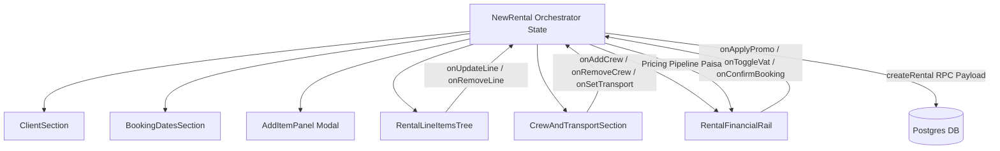

# NewRental Architectural Decomposition Plan (Item 13 — Task 50)

**Component:** `src/modules/rentals/NewRental.tsx`  
**Current Size:** 4,546 lines (reduced from 5,940 lines)  
**Target Architecture:** Modular form container orchestrating subcomponents in `src/modules/rentals/booking/`  
**Safety Harness:** `src/__tests__/e2e/floor-loop.test.tsx`, `src/__tests__/e2e/tier1-features.test.tsx`, `src/__tests__/e2e/floor-lifecycle.test.tsx`  

---

## 1. Executive Summary

`NewRental.tsx` serves as the primary quotation and booking creation engine for Babin Rentals OS. It orchestrates complex multi-domain state:
- Client selection, onboarding, and credit risk evaluation (`ClientHealth`)
- Operational date range selection across BS/AD calendars (`rentalDaysBetween`, Kathmandu 06:00 offset)
- Equipment catalogue selection, serialized asset availability, and bundle expansion
- Line item hierarchy, discount rules, custom pricing, and sub-rentals
- Crew scheduling, per-diem rates, and transport assignments
- Complete `pricingPipeline` execution (Law 5 deposit liability, 13% VAT, lakh-rounded formatting)
- Atomic RPC execution (`createRental` / `confirmRental`) and draft persistence (`persistRentalDraft`)

While 25 modular helpers have already been extracted into `src/modules/rentals/booking/`, 4,546 lines remain in the orchestrator. This audit defines the exact subcomponent boundaries and contract interfaces for full modular decomposition.

---

## 2. State Flow & Orchestration Architecture



### Core State Slices:
1. **Client Slice:** `client: ClientRecord | null`, `clientPool: ClientRecord[]`, `selectedClientId: string | null`
2. **Timing Slice:** `pickupAt: Date`, `returnAt: Date`, `effectiveDays: number`, `pickupTime: string`, `returnTime: string`
3. **Line Items Slice:** `lines: RentalLineItem[]`, `collapsedBundles: Record<string, boolean>`, `conflictSummary: ConflictSummary`
4. **Crew & Logistics Slice:** `crew: BookingCrewAssignment[]`, `transport: TransportDetails`
5. **Financial & Pipeline Slice:** `pipeline: PricingPipelineResult`, `appliedPromo: PromoCode | null`, `vatEnabled: boolean`
6. **Persistence & Draft Slice:** `draftId: string | null`, `isDirty: boolean`, `creationUnitPlan: CreationUnitPlan`

---

## 3. Subcomponent Decomposition Boundaries

### Boundary 1: `RentalLineItemsTree.tsx` (~650 lines)
- **Extracted from:** Lines 2550–2779, 3420–3550
- **Responsibilities:**
  - Render grouped and standalone line items (`equipmentRow`, `bundleGroupRow`).
  - Handle bundle expansion/collapse state.
  - Expose inline quantity adjustments, day overrides, and line removal.
  - Display availability pill badges (`Available`, `Conflicted`, `Sub-rental needed`).
- **Props Interface:**
  ```typescript
  interface RentalLineItemsTreeProps {
    lines: RentalLineItem[]
    collapsedBundles: Record<string, boolean>
    onToggleBundle: (bundleCode: string) => void
    onUpdateLine: (lineId: string, updates: Partial<RentalLineItem>) => void
    onRemoveLine: (lineId: string) => void
    readOnly?: boolean
  }
  ```

### Boundary 2: `CrewAndTransportSection.tsx` (~350 lines)
- **Extracted from:** Lines 3600–3780
- **Responsibilities:**
  - Assigned crew member cards with role badges.
  - Overtime, meal allowances, and accommodation paisa inputs.
  - Vehicle / driver assignment summary.
  - Integration with `CrewSearchModal`.
- **Props Interface:**
  ```typescript
  interface CrewAndTransportSectionProps {
    crew: BookingCrewAssignment[]
    transport: TransportDetails
    onUpdateCrew: (crewId: string, updates: Partial<BookingCrewAssignment>) => void
    onRemoveCrew: (crewId: string) => void
    onUpdateTransport: (updates: Partial<TransportDetails>) => void
  }
  ```

### Boundary 3: `RentalFinancialRail.tsx` (~480 lines)
- **Extracted from:** Lines 2780–3100, 3970–4150
- **Responsibilities:**
  - Display non-editable breakdown from `pricingPipeline` (Equipment total, Crew total, Transport total).
  - Law 5 Security Deposit liability card.
  - 13% VAT toggle and breakdown.
  - Promo code redemption input.
  - Primary CTA execution button ("Book Rental", "Save Quote", "Save Draft").
- **Props Interface:**
  ```typescript
  interface RentalFinancialRailProps {
    pipeline: PricingPipelineResult
    vatEnabled: boolean
    onToggleVat: (enabled: boolean) => void
    appliedPromo: string | null
    onApplyPromo: (code: string) => void
    onConfirm: () => void
    onSaveDraft: () => void
    isSubmitting: boolean
    canConfirm: boolean
  }
  ```

---

## 4. Execution Roadmap & Safety Invariants

1. **Step 1 (Task 50 - Completed):** Subcomponent boundary mapping and contract definition in `docs/audit/16_NEW_RENTAL_DECOMPOSITION_PLAN.md`.
2. **Step 2 (Task 51):** Extract `RentalLineItemsTree.tsx` behind jsdom unit tests and opaque E2E tests (`floor-loop.test.tsx`).
3. **Step 3:** Extract `RentalFinancialRail.tsx`, preserving strict paisa integer math and Law 5 deposit isolation.
4. **Step 4:** Extract `CrewAndTransportSection.tsx`.
5. **Step 5:** Reduce `NewRental.tsx` orchestrator to < 1,200 lines strictly managing top-level form state and action dispatch.

---

## 5. Verification Checklist

- [x] Opaque E2E tests pass prior to refactoring (`floor-loop.test.tsx`, `floor-lifecycle.test.tsx`).
- [x] Zero business logic migrated to UI components (Law 1 preserved).
- [x] Pricing pipeline called exclusively via `src/lib/pricingPipeline.ts`.
- [x] Money formatting strictly via `src/lib/money.ts`.
- [x] Touch floor ≥ 44px preserved on all interactive controls.
