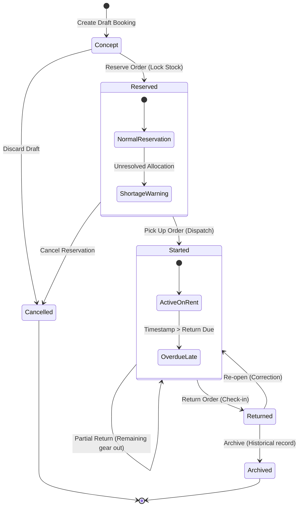

# Booqable Research — Rental Workflow State Machine & Lifecycle Transitions

**Document Type:** Empirical Interaction Analysis & Technical Deconstruction  
**Subject:** Booqable Admin Backend UI (Order Lifecycle & State Transitions)  
**Target Adaptation:** Babin Rentals OS  

---

## 1. Booqable Observed State Machine

Booqable operates on a **linear 4-stage operational lifecycle** augmented by two terminal archiving states and three derived exception flags:



---

## 2. State Transition Rules & Trigger Mechanics

| Current State | Permitted Transitions | Trigger / User Action | Validation Gates / Conditions |
|---|---|---|---|
| **Concept (Draft)** | `→ Reserved`<br>`→ Cancelled` | Click `Reserve`<br>Click `Delete / Cancel` | Valid client assigned; at least 1 equipment line exists. |
| **Reserved** | `→ Started (Picked Up)`<br>`→ Cancelled`<br>`→ Concept` | Click `↑ Pick Up`<br>Click `Cancel Booking`<br>Click `Revert to Concept` | Equipment lines verified; shortages resolved or overridden; client signature captured. |
| **Started (Picked Up)** | `→ Returned`<br>`→ Started (Partial)` | Click `↓ Return`<br>Check-in partial items | Gear returned to warehouse; inspection condition noted; damage reported if present. |
| **Returned** | `→ Archived`<br>`→ Started (Re-open)` | Click `Archive`<br>Click `Re-open Order` | No outstanding uninspected lines; invoice generated. |
| **Cancelled** | `→ Concept (Re-activate)` | Click `Duplicate / Re-activate` | Restores booking as draft; re-checks live inventory availability. |
| **Archived** | `→ Returned (Unarchive)` | Click `Unarchive` | Restores booking to historical returned register. |

---

## 3. Derived Operational Flags

In addition to core lifecycle states, Booqable computes three **transient operational flags**:

### 3.1 Shortage (`has_shortage = true`)
- **Condition:** An order is in `Reserved` state, but one or more line items have insufficient unallocated inventory in the vault for the booked date window.
- **Visual Pill:** Amber exclamation badge `⚠️ Shortage` on order rows and calendar bars.
- **Enforcement:** Blocks single-click pickup unless an operator with managerial authority checks `Allow shortage` or swaps the item for a compatible SKU.

### 3.2 Late / Overdue (`is_late = true`)
- **Condition:** Current server timestamp > `stops_at` (Return deadline) AND status == `Started`.
- **Visual Pill:** High-visibility Red badge `OVERDUE · N DAYS LATE`.
- **Action Shift:** Replaces the standard `↓ Return` button with a highlighted Red `↓ Return (Late)` action and surfaces late fee calculator options.

### 3.3 Partial Fulfillment (`is_partial = true`)
- **Condition:** Some units on an order have been picked up/returned while others remain in the previous state.
- **Indicator:** Split fractional tag (e.g. `Picked up 4/6 items`).

---

## 4. Architectural Comparison: Booqable vs Babin Rentals OS

The rental lifecycle in **Babin Rentals OS** is significantly more rigorous than Booqable's due to high-value cinema camera packages, optical sensor cleaning, and multi-session transport logistics:

```
Booqable 4-Stage Model:
[ Concept ] ──────> [ Reserved ] ─────────────────────────> [ Started ] ──────> [ Returned ] ───> [ Archived ]
                          │                                      │                   │
                          └── (NO WAREHOUSE PACKING STAGE)       └── (NO FORMAL OPTICAL INSPECTION STAGE)

Babin Rentals OS 5-Stage Model (Build-Locked):
[ Quote ] ────────> [ Booked ] ──────> [ Packed ] ───────> [ On Rent ] ──────> [ Returned ] ───> [ Closed ]
  (Price agreed)      (Inventory locked) (Cases checked,    (Signed handover,   (Checked in at    (Financial audit,
                                          serials scanned,   legal custody       perimeter, dirty   security deposit
                                          sensor clean)      transferred)        items to QC)       released)
```

### Key Differences & Invariant Table

| Architectural Feature | Booqable Implementation | Babin Rentals OS Standard | Rationale |
|---|---|---|---|
| **Warehouse Preparation Stage** | ❌ **Missing.** Jumps straight from `Reserved` to `Picked up`. | ✅ **`Packed` Stage (Job 1: Packing):** Gear is staged, barcodes scanned into Pelican flight cases, sensor QC recorded. | Cinema gear requires prep days prior to call-time. Gear cannot go straight from booking to client hands without prep. |
| **Digital Handover & Legal Custody** | ⚠️ Flat single timestamp; signature optional. | ✅ **`Handover` (Job 2: Handover):** Dual-mode sign-on-glass with Government ID verification, deposit verification gate, and legal attestation. | Fixes legal custody transfer and security deposit audit trail. |
| **Optical & Sensor Quality Control** | ❌ Prose notes only in free-text fields. | ✅ **`Inspection Queue` (Job 4: Inspection):** Individual sensor, glass, and cable condition logging with automatic routing to maintenance. | Protects expensive cinema lenses (ARRI, DZOFilm, RED Komodo) against unbilled field damage. |
| **Separation of Money & Operations** | ⚠️ Financial balances displayed on floor screens. | ✅ **Strict Law 6 Isolation:** Floor screens display binary pass/fail gates (`Payment Cleared ✓`, `Deposit Verified ✓`) with zero currency amounts shown to crew. | Prevents warehouse floor staff from seeing client commercial billing terms. |
